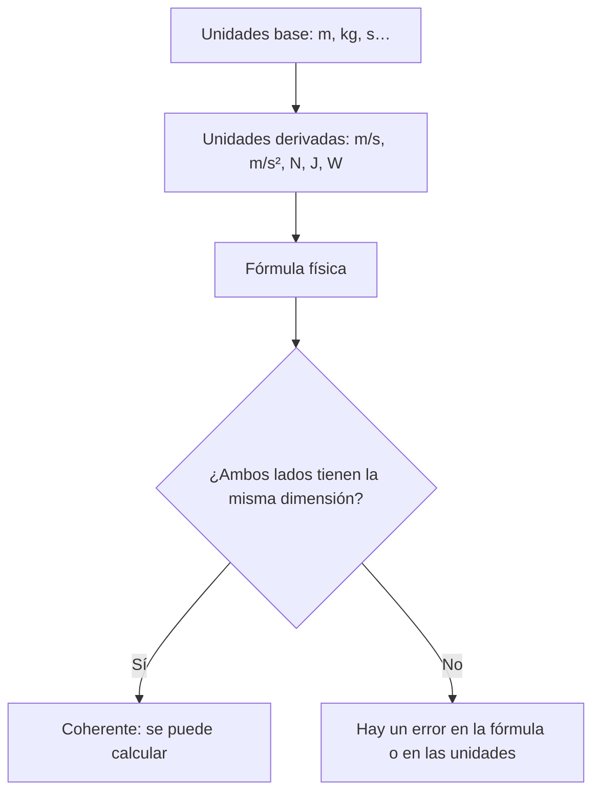

# B03-C06 — Unidades del Sistema Internacional

<!-- nav:top -->
[🏠 Programa](../../../../README.md) · [📚 Bloque B03](../../../tronco-comun/B03-matematica-elemental-para-ciencias-espaciales.md) · [← Anterior: B03-C05 — Notación científica y órdenes de magnitud](../B03-C05-notacion-cientifica-y-ordenes-de-magnitud/CLASE.md) · [Siguiente: B03-C07 — Conversión de distancia y velocidad →](../B03-C07-conversion-de-distancia-y-velocidad/CLASE.md)
<!-- /nav -->

## 1. Ubicación, nivel y alcance

Sexta clase del bloque B03 y apertura de su tramo de unidades. Hasta ahora has trabajado con números; desde aquí todo número astronómico lleva una **unidad**, y la unidad es la mitad del dato. Esta clase presenta el Sistema Internacional de Unidades (SI), su lógica y la forma correcta de escribirlo, y enseña a usar las unidades como una herramienta de control (análisis dimensional). Nivel N0 → N1.

Verás las unidades base y derivadas, los prefijos, las reglas de escritura y cómo comprobar una fórmula mirando solo sus unidades. No verás todavía conversiones detalladas (C07, C08) ni incertidumbre formal (C19).

## 2. Por qué esta clase existe

El 23 de septiembre de 1999 la NASA perdió contacto con la sonda Mars Climate Orbiter. Según la agencia, un error de navegación se debió a no traducir unidades inglesas a métricas: el programa en tierra usaba unas y el de la nave otras, y la sonda pasó demasiado cerca de Marte y se quemó en su atmósfera (S1). Las leyes de la física funcionaron; los números iban sin acuerdo sobre qué significaban.

La decisión central es: **¿en qué sistema de unidades expreso cada magnitud, cómo lo escribo y cómo compruebo que una fórmula es coherente?** Aprenderás las siete unidades base, cómo se forman las derivadas, cómo se usan los prefijos y cómo el análisis dimensional detecta errores antes de calcular.

## 3. Lo que podrás hacer al terminar

1. Nombrar las siete unidades base del SI y las magnitudes que miden.
2. Construir unidades derivadas (m/s, m/s², N, J, W, Pa) a partir de las base.
3. Usar prefijos del SI (de nano a giga) y escribir un valor con su unidad según las reglas del SI.
4. Hacer el análisis dimensional de una fórmula y detectar una inconsistencia.
5. Verificar con unidades una fórmula astronómica y contrastarla con un dato publicado.
6. Explicar qué falla cuando dos grupos usan convenciones distintas.

La evidencia es la **ficha de análisis dimensional** del ejercicio 12 (sección 20).

## 4. Con qué llegas y cómo comprobarlo

Necesitas C01 a C05. Cinco preguntas:

1. ¿Qué es mayor, 1 km o 1 m? ¿Cuántas veces?
2. ¿Cuántos segundos hay en 1 hora?
3. Si un coche recorre 120 km en 2 h, ¿cuál es su rapidez y con qué unidad?
4. ¿Cuánto es `10⁶ × 10⁻³`?
5. ¿Por qué `5 km + 3 s` no tiene sentido?

<details>
<summary>Ver respuestas</summary>

1. 1 km, mil veces. 2. 3 600 s. 3. 60 km/h. 4. `10³`. 5. Porque no se suman magnitudes de distinta clase (longitud y tiempo): es la idea central de esta clase.
</details>

Con cuatro o cinco aciertos, sigue; con menos, repasa C05.

## 5. Un caso real: la sonda que perdió el rumbo por un acuerdo de unidades

La NASA resume el caso de Mars Climate Orbiter así: la sonda se perdió en 1999, unos nueve meses después de su lanzamiento (11 de diciembre de 1998 según la misma página); la causa fue un error de navegación por no traducir unidades inglesas a métricas, con un programa en tierra en unidades inglesas y otro a bordo en métricas (S1). No hace falta conocer la ingeniería de la misión para entender la lección: **un número sin su unidad acordada es una cifra, no un dato**. Límite: la página de la NASA es una síntesis divulgativa; no se leyó el informe de la comisión de investigación y esta clase no reconstruye el error técnico.

## 6. Vocabulario

Una **magnitud** es una propiedad medible (longitud, masa, tiempo). Una **unidad** es una cantidad de referencia de esa magnitud (metro, kilogramo, segundo). El **SI** (Sistema Internacional de Unidades) es el sistema acordado internacionalmente; sus siete **unidades base** son el segundo (s), el metro (m), el kilogramo (kg), el amperio (A), el kelvin (K), el mol (mol) y la candela (cd), definidas a partir de siete **constantes definitorias** de valor exacto (S2). Una **unidad derivada** combina unidades base: m/s, m/s², N = kg·m/s², J = N·m, W = J/s. Una unidad es **coherente** si su factor numérico de equivalencia con las base es 1. Un **prefijo** (kilo, mega, nano…) multiplica la unidad por una potencia de diez. La **dimensión** de una magnitud indica de qué unidades base depende y con qué exponentes. El **análisis dimensional** es comprobar que ambos lados de una fórmula tienen la misma dimensión.

## 7. Modelo mental: las unidades como un álgebra paralela

Las unidades se multiplican, dividen y elevan igual que los números, pero no se suman si son distintas.



*Descripción textual:* las unidades base generan las derivadas; estas aparecen en una fórmula; una pregunta decide si ambos lados tienen la misma dimensión: si sí, la fórmula es coherente; si no, hay un error.

Analogía: una oración debe concordar. «Tres lunas verde» suena mal por falta de concordancia; «5 km + 3 s» suena mal por la misma razón. El límite: que una fórmula sea dimensionalmente correcta no la hace física correcta (le puede faltar un factor numérico como `2` o `π`).

## 8. La explicación, paso a paso

### 8.1 Unidades base y por qué ahora son más estables

El SI se define fijando exactamente el valor de siete constantes: la frecuencia del cesio 133, `ΔνCs = 9 192 631 770 Hz`; la velocidad de la luz, `c = 299 792 458 m/s`; la constante de Planck, `h = 6,626 070 15 × 10⁻³⁴ J s`; la de Boltzmann, `k = 1,380 649 × 10⁻²³ J/K`; la de Avogadro, `N_A = 6,022 140 76 × 10²³ mol⁻¹`, junto con la carga elemental y la eficacia luminosa (S2). De ahí se obtienen las unidades: el segundo cuenta períodos de la radiación del cesio y el metro se deriva de `c` y del segundo. Importa porque ya no existe un objeto físico patrón que pueda deteriorarse: cualquier laboratorio puede reproducir la unidad.

### 8.2 Unidades derivadas

Rapidez: m/s. Aceleración: m/s². Fuerza (newton): `kg·m/s²`. Energía (julio): `N·m = kg·m²/s²`. Potencia (vatio): `J/s = kg·m²/s³`. Presión (pascal): `N/m²`. Para saber si una unidad es coherente basta con reconstruirla desde las base. Un caso clave en astronomía: la constante de gravitación `G` tiene unidades `m³ kg⁻¹ s⁻²`, y el producto `GM` (con `M` en kg) se mide en `m³ s⁻²`.

### 8.3 Prefijos

Un prefijo multiplica la unidad: kilo `10³`, mega `10⁶`, giga `10⁹`; mili `10⁻³`, micro `10⁻⁶`, nano `10⁻⁹`. La tabla del SI llega hoy hasta ronna `10²⁷`, quetta `10³⁰`, ronto `10⁻²⁷` y quecto `10⁻³⁰` (S2). Regla importante: **el prefijo y el símbolo de la unidad forman un símbolo inseparable**; `2,3 cm³ = 2,3 (10⁻² m)³ = 2,3 × 10⁻⁶ m³` (S2): el exponente afecta al prefijo también. Cuidado con `mm` (milímetro) y `Mm` (megámetro): difieren en nueve órdenes de magnitud.

### 8.4 Cómo se escribe una magnitud

El SI establece que el valor de una magnitud se escribe con el número primero y **un espacio** antes de la unidad: `m = 12,3 g`, `t = 30,2 °C` (S2). El espacio equivale a un signo de multiplicación. La única excepción son el grado, el minuto y el segundo de arco, que van pegados al número. Además, la unidad no se «califica» (se escribe `U_max = 1000 V`, no `U = 1000 V_max`).

### 8.5 Análisis dimensional

Para comprobar `g = GM/R²` (aceleración de gravedad en la superficie): las unidades de `GM` son `m³ s⁻²`, las de `R²` son `m²`; el cociente es `m s⁻²`, que es una aceleración. ✓. Para `v = √(2GM/R)`: `m³ s⁻² / m = m² s⁻²`; la raíz da `m s⁻¹`, una rapidez. ✓. Para `E = mc` (error deliberado): `kg · m/s` es un momento lineal, no una energía (`kg m² s⁻²`); la fórmula correcta es `E = mc²`. El análisis dimensional **no** detecta factores numéricos, pero sí un exponente o una magnitud equivocados.

## 9. Magnitudes, símbolos y unidades

| Símbolo | Qué es | Unidad SI | Valor o nota |
|---|---|---|---|
| `l`, `d`, `R` | longitud | m | 1 au = 149 597 870 700 m (S2) |
| `m`, `M` | masa | kg | — |
| `t` | tiempo | s | 1 d = 86 400 s (S2) |
| `v` | rapidez | m s⁻¹ | `c = 299 792 458 m/s` (S2) |
| `a`, `g` | aceleración | m s⁻² | g medio terrestre 9,820 (S3) |
| `F` | fuerza | N = kg m s⁻² | — |
| `E` | energía | J = kg m² s⁻² | — |
| `P` | potencia | W = kg m² s⁻³ | — |
| `G` | constante gravitacional | m³ kg⁻¹ s⁻² | 6,674 30 × 10⁻¹¹ (CODATA 2022, S4) |
| `GM` | parámetro gravitacional | m³ s⁻² | Tierra nominal 3,986 004 × 10¹⁴ (S5) |
| `ρ` | densidad | kg m⁻³ | Sol medio 1408 (S3) |

## 10. Convenciones y referencias

Se usa la coma decimal en el texto y el punto en el código. En este programa los símbolos de unidades se escriben sin plural: `5 km`, no `5 kms` (convención de la clase). Se evita mezclar sistemas dentro de un mismo cálculo. Las unidades no SI que el SI acepta (minuto, hora, día, grado, unidad astronómica, hectárea, litro, tonelada, milla náutica) se declaran siempre con su equivalencia (S2). Un litro `1 L = 1 dm³ = 10⁻³ m³`; una milla náutica `= 1 852 m` (S2).

## 11. De dónde sale lo que afirmamos

| ID | Fuente | Localizador | Respalda | Estado |
|---|---|---|---|---|
| S1 | NASA Science, «Mars Climate Orbiter» | https://science.nasa.gov/mars-climate-orbiter/ | Pérdida el 23-sep-1999, lanzada el 11-dic-1998; error de navegación por no traducir unidades inglesas a métricas; programa en tierra en unidades inglesas y a bordo en métricas | Página consultada el 2026-11-05 |
| S2 | BIPM, *The International System of Units (SI)*, 9.ª ed. (2019), portada V4.01; tabla 1, apartado de prefijos, tabla 8, apdo. 5.4.3 | https://doi.org/10.59161/AUEZ1291 | Siete constantes definitorias y sus valores; segundo y metro; prefijos hasta quetta/quecto; prefijo inseparable; espacio entre número y unidad; litro, au, milla náutica | PDF leído el 2026-11-05 |
| S3 | NASA NSSDC, *Earth Fact Sheet* (15-nov-2024) y *Sun Fact Sheet* (9-may-2024) | https://nssdc.gsfc.nasa.gov/planetary/factsheet/earthfact.html y .../sunfact.html | Tierra: gravedad media 9,820 m/s², velocidad de escape 11,186 km/s, radio medio volumétrico 6 371 km. Sol: masa 1 988 400 × 10²⁴ kg, volumen 1 412 000 × 10¹² km³, densidad 1408 kg/m³ | Páginas consultadas el 2026-11-05 |
| S4 | NIST, CODATA, constante de gravitación newtoniana | https://physics.nist.gov/cgi-bin/cuu/Value?bg | G = 6,674 30 × 10⁻¹¹ m³ kg⁻¹ s⁻², u relativa 2,2 × 10⁻⁵ (CODATA 2022) | Página consultada el 2026-11-05 |
| S5 | IAU 2015, Resolución B3 (Mamajek et al., arXiv:1510.07674) | https://arxiv.org/abs/1510.07674 | (GM)ᴺ de la Tierra = 3,986 004 × 10¹⁴ m³ s⁻²; radio ecuatorial nominal 6,3781 × 10⁶ m | PDF leído el 2026-11-05 |

Límites: S1 es divulgativa. El SI se lee en su 9.ª edición; la portada del PDF consultado indica una versión V4.01. No se contrastaron los valores de G con los informes originales de CODATA.

## 12. Cómo ver las unidades

Versión accesible de un árbol de unidades.

| Magnitud | Símbolo | Unidad SI | Expresión en base |
|---|---|---|---|
| Rapidez | `v` | m/s | m s⁻¹ |
| Aceleración | `a` | m/s² | m s⁻² |
| Fuerza | `F` | N | kg m s⁻² |
| Energía | `E` | J | kg m² s⁻² |
| Potencia | `P` | W | kg m² s⁻³ |
| Irradiancia | `S` | W/m² | kg s⁻³ |
| Densidad | `ρ` | kg/m³ | kg m⁻³ |

Si dibujas el árbol, usa un cuadro por unidad base y flechas con los exponentes escritos, no solo colores. Descripción larga: de las tres unidades base m, kg, s salen todas las de la tabla multiplicando y dividiendo con exponentes enteros.

## 13. Ejemplo trabajado: comprobar con unidades la rapidez circular de la Luna

Fórmula: `v = √(GM/a)`, con `GM` de la Tierra y `a` el semieje lunar. Datos: `GM = 3,986004 × 10¹⁴ m³ s⁻²` (S5) y `a = 3,844 × 10⁸ m` (NASA, C05).

**Paso 1 · dimensión.** `GM/a = m³ s⁻² / m = m² s⁻²`; la raíz da `m s⁻¹`. Es una rapidez: la fórmula pasa el control.
**Paso 2 · estimación.** `4 × 10¹⁴ / 4 × 10⁸ = 10⁶`, raíz `10³ m/s`: unos 1 000 m/s.
**Paso 3 · cálculo.** `3,986004 × 10¹⁴ / 3,844 × 10⁸ = 1,0369 × 10⁶ m² s⁻²`; `√ = 1 018,3 m/s = 1,018 km/s`.
**Paso 4 · comparación.** NASA publica 1,022 km/s como velocidad orbital media de la Luna (C01): diferencia relativa de 0,36 %.
**Sentido físico.** Con la masa de la Tierra y la distancia, y sin ningún dato del movimiento de la Luna, has predicho su rapidez con una exactitud de menos de medio por ciento. Límite: supone órbita circular, que la Luna no tiene exactamente.

## 14. Dos formas de verificar una fórmula y cuándo fallan

**Análisis dimensional** es rápido y no requiere datos; falla con factores numéricos (`½`, `2π`) y con funciones (`sen`, `ln`) de argumentos con unidades. **Contraste con un dato publicado** detecta factores y errores de modelo, pero necesita un dato fiable y puede coincidir por casualidad. Lo robusto es usar ambos: primero la dimensión, después el número.

## 15. Práctica guiada

**Ejercicio 1 · con los pasos indicados.** Expresa `5 km/s` en m/s. *Pasos:* `1 km = 10³ m` (S2).

<details><summary>Solución comentada</summary>

`5 × 10³ m/s = 5 000 m/s`. El prefijo kilo multiplica por mil.
</details>

**Ejercicio 2 · con una pista.** Comprueba la dimensión de `g = GM/R²`. *Pista:* `GM` tiene `m³ s⁻²`.

<details><summary>Solución comentada</summary>

`m³ s⁻² / m² = m s⁻²`, una aceleración. ✓ (sección 8.5).
</details>

**Ejercicio 3 · casi autónomo.** ¿Cuántos metros son `1 nm`? ¿Y cuántos nanómetros son `656,3 nm` en metros?

<details><summary>Solución comentada</summary>

`1 nm = 10⁻⁹ m`; `656,3 nm = 6,563 × 10⁻⁷ m`.
</details>

## 16. Práctica autónoma, transferencia e integrador

**Ejercicio 4.** Distingue `1 mm`, `1 Mm` y `1 m`. ¿Cuántas veces es mayor `1 Mm` que `1 mm`?

<details><summary>Solución comentada</summary>

`10⁻³ m`, `10⁶ m` y `1 m`. `10⁶/10⁻³ = 10⁹`: mil millones de veces.
</details>

**Ejercicio 5.** Comprueba con unidades que `v = √(2GM/R)` es una rapidez.

<details><summary>Solución comentada</summary>

`2GM/R = m³ s⁻² / m = m² s⁻²`; raíz: `m s⁻¹`. ✓ El `2` no tiene dimensión.
</details>

**Ejercicio 6.** ¿Es dimensionalmente correcta `E = mc`? Justifica y corrige.

<details><summary>Solución comentada</summary>

No: `kg · m s⁻¹` no es energía (`kg m² s⁻²`). La corrección `E = mc²` da `kg m² s⁻²`. El análisis dimensional detecta el exponente que falta.
</details>

**Ejercicio 7.** La densidad media del Sol, de su masa y volumen (S3): `1,9884 × 10³⁰ kg ÷ 1,412 × 10²⁷ m³`. Calcula y compara con 1408 kg/m³.

<details><summary>Solución comentada</summary>

El volumen en m³: `1,412 × 10¹⁸ km³ × (10³ m/km)³ = 1,412 × 10²⁷ m³`. Densidad `1,408 × 10³ kg/m³`. Coincide con S3. El paso delicado es el cubo del prefijo.
</details>

**Ejercicio 8.** Corrige la escritura: `12.3g`, `30.2° C`, `5 kms`, `1000 Vmax`.

<details><summary>Solución comentada</summary>

`12,3 g` (espacio), `30,2 °C` (espacio, grado Celsius pegado), `5 km` (sin plural, convención de la clase), `U_max = 1000 V` (la calificación va en el símbolo de la magnitud) (S2, 5.4.3).
</details>

**Ejercicio 9 · transferencia.** Un equipo entrega una distancia como `100` creyendo que son millas náuticas y otro la lee como kilómetros. ¿Cuál es el factor de error y qué regla de registro lo habría evitado? (1 milla náutica = 1 852 m, S2.)

<details><summary>Solución comentada</summary>

`100 mn = 185,2 km`, no `100 km`: el error es un factor `1,852` (85 %). Regla: todo número se registra con su unidad escrita, y las interfaces entre programas incluyen pruebas con valores conocidos. Es una versión simplificada de la lección de S1; no reconstruye el caso real.
</details>

**Ejercicio 10 · transferencia.** La irradiancia `S` se mide en W/m². Escríbela en unidades base y comprueba que `P = S × A` (con `A` en m²) da vatios.

<details><summary>Solución comentada</summary>

`W/m² = kg m² s⁻³ / m² = kg s⁻³`. `S × A = kg s⁻³ · m² = kg m² s⁻³ = W`. ✓
</details>

**Ejercicio 11 · transferencia.** ¿Cuántos litros hay en 1 m³? (S2: `1 L = 10⁻³ m³`.)

<details><summary>Solución comentada</summary>

`1 m³ / 10⁻³ m³ = 1 000 L`. Un tanque de 5 m³ contiene 5 000 L.
</details>

**Ejercicio 12 · integrador.** Elabora tu *ficha de análisis dimensional* (sección 20) para una fórmula a elección con datos citados: dimensión de cada lado, estimación, cálculo, comparación con un dato publicado y comentario de límites.

<details><summary>Solución modelo</summary>

La del ejemplo de la sección 13 con otro cuerpo, p. ej. `g = GM/R²` con `GM = 3,986004 × 10¹⁴ m³ s⁻²` y `R = 6,371 × 10⁶ m`: `g = 9,820 m/s²`, igual a S3. Se acepta cualquier fórmula que pase el control dimensional y tenga fuente.
</details>

## 17. Laboratorio: un verificador de dimensiones

El script [laboratorio_dimensiones.py](laboratorio_dimensiones.py) representa cada unidad como un trío de exponentes de (m, kg, s) y comprueba, antes de calcular, que `GM` tiene `m³ s⁻²`, que `GM/R²` es una aceleración y que `GM/R` es el cuadrado de una rapidez. Después calcula `g`, la velocidad de escape y la densidad solar, y las contrasta con S3 (tolerancias 0,1 %, 0,05 % y 0,2 %).

**Datos:** publicados (NASA, IAU). **Predice antes de ejecutar:** ¿`g` saldrá cerca de 9,8? (Sí.) **Resultados (2026-11-05, Python 3.12.9):** dimensión de `G` = m³ kg⁻¹ s⁻²; `GM` = m³ s⁻²; `g = 9,820 m/s²` (NASA 9,820); `v_escape = 11,186 km/s` (NASA 11,186); densidad media del Sol `1408 kg/m³` (NASA 1408).

```bash
python programa/clases/B03/B03-C06-unidades-del-sistema-internacional/laboratorio_dimensiones.py
```

**Límites:** solo m, kg, s; sin ángulos ni temperatura; verifica coherencia, no sustituye el cálculo.

## 18. Errores frecuentes y cómo corregirlos

**Sumar magnitudes de distinta clase.** Ejercicio 6.
**Confundir `mm` y `Mm`.** Ejercicio 4.
**Olvidar elevar el prefijo al cubo.** Ejercicio 7.
**Escribir sin espacio o con plural.** Ejercicio 8.
**Creer que una fórmula dimensionalmente correcta ya es correcta.** Sección 14.

## 19. Cómo sabrás que vas bien

Tras 8.2: ¿reconstruyes las unidades base del julio? (`kg m² s⁻²`). Si no, repite el ejercicio 10. Tras 8.3: ¿distingues `nm`, `µm` y `mm`? Si no, rehaz el 3. Tras 8.5: ¿detectas el error de `E = mc`? Si no, revisa el 6. Al final: ¿sabes decir qué no detecta el análisis dimensional? Si dudas, relee la sección 14.

## 20. Qué entregas y cómo se evalúa

El producto es tu **ficha de análisis dimensional**: una fórmula astronómica con dimensión de cada lado, estimación previa, cálculo con unidades, comparación con un dato citado y límites.

| Criterio | Inicial | En desarrollo | Logrado | Destacado |
|---|---|---|---|---|
| Dimensión de la fórmula | No la comprueba | Parcial | Correcta | Detecta una fórmula errónea |
| Prefijos y potencias | Errores | Algunos aciertos | Correctos | Verifica por otra vía |
| Escritura SI | Incorrecta | Parcial | Correcta | Corrige un texto ajeno |
| Contraste con dato | Sin fuente | Fuente parcial | Fuente citada | Explica la diferencia |
| Límites | Ausentes | Genéricos | Específicos | Propone una mejora |

**Condiciones críticas:** no mezclar sistemas de unidades; no omitir unidades; citar solo fuentes consultadas.

## 21. Ética, seguridad y límites

Declarar unidades es honestidad científica y, en las misiones reales, seguridad. Esta clase es educativa y no sirve para operar naves ni para navegación. Accesibilidad: unidades y exponentes en texto, tablas equivalentes, sin conexión.

## 22. Para cerrar y seguir

El SI fija siete constantes y de ellas salen las unidades; las derivadas se forman multiplicando y dividiendo; los prefijos son potencias de diez inseparables de su unidad; y el análisis dimensional permite detectar errores antes de calcular. Queda una pregunta: ¿cómo pasar de una unidad a otra sin equivocarse? Es C07.

**Glosario español–inglés.** magnitud · *quantity*; unidad base · *base unit*; unidad derivada · *derived unit*; prefijo · *prefix*; análisis dimensional · *dimensional analysis*; unidad coherente · *coherent unit*; dimensión · *dimension*.

**Continuidad.** B03-C07 y B03-C08 usan estos factores para convertir distancias, velocidades y tiempos. B03-C14 reutiliza el análisis dimensional para comprobar despejes. B03-C12 retoma `G` y `GM`.

**Referencias:** ver sección 11. S1 es divulgativa; las demás son datos oficiales consultados.

<!-- nav:bottom -->
---

[← Anterior: B03-C05 — Notación científica y órdenes de magnitud](../B03-C05-notacion-cientifica-y-ordenes-de-magnitud/CLASE.md) · [📚 Bloque B03](../../../tronco-comun/B03-matematica-elemental-para-ciencias-espaciales.md) · [Siguiente: B03-C07 — Conversión de distancia y velocidad →](../B03-C07-conversion-de-distancia-y-velocidad/CLASE.md)
<!-- /nav -->
