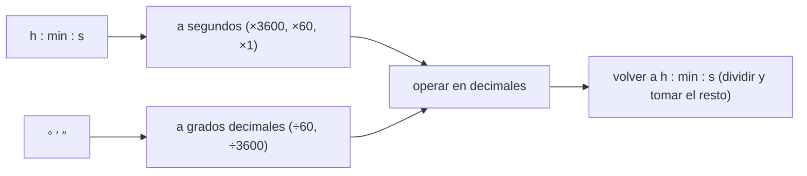

# B03-C08 — Tiempo y conversiones astronómicas

<!-- nav:top -->
[🏠 Programa](../../../../README.md) · [📚 Bloque B03](../../../tronco-comun/B03-matematica-elemental-para-ciencias-espaciales.md) · [← Anterior: B03-C07 — Conversión de distancia y velocidad](../B03-C07-conversion-de-distancia-y-velocidad/CLASE.md) · [Siguiente: B03-C09 — Operaciones con números negativos →](../B03-C09-operaciones-con-numeros-negativos/CLASE.md)
<!-- /nav -->

## 1. Ubicación, nivel y alcance

Octava clase del bloque B03 y cierre del tramo de unidades. En C07 convertiste distancias y velocidades; el tiempo y los ángulos añaden dos dificultades: las unidades no son decimales (60 minutos en una hora, 360 grados en una vuelta) y hay unidades históricas que conviven con el SI. Nivel N0 → N1.

Verás cómo pasar entre segundos, horas, días y años; cómo operar con horas–minutos–segundos; cómo se relacionan grados, minutos y segundos de arco, y por qué una hora de ascensión recta equivale a 15 grados. No verás las escalas de tiempo (UTC, TT, TDB), que son materia de B13.

## 2. Por qué esta clase existe

El período de Neptuno en las fichas de la NASA es 60 189,018 días. Nadie piensa en 60 mil días; se piensa en años. Y el tamaño aparente del Sol en el cielo se da en grados y minutos de arco, no en radianes. Quien trabaja con observaciones debe pasar entre todas esas formas sin error, porque un cuarto de hora se confunde con una cuarta parte de un grado en cuanto se mezclan las bases.

La decisión central es: **¿cuál es la equivalencia exacta entre estas unidades de tiempo o de ángulo y cómo la aplico respetando la base 60 y la base 24?** Aprenderás las equivalencias del SI, la regla de los 15 grados por hora y cómo documentar la convención usada para el año.

## 3. Lo que podrás hacer al terminar

1. Convertir entre segundos, minutos, horas y días con las equivalencias del SI.
2. Pasar un tiempo en h–min–s a segundos y a horas decimales, y viceversa.
3. Convertir un período de días a años declarando qué año se usa.
4. Convertir entre grados, minutos y segundos de arco y radianes.
5. Relacionar horas de ascensión recta con grados (15° por hora).
6. Usar estas conversiones para interpretar la rotación terrestre y el tiempo de luz.

La evidencia es la **tabla de tiempos y ángulos convertidos** del ejercicio 12 (sección 20).

## 4. Con qué llegas y cómo comprobarlo

Necesitas C01 a C07. Cinco preguntas:

1. ¿Cuántos minutos hay en 3 h?
2. ¿Cuántos grados tiene una vuelta completa?
3. ¿Cuánto es la mitad de 24 h en horas? ¿Y en minutos?
4. ¿Cuánto es `60 × 60`?
5. ¿Cuántas veces cabe 15 en 360?

<details>
<summary>Ver respuestas</summary>

1. 180. 2. 360°. 3. 12 h; 720 min. 4. 3 600. 5. 24 veces.
</details>

Con cuatro o cinco aciertos, sigue; con menos, repasa C07.

## 5. Un caso real: cuánto dura un año en Neptuno y qué gira la Tierra en una hora

La NASA publica el período sidéreo de Neptuno en 60 189,018 días y el de Mercurio en 87,969 días; además, la rotación sidérea de la Tierra dura 23,9345 horas (S1). Con las equivalencias del SI, 1 d = 86 400 s (S2), puedes expresar esos períodos en segundos o en años, y calcular que la Tierra gira unos 15,04° por hora respecto de las estrellas. Límite: convertir el período a «años» exige decidir qué año; aquí se usa el año de 365,25 d como convención del programa, no como medición.

## 6. Vocabulario

El **segundo** (s) es la unidad SI de tiempo. El **minuto** (min), la **hora** (h) y el **día** (d) se aceptan con las equivalencias `1 min = 60 s`, `1 h = 60 min = 3600 s`, `1 d = 24 h = 86 400 s` (S2). El **año juliano** es, por convención del programa, 365,25 d. El **grado** (°) es `π/180` rad; el **minuto de arco** (′) es `1/60` de grado y el **segundo de arco** (″) es `1/60` de minuto de arco, es decir, `π/648 000` rad (S2). La **ascensión recta** es una coordenada celeste que se expresa en horas, minutos y segundos de tiempo (se desarrolla en B08). Un **período sidéreo** es el tiempo para una vuelta respecto de las estrellas. El **radián** (rad) es la unidad SI de ángulo plano.

## 7. Modelo mental: dos relojes, uno decimal y otro en base 60

El tiempo se cuenta en bases mezcladas (24, 60, 60). Los ángulos en bases 360, 60, 60. La clave es pasar todo a una **unidad común decimal** (segundos o grados) antes de operar.



*Descripción textual:* dos entradas (tiempo en horas–minutos–segundos y ángulo en grados–minutos–segundos) se llevan a una unidad decimal; se opera allí; y, si hace falta, se regresa a la forma sexagesimal dividiendo y tomando el resto.

Analogía: sumar centavos y pesos. Se pasa todo a centavos, se suma y se vuelve a pesos y centavos. El límite: en dinero la base es 100 en ambos niveles; en el tiempo, 24 y 60, lo que obliga a cuidar los «llevo uno».

## 8. La explicación, paso a paso

### 8.1 Segundos, minutos, horas y días

Pasar de una unidad grande a una pequeña multiplica: `1 h = 3600 s`. Pasar de pequeña a grande divide: `499 s = 499/60 min = 8,3167 min = 8 min 19 s`. Para 8 min 19 s: `8 × 60 + 19 = 499 s`. Es la misma cantidad de tiempo que tarda la luz del Sol en llegar a la Tierra (C07).

### 8.2 Horas, minutos y segundos a segundos

`11 h 51 min 41 s = 11 × 3600 + 51 × 60 + 41 = 39 600 + 3 060 + 41 = 42 701 s`. Para volver a h–min–s: `42 701 ÷ 3600 = 11` horas enteras; el resto es `42 701 − 11 × 3600 = 3 101 s`; `3 101 ÷ 60 = 51` minutos enteros; el resto es `3 101 − 51 × 60 = 41 s`. Resultado: `11 h 51 min 41 s`. Regla: en cada paso se resta la parte entera antes de seguir con el resto.

### 8.3 De días a años: declarar la convención

`60 189,018 d ÷ 365,25 d/año = 164,79 años` (año juliano, convención). Con `365,256` (el sidéreo terrestre) saldría `164,786`. La diferencia es de 0,003 años. Lo esencial es **escribir qué año se usó**; sin ese dato dos personas obtienen cifras distintas y ambas tienen razón.

### 8.4 Grados, minutos y segundos de arco

`1° = 60′ = 3600″`. Un ángulo de `0,5°` son `30′` o `1 800″`. Y `1″ = π/648 000 rad = 4,848 × 10⁻⁶ rad` (S2). Para pasar de grados decimales a grados–minutos–segundos, la parte decimal se multiplica por 60 para tener minutos, y el nuevo decimal otra vez por 60 para segundos. El símbolo `″` es segundo de **arco**, no de tiempo; el SI indica que estos símbolos se escriben pegados al número (`30° 22′ 8″`).

### 8.5 Por qué 15 grados por hora

Una vuelta completa son `360°` y un día de rotación `24 h`; por tanto, `360°/24 h = 15°/h`. Esto relaciona la ascensión recta en horas con grados: `6 h = 90°`. Pero la Tierra gira respecto de las estrellas en `23,9345 h` (no en 24), de modo que su velocidad angular sidérea es `360°/23,9345 h = 15,041°/h`. En un día solar de 24 h gira `360,985°`: casi un grado más que una vuelta, que es la razón de fondo por la que el día sidéreo es más corto (B01-C04).

### 8.6 Tiempo de luz como tiempo

Dividir una distancia por `c` da segundos; luego se convierte a la unidad que se lea mejor. Del Sol a la Tierra: `499,005 s = 8 min 19 s`. A Neptuno: `15 060 s = 4 h 11 min` (aprox.). Si el resultado es 15 060 s, `15 060/3600 = 4,183 h`, y `0,183 × 60 = 11,0 min`: `4 h 11 min`.

## 9. Magnitudes, símbolos y unidades

| Símbolo | Qué es | Unidad | Valor o nota |
|---|---|---|---|
| `t` | tiempo | s (también min, h, d) | 1 min = 60 s; 1 h = 3600 s; 1 d = 86 400 s (S2) |
| `T` | período | d, años | Neptuno 60 189,018 d; Mercurio 87,969 d (S1) |
| año juliano | convención | d | 365,25 (convención del programa) |
| `θ` | ángulo plano | °, ′, ″, rad | 1° = π/180 rad; 1″ = π/648 000 rad (S2) |
| `ω` | velocidad angular | °/h, rad/s | Tierra: 15,041 °/h respecto de las estrellas |
| `α` | ascensión recta | h, ° | 1 h = 15° |

## 10. Convenciones y referencias

En el texto, `h`, `min` y `s` van tras el número; los símbolos `°`, `′` y `″` se pegan al número, como indica el SI (S2). Un tiempo en h–min–s se escribe `11 h 51 min 41 s` o `11:51:41`. Cuando se pasa a años, se declara la convención («años julianos de 365,25 d»). Los segundos de tiempo y los de arco se distinguen por el símbolo.

## 11. De dónde sale lo que afirmamos

| ID | Fuente | Localizador | Respalda | Estado |
|---|---|---|---|---|
| S1 | NASA NSSDC, fichas *Neptune* (3-oct-2024), *Mercury* (11-ene-2024) y *Earth* (15-nov-2024) | https://nssdc.gsfc.nasa.gov/planetary/factsheet/ | Período sidéreo de Neptuno 60 189,018 d y de Mercurio 87,969 d; rotación sidérea terrestre 23,9345 h; longitud del día 24,0000 h; período sidéreo de la Tierra 365,256 d | Páginas consultadas el 2026-11-05 |
| S2 | BIPM, *The International System of Units (SI)*, 9.ª ed. (2019), tabla 8 y apdo. 5.4.3 | https://doi.org/10.59161/AUEZ1291 | 1 min = 60 s; 1 h = 3600 s; 1 d = 86 400 s; 1° = π/180 rad; 1′ y 1″ con sus equivalencias; los símbolos °, ′, ″ van sin espacio | PDF leído el 2026-11-05 |

Límites: el año juliano de 365,25 d se usa como convención del programa y no como dato verificado en esta clase; las escalas de tiempo (UTC, TT) no se tratan y no se consultaron.

## 12. Cómo ver las equivalencias

Versión accesible de una regla de tiempos y ángulos.

| Cantidad | Equivalencia | Valor |
|---|---|---|
| 1 h | segundos | 3 600 |
| 1 d | segundos | 86 400 |
| 1 año juliano | días / segundos | 365,25 / 31 557 600 |
| 1° | minutos / segundos de arco | 60 / 3 600 |
| 1″ | radianes | 4,848 × 10⁻⁶ |
| 1 h de ascensión recta | grados | 15 |
| Rotación sidérea terrestre | °/h | 15,041 |

Si lo dibujas, usa un círculo dividido en 24 horas y en 360 grados con ambas escalas rotuladas. Descripción larga: una circunferencia con dos anillos concéntricos; el exterior marca 0 a 360° y el interior 0 a 24 h; cada hora corresponde a 15°.

## 13. Ejemplo trabajado: la órbita de Neptuno en años y en segundos

**Pregunta.** ¿Cuántos años y cuántos segundos dura una vuelta de Neptuno?

**Paso 1 · estimación.** `6 × 10⁴ d ÷ 365 ≈ 164`.
**Paso 2 · años.** `60 189,018 ÷ 365,25 = 164,79 años` (convención juliana).
**Paso 3 · segundos.** `60 189,018 × 86 400 = 5,2003 × 10⁹ s` (S2).
**Paso 4 · comprobación.** `164,79 × 31 557 600 = 5,2003 × 10⁹ s`. Coincide.
**Paso 5 · lectura.** Una vuelta de Neptuno dura ~165 años terrestres: más que una vida humana.
**Sentido físico.** El «año» de un planeta depende del planeta; hablar de años sin decir cuál lleva a confusión.

## 14. Dos formas de operar con tiempos y cuándo fallan

**En base 60** (restar 2:45 a 5:20 con préstamos) muestra la estructura pero favorece el error de «llevar». **En decimales** (pasar a segundos o a horas) es más seguro para cálculos largos, pero hay que volver a la forma legible al final. Ambas fallan si se mezcla tiempo de reloj con duración, o si se usa «año» sin declarar. Para ángulos, la forma sexagesimal sirve para leer; la decimal para calcular.

## 15. Práctica guiada

**Ejercicio 1 · con los pasos indicados.** Pasa 8 min 19 s a segundos y a minutos decimales. *Pasos:* sección 8.1.

<details><summary>Solución comentada</summary>

`8 × 60 + 19 = 499 s`; `499/60 = 8,3167 min`. Es el tiempo que tarda la luz del Sol en llegar.
</details>

**Ejercicio 2 · con una pista.** Pasa 11 h 51 min 41 s a segundos. *Pista:* `h × 3600 + min × 60 + s`.

<details><summary>Solución comentada</summary>

`39 600 + 3 060 + 41 = 42 701 s`.
</details>

**Ejercicio 3 · casi autónomo.** ¿Cuántos segundos de arco hay en 0,5°?

<details><summary>Solución comentada</summary>

`0,5 × 3600 = 1 800″`, o `30′`.
</details>

## 16. Práctica autónoma, transferencia e integrador

**Ejercicio 4.** Convierte el período de Mercurio, 87,969 d, a segundos y a años julianos.

<details><summary>Solución comentada</summary>

`87,969 × 86 400 = 7,6005 × 10⁶ s`; `87,969/365,25 = 0,2408 años`.
</details>

**Ejercicio 5.** Escribe 6 h 30 min de ascensión recta en grados.

<details><summary>Solución comentada</summary>

`6,5 h × 15°/h = 97,5°`. Si te salió 6,5 × 60 confundiste minutos con grados.
</details>

**Ejercicio 6.** Calcula cuántos grados gira la Tierra respecto de las estrellas en un día solar de 24 h, con la rotación sidérea de 23,9345 h.

<details><summary>Solución comentada</summary>

`360° × 24/23,9345 = 360,985°`. Casi un grado más que una vuelta.
</details>

**Ejercicio 7.** Convierte 15 060 s a horas, minutos y segundos.

<details><summary>Solución comentada</summary>

`15 060/3600 = 4` (resto 660); `660/60 = 11` (resto 0): `4 h 11 min 0 s`.
</details>

**Ejercicio 8.** Un compañero escribe `30″ 22′ 8°` para «30 grados, 22 minutos, 8 segundos». ¿Qué error hay?

<details><summary>Solución comentada</summary>

Invirtió los símbolos: debe ser `30° 22′ 8″`. Los grados son la unidad grande y los segundos de arco la más pequeña (S2).
</details>

**Ejercicio 9 · transferencia.** Convierte `1″` a radianes y explica por qué es una cantidad tan pequeña.

<details><summary>Solución comentada</summary>

`π/648 000 = 4,848 × 10⁻⁶ rad`. Una vuelta (2π rad) tiene `1 296 000″`, así que cada segundo de arco es una fracción diminuta de ella.
</details>

**Ejercicio 10 · transferencia.** Un reloj de observatorio anota `t_obs = 12:00:00` y el tiempo de luz del Sol es 499,005 s. ¿A qué hora ocurrió la llamarada en el Sol (hora del reloj)?

<details><summary>Solución comentada</summary>

`12:00:00 − 0:08:19 = 11:51:41` (redondeado al segundo). Es la corrección de B01-C04 con la conversión de esta clase.
</details>

**Ejercicio 11 · transferencia.** Un artículo dice «Neptuno tarda 165 años». Calcula el porcentaje de diferencia con 164,79 años y comenta si la afirmación es aceptable.

<details><summary>Solución comentada</summary>

`(165 − 164,79)/164,79 = 0,13 %`. Es un redondeo razonable a tres cifras; lo que faltaría es decir que son años terrestres.
</details>

**Ejercicio 12 · integrador.** Elabora tu *tabla de tiempos y ángulos convertidos* (sección 20): cinco filas con datos NASA (período, rotación, tiempo de luz…) convertidos a dos unidades, con la convención de año declarada, la comprobación por vía inversa y la fuente.

<details><summary>Solución modelo</summary>

Ejemplos: Neptuno 60 189,018 d = 164,79 años = 5,2003 × 10⁹ s; Mercurio 87,969 d = 0,2408 años; luz 1 au = 499,005 s = 8 min 19 s; rotación sidérea 23,9345 h = 86 164 s; 6,5 h de ascensión recta = 97,5°. Cada fila lleva el factor y la prueba inversa.
</details>

## 17. Laboratorio: tiempos y ángulos sin sorpresas

El script [laboratorio_tiempo_y_angulos.py](laboratorio_tiempo_y_angulos.py) define las conversiones h–min–s ↔ segundos, grados ↔ segundos de arco y horas ↔ grados, y las usa con los datos de la clase. Antes comprueba que `11 h 51 min 41 s` se recupera tras la ida y vuelta, que `8 min 19 s` son 499 s, que 1 h son 15° y que `1″ = π/648 000 rad`.

**Datos:** definiciones del SI y valores publicados (NASA). **Predice antes de ejecutar:** ¿cuántos años julianos dura una vuelta de Neptuno? (Unos 165.) **Resultados (2026-11-05, Python 3.12.9):** Mercurio 87,969 d = 7,6005 × 10⁶ s = 0,2408 años julianos; Neptuno 60 189,018 d = 5,2003 × 10⁹ s = 164,7886 años julianos; 1″ = 4,8481 × 10⁻⁶ rad; 1° = 0,017453 rad; rotación sidérea terrestre 15,0410 °/h; luz de 1 au = 499,005 s = 8 min 19,0 s.

```bash
python programa/clases/B03/B03-C08-tiempo-y-conversiones-astronomicas/laboratorio_tiempo_y_angulos.py
```

**Límites:** conversiones de unidades, no de escalas de tiempo; el año juliano es una convención.

## 18. Errores frecuentes y cómo corregirlos

**Tratar los minutos como decimales** (8,19 min por 8 min 19 s). Ejercicio 1.
**Invertir la jerarquía de símbolos de arco.** Ejercicio 8.
**Decir «años» sin declarar cuál.** Sección 8.3 y ejercicio 11.
**Confundir segundo de tiempo con segundo de arco.** Ejercicio 3.
**Olvidar la diferencia sidérea.** Ejercicio 6.

## 19. Cómo sabrás que vas bien

Tras 8.2: ¿pasas 1:30:15 a segundos sin ayuda? (`5 415 s`). Si no, repite el ejercicio 2. Tras 8.4: ¿distingues `′` de `″`? Si no, rehaz el 3. Tras 8.5: ¿explicas por qué 15°/h? Si no, relee. Al final: ¿declaras qué año usas? Si dudas, revisa el ejercicio 11.

## 20. Qué entregas y cómo se evalúa

El producto es tu **tabla de tiempos y ángulos convertidos**: cinco filas con datos citados, dos unidades por cantidad, convención de año declarada y verificación inversa.

| Criterio | Inicial | En desarrollo | Logrado | Destacado |
|---|---|---|---|---|
| Equivalencias | Incorrectas | Parciales | Correctas | Cita su origen en el SI |
| Base 60 | Errores de «llevar» | Aciertos con ayuda | Correcto | Detecta un error ajeno |
| Convención de año | Ausente | Implícita | Declarada | Compara dos convenciones |
| Verificación | Ninguna | Una vía | Ida y vuelta | Con dos métodos |
| Fuentes | Sin cita | Parcial | Completa | Declara límites |

**Condiciones críticas:** no omitir unidades ni la convención de año; no confundir segundos de tiempo y de arco; citar solo fuentes consultadas.

## 21. Ética, seguridad y límites

Una hora mal convertida o un «año» sin definir cambian una predicción de forma que parece plausible. Declarar convenciones es parte de la honestidad científica. Esta clase es educativa y no sirve para calcular efemérides ni escalas de tiempo oficiales. Accesibilidad: equivalencias en texto, tablas y descripciones, sin conexión.

## 22. Para cerrar y seguir

El tiempo y los ángulos se convierten con equivalencias exactas y base 60; conviene pasar a una unidad decimal para operar; una hora de ascensión recta son 15°; y el año hay que declararlo. Queda una pregunta: los números con signo (antes y después, arriba y abajo) también aparecen en los cálculos. ¿Cómo se operan? Es C09.

**Glosario español–inglés.** segundo de arco · *arcsecond*; minuto de arco · *arcminute*; ascensión recta · *right ascension*; período sidéreo · *sidereal period*; año juliano · *Julian year*; velocidad angular · *angular velocity*; radián · *radian*.

**Continuidad.** B03-C09 usa signos para el tiempo antes y después de un evento. B03-C18 retoma los segundos de arco para el tamaño angular de los astros. B03-C20 usa el tiempo de luz de la maqueta. B13 estudia las escalas de tiempo oficiales.

**Referencias:** ver sección 11. Todas las fuentes son datos oficiales consultados.

<!-- nav:bottom -->
---

[← Anterior: B03-C07 — Conversión de distancia y velocidad](../B03-C07-conversion-de-distancia-y-velocidad/CLASE.md) · [📚 Bloque B03](../../../tronco-comun/B03-matematica-elemental-para-ciencias-espaciales.md) · [Siguiente: B03-C09 — Operaciones con números negativos →](../B03-C09-operaciones-con-numeros-negativos/CLASE.md)
<!-- /nav -->
