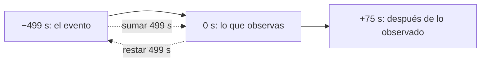

# B03-C09 — Operaciones con números negativos

<!-- nav:top -->
[🏠 Programa](../../../../README.md) · [📚 Bloque B03](../../../tronco-comun/B03-matematica-elemental-para-ciencias-espaciales.md) · [← Anterior: B03-C08 — Tiempo y conversiones astronómicas](../B03-C08-tiempo-y-conversiones-astronomicas/CLASE.md) · [Siguiente: B03-C10 — Proporcionalidad directa e inversa →](../B03-C10-proporcionalidad-directa-e-inversa/CLASE.md)
<!-- /nav -->

## 1. Ubicación, nivel y alcance

Novena clase del bloque B03. Hasta C08 casi todos tus números eran positivos. Pero en ciencias espaciales los signos cargan información: «diez minutos antes del lanzamiento», «el evento ocurrió antes de que lo vieras», «una órbita ligada tiene energía negativa». Esta clase te enseña a operar con números negativos y a leer su signo como parte del significado. Nivel N0 → N1.

Verás la recta numérica, el valor absoluto, las reglas de suma, resta, multiplicación y división con signo y por qué valen, y tres usos reales: cuenta regresiva, corrección por tiempo de luz y energía ligada. No verás vectores (B10) ni energía en detalle (B05).

## 2. Por qué esta clase existe

Cuando observas una llamarada solar a las 12:00:00, el evento ocurrió **antes**: su tiempo es el observado menos 499 s. Si sumas en vez de restar, afirmas que la llamarada ocurre en el futuro. Y cuando un ingeniero escribe que la energía de una órbita es `−5,2 × 10⁵ J/kg`, el signo menos no es una rareza: dice que la nave está ligada al planeta y no escapará sola.

La decisión central es: **¿qué significa el signo de este número en este problema, y cómo lo conservo al operar?** Aprenderás las reglas y a explicar el signo con palabras.

## 3. Lo que podrás hacer al terminar

1. Ubicar números negativos en la recta y compararlos.
2. Sumar, restar, multiplicar y dividir con signos y justificar cada regla.
3. Usar el valor absoluto como distancia al cero.
4. Expresar tiempos antes y después de un evento con signo (T−, T+).
5. Aplicar la corrección `t_evento = t_observado − d/c` con el signo correcto.
6. Interpretar el signo de una energía orbital y distinguir ligado de no ligado.

La evidencia es el **registro de signos y convenciones** del ejercicio 12 (sección 20).

## 4. Con qué llegas y cómo comprobarlo

Necesitas C01 a C08. Cinco preguntas:

1. ¿Qué número está dos lugares a la izquierda del 1 en la recta?
2. Si debes 5 monedas y recibes 3, ¿cuánto debes ahora?
3. ¿Cuánto es `8 − 3`? ¿Y `3 − 8`?
4. ¿Qué es mayor, `−2` o `−7`?
5. ¿Por qué `12:00:00 − 0:08:19` es una hora anterior a las 12?

<details>
<summary>Ver respuestas</summary>

1. `−1`. 2. 2 monedas. 3. 5; `−5`. 4. `−2` (está más a la derecha). 5. Porque se resta tiempo: se retrocede en la línea del tiempo (11:51:41).
</details>

Con cuatro o cinco aciertos, sigue; con menos, dibuja la recta y repite las preguntas 3 y 4.

## 5. Un caso real: una órbita lunar con energía negativa

La NASA da para la Luna un semieje de 384 400 km y una velocidad orbital media de 1,022 km/s (S1). La IAU fija un parámetro gravitacional nominal para la Tierra, `GM = 3,986004 × 10¹⁴ m³ s⁻²` (S2). Con ellos puedes calcular la energía por kilogramo de la Luna: una parte cinética positiva (`+5,22 × 10⁵ J/kg`) y una potencial negativa (`−1,04 × 10⁶ J/kg`). La suma es negativa: `−5,15 × 10⁵ J/kg`. Ese signo dice que la Luna está ligada a la Tierra. Límite: el cálculo supone dos cuerpos y órbita casi circular; los significados de «energía cinética» y «potencial» se profundizan en B05.

## 6. Vocabulario

Un **número negativo** es menor que cero; su **opuesto** es el positivo del mismo tamaño (`−3` y `3`). El **valor absoluto** `|x|` es la distancia de `x` al cero y nunca es negativo. La **recta numérica** ordena los números de izquierda (menores) a derecha (mayores). Una **convención de signo** es el acuerdo sobre qué sentido es positivo. Una **cuenta regresiva** usa T− antes de un instante de referencia y T+ después. Una **órbita ligada** es aquella en que la energía total por unidad de masa es negativa. La **energía específica** es energía por unidad de masa (J/kg).

## 7. Modelo mental: la recta con cero como referencia

Los signos indican de qué lado del cero estás; los números dicen cuánto.



*Descripción textual:* una recta con tres puntos de izquierda a derecha: −499 s (el evento), 0 s (la observación) y +75 s (después). Sumar 499 s desde el evento lleva a la observación; restar 499 s desde la observación regresa al evento.

Analogía: un termómetro vertical o un ascensor con pisos bajo tierra. El límite: en el ascensor el cero (planta baja) es una elección; en tiempo y energía el cero también lo es (instante de referencia, nivel de energía), por eso hay que declararlo.

## 8. La explicación, paso a paso

### 8.1 La recta y el orden

A mayor posición a la derecha, mayor valor: `−2 > −7`. Un número negativo con menor valor absoluto es mayor. Por eso `−0,5 > −3`.

### 8.2 Suma y resta con signos

Sumar un número positivo avanza a la derecha; sumar uno negativo retrocede. `−3 + 5 = 2`; `−3 + (−5) = −8`. Restar es sumar el opuesto: `5 − (−3) = 5 + 3 = 8`. Justificación: restar una deuda de 3 equivale a ganar 3.

### 8.3 Multiplicación y división con signos

Signos iguales dan positivo; signos distintos dan negativo: `(−4)(−6) = 24`; `(−24) ÷ 6 = −4`. ¿Por qué «menos por menos es más»? Porque `5 + (−5) = 0`, así que `(−3)(5 + (−5)) = 0`; por la propiedad distributiva `(−3)(5) + (−3)(−5) = 0`; como `(−3)(5) = −15`, necesariamente `(−3)(−5) = +15`. Si fuera −15 la igualdad fallaría.

### 8.4 Valor absoluto y distancia

La distancia entre dos puntos de la recta es el valor absoluto de su diferencia: entre `−499 s` y `+75 s` hay `|75 − (−499)| = 574 s`. No se obtiene sumando absolutos en general (sí cuando están a lados opuestos del cero).

### 8.5 Tiempo antes y después: la cuenta regresiva

Se toma un instante como cero (T). Antes, el tiempo es negativo: `T−10:00` son `−600 s`. Entre `T−10:00` y `T+1:15` hay `75 − (−600) = 675 s = 11 min 15 s`. La cuenta regresiva es una recta de tiempo con signos.

### 8.6 Corrección por tiempo de luz

Si la luz llega a tu instrumento en `t_obs`, el evento ocurrió antes: `t_evento = t_obs − d/c`. Con `d = 1 au`, `d/c = 499,005 s`, así que `t_evento − t_obs = −499,005 s`: el desfase es negativo (el evento está en el pasado de la observación). Si sumaras, afirmarías un evento en el futuro, lo cual contradice que la luz tarda en llegar.

### 8.7 El signo de la energía orbital

La energía específica de un cuerpo que se mueve a rapidez `v` a distancia `r` del centro es `e = v²/2 − GM/r`. El primer término es positivo; el segundo, negativo (por convención, el cero es la energía de un cuerpo infinitamente lejos y en reposo). Si `e < 0`, el cuerpo está ligado; si `e > 0`, tiene energía de sobra para escapar. Para una órbita de semieje `a`, `e = −GM/(2a)`. Con la Luna, `−GM/(2a) = −5,185 × 10⁵ J/kg`; con `v²/2 − GM/r` salen `−5,147 × 10⁵ J/kg`: coinciden al 0,73 % (el «r» es el semieje, no la distancia instantánea).

## 9. Magnitudes, símbolos y unidades

| Símbolo | Qué es | Unidad | Valor o nota |
|---|---|---|---|
| `|x|` | valor absoluto | la de `x` | siempre ≥ 0 |
| `t_obs`, `t_evento` | tiempo observado y del evento | s | `t_evento = t_obs − d/c` |
| `d` | distancia | m | 1 au = 149 597 870 700 m (S3) |
| `c` | velocidad de la luz | m/s | 299 792 458 (S3) |
| `e` | energía específica | J/kg | Luna: −5,15 × 10⁵ (calculada) |
| `GM` | parámetro gravitacional terrestre | m³ s⁻² | 3,986004 × 10¹⁴ (nominal, S2) |
| `a`, `v` | semieje y rapidez orbital lunares | km, km/s | 384 400; 1,022 (S1) |

## 10. Convenciones y referencias

El signo menos se escribe siempre (`−3`, no «3 negativo»); los negativos en una operación se encierran en paréntesis (`5 − (−3)`). La cuenta regresiva usa `T−` y `T+`. Se declara el cero: «tiempo respecto del instante de observación», «energía cero a distancia infinita». Las unidades acompañan a los números con signo (`−499 s`).

## 11. De dónde sale lo que afirmamos

| ID | Fuente | Localizador | Respalda | Estado |
|---|---|---|---|---|
| S1 | NASA NSSDC, *Moon Fact Sheet* (act. 11-ene-2024) | https://nssdc.gsfc.nasa.gov/planetary/factsheet/moonfact.html | Semieje 0,3844 × 10⁶ km; velocidad orbital media 1,022 km/s | Página consultada el 2026-11-05 |
| S2 | IAU 2015, Resolución B3 (Mamajek et al., arXiv:1510.07674) | https://arxiv.org/abs/1510.07674 | (GM)ᴺ de la Tierra = 3,986004 × 10¹⁴ m³ s⁻² (nominal, exacto por definición) | PDF leído el 2026-11-05 |
| S3 | BIPM, *The International System of Units (SI)*, 9.ª ed. (2019) | https://doi.org/10.59161/AUEZ1291 | `c` = 299 792 458 m/s; 1 au = 149 597 870 700 m | PDF leído el 2026-11-05 |

Límites: la fórmula de la energía específica y el criterio ligado/no ligado son modelo estándar de dos cuerpos que esta clase usa sin demostrar (se estudia en B05 y B41); su coincidencia numérica con los datos de S1 y S2 es nuestra comprobación. La cuenta regresiva es un ejemplo sintético.

## 12. Cómo ver los signos

Versión accesible de una recta con tres líneas.

| Contexto | Cero | Negativo significa | Positivo significa |
|---|---|---|---|
| Cuenta regresiva | instante de referencia T | antes de T | después de T |
| Corrección por luz | instante de observación | evento anterior a la observación | posterior (no ocurre al corregir) |
| Energía orbital | cuerpo en reposo a distancia infinita | ligado | con energía para escapar |

Si lo dibujas, usa una recta horizontal con el cero marcado y flechas de sentido, y no solo colores para los signos. Descripción larga: una única recta recorre las tres situaciones; el cero cambia de significado en cada una.

## 13. Ejemplo trabajado: ¿cuándo ocurrió la llamarada y está ligada la Luna?

**Parte A · tiempo.** Un telescopio solar registra una llamarada a las 12:00:00. Distancia 1 au.
**Paso 1 · plan.** `t_evento = t_obs − d/c`.
**Paso 2 · tiempo de luz.** `149 597 870 700 / 299 792 458 = 499,005 s = 8 min 19 s`.
**Paso 3 · resta.** `12:00:00 − 0:08:19 = 11:51:41`. Desfase `−499 s`.
**Paso 4 · comprobación.** El evento debe ser anterior a lo observado: ✓.

**Parte B · energía.** Datos de la sección 5.
**Paso 1 · cinética.** `v²/2 = (1 022)²/2 = 5,222 × 10⁵ J/kg` (positiva).
**Paso 2 · potencial.** `−GM/a = −3,986004 × 10¹⁴ / 3,844 × 10⁸ = −1,0369 × 10⁶ J/kg`.
**Paso 3 · suma.** `5,222 × 10⁵ − 10,369 × 10⁵ = −5,147 × 10⁵ J/kg`.
**Paso 4 · comparación.** `−GM/(2a) = −5,185 × 10⁵`; la diferencia relativa es del 0,73 %.
**Sentido físico.** Negativa: la Luna no se escapará por sí sola. Además, en una órbita circular la energía cinética es la mitad del valor absoluto de la potencial; aquí `5,22 × 10⁵` frente a `1,0369 × 10⁶ / 2 = 5,18 × 10⁵`, coherente.

## 14. Convenciones de signo: cuándo ayudan y cuándo confunden

Una convención bien elegida evita errores (restar el tiempo de luz en vez de sumarlo). Pero dos grupos con convenciones distintas (uno cuenta el tiempo antes de la observación como positivo, otro como negativo) pueden cometer el error de C06. Elige una y decláralo. Para magnitudes que no pueden ser negativas (masa, distancia) un signo menos indica un error de datos, no una convención.

## 15. Práctica guiada

**Ejercicio 1 · con los pasos indicados.** Calcula `(−7) + 4` y `(−7) − 4`. *Pasos:* ubica en la recta (8.2).

<details><summary>Solución comentada</summary>

`−7 + 4 = −3` (avanzas 4 a la derecha); `−7 − 4 = −11` (retrocedes 4). Si te salió 11 olvidaste el signo del primer número.
</details>

**Ejercicio 2 · con una pista.** Calcula `5 − (−3)`. *Pista:* restar es sumar el opuesto.

<details><summary>Solución comentada</summary>

`5 + 3 = 8`. Quitar una deuda de 3 equivale a ganar 3.
</details>

**Ejercicio 3 · casi autónomo.** Calcula `(−4)(−6)` y `(−24) ÷ 6`.

<details><summary>Solución comentada</summary>

`24` (signos iguales); `−4` (signos distintos).
</details>

## 16. Práctica autónoma, transferencia e integrador

**Ejercicio 4.** Una señal llega a las 15:30:00 desde una fuente a 1 au. ¿A qué hora ocurrió el evento? (499 s.)

<details><summary>Solución comentada</summary>

`15:30:00 − 0:08:19 = 15:21:41`.
</details>

**Ejercicio 5.** ¿Cuánto tiempo hay entre `T−10:00` y `T+1:15`?

<details><summary>Solución comentada</summary>

`75 − (−600) = 675 s = 11 min 15 s`.
</details>

**Ejercicio 6.** Calcula `v²/2 − GM/r` para `v = 1 022 m/s`, `r = 3,844 × 10⁸ m` y `GM = 3,986004 × 10¹⁴ m³ s⁻²`. Interpreta el signo.

<details><summary>Solución comentada</summary>

`5,222 × 10⁵ − 1,0369 × 10⁶ = −5,147 × 10⁵ J/kg`. Negativa: ligada.
</details>

**Ejercicio 7.** Dos instantes son `−499 s` y `+75 s` respecto de la observación. ¿Cuál es su separación?

<details><summary>Solución comentada</summary>

`|75 − (−499)| = 574 s`. No `75 − 499 = −424`, que dice cuál es anterior pero no la separación.
</details>

**Ejercicio 8.** ¿Es lo mismo `−3²` que `(−3)²`?

<details><summary>Solución comentada</summary>

`−3² = −9` (se eleva 3 al cuadrado y luego se cambia el signo); `(−3)² = 9`. La jerarquía de C01 pone la potencia antes que el signo.
</details>

**Ejercicio 9 · transferencia.** Un vehículo en la superficie terrestre (`r = 6,371 × 10⁶ m`) tiene `v = 10 km/s`. Calcula `e` y decide si queda ligado.

<details><summary>Solución comentada</summary>

`v²/2 = 5,0 × 10⁷`; `GM/r = 6,2565 × 10⁷`; `e = −1,256 × 10⁷ J/kg`. Negativa: ligado (10 km/s es menor que la velocidad de escape de 11,186 km/s de la NASA). Es un ejercicio de signos; ignora el aire y la rotación.
</details>

**Ejercicio 10 · transferencia.** Repite con `v = 12 km/s`.

<details><summary>Solución comentada</summary>

`v²/2 = 7,2 × 10⁷`; `e = 7,2 × 10⁷ − 6,2565 × 10⁷ = +9,4 × 10⁶ J/kg`. Positiva: tiene energía para escapar, coherente con 12 > 11,186 km/s.
</details>

**Ejercicio 11 · transferencia.** Un estudiante calcula el instante de un evento como `12:00:00 + 0:08:19 = 12:08:19`. ¿Qué error conceptual hay?

<details><summary>Solución comentada</summary>

Sumó el tiempo de luz en vez de restarlo: afirma que el evento ocurrió **después** de que se observó. La luz tarda en llegar, así que el evento es anterior (8.6).
</details>

**Ejercicio 12 · integrador.** Elabora tu *registro de signos y convenciones* (sección 20): cinco magnitudes con signo (tiempo relativo, corrección por luz, energía, otra a elección…), con cero declarado, significado de cada signo, operación realizada y comprobación.

<details><summary>Solución modelo</summary>

Una fila podría ser: «`t − t_obs = −499 s`; cero: instante de observación; negativo = evento anterior; operación: `12:00:00 − 0:08:19`; comprobación: el evento es anterior». Se acepta cualquier terna coherente con fuente citada cuando use datos publicados.
</details>

## 17. Laboratorio: signos en 60 líneas

El script [laboratorio_signos.py](laboratorio_signos.py) calcula la energía específica de la Luna de las dos maneras de la sección 8.7, la corrección por tiempo de luz y el formato T−/T+. Antes comprueba las reglas de signos, que ambas energías sean negativas y coincidan al 1 %, y que `t_evento` sea 499 s anterior.

**Datos:** publicados (NASA, IAU, SI); la cuenta regresiva es sintética. **Predice antes de ejecutar:** ¿qué signo tendrá la energía? (Negativo.) **Resultados (2026-11-05, Python 3.12.9):** `e = v²/2 − GM/r = −5,1470 × 10⁵ J/kg`; `e = −GM/(2a) = −5,1847 × 10⁵ J/kg` (0,73 %); cinética `5,2224 × 10⁵`, potencial `−1,0369 × 10⁶`; `t_evento − t_obs = −499,005 s`; cuenta `T-00:10:00 … T+00:01:15`.

```bash
python programa/clases/B03/B03-C09-operaciones-con-numeros-negativos/laboratorio_signos.py
```

**Límites:** dos cuerpos y órbita casi circular; la energía no es una predicción de misión.

## 18. Errores frecuentes y cómo corregirlos

**Perder el signo en la resta.** Ejercicio 1.
**Sumar el tiempo de luz.** Ejercicio 11.
**Confundir `−3²` con `(−3)²`.** Ejercicio 8.
**Usar valor absoluto donde se necesita el signo.** Ejercicio 7 (distancia sí; orden no).
**No declarar el cero.** Sección 14.

## 19. Cómo sabrás que vas bien

Tras 8.2: ¿calculas `−8 − (−3)`? (`−5`). Si no, repite el ejercicio 2. Tras 8.3: ¿explicas «menos por menos»? Si no, relee. Tras 8.6: ¿restas el tiempo de luz sin dudar? Si dudas, rehaz el ejercicio 4. Al final: ¿dices qué significa el signo de `e`? Si no, revisa el 9.

## 20. Qué entregas y cómo se evalúa

El producto es tu **registro de signos y convenciones**: cinco magnitudes con signo, cero declarado, significado del signo, operación realizada y comprobación.

| Criterio | Inicial | En desarrollo | Logrado | Destacado |
|---|---|---|---|---|
| Operaciones | Errores de signo | Aciertos con ayuda | Correctas | Justifica una regla |
| Cero declarado | Ausente | Implícito | Explícito | Compara dos convenciones |
| Interpretación | Ninguna | Parcial | Del signo en cada caso | Detecta un error ajeno |
| Comprobación | Ninguna | Una | Por sentido y cálculo | Por dos vías |
| Fuentes | Sin cita | Parcial | Completa | Declara límites |

**Condiciones críticas:** no omitir el cero ni las unidades; no sumar el tiempo de luz; citar solo fuentes consultadas.

## 21. Ética, seguridad y límites

Un signo mal interpretado puede invertir una conclusión sin que el número parezca raro. Esta clase es educativa; la energía orbital aquí es un ejemplo de signo y no sirve para decidir si una trayectoria real escapa. Accesibilidad: signos en texto, tablas equivalentes, sin conexión.

## 22. Para cerrar y seguir

Los negativos ordenan, restan y multiplican con reglas que se justifican; el signo exige un cero declarado; restar el tiempo de luz ubica el evento en el pasado, y una energía orbital negativa significa cuerpo ligado. Queda una pregunta: ¿cómo se relacionan dos magnitudes que cambian juntas, como la energía recibida y la distancia? Es C10.

**Glosario español–inglés.** número negativo · *negative number*; valor absoluto · *absolute value*; recta numérica · *number line*; cuenta regresiva · *countdown*; órbita ligada · *bound orbit*; energía específica · *specific energy*; tiempo de luz · *light-travel time*.

**Continuidad.** B03-C10 usa la proporcionalidad para la energía recibida del Sol. B05 desarrolla la energía y B13 las escalas de tiempo.

**Referencias:** ver sección 11. Todas las fuentes son datos oficiales consultados.

<!-- nav:bottom -->
---

[← Anterior: B03-C08 — Tiempo y conversiones astronómicas](../B03-C08-tiempo-y-conversiones-astronomicas/CLASE.md) · [📚 Bloque B03](../../../tronco-comun/B03-matematica-elemental-para-ciencias-espaciales.md) · [Siguiente: B03-C10 — Proporcionalidad directa e inversa →](../B03-C10-proporcionalidad-directa-e-inversa/CLASE.md)
<!-- /nav -->
