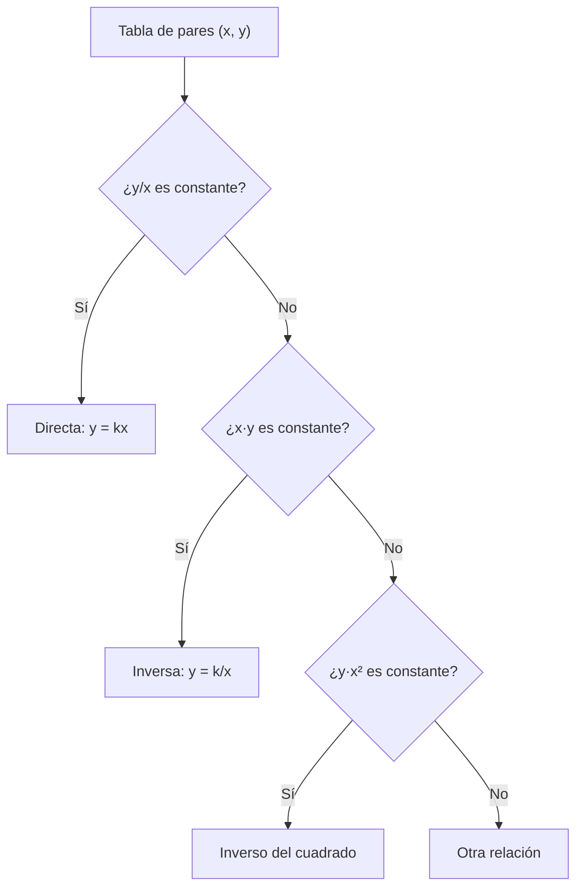

# B03-C10 — Proporcionalidad directa e inversa

<!-- nav:top -->
[🏠 Programa](../../../../README.md) · [📚 Bloque B03](../../../tronco-comun/B03-matematica-elemental-para-ciencias-espaciales.md) · [← Anterior: B03-C09 — Operaciones con números negativos](../B03-C09-operaciones-con-numeros-negativos/CLASE.md) · [Siguiente: B03-C11 — Estimación y redondeo responsable →](../B03-C11-estimacion-y-redondeo-responsable/CLASE.md)
<!-- /nav -->

## 1. Ubicación, nivel y alcance

Décima clase del bloque B03 y punto medio del bloque. Con razones (C02), potencias (C04) y signos (C09) ya puedes hablar de **cómo cambia una magnitud cuando cambia otra**. La proporcionalidad directa e inversa describe las dos relaciones más simples y más usadas en ciencias espaciales. Nivel N0 → N1.

Verás cuándo dos magnitudes son directamente o inversamente proporcionales, cómo hallar y verificar la constante de proporcionalidad, la ley del inverso del cuadrado de la distancia y por qué no toda relación creciente es proporcional. No verás aún funciones generales (B09) ni gráficos con pendiente (C16).

## 2. Por qué esta clase existe

Un panel solar en órbita de Marte no recibe la misma energía que uno en órbita de la Tierra. ¿Cuánta menos? Si la energía fuera inversamente proporcional a la distancia (`1/d`), Marte (1,52 au) recibiría el 66 % de lo que recibe la Tierra; con el modelo correcto de esta clase recibe un 43 %. La diferencia entre «proporcional a `d`» y «proporcional a `1/d²`» decide el diseño de una misión.

La decisión central es: **¿esta relación es directa, inversa, con exponente 2 u otra cosa, y cómo lo compruebo con datos?** Aprenderás a calcular la constante, a probar si es constante y a usarla para predecir.

## 3. Lo que podrás hacer al terminar

1. Definir proporcionalidad directa (`y = kx`) e inversa (`y = k/x`).
2. Calcular la constante `k` y comprobar que es constante con una tabla.
3. Distinguir proporcionalidad directa de relación creciente no proporcional.
4. Aplicar la ley del inverso del cuadrado a la energía solar recibida.
5. Predecir el efecto de cambiar una magnitud por un factor dado.
6. Detectar con datos cuándo una relación no es proporcional.

La evidencia es el **cuaderno de proporcionalidades** del ejercicio 12 (sección 20).

## 4. Con qué llegas y cómo comprobarlo

Necesitas C01 a C09. Cinco preguntas:

1. Si 3 cuadernos cuestan 12 monedas, ¿cuánto cuestan 5?
2. Si 4 obreros terminan en 6 días, ¿cuánto tardan 8?
3. ¿Cuánto es `1/2²`? ¿Y `1/0,5²`?
4. ¿Qué es la razón `y/x` si `y = 12` y `x = 3`?
5. ¿Es `y = x + 2` una proporcionalidad directa? (Pista: `x = 0`.)

<details>
<summary>Ver respuestas</summary>

1. 20 monedas. 2. 3 días (inversa). 3. 0,25; 4. 4. 4. No: con `x = 0` da `y = 2`, no 0.
</details>

Con cuatro o cinco aciertos, sigue; con menos, repasa C02 y C04.

## 5. Un caso real: la luz del Sol a lo largo del Sistema Solar

La IAU fija un valor nominal de irradiancia solar a 1 au de 1361 W/m² (S1). Si la energía se reparte sobre esferas cada vez mayores, a mayor distancia llega menos, con el inverso del cuadrado. Con los semiejes de la NASA (S2) resulta, por ejemplo, Marte 586 W/m², Júpiter 50,3 W/m² y Neptuno 1,5 W/m². Estas cifras **no son medidas**: son calculadas con el modelo de fuente puntual a partir del valor nominal. Límite: el modelo ignora la excentricidad de las órbitas y cualquier atmósfera.

## 6. Vocabulario

Dos magnitudes son **directamente proporcionales** si su cociente `y/x` es constante: `y = kx`. Son **inversamente proporcionales** si su producto `x·y` es constante: `y = k/x`. La **constante de proporcionalidad** `k` es ese valor fijo. Una relación **lineal** es `y = kx + b`; es proporcional solo si `b = 0`. La **ley del inverso del cuadrado** dice que una cantidad es proporcional a `1/d²`. La **irradiancia** es la potencia por unidad de área (W/m²). Una **fuente puntual** es un modelo sin tamaño que emite igual en todas las direcciones.

## 7. Modelo mental: la tabla que no cambia de cociente

Para saber si dos magnitudes son proporcionales, miras la tabla: ¿algún cociente o producto se mantiene?



*Descripción textual:* una cascada de preguntas sobre una tabla de pares. Si el cociente `y/x` es constante, la relación es directa; si no, se prueba el producto; si tampoco, el producto `y·x²`; si ninguno es constante, la relación es de otro tipo.

Analogía: repartir una pizza entre más personas: más personas, menos porción cada una (inversa). El límite: en una pizza el reparto es lineal en el número de personas; la luz se reparte sobre una superficie esférica cuya área crece con el cuadrado de la distancia (C17), de ahí `1/d²`.

## 8. La explicación, paso a paso

### 8.1 Proporcionalidad directa

Si `y = kx`, al duplicar `x` se duplica `y`. Ejemplo: la circunferencia de un círculo y su radio (`C = 2πR`): para la Tierra (6 371 km) es 40 030 km y para la Luna (1 737,4 km) es 10 916 km. Los cocientes `C/R = 6,283` son iguales. La constante es `2π`.

### 8.2 Cómo comprobarla con una tabla

Calcula `y/x` en cada fila; si los valores coinciden (dentro del redondeo), hay proporcionalidad directa. Una tabla `x = 1, 2, 3` con `y = 2,5; 5; 7,5` da `k = 2,5` en las tres filas. En cambio `y = 3, 5, 7` da `3; 2,5; 2,33`: no es proporcional (es lineal con `b = 1`).

### 8.3 Proporcionalidad inversa

Si `y = k/x`, al duplicar `x` el valor `y` se reduce a la mitad. Para recorrer una distancia fija, el tiempo es inversamente proporcional a la rapidez: `t = d/v`, con `k = d`. Si `d = 384 400 km`, a 1 km/s tarda 384 400 s y a 2 km/s la mitad, 192 200 s. El producto `v·t` es siempre 384 400 km.

### 8.4 Inverso del cuadrado

Una fuente de potencia `P` que emite igual en todas direcciones reparte su energía sobre una esfera de área `4πd²` (C17). La irradiancia es `S = P/(4πd²)`, que es proporcional a `1/d²`. Por eso `S(d) = S(1 au)/d²` si `d` va en au. A 2 au llega 1/4; a 0,5 au llegan 4 veces más. Duplicar la distancia reduce la energía a la cuarta parte, no a la mitad.

### 8.5 Predecir con la constante

Si conoces `k` y un valor de `x`, calculas `y`. Con la constante `S·d² = 1361 W/m² × (1 au)²`, Marte (1,5238 au) recibe `1361/1,5238² = 586,1 W/m²`, es decir, el 43,1 % de lo que recibe la Tierra. Fíjate que la razón de energías es el **cuadrado inverso de la razón de distancias**: `(1/1,5238)² = 0,4307`.

### 8.6 Cuándo no hay proporcionalidad

Un período `T` y un semieje `a` crecen juntos, pero `T/a` no es constante: Mercurio 0,622 años/au, Tierra 1 y Neptuno 5,46. Lo constante es `T/a^(3/2)` (C04). No toda relación creciente es directa: hay que probar el cociente.

## 9. Magnitudes, símbolos y unidades

| Símbolo | Qué es | Unidad | Valor o nota |
|---|---|---|---|
| `k` | constante de proporcionalidad | depende | `y/x` o `x·y` |
| `S` | irradiancia solar | W/m² | 1361 a 1 au (nominal, S1) |
| `d` | distancia al Sol | au | de S2 |
| `C`, `R` | circunferencia y radio | km | `C = 2πR` |
| `v`, `t` | rapidez y tiempo | km/s, s | `v·t = d` |
| `P` | potencia de la fuente | W | 3,828 × 10²⁶ (nominal, S1) |

## 10. Convenciones y referencias

Se escribe «proporcional a» con el símbolo `∝` solo en texto; en fórmulas, con `k`. Se declara qué magnitud es `x` y cuál `y`. Los valores de irradiancia de esta clase son **calculados** (modelo), a diferencia de los publicados. La distancia de la irradiancia se mide en au (1 au = 149 597 870 700 m, S3).

## 11. De dónde sale lo que afirmamos

| ID | Fuente | Localizador | Respalda | Estado |
|---|---|---|---|---|
| S1 | IAU 2015, Resolución B3 (Mamajek et al., arXiv:1510.07674) | https://arxiv.org/abs/1510.07674 | Irradiancia solar nominal `S_N` = 1361 W m⁻²; luminosidad nominal `L_N` = 3,828 × 10²⁶ W | PDF leído el 2026-11-05 |
| S2 | NASA NSSDC, fichas de Mercurio, Venus, Tierra, Marte, Júpiter, Saturno, Urano y Neptuno | https://nssdc.gsfc.nasa.gov/planetary/factsheet/ | Semiejes mayores (10⁶ km) y períodos sidéreos; radios medios de la Tierra (6 371) y la Luna (1 737,4) | Páginas consultadas el 2026-11-05 |
| S3 | BIPM, *The International System of Units (SI)*, 9.ª ed. (2019), tabla 8 | https://doi.org/10.59161/AUEZ1291 | 1 au = 149 597 870 700 m | PDF leído el 2026-11-05 |

Límites: el valor nominal de la IAU es un factor de conversión, no la mejor estimación de la irradiancia en cada instante. Que la irradiancia siga `1/d²` es un resultado geométrico del modelo de fuente puntual que la clase deduce; no se contrastó con mediciones de las misiones.

## 12. Cómo ver la relación

Versión accesible de una gráfica `S` frente a `d`.

| Planeta | `d` (au) | `S` (W/m²) | `S` / `S`(Tierra) |
|---|---|---|---|
| Mercurio | 0,3871 | 9 082,7 | 6,674 |
| Venus | 0,7233 | 2 601,2 | 1,911 |
| Tierra | 1,0000 | 1 361,0 | 1,000 |
| Marte | 1,5238 | 586,1 | 0,4307 |
| Júpiter | 5,2038 | 50,3 | 0,0369 |
| Saturno | 9,5726 | 14,9 | 0,0109 |
| Urano | 19,165 | 3,7 | 0,0027 |
| Neptuno | 30,181 | 1,5 | 0,0011 |

Si la dibujas, usa ejes logarítmicos (la relación `1/d²` aparece como recta de pendiente −2; C16) y distingue los planetas por forma. Descripción larga: de Mercurio a Neptuno, `d` crece unas 78 veces y `S` cae unas 6 000 veces (78²).

## 13. Ejemplo trabajado: la energía en Marte frente a la Tierra

**Pregunta.** ¿Qué fracción de la irradiancia terrestre recibe Marte?

**Paso 1 · plan.** `S ∝ 1/d²`, luego `S_M/S_T = (d_T/d_M)²`.
**Paso 2 · distancias.** `d_T = 1 au`; `d_M = 227,956 × 10⁶ km / 149,5979 × 10⁶ km/au = 1,5238 au`.
**Paso 3 · estimación.** `1,5² = 2,25`; `1/2,25 ≈ 0,44`.
**Paso 4 · cálculo.** `1,5238² = 2,3220`; `1/2,3220 = 0,4307`: el 43,1 %. En valor: `1361 × 0,4307 = 586,1 W/m²`.
**Paso 5 · comprobación.** `S·d² = 586,1 × 2,322 = 1 361`, igual al valor en la Tierra: la constante se conserva.
**Sentido físico.** Un panel solar necesita más de dos veces la superficie en Marte que en la Tierra para recoger la misma potencia (el efecto del polvo y la atmósfera no se consideran aquí).

## 14. Directa, inversa o cuadrática: cómo decidir

Probar `y/x` constante (directa), `x·y` constante (inversa) y `y·x²` constante (inverso del cuadrado) cubre los casos de esta clase. La prueba falla si los datos tienen mucho ruido (el cociente fluctúa), si la relación tiene un término constante (`b ≠ 0`) o si el rango es demasiado corto para distinguir `1/d` de `1/d²`. Con pocos datos, dos modelos pueden ajustar igual de bien.

## 15. Práctica guiada

**Ejercicio 1 · con los pasos indicados.** Decide si `x = 1, 2, 3` e `y = 2,5; 5; 7,5` son directamente proporcionales y halla `k`. *Pasos:* sección 8.2.

<details><summary>Solución comentada</summary>

`y/x = 2,5` en las tres filas: sí; `k = 2,5`.
</details>

**Ejercicio 2 · con una pista.** Decide si `x = 1, 2, 4` e `y = 8, 4, 2` son inversamente proporcionales. *Pista:* calcula `x·y`.

<details><summary>Solución comentada</summary>

`x·y = 8` en todas: sí; `k = 8`.
</details>

**Ejercicio 3 · casi autónomo.** ¿Qué irradiancia llega a 2 au si a 1 au son 1361 W/m²?

<details><summary>Solución comentada</summary>

`1361/2² = 340,25 W/m²`. No 680, que sería proporcionalidad inversa simple.
</details>

## 16. Práctica autónoma, transferencia e integrador

**Ejercicio 4.** Calcula la irradiancia en Júpiter con `d = 5,2038 au`.

<details><summary>Solución comentada</summary>

`5,2038² = 27,08`; `1361/27,08 = 50,3 W/m²`.
</details>

**Ejercicio 5.** Mercurio está a 0,3871 au. ¿Cuántas veces la irradiancia terrestre recibe?

<details><summary>Solución comentada</summary>

`(1/0,3871)² = 6,674`; unas 6,7 veces: 9 083 W/m². Como la distancia es menor que 1 au, la razón es mayor que 1.
</details>

**Ejercicio 6.** Calcula la circunferencia de la Luna (`R = 1 737,4 km`) y su razón con la de la Tierra (`R = 6 371 km`).

<details><summary>Solución comentada</summary>

`2π × 1 737,4 = 10 916 km`; la razón con 40 030 km es `0,2727`, igual a la razón de radios (proporcionalidad directa).
</details>

**Ejercicio 7.** Una nave debe recorrer `384 400 km`. ¿Cuánto tarda a 1 km/s y a 2 km/s?

<details><summary>Solución comentada</summary>

384 400 s y 192 200 s. Al duplicar la rapidez, el tiempo se reduce a la mitad (inversa). Es un modelo de rapidez constante.
</details>

**Ejercicio 8.** Con `T/a` de la Tierra (1) y de Marte (`1,881/1,5238 = 1,234`), ¿es `T` directamente proporcional a `a`?

<details><summary>Solución comentada</summary>

No: los cocientes difieren (1 frente a 1,234). Lo constante es `T/a^(3/2)` (C04).
</details>

**Ejercicio 9 · transferencia.** ¿A qué distancia del Sol la irradiancia es un noveno de la terrestre?

<details><summary>Solución comentada</summary>

`1/d² = 1/9` → `d = 3 au`. La irradiancia sería `1361/9 = 151,2 W/m²`.
</details>

**Ejercicio 10 · transferencia.** Si una nave se aleja un 10 % más del Sol, ¿cuánto cambia (en %) la irradiancia que recibe?

<details><summary>Solución comentada</summary>

Factor `1/1,1² = 0,8264`: la irradiancia cae un 17,4 %. El cambio es mayor que el 10 % de la distancia porque `d` está al cuadrado (C03).
</details>

**Ejercicio 11 · transferencia.** Un compañero mide `(d, S) = (1; 1361), (2; 340), (3; 151)`. Comprueba si sigue el inverso del cuadrado.

<details><summary>Solución comentada</summary>

`S·d² = 1361; 1360; 1359`: constante dentro del redondeo. Sí se ajusta. (Si usara `S·d` daría `1361; 680; 453`, no constante.)
</details>

**Ejercicio 12 · integrador.** Elabora tu *cuaderno de proporcionalidades* (sección 20): tres relaciones astronómicas (una directa, una inversa, una de inverso del cuadrado), cada una con tabla de datos, cálculo de `k`, prueba de constancia, predicción y fuente.

<details><summary>Solución modelo</summary>

Directa: `C = 2πR` (Tierra y Luna). Inversa: `t = d/v` para `d = 384 400 km`. Inverso del cuadrado: `S(d)` con la tabla de la sección 12. Cada una con su `k` (`2π`; 384 400 km; `1361 W/m² · (1 au)²`) y su prueba. Se acepta cualquier terna con datos citados.
</details>

## 17. Laboratorio: comprobar proporcionalidades

El script [laboratorio_proporcionalidad.py](laboratorio_proporcionalidad.py) calcula la irradiancia en los ocho planetas con `S = 1361/d²` y comprueba antes que `S·d²` es constante a `10⁻⁶` y que `C/R = 2π` para la Tierra y la Luna.

**Datos:** nominal (IAU) y publicados (NASA); las irradiancias son **calculadas con un modelo**, no medidas. **Predice antes de ejecutar:** ¿qué planeta recibe más de seis veces la irradiancia terrestre? (Mercurio.) **Resultados (2026-11-05, Python 3.12.9):** Mercurio 9 082,7 W/m² (6,674×); Venus 2 601,2; Tierra 1 361,0; Marte 586,1 (0,4307×); Júpiter 50,3; Saturno 14,9; Urano 3,7; Neptuno 1,5; `C/R = 6,283185`.

```bash
python programa/clases/B03/B03-C10-proporcionalidad-directa-e-inversa/laboratorio_proporcionalidad.py
```

**Límites:** fuente puntual; órbitas circulares de semieje medio; sin atmósfera.

## 18. Errores frecuentes y cómo corregirlos

**Creer que toda relación creciente es proporcional.** Ejercicio 8.
**Usar `1/d` en vez de `1/d²`.** Ejercicio 3.
**Olvidar que `b ≠ 0` rompe la proporcionalidad.** Sección 8.2.
**Invertir la razón.** Ejercicio 5.
**Aplicar una constante fuera de su dominio.** Sección 14.

## 19. Cómo sabrás que vas bien

Tras 8.2: ¿puedes decidir en un minuto si una tabla es directa? Si no, repite el ejercicio 1. Tras 8.4: ¿explicas por qué `1/d²`? Si no, relee. Tras 8.5: ¿predices la irradiancia de otro planeta? Si no, haz el 4. Al final: ¿distingues proporcional de creciente? Si dudas, vuelve al 8.

## 20. Qué entregas y cómo se evalúa

El producto es tu **cuaderno de proporcionalidades**: tres relaciones astronómicas, cada una con datos, `k`, prueba de constancia, predicción y fuente.

| Criterio | Inicial | En desarrollo | Logrado | Destacado |
|---|---|---|---|---|
| Clasificación | Errónea | Con ayuda | Correcta | Justifica con datos |
| Constante `k` | No la calcula | La calcula sin unidad | Con unidad | La contrasta con un valor publicado |
| Prueba | Ninguna | Una fila | Toda la tabla | Discute el ruido |
| Predicción | Ausente | Sin comprobar | Comprobada | Estima el error |
| Fuentes y límites | Sin cita | Parcial | Completa | Distingue calculado de medido |

**Condiciones críticas:** no presentar valores calculados como medidos; incluir unidades en `k`; citar solo fuentes consultadas.

## 21. Ética, seguridad y límites

Una relación proporcional ajustada a pocos datos puede ser engañosa. Rotular lo calculado como calculado es honestidad científica. Esta clase es educativa y no sirve para dimensionar sistemas de energía reales. Accesibilidad: tablas equivalentes, fórmulas en texto, sin conexión.

## 22. Para cerrar y seguir

Dos magnitudes son directamente proporcionales si su cociente es constante e inversamente si lo es su producto; la energía de una fuente puntual cae con el cuadrado de la distancia; y toda proporcionalidad se prueba con datos. Queda una pregunta: los números con los que trabajamos tienen cifras limitadas. ¿Cuántas debo conservar y cómo estimo antes de calcular? Es C11.

**Glosario español–inglés.** proporcionalidad directa · *direct proportion*; proporcionalidad inversa · *inverse proportion*; constante de proporcionalidad · *constant of proportionality*; ley del inverso del cuadrado · *inverse-square law*; irradiancia · *irradiance*; fuente puntual · *point source*.

**Continuidad.** B03-C16 mostrará estas relaciones como rectas en un gráfico logarítmico. B03-C17 justifica el área de la esfera. B03-C20 usa la proporcionalidad en la maqueta a escala.

**Referencias:** ver sección 11. Todas las fuentes son datos oficiales consultados.

<!-- nav:bottom -->
---

[← Anterior: B03-C09 — Operaciones con números negativos](../B03-C09-operaciones-con-numeros-negativos/CLASE.md) · [📚 Bloque B03](../../../tronco-comun/B03-matematica-elemental-para-ciencias-espaciales.md) · [Siguiente: B03-C11 — Estimación y redondeo responsable →](../B03-C11-estimacion-y-redondeo-responsable/CLASE.md)
<!-- /nav -->
