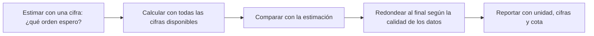

# B03-C11 — Estimación y redondeo responsable

<!-- nav:top -->
[🏠 Programa](../../../../README.md) · [📚 Bloque B03](../../../tronco-comun/B03-matematica-elemental-para-ciencias-espaciales.md) · [← Anterior: B03-C10 — Proporcionalidad directa e inversa](../B03-C10-proporcionalidad-directa-e-inversa/CLASE.md) · [Siguiente: B03-C12 — Variables y constantes científicas →](../B03-C12-variables-y-constantes-cientificas/CLASE.md)
<!-- /nav -->

## 1. Ubicación, nivel y alcance

Undécima clase del bloque B03. Hasta aquí calculaste con muchas cifras. Pero ningún dato astronómico las tiene todas: las fichas de la NASA dan cuatro o siete cifras, y la calculadora te devuelve diez. Esta clase te enseña a **estimar antes de calcular** y a **redondear sin engañar**: cuántas cifras conservar, cuándo redondear y cómo dejar claro cuán bueno es un número. Nivel N0 → N1.

Verás cifras significativas, reglas de redondeo, estimación de Fermi (resolver un problema con números redondos), cotas superior e inferior, y por qué conviene redondear solo al final. La propagación formal llega en C19.

## 2. Por qué esta clase existe

Si te piden el tiempo que tarda la luz del Sol en llegar a la Tierra y respondes «499,004783836 s», parece muy preciso, pero tus datos (1 au y `c`) son exactos; en cambio, si respondes lo mismo para la distancia a la Luna, que varía entre unos 357 000 y 407 000 km, esas cifras serían falsas. Redondear mal engaña en ambos sentidos: demasiadas cifras fingen precisión, demasiado pocas pierden información.

La decisión central es: **¿cuántas cifras puedo defender, y cómo compruebo antes de calcular que el orden de magnitud tiene sentido?** Aprenderás a estimar de cabeza, a calcular con todas las cifras y a redondear al final con criterio.

## 3. Lo que podrás hacer al terminar

1. Contar cifras significativas de un número y redondear a `n` cifras.
2. Estimar un resultado con una cifra y compararlo con el cálculo exacto.
3. Acotar una cantidad entre un mínimo y un máximo razonables.
4. Explicar por qué redondear antes de operar acumula error.
5. Decidir cuántas cifras reportar según la calidad de los datos.
6. Redactar una estimación de Fermi con supuestos explícitos.

La evidencia es el **informe de estimación con cotas** del ejercicio 12 (sección 20).

## 4. Con qué llegas y cómo comprobarlo

Necesitas C01 a C10. Cinco preguntas:

1. ¿Cuánto es `3,0 × 10⁸ ÷ 1,5 × 10¹¹`?
2. ¿Cuánto es `27,3217` redondeado a un decimal?
3. ¿Cuánto es `2 × 3 × 5`, aproximadamente, si redondeas cada uno a una cifra?
4. ¿Qué es un orden de magnitud?
5. ¿Qué es mayor, 357 000 o 407 000?

<details>
<summary>Ver respuestas</summary>

1. `2 × 10⁻³`. 2. 27,3. 3. 30. 4. El exponente de la notación científica (C05). 5. 407 000.
</details>

Con cuatro o cinco aciertos, sigue; con menos, repasa C05.

## 5. Un caso real: la distancia a la Luna no es un número, es un intervalo

La NASA publica un semieje lunar de 384 400 km; pero la propia ficha indica que la distancia Tierra–Luna varía a lo largo del año entre unos 357 000 y 407 000 km (S1). Si alguien te dice «la Luna está a 384 400 km», esas seis cifras sugieren una precisión de ±0,5 km, cuando la distancia real cambia en decenas de miles de km. Una descripción honesta usa dos o tres cifras («unos 384 000 km») o un intervalo. Límite: aquí tratamos las cifras publicadas como datos; no estudiamos cómo se midió la distancia.

## 6. Vocabulario

Una **cifra significativa** es un dígito que aporta información sobre el valor; cuentan todos los dígitos desde el primero distinto de cero hasta el último que se ha medido o calculado con sentido (`0,00450` tiene 3). **Redondear** es reemplazar un número por otro con menos cifras; la regla usual es mirar la primera cifra descartada: si es 5 o más, se sube la anterior. Una **estimación** (o estimación de Fermi) es un cálculo con números redondos para obtener el orden de magnitud. Una **cota** es un valor que el resultado no debería superar (superior) o no debería bajar de él (inferior). Un **error de redondeo** es la diferencia entre el número y su redondeo. **Incertidumbre** es la duda sobre el valor; el SI y la guía de la metrología recomiendan reportarla con a lo sumo dos cifras significativas (S2).

## 7. Modelo mental: estimar, calcular, redondear

Las tres etapas deben hacerse en este orden.



*Descripción textual:* una cadena de cinco pasos. Primero se estima con una cifra; luego se calcula sin redondear; se compara con la estimación; se redondea al final según la calidad de los datos; y se reporta con unidad, cifras y cota.

Analogía: un mapa y una brújula. La estimación es la brújula (te dice la dirección general); el cálculo es el mapa detallado. El límite: la brújula no sustituye al mapa; una estimación no reemplaza un cálculo cuando el problema exige precisión.

## 8. La explicación, paso a paso

### 8.1 Contar cifras significativas

`27,3217` tiene 6. `0,00450` tiene 3 (los ceros iniciales no cuentan; el cero final sí, porque se escribió). `149 597 870 700` en notación científica `1,495978707 × 10¹¹` tiene 10 si es exacto (como el au del SI). Para evitar dudas, escribe en notación científica: `4,50 × 10⁻³` deja claro que son 3.

### 8.2 Redondear a n cifras

Mira la primera cifra descartada: `27,3217` a 3 cifras → `27,3` (la siguiente es 2). `2,5` a una cifra → `3` (regla «5 sube»). Cuidado: las computadoras trabajan en binario (C01) y a veces redondean `2,5` hacia el par más cercano; si necesitas la regla «5 sube», impleméntala con decimales exactos, como hace el laboratorio.

### 8.3 Estimar con una cifra

Redondea cada dato a una cifra y opera: el tiempo de luz del Sol a la Tierra es `1,5 × 10¹¹ m ÷ 3 × 10⁸ m/s = 5 × 10² s`. El valor exacto es 499,005 s: la estimación acierta al 0,2 %. Funciona porque los errores de redondeo en el numerador y denominador se compensan parcialmente; pero no siempre, así que se compara siempre con el cálculo.

### 8.4 Estimación de Fermi

Cuando un dato falta, se construye con valores conocidos. ¿Cuántas Tierras caben entre la Tierra y la Luna? El diámetro terrestre es ~`1,3 × 10⁴ km` y la distancia ~`3,8 × 10⁵ km`: `3,8 × 10⁵ / 1,3 × 10⁴ ≈ 29`. El valor exacto con los datos de la NASA es 30,2. Se declaran los supuestos (diámetro y distancia medios) y se admite un factor de error.

### 8.5 Cotas

Con el intervalo de la Luna (357 000 a 407 000 km) y `c = 299 792,458 km/s`, el tiempo de luz queda entre `357 000 / 299 792 = 1,19 s` y `407 000 / 299 792 = 1,36 s`. Reportar «entre 1,19 y 1,36 s» es más honesto que «1,282 s».

### 8.6 Redondear solo al final

Si sumas `1,44 + 2,44 = 3,88` y redondeas a 2 cifras al final, obtienes `3,9`. Si redondeas antes (`1,4 + 2,4`) obtienes `3,8`. El segundo error es cuatro veces mayor. Regla: conserva cifras de más (una o dos) durante el cálculo, y redondea el resultado final.

### 8.7 Cuántas cifras reportar

Reporta tantas cifras como te permita la peor de tus entradas. Si multiplicas `2,0` (2 cifras) por `3,14159`, el producto tiene 2 cifras: `6,3`. La guía de metrología sugiere reportar la incertidumbre con a lo sumo dos cifras significativas y redondear el valor para que sea coherente con ella; si `y = 10,057 62 Ω` con `u = 27 mΩ`, se escribe `10,058 Ω` (S2, 7.2.6).

## 9. Magnitudes, símbolos y unidades

| Símbolo | Qué es | Unidad | Valor o nota |
|---|---|---|---|
| `n` | número de cifras significativas | sin unidad | — |
| `x_min`, `x_max` | cotas inferior y superior | la de `x` | Luna: 357 000 y 407 000 km (S1) |
| `a` | semieje lunar | km | 384 400 (S1) |
| `c` | velocidad de la luz | km/s | 299 792,458 (S3) |
| 1 au | unidad astronómica | m | 149 597 870 700 (S3, exacto) |
| `R⊕` | radio medio terrestre | km | 6 371 (S1) |

## 10. Convenciones y referencias

Los datos exactos por definición (1 au, `c`) no limitan las cifras; los medidos sí. En este programa se escribe el resultado con una o dos cifras más de las que se reportarán hasta el final. Los intervalos se escriben «entre `a` y `b`» con unidad. Las estimaciones se rotulan como tales («≈», «estimado») y no se presentan como valores medidos.

## 11. De dónde sale lo que afirmamos

| ID | Fuente | Localizador | Respalda | Estado |
|---|---|---|---|---|
| S1 | NASA NSSDC, *Moon Fact Sheet* (11-ene-2024) y *Earth Fact Sheet* (15-nov-2024) | https://nssdc.gsfc.nasa.gov/planetary/factsheet/moonfact.html y .../earthfact.html | Semieje lunar 0,3844 × 10⁶ km; la distancia Tierra–Luna varía entre unos 357 000 y 407 000 km a lo largo del año; radio medio terrestre 6 371 km | Páginas consultadas el 2026-11-05 |
| S2 | JCGM 100:2008, *Evaluation of measurement data – Guide to the expression of uncertainty in measurement* (GUM), apdo. 7.2.6 | https://www.bipm.org/documents/20126/2071204/JCGM_100_2008_E.pdf | Reportar la incertidumbre con a lo sumo dos cifras significativas y redondear el valor de forma coherente; ejemplo `10,057 62 Ω`, `u = 27 mΩ` → `10,058 Ω` | PDF leído el 2026-11-05 |
| S3 | BIPM, *The International System of Units (SI)*, 9.ª ed. (2019) | https://doi.org/10.59161/AUEZ1291 | `c` = 299 792 458 m/s; 1 au = 149 597 870 700 m | PDF leído el 2026-11-05 |

Límites: las reglas de redondeo (mitad hacia arriba) son una convención didáctica; hay otras (mitad al par). El GUM da recomendaciones de reporte, no una ley.

## 12. Cómo ver la calidad de un número

Versión accesible de una tabla de «cifras que puedes defender».

| Dato | Cifras publicadas | Calidad | Cómo reportar |
|---|---|---|---|
| 1 au | 12 (exacto) | definición | todas, si hace falta |
| `c` | 9 (exacto) | definición | todas, si hace falta |
| Semieje lunar | 6 (384 400 km) | valor medio de una cantidad que varía ±25 000 km | 3 cifras o intervalo |
| Radio medio terrestre | 4 (6 371 km) | promedio de una forma achatada | 3–4 cifras |
| Tiempo de luz a la Luna | calculado | hereda la variación | 2–3 cifras con cotas |

Si la dibujas, usa barras de intervalo (mínimo–máximo) y no solo puntos. Descripción larga: la distancia lunar es una barra larga de 357 000 a 407 000 km con una marca en 384 400; la del au es un punto sin barra.

## 13. Ejemplo trabajado: ¿cuántas cifras tiene el tiempo de luz a la Luna?

**Pregunta.** ¿Cuánto tarda la luz de la Tierra a la Luna y con qué cifras lo reporto?

**Paso 1 · estimación.** `4 × 10⁵ km ÷ 3 × 10⁵ km/s ≈ 1,3 s`.
**Paso 2 · cálculo con el semieje.** `384 400 ÷ 299 792,458 = 1,28225 s`.
**Paso 3 · comparación.** La estimación `1,3` acierta al 1,4 %. ✓.
**Paso 4 · cotas.** Con 357 000 y 407 000 km: `1,19 s` y `1,36 s`.
**Paso 5 · cifras.** El dato varía ±7 %; reportar 3 cifras (`1,28 s`) es defendible como valor medio, 6 no. Mejor aún: «≈ 1,3 s (entre 1,2 y 1,4 s)».
**Sentido físico.** La conversación con una nave en la Luna tiene un retardo de ida y vuelta de unos 2,6 s: perceptible en tiempo real.

## 14. Dos formas de reportar un resultado y cuándo fallan

**Un valor con pocas cifras** (`1,3 s`) es legible y honesto, pero oculta el intervalo. **Un valor con cota** (`1,28 s, entre 1,19 y 1,36 s`) informa más, pero es más largo. Ambas fallan si las cifras no reflejan la calidad real de los datos. Conserva cifras de sobra mientras calculas y recorta al informar.

## 15. Práctica guiada

**Ejercicio 1 · con los pasos indicados.** Cuenta las cifras significativas de `0,00450`, `27,3217` y `1,20 × 10³`. *Pasos:* sección 8.1.

<details><summary>Solución comentada</summary>

3, 6 y 3. Los ceros iniciales no cuentan; el cero final de `1,20` sí, porque se escribió.
</details>

**Ejercicio 2 · con una pista.** Redondea `149 597 870 700 m` a 4 cifras. *Pista:* notación científica.

<details><summary>Solución comentada</summary>

`1,496 × 10¹¹ m`. La siguiente cifra es 5 (de 1,4959…), que sube el 5 a 6.
</details>

**Ejercicio 3 · casi autónomo.** Estima el diámetro del Sol en diámetros terrestres con `7 × 10⁵ km` (radio solar) y `6,4 × 10³ km` (radio terrestre).

<details><summary>Solución comentada</summary>

`7 × 10⁵ / 6,4 × 10³ ≈ 109`. El valor con las cifras de la NASA es 109,2. Cociente de radios = cociente de diámetros.
</details>

## 16. Práctica autónoma, transferencia e integrador

**Ejercicio 4.** Redondea `2,5` a una cifra con la regla «5 sube» y `2,45` a dos cifras.

<details><summary>Solución comentada</summary>

`3`; `2,5`. En un programa, `round(2.5)` puede dar 2: no sigue esta regla (mitad al par).
</details>

**Ejercicio 5.** El período de Neptuno es 60 189,018 d. Estima con una cifra y compara.

<details><summary>Solución comentada</summary>

`6 × 10⁴ d`; el error es `|60 000 − 60 189|/60 189 = 0,31 %`.
</details>

**Ejercicio 6.** ¿Cuántos segundos hay en un año? Estima con una cifra y compara con 31 557 600 s (año juliano de 365,25 d).

<details><summary>Solución comentada</summary>

`3 × 10⁷ s` (si redondeas a `3 × 10²` días × `10⁵` s/d da `3 × 10⁷`); el error es del 5 %. Es un buen orden de magnitud, no un valor exacto.
</details>

**Ejercicio 7.** Calcula `1,44 + 2,44` redondeando antes a 2 cifras y después. ¿Qué error es menor?

<details><summary>Solución comentada</summary>

Antes: `3,8` (error 0,08). Después: `3,9` (error 0,02). Redondear al final es mejor.
</details>

**Ejercicio 8.** Con el intervalo 357 000–407 000 km, da cotas del tiempo de luz Tierra–Luna.

<details><summary>Solución comentada</summary>

`1,19 s` y `1,36 s` (S1 y S3).
</details>

**Ejercicio 9 · transferencia.** Multiplicas `2,0` (2 cifras) por `3,14159`. ¿Cuántas cifras reportas y cuánto vale?

<details><summary>Solución comentada</summary>

`6,28318…` → `6,3` (2 cifras). El resultado no puede ser más preciso que el dato menos preciso.
</details>

**Ejercicio 10 · transferencia.** Estima la rapidez orbital de la Tierra con `2π × 1,5 × 10⁸ km / 3 × 10⁷ s`. Compara con 29,78 km/s (NASA).

<details><summary>Solución comentada</summary>

`≈ 31,4 km/s`; el error es de `5,5 %` por haber redondeado el año a `3 × 10⁷ s` (cuando son `3,156 × 10⁷`). Con esa corrección sale `29,9 km/s`.
</details>

**Ejercicio 11 · transferencia.** Un informe dice «la Luna está a 384 400,000 km». ¿Qué problema tiene y cómo lo corriges?

<details><summary>Solución comentada</summary>

Cifras que no se sostienen: la distancia varía unas decenas de miles de km. Se corrige a «≈ 3,84 × 10⁵ km (entre 3,57 × 10⁵ y 4,07 × 10⁵ km)».
</details>

**Ejercicio 12 · integrador.** Elabora tu *informe de estimación con cotas* (sección 20): elige una cantidad astronómica, estima con una cifra, calcula con datos citados, da cotas, decide cuántas cifras reportar y justifícalo.

<details><summary>Solución modelo</summary>

Ejemplo del ejemplo trabajado con otra cantidad, p. ej. el tiempo de luz a Neptuno: estimación `4,5 × 10¹² / 3 × 10⁸ = 1,5 × 10⁴ s`; cálculo `15 060 s`; cota por variación de distancia; reporte «≈ 4,2 h». Se acepta cualquier cantidad con datos citados y supuestos explícitos.
</details>

## 17. Laboratorio: redondear con decimales exactos

El script [laboratorio_estimacion.py](laboratorio_estimacion.py) implementa `cifras(x, n)` con `Decimal` (regla «mitad hacia arriba»), compara la estimación del tiempo de luz con el valor exacto y muestra el efecto de redondear antes o después. Antes comprueba redondeos conocidos (`27,3217 → 27,3`; `2,5 → 3`), que la estimación está a menos del 1 % y que redondear antes empeora el resultado.

**Datos:** exactos del SI y publicados (NASA). **Predice antes de ejecutar:** ¿qué error tendrá la estimación `1,5e11/3e8`? (Cerca de 0,2 %.) **Resultados (2026-11-05, Python 3.12.9):** estimado 500 s, exacto 499,005 s, error 0,20 %; diámetros terrestres entre Tierra y Luna 30,2; 1 au con 6, 4, 3 y 2 cifras: `1,495980e11`, `1,496000e11`, `1,500000e11`, `1,500000e11`; redondeo previo 3,8, al final 3,9, exacto 3,88.

```bash
python programa/clases/B03/B03-C11-estimacion-y-redondeo-responsable/laboratorio_estimacion.py
```

**Límites:** no propaga incertidumbre (eso es C19).

## 18. Errores frecuentes y cómo corregirlos

**Reportar todas las cifras de la calculadora.** Ejercicio 11.
**Redondear antes de operar.** Ejercicio 7.
**Contar mal los ceros.** Ejercicio 1.
**Confiar en el `round` del lenguaje.** Ejercicio 4.
**No estimar antes.** Ejercicios 3 y 5.

## 19. Cómo sabrás que vas bien

Tras 8.1: ¿cuentas las cifras de `0,0300`? (3). Si no, repite el ejercicio 1. Tras 8.3: ¿estimas el tiempo de luz de memoria? Si no, haz el 5. Tras 8.6: ¿explicas por qué se redondea al final? Si no, rehaz el 7. Al final: ¿decides cuántas cifras reportar? Si dudas, vuelve al ejercicio 11.

## 20. Qué entregas y cómo se evalúa

El producto es tu **informe de estimación con cotas**: estimación previa, cálculo con datos citados, comparación, cotas, número de cifras reportado y justificación.

| Criterio | Inicial | En desarrollo | Logrado | Destacado |
|---|---|---|---|---|
| Estimación previa | Ausente | Sin supuestos | Con supuestos | Con error cuantificado |
| Cálculo | Con errores | Aciertos parciales | Correcto | Verificado por otra vía |
| Cotas | Ausentes | Una | Dos, con fuente | Explica su origen |
| Cifras | Todas las de la calculadora | Algunas justificadas | Justificadas | Coherentes con la incertidumbre |
| Rotulado | Mezcla estimado y medido | Parcial | Claro | Distingue exacto, medido y estimado |

**Condiciones críticas:** no reportar cifras que los datos no sostienen; rotular lo estimado; citar solo fuentes consultadas.

## 21. Ética, seguridad y límites

Reportar más cifras de las defendibles es una forma sutil de desinformación. Declarar cotas es honestidad científica. Esta clase es educativa y no sirve para decidir márgenes de seguridad en una misión. Accesibilidad: cifras y cotas en texto, tablas equivalentes, sin conexión.

## 22. Para cerrar y seguir

Estimar con una cifra orienta, calcular con todas las cifras precisa, y redondear al final según la calidad de los datos informa con honestidad; las cotas dicen cuánto puede variar el resultado. Queda una pregunta: los símbolos que usamos en las fórmulas (`a`, `v`, `G`, `c`) no son todos iguales. ¿Cuáles varían y cuáles son constantes? Es C12.

**Glosario español–inglés.** cifra significativa · *significant figure*; redondeo · *rounding*; estimación de Fermi · *Fermi estimate*; cota · *bound*; error de redondeo · *rounding error*; incertidumbre · *uncertainty*.

**Continuidad.** B03-C12 distingue variables y constantes; B03-C19 cuantifica la propagación de los redondeos; B12 estudia la incertidumbre con rigor.

**Referencias:** ver sección 11. Todas las fuentes son datos oficiales consultados.

<!-- nav:bottom -->
---

[← Anterior: B03-C10 — Proporcionalidad directa e inversa](../B03-C10-proporcionalidad-directa-e-inversa/CLASE.md) · [📚 Bloque B03](../../../tronco-comun/B03-matematica-elemental-para-ciencias-espaciales.md) · [Siguiente: B03-C12 — Variables y constantes científicas →](../B03-C12-variables-y-constantes-cientificas/CLASE.md)
<!-- /nav -->
