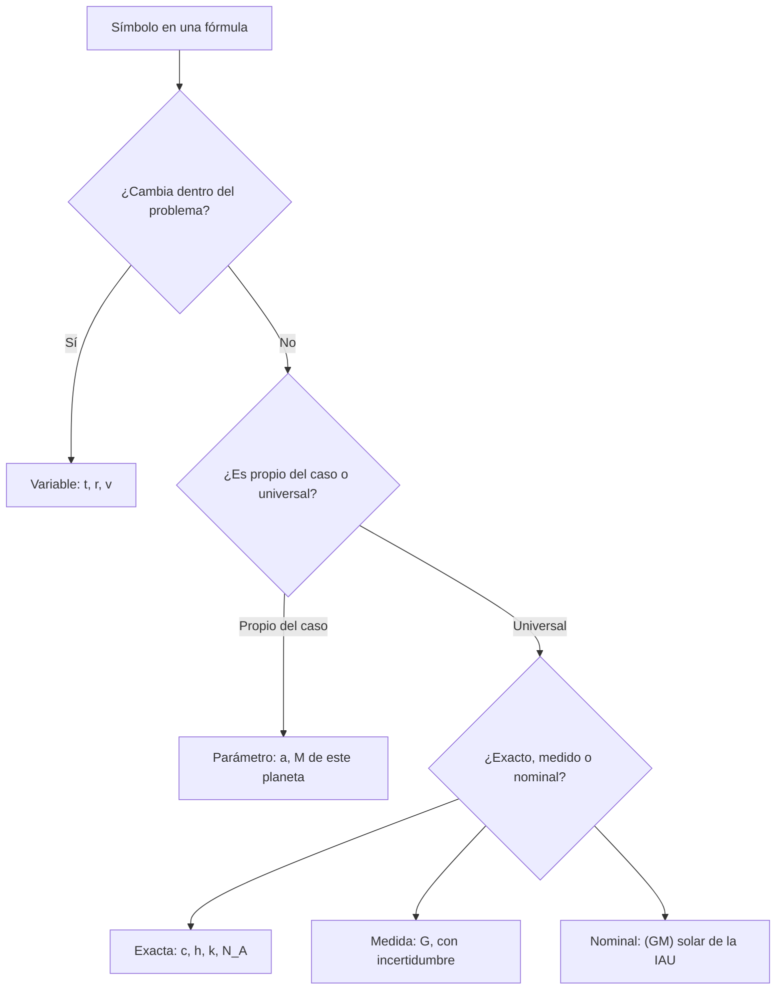

# B03-C12 — Variables y constantes científicas

<!-- nav:top -->
[🏠 Programa](../../../../README.md) · [📚 Bloque B03](../../../tronco-comun/B03-matematica-elemental-para-ciencias-espaciales.md) · [← Anterior: B03-C11 — Estimación y redondeo responsable](../B03-C11-estimacion-y-redondeo-responsable/CLASE.md) · [Siguiente: B03-C13 — Expresiones algebraicas iniciales →](../B03-C13-expresiones-algebraicas-iniciales/CLASE.md)
<!-- /nav -->

## 1. Ubicación, nivel y alcance

Duodécima clase del bloque B03 y apertura de su tramo algebraico. Para escribir una fórmula necesitas símbolos, y cada símbolo cumple un papel: unos cambian (variables), otros se fijan por el problema (parámetros) y otros son valores de la naturaleza o de una convención (constantes). Distinguirlos es el primer paso del lenguaje algebraico. Nivel N0 → N1.

Verás qué es una variable, un parámetro y una constante; la diferencia entre constantes exactas, medidas y nominales; y el caso de `G` y `GM`, donde una constante se conoce peor que su producto con una masa. No verás todavía manipulación algebraica (C13, C14) ni incertidumbre formal (C19).

## 2. Por qué esta clase existe

La masa del Sol se conoce con unas cinco cifras. Sin embargo, el producto `GM` del Sol se conoce con diez, y la constante `G` por sí sola con apenas cinco. La razón es histórica y metodológica: las órbitas miden `GM` directamente; para separar `G` de `M` hace falta una medida independiente de laboratorio, mucho más difícil. Saber qué es constante, qué es medido y qué es una convención evita atribuir al Sol una precisión que no tiene.

La decisión central es: **¿qué papel juega cada símbolo de esta fórmula, de dónde sale su valor y con qué confianza?** Aprenderás a etiquetar símbolos, a distinguir constantes de distinta naturaleza y a combinar `GM` y `G` para obtener una masa con su incertidumbre.

## 3. Lo que podrás hacer al terminar

1. Distinguir variable, parámetro y constante en una fórmula.
2. Clasificar una constante como exacta por definición, medida o nominal.
3. Explicar por qué `c` o `h` no llevan incertidumbre en el SI actual y `G` sí.
4. Calcular una masa a partir de `GM` y `G` y propagar la incertidumbre relativa de `G`.
5. Distinguir un valor nominal de una mejor estimación.
6. Construir un glosario de símbolos de una fórmula con unidades, naturaleza y fuente.

La evidencia es el **glosario de variables y constantes** del ejercicio 12 (sección 20).

## 4. Con qué llegas y cómo comprobarlo

Necesitas C01 a C11. Cinco preguntas:

1. En `d = vt`, ¿qué símbolos pueden tomar muchos valores?
2. ¿Cuántas cifras significativas tiene `6,67430`?
3. ¿Cuál es la unidad de `G` según C06?
4. ¿Qué es una incertidumbre relativa de `2,2 × 10⁻⁵` en porcentaje?
5. ¿Cuánto es `1,3271244 × 10²⁰ ÷ 6,6743 × 10⁻¹¹`, aproximadamente?

<details>
<summary>Ver respuestas</summary>

1. `d`, `v` y `t`. 2. 6. 3. `m³ kg⁻¹ s⁻²`. 4. 0,0022 %. 5. Unos `2 × 10³⁰`.
</details>

Con cuatro o cinco aciertos, sigue; con menos, repasa C05 y C06.

## 5. Un caso real: la masa del Sol a partir de GM y G

La IAU fija un parámetro gravitacional solar nominal, `(GM)☉ = 1,3271244 × 10²⁰ m³ s⁻²`, que es exacto **por definición** como valor de conversión (S1). CODATA 2022 da `G = 6,67430 × 10⁻¹¹ m³ kg⁻¹ s⁻²` con incertidumbre estándar relativa de `2,2 × 10⁻⁵` (S2). Dividiendo, `M☉ = GM/G = 1,98841 × 10³⁰ kg`, que coincide con la masa publicada por la NASA, `1,9884 × 10³⁰ kg` (S3), a 0,0005 %. Pero la incertidumbre de esa masa viene casi toda de `G`: `±4,4 × 10²⁵ kg`. Límite: el `GM` nominal es un factor de conversión, no la estimación más reciente de `GM`; la IAU lo advierte (S1).

## 6. Vocabulario

Una **variable** es un símbolo que puede tomar distintos valores dentro de un problema (el tiempo `t`). Un **parámetro** es un símbolo cuyo valor se fija para un problema concreto pero puede cambiar entre problemas (el semieje `a` de un planeta). Una **constante** es un valor que no cambia: **exacta por definición** (como `c = 299 792 458 m/s` en el SI, S4), **medida** (como `G`, con incertidumbre) o **nominal** (valor de conversión fijado por acuerdo, como el `(GM)☉` de la IAU). La **incertidumbre estándar** es la dispersión asociada a un valor medido; la **relativa** es esa incertidumbre dividida por el valor (S5). Una **fórmula** relaciona símbolos con una igualdad. Una **constante definitoria** del SI es una de las siete cuyo valor numérico se fija exactamente (S4).

## 7. Modelo mental: tres cajones de símbolos

Cuando leas una fórmula, clasifica cada símbolo.



*Descripción textual:* un árbol de decisión. Un símbolo se pregunta si cambia en el problema (variable); si no, si es propio del caso (parámetro) o universal (constante); y la constante universal se clasifica en exacta, medida o nominal.

Analogía: en una receta, la cantidad de harina es un parámetro de la receta, el tiempo de horno una variable mientras cocinas, y «un litro son mil mililitros» una constante. El límite: en la cocina las constantes no se miden con incertidumbre; en la ciencia, algunas sí.

## 8. La explicación, paso a paso

### 8.1 Variables y parámetros

En `T = 2πa/v` para la órbita circular, `T` es el resultado; `a` y `v` son datos del problema (parámetros de esa órbita); `2π` es un número. Si estudias cómo cambia `T` al variar `a`, entonces `a` pasa a ser la variable. El papel depende del problema, no del símbolo.

### 8.2 Constantes exactas por definición

Desde la revisión del SI, siete constantes tienen valor fijo: `ΔνCs = 9 192 631 770 Hz`, `c = 299 792 458 m/s`, `h = 6,626 070 15 × 10⁻³⁴ J s`, `k = 1,380 649 × 10⁻²³ J/K`, `N_A = 6,022 140 76 × 10²³ mol⁻¹`, y la carga elemental y la eficacia luminosa (S4). Son exactas porque **las unidades se definen a partir de ellas**: el metro y el kilogramo «heredan» su incertidumbre. No tiene sentido preguntar con qué precisión se mide `c` en m/s: es exacta por construcción.

### 8.3 Constantes medidas: G

La constante de gravitación `G` no está fijada por el SI; se mide en laboratorio. CODATA 2022 da `6,67430 × 10⁻¹¹` con incertidumbre estándar `0,00015 × 10⁻¹¹` (relativa `2,2 × 10⁻⁵`, S2). La IAU la describe como una de las constantes menos precisas (S1), por lo que cualquier cantidad que dependa de `G` por separado hereda esa incertidumbre.

### 8.4 Constantes nominales

Para evitar que cada publicación use un valor distinto, la IAU adopta «valores nominales» exactos para convertir unidades solares y planetarias: `R☉ᴺ = 6,957 × 10⁸ m`, `S☉ᴺ = 1361 W m⁻²`, `L☉ᴺ = 3,828 × 10²⁶ W`, `(GM)☉ᴺ = 1,3271244 × 10²⁰ m³ s⁻²` (S1). La propia resolución subraya que son **factores de conversión, no estimaciones** del valor verdadero (S1). Si necesitas una masa en kg, dividir `GM` por `G` y declarar qué `G` usas.

### 8.5 Por qué GM se conoce mejor que G

El movimiento de un cuerpo en órbita depende de `GM`, no de `G` y `M` por separado. Medir períodos y distancias da `GM` con muchas cifras; para separar `M`, hace falta `G`. La resolución de la IAU lo dice así: el error en `GM` es unos cinco órdenes de magnitud menor que el de `G` (S1). Por eso se dan las masas astronómicas como `GM` siempre que se puede.

### 8.6 Propagar la incertidumbre relativa en un cociente

Para `M = (GM)/G`, con `GM` exacto, la incertidumbre relativa de `M` es la de `G`: `2,2 × 10⁻⁵`. Para un producto o cociente de magnitudes independientes, las incertidumbres relativas se combinan en cuadratura (S5, ecuación 12 del apartado 5.1.2); aquí solo hay una fuente. Entonces `u(M) = 2,2 × 10⁻⁵ × 1,98841 × 10³⁰ = 4,4 × 10²⁵ kg`. El método general se estudia en C19.

## 9. Magnitudes, símbolos y unidades

| Símbolo | Qué es | Unidad | Naturaleza y valor |
|---|---|---|---|
| `c` | velocidad de la luz | m/s | exacta: 299 792 458 (S4) |
| `h` | constante de Planck | J s | exacta: 6,626 070 15 × 10⁻³⁴ (S4) |
| `k` | constante de Boltzmann | J/K | exacta: 1,380 649 × 10⁻²³ (S4) |
| `N_A` | constante de Avogadro | mol⁻¹ | exacta: 6,022 140 76 × 10²³ (S4) |
| `G` | constante de gravitación | m³ kg⁻¹ s⁻² | medida: 6,674 30 × 10⁻¹¹, `u_r = 2,2 × 10⁻⁵` (S2) |
| `(GM)☉` | parámetro gravitacional solar | m³ s⁻² | nominal: 1,3271244 × 10²⁰ (S1) |
| `M☉` | masa del Sol | kg | 1,9884 × 10³⁰ (publicada, S3) |
| `t`, `r`, `v` | tiempo, distancia, rapidez | s, m, m/s | variables |
| `a` | semieje | m | parámetro de cada órbita |

## 10. Convenciones y referencias

En este programa las constantes se escriben con su valor y unidad. Se declara siempre la naturaleza (exacta, medida, nominal) y la fuente con año (CODATA 2022). Los valores nominales llevan el superíndice `ᴺ` o la palabra «nominal». Las variables se definen en la primera aparición con su unidad.

## 11. De dónde sale lo que afirmamos

| ID | Fuente | Localizador | Respalda | Estado |
|---|---|---|---|---|
| S1 | IAU 2015, Resolución B3 (Mamajek et al., arXiv:1510.07674) | https://arxiv.org/abs/1510.07674 | Valores nominales: R☉ᴺ = 6,957 × 10⁸ m; S☉ᴺ = 1361 W m⁻²; L☉ᴺ = 3,828 × 10²⁶ W; (GM)☉ᴺ = 1,3271244 × 10²⁰ m³ s⁻²; son exactos y factores de conversión, no estimaciones; el error de GM es unos cinco órdenes menor que el de G | PDF leído el 2026-11-05 |
| S2 | NIST, CODATA, constante de gravitación newtoniana | https://physics.nist.gov/cgi-bin/cuu/Value?bg | G = 6,674 30 × 10⁻¹¹ m³ kg⁻¹ s⁻²; u = 0,000 15 × 10⁻¹¹; u relativa 2,2 × 10⁻⁵ (CODATA 2022) | Página consultada el 2026-11-05 |
| S3 | NASA NSSDC, *Sun Fact Sheet* (act. 9-may-2024) | https://nssdc.gsfc.nasa.gov/planetary/factsheet/sunfact.html | Masa del Sol 1 988 400 × 10²⁴ kg | Página consultada el 2026-11-05 |
| S4 | BIPM, *The International System of Units (SI)*, 9.ª ed. (2019), tabla 1 | https://doi.org/10.59161/AUEZ1291 | Valores exactos de `ΔνCs`, `c`, `h`, `k`, `N_A`; las unidades se definen a partir de ellas | PDF leído el 2026-11-05 |
| S5 | JCGM 100:2008 (GUM), apdo. 5.1.2, ecuaciones (10)–(12) | https://www.bipm.org/documents/20126/2071204/JCGM_100_2008_E.pdf | Ley de propagación de la incertidumbre; forma relativa para productos y cocientes | PDF leído el 2026-11-05 |
| S6 | NASA NSSDC, *Earth Fact Sheet* (act. 15-nov-2024) | https://nssdc.gsfc.nasa.gov/planetary/factsheet/earthfact.html | Masa de la Tierra 5,9722 × 10²⁴ kg | Página consultada el 2026-11-05 |

Límites: no se consultó el informe técnico de CODATA 2022 ni los experimentos de laboratorio sobre `G`; se cita el valor tal como lo publica NIST. La cantidad «cinco órdenes» es la afirmación de la resolución de la IAU, no un resultado propio.

## 12. Cómo ver la naturaleza de cada símbolo

Versión accesible de un mapa de constantes.

| Símbolo | Variable | Parámetro | Constante exacta | Constante medida | Nominal |
|---|---|---|---|---|---|
| `t` | sí | | | | |
| `a` | | sí | | | |
| `c` | | | sí | | |
| `G` | | | | sí | |
| `(GM)☉` | | | | | sí |

Si la dibujas, usa cinco cajones rotulados con forma distinta y símbolos en su interior. Descripción larga: de izquierda a derecha, de lo que cambia a lo que se fija por acuerdo; solo `G` lleva una barra de incertidumbre.

## 13. Ejemplo trabajado: la masa de la Tierra con GM nominal y G

**Pregunta.** Con `(GM)⊕ = 3,986004 × 10¹⁴ m³ s⁻²` (nominal, S1) y `G` de CODATA 2022, ¿qué masa terrestre resulta y con qué incertidumbre?

**Paso 1 · plan.** `M = GM/G`; las unidades `m³ s⁻² / (m³ kg⁻¹ s⁻²) = kg`.
**Paso 2 · estimación.** `4 × 10¹⁴ / 6,7 × 10⁻¹¹ ≈ 6 × 10²⁴ kg`.
**Paso 3 · cálculo.** `3,986004 × 10¹⁴ / 6,6743 × 10⁻¹¹ = 5,97217 × 10²⁴ kg`.
**Paso 4 · comparación.** NASA da `5,9722 × 10²⁴ kg` (S6): coincide.
**Paso 5 · incertidumbre.** Con `u_r(G) = 2,2 × 10⁻⁵`, `u(M) = 1,3 × 10²⁰ kg`; se informa `M = 5,9722 × 10²⁴ kg` con `u_r = 2,2 × 10⁻⁵`.
**Sentido físico.** La masa de la Tierra se conoce con cinco cifras porque se necesita `G`; la órbita de un satélite, en cambio, solo depende de `GM`, con diez cifras.

## 14. Constante exacta, medida o nominal: cuándo importa

**Exacta** simplifica: no aporta incertidumbre. **Medida** exige incertidumbre y una versión (año). **Nominal** es práctica para uniformar publicaciones, pero no debe usarse como si fuese la mejor estimación del valor real. Confundirlas lleva a dos errores: dar una incertidumbre a `c`, o dar una masa del Sol con diez cifras como si se conociera así.

## 15. Práctica guiada

**Ejercicio 1 · con los pasos indicados.** En `v = d/t`, identifica variables y parámetros si estudias el viaje a la Luna con `d = 384 400 km`. *Pasos:* sección 8.1.

<details><summary>Solución comentada</summary>

`d` es un parámetro del problema (fijo); `t` y `v` son variables ligadas por `v = d/t`: si una cambia, la otra también.
</details>

**Ejercicio 2 · con una pista.** Clasifica `c`, `G` y `(GM)☉` como exacta, medida o nominal. *Pista:* sección 8.2 a 8.4.

<details><summary>Solución comentada</summary>

`c`: exacta. `G`: medida (CODATA 2022). `(GM)☉`: nominal (IAU 2015).
</details>

**Ejercicio 3 · casi autónomo.** Calcula la masa de la Tierra con `GM = 3,986004 × 10¹⁴` y `G = 6,6743 × 10⁻¹¹`.

<details><summary>Solución comentada</summary>

`5,97217 × 10²⁴ kg`; la NASA da 5,9722.
</details>

## 16. Práctica autónoma, transferencia e integrador

**Ejercicio 4.** Convierte `u_r = 2,2 × 10⁻⁵` a porcentaje.

<details><summary>Solución comentada</summary>

`0,0022 %`.
</details>

**Ejercicio 5.** Calcula `u(M☉)` si `M☉ = 1,98841 × 10³⁰ kg` y `u_r(G) = 2,2 × 10⁻⁵`.

<details><summary>Solución comentada</summary>

`4,4 × 10²⁵ kg` (con dos cifras, como recomienda el GUM, S5 apdo. 7.2.6).
</details>

**Ejercicio 6.** Verifica con unidades que `GM/G` da kilogramos.

<details><summary>Solución comentada</summary>

`m³ s⁻² ÷ (m³ kg⁻¹ s⁻²) = kg`. Los `m³` y los `s⁻²` se cancelan.
</details>

**Ejercicio 7.** ¿Por qué no tiene sentido dar la incertidumbre de `c` en m/s?

<details><summary>Solución comentada</summary>

Porque el SI la fija exactamente y define el metro a partir de ella (S4). Cualquier «incertidumbre» sería de otra cosa (la longitud medida, no `c`).
</details>

**Ejercicio 8.** La irradiancia nominal es `1361 W m⁻²` a 1 au. Halla la constante `k = S × d²` en W (con `d` en m).

<details><summary>Solución comentada</summary>

`1361 × (1,495978707 × 10¹¹)² = 3,046 × 10²⁵ W`. Es la potencia dividida entre `4π` (S1: `L = 3,828 × 10²⁶ W`); se ve en el ejercicio 9.
</details>

**Ejercicio 9 · transferencia.** Con la luminosidad nominal `3,828 × 10²⁶ W` y la fórmula `S = L/(4π d²)`, calcula `S` a 1 au y compárala con 1361 W/m².

<details><summary>Solución comentada</summary>

`S = 3,828 × 10²⁶ / (4π × 2,238 × 10²²) = 1 361,2 W/m²`. Coincide con el nominal al 0,01 %. La fórmula es la de C10 con `k = L/4π`.
</details>

**Ejercicio 10 · transferencia.** Un texto usa `G = 6,67 × 10⁻¹¹`. ¿Qué error relativo comete frente a CODATA 2022?

<details><summary>Solución comentada</summary>

`(6,6743 − 6,67)/6,6743 = 0,064 %`. Es unas 29 veces mayor que la incertidumbre relativa de `G` (0,0022 %): válido para estimaciones, insuficiente si la precisión importa.
</details>

**Ejercicio 11 · transferencia.** Una publicación da la masa del Sol como `1,988 4100 × 10³⁰ kg` (8 cifras). ¿Qué problema tiene y cómo lo corriges?

<details><summary>Solución comentada</summary>

Con `u_r = 2,2 × 10⁻⁵` solo se defienden unas 4–5 cifras (hasta `1,9884 × 10³⁰`). Se corrige reportando `1,9884 × 10³⁰ kg` o `1,98841 × 10³⁰ kg ± 0,00004 × 10³⁰`.
</details>

**Ejercicio 12 · integrador.** Elabora tu *glosario de variables y constantes* (sección 20) para una fórmula a elección con al menos cuatro símbolos: tipo (variable, parámetro, constante), unidad, valor con fuente y naturaleza.

<details><summary>Solución modelo</summary>

Para `g = GM/R²`: `g` (variable derivada, m/s²), `GM` (nominal, m³ s⁻²), `R` (parámetro, m), `2` en `R²` (número). Con `G` si la fórmula la usa. Cada fila con su fuente citada. Se acepta cualquier fórmula con símbolos clasificados y fuentes consultadas.
</details>

## 17. Laboratorio: constantes y masa con su incertidumbre

El script [laboratorio_constantes.py](laboratorio_constantes.py) lista las constantes exactas del SI, calcula `M☉ = GM/G` y su incertidumbre desde la de `G`. Antes comprueba que `M☉` coincide con la de la NASA al `10⁻⁴` y que la incertidumbre es `4,4 × 10²⁵ kg`.

**Datos:** publicados (BIPM, NIST, IAU, NASA). **Predice antes de ejecutar:** ¿cuántas cifras coincidirán con la masa de la NASA? (Cinco.) **Resultados (2026-11-05, Python 3.12.9):** constantes exactas impresas; `M☉ = 1,98841 × 10³⁰ kg` (NASA 1,9884 × 10³⁰), diferencia 0,0005 %; incertidumbre `±4,37 × 10²⁵ kg` (relativa `2,2 × 10⁻⁵`).

```bash
python programa/clases/B03/B03-C12-variables-y-constantes-cientificas/laboratorio_constantes.py
```

**Límites:** la incertidumbre solo proviene de `G`; no considera la del propio dato `GM`.

## 18. Errores frecuentes y cómo corregirlos

**Dar incertidumbre a una constante exacta.** Ejercicio 7.
**Tratar un valor nominal como la mejor estimación.** Sección 14.
**Dar demasiadas cifras a la masa del Sol.** Ejercicio 11.
**Confundir variable con parámetro.** Ejercicio 1.
**Omitir el año de CODATA.** Sección 10.

## 19. Cómo sabrás que vas bien

Tras 8.1: ¿etiquetas los símbolos de `T = 2πa/v`? Si no, repite el ejercicio 1. Tras 8.2–8.4: ¿distingues las tres naturalezas? Si no, haz el 2. Tras 8.5: ¿explicas por qué GM se conoce mejor? Si no, relee. Al final: ¿informas una masa con su incertidumbre? Si dudas, rehaz el 5.

## 20. Qué entregas y cómo se evalúa

El producto es tu **glosario de variables y constantes** para una fórmula: símbolos, tipo, unidad, valor con fuente y naturaleza.

| Criterio | Inicial | En desarrollo | Logrado | Destacado |
|---|---|---|---|---|
| Clasificación | Errónea | Parcial | Correcta | Justifica con la fuente |
| Unidades | Ausentes | Algunas | Todas | Verifica con análisis dimensional |
| Fuentes | Sin cita | Parcial | Completa con año | Distingue exacto, medido y nominal |
| Incertidumbre | Ignorada | Mencionada | Cuantificada | Propaga a una cantidad |
| Claridad | Confusa | Entendible | Reproducible | Autoevaluada |

**Condiciones críticas:** no atribuir incertidumbre a constantes exactas; declarar el año y la naturaleza de cada constante; citar solo fuentes consultadas.

## 21. Ética, seguridad y límites

Dar más precisión a un valor de la que tiene es una falta de honestidad científica; usar un valor nominal como si fuese «la verdad» también. Esta clase es educativa y no sirve para fijar parámetros de misión. Accesibilidad: símbolos en texto, tablas equivalentes, sin conexión.

## 22. Para cerrar y seguir

Una fórmula mezcla variables, parámetros y constantes; las constantes pueden ser exactas, medidas o nominales; `GM` se conoce mucho mejor que `G`, y la incertidumbre de una masa viene de `G`. Queda una pregunta: ahora que sabes qué es cada símbolo, ¿cómo se combinan en expresiones y se simplifican? Es C13.

**Glosario español–inglés.** variable · *variable*; parámetro · *parameter*; constante · *constant*; constante nominal · *nominal constant*; incertidumbre estándar · *standard uncertainty*; constante definitoria · *defining constant*; parámetro gravitacional · *gravitational parameter*.

**Continuidad.** B03-C13 y C14 manipulan fórmulas con estos símbolos; B03-C19 formaliza la propagación de incertidumbre; B12 la estudia con rigor.

**Referencias:** ver sección 11. Todas las fuentes son datos oficiales consultados.

<!-- nav:bottom -->
---

[← Anterior: B03-C11 — Estimación y redondeo responsable](../B03-C11-estimacion-y-redondeo-responsable/CLASE.md) · [📚 Bloque B03](../../../tronco-comun/B03-matematica-elemental-para-ciencias-espaciales.md) · [Siguiente: B03-C13 — Expresiones algebraicas iniciales →](../B03-C13-expresiones-algebraicas-iniciales/CLASE.md)
<!-- /nav -->
