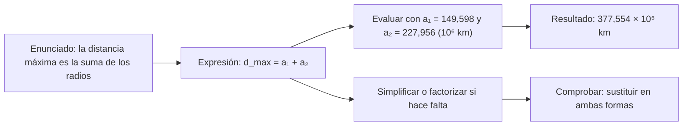

# B03-C13 — Expresiones algebraicas iniciales

<!-- nav:top -->
[🏠 Programa](../../../../README.md) · [📚 Bloque B03](../../../tronco-comun/B03-matematica-elemental-para-ciencias-espaciales.md) · [← Anterior: B03-C12 — Variables y constantes científicas](../B03-C12-variables-y-constantes-cientificas/CLASE.md) · [Siguiente: B03-C14 — Despeje de ecuaciones elementales →](../B03-C14-despeje-de-ecuaciones-elementales/CLASE.md)
<!-- /nav -->

## 1. Ubicación, nivel y alcance

Decimotercera clase del bloque B03. En C12 aprendiste a clasificar símbolos. Ahora los combinas: una **expresión algebraica** es una frase matemática hecha con números, símbolos y operaciones, que describe una situación sin fijar todavía los valores. El álgebra permite razonar una vez y calcular muchas veces. Nivel N0 → N1.

Verás cómo traducir un enunciado a una expresión, evaluarla con datos, simplificarla (reducir términos, aplicar la propiedad distributiva), factorizar lo más sencillo y comprobar que lo hecho es equivalente. No verás aún ecuaciones con incógnita (C14) ni álgebra avanzada (B04).

## 2. Por qué esta clase existe

¿Cuánto tarda una señal en llegar desde la Tierra hasta Marte? Depende de dónde estén los dos planetas. Calcular el caso más cercano y el más lejano, y luego otros intermedios, serían tres cálculos distintos; con una expresión escribes la regla una vez y la reutilizas. Además, el álgebra permite descubrir relaciones que los números ocultan (por ejemplo, que el producto de las distancias extremas depende solo de los radios de las órbitas).

La decisión central es: **¿cómo expreso con símbolos lo que ocurre, de modo que sirva para cualquier valor y pueda comprobar que no me equivoqué?** Aprenderás a construir, evaluar, simplificar y verificar expresiones.

## 3. Lo que podrás hacer al terminar

1. Traducir un enunciado verbal a una expresión algebraica y viceversa.
2. Evaluar una expresión sustituyendo valores con sus unidades.
3. Reducir términos semejantes y aplicar la propiedad distributiva.
4. Factorizar un factor común y reconocer una diferencia de cuadrados.
5. Comprobar que dos expresiones son equivalentes sustituyendo valores.
6. Usar una expresión para analizar un problema astronómico con casos extremos.

La evidencia es la **ficha de expresiones** del ejercicio 12 (sección 20).

## 4. Con qué llegas y cómo comprobarlo

Necesitas C01 a C12. Cinco preguntas:

1. ¿Cuánto es `3 × (2 + 5)`? ¿Y `3 × 2 + 3 × 5`?
2. ¿Qué significa que un símbolo sea una variable?
3. Si `d = 6` y `v = 2`, ¿cuánto es `d/v`?
4. ¿Cuánto es `5² − 3²`?
5. ¿Cuál es la unidad de `d/c` si `d` está en km y `c` en km/s?

<details>
<summary>Ver respuestas</summary>

1. 21 y 21 (son iguales: propiedad distributiva). 2. Que puede tomar varios valores. 3. 3. 4. 16. 5. Segundos.
</details>

Con cuatro o cinco aciertos, sigue; con menos, repasa C09 y C12.

## 5. Un caso real: cuánto tarda una señal entre la Tierra y Marte

Los semiejes mayores de la órbita de la Tierra y de Marte son 149,598 y 227,956 millones de km (S1). Si imaginas ambas órbitas circulares y en el mismo plano, la distancia entre los dos planetas varía entre `a₂ − a₁` (alineados del mismo lado del Sol) y `a₁ + a₂` (al otro lado del Sol). Con `c = 299 792,458 km/s` (S2) el retardo de la señal oscila entre 261 s (4,4 min) y 1 259 s (21 min). Límite: es un **modelo simplificado**; las órbitas reales son elípticas e inclinadas, por lo que las distancias reales extremas son distintas de las de este modelo.

## 6. Vocabulario

Una **expresión algebraica** combina números, variables y operaciones (`a₁ + a₂`). Un **término** es cada sumando (`3a`, `−5`). Los **términos semejantes** tienen la misma parte literal y se pueden reducir (`3a + 2a = 5a`). Un **coeficiente** es el número que multiplica a una variable (`3` en `3a`). La **propiedad distributiva** dice `a(b + c) = ab + ac`. **Factorizar** es escribir una suma como un producto (`6a + 9 = 3(2a + 3)`). Una **identidad** es una igualdad válida para cualquier valor (`(a + b)² = a² + 2ab + b²`). **Evaluar** es sustituir variables por valores y calcular. Dos expresiones son **equivalentes** si valen lo mismo para todos los valores.

## 7. Modelo mental: la expresión como máquina

Una expresión es una máquina: entra un valor, sale otro.



*Descripción textual:* un enunciado se traduce a una expresión; esta se evalúa con datos para obtener un resultado, o bien se simplifica o factoriza; en ambos caminos se comprueba sustituyendo valores en la forma original y en la transformada.

Analogía: una receta con cantidades literales («dos partes de harina por cada una de agua»). Sirve para cualquier tamaño. El límite: una receta tolera aproximaciones; una expresión debe conservar el valor exacto al transformarse.

## 8. La explicación, paso a paso

### 8.1 De palabras a símbolos

«El doble de la suma de `a` y `b`» es `2(a + b)`. «La suma del doble de `a` y `b`» es `2a + b`. Las palabras ordenan; los paréntesis las traducen. Identifica primero cada magnitud, asígnale un símbolo con unidad y escribe la relación.

### 8.2 Evaluar con unidades

Sustituir es poner el valor **con su unidad** en el lugar del símbolo: `t = d/c`, con `d = 78,358 × 10⁶ km` y `c = 299 792,458 km/s`, da `t = 261,4 s`. Si escribes solo números pierdes la comprobación por unidades de C06.

### 8.3 Términos semejantes

`3a + 5a − 2a = 6a`: se suman los coeficientes porque son «la misma cosa» contada varias veces. `3a + 2b` no se reduce: son cosas distintas. Un modo de comprobarlo es sustituir `a = 1`, `b = 1`: `5` y `5` coinciden en la suma de semejantes; en `3a + 2b = 5ab` daría `5 ≠ 5` solo por casualidad, y con `a = 2`, `b = 1` ya falla.

### 8.4 Propiedad distributiva

`2(a + 3) = 2a + 6` (no `2a + 3`). Justificación: `2(a + 3)` son dos copias de `a + 3`, o sea dos `a` y dos `3`. Lo mismo para restas: `3(a − 2) = 3a − 6`.

### 8.5 Factor común y diferencia de cuadrados

`6a + 9 = 3(2a + 3)`: ambos términos son múltiplos de 3. La **diferencia de cuadrados** es `a² − b² = (a − b)(a + b)`. Se comprueba al expandir: `(a − b)(a + b) = a² + ab − ab − b² = a² − b²`. Y el cuadrado de una suma: `(a + b)² = a² + 2ab + b²`; con `a = 3` y `b = 4` da `49 = 9 + 24 + 16`. Cuidado: `(a + b)² ≠ a² + b²` (el término `2ab` no puede olvidarse; ver C04).

### 8.6 Casos extremos y la expresión del producto

Para la distancia entre dos órbitas circulares coplanares de radios `a₁ < a₂`: `d_min = a₂ − a₁`, `d_max = a₁ + a₂`. El producto `d_max · d_min = (a₂ + a₁)(a₂ − a₁) = a₂² − a₁²` por diferencia de cuadrados. Con los datos: `377,554 × 78,358 = 29 584,4` (en 10¹² km²) y `227,956² − 149,598² = 51 963,9 − 22 379,6 = 29 584,4`: coinciden. La diferencia `d_max − d_min = 2a₁` muestra algo que no se ve con números: el rango total de distancias solo depende del radio de la órbita **interior**.

## 9. Magnitudes, símbolos y unidades

| Símbolo | Qué es | Unidad | Valor o nota |
|---|---|---|---|
| `a₁`, `a₂` | radios de las órbitas de la Tierra y Marte (modelo) | km | 149,598 × 10⁶; 227,956 × 10⁶ (S1) |
| `d_min`, `d_max` | distancia mínima y máxima (modelo) | km | `a₂ − a₁`; `a₁ + a₂` |
| `c` | velocidad de la luz | km/s | 299 792,458 (S2) |
| `t` | retardo de la señal | s | `t = d/c` |
| `T` | período orbital | s | para el ejercicio 10 |

## 10. Convenciones y referencias

Se omite el signo de multiplicación entre número y letra (`3a`) y entre número y paréntesis (`2(a + b)`), pero no entre dos números (`2 × 3`). Los subíndices distinguen cantidades de la misma clase (`a₁`, `a₂`). Se comprueba cada transformación sustituyendo al menos dos conjuntos de valores. Las distancias del modelo se rotulan «del modelo circular» para no confundirlas con datos de la NASA.

## 11. De dónde sale lo que afirmamos

| ID | Fuente | Localizador | Respalda | Estado |
|---|---|---|---|---|
| S1 | NASA NSSDC, fichas *Earth* (15-nov-2024) y *Mars* (19-may-2025) | https://nssdc.gsfc.nasa.gov/planetary/factsheet/earthfact.html y .../marsfact.html | Semieje mayor de la Tierra 149,598 × 10⁶ km y de Marte 227,956 × 10⁶ km; período sidéreo de Marte 686,980 d | Páginas consultadas el 2026-11-05 |
| S2 | BIPM, *The International System of Units (SI)*, 9.ª ed. (2019) | https://doi.org/10.59161/AUEZ1291 | `c` = 299 792 458 m/s | PDF leído el 2026-11-05 |

Límites: el modelo circular y coplanar es una simplificación didáctica que **no** se contrastó con efemérides; los retardos y distancias extremas del modelo no deben tomarse como los reales.

## 12. Cómo ver la expresión

Versión accesible de una tabla de casos.

| Caso (modelo circular) | Expresión | Distancia (10⁶ km) | Retardo de luz |
|---|---|---|---|
| Planetas del mismo lado del Sol | `a₂ − a₁` | 78,358 | 261,4 s (4,36 min) |
| Sol entre los dos planetas | `a₁ + a₂` | 377,554 | 1 259,4 s (20,99 min) |
| Rango total | `2a₁` | 299,196 | 998,0 s (diferencia) |

Si la dibujas, usa dos círculos concéntricos con dos posiciones del planeta exterior y los segmentos rotulados. Descripción larga: un disco central (Sol), una órbita interior de radio `a₁` y una exterior de radio `a₂`; los dos casos extremos son segmentos alineados con el centro.

## 13. Ejemplo trabajado: el retardo máximo de una señal Tierra–Marte (modelo)

**Pregunta.** ¿Qué retardo tiene la señal en el caso extremo, y por qué la expresión basta para cualquier par de planetas?

**Paso 1 · símbolos.** `a₁` y `a₂` (radios), `d_max = a₁ + a₂`, `t = d/c`.
**Paso 2 · expresión combinada.** `t_max = (a₁ + a₂)/c`. Se evalúa con unidades al final.
**Paso 3 · estimación.** `(1,5 + 2,3) × 10⁸ km / 3 × 10⁵ km/s ≈ 1,3 × 10³ s`.
**Paso 4 · sustitución.** `(149,598 + 227,956) × 10⁶ km / 299 792,458 km/s = 377,554 × 10⁶ / 299 792,458 = 1 259,4 s = 20,99 min`.
**Paso 5 · comprobación.** Con `t_min = (a₂ − a₁)/c = 261,4 s`, la diferencia es `2a₁/c = 998,0 s`; y `1 259,4 − 261,4 = 998,0`. ✓
**Sentido físico.** La misma expresión sirve con Júpiter (`a₂ = 778,479`) o Neptuno: solo cambias el dato.

## 14. Dos formas de resolver: números primero o símbolos primero

**Números primero:** rápido para un caso, pero cada caso exige repetir todo y no revela relaciones. **Símbolos primero:** se escribe la expresión general, se simplifica y se evalúa al final; es más lento la primera vez, pero evita errores de redondeo intermedio y permite ver patrones (como `2a₁`). Falla si la expresión mezcla unidades o si se simplifica sin comprobar. Lo recomendado: símbolos primero y sustituir al final con unidades.

## 15. Práctica guiada

**Ejercicio 1 · con los pasos indicados.** Escribe la expresión de la distancia máxima y evalúala con `a₁ = 149,598` y `a₂ = 227,956` (en 10⁶ km). *Pasos:* sección 8.1 y 8.2.

<details><summary>Solución comentada</summary>

`d_max = a₁ + a₂ = 149,598 + 227,956 = 377,554 × 10⁶ km`.
</details>

**Ejercicio 2 · con una pista.** Reduce `3x + 5x − 2x`. *Pista:* coeficientes.

<details><summary>Solución comentada</summary>

`(3 + 5 − 2)x = 6x`. Comprobación con `x = 2`: `6 + 10 − 4 = 12 = 6 × 2`.
</details>

**Ejercicio 3 · casi autónomo.** Evalúa `t = d/c` con `d = 78,358 × 10⁶ km`.

<details><summary>Solución comentada</summary>

`78,358 × 10⁶ / 299 792,458 = 261,4 s`. Los km se cancelan.
</details>

## 16. Práctica autónoma, transferencia e integrador

**Ejercicio 4.** Expande `2(a + 3)` y `3(a − 2)`.

<details><summary>Solución comentada</summary>

`2a + 6` y `3a − 6`. Error típico: `2a + 3` (olvidó multiplicar el 3).
</details>

**Ejercicio 5.** Factoriza `6a + 9`.

<details><summary>Solución comentada</summary>

`3(2a + 3)`. Comprobación con `a = 1`: `15 = 3 × 5`.
</details>

**Ejercicio 6.** Comprueba que `(a + b)² = a² + 2ab + b²` con `a = 3` y `b = 4`.

<details><summary>Solución comentada</summary>

`(3 + 4)² = 49` y `9 + 24 + 16 = 49`. Y `a² + b² = 25`: no coincide con 49.
</details>

**Ejercicio 7.** Usa la diferencia de cuadrados para calcular `d_max · d_min` con `a₁ = 149,598` y `a₂ = 227,956` y compáralo con el producto directo `377,554 × 78,358`.

<details><summary>Solución comentada</summary>

`a₂² − a₁² = 51 963,9 − 22 379,6 = 29 584,4`; directo: `377,554 × 78,358 = 29 584,4`. Coinciden (unidades: 10¹² km²).
</details>

**Ejercicio 8.** Un estudiante escribe `(a + b)² = a² + b²`. Detecta el error con valores.

<details><summary>Solución comentada</summary>

Con `a = 1`, `b = 1`: `(1 + 1)² = 4` frente a `1 + 1 = 2`. Falta `2ab`.
</details>

**Ejercicio 9 · transferencia.** El tiempo de ida y vuelta de una orden con respuesta es `t = 2d/c + t_proc`, donde `t_proc` es el tiempo de proceso (hipotético, 1 s). Evalúa para `d_max` del modelo.

<details><summary>Solución comentada</summary>

`2 × 1 259,4 + 1 = 2 519,8 s ≈ 42 min`. La parte dominante es el viaje de la luz; el 1 s de proceso es despreciable.
</details>

**Ejercicio 10 · transferencia.** Escribe la expresión de la rapidez orbital media `v = 2πa/T` y evalúala para Marte: `a = 227,956 × 10⁶ km`, `T = 686,980 d`.

<details><summary>Solución comentada</summary>

`T = 686,980 × 86 400 = 5,9355 × 10⁷ s`; `v = 2π × 227,956 × 10⁶ / 5,9355 × 10⁷ = 24,13 km/s`. Unidades: km/s.
</details>

**Ejercicio 11 · transferencia.** Comprueba con unidades que `t = (a₁ + a₂)/c` es un tiempo.

<details><summary>Solución comentada</summary>

`km / (km/s) = s`. ✓ Si `a` estuviera en au y `c` en km/s, la expresión no sería consistente.
</details>

**Ejercicio 12 · integrador.** Elabora tu *ficha de expresiones* (sección 20) para otro par de planetas (por ejemplo Tierra y Júpiter): enunciado, expresión de `d_min`, `d_max` y retardos, simplificación (producto y diferencia), evaluación con unidades, comprobación y fuente.

<details><summary>Solución modelo</summary>

Con `a₁ = 149,598` y `a₂ = 778,479` (10⁶ km): `d_min = 628,881`, `d_max = 928,077`; retardos 2 097,7 s y 3 095,7 s; `d_max · d_min = a₂² − a₁² = 583 650` (10¹² km²); `d_max − d_min = 2a₁ = 299,196`. Cada paso con unidades y la advertencia de modelo circular.
</details>

## 17. Laboratorio: validar identidades con números

El script [laboratorio_expresiones.py](laboratorio_expresiones.py) evalúa las expresiones de la clase y, antes, comprueba 1 000 veces con números aleatorios (semilla fija) que `(a+b)² = a² + 2ab + b²`, que `a² − b² = (a−b)(a+b)` y que la distributiva se cumple, y que `d_max · d_min = a₂² − a₁²` con los datos.

**Datos:** publicados (NASA, SI); distancias del **modelo circular**, no reales. **Predice antes de ejecutar:** ¿cuántos minutos tarda la luz en el caso más lejano del modelo? (Unos 21.) **Resultados (2026-11-05, Python 3.12.9):** distancia mínima 78,358 × 10⁶ km, luz 261,4 s = 4,36 min; máxima 377,554 × 10⁶ km, luz 1 259,4 s = 20,99 min; `d_max · d_min = a₂² − a₁²` = 2,9584 × 10¹⁶ km².

```bash
python programa/clases/B03/B03-C13-expresiones-algebraicas-iniciales/laboratorio_expresiones.py
```

**Límites:** órbitas circulares y coplanares; no calcula acercamientos reales.

## 18. Errores frecuentes y cómo corregirlos

**Distribuir a medias** (`2(a + 3) = 2a + 3`). Ejercicio 4.
**Olvidar el término cruzado `2ab`.** Ejercicios 6 y 8.
**Sumar términos no semejantes.** Sección 8.3.
**Evaluar sin unidades.** Ejercicio 11.
**Simplificar sin comprobar.** Sección 14.

## 19. Cómo sabrás que vas bien

Tras 8.1: ¿traduces «la mitad de la suma de `a` y `b`»? (`(a + b)/2`). Si no, repite el ejercicio 1. Tras 8.4: ¿expandes `4(x − 2)`? (`4x − 8`). Si no, haz el 4. Tras 8.5: ¿factorizas `10a + 15`? (`5(2a + 3)`). Al final: ¿compruebas con valores? Si dudas, rehaz el 8.

## 20. Qué entregas y cómo se evalúa

El producto es tu **ficha de expresiones**: un problema astronómico con enunciado, expresión, simplificación, evaluación con unidades, comprobación y límites del modelo.

| Criterio | Inicial | En desarrollo | Logrado | Destacado |
|---|---|---|---|---|
| Traducción | Incorrecta | Parcial | Correcta | Generaliza a otros casos |
| Simplificación | Errores | Con ayuda | Correcta y comprobada | Descubre una relación nueva |
| Unidades | Ausentes | Algunas | En cada paso | Verifica la dimensión final |
| Comprobación | Ninguna | Un valor | Dos o más | Con una vía independiente |
| Límites del modelo | No los menciona | Genéricos | Específicos | Propone mejora |

**Condiciones críticas:** no presentar un modelo simplificado como realidad; incluir unidades; citar solo fuentes consultadas.

## 21. Ética, seguridad y límites

Un modelo simplificado puede dar cifras que parecen precisas pero no son reales; rotularlo como modelo es parte de la honestidad científica. Esta clase es educativa y no sirve para planificar comunicaciones ni misiones. Accesibilidad: expresiones en texto, tablas equivalentes, sin conexión.

## 22. Para cerrar y seguir

Una expresión permite razonar una vez y calcular muchas; se evalúa con unidades, se simplifica con propiedades que se justifican y se comprueba con valores; una identidad como la diferencia de cuadrados revela relaciones que los números ocultan. Queda una pregunta: ¿qué pasa cuando el valor desconocido está dentro de la expresión y quieres hallarlo? Es C14.

**Glosario español–inglés.** expresión algebraica · *algebraic expression*; término · *term*; coeficiente · *coefficient*; propiedad distributiva · *distributive property*; factorizar · *to factor*; identidad · *identity*; términos semejantes · *like terms*.

**Continuidad.** B03-C14 despeja incógnitas de estas expresiones. B04 desarrolla el álgebra completa y B03-C20 usa expresiones para la maqueta.

**Referencias:** ver sección 11. Todas las fuentes son datos oficiales consultados.

<!-- nav:bottom -->
---

[← Anterior: B03-C12 — Variables y constantes científicas](../B03-C12-variables-y-constantes-cientificas/CLASE.md) · [📚 Bloque B03](../../../tronco-comun/B03-matematica-elemental-para-ciencias-espaciales.md) · [Siguiente: B03-C14 — Despeje de ecuaciones elementales →](../B03-C14-despeje-de-ecuaciones-elementales/CLASE.md)
<!-- /nav -->
