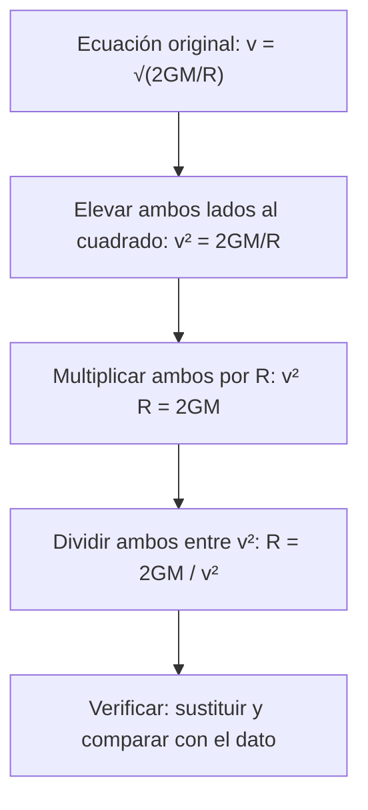

# B03-C14 — Despeje de ecuaciones elementales

<!-- nav:top -->
[🏠 Programa](../../../../README.md) · [📚 Bloque B03](../../../tronco-comun/B03-matematica-elemental-para-ciencias-espaciales.md) · [← Anterior: B03-C13 — Expresiones algebraicas iniciales](../B03-C13-expresiones-algebraicas-iniciales/CLASE.md) · [Siguiente: B03-C15 — Representación cartesiana de datos →](../B03-C15-representacion-cartesiana-de-datos/CLASE.md)
<!-- /nav -->

## 1. Ubicación, nivel y alcance

Decimocuarta clase del bloque B03. En C13 construiste y simplificaste expresiones. Ahora das el paso que más se usa en ciencia: **despejar**, es decir, dejar sola la magnitud que te interesa cuando conoces las demás. Una misma fórmula sirve para calcular una distancia, un tiempo o una masa según lo que sepas. Nivel N0 → N1.

Verás las ecuaciones como balanzas, las operaciones inversas, el orden de los pasos, cómo despejar en fórmulas con potencias y raíces, y la verificación por sustitución. No verás sistemas de ecuaciones ni ecuaciones cuadráticas (B04).

## 2. Por qué esta clase existe

La fórmula de la velocidad de escape, `v = √(2GM/R)`, aparece en las fichas de la NASA como un número (11,186 km/s). Pero un ingeniero puede necesitar lo contrario: dado `v`, ¿cuál es el radio? Dados el semieje y el período de la Tierra, ¿cuál es `GM` del Sol? Despejar permite invertir una fórmula sin volver a deducirla, y la verificación por sustitución comprueba que el despeje no introdujo errores.

La decisión central es: **¿qué operaciones inversas, y en qué orden, dejan sola la incógnita sin cambiar la igualdad, y cómo compruebo el resultado?** Aprenderás un procedimiento seguro y su control.

## 3. Lo que podrás hacer al terminar

1. Explicar una ecuación como una igualdad que se conserva al aplicar la misma operación a ambos lados.
2. Despejar una incógnita en ecuaciones lineales y en fórmulas con potencias y raíces.
3. Elegir el orden de las operaciones inversas.
4. Comprobar un despeje por sustitución y por análisis dimensional.
5. Usar una fórmula astronómica en ambos sentidos con datos publicados.
6. Detectar errores típicos de despeje (olvidar el signo, no aplicar a todo el lado).

La evidencia es la **hoja de despejes verificados** del ejercicio 12 (sección 20).

## 4. Con qué llegas y cómo comprobarlo

Necesitas C01 a C13. Cinco preguntas:

1. Si `x + 3 = 10`, ¿cuánto vale `x`?
2. Si `2x = 14`, ¿cuánto vale `x`?
3. ¿Cuál es la operación inversa de elevar al cuadrado?
4. ¿Cuánto es `√(36/4)`?
5. ¿Qué haces con ambos lados si restas 5 a uno?

<details>
<summary>Ver respuestas</summary>

1. 7. 2. 7. 3. La raíz cuadrada. 4. 3. 5. Restas 5 al otro lado también: la igualdad solo se conserva si ambos lados reciben lo mismo.
</details>

Con cuatro o cinco aciertos, sigue; con menos, repasa C13.

## 5. Un caso real: invertir la velocidad de escape y la ley de Kepler

La NASA publica la velocidad de escape de la Tierra, 11,186 km/s, y su radio medio, 6 371 km (S1). La IAU fija el parámetro gravitacional terrestre nominal `GM = 3,986004 × 10¹⁴ m³ s⁻²` (S2). La fórmula `v = √(2GM/R)` (que se justificará en B05) relaciona las tres. Si despejas `R` a partir de `v` y `GM`, obtienes 6 371,2 km: el radio publicado. Y con la tercera ley de Kepler, `T² = 4π²a³/(GM)`, el semieje y el período de la Tierra (S1) dan `GM` del Sol en 0,001 % de la cifra nominal. Límite: ambas fórmulas son modelos de dos cuerpos que aquí se **dan** como punto de partida; esta clase solo enseña a manipularlas.

## 6. Vocabulario

Una **ecuación** es una igualdad con una o más **incógnitas**. **Resolver** o **despejar** una incógnita es aislarla en un lado. Una **operación inversa** deshace otra (suma/resta, multiplicación/división, potencia/raíz). Una **solución** es el valor que hace cierta la igualdad. **Verificar** es sustituir la solución en la ecuación original. Una **fórmula** es una ecuación entre magnitudes; **despejar una variable de una fórmula** da otra fórmula equivalente. Una **ecuación equivalente** tiene las mismas soluciones.

## 7. Modelo mental: la balanza

Una ecuación es una balanza equilibrada: lo que haces a un platillo debes hacerlo al otro.



*Descripción textual:* una cadena vertical que parte de la ecuación original; cada flecha aplica una operación a ambos lados (cuadrado, multiplicar por R, dividir entre v²) y el proceso termina verificando por sustitución.

Analogía: una balanza de platillos. El límite: una balanza no distingue entre pesos negativos; en una ecuación hay operaciones que no se pueden aplicar siempre (dividir entre cero, elevar al cuadrado puede introducir soluciones espurias).

## 8. La explicación, paso a paso

### 8.1 El principio de la balanza

Si `A = B`, entonces `A + k = B + k`, `A − k = B − k`, `kA = kB` y `A/k = B/k` (con `k ≠ 0`). Cada una conserva la igualdad. Despejar es una sucesión de estos pasos.

### 8.2 Ecuación lineal

`3x + 7 = 22`. Para aislar `x`: restas 7 en ambos lados, `3x = 15`; divides entre 3, `x = 5`. Comprobación: `3·5 + 7 = 22` ✓. El orden es el inverso de la jerarquía de operaciones (C01): primero se deshacen las sumas/restas y después las multiplicaciones/divisiones.

### 8.3 Despejar en una fórmula

`v = d/t`. Para `t`: multiplicas por `t`, `vt = d`; divides entre `v`, `t = d/v`. Para la Luna, `d = 384 400 km` y `v = 1,022 km/s`: `t = 376 125 s = 4,35 d`. Si despejas `d`: `d = vt`. Una fórmula con tres variables sirve para calcular cualquiera de ellas si conoces las otras dos.

### 8.4 Potencias y raíces

Para deshacer `x²` se aplica raíz cuadrada; para deshacer `√x`, se eleva al cuadrado. De `v = √(2GM/R)`: elevas al cuadrado, `v² = 2GM/R`; multiplicas por `R`, `v²R = 2GM`; divides entre `v²`, `R = 2GM/v²`. Con `GM = 3,986004 × 10¹⁴` y `v = 11 186 m/s`: `R = 7,972008 × 10¹⁴ / 1,25126 × 10⁸ = 6,3712 × 10⁶ m`. Para `a` en `T² = 4π²a³/GM`: `a³ = GM T²/(4π²)` y `a = [GM T²/(4π²)]^(1/3)`.

### 8.5 Verificar

Todo despeje se comprueba de tres maneras: (1) sustituir la solución en la ecuación original; (2) revisar las unidades (`2GM/v²` es `m³ s⁻² / (m² s⁻²) = m`, una longitud ✓); (3) comparar con un valor conocido. Con `R = 6 371,2 km` el valor publicado es 6 371 km: coincide.

### 8.6 Errores típicos

- Aplicar la operación solo a un término: de `2x + 3 = 11`, dividir solo `2x` entre 2 y escribir `x + 3 = 11`.
- Perder el signo: de `5 − x = 2`, escribir `x = 3` es correcto, pero `x = −3` ocurre cuando se pasa el 5 sin cambiar el signo de `x`.
- Olvidar que un cociente se invierte: de `d = vt`, `t = d/v` (no `v/d`).

## 9. Magnitudes, símbolos y unidades

| Símbolo | Qué es | Unidad | Valor o nota |
|---|---|---|---|
| `v_esc` | velocidad de escape | m/s | Tierra: 11 186 (NASA, S1) |
| `R` | radio | m | Tierra: 6 371 000 (NASA, S1) |
| `GM` | parámetro gravitacional | m³ s⁻² | Tierra: 3,986004 × 10¹⁴; Sol: 1,3271244 × 10²⁰ (nominales, S2) |
| `a` | semieje mayor | m | Tierra: 149,598 × 10⁹ (S1) |
| `T` | período | s | Tierra: 365,256 d = 3,15581 × 10⁷ s (S1) |
| `π` | constante matemática | sin unidad | 3,14159… |

## 10. Convenciones y referencias

Se escribe cada paso en una línea nueva con la operación aplicada a ambos lados. Se verifica siempre el resultado con unidades. Las fórmulas físicas se **dan** aquí como entrada y se citan sus fuentes cuando los datos son publicados; no se deducen. Los signos y paréntesis se escriben completos para evitar confusiones.

## 11. De dónde sale lo que afirmamos

| ID | Fuente | Localizador | Respalda | Estado |
|---|---|---|---|---|
| S1 | NASA NSSDC, *Earth Fact Sheet* (act. 15-nov-2024) | https://nssdc.gsfc.nasa.gov/planetary/factsheet/earthfact.html | Velocidad de escape 11,186 km/s; radio medio volumétrico 6 371,000 km; semieje 149,598 × 10⁶ km; período sidéreo 365,256 d | Página consultada el 2026-11-05 |
| S2 | IAU 2015, Resolución B3 (Mamajek et al., arXiv:1510.07674) | https://arxiv.org/abs/1510.07674 | (GM)ᴺ de la Tierra = 3,986004 × 10¹⁴ m³ s⁻² y del Sol = 1,3271244 × 10²⁰ m³ s⁻² | PDF leído el 2026-11-05 |
| S3 | NASA NSSDC, *Moon Fact Sheet* (act. 11-ene-2024) | https://nssdc.gsfc.nasa.gov/planetary/factsheet/moonfact.html | Semieje lunar 384 400 km; velocidad orbital media 1,022 km/s | Página consultada el 2026-11-05 |

Límites: las fórmulas `v_esc = √(2GM/R)` y `T² = 4π²a³/GM` no se demuestran ni se tomaron de una fuente en esta clase; son modelos estándar de dos cuerpos cuya validez se comprueba aquí solo por coincidencia numérica con S1 y S2. Su deducción llega en B05 y B71.

## 12. Cómo ver los despejes

Versión accesible de una tabla de «misma fórmula, distinta incógnita».

| Fórmula | Incógnita | Despeje | Ejemplo |
|---|---|---|---|
| `v = d/t` | `t` | `t = d/v` | 376 125 s |
| `v = d/t` | `d` | `d = vt` | — |
| `v = √(2GM/R)` | `R` | `R = 2GM/v²` | 6 371,2 km |
| `v = √(2GM/R)` | `GM` | `GM = v²R/2` | 3,98591 × 10¹⁴ m³ s⁻² |
| `T² = 4π²a³/GM` | `GM` | `GM = 4π²a³/T²` | 1,32713 × 10²⁰ m³ s⁻² |
| `T² = 4π²a³/GM` | `a` | `a = (GM T²/4π²)^(1/3)` | 149,598 × 10⁶ km |

Si lo dibujas, usa una columna de «fórmula» con flechas hacia los distintos despejes. Descripción larga: una fórmula central de la que salen tantas flechas como incógnitas posibles.

## 13. Ejemplo trabajado: el parámetro gravitacional del Sol desde la órbita de la Tierra

**Pregunta.** Con `a = 149,598 × 10⁹ m` y `T = 365,256 d`, ¿cuánto vale `GM` del Sol según `T² = 4π²a³/GM`?

**Paso 1 · plan.** Aislar `GM`: multiplicar ambos lados por `GM`, `T²·GM = 4π²a³`; dividir entre `T²`, `GM = 4π²a³/T²`.
**Paso 2 · unidades.** `m³ / s² = m³ s⁻²` ✓.
**Paso 3 · T en segundos.** `365,256 × 86 400 = 3,15581 × 10⁷ s`.
**Paso 4 · estimación.** `40 × 3,3 × 10³³ / 10¹⁵ ≈ 1,3 × 10²⁰`.
**Paso 5 · cálculo.** `4π² = 39,478`; `a³ = 3,3479 × 10³³ m³`; `T² = 9,9592 × 10¹⁴ s²`; `GM = 39,478 × 3,3479 × 10³³ / 9,9592 × 10¹⁴ = 1,32713 × 10²⁰ m³ s⁻²`.
**Paso 6 · comparación.** Nominal IAU `1,3271244 × 10²⁰`: diferencia 0,001 %.
**Paso 7 · inversión.** Con `GM` nominal, `a = [GM T²/4π²]^(1/3) = 149,598 × 10⁹ m`: se recupera el semieje de partida (verificación por sustitución).
**Sentido físico.** El mismo dato orbital, usado «al revés», entrega el parámetro gravitacional del Sol; así se obtienen las masas de los astros.

## 14. Dos caminos para resolver: despejar primero o sustituir primero

**Despejar primero** (fórmula general) y sustituir al final conserva las cifras y permite revisar unidades; es el camino recomendado. **Sustituir primero** y resolver con números es más rápido en un caso, pero pierde la fórmula general y mezcla redondeos. Ambos fallan si olvidas verificar o si la fórmula no es válida para el rango (por ejemplo, la velocidad de escape no aplica a un cuerpo ya dentro de otra órbita).

## 15. Práctica guiada

**Ejercicio 1 · con los pasos indicados.** Resuelve `3x + 7 = 22`. *Pasos:* resta 7, divide entre 3 (8.2).

<details><summary>Solución comentada</summary>

`3x = 15`; `x = 5`. Verificación: `3·5 + 7 = 22` ✓.
</details>

**Ejercicio 2 · con una pista.** Despeja `t` de `v = d/t` y calcula con `d = 384 400 km`, `v = 1,022 km/s`. *Pista:* multiplica por `t`.

<details><summary>Solución comentada</summary>

`t = d/v = 376 125 s ≈ 4,35 d`. Unidades: `km/(km/s) = s`.
</details>

**Ejercicio 3 · casi autónomo.** La potencia recibida por una superficie es `P = S·A`. Despeja `A` y calcula con `P = 1,7355 × 10¹⁷ W` y `S = 1361 W/m²`.

<details><summary>Solución comentada</summary>

`A = P/S = 1,7355 × 10¹⁷ / 1361 = 1,275 × 10¹⁴ m²`. Es el área de un círculo de radio ≈ 6 371 km (`π R²`), la sección de la Tierra (C17).
</details>

## 16. Práctica autónoma, transferencia e integrador

**Ejercicio 4.** De `v = √(2GM/R)` despeja `R` y calcúlalo con `GM = 3,986004 × 10¹⁴` y `v = 11 186 m/s`.

<details><summary>Solución comentada</summary>

`R = 2GM/v² = 7,972008 × 10¹⁴ / 1,2513 × 10⁸ = 6,371 × 10⁶ m = 6 371 km`. ✓ con S1.
</details>

**Ejercicio 5.** Despeja `T` de `a = T^(2/3)` (T en años, a en au) y halla `T` si `a = 4 au`.

<details><summary>Solución comentada</summary>

`T = a^(3/2) = 4^1,5 = 8 años`. Se eleva ambos lados a la potencia inversa `3/2`.
</details>

**Ejercicio 6.** De `g = GM/R²` despeja `R` y calcula con `g = 9,820 m/s²`.

<details><summary>Solución comentada</summary>

`R = √(GM/g) = √(3,986004 × 10¹⁴ / 9,820) = 6,371 × 10⁶ m`. Coincide con 6 371 km (S1).
</details>

**Ejercicio 7.** Un estudiante resuelve `2x + 3 = 11` así: `x + 3 = 5,5`. ¿Qué error hay y cuál es la solución?

<details><summary>Solución comentada</summary>

Dividió solo `2x` entre 2 (y el 11); debe dividir **todo** el lado izquierdo. Correcto: `2x = 8`, `x = 4`. Verificación: `2·4 + 3 = 11` ✓.
</details>

**Ejercicio 8.** Comprueba por unidades que `GM = v²R/2` tiene `m³ s⁻²`.

<details><summary>Solución comentada</summary>

`(m/s)² · m = m³ s⁻²` ✓; el `2` no tiene dimensión.
</details>

**Ejercicio 9 · transferencia.** Con `a = 149,598 × 10⁹ m` y `T = 3,15581 × 10⁷ s`, calcula `GM` del Sol con `GM = 4π²a³/T²` y compárala con la nominal.

<details><summary>Solución comentada</summary>

`1,32713 × 10²⁰ m³ s⁻²`; nominal `1,3271244 × 10²⁰`: diferencia 0,001 %.
</details>

**Ejercicio 10 · transferencia.** Despeja `G` de `GM = G·M` y calcúlala con `GM = 3,986004 × 10¹⁴` y `M = 5,9722 × 10²⁴ kg`. Compara con CODATA 2022 (`6,6743 × 10⁻¹¹`).

<details><summary>Solución comentada</summary>

`G = GM/M = 6,6743 × 10⁻¹¹` aproximadamente (con las cifras dadas sale `6,67426 × 10⁻¹¹`). Coincide con CODATA a 5 cifras; la masa de la Tierra se conoce a esa precisión porque se obtuvo con `G`.
</details>

**Ejercicio 11 · transferencia.** Una nave debe recibir la respuesta de la Tierra en menos de 3 s. Si `t = 2d/c`, despeja `d` y halla la distancia máxima (c = 299 792,458 km/s).

<details><summary>Solución comentada</summary>

`d = ct/2 = 299 792,458 × 3/2 = 449 689 km`. Algo más lejos que la Luna (384 400 km): el requisito se cumple allí, pero no mucho más allá.
</details>

**Ejercicio 12 · integrador.** Elabora tu *hoja de despejes verificados* (sección 20): elige una fórmula con tres variables, despeja cada una, calcula con datos citados, verifica por sustitución y por unidades, y comenta los límites.

<details><summary>Solución modelo</summary>

Con `v = 2πa/T` (rapidez orbital): `a = vT/2π`, `T = 2πa/v`; con datos NASA de Marte (`v = 24,13 km/s`, `T = 686,98 d`) se recupera `a = 227,96 × 10⁶ km`. Cada despeje con paso a paso, unidades y verificación.
</details>

## 17. Laboratorio: despejar y verificar

El script [laboratorio_despejes.py](laboratorio_despejes.py) implementa los despejes de la sección 12 y los verifica de dos modos. Antes comprueba que, al sustituir lo despejado, se recupera el dato de partida (error < 10⁻⁹), que `R` sale a menos del 0,1 % del publicado y que `GM` del Sol sale a menos del 0,1 % de la nominal.

**Datos:** publicados (NASA, IAU). **Predice antes de ejecutar:** ¿cuánto saldrá `R`? (6 371 km.) **Resultados (2026-11-05, Python 3.12.9):** `R` = 6 371,2 km (diferencia 0,002 %); `GM`⊕ = 3,98591 × 10¹⁴ m³/s² (nominal 3,98600 × 10¹⁴); `GM`☉ = 1,32713 × 10²⁰ m³/s² (nominal 1,32712 × 10²⁰; diferencia 0,001 %); `a` = 149,598 × 10⁶ km.

```bash
python programa/clases/B03/B03-C14-despeje-de-ecuaciones-elementales/laboratorio_despejes.py
```

**Límites:** las fórmulas son modelos dados; el script verifica el álgebra y la coincidencia numérica, no la física.

## 18. Errores frecuentes y cómo corregirlos

**Operar solo un término.** Ejercicio 7.
**Invertir el cociente.** Sección 8.6.
**Olvidar elevar a la potencia inversa.** Ejercicio 5.
**No verificar.** Sección 8.5.
**Usar la fórmula fuera de su dominio.** Sección 14.

## 19. Cómo sabrás que vas bien

Tras 8.2: ¿resuelves `5x − 4 = 21`? (`x = 5`). Si no, repite el ejercicio 1. Tras 8.4: ¿despejas `R` en `v² = 2GM/R`? Si no, haz el 4. Tras 8.5: ¿verificas por unidades por reflejo? Si dudas, rehaz el 8. Al final: ¿detectas el error del ejercicio 7 al verlo? Si no, vuelve a la balanza.

## 20. Qué entregas y cómo se evalúa

El producto es tu **hoja de despejes verificados**: una fórmula, sus despejes, el cálculo con datos citados, la verificación por sustitución y por unidades, y los límites.

| Criterio | Inicial | En desarrollo | Logrado | Destacado |
|---|---|---|---|---|
| Procedimiento | Pasos sin justificar | Con ayuda | Cada paso con su operación | Elige el orden más eficiente |
| Verificación | Ninguna | Una vía | Sustitución y unidades | Comparación con dato publicado |
| Cálculo | Errores | Aciertos parciales | Correcto | Con cifras justificadas |
| Fuentes | Sin cita | Parcial | Completa | Distingue fórmula dada de dato |
| Límites | No los menciona | Genéricos | Específicos | Explica cuándo falla la fórmula |

**Condiciones críticas:** no presentar fórmulas sin declarar que se dan; verificar siempre; citar solo fuentes consultadas.

## 21. Ética, seguridad y límites

Despejar bien no valida la fórmula: un despeje correcto de un modelo inadecuado da un resultado incorrecto. Esta clase es educativa y no sirve para dimensionar trayectorias ni misiones. Accesibilidad: pasos en texto, tablas equivalentes, sin conexión.

## 22. Para cerrar y seguir

Una ecuación se conserva si se opera igual en ambos lados; se despeja deshaciendo operaciones en orden inverso; toda solución se verifica por sustitución, unidades y comparación. Queda una pregunta: ¿cómo ver una relación entre dos magnitudes de un solo vistazo? Con un gráfico. Es C15.

**Glosario español–inglés.** ecuación · *equation*; incógnita · *unknown*; despejar · *to solve for*; operación inversa · *inverse operation*; verificar · *to verify*; solución · *solution*; fórmula · *formula*.

**Continuidad.** B03-C15 y C16 representan estas relaciones en gráficos. B04 amplía el álgebra y B05 y B71 deducen las fórmulas aquí dadas.

**Referencias:** ver sección 11. Todas las fuentes son datos oficiales consultados.

<!-- nav:bottom -->
---

[← Anterior: B03-C13 — Expresiones algebraicas iniciales](../B03-C13-expresiones-algebraicas-iniciales/CLASE.md) · [📚 Bloque B03](../../../tronco-comun/B03-matematica-elemental-para-ciencias-espaciales.md) · [Siguiente: B03-C15 — Representación cartesiana de datos →](../B03-C15-representacion-cartesiana-de-datos/CLASE.md)
<!-- /nav -->
