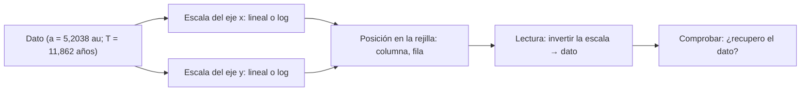

# B03-C15 — Representación cartesiana de datos

<!-- nav:top -->
[🏠 Programa](../../../../README.md) · [📚 Bloque B03](../../../tronco-comun/B03-matematica-elemental-para-ciencias-espaciales.md) · [← Anterior: B03-C14 — Despeje de ecuaciones elementales](../B03-C14-despeje-de-ecuaciones-elementales/CLASE.md) · [Siguiente: B03-C16 — Pendiente e interpretación de gráficos →](../B03-C16-pendiente-e-interpretacion-de-graficos/CLASE.md)
<!-- /nav -->

## 1. Ubicación, nivel y alcance

Decimoquinta clase del bloque B03 y apertura de su tramo de representación. Con álgebra puedes escribir una relación; con un gráfico la **ves**. El plano cartesiano pone cada dato como un punto con dos coordenadas, y la forma que dibujan los puntos revela relaciones que una tabla esconde. Nivel N0 → N1.

Verás qué es un plano cartesiano, cómo leer y escribir pares ordenados, cómo elegir ejes, escalas lineal y logarítmica y rangos, qué hace honesto o engañoso a un gráfico y cómo hacerlo accesible. No verás pendiente ni ajuste (C16) ni visualización avanzada (B14).

## 2. Por qué esta clase existe

Las fichas de la NASA dan semiejes y períodos de los ocho planetas. En una tabla son 16 números. En un gráfico con ejes bien elegidos, caen sobre una recta, y esa recta es la tercera ley de Kepler. Pero con ejes mal elegidos, los cuatro planetas interiores se amontonan en una esquina y nadie ve nada. La elección de escala es una decisión científica, no estética.

La decisión central es: **¿qué pongo en cada eje, con qué unidades y escala, para que quien lo lea vea la relación real y pueda reconstruir los datos?** Aprenderás a construir un gráfico legible, honesto y accesible.

## 3. Lo que podrás hacer al terminar

1. Ubicar y leer puntos con coordenadas `(x, y)`, con signo.
2. Elegir qué magnitud va en cada eje y rotularla con unidad.
3. Elegir entre escala lineal y logarítmica y justificarlo.
4. Convertir un dato en una posición en el gráfico y viceversa.
5. Detectar gráficos engañosos (ejes truncados, sin unidades).
6. Escribir un texto alternativo y acompañar el gráfico con una tabla.

La evidencia es el **gráfico cartesiano accesible** del ejercicio 12 (sección 20).

## 4. Con qué llegas y cómo comprobarlo

Necesitas C01 a C14. Cinco preguntas:

1. ¿Qué número está a mitad de camino entre 0 y 10?
2. ¿Qué punto está en `(3, −2)` respecto del origen: arriba o abajo?
3. ¿Cuánto es `log₁₀ 100`? ¿Y `log₁₀ 0,1`?
4. ¿Por qué `5 km` sin eje de unidades no se entiende en un gráfico?
5. Si `x` va de 0 a 30 y de 0 a 30 hay 60 casillas, ¿cuántas casillas por unidad?

<details>
<summary>Ver respuestas</summary>

1. 5. 2. Abajo (y negativa) y a la derecha. 3. 2; −1. 4. Falta la unidad: no se sabe qué magnitud ni qué tamaño. 5. 2 casillas por unidad.
</details>

Con cuatro o cinco aciertos, sigue; con menos, repasa C05 y C09.

## 5. Un caso real: ocho planetas, una forma

Con los semiejes y períodos que publica la NASA (S1), convertidos a au y años (C04), obtienes ocho pares `(a, T)`: Mercurio `(0,3871; 0,2408)`, Venus `(0,7233; 0,6152)`, Tierra `(1; 1)`, Marte `(1,524; 1,881)`, Júpiter `(5,204; 11,86)`, Saturno `(9,573; 29,45)`, Urano `(19,17; 84,01)` y Neptuno `(30,18; 164,8)`. Si los dibujas con escala lineal, los cuatro primeros quedan casi sobre el mismo punto y Neptuno ocupa todo el borde. Con escala logarítmica en ambos ejes, los ocho se alinean en una recta. Los datos son los mismos; solo cambia el modo de verlos. Límite: un gráfico muestra una relación, no la demuestra.

## 6. Vocabulario

Un **plano cartesiano** tiene dos ejes perpendiculares que se cortan en el **origen** `(0, 0)`. Un **par ordenado** `(x, y)` es la posición de un punto: `x` es la **abscisa** (horizontal) e `y` la **ordenada** (vertical). El **eje horizontal** suele llevar la variable que controlas o que ordena los datos, y el vertical la que responde. Una **escala lineal** da el mismo espacio a sumas iguales; una **escala logarítmica** da el mismo espacio a multiplicaciones iguales (cada paso es un factor 10). Un **rango** es el intervalo de valores mostrado. Un **rótulo** nombra la magnitud y su unidad. Un **texto alternativo** describe el gráfico a quien no lo ve. Un **gráfico de dispersión** muestra puntos sin unirlos.

## 7. Modelo mental: de un dato a un píxel y de vuelta

Cada punto es el resultado de dos conversiones, una por eje, y debe poder invertirse.



*Descripción textual:* un dato con dos magnitudes pasa por la escala de cada eje (lineal o logarítmica) y da una posición en la rejilla (columna y fila); al leerlo, se invierte la escala para recuperar el dato, y se comprueba que coincida.

Analogía: un mapa. Cada lugar tiene coordenadas, y la escala dice cuántos km hay por centímetro. El límite: un mapa tiene una escala lineal uniforme; un gráfico logarítmico no: «el doble de distancia en la página» significa «multiplicar por un factor», no «sumar una cantidad».

## 8. La explicación, paso a paso

### 8.1 Coordenadas y cuadrantes

`(x, y)` con `x` hacia la derecha e `y` hacia arriba. Los cuatro cuadrantes se definen por los signos. Un punto `(3, −2)` está a la derecha y abajo del origen. Este uso de signos reutiliza C09.

### 8.2 Qué va en cada eje

En el eje horizontal va la variable que controlas o que ordena los datos (el semieje `a`); en el vertical, la que quieres explicar (el período `T`). Cada eje lleva su nombre y su unidad: «Semieje mayor a (au)», «Período T (años)». Sin unidades el gráfico no se puede reproducir (C06).

### 8.3 Escala y rango

Elige el rango para incluir todos los datos y dejar un margen. Si el eje empieza en un valor distinto de cero, indícalo. Un eje truncado exagera diferencias: la distancia lunar varía entre 357 000 y 407 000 km (S2); con un eje de 350 000 a 410 000 parece una oscilación gigantesca, y con uno de 0 a 410 000 se ve moderada (un 12 %). Ninguna es falsa, pero cada una cuenta algo distinto; hay que declararlo.

### 8.4 Escala logarítmica

En una escala logarítmica, la posición de un valor es `log₁₀ x`. Entre `1` y `10` hay la misma distancia que entre `10` y `100`. Por eso valores que difieren en factores enormes caben en un mismo gráfico. En ese eje el cero no existe (`log 0` no está definido) y las diferencias aparecen como cocientes. Si `T = a^(3/2)`, entonces `log T = 1,5 log a`: en ejes logarítmicos la relación es una recta (la pendiente se estudia en C16).

### 8.5 De dato a celda y de celda a dato

Con una rejilla de `n` columnas y valores entre `x_min` y `x_max`, la columna es `round[(x − x_min)/(x_max − x_min) · (n − 1)]` en escala lineal; en logarítmica se usa `log₁₀` de cada valor. Para recuperar el dato se invierte la fórmula; el error máximo es media celda. Este es el procedimiento que usa el laboratorio.

### 8.6 Gráficos honestos y accesibles

Un gráfico honesto: ejes rotulados con unidad, rango y escala declarados, datos y fuente citados, y sin ocultar los puntos que no encajan. Un gráfico accesible: no depende solo del color (usa forma y etiqueta), lleva un texto alternativo, y se acompaña de una tabla con los mismos datos. Todo lo que el gráfico muestra debe poder obtenerse también de la tabla.

## 9. Magnitudes, símbolos y unidades

| Símbolo | Qué es | Unidad | Valor o nota |
|---|---|---|---|
| `x`, `y` | coordenadas del punto | las de cada eje | — |
| `a` | semieje mayor | au | de S1 |
| `T` | período sidéreo | años | de S1 |
| `log₁₀` | logaritmo decimal | sin unidad | posición en eje logarítmico |
| 1 au | unidad astronómica | m | 149 597 870 700 (S3) |
| año | período sidéreo de la Tierra | d | 365,256 (S1) |

## 10. Convenciones y referencias

El eje horizontal lleva la variable independiente; el vertical, la dependiente. Los rótulos se escriben «magnitud (unidad)». Los gráficos logarítmicos indican «ejes logarítmicos». Los datos observados, estimados o simulados se rotulan en el título o en el pie. Cada gráfico lleva la fuente de sus datos y una tabla equivalente.

## 11. De dónde sale lo que afirmamos

| ID | Fuente | Localizador | Respalda | Estado |
|---|---|---|---|---|
| S1 | NASA NSSDC, fichas de Mercurio, Venus, Tierra, Marte, Júpiter, Saturno, Urano y Neptuno | https://nssdc.gsfc.nasa.gov/planetary/factsheet/ | Semiejes (10⁶ km) y períodos sidéreos (d): Mercurio 57,909 y 87,969; Venus 108,210 y 224,701; Tierra 149,598 y 365,256; Marte 227,956 y 686,980; Júpiter 778,479 y 4 332,589; Saturno 1 432,041 y 10 755,699; Urano 2 867,043 y 30 685,400; Neptuno 4 514,953 y 60 189,018 | Páginas consultadas el 2026-11-05 |
| S2 | NASA NSSDC, *Moon Fact Sheet* (act. 11-ene-2024) | https://nssdc.gsfc.nasa.gov/planetary/factsheet/moonfact.html | La distancia Tierra–Luna varía entre unos 357 000 y 407 000 km | Página consultada el 2026-11-05 |
| S3 | BIPM, *The International System of Units (SI)*, 9.ª ed. (2019), tabla 8 | https://doi.org/10.59161/AUEZ1291 | 1 au = 149 597 870 700 m | PDF leído el 2026-11-05 |

Límites: los gráficos son representación de datos publicados; no se consultó ninguna guía de accesibilidad externa, y las recomendaciones de la sección 8.6 son criterios de la clase.

## 12. Cómo ver los datos

Versión accesible (tabla equivalente del gráfico).

| N.º | Planeta | `a` (au) | `T` (años) |
|---|---|---|---|
| 1 | Mercurio | 0,3871 | 0,2408 |
| 2 | Venus | 0,7233 | 0,6152 |
| 3 | Tierra | 1,0000 | 1,0000 |
| 4 | Marte | 1,5238 | 1,8808 |
| 5 | Júpiter | 5,2038 | 11,8618 |
| 6 | Saturno | 9,5726 | 29,4470 |
| 7 | Urano | 19,1650 | 84,0107 |
| 8 | Neptuno | 30,1806 | 164,7858 |

Texto alternativo propuesto: «Gráfico de dispersión con ejes logarítmicos. El eje horizontal es el semieje mayor en unidades astronómicas, de 0,3 a 30; el vertical, el período en años, de 0,2 a 160. Ocho puntos numerados de Mercurio (1) a Neptuno (8) forman una línea ascendente casi recta. Fuente: NASA, fichas planetarias.» Descripción larga: con escala lineal, los puntos 1 a 4 se agrupan en la esquina inferior izquierda; con escala logarítmica quedan distribuidos y alineados.

## 13. Ejemplo trabajado: poner a Júpiter en una rejilla

**Pregunta.** En una rejilla de 60 columnas con `a` entre 0,31 y 33,2 au (escala logarítmica), ¿en qué columna cae Júpiter (`a = 5,2038 au`)?

**Paso 1 · logaritmos.** `log₁₀ 5,2038 = 0,7163`; `log₁₀ 0,31 = −0,5086`; `log₁₀ 33,2 = 1,5211`.
**Paso 2 · fracción del recorrido.** `(0,7163 − (−0,5086)) / (1,5211 − (−0,5086)) = 1,2249/2,0297 = 0,6035`.
**Paso 3 · columna.** `0,6035 × (60 − 1) = 35,6 → 36` (contando desde 0).
**Paso 4 · inversa.** Columna 36 corresponde a `log = −0,5086 + 36/59 · 2,0297 = 0,7298`, es decir, `a = 5,37 au`.
**Paso 5 · comprobación.** El error es `|5,37 − 5,20|/5,20 = 3 %`, y el ancho de media columna equivale a un factor `10^(2,0297/59/2) = 1,04` (4 %): la inversa recupera el dato dentro de media celda ✓.
**Sentido físico.** Lo que ves en un gráfico es una versión discretizada del dato; al leer valores, el error de lectura es del orden de un píxel.

## 14. Lineal frente a logarítmica: cuándo conviene cada una

La **escala lineal** muestra diferencias absolutas y es natural cuando los datos varían poco (±12 % en la distancia lunar). La **logarítmica** muestra cocientes y es la elegida cuando los datos abarcan órdenes de magnitud o cuando se espera una ley de potencias. Falla si hay ceros o negativos (no existen en log) y confunde a quien no sabe que los ejes son logarítmicos. Siempre se declara la escala.

## 15. Práctica guiada

**Ejercicio 1 · con los pasos indicados.** Ubica `(3, −2)`, `(−1, 4)` y `(0, 5)` y di en qué cuadrante o eje están. *Pasos:* signos de cada coordenada (8.1).

<details><summary>Solución comentada</summary>

`(3, −2)`: cuarto cuadrante (derecha, abajo). `(−1, 4)`: segundo (izquierda, arriba). `(0, 5)`: sobre el eje vertical.
</details>

**Ejercicio 2 · con una pista.** Rotula los ejes del gráfico de la sección 12. *Pista:* magnitud y unidad entre paréntesis.

<details><summary>Solución comentada</summary>

Horizontal: «Semieje mayor a (au)»; vertical: «Período T (años)». Si falta la unidad, el gráfico no es reproducible.
</details>

**Ejercicio 3 · casi autónomo.** En un eje logarítmico de 1 a 100, ¿qué fracción del recorrido ocupa `10`? ¿Y `30,18` (Neptuno)?

<details><summary>Solución comentada</summary>

`log₁₀ 10 = 1` de 2: mitad (0,5). `log₁₀ 30,18 = 1,4797`: `1,4797/2 = 0,74`. Un valor tres veces mayor que 10 queda mucho más cerca de 10 que de 100.
</details>

## 16. Práctica autónoma, transferencia e integrador

**Ejercicio 4.** Escribe como par ordenado Marte, con `a` en au y `T` en años, usando la tabla de la sección 12.

<details><summary>Solución comentada</summary>

`(1,5238; 1,8808)`.
</details>

**Ejercicio 5.** Explica por qué en escala lineal Mercurio, Venus, Tierra y Marte se amontonan.

<details><summary>Solución comentada</summary>

Los cuatro tienen `a` entre 0,39 y 1,52 au, mientras que el eje llega a 30 au: ocupan el 4 % del eje horizontal. En escala logarítmica, cada factor de 2 ocupa el mismo espacio y quedan separados.
</details>

**Ejercicio 6.** Compara un eje de 350 000 a 410 000 km con uno de 0 a 410 000 km para la distancia lunar (357 000–407 000 km). ¿Qué impresión da cada uno?

<details><summary>Solución comentada</summary>

El primero amplifica la variación (ocupa el 95 % de la altura); el segundo la muestra como una banda del 12 % de la altura. Ninguno es falso; hay que declarar el rango.
</details>

**Ejercicio 7.** Escribe un texto alternativo para un gráfico de dispersión de `(d, S)` con los planetas de la tabla de C10.

<details><summary>Solución comentada</summary>

«Gráfico de dispersión con ejes logarítmicos: distancia al Sol (au), de 0,3 a 30, frente a irradiancia calculada (W/m²), de 1,5 a 9 000. Ocho puntos forman una línea descendente casi recta. Valores calculados con un modelo, no medidos.» Menciona ejes, rangos, forma y procedencia.
</details>

**Ejercicio 8.** Un gráfico muestra dos curvas, una roja y una verde, sin leyenda ni formas. Señala dos problemas de accesibilidad y su corrección.

<details><summary>Solución comentada</summary>

(1) Depende del color (no se distinguen con daltonismo): usa formas o patrones. (2) No hay leyenda ni tabla: añade ambas.
</details>

**Ejercicio 9 · transferencia.** Un compañero tiene los datos `(0, 100)`, `(10, 600)` y `(20, 1100)` (tiempo en s, posición en km; sintéticos). ¿Qué ejes elegirías y qué forma esperas?

<details><summary>Solución comentada</summary>

Tiempo en el horizontal (controlado), posición en el vertical, ambos lineales. Esperas una recta ascendente (`50 km/s`).
</details>

**Ejercicio 10 · transferencia.** Con los datos de la tabla de la sección 12, ¿por qué una escala logarítmica en `T` pero lineal en `a` no alinearía los puntos?

<details><summary>Solución comentada</summary>

La relación es `log T = 1,5 log a`: lineal solo si **ambos** ejes son logarítmicos. Con `a` lineal los puntos forman una curva.
</details>

**Ejercicio 11 · transferencia.** Calcula la columna de Neptuno (`a = 30,18`) en la rejilla del ejemplo (60 columnas, `a` entre 0,31 y 33,2).

<details><summary>Solución comentada</summary>

`log₁₀ 30,18 = 1,4797`; fracción `(1,4797 + 0,5086)/2,0297 = 0,9797`; columna `0,9797 × 59 = 57,8 → 58`. Queda casi en el borde derecho.
</details>

**Ejercicio 12 · integrador.** Elabora tu *gráfico cartesiano accesible* (sección 20) con los ocho planetas o con otros datos publicados: título, ejes rotulados con unidades, escala justificada, fuente, texto alternativo y tabla equivalente. Puedes usar papel o el laboratorio.

<details><summary>Solución modelo</summary>

Gráfico log–log de `(a, T)` con la tabla de la sección 12 y el texto alternativo propuesto, más una nota: «datos publicados por NASA; sin incertidumbre». Se acepta cualquier gráfico que reúna los siete elementos.
</details>

## 17. Laboratorio: un plano de texto

El script [laboratorio_cartesiano.py](laboratorio_cartesiano.py) dibuja los ocho planetas en una rejilla de 60 × 20 caracteres, con escala lineal y logarítmica, e imprime los datos en CSV. Antes comprueba que la transformación dato → celda → dato es invertible con error menor que media celda en ambas escalas.

**Datos:** publicados (NASA). **Predice antes de ejecutar:** ¿qué planetas se superponen en la escala lineal? (Los interiores.) **Resultados (2026-11-05, Python 3.12.9):** en la escala lineal, Mercurio (1) y Venus (2) caen en la misma celda (se ve solo el 2: Mercurio queda oculto) y los planetas 3 y 4 en las celdas contiguas (`234` en la fila inferior); en la logarítmica, los ocho puntos forman una línea ascendente (del 1 abajo a la izquierda al 8 arriba a la derecha); el CSV reproduce la tabla de la sección 12.

```bash
python programa/clases/B03/B03-C15-representacion-cartesiana-de-datos/laboratorio_cartesiano.py
```

**Límites:** gráfico de texto de baja resolución; no es una herramienta de análisis.

## 18. Errores frecuentes y cómo corregirlos

**Ejes sin unidades.** Ejercicio 2.
**Escala sin declarar.** Ejercicio 6.
**Usar `log 0`.** Sección 14.
**Depender del color.** Ejercicio 8.
**Confundir lectura y dato.** Sección 13 (error de media celda).

## 19. Cómo sabrás que vas bien

Tras 8.1: ¿ubicas `(−2, 3)`? Si no, repite el ejercicio 1. Tras 8.4: ¿entiendes por qué 10 está a mitad de 1 y 100? Si no, rehaz el 3. Tras el ejemplo: ¿calculas la columna de otro planeta? Si dudas, haz el 11. Al final: ¿redactas un texto alternativo? Si no, intenta el 7.

## 20. Qué entregas y cómo se evalúa

El producto es tu **gráfico cartesiano accesible**: título, ejes con unidad, escala justificada, fuente, texto alternativo y tabla equivalente.

| Criterio | Inicial | En desarrollo | Logrado | Destacado |
|---|---|---|---|---|
| Ejes y unidades | Ausentes | Parciales | Completos | Verifica la dimensión |
| Escala | Sin declarar | Declarada | Justificada | Compara dos escalas |
| Accesibilidad | Solo color | Leyenda | Texto alternativo y tabla | Probado con otra persona |
| Fuente | Sin cita | Parcial | Completa | Distingue observado de calculado |
| Honestidad | Eje engañoso | Eje sin declarar | Eje declarado | Muestra puntos discrepantes |

**Condiciones críticas:** no omitir unidades ni escala; incluir tabla equivalente; citar solo fuentes consultadas.

## 21. Ética, seguridad y límites

Un gráfico puede mentir con un eje truncado o una escala no declarada; la honestidad es parte de la técnica. Esta clase es educativa y no sustituye herramientas de análisis. Accesibilidad: todo gráfico va con descripción y tabla; el laboratorio funciona sin conexión y sin bibliotecas gráficas.

## 22. Para cerrar y seguir

Un gráfico traduce datos a posiciones con una escala por eje; la escala logarítmica muestra cocientes y alinea las leyes de potencia; ejes rotulados, escala declarada, fuente y tabla lo hacen honesto y accesible. Queda una pregunta: ¿cómo medir qué tan rápido cambia una magnitud en un gráfico? Con la pendiente, en C16.

**Glosario español–inglés.** plano cartesiano · *Cartesian plane*; par ordenado · *ordered pair*; abscisa · *abscissa*; ordenada · *ordinate*; escala logarítmica · *logarithmic scale*; texto alternativo · *alt text*; gráfico de dispersión · *scatter plot*.

**Continuidad.** B03-C16 interpreta pendientes en estos gráficos. B14 trata la visualización con código y B15 las imágenes y señales.

**Referencias:** ver sección 11. Todas las fuentes son datos oficiales consultados.

<!-- nav:bottom -->
---

[← Anterior: B03-C14 — Despeje de ecuaciones elementales](../B03-C14-despeje-de-ecuaciones-elementales/CLASE.md) · [📚 Bloque B03](../../../tronco-comun/B03-matematica-elemental-para-ciencias-espaciales.md) · [Siguiente: B03-C16 — Pendiente e interpretación de gráficos →](../B03-C16-pendiente-e-interpretacion-de-graficos/CLASE.md)
<!-- /nav -->
