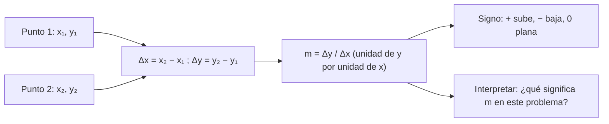

# B03-C16 — Pendiente e interpretación de gráficos

<!-- nav:top -->
[🏠 Programa](../../../../README.md) · [📚 Bloque B03](../../../tronco-comun/B03-matematica-elemental-para-ciencias-espaciales.md) · [← Anterior: B03-C15 — Representación cartesiana de datos](../B03-C15-representacion-cartesiana-de-datos/CLASE.md) · [Siguiente: B03-C17 — Áreas y volúmenes elementales →](../B03-C17-areas-y-volumenes-elementales/CLASE.md)
<!-- /nav -->

## 1. Ubicación, nivel y alcance

Decimosexta clase del bloque B03. En C15 aprendiste a dibujar datos. Ahora aprendes a **leer** lo que dicen: cuán rápido cambia una magnitud respecto de otra. Esa tasa de cambio es la pendiente, y en ciencias espaciales es la rapidez de una nave, el consumo de combustible o el exponente de una ley de la naturaleza. Nivel N0 → N1.

Verás la pendiente como cociente de cambios, su signo y sus unidades, la recta de mejor ajuste por mínimos cuadrados, la lectura de una gráfica logarítmica y por qué la pendiente de una gráfica log–log es un exponente. No verás cálculo diferencial (B09) ni regresión estadística completa (B12).

## 2. Por qué esta clase existe

Si sitúas en un gráfico logarítmico el período frente al semieje de los planetas, los puntos forman una recta. Su pendiente es 1,5: ese número es el exponente de la tercera ley de Kepler. Nadie te lo dice: lo **mides** en el gráfico. Y si el mismo gráfico se hace con escalas lineales, la pendiente cambia de un tramo a otro (1,7 años/au entre la Tierra y Marte; 7,3 entre Urano y Neptuno), lo que señala que la relación no es una recta.

La decisión central es: **¿qué dice la pendiente de este gráfico, con qué unidades, y cuándo tiene sentido hablar de una sola pendiente?** Aprenderás a calcularla, interpretarla y desconfiar de ella cuando corresponde.

## 3. Lo que podrás hacer al terminar

1. Calcular la pendiente entre dos puntos y explicar su signo y sus unidades.
2. Reconocer una relación lineal y escribir su ecuación `y = mx + b`.
3. Ajustar una recta a varios puntos por mínimos cuadrados y juzgar si es razonable.
4. Interpretar la pendiente de una gráfica log–log como un exponente.
5. Distinguir pendiente constante (recta) de pendiente variable (curva).
6. Reportar una pendiente con su unidad y una advertencia de límites.

La evidencia es el **informe de pendiente con unidades** del ejercicio 12 (sección 20).

## 4. Con qué llegas y cómo comprobarlo

Necesitas C01 a C15. Cinco preguntas:

1. ¿Cuánto es `(8 − 2)/(3 − 1)`?
2. Si un coche recorre 100 km en 2 h, ¿cuál es su rapidez y con qué unidad?
3. ¿Cuánto es `log₁₀ 1000`?
4. Si `y` crece cuando `x` crece, ¿la pendiente es positiva o negativa?
5. ¿Qué es un par ordenado?

<details>
<summary>Ver respuestas</summary>

1. 3. 2. 50 km/h. 3. 3. 4. Positiva. 5. Un punto `(x, y)` del plano (C15).
</details>

Con cuatro o cinco aciertos, sigue; con menos, repasa C15.

## 5. Un caso real: la pendiente 1,5 en el gráfico de Kepler

Con los ocho pares `(a, T)` de la NASA (S1), en au y años, un ajuste de mínimos cuadrados de `log₁₀ T` frente a `log₁₀ a` da una pendiente de **1,499** y una ordenada de **−0,0001** (resultado del laboratorio). La pendiente entre Mercurio y Neptuno, solo con dos puntos, es 1,4986. Es el exponente `3/2` de `T = a^(3/2)` (C04), obtenido ahora desde los datos y no desde la fórmula. Límite: el ajuste dice que los ocho puntos son compatibles con 1,5; no demuestra la ley, y no tiene incertidumbre calculada (eso es B12).

## 6. Vocabulario

La **pendiente** `m` de una recta que pasa por `(x₁, y₁)` y `(x₂, y₂)` es `m = (y₂ − y₁)/(x₂ − x₁)`: el cambio de `y` por cada unidad de `x`. La **ordenada en el origen** `b` es el valor de `y` cuando `x = 0`. Una **recta** es `y = mx + b`. Una **relación lineal** tiene pendiente constante. Una **curva** tiene pendiente que cambia. Un **ajuste por mínimos cuadrados** busca la recta que minimiza la suma de los cuadrados de las distancias verticales entre los puntos y la recta. Un **residuo** es la diferencia entre un dato y el valor de la recta. Una **gráfica log–log** usa `log₁₀` en ambos ejes.

## 7. Modelo mental: subir cuánto por avanzar cuánto

La pendiente es «cuánto sube (o baja) por cada paso a la derecha».



*Descripción textual:* dos puntos producen los cambios Δx y Δy; su cociente es la pendiente, con unidad de y por unidad de x; el signo indica si la recta sube, baja o es plana; y siempre se interpreta qué significa en el problema.

Analogía: la inclinación de una cuesta. Sube más cuanto mayor es la pendiente. El límite: una cuesta se mide con ángulos o porcentajes sin unidades; la pendiente de un gráfico tiene unidades (km/s, años/au) y su tamaño depende de la escala elegida.

## 8. La explicación, paso a paso

### 8.1 Pendiente entre dos puntos

`m = (y₂ − y₁)/(x₂ − x₁)`. Entre `(1, 2)` y `(3, 8)`: `(8 − 2)/(3 − 1) = 3`. El orden no importa si se mantiene igual arriba y abajo. Si inviertes uno solo, cambias el signo.

### 8.2 Signo y unidades

Si `y` sube con `x`, `m > 0`; si baja, `m < 0`; si no cambia, `m = 0`. La unidad es la de `y` entre la de `x`. Con un movimiento uniforme sintético, posición `100 km` en `t = 0 s` y `600 km` en `t = 10 s`: `m = 500/10 = 50 km/s`. La pendiente es la **rapidez**. Con una masa que baja de 500 kg a 380 kg en 100 s (sintético), `m = −120/100 = −1,2 kg/s`: el signo negativo dice que disminuye.

### 8.3 La ecuación de la recta

Con la pendiente `m` y un punto, `y = y₁ + m(x − x₁)`. Para el movimiento sintético, `y = 100 + 50t` (km, con `t` en s). La ordenada `b = 100` es la posición inicial. Con la ecuación predices: a `t = 20 s`, `y = 1 100 km`.

### 8.4 Ajustar una recta a muchos puntos

Si los puntos no caen exactamente sobre una recta, se busca la que mejor los representa. Con medias `x̄`, `ȳ` y sumas `S_xx = Σ(x − x̄)²` y `S_xy = Σ(x − x̄)(y − ȳ)`, la pendiente de mínimos cuadrados es `m = S_xy/S_xx` y la ordenada `b = ȳ − m x̄`. La fórmula sale de pedir que la suma de los cuadrados de los residuos sea mínima (se demuestra en B09 y B12). El laboratorio la verifica con datos exactos: para `y = 3x + 2` recupera `m = 3` y `b = 2` sin error.

### 8.5 Pendiente en una gráfica log–log

Si `T = a^p`, entonces `log T = p · log a`: una recta con pendiente `p` y ordenada 0. Midiendo la pendiente de `log T` frente a `log a` obtienes el exponente `p`. Con los ocho planetas: `p = 1,499`. Si en cambio la relación es `S = k/d²`, la pendiente log–log es `−2` (irradiancia, C10). Las gráficas log–log convierten leyes de potencia en rectas.

### 8.6 Cuando una sola pendiente no basta

En escalas lineales, el gráfico `T` frente a `a` de los planetas es una curva. La pendiente entre Tierra y Marte es `(1,8808 − 1)/(1,5238 − 1) = 1,68 años/au`; entre Urano y Neptuno, `(164,786 − 84,011)/(30,1806 − 19,165) = 7,33 años/au`. Hablar de «la pendiente» de una curva es engañoso: cada tramo tiene la suya. Es el punto de partida del cálculo diferencial.

## 9. Magnitudes, símbolos y unidades

| Símbolo | Qué es | Unidad | Valor o nota |
|---|---|---|---|
| `m` | pendiente | unidad de `y` / unidad de `x` | `Δy/Δx` |
| `b` | ordenada en el origen | unidad de `y` | — |
| `p` | exponente | sin unidad | Kepler: 1,499 (ajuste) |
| `a`, `T` | semieje (au) y período (años) | au, años | de S1 |
| `x̄`, `ȳ` | medias | las de cada eje | — |
| `S_xx`, `S_xy` | sumas de cuadrados y de productos | según ejes | para el ajuste |

## 10. Convenciones y referencias

La pendiente se escribe siempre con su unidad (`50 km/s`, `1,68 años/au`). En gráficas log–log se declara «pendiente en escala log–log, sin unidades». Los ajustes se rotulan «mínimos cuadrados» y se acompañan de sus límites. Los datos sintéticos se marcan como tales; los publicados, con su fuente.

## 11. De dónde sale lo que afirmamos

| ID | Fuente | Localizador | Respalda | Estado |
|---|---|---|---|---|
| S1 | NASA NSSDC, fichas de Mercurio, Venus, Tierra, Marte, Júpiter, Saturno, Urano y Neptuno | https://nssdc.gsfc.nasa.gov/planetary/factsheet/ | Semiejes (10⁶ km) y períodos sidéreos (d) de los ocho planetas | Páginas consultadas el 2026-11-05 |
| S2 | BIPM, *The International System of Units (SI)*, 9.ª ed. (2019), tabla 8 | https://doi.org/10.59161/AUEZ1291 | 1 au = 149 597 870 700 m | PDF leído el 2026-11-05 |

Límites: la fórmula de mínimos cuadrados es estándar y se **da** en esta clase sin demostrarla ni citarla de una fuente consultada; su implementación se valida con datos exactos en el laboratorio. Los movimientos de 50 km/s y la pérdida de masa son datos sintéticos. No se calcula incertidumbre de la pendiente.

## 12. Cómo ver las pendientes

Versión accesible de una tabla de pendientes.

| Tramo | Tipo de gráfico | Pendiente | Unidad |
|---|---|---|---|
| Movimiento uniforme (sintético) | lineal | 50 | km/s |
| Pérdida de masa (sintético) | lineal | −1,2 | kg/s |
| Tierra–Marte | `T` frente a `a`, lineal | 1,68 | años/au |
| Urano–Neptuno | `T` frente a `a`, lineal | 7,33 | años/au |
| Mercurio–Neptuno | log–log | 1,4986 | sin unidad |
| Ocho planetas | log–log, mínimos cuadrados | 1,499 | sin unidad |

Si la dibujas, traza triángulos de pendiente (Δx horizontal, Δy vertical) rotulados y usa trazos distintos para cada recta. Descripción larga: en la escala lineal, los triángulos entre planetas sucesivos son cada vez más empinados; en la log–log, todos tienen la misma inclinación.

## 13. Ejemplo trabajado: medir el exponente de Kepler desde dos planetas

**Pregunta.** Con Mercurio y Neptuno, ¿qué exponente `p` sale de la gráfica log–log?

**Paso 1 · puntos.** Mercurio `(a, T) = (0,3871; 0,2408)`; Neptuno `(30,1806; 164,786)`.
**Paso 2 · logaritmos.** Mercurio `(−0,4122; −0,6183)`; Neptuno `(1,4797; 2,2169)`.
**Paso 3 · cambios.** `Δx = 1,4797 − (−0,4122) = 1,8919`; `Δy = 2,2169 − (−0,6183) = 2,8352`.
**Paso 4 · pendiente.** `m = 2,8352/1,8919 = 1,4986`.
**Paso 5 · interpretación y comparación.** `T ∝ a^1,4986 ≈ a^(3/2)`. El ajuste con los ocho planetas da 1,499, y la teoría 1,5. La diferencia es de 0,1 %.
**Sentido físico.** Con solo dos puntos y una calculadora obtienes el exponente de una ley de la naturaleza. Con más puntos aumenta la confianza, pero la pendiente sola no da una incertidumbre.

## 14. Dos formas de obtener la pendiente y cuándo fallan

**Dos puntos** es rápido y claro, pero depende de qué puntos elijas y no usa el resto de los datos. **Ajuste por mínimos cuadrados** usa todos, pero es sensible a valores extremos y supone errores solo en `y`. Ambas fallan si la relación no es lineal en la escala elegida (como `T` frente a `a` lineal) o si hay muy pocos puntos.

## 15. Práctica guiada

**Ejercicio 1 · con los pasos indicados.** Calcula la pendiente entre `(1, 2)` y `(3, 8)`. *Pasos:* `Δy/Δx` (8.1).

<details><summary>Solución comentada</summary>

`(8 − 2)/(3 − 1) = 3`. Si te salió `1/3` invertiste el cociente.
</details>

**Ejercicio 2 · con una pista.** Un cuerpo está a 100 km en `t = 0` y a 600 km en `t = 10 s` (datos sintéticos). Calcula la pendiente con su unidad. *Pista:* km entre s.

<details><summary>Solución comentada</summary>

`500 km / 10 s = 50 km/s`. La pendiente es la rapidez.
</details>

**Ejercicio 3 · casi autónomo.** Una masa de combustible baja de 500 kg a 380 kg en 100 s (sintético). Calcula la pendiente y explica el signo.

<details><summary>Solución comentada</summary>

`(380 − 500)/100 = −1,2 kg/s`. El signo negativo indica que disminuye.
</details>

## 16. Práctica autónoma, transferencia e integrador

**Ejercicio 4.** Con los puntos del ejercicio 2, escribe la ecuación de la recta y predice la posición a `t = 20 s`.

<details><summary>Solución comentada</summary>

`y = 100 + 50t`; a `t = 20`, `y = 1 100 km`.
</details>

**Ejercicio 5.** Calcula la pendiente log–log entre Mercurio y Neptuno con los logaritmos del ejemplo.

<details><summary>Solución comentada</summary>

`2,8352/1,8919 = 1,4986` (sección 13).
</details>

**Ejercicio 6.** Con la recta ajustada `log T = 1,499 log a − 0,0001`, predice `T` para `a = 4 au`.

<details><summary>Solución comentada</summary>

`log a = 0,6021`; `log T = 1,499 × 0,6021 − 0,0001 = 0,9024`; `T = 10^0,9024 = 7,99 años`. Kepler exacto: `4^1,5 = 8`.
</details>

**Ejercicio 7.** Un estudiante calcula la pendiente como `Δx/Δy` y obtiene `0,02` para un movimiento a 50 km/s. ¿Qué error cometió?

<details><summary>Solución comentada</summary>

Invirtió el cociente: `1/50 = 0,02 s/km`. Es el inverso de la rapidez (tiempo por km), no la rapidez. La unidad lo delata.
</details>

**Ejercicio 8.** Calcula la pendiente lineal `T`–`a` entre Tierra y Marte, y entre Urano y Neptuno. ¿Qué indican?

<details><summary>Solución comentada</summary>

`(1,8808 − 1)/(1,5238 − 1) = 1,68 años/au` y `(164,786 − 84,011)/(30,1806 − 19,165) = 7,33 años/au`. Que no es una recta: la pendiente crece con `a`.
</details>

**Ejercicio 9 · transferencia.** La irradiancia calculada (C10) es 9 082,7 W/m² a 0,3871 au y 1,494 W/m² a 30,18 au. Calcula la pendiente log–log.

<details><summary>Solución comentada</summary>

`log S`: 3,9582 y 0,1744; `log d`: −0,4122 y 1,4797. `m = (0,1744 − 3,9582)/(1,4797 + 0,4122) = −3,7838/1,8919 = −2,00`. El exponente es −2: inverso del cuadrado.
</details>

**Ejercicio 10 · transferencia.** ¿Qué unidad tiene la pendiente `T`–`a` lineal y por qué la log–log no tiene unidad?

<details><summary>Solución comentada</summary>

Años por au. En log–log se divide el cambio de `log T` entre el de `log a`: los logaritmos son adimensionales.
</details>

**Ejercicio 11 · transferencia.** El ajuste da `m = 1,499`. ¿Es «significativamente» distinto de 1,5?

<details><summary>Solución comentada</summary>

La diferencia es de 0,001 (0,07 %). Sin una incertidumbre calculada no se puede decir «significativamente»; con datos exactos de la NASA y 8 puntos, es compatible con 1,5. La respuesta honesta es «consistente con 1,5, sin incertidumbre cuantificada».
</details>

**Ejercicio 12 · integrador.** Elabora tu *informe de pendiente con unidades* (sección 20): elige un conjunto de datos publicados (por ejemplo, irradiancia frente a distancia), gráfica en ejes adecuados, calcula la pendiente entre dos puntos y por ajuste, interpreta signo y unidades, y declara límites.

<details><summary>Solución modelo</summary>

Con los datos de C10: log–log, pendiente `−2,00`; interpretación «inverso del cuadrado»; ajuste con los ocho planetas por mínimos cuadrados da `−2` por construcción (datos calculados con el modelo), y se advierte que no son mediciones. Se acepta cualquier conjunto con fuente y límites.
</details>

## 17. Laboratorio: pendientes y ajuste con pruebas

El script [laboratorio_pendiente.py](laboratorio_pendiente.py) implementa la pendiente entre dos puntos y el ajuste por mínimos cuadrados y los usa con los datos de Kepler. Antes comprueba, con datos **sintéticos exactos**, que recupera `y = 3x + 2` y un movimiento de 50 km/s desde 100 km, y que la pendiente de Kepler está a menos de 0,01 de 1,5.

**Datos:** publicados (NASA); sintéticos para las pruebas. **Predice antes de ejecutar:** ¿qué pendiente log–log saldrá? (Cerca de 1,5.) **Resultados (2026-11-05, Python 3.12.9):** `m = 1,4990`, `b = −0,0001`; pendiente entre Mercurio y Neptuno `1,4986`; pendiente lineal `T`–`a` Tierra–Marte `1,6816 años/au` y Urano–Neptuno `7,3328 años/au`.

```bash
python programa/clases/B03/B03-C16-pendiente-e-interpretacion-de-graficos/laboratorio_pendiente.py
```

**Límites:** sin incertidumbre de la pendiente; supone errores solo en `y`.

## 18. Errores frecuentes y cómo corregirlos

**Invertir `Δy/Δx`.** Ejercicio 7.
**Olvidar la unidad.** Ejercicio 2.
**Hablar de «la pendiente» de una curva.** Ejercicio 8.
**Confundir pendiente log–log con pendiente lineal.** Ejercicio 10.
**Afirmar significancia sin incertidumbre.** Ejercicio 11.

## 19. Cómo sabrás que vas bien

Tras 8.1: ¿calculas la pendiente entre `(2, 5)` y `(6, 17)`? (`3`). Si no, repite el ejercicio 1. Tras 8.2: ¿interpretas el signo? Si no, haz el 3. Tras 8.5: ¿explicas por qué log–log da exponentes? Si no, rehaz el 5. Al final: ¿sabes cuándo una sola pendiente engaña? Si dudas, vuelve al 8.

## 20. Qué entregas y cómo se evalúa

El producto es tu **informe de pendiente con unidades**: datos, gráfico, pendiente por dos puntos y por ajuste, interpretación con unidades y límites.

| Criterio | Inicial | En desarrollo | Logrado | Destacado |
|---|---|---|---|---|
| Cálculo de la pendiente | Con errores | Con ayuda | Correcto | Por dos métodos |
| Unidades | Ausentes | Parciales | Completas | Verifica la dimensión |
| Interpretación | Ninguna | Del signo | Del significado físico | Discute su validez |
| Gráfico | Sin ejes | Ejes sin escala | Ejes y escala | Accesible |
| Límites | No los menciona | Genéricos | Específicos | Cuantifica o declara que no puede |

**Condiciones críticas:** no omitir unidades; no afirmar certeza sin incertidumbre; distinguir datos sintéticos, calculados y publicados; citar solo fuentes consultadas.

## 21. Ética, seguridad y límites

Una pendiente única sobre una curva o un ajuste sin incertidumbre dan una falsa sensación de precisión. Esta clase es educativa y no sirve para extrapolar fuera del rango de los datos. Accesibilidad: cálculos en texto, tablas equivalentes, sin conexión.

## 22. Para cerrar y seguir

La pendiente es el cambio de una magnitud por unidad de la otra, con signo y unidad; una recta ajustada resume muchos puntos; en un gráfico log–log, la pendiente es un exponente. Queda una pregunta: la geometría también aparece en lo espacial: áreas, volúmenes, tamaños. ¿Cómo se calculan? Es C17.

**Glosario español–inglés.** pendiente · *slope*; ordenada en el origen · *intercept*; mínimos cuadrados · *least squares*; residuo · *residual*; relación lineal · *linear relationship*; ley de potencias · *power law*; log–log · *log-log*.

**Continuidad.** B03-C17 y C18 calculan áreas, volúmenes y ángulos. B09 formaliza la pendiente con derivadas y B12 la incertidumbre del ajuste.

**Referencias:** ver sección 11. Todas las fuentes son datos oficiales consultados.

<!-- nav:bottom -->
---

[← Anterior: B03-C15 — Representación cartesiana de datos](../B03-C15-representacion-cartesiana-de-datos/CLASE.md) · [📚 Bloque B03](../../../tronco-comun/B03-matematica-elemental-para-ciencias-espaciales.md) · [Siguiente: B03-C17 — Áreas y volúmenes elementales →](../B03-C17-areas-y-volumenes-elementales/CLASE.md)
<!-- /nav -->
