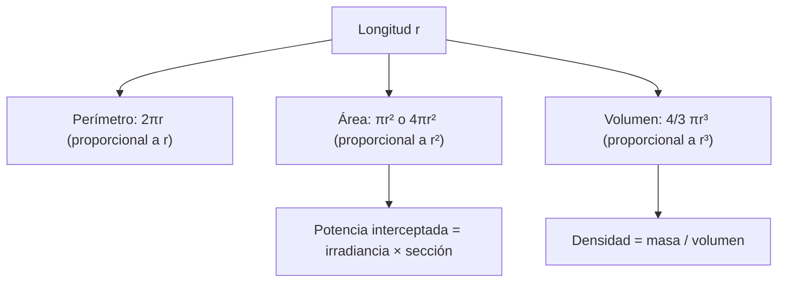

# B03-C17 — Áreas y volúmenes elementales

<!-- nav:top -->
[🏠 Programa](../../../../README.md) · [📚 Bloque B03](../../../tronco-comun/B03-matematica-elemental-para-ciencias-espaciales.md) · [← Anterior: B03-C16 — Pendiente e interpretación de gráficos](../B03-C16-pendiente-e-interpretacion-de-graficos/CLASE.md) · [Siguiente: B03-C18 — Razones trigonométricas iniciales →](../B03-C18-razones-trigonometricas-iniciales/CLASE.md)
<!-- /nav -->

## 1. Ubicación, nivel y alcance

Decimoséptima clase del bloque B03. Los astros son, en primera aproximación, esferas; las naves, cilindros y conos; los haces de luz, áreas que se reparten. Esta clase te da las fórmulas de área y volumen más usadas, explica **por qué** crecen con el cuadrado y el cubo del tamaño, y las aplica a la densidad del Sol, el volumen de la Tierra y la energía que esta intercepta. Nivel N0 → N1.

Verás perímetro y área del círculo, área y volumen de la esfera, volumen del cilindro, el elipsoide achatado para la Tierra y la relación entre masa, volumen y densidad. No verás integrales (B09) ni geometría diferencial.

## 2. Por qué esta clase existe

La NASA publica que la densidad media del Sol es 1408 kg/m³ (S1), cerca de una vez y media la del agua. ¿Cómo se obtiene? Dividiendo la masa entre el volumen, y el volumen sale de un radio y una fórmula. Y la Tierra recibe del Sol una cantidad enorme de potencia porque su sección frontal, un círculo de 6 371 km de radio, intercepta el flujo solar. Ambos resultados dependen de dos fórmulas y de saber cuál usar.

La decisión central es: **¿qué figura describe mejor este objeto, qué fórmula corresponde (área o volumen) y cómo compruebo el resultado contra un dato publicado?** Aprenderás las fórmulas, su origen y la forma de verificar.

## 3. Lo que podrás hacer al terminar

1. Calcular perímetro y área de un círculo, y área y volumen de una esfera.
2. Calcular el volumen de un cilindro y de un elipsoide achatado.
3. Explicar por qué el área escala con el cuadrado y el volumen con el cubo.
4. Calcular una densidad media y compararla con un dato publicado.
5. Calcular la potencia interceptada por un cuerpo a partir de la irradiancia.
6. Estimar el error de aproximar una Tierra achatada por una esfera.

La evidencia es la **hoja de áreas y volúmenes** del ejercicio 12 (sección 20).

## 4. Con qué llegas y cómo comprobarlo

Necesitas C01 a C16. Cinco preguntas:

1. ¿Cuánto es `r²` si `r = 4`? ¿Y `r³`?
2. ¿Cuánto es `4/3 × 3`?
3. Si el radio se duplica, ¿por cuánto se multiplica el área de un cuadrado de ese lado?
4. ¿Cuánto es `1,4 × 10¹⁸ ÷ 2,0 × 10¹⁷`?
5. ¿Qué unidad tiene el área? ¿Y el volumen?

<details>
<summary>Ver respuestas</summary>

1. 16; 64. 2. 4. 3. 4 (C04). 4. 7. 5. Longitud al cuadrado (m²) y al cubo (m³).
</details>

Con cuatro o cinco aciertos, sigue; con menos, repasa C04 y C06.

## 5. Un caso real: ¿cuánta materia hay en un metro cúbico del Sol?

La ficha del Sol de la NASA da una masa de `1,9884 × 10³⁰ kg`, un volumen de `1,412 × 10¹⁸ km³` y una densidad media de 1408 kg/m³, y su radio medio volumétrico es de 695 700 km (S1). Con ese radio y la fórmula de la esfera, el volumen resulta `1,4104 × 10¹⁸ km³`, un 0,11 % menos que el publicado; la densidad calculada es 1410 kg/m³ y la publicada, 1408. La pequeña diferencia viene de las cifras redondeadas de la ficha. Límite: «densidad media» es un promedio: el Sol es mucho más denso en el centro que en la superficie, y esta clase solo calcula el promedio.

## 6. Vocabulario

El **perímetro** de un círculo de radio `r` es `2πr`; su **área**, `πr²`. Una **esfera** de radio `r` tiene **área superficial** `4πr²` y **volumen** `(4/3)πr³`. Un **cilindro** de radio `r` y altura `h` tiene volumen `πr²h`. Un **elipsoide de revolución achatado** de radio ecuatorial `a` y polar `c < a` tiene volumen `(4/3)πa²c`. La **sección transversal** de un cuerpo es el área de su sombra frontal (para una esfera, un círculo `πr²`). La **densidad** es masa dividida entre volumen, `ρ = M/V`. Un **radio medio volumétrico** es el radio de la esfera con el mismo volumen que el cuerpo. El **achatamiento** mide cuánto difiere `c` de `a`.

## 7. Modelo mental: cuadrados y cubos de longitud

Si multiplicas todas las longitudes de una figura por `k`, las áreas se multiplican por `k²` y los volúmenes por `k³`.



*Descripción textual:* una longitud `r` da tres magnitudes: perímetro (proporcional a `r`), área (proporcional a `r²`) y volumen (proporcional a `r³`); el volumen permite calcular la densidad con la masa, y el área de la sección permite calcular la potencia interceptada con la irradiancia.

Analogía: cubos de azúcar. Un cubo de 2 por 2 por 2 tiene 8 cubitos y una cara de 4: el volumen crece más rápido que el área. El límite: la analogía vale para figuras semejantes; si cambia la forma, los factores cambian.

## 8. La explicación, paso a paso

### 8.1 Círculo

Perímetro `2πr` y área `πr²`. Para la Tierra, `r = 6 371 km`: perímetro `40 030 km`, área `1,2751 × 10⁸ km²`. `π` es la razón perímetro/diámetro (C01); las fórmulas se pueden justificar por semejanza (todos los círculos son ampliaciones de uno) y se demuestran con cálculo integral (B09).

### 8.2 Esfera

Área `4πr²`, volumen `(4/3)πr³`. Para la Tierra con radio medio, el área superficial es `5,1006 × 10⁸ km²`; el volumen, `1,0832 × 10¹² km³`. Comprobación de escala: duplicar `r` cuadruplica el área y octuplica el volumen (C04). Por eso Júpiter, con un radio ≈ 11 veces el terrestre, tiene un volumen ≈ 1 300 veces mayor.

### 8.3 Cilindro y elipsoide achatado

Un cilindro de radio `r` y altura `h` tiene volumen `πr²h`: el área de la base por la altura. Un tanque de 1,5 m de radio y 3 m de alto (valores ilustrativos) tiene `π × 2,25 × 3 = 21,2 m³`, es decir, `21 206 litros` (`1 m³ = 1 000 L`, S2). El elipsoide achatado generaliza la esfera: con `a = c` vuelve a `(4/3)πa³`.

### 8.4 La Tierra no es una esfera

La IAU fija como valores nominales los radios terrestres ecuatorial `6,3781 × 10⁶ m` y polar `6,3568 × 10⁶ m` (S3). El elipsoide tiene volumen `(4/3)π a² c = 1,08320 × 10²¹ m³ = 1,08320 × 10¹² km³`, igual que el publicado por la NASA, `1,08321 × 10¹² km³` (S1). Si en cambio usaras una esfera de radio `a`, sobrestimarías el volumen en `a/c − 1 ≈ 0,34 %`. El achatamiento es pequeño: la Tierra es una esfera con una precisión del 0,3 %.

### 8.5 Densidad media

`ρ = M/V`. Para el Sol: `1,9884 × 10³⁰ kg / 1,4104 × 10²⁷ m³ = 1 410 kg/m³` (ojo con `km³ → m³`: se multiplica por `10⁹`). Con el volumen publicado por la NASA, `1,412 × 10²⁷ m³`, resulta 1 408 kg/m³, igual que la ficha. Interpretación: promedio.

### 8.6 Potencia interceptada

La Tierra presenta al Sol un círculo de área `πR²`. Si la irradiancia nominal a 1 au es `S = 1361 W/m²` (S3), la potencia interceptada es `P = S · πR² = 1361 × π × (6,371 × 10⁶)² = 1,7355 × 10¹⁷ W`. Repartida sobre toda la superficie (`4πR²`), da un promedio de `S/4 = 340 W/m²`: la superficie de una esfera es 4 veces su sección. Ese cociente de 4 se obtiene de las fórmulas, no de una medida. Límite: ignora reflexión y atmósfera.

## 9. Magnitudes, símbolos y unidades

| Símbolo | Qué es | Unidad | Valor o nota |
|---|---|---|---|
| `r`, `R` | radio | m o km | Sol 695 700 km; Tierra 6 371 km; Luna 1 737,4 km (S1) |
| `a`, `c` | radios ecuatorial y polar de la Tierra | m | 6,3781 × 10⁶; 6,3568 × 10⁶ (nominales, S3) |
| `A` | área | m², km² | `πr²`, `4πr²` |
| `V` | volumen | m³, km³ | `(4/3)πr³`, `πr²h` |
| `ρ` | densidad | kg/m³ | Sol: 1408 (NASA, S1) |
| `S` | irradiancia solar | W/m² | 1361 a 1 au (nominal, S3) |
| `P` | potencia | W | `S·πR²` |

## 10. Convenciones y referencias

`km³` se pasa a `m³` multiplicando por `10⁹`; `km²` a `m²`, por `10⁶`. Se declara si el radio es ecuatorial, polar o medio volumétrico. Los volúmenes calculados con una fórmula se rotulan «calculado»; los de la NASA, «publicado». El litro (L) es `10⁻³ m³` (S2). Las fórmulas de la esfera, el círculo y el cilindro se **dan** en esta clase; su origen geométrico se explica solo por escala y no se demuestra.

## 11. De dónde sale lo que afirmamos

| ID | Fuente | Localizador | Respalda | Estado |
|---|---|---|---|---|
| S1 | NASA NSSDC, fichas *Sun* (9-may-2024), *Earth* (15-nov-2024) y *Moon* (11-ene-2024) | https://nssdc.gsfc.nasa.gov/planetary/factsheet/sunfact.html, .../earthfact.html y .../moonfact.html | Sol: masa 1 988 400 × 10²⁴ kg, volumen 1 412 000 × 10¹² km³, densidad 1408 kg/m³, radio medio 695 700 km. Tierra: volumen 108,321 × 10¹⁰ km³, radio medio 6 371,000 km. Luna: radio medio 1 737,4 km | Páginas consultadas el 2026-11-05 |
| S2 | BIPM, *The International System of Units (SI)*, 9.ª ed. (2019), tabla 8 | https://doi.org/10.59161/AUEZ1291 | Litro: 1 L = 1 dm³ = 10⁻³ m³ | PDF leído el 2026-11-05 |
| S3 | IAU 2015, Resolución B3 (Mamajek et al., arXiv:1510.07674) | https://arxiv.org/abs/1510.07674 | Radios terrestres nominales ecuatorial 6,3781 × 10⁶ m y polar 6,3568 × 10⁶ m; irradiancia nominal 1361 W m⁻²; recomendación 6: volumen terrestre nominal `4π R_eE² R_pE / 3` | PDF leído el 2026-11-05 |

Límites: la IAU define el volumen nominal terrestre con la misma fórmula del elipsoide (S3, recomendación 6), por lo que la coincidencia con la NASA no es una prueba independiente de la fórmula. La densidad del Sol es un promedio.

## 12. Cómo ver la escala de áreas y volúmenes

Versión accesible de una tabla de factores.

| Cuerpo | Radio (km) | Razón de radios | Razón de áreas | Razón de volúmenes |
|---|---|---|---|---|
| Luna / Tierra | 1 737,4 / 6 371 | 0,2727 | 0,0744 | 0,0203 |
| Júpiter / Tierra | 69 911 / 6 371 | 10,97 | 120,4 | 1 321 |
| Sol / Tierra | 695 700 / 6 371 | 109,2 | 11 924 | 1,302 × 10⁶ |

Si la dibujas, usa círculos con áreas proporcionales y rotula los factores; no uses solo colores. Descripción larga: tres filas con una razón creciente; al pasar de radio a área se eleva al cuadrado y de área a volumen se multiplica de nuevo por la razón de radios.

## 13. Ejemplo trabajado: ¿cuánta energía intercepta la Tierra?

**Pregunta.** Con `S = 1361 W/m²` y `R = 6 371 km`, ¿qué potencia intercepta la Tierra y cuánto es el promedio por metro cuadrado de superficie?

**Paso 1 · figura.** Sección frontal: círculo de radio `R`; área `πR²`.
**Paso 2 · unidades.** `R = 6,371 × 10⁶ m`; `W/m² × m² = W` ✓.
**Paso 3 · estimación.** `π × 4 × 10¹³ ≈ 1,3 × 10¹⁴ m²`; `× 1,4 × 10³ ≈ 1,8 × 10¹⁷ W`.
**Paso 4 · cálculo.** `πR² = 1,2751 × 10¹⁴ m²`; `P = 1361 × 1,2751 × 10¹⁴ = 1,7355 × 10¹⁷ W`.
**Paso 5 · promedio.** `A_sup = 4πR² = 5,1006 × 10¹⁴ m²`; `P/A_sup = 340,25 W/m²` (que es `S/4`).
**Paso 6 · comprobación.** La razón superficie/sección es exactamente 4, por las fórmulas.
**Sentido físico.** La Tierra intercepta ~1,7 × 10¹⁷ W; el promedio por m² de su superficie es la cuarta parte de la irradiancia en el techo de la atmósfera. Límite: sin reflexión ni atmósfera.

## 14. Esfera, elipsoide o forma real: cuándo usar cada modelo

La **esfera** basta para órdenes de magnitud y comparaciones entre cuerpos (error ≈ 0,3 % en la Tierra). El **elipsoide** es necesario cuando la precisión de unas pocas diezmilésimas importa. La **forma real** (con relieve) hace falta en geodesia y navegación (B53, B57). Con cuerpos irregulares como asteroides, la esfera puede fallar por un factor 2 o más. Siempre se declara el modelo.

## 15. Práctica guiada

**Ejercicio 1 · con los pasos indicados.** Calcula el área de un círculo de radio 6 371 km. *Pasos:* `πr²`.

<details><summary>Solución comentada</summary>

`π × 6 371² = π × 4,0590 × 10⁷ = 1,2751 × 10⁸ km²`. Si te salió 40 030 calculaste el perímetro.
</details>

**Ejercicio 2 · con una pista.** Calcula el volumen de la Luna con `r = 1 737,4 km`. *Pista:* `(4/3)πr³`.

<details><summary>Solución comentada</summary>

`r³ = 5,2443 × 10⁹`; `V = 4,18879 × 5,2443 × 10⁹ = 2,1968 × 10¹⁰ km³`.
</details>

**Ejercicio 3 · casi autónomo.** Calcula el área superficial de la Tierra (esfera de radio 6 371 km).

<details><summary>Solución comentada</summary>

`4π × 4,0590 × 10⁷ = 5,1006 × 10⁸ km²`.
</details>

## 16. Práctica autónoma, transferencia e integrador

**Ejercicio 4.** ¿Cuántas Lunas caben en el volumen de la Tierra?

<details><summary>Solución comentada</summary>

`(6 371/1 737,4)³ = 3,667³ = 49,3`. Unas 49 Lunas (si ambas fueran esferas).
</details>

**Ejercicio 5.** Calcula la densidad media del Sol con `M = 1,9884 × 10³⁰ kg` y `V = 1,412 × 10¹⁸ km³`.

<details><summary>Solución comentada</summary>

`V = 1,412 × 10²⁷ m³`; `ρ = 1,9884 × 10³⁰ / 1,412 × 10²⁷ = 1 408 kg/m³` ✓ con la ficha.
</details>

**Ejercicio 6.** Calcula la potencia que intercepta la Tierra con `S = 1361 W/m²`.

<details><summary>Solución comentada</summary>

`1361 × π × (6,371 × 10⁶)² = 1,7355 × 10¹⁷ W`.
</details>

**Ejercicio 7.** ¿Cuál es el promedio de irradiancia sobre toda la superficie terrestre, sin atmósfera ni reflexión?

<details><summary>Solución comentada</summary>

`S × πR² / (4πR²) = S/4 = 340,25 W/m²`.
</details>

**Ejercicio 8.** Un estudiante calcula el área de la sección terrestre con `π d²` (diámetro) y obtiene `5,10 × 10⁸ km²`. ¿Qué error hay?

<details><summary>Solución comentada</summary>

Usó el diámetro donde va el radio: `πd² = π(2r)² = 4πr²`, que es el área **superficial**, no la sección. La sección es `πr² = 1,275 × 10⁸ km²`. Se corrige comprobando con la razón 4.
</details>

**Ejercicio 9 · transferencia.** Un tanque cilíndrico ilustrativo tiene `r = 1,5 m`, `h = 3 m`. ¿Cuántos litros contiene?

<details><summary>Solución comentada</summary>

`V = π × 1,5² × 3 = 21,2 m³ = 21 206 L` (`1 m³ = 1 000 L`, S2).
</details>

**Ejercicio 10 · transferencia.** Si el radio de un asteroide esférico se duplica, ¿cómo cambian su área superficial, su volumen y, a densidad constante, su masa?

<details><summary>Solución comentada</summary>

Área ×4, volumen ×8, masa ×8 (la masa es densidad por volumen). Una pequeña diferencia de radio produce una gran diferencia de masa.
</details>

**Ejercicio 11 · transferencia.** Con los radios nominales terrestres, calcula el error relativo de usar una esfera de radio ecuatorial en vez del elipsoide.

<details><summary>Solución comentada</summary>

`V_esfera/V_elipsoide = a/c = 6,3781/6,3568 = 1,00335`: sobreestimación de 0,34 %.
</details>

**Ejercicio 12 · integrador.** Elabora tu *hoja de áreas y volúmenes* (sección 20) para tres cuerpos con datos NASA citados: radio, razones de área y volumen respecto de la Tierra, densidad media (con masa) y comentario del modelo usado.

<details><summary>Solución modelo</summary>

Con Luna, Júpiter y Sol, usando radios medios y masas de S1 y la tabla de la sección 12; densidad del Sol: 1408 kg/m³. Se aceptan otras ternas con datos citados, siempre que se declare que los cuerpos se tratan como esferas.
</details>

## 17. Laboratorio: geometría con pruebas

El script [laboratorio_geometria.py](laboratorio_geometria.py) implementa las fórmulas, comprueba escalas (`r×2` → área ×4, volumen ×8; elipsoide con `a = c` = esfera) y contrasta el volumen del Sol y de la Tierra con los publicados (tolerancias 0,2 % y 10⁻⁴), y la densidad solar con 1408 kg/m³.

**Datos:** publicados (NASA, IAU); resultados **calculados**. **Predice antes de ejecutar:** ¿qué diferencia habrá con el volumen del Sol de la NASA? (Cerca de 0,1 %.) **Resultados (2026-11-05, Python 3.12.9):** `V_Sol = 1,4104 × 10¹⁸ km³` (NASA 1,412 × 10¹⁸; 0,11 %); densidad 1410 kg/m³; `V_Tierra` (elipsoide nominal) `1,08320 × 10¹² km³` (NASA 1,08321 × 10¹²); caben `1,302 × 10⁶` Tierras en el Sol y `49,3` Lunas en la Tierra; potencia interceptada `1,7355 × 10¹⁷ W`; razón de áreas de sección Sol/Tierra `11 924`.

```bash
python programa/clases/B03/B03-C17-areas-y-volumenes-elementales/laboratorio_geometria.py
```

**Límites:** esferas y elipsoides lisos; sin relieve ni densidad variable.

## 18. Errores frecuentes y cómo corregirlos

**Confundir diámetro y radio.** Ejercicio 8.
**Olvidar el cubo en el volumen.** Ejercicio 2.
**No convertir `km³` a `m³`.** Ejercicio 5.
**Mezclar sección y superficie.** Ejercicios 6 y 7.
**Tratar la Tierra como esfera sin declararlo.** Ejercicio 11.

## 19. Cómo sabrás que vas bien

Tras 8.2: ¿explicas por qué el volumen crece como `r³`? Si no, repite el ejercicio 4. Tras 8.5: ¿conviertes `km³` a `m³` sin pensar? Si no, rehaz el 5. Tras 8.6: ¿distingues sección y superficie? Si no, haz el 7. Al final: ¿declaras el modelo geométrico? Si dudas, vuelve a la sección 14.

## 20. Qué entregas y cómo se evalúa

El producto es tu **hoja de áreas y volúmenes**: tres cuerpos con radios, razones de áreas y volúmenes, densidad media, modelo declarado y fuente.

| Criterio | Inicial | En desarrollo | Logrado | Destacado |
|---|---|---|---|---|
| Fórmulas | Confunde áreas y volúmenes | Con ayuda | Correctas | Justifica por escala |
| Conversiones | Errores de potencia | Parciales | Correctas | Verifica por dos vías |
| Comparación con dato | Sin fuente | Fuente parcial | Fuente citada | Explica la diferencia |
| Modelo | No lo declara | Implícito | Declarado | Estima el error del modelo |
| Claridad | Confusa | Entendible | Reproducible | Autoevaluada |

**Condiciones críticas:** no confundir sección y superficie; declarar el modelo; citar solo fuentes consultadas.

## 21. Ética, seguridad y límites

Aplicar una fórmula de esfera a un cuerpo irregular puede dar errores de un factor 2. Esta clase es educativa y no sirve para dimensionar tanques, estructuras ni balances de energía de una nave. Accesibilidad: fórmulas en texto, tablas equivalentes, sin conexión.

## 22. Para cerrar y seguir

El perímetro crece con `r`, el área con `r²` y el volumen con `r³`; la densidad es masa entre volumen, y la potencia interceptada es irradiancia por sección. Queda una pregunta: ¿cómo calcular tamaños y distancias cuando solo conoces ángulos? Con trigonometría, en C18.

**Glosario español–inglés.** área · *area*; volumen · *volume*; esfera · *sphere*; cilindro · *cylinder*; elipsoide · *ellipsoid*; densidad · *density*; sección transversal · *cross section*; achatamiento · *flattening*.

**Continuidad.** B03-C18 y C20 usan estas fórmulas en problemas de tamaño angular y de maqueta. B53 y B57 tratan formas planetarias reales.

**Referencias:** ver sección 11. Todas las fuentes son datos oficiales consultados.

<!-- nav:bottom -->
---

[← Anterior: B03-C16 — Pendiente e interpretación de gráficos](../B03-C16-pendiente-e-interpretacion-de-graficos/CLASE.md) · [📚 Bloque B03](../../../tronco-comun/B03-matematica-elemental-para-ciencias-espaciales.md) · [Siguiente: B03-C18 — Razones trigonométricas iniciales →](../B03-C18-razones-trigonometricas-iniciales/CLASE.md)
<!-- /nav -->
