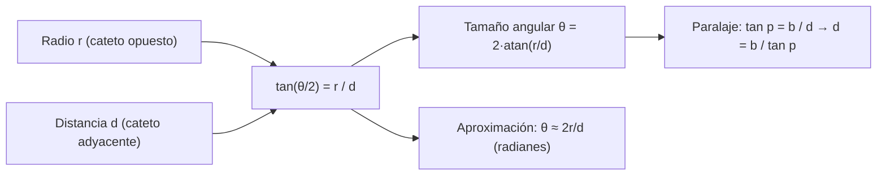

# B03-C18 — Razones trigonométricas iniciales

<!-- nav:top -->
[🏠 Programa](../../../../README.md) · [📚 Bloque B03](../../../tronco-comun/B03-matematica-elemental-para-ciencias-espaciales.md) · [← Anterior: B03-C17 — Áreas y volúmenes elementales](../B03-C17-areas-y-volumenes-elementales/CLASE.md) · [Siguiente: B03-C19 — Propagación elemental de redondeos →](../B03-C19-propagacion-elemental-de-redondeos/CLASE.md)
<!-- /nav -->

## 1. Ubicación, nivel y alcance

Decimoctava clase del bloque B03. No puedes llevar una cinta métrica a la Luna ni al Sol, pero sí puedes medir **ángulos** en el cielo. La trigonometría convierte ángulos en distancias y tamaños: dice cuánto mide algo lejano a partir de cuánto se ve de grande. Es la herramienta con la que se midió el Sistema Solar. Nivel N0 → N1.

Verás las razones seno, coseno y tangente en un triángulo rectángulo, la medida de ángulos en grados, minutos, segundos de arco y radianes, el tamaño angular de un astro, la aproximación de ángulo pequeño y el paralaje como método de distancia. No verás leyes del seno y del coseno (B04) ni trigonometría esférica (B04, B08).

## 2. Por qué esta clase existe

El Sol y la Luna se ven en el cielo con tamaños angulares muy parecidos, de alrededor de medio grado. ¿Es casualidad que midan lo mismo en el cielo siendo tan distintos? No: el Sol es unas 400 veces más ancho y está unas 400 veces más lejos. Esa «coincidencia» solo se ve con trigonometría: un cociente de tamaño y distancia produce el ángulo. Y a la inversa, si conoces el ángulo y la distancia, obtienes el tamaño.

La decisión central es: **¿qué triángulo rectángulo describe este problema, qué razón uso y en qué unidad de ángulo trabajo la calculadora?** Aprenderás a plantear el triángulo, a elegir la razón y a comprobar.

## 3. Lo que podrás hacer al terminar

1. Definir seno, coseno y tangente como razones de lados en un triángulo rectángulo.
2. Convertir entre grados, minutos y segundos de arco, y radianes.
3. Calcular el tamaño angular de una esfera a una distancia dada.
4. Usar la aproximación de ángulo pequeño y reconocer su rango de validez.
5. Calcular una distancia por paralaje con una base conocida.
6. Detectar errores típicos (calculadora en modo equivocado, ángulo mal definido).

La evidencia es la **ficha de triángulo y ángulo** del ejercicio 12 (sección 20).

## 4. Con qué llegas y cómo comprobarlo

Necesitas C01 a C17. Cinco preguntas:

1. ¿Cuántos grados tiene un ángulo recto?
2. ¿Cuántos segundos de arco hay en 1°?
3. ¿Cuánto es `√(3² + 4²)`?
4. Si dos triángulos son semejantes y uno tiene lados el doble, ¿qué ocurre con las razones entre sus lados?
5. ¿Cuánto es `1 737,4 / 384 400`?

<details>
<summary>Ver respuestas</summary>

1. 90°. 2. 3 600″ (C08). 3. 5. 4. Se mantienen. 5. 0,00452 (≈ 4,5 × 10⁻³).
</details>

Con cuatro o cinco aciertos, sigue; con menos, repasa C08 y C17.

## 5. Un caso real: cuánto mide la Luna en el cielo

La NASA da para la Luna un radio medio de 1 737,4 km y un semieje de 384 400 km; en oposición (más cerca de la Tierra) publica una distancia de 378 000 km y un diámetro aparente de 1 896 segundos de arco (S1). Con trigonometría, un radio de 1 737,4 km visto a 378 000 km subtiende `2·atan(1 737,4/378 000) = 1 896″`: exactamente el valor publicado. A la distancia media (384 400 km) el diámetro angular es 0,518°; el del Sol a 1 au, con radio 695 700 km, es 0,533° (S1, S2). Son del mismo orden. Límite: el cálculo trata ambos astros como esferas vistas desde el centro de la Tierra, sin refracción.

## 6. Vocabulario

En un **triángulo rectángulo**, el **cateto opuesto** a un ángulo `θ` es el lado frente a él, el **cateto adyacente** es el lado que lo forma junto con la hipotenusa, y la **hipotenusa** es el lado mayor, frente al ángulo recto. Las **razones trigonométricas** son: `sen θ = opuesto/hipotenusa`, `cos θ = adyacente/hipotenusa` y `tan θ = opuesto/adyacente`. Un **radián** es el ángulo cuyo arco mide lo mismo que el radio; `180° = π rad`. Un **segundo de arco** es `1/3600` de grado: `1″ = π/648 000 rad = 4,848 × 10⁻⁶ rad` (S3). El **tamaño angular** de un objeto es el ángulo que subtiende visto desde un punto. La **aproximación de ángulo pequeño** dice `tan θ ≈ θ` (en radianes) si `θ` es pequeño. El **paralaje** es el cambio de dirección de un objeto visto desde dos puntos distintos; la **base** es la distancia entre ellos.

## 7. Modelo mental: el triángulo que une tamaño, distancia y ángulo

Un objeto de radio `r` a distancia `d` forma un triángulo con la mirada: lo que se ve es el ángulo.



*Descripción textual:* el radio y la distancia forman el triángulo, cuya tangente da el semiángulo; de ahí se obtiene el tamaño angular exacto o la aproximación `θ ≈ 2r/d`; el mismo triángulo con una base `b` y un ángulo `p` da la distancia por paralaje.

Analogía: una moneda a distintas distancias del ojo. Cerca tapa más cielo, lejos menos. El límite: la moneda subtiende un ángulo pero la analogía no muestra la fórmula; además, el ojo ve con perspectiva y errores de percepción que la fórmula no tiene.

## 8. La explicación, paso a paso

### 8.1 Seno, coseno y tangente

En un triángulo de lados `3`, `4` y `5` (hipotenusa 5), el ángulo opuesto al lado 3 cumple `sen θ = 3/5 = 0,6`, `cos θ = 4/5 = 0,8` y `tan θ = 3/4 = 0,75`. Las razones solo dependen del ángulo y no del tamaño del triángulo: dos triángulos semejantes tienen las mismas razones (C02). Por eso se pueden tabular y reutilizar.

### 8.2 Unidades de ángulo

La calculadora tiene modos: **grados** y **radianes**. `tan(45°) = 1`; `tan(45 rad)` es otra cosa. Para pasar de grados a radianes multiplica por `π/180`. Para ángulos astronómicos, `1° = 60′ = 3 600″` (C08). Verifica siempre el modo: es el error más frecuente.

### 8.3 Tamaño angular de una esfera

Visto desde una distancia `d`, el radio `r` forma un triángulo rectángulo con la visual tangente: `tan(θ/2) = r/d`, luego `θ = 2·atan(r/d)`. Para la Luna a 384 400 km: `r/d = 0,0045198`; `atan = 0,0045198 rad` (casi igual); `θ = 0,0090395 rad = 0,5179°`. Para el Sol a 1 au: `r/d = 695 700/149 597 870,7 = 0,0046504`; `θ = 0,5329°`.

### 8.4 La aproximación de ángulo pequeño

Para ángulos pequeños (en radianes), `tan θ ≈ θ ≈ sen θ`. Con `θ = 1″ = 4,848 × 10⁻⁶ rad`, la diferencia relativa entre `tan θ` y `θ` es menor que `10⁻¹¹`. Con el semiángulo lunar, `0,0045198`, el error de `tan x ≈ x` es de `7 × 10⁻⁶` en términos relativos. Por eso `θ ≈ 2r/d` basta para casi todos los objetos astronómicos. No vale para ángulos grandes (a 45°, `tan = 1` y `θ = 0,785`).

### 8.5 Paralaje y distancia

Si observas una estrella desde dos puntos separados por una base `b`, su dirección cambia un ángulo `p`. En el triángulo, `tan p = b/d`, luego `d = b / tan p ≈ b/p` (con `p` en radianes). Con la base de 1 au y un paralaje de `1″`: `d = 149 597 870,7 km / 4,848 × 10⁻⁶ = 3,0857 × 10¹³ km = 206 265 au = 3,0857 × 10¹⁶ m`. Esa es la distancia a la que 1 au subtiende un segundo de arco (la idea que da nombre al parsec; no se consultó su definición oficial). Con un paralaje 10 veces menor (`0,1″`), la distancia es 10 veces mayor: `2,06 × 10⁶ au`.

### 8.6 Resolución angular y tamaño mínimo

Un instrumento que distingue detalles de `θ` radianes a distancia `d` resuelve estructuras de tamaño `d·θ`. Con `θ = 1″` y `d = 384 400 km`: `384 400 × 4,848 × 10⁻⁶ = 1,86 km`. Es el tamaño del detalle más pequeño que se separa en la Luna. Se estudia en B41 y B42.

## 9. Magnitudes, símbolos y unidades

| Símbolo | Qué es | Unidad | Valor o nota |
|---|---|---|---|
| `θ` | tamaño angular | °, ″, rad | Luna 0,518°; Sol 0,533° (calculados) |
| `r`, `d` | radio y distancia | km | Luna 1 737,4 km; 384 400 km (S1) |
| `p` | paralaje | ″, rad | — |
| `b` | base | km, au | 1 au = 149 597 870,7 km (S3) |
| `sen`, `cos`, `tan` | razones trigonométricas | sin unidad | — |
| 1″ | un segundo de arco | rad | 4,848 × 10⁻⁶ (S3) |

## 10. Convenciones y referencias

Los ángulos se miden desde la horizontal hacia arriba en sentido contrario al de las agujas del reloj. El símbolo `′` es minuto de arco y `″` segundo de arco, pegados al número (S3). Los argumentos de `sen`, `cos`, `tan` y de sus inversas (`asin`, `acos`, `atan`) se indican en grados o radianes de forma explícita. Los tamaños angulares son **calculados**; el diámetro aparente de 1 896″ es **publicado**.

## 11. De dónde sale lo que afirmamos

| ID | Fuente | Localizador | Respalda | Estado |
|---|---|---|---|---|
| S1 | NASA NSSDC, fichas *Moon* (11-ene-2024) y *Sun* (9-may-2024) | https://nssdc.gsfc.nasa.gov/planetary/factsheet/moonfact.html y .../sunfact.html | Luna: radio medio 1 737,4 km; semieje 384 400 km; en oposición, distancia 378 000 km y diámetro aparente 1 896″. Sol: radio medio 695 700 km | Páginas consultadas el 2026-11-05 |
| S2 | NASA NSSDC, *Earth Fact Sheet* (act. 15-nov-2024) | https://nssdc.gsfc.nasa.gov/planetary/factsheet/earthfact.html | Semieje de la Tierra 149,598 × 10⁶ km (distancia al Sol); radio medio 6 371 km | Página consultada el 2026-11-05 |
| S3 | BIPM, *The International System of Units (SI)*, 9.ª ed. (2019), tabla 8 y apdo. 5.4.3 | https://doi.org/10.59161/AUEZ1291 | 1° = π/180 rad; 1″ = π/648 000 rad; 1 au = 149 597 870 700 m; los símbolos °, ′, ″ van pegados al número | PDF leído el 2026-11-05 |

Límites: las razones trigonométricas y la aproximación de ángulo pequeño son matemática estándar y se **dan** sin demostrar. El parsec no se define aquí oficialmente; la distancia de 206 265 au es un cálculo propio. La afirmación «el Sol es unas 400 veces más ancho y más lejano» de la sección 2 es una estimación de orden de magnitud que se comprueba con los datos de S1 y S2: `695 700/1 737,4 = 400` y `149,6 × 10⁶/384 400 = 389`.

## 12. Cómo ver los ángulos

Versión accesible de una tabla de tamaños angulares.

| Objeto | `r` (km) | `d` (km) | `θ` (°) | `θ` (′) |
|---|---|---|---|---|
| Luna (distancia media) | 1 737,4 | 384 400 | 0,5179 | 31,07 |
| Luna (en oposición) | 1 737,4 | 378 000 | 0,5267 | 31,6 (= 1 896″) |
| Sol | 695 700 | 149 597 870,7 | 0,5329 | 31,97 |
| Tierra vista desde la Luna | 6 371 | 384 400 | 1,899 | 113,9 |

Si la dibujas, traza los triángulos a escala con la visual tangente rotulada y distingue cada objeto por forma. Descripción larga: cuatro triángulos largos y delgados con el vértice en el ojo; el de la Tierra desde la Luna es el más abierto, unas 3,7 veces el de la Luna desde la Tierra.

## 13. Ejemplo trabajado: comprobar el diámetro aparente que publica la NASA

**Pregunta.** ¿Qué tamaño angular tiene la Luna en oposición según la geometría, y coincide con 1 896″?

**Paso 1 · triángulo.** Cateto opuesto `r = 1 737,4 km`; adyacente `d = 378 000 km`.
**Paso 2 · razón.** `tan(θ/2) = 1 737,4/378 000 = 0,0045963`.
**Paso 3 · semiángulo.** `atan(0,0045963) = 0,0045963 rad = 0,26335°` (modo radianes y luego a grados).
**Paso 4 · ángulo completo.** `θ = 0,5267° = 31,60′ = 1 896″`.
**Paso 5 · comparación.** La NASA publica 1 896″: coincide.
**Paso 6 · aproximación.** `2r/d = 0,0091926 rad = 1 896,1″`: igual con cinco cifras. La aproximación de ángulo pequeño sirve.
**Sentido físico.** La geometría reproduce un dato medido; el instrumento y la fórmula coinciden. Y como el Sol se ve de 0,533° y la Luna de 0,518° a 0,527°, los dos tamaños angulares son comparables.

## 14. Ángulo exacto o aproximado: cuándo conviene cada uno

La **forma exacta** `2·atan(r/d)` sirve siempre y es el estándar para calcular. La **aproximación** `2r/d` es más fácil de operar a mano y permite razonar con proporciones (el ángulo es inversamente proporcional a la distancia, C10). Falla para ángulos de varios grados. En el cielo, casi todo cabe en el régimen pequeño, salvo cuando miras la Tierra desde una órbita baja.

## 15. Práctica guiada

**Ejercicio 1 · con los pasos indicados.** En el triángulo 3-4-5, calcula `sen`, `cos` y `tan` del ángulo opuesto al lado 3. *Pasos:* sección 8.1.

<details><summary>Solución comentada</summary>

`0,6`, `0,8` y `0,75`. Comprobación: `sen² + cos² = 0,36 + 0,64 = 1`.
</details>

**Ejercicio 2 · con una pista.** Calcula el diámetro angular de la Luna a 384 400 km, con `r = 1 737,4 km`. *Pista:* `θ = 2 atan(r/d)`, en radianes y luego a grados.

<details><summary>Solución comentada</summary>

`r/d = 0,0045198`; `θ = 2 × 0,0045198 = 0,0090395 rad = 0,5179° = 31,07′`.
</details>

**Ejercicio 3 · casi autónomo.** Pasa `0,5329°` a minutos y segundos de arco.

<details><summary>Solución comentada</summary>

`0,5329 × 60 = 31,97′`; `31,97 × 60 = 1 918″`.
</details>

## 16. Práctica autónoma, transferencia e integrador

**Ejercicio 4.** ¿Qué diámetro angular tiene la Tierra vista desde la Luna? (`r = 6 371 km`, `d = 384 400 km`.)

<details><summary>Solución comentada</summary>

`r/d = 0,016574`; `θ = 2 × 0,016574 = 0,033148 rad = 1,899°`. Unas 3,7 veces el de la Luna vista desde la Tierra.
</details>

**Ejercicio 5.** Si el Sol se ve de `0,5329°` y su diámetro es `1 391 400 km`, calcula su distancia.

<details><summary>Solución comentada</summary>

`d = 1 391 400/tan(0,5329°) = 1 391 400/0,009301 = 1,496 × 10⁸ km`: 1 au. Es el problema inverso.
</details>

**Ejercicio 6.** Un paralaje de `0,1″` con base 1 au, ¿qué distancia da?

<details><summary>Solución comentada</summary>

`d = 1 au/(0,1 × 4,848 × 10⁻⁶) = 2,0626 × 10⁶ au`. Diez veces más que con 1″.
</details>

**Ejercicio 7.** Comprueba que `tan θ ≈ θ` para `θ = 1″`.

<details><summary>Solución comentada</summary>

`θ = 4,848 × 10⁻⁶ rad`; `tan θ = 4,848 × 10⁻⁶ (1 + 7,8 × 10⁻¹²)`. Iguales con once cifras.
</details>

**Ejercicio 8.** Tecleas `tan(0,5179)` con la calculadora en modo radianes, queriendo grados, y obtienes `0,5658`. ¿Qué error hay?

<details><summary>Solución comentada</summary>

La calculadora interpretó 0,5179 **radianes** (29,7°). Para 0,5179° debías pasar a radianes (`0,009039`) o cambiar el modo. La verificación de sentido (un ángulo tan pequeño debe dar una tangente ~0,009) lo detecta.
</details>

**Ejercicio 9 · transferencia.** La NASA da 1 896″ para la Luna en oposición. ¿Por qué no coincide con el 0,518° (1 864″) a la distancia media?

<details><summary>Solución comentada</summary>

Porque la distancia es distinta: 378 000 km frente a 384 400 km. El tamaño angular es inversamente proporcional a la distancia: `1 864″ × 384 400/378 000 = 1 896″`.
</details>

**Ejercicio 10 · transferencia.** Con las distancias del perigeo medio (363 300 km) y del apogeo medio (405 500 km), ¿en qué porcentaje cambia el diámetro angular de la Luna?

<details><summary>Solución comentada</summary>

`405 500/363 300 = 1,116`: el diámetro angular en el perigeo es 11,6 % mayor que en el apogeo (aproximación de ángulo pequeño).
</details>

**Ejercicio 11 · transferencia.** Un telescopio resuelve `1″`. ¿Qué tamaño mínimo distingue en la Luna (`d = 384 400 km`)?

<details><summary>Solución comentada</summary>

`384 400 × 4,848 × 10⁻⁶ = 1,86 km`. Idealmente; en la práctica la atmósfera limita.
</details>

**Ejercicio 12 · integrador.** Elabora tu *ficha de triángulo y ángulo* (sección 20): un objeto de tu elección con radio y distancia citados, el triángulo dibujado, el tamaño angular exacto y aproximado, su conversión a ′ y ″, la comprobación con un dato publicado (si existe) y los límites.

<details><summary>Solución modelo</summary>

Para Júpiter: `r = 69 911 km`, `d` mínima del orden de `5,2 au − 1 au` (modelo circular, `6,2 × 10⁸ km`); `θ ≈ 2 × 69 911/6,2 × 10⁸ = 2,3 × 10⁻⁴ rad = 46,5″`. Se declara que usa el modelo circular de C13 y no es un dato publicado. Se acepta cualquier objeto con datos citados.
</details>

## 17. Laboratorio: triángulos y ángulos

El script [laboratorio_triangulos.py](laboratorio_triangulos.py) calcula tamaños angulares y distancias por paralaje, y antes comprueba el triángulo 3-4-5, `tan 45° = 1`, que `1″` mide `1/3600°`, la aproximación de ángulo pequeño y que el diámetro angular de la Luna a 378 000 km coincide con 1 896″ a menos del 0,1 %.

**Datos:** publicados (NASA, SI); resultados **calculados**. **Predice antes de ejecutar:** ¿qué ángulo tiene el Sol en el cielo? (Cerca de 0,5°.) **Resultados (2026-11-05, Python 3.12.9):** Luna a 378 000 km: 1896″ (NASA 1896″); a 384 400 km: 0,5179°; Sol a 1 au: 0,5329° = 31,97′; paralaje de 1″ con base 1 au: 206 265 au = 3,0857 × 10¹⁶ m; paralaje de 0,1″: 2 062 648 au.

```bash
python programa/clases/B03/B03-C18-razones-trigonometricas-iniciales/laboratorio_triangulos.py
```

**Límites:** esferas vistas de frente; sin refracción, sin paralaje diurno.

## 18. Errores frecuentes y cómo corregirlos

**Calculadora en el modo equivocado.** Ejercicio 8.
**Olvidar el factor 2 al pasar de radio a diámetro angular.** Ejercicio 2.
**Confundir cateto opuesto y adyacente.** Ejercicio 1.
**Usar grados en la aproximación `θ ≈ r/d`.** Sección 8.4.
**Creer que el tamaño angular no depende de la distancia.** Ejercicio 9.

## 19. Cómo sabrás que vas bien

Tras 8.1: ¿calculas `sen` de un ángulo de un triángulo 5-12-13? (`5/13` o `12/13`, según el ángulo). Si no, repite el ejercicio 1. Tras 8.3: ¿calculas un diámetro angular? Si no, haz el 2. Tras 8.5: ¿explicas por qué menor paralaje significa mayor distancia? Si no, rehaz el 6. Al final: ¿verificas el modo de la calculadora? Si dudas, vuelve al 8.

## 20. Qué entregas y cómo se evalúa

El producto es tu **ficha de triángulo y ángulo**: un objeto con radio y distancia citados, triángulo, tamaño angular exacto y aproximado, conversión de unidades, comparación con un dato publicado y límites.

| Criterio | Inicial | En desarrollo | Logrado | Destacado |
|---|---|---|---|---|
| Triángulo | Mal planteado | Con ayuda | Correcto | Justifica el modelo |
| Cálculo | Con errores de modo | Parcial | Correcto | Compara exacto y aproximado |
| Unidades de ángulo | Mezcla | Algunas | Correctas | Verifica ida y vuelta |
| Comparación | Sin dato | Dato sin fuente | Dato citado | Explica la diferencia |
| Límites | No los menciona | Genéricos | Específicos | Propone mejora |

**Condiciones críticas:** declarar el modo de ángulo; distinguir calculado de publicado; citar solo fuentes consultadas.

## 21. Ética, seguridad y límites

Nunca mires directamente al Sol, ni siquiera para medir su tamaño angular: toda observación solar requiere filtros certificados y supervisión. Esta clase es educativa y usa datos publicados, no mediciones propias. Accesibilidad: fórmulas en texto, tablas equivalentes, sin conexión.

## 22. Para cerrar y seguir

Las razones trigonométricas ligan ángulos y lados; el tamaño angular es `2·atan(r/d)` y se aproxima por `2r/d`; el paralaje da distancias a partir de ángulos; y la calculadora debe estar en el modo correcto. Queda una pregunta: todos estos números tienen cifras limitadas. ¿Cómo se combinan sus errores de redondeo? Es C19.

**Glosario español–inglés.** seno · *sine*; coseno · *cosine*; tangente · *tangent*; hipotenusa · *hypotenuse*; tamaño angular · *angular size*; paralaje · *parallax*; segundo de arco · *arcsecond*; radián · *radian*.

**Continuidad.** B03-C19 propaga los errores de estos cálculos y B03-C20 usa ángulos y distancias en la maqueta. B04 trata la trigonometría completa y B08 los ángulos del cielo.

**Referencias:** ver sección 11. Todas las fuentes son datos oficiales consultados.

<!-- nav:bottom -->
---

[← Anterior: B03-C17 — Áreas y volúmenes elementales](../B03-C17-areas-y-volumenes-elementales/CLASE.md) · [📚 Bloque B03](../../../tronco-comun/B03-matematica-elemental-para-ciencias-espaciales.md) · [Siguiente: B03-C19 — Propagación elemental de redondeos →](../B03-C19-propagacion-elemental-de-redondeos/CLASE.md)
<!-- /nav -->
