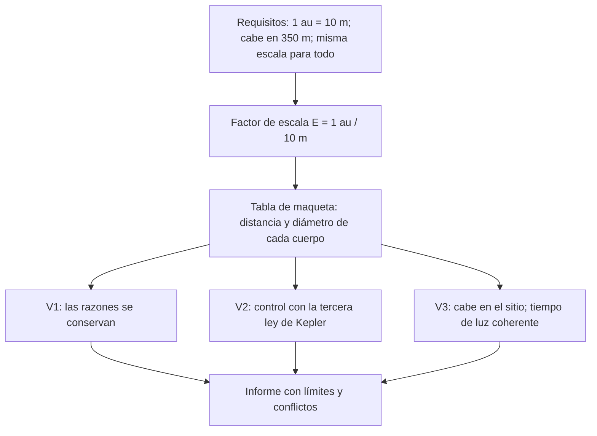

# B03-C20 — Problema integrado de escala del sistema solar

<!-- nav:top -->
[🏠 Programa](../../../../README.md) · [📚 Bloque B03](../../../tronco-comun/B03-matematica-elemental-para-ciencias-espaciales.md) · [← Anterior: B03-C19 — Propagación elemental de redondeos](../B03-C19-propagacion-elemental-de-redondeos/CLASE.md) · [Siguiente: B04-C01 — Polinomios y factorización →](../../B04/B04-C01-polinomios-y-factorizacion/CLASE.md)
<!-- /nav -->

## 1. Ubicación, nivel y alcance

Vigésima y última clase del bloque B03. Hasta aquí practicaste cada herramienta por separado: razones, potencias, notación científica, unidades, proporcionalidad, despejes, gráficos, geometría, trigonometría y propagación de redondeos. Esta clase las junta en un **problema de ingeniería**: diseñar y verificar una maqueta a escala del Sistema Solar con requisitos, componentes y criterios de comprobación. Nivel N1.

Verás cómo traducir requisitos a una restricción matemática, cómo elegir un factor de escala, cómo construir una tabla de maqueta, y sobre todo cómo **verificarla** con comprobaciones independientes. No aprenderás conceptos nuevos: reutilizarás los anteriores y los citarás.

## 2. Por qué esta clase existe

Un ingeniero no recibe un ejercicio con una sola fórmula: recibe requisitos («que quepa en un patio de 350 m», «que se vea el Sol», «que Neptuno esté a su sitio») y debe decidir qué se puede cumplir y qué no. Una maqueta fiel de los tamaños y de las distancias a la vez es imposible en la práctica: si las distancias caben en un patio, los planetas son granos casi invisibles. Reconocerlo con números, y no con intuición, es parte del trabajo.

La decisión central es: **¿qué escala elijo para cumplir los requisitos, qué debo comprobar para estar seguro de que la maqueta es correcta y qué limitaciones debo declarar?** Aprenderás a plantear el problema, resolverlo y documentarlo.

## 3. Lo que podrás hacer al terminar

1. Traducir requisitos de un problema a condiciones matemáticas con unidades.
2. Calcular un factor de escala y aplicarlo a longitudes (distancias y tamaños).
3. Construir una tabla de maqueta con dimensiones en una unidad práctica.
4. Verificar la tabla con comprobaciones independientes (razones, Kepler, tiempo de luz).
5. Detectar cuándo dos requisitos se contradicen y proponer una alternativa.
6. Redactar un informe de ingeniería con requisitos, método, resultados, verificaciones, límites y fuentes.

La evidencia es el **informe de maqueta con verificaciones** del ejercicio 12 (sección 20).

## 4. Con qué llegas y cómo comprobarlo

Necesitas C01 a C19. Cinco preguntas:

1. Si 1 au se representa con 10 m, ¿cuántos metros representan 30 au?
2. ¿Cuánto es `1,496 × 10¹¹ / 10`?
3. Si una longitud real se divide entre `k` para la maqueta, ¿cómo cambia una razón entre dos longitudes?
4. ¿Qué unidad tiene un factor de escala?
5. ¿Cómo comprobarías que `T² = a³` en la tabla de un planeta?

<details>
<summary>Ver respuestas</summary>

1. 300 m. 2. `1,496 × 10¹⁰`. 3. No cambia: las razones se conservan (C02). 4. Ninguna: es una razón entre longitudes (adimensional). 5. Calcula `T²` y `a³` con `T` en años y `a` en au (C04) y compara.
</details>

Con cuatro o cinco aciertos, sigue; con menos, repasa C02, C04 y C07.

## 5. El problema: diseñar la maqueta de un patio

**Enunciado.** Una escuela dispone de un patio de **350 m** de largo. Se quiere una maqueta lineal del Sistema Solar con el Sol y los ocho planetas, con las distancias al Sol fieles a escala. **Requisitos:** (R1) el semieje de la Tierra, 1 au, se representa con **10 m**; (R2) todos los planetas deben quedar dentro del patio; (R3) todos los tamaños deben ser fieles a la **misma escala** de longitudes; (R4) debe entregarse una tabla de maqueta con distancias en metros y diámetros en milímetros; (R5) la tabla debe pasar tres verificaciones independientes.

**Datos** (NASA, S1): semiejes mayores, radios medios volumétricos y períodos sidéreos de los ocho planetas; radio solar 695 700 km. **Constantes** (SI, S2): 1 au = 149 597 870 700 m; `c` = 299 792 458 m/s.

## 6. Vocabulario

Un **requisito** es una condición que la solución debe cumplir. Un **componente** es una parte del sistema (aquí, cada cuerpo con su distancia y su tamaño). Un **criterio de comprobación** es una prueba objetiva que dice si el requisito se cumple. El **factor de escala** `E` es la razón entre una longitud real y la longitud de la maqueta: `longitud_maqueta = longitud_real / E`. Una **maqueta a escala** conserva todas las razones entre longitudes. Una **restricción** limita el espacio de soluciones. Una **verificación** comprueba que el diseño cumple lo especificado, y una **validación** que sirve para su propósito. Un **conflicto de requisitos** ocurre cuando no se pueden cumplir todos a la vez.

## 7. Modelo mental: requisitos → escala → tabla → verificaciones

El proceso de ingeniería se ordena en etapas con comprobaciones.



*Descripción textual:* de los requisitos se calcula el factor de escala; con él se construye la tabla de maqueta; la tabla pasa por tres verificaciones (razones, Kepler y espacio/tiempo de luz); y todo se resume en un informe con límites y conflictos.

Analogía: un plano de arquitectura. Cada longitud del plano es la real dividida por la escala. El límite: un plano puede dibujar lo pequeño exagerando; una maqueta fiel no puede, y por eso aparece el conflicto de la sección 8.5.

## 8. La explicación, paso a paso

### 8.1 Del requisito a la escala (C02, C07)

R1 dice que 1 au (`1,495978707 × 10¹¹ m`, S2) equivale a 10 m. El factor es `E = 1,495978707 × 10¹¹ / 10 = 1,496 × 10¹⁰`, **sin unidades** (metros reales por metro de maqueta). Cualquier longitud real `L` se vuelve `L/E` en la maqueta.

### 8.2 Distancias (C05, C07)

Neptuno: `4 514,953 × 10⁶ km = 4,514953 × 10¹² m`; en la maqueta, `4,514953 × 10¹² / 1,496 × 10¹⁰ = 301,8 m`. Equivale a `30,18 au × 10 m/au`. Como 301,8 m < 350 m, se cumple R2. Estimación previa: `30 × 10 = 300`.

### 8.3 Tamaños (C17, C18)

El mismo factor para los diámetros (R3). El Sol: `2 × 695 700 km = 1,3914 × 10⁹ m`; `/ 1,496 × 10¹⁰ = 0,0930 m = 9,30 cm`. La Tierra: `2 × 6 371 km = 1,2742 × 10⁷ m`; `/E = 8,52 × 10⁻⁴ m = 0,852 mm`. Júpiter: `9,35 mm`. Los planetas interiores miden menos de un milímetro: se ven como granos.

### 8.4 Verificaciones (C10, C04, C19)

- **V1 · razones.** La razón entre la distancia de Neptuno y el diámetro del Sol debe ser la misma en la maqueta y en la realidad: `4,514953 × 10¹² / 1,3914 × 10⁹ = 3 245` en ambas. Si cambia, hay un error de conversión.
- **V2 · Kepler.** Los períodos y semiejes de la tabla deben cumplir `T² ≈ a³` (con `T` en años y `a` en au) con desviación menor que 1,5 % (C04). Detecta errores de transcripción de datos.
- **V3 · espacio y tiempo de luz.** Neptuno a 301,8 m cabe en 350 m (R2). El tiempo de luz real es `4,514953 × 10¹² m / 299 792 458 m/s = 15 060 s = 251 min` (C07, C08). Si «la luz» recorriera la maqueta a la misma razón de tiempo, iría a `c/E = 0,02 m/s` (2 cm por segundo).

### 8.5 El conflicto de requisitos

Con R1, la Tierra mide 0,85 mm: el requisito de ver los planetas (si se pidiera que fuesen visibles, por ejemplo, de 1 cm) choca con R2. Para que la Tierra midiera 1 cm (`E' = 1,2742 × 10⁷ / 0,01 = 1,274 × 10⁹`), 1 au pasaría a ser `149 597 870 700 / 1,274 × 10⁹ = 117,4 m` y Neptuno estaría a **3,54 km** del Sol: no cabría en el patio. Es un conflicto real entre «tamaños legibles» y «distancias en el patio». Solución habitual: dos maquetas (una de distancias y otra de tamaños) o aceptar una escala distinta para los tamaños, **declarándolo**.

### 8.6 Incertidumbre de construcción (C11, C19)

Si se mide la maqueta caminando con un error de ±1 m, la distancia de Mercurio (3,87 m) tendría un error relativo de ~26 %, y la de Neptuno (301,8 m), de 0,33 %. Con una cinta de ±1 cm, el error de Mercurio baja a 0,26 %. El error relativo es mayor cuanto menor es la distancia: no se puede dar una incertidumbre única sin decir a qué distancia se refiere.

## 9. Magnitudes, símbolos y unidades

| Símbolo | Qué es | Unidad | Valor o nota |
|---|---|---|---|
| `E` | factor de escala | sin unidad | `1,496 × 10¹⁰` para 1 au = 10 m |
| `a` | semieje mayor | 10⁶ km, au | de S1 |
| `r`, `d` | radio y diámetro de un cuerpo | km | de S1; Sol 695 700 km |
| `L_m` | longitud en la maqueta | m, mm | `L/E` |
| `T` | período sidéreo | d, años | de S1 |
| `t_luz` | tiempo de luz | s, min | `d/c` |
| 1 au | unidad astronómica | m | 149 597 870 700 (S2) |
| `c` | velocidad de la luz | m/s | 299 792 458 (S2) |

## 10. Convenciones y referencias

Las distancias de la maqueta se dan en metros con dos decimales; los diámetros, en milímetros con tres. El factor de escala se escribe `1 : 1,496 × 10¹⁰`. Los datos de partida se rotulan «publicados»; la tabla de la maqueta, «calculada». Los diámetros de los planetas usan el radio medio volumétrico de la NASA y las órbitas se tratan como circulares de radio igual al semieje.

## 11. De dónde sale lo que afirmamos

| ID | Fuente | Localizador | Respalda | Estado |
|---|---|---|---|---|
| S1 | NASA NSSDC, fichas de Mercurio, Venus, Tierra, Marte, Júpiter, Saturno, Urano y Neptuno, y del Sol, y tabla de razones | https://nssdc.gsfc.nasa.gov/planetary/factsheet/ (mercuryfact … neptunefact, sunfact, planet_table_ratio) | Radios medios (km): Mercurio 2 439,7; Venus 6 051,8; Tierra 6 371,0; Marte 3 389,5; Júpiter 69 911; Saturno 58 232; Urano 25 362; Neptuno 24 622; Sol 695 700. Semiejes (10⁶ km) y períodos (d) como en C04. Distancia de Neptuno 30,18 veces la de la Tierra | Páginas consultadas el 2026-11-05 |
| S2 | BIPM, *The International System of Units (SI)*, 9.ª ed. (2019), tabla 8 y definiciones | https://doi.org/10.59161/AUEZ1291 | 1 au = 149 597 870 700 m; `c` = 299 792 458 m/s; 1 h = 3600 s | PDF leído el 2026-11-05 |

Límites: la maqueta supone órbitas circulares y cuerpos esféricos, con datos medios de fichas divulgativas; no es una efeméride. El resultado es una tabla **calculada**, no una medición.

## 12. La tabla de la maqueta

Versión accesible de la maqueta: distancia al Sol y diámetro en la maqueta (R1: 1 au = 10 m) y tiempo de luz real.

| Cuerpo | Distancia en la maqueta (m) | Diámetro en la maqueta (mm) | Tiempo de luz real (min) |
|---|---|---|---|
| Sol | 0 | 93,0 (9,30 cm) | — |
| Mercurio | 3,87 | 0,326 | 3,22 |
| Venus | 7,23 | 0,809 | 6,02 |
| Tierra | 10,00 | 0,852 | 8,32 |
| Marte | 15,24 | 0,453 | 12,67 |
| Júpiter | 52,04 | 9,347 | 43,28 |
| Saturno | 95,73 | 7,785 | 79,61 |
| Urano | 191,65 | 3,391 | 159,39 |
| Neptuno | 301,81 | 3,292 | 251,00 |

Si la dibujas, usa una línea horizontal con escala lineal en metros y símbolos de forma distinta para los planetas, con el Sol a la izquierda. Descripción larga: una línea de 302 m con los cuatro planetas interiores agrupados en los primeros 16 m, Júpiter a 52 m y los otros tres gigantes hasta 302 m; los diámetros de los planetas, entre 0,3 y 9 mm, no se pueden dibujar a la misma escala que las distancias.

## 13. Ejemplo trabajado: construir y verificar la fila de Marte

**Pregunta.** ¿Qué valores tiene la fila de Marte y pasa las tres verificaciones?

**Paso 1 · escala.** `E = 1,496 × 10¹⁰`.
**Paso 2 · distancia.** `227,956 × 10⁹ m / 1,496 × 10¹⁰ = 15,24 m`. Estimación: `1,5 au × 10 m/au = 15 m` ✓.
**Paso 3 · diámetro.** `2 × 3 389,5 km = 6 779 km = 6,779 × 10⁶ m`; `/E = 4,53 × 10⁻⁴ m = 0,453 mm`.
**Paso 4 · V1.** Razón distancia/diámetro del Sol: en la realidad `227,956 × 10⁶ / 1 391 400 = 163,8`; en la maqueta `15,24 m / 0,0930 m = 163,9`. Iguales ✓ (la pequeña diferencia es de redondeo).
**Paso 5 · V2.** `a = 1,5238 au`, `T = 686,980/365,256 = 1,8808 años`; `T² = 3,5373`, `a³ = 3,5381`; razón `0,9998` ✓ (< 1,5 %).
**Paso 6 · V3.** `15,24 m < 350 m` ✓. Tiempo de luz `227,956 × 10⁹ / 299 792 458 = 760 s = 12,67 min` ✓.
**Sentido físico.** Marte, de 0,45 mm, es una mota a 15 m del Sol de 9,3 cm: la maqueta fiel expone que el Sistema Solar es casi todo espacio vacío.

## 14. Una maqueta o dos: cuándo conviene cada solución

Una **maqueta única** (R1–R3 a la vez) es honesta sobre las proporciones, pero los planetas son casi invisibles. **Dos maquetas** (una de distancias, otra de tamaños con escala mayor) permiten ver ambos, a costa de que no se puedan comparar directamente. **Una escala distinta para tamaños** con aviso explícito es la solución más común, pero induce a error si no se declara. Siempre se documenta qué se conserva y qué no.

## 15. Práctica guiada

**Ejercicio 1 · con los pasos indicados.** Calcula el factor de escala si 1 au = 10 m y escribe `1 : E`. *Pasos:* sección 8.1.

<details><summary>Solución comentada</summary>

`E = 149 597 870 700 / 10 = 1,496 × 10¹⁰`; `1 : 1,496 × 10¹⁰`. Sin unidades.
</details>

**Ejercicio 2 · con una pista.** Calcula el diámetro de la Tierra y de Júpiter en la maqueta. *Pista:* diámetro = 2 × radio medio, dividido entre `E`.

<details><summary>Solución comentada</summary>

Tierra: `12 742 km = 1,2742 × 10⁷ m`; `/E = 0,852 mm`. Júpiter: `139 822 km`; `/E = 9,347 mm`. Ratio Júpiter/Tierra = 10,97 en ambos (se conserva).
</details>

**Ejercicio 3 · casi autónomo.** Calcula la distancia de Marte al Sol en la maqueta.

<details><summary>Solución comentada</summary>

`227,956 × 10⁹ m / 1,496 × 10¹⁰ = 15,24 m`.
</details>

## 16. Práctica autónoma, transferencia e integrador

**Ejercicio 4.** Calcula el diámetro del Sol en la maqueta y compáralo con el de la Tierra.

<details><summary>Solución comentada</summary>

`1,3914 × 10⁹ / 1,496 × 10¹⁰ = 9,30 cm`; razón con la Tierra `0,0930 / 0,000852 = 109,2` (C02).
</details>

**Ejercicio 5.** Comprueba que la razón entre la distancia de Neptuno y la de la Tierra es la misma en la realidad y en la maqueta.

<details><summary>Solución comentada</summary>

Realidad: `4 514,953/149,598 = 30,18` (coincide con 30,18 de S1). Maqueta: `301,81/10,00 = 30,18`. ✓
</details>

**Ejercicio 6.** Si quisieras que la Tierra midiera 1 cm, ¿qué factor de escala necesitas y a qué distancia quedaría Neptuno? ¿Cabe en el patio?

<details><summary>Solución comentada</summary>

`E' = 1,2742 × 10⁷ m / 0,01 m = 1,274 × 10⁹`; Neptuno a `4,514953 × 10¹² / 1,274 × 10⁹ = 3 543 m`. No cabe en 350 m. Conflicto R2–tamaño legible.
</details>

**Ejercicio 7.** Calcula la «rapidez de la luz» en la maqueta si el tiempo no se escala: `c/E`.

<details><summary>Solución comentada</summary>

`299 792 458 / 1,496 × 10¹⁰ = 0,0200 m/s = 2 cm/s`. La luz tardaría `301,8 m / 0,02 m/s ≈ 15 060 s` en llegar a Neptuno, como en la realidad.
</details>

**Ejercicio 8.** Verifica la tercera ley de Kepler para Neptuno con los datos de la tabla.

<details><summary>Solución comentada</summary>

`a = 30,181 au`, `T = 164,786 años`; `T² = 27 154`, `a³ = 27 491`; razón `0,9878`: desviación 1,2 % < 1,5 % ✓.
</details>

**Ejercicio 9 · transferencia.** Un estudiante dice «la maqueta no sirve porque la Tierra casi no se ve». ¿Es un error del cálculo o una limitación del requisito? Argumenta con números.

<details><summary>Solución comentada</summary>

Es una limitación: con 1 au = 10 m, la Tierra mide 0,85 mm, y eso es lo que implica el requisito R3 (misma escala). Los cálculos están bien. Para hacerla visible habría que romper R2 (3,5 km para 1 cm) o R3 (escala distinta para tamaños).
</details>

**Ejercicio 10 · transferencia.** Si se mide con pasos de ±1 m, ¿cuál es el error relativo en Mercurio (3,87 m) y en Neptuno (301,8 m)? ¿Qué distancia pide más cuidado?

<details><summary>Solución comentada</summary>

`1/3,87 = 26 %` y `1/301,8 = 0,33 %`. Mercurio exige una cinta; el error relativo es mayor cuanto menor es la distancia.
</details>

**Ejercicio 11 · transferencia.** Propón tres verificaciones independientes para una tabla de maqueta con datos que otra persona calculó, distintas de las tres de la clase.

<details><summary>Solución comentada</summary>

(1) Recalcular dos filas con otra unidad (km en vez de m). (2) Comparar los tiempos de luz con la distancia en au × 499 s (C07). (3) Contrastar la razón de diámetros con la tabla de razones de la NASA (C02). Cada una detecta un tipo de error distinto.
</details>

**Ejercicio 12 · integrador.** Elabora tu *informe de maqueta con verificaciones* (sección 20): requisitos y conflictos, factor de escala, tabla de la maqueta (distancias y diámetros), tres verificaciones, propagación de la incertidumbre de construcción, límites y fuentes. Puedes cambiar el patio (por ejemplo, 100 m) y rehacer el diseño.

<details><summary>Solución modelo</summary>

Con un patio de 100 m: 1 au → 3 m (Neptuno a 90,5 m), `E = 5,0 × 10¹⁰`, Sol de 2,8 cm, Tierra de 0,25 mm. Conflictos declarados: tamaños ilegibles. Verificaciones: razones, Kepler y tiempo de luz; incertidumbre de ±1 cm en la cinta. Se acepta cualquier patio y escala si se cumple R2–R3 o si el conflicto se declara y se resuelve con una alternativa explícita.
</details>

## 17. Laboratorio: la maqueta como código

El script [laboratorio_maqueta.py](laboratorio_maqueta.py) calcula la tabla de la sección 12 y, antes de imprimirla, ejecuta las verificaciones V1 (razones conservadas a `10⁻¹²`), V2 (Kepler a 1,5 %) y V3 (Neptuno cabe en 350 m; 30,18 au publicado). Si alguna falla, se detiene.

**Datos:** publicados (NASA, SI); la tabla es **calculada**. **Predice antes de ejecutar:** ¿a cuántos metros quedará Neptuno? (Unos 300.) **Resultados (2026-11-05, Python 3.12.9):** factor de escala `1 : 1,4960 × 10¹⁰`; diámetro del Sol en la maqueta 9,30 cm; Mercurio 3,87 m; Venus 7,23 m; Tierra 10,00 m; Marte 15,24 m; Júpiter 52,04 m; Saturno 95,73 m; Urano 191,65 m; Neptuno 301,81 m; diámetros de 0,326 mm (Mercurio) a 9,347 mm (Júpiter); luz real de 3,22 min (Mercurio) a 251,00 min (Neptuno).

```bash
python programa/clases/B03/B03-C20-problema-integrado-de-escala-del-sistema-solar/laboratorio_maqueta.py
```

**Límites:** órbitas circulares y cuerpos esféricos; no hay posiciones angulares ni efemérides.

## 18. Errores frecuentes y cómo corregirlos

**Aplicar una escala a las distancias y otra a los tamaños sin decirlo.** Ejercicio 9.
**Convertir mal las unidades al dividir entre `E`.** Ejercicios 2 y 3.
**Omitir las verificaciones.** Ejercicios 5, 8 y 11.
**Dar una única incertidumbre a todas las distancias.** Ejercicio 10.
**No declarar el conflicto de requisitos.** Ejercicio 6.

## 19. Cómo sabrás que vas bien

Tras 8.1: ¿calculas `E` de cabeza con orden de magnitud? (`10¹⁰`). Si no, repite el ejercicio 1. Tras 8.4: ¿haces las tres verificaciones? Si no, haz el 5, el 8 y el 7. Tras 8.5: ¿entiendes el conflicto? Si no, rehaz el 6. Al final: ¿puedes defender tu maqueta ante alguien que la audite? Si dudas, completa el 11.

## 20. Qué entregas y cómo se evalúa

El producto es tu **informe de maqueta con verificaciones**: requisitos y conflictos, factor de escala, tabla de maqueta, tres verificaciones, incertidumbre de construcción, límites y fuentes.

| Criterio | Inicial | En desarrollo | Logrado | Destacado |
|---|---|---|---|---|
| Requisitos | Ausentes | Implícitos | Explícitos con unidades | Detecta y resuelve un conflicto |
| Factor y tabla | Con errores | Parcial | Correctos | Compara dos escalas |
| Verificaciones | Ninguna | Una | Tres independientes | Propone una cuarta |
| Incertidumbre | Ignorada | Mencionada | Cuantificada por distancia | Propaga a la tabla |
| Fuentes y límites | Sin cita | Parcial | Completos | Distingue publicado, calculado y simulado |

**Condiciones críticas:** no omitir unidades; no presentar la maqueta como medición; declarar toda escala distinta; citar solo fuentes consultadas.

## 21. Ética, seguridad y límites

Una maqueta que exagera tamaños sin decirlo enseña algo falso aunque cada número esté bien. Declarar lo que se sacrifica es parte de la honestidad científica y de la ingeniería. Esta clase es educativa y no sirve para diseñar sistemas reales. Si se arma la maqueta en un patio, hay que cuidar la seguridad del lugar (tránsito, obstáculos, sol). Accesibilidad: tabla equivalente, instrucciones en texto, sin conexión.

## 22. Para cerrar y seguir

Un problema de ingeniería se plantea con requisitos, se resuelve con un factor de escala, se documenta con una tabla y se valida con verificaciones independientes; cuando los requisitos chocan, se declara el conflicto. El Sistema Solar a escala resulta casi vacío: Neptuno a 300 m del Sol de 9 cm, con una Tierra de menos de un milímetro. Con este bloque tienes las herramientas matemáticas básicas; en B04 y B09 las ampliarás con álgebra, trigonometría y cálculo.

**Glosario español–inglés.** factor de escala · *scale factor*; maqueta · *scale model*; requisito · *requirement*; verificación · *verification*; validación · *validation*; restricción · *constraint*; tiempo de luz · *light-travel time*.

**Continuidad.** El bloque B04 retoma álgebra, trigonometría y geometría con más profundidad; B05, la física que justifica las fórmulas dadas; B08, la observación del cielo; B49, la ingeniería de sistemas y de requisitos de misión.

**Referencias:** ver sección 11. Todas las fuentes son datos oficiales consultados.

<!-- nav:bottom -->
---

[← Anterior: B03-C19 — Propagación elemental de redondeos](../B03-C19-propagacion-elemental-de-redondeos/CLASE.md) · [📚 Bloque B03](../../../tronco-comun/B03-matematica-elemental-para-ciencias-espaciales.md) · [Siguiente: B04-C01 — Polinomios y factorización →](../../B04/B04-C01-polinomios-y-factorizacion/CLASE.md)
<!-- /nav -->
