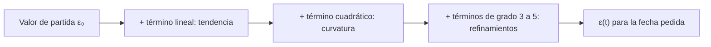

# B04-C01 — Polinomios y factorización

<!-- nav:top -->
[🏠 Programa](../../../../README.md) · [📚 Bloque B04](../../../tronco-comun/B04-algebra-trigonometria-y-geometria-espacial.md) · [← Anterior: B03-C20 — Problema integrado de escala del sistema solar](../../B03/B03-C20-problema-integrado-de-escala-del-sistema-solar/CLASE.md) · [Siguiente: B04-C02 — Ecuaciones lineales y cuadráticas →](../B04-C02-ecuaciones-lineales-y-cuadraticas/CLASE.md)
<!-- /nav -->

## 1. Ubicación, nivel y alcance

Primera clase del bloque B04. Parte del lenguaje de potencias y cocientes que ya usas desde [B01-C02](../../B01/B01-C02-escalas-desde-la-tierra-al-cosmos-observable/CLASE.md) y lo convierte en una herramienta de álgebra: expresiones como `a₀ + a₁t + a₂t² + …`, que aparecen en casi todo modelo astronómico. Nivel N1.

Verás qué es un polinomio, cómo evaluarlo de forma eficiente y exacta, y cómo factorizarlo para encontrar sus raíces. No verás todavía ecuaciones completas de segundo grado (siguiente clase), derivadas (bloque B09) ni ajuste de datos (bloque B12).

## 2. Por qué esta clase existe

Cuando un observatorio publica dónde está inclinado el eje de la Tierra, no da un solo número: da una *fórmula* para cada fecha, porque ese eje se mueve lentamente. Esa fórmula es un polinomio. Si no sabes leerlo, evaluarlo o ver qué término domina, no puedes saber qué tan fiable es la cifra que obtienes ni cuándo deja de valer.

La decisión central: **¿cómo uso una fórmula polinómica publicada sin equivocarme y sin perder precisión?** Aprenderás a leer coeficientes y grados, a evaluar con el esquema de Horner, a dividir por un factor y a reconocer productos notables como la diferencia de cuadrados, que aparece, por ejemplo, al comparar el perihelio y el afelio de un cometa.

## 3. Lo que podrás hacer al terminar

1. Identificar grado, coeficientes y término independiente de un polinomio.
2. Evaluar un polinomio con el esquema de Horner y comprobar el resultado con la forma directa.
3. Factorizar con factor común, diferencia de cuadrados y división sintética.
4. Encontrar las raíces racionales de un polinomio sencillo.
5. Decir qué término domina en un intervalo y estimar cuándo una fórmula deja de ser fiable.
6. Declarar unidades y variable independiente de cualquier fórmula publicada.

La evidencia es la **ficha de una fórmula publicada** del ejercicio 12 (sección 20).

## 4. Con qué llegas y cómo comprobarlo

Necesitas potencias, notación científica y orden de las operaciones (B03). Cinco preguntas:

1. Calcula `2·3²`.
2. ¿Cuánto es `(−2)³`?
3. Escribe 0,0000436 en notación científica.
4. Si `x = 4`, ¿cuánto vale `3x² − x + 5`?
5. ¿Qué número multiplicado por sí mismo da 81?

<details>
<summary>Ver respuestas</summary>

1. 18 (primero la potencia). 2. −8. 3. 4,36 × 10⁻⁵. 4. `3·16 − 4 + 5 = 49`. 5. 9 (y también −9).
</details>

Con cuatro o cinco aciertos, sigue; con tres o menos, repasa B03 antes de los ejercicios.

## 5. Un caso real: el eje de la Tierra se inclina cada vez menos

El eje de rotación de la Tierra forma un ángulo con la perpendicular al plano de su órbita: la **oblicuidad de la eclíptica**, ε. Hoy ronda 23,44°. No es constante: la atracción de la Luna, el Sol y los planetas lo desplaza muy despacio. La Unión Astronómica Internacional (IAU) adoptó en 2006 un modelo de precesión, y la ecuación que lo describe es un polinomio de grado cinco en el tiempo `t`, medido en siglos desde el año 2000 (S1).

En la clase la usarás para responder: ¿cuántos segundos de arco *cambia* la oblicuidad en un siglo y qué parte de ese cambio la aporta cada término? Es una pregunta concreta de ciencias espaciales: la oblicuidad entra en toda conversión entre coordenadas eclípticas y ecuatoriales (C19), y un error en ella desplaza las posiciones calculadas.

## 6. Vocabulario

Un **polinomio** en la variable `x` es una suma de términos `aₖ xᵏ`, con `k` entero no negativo. Los números `aₖ` son los **coeficientes**; `a₀` es el **término independiente** (el valor cuando `x = 0`). El **grado** es el mayor exponente con coeficiente no nulo. Una **raíz** es un valor de `x` que hace el polinomio igual a cero. **Factorizar** es escribir el polinomio como producto de polinomios de menor grado. El **esquema de Horner** reescribe `a₀ + a₁x + a₂x² + a₃x³` como `a₀ + x(a₁ + x(a₂ + x a₃))`, lo que evita calcular potencias altas por separado. Un **segundo de arco** (″) es 1/3600 de grado; los segundos de arco miden ángulos pequeños, no tiempo.

## 7. Modelo mental: un polinomio es una receta de «correcciones»

Piensa en `ε(t)` como un valor de partida (`ε₀`, la oblicuidad en el año 2000) al que se suman correcciones cada vez más pequeñas: una lineal (la tendencia principal), una cuadrática (cómo cambia la tendencia), una cúbica, etc. Cuanto mayor el grado, menor suele ser el aporte, mientras `t` sea pequeña.



*Descripción textual:* cinco cajas en cadena: se parte del valor en el año 2000, se suma la tendencia lineal, luego la curvatura, luego los refinamientos de grados 3 a 5, y se obtiene la oblicuidad para la fecha buscada.

Analogía: es como un presupuesto con un gasto fijo y varios extras cada vez menores. Su límite: en un polinomio la fórmula crece sin freno cuando `t` es grande, y la naturaleza no; por eso toda fórmula publicada trae un intervalo de validez. En esta clase usaremos solo `|t| ≤ 1` siglo, un límite conservador nuestro, no el de la fuente.

## 8. La explicación, paso a paso

### 8.1 Leer un polinomio

En `p(x) = 3x² − x + 5`, el grado es 2; los coeficientes son `a₂ = 3`, `a₁ = −1`, `a₀ = 5`. Al sustituir `x = 4`: `3·16 − 4 + 5 = 49`. Cada término lleva su propia unidad si `x` y el resultado la tienen: en la oblicuidad, `t` está en siglos y `ε` en segundos de arco, así que el coeficiente lineal está en ″ por siglo, el cuadrático en ″ por siglo², y así sucesivamente.

### 8.2 Evaluar con Horner

Para `p(x) = 2x³ − 5x² + 3x − 7` y `x = 2`, calcula de adentro hacia afuera: `2`, luego `2·2 − 5 = −1`, luego `−1·2 + 3 = 1`, luego `1·2 − 7 = −5`. Hacen falta tres multiplicaciones y tres sumas, y los números intermedios se mantienen del mismo orden de tamaño. Con coeficientes de tamaños muy distintos, como los de la oblicuidad (de 10⁴ a 10⁻⁸), esto reduce los errores de redondeo.

### 8.3 Factorizar

**Factor común.** `6x³ + 9x² = 3x²(2x + 3)`. **Diferencia de cuadrados.** `A² − B² = (A − B)(A + B)`. **Trinomio cuadrado perfecto.** `A² + 2AB + B² = (A + B)²`. **División sintética.** Si `r` es raíz de `p(x)`, entonces `(x − r)` es un factor: la división sintética calcula el cociente. Para `x³ − 6x² + 11x − 6`: se prueban divisores del término independiente (±1, ±2, ±3, ±6); `x = 1` da resto 0, y queda `x² − 5x + 6 = (x − 2)(x − 3)`. Resultado: `(x − 1)(x − 2)(x − 3)`.

**Regla de las raíces racionales.** Si el polinomio tiene coeficientes enteros y una raíz `p/q` en fracción irreducible, `p` divide al término independiente y `q` al coeficiente principal. Sirve para decidir qué candidatos probar; no garantiza que haya raíces racionales.

### 8.4 Dónde aparece en astronomía

La **tercera ley de Kepler** en unidades de años y unidades astronómicas es `P² = a³`. Si preguntas qué `a` da `P = 8` años, resuelves `a³ − 64 = 0`, que se factoriza `(a − 4)(a² + 4a + 16)`; solo la raíz real positiva `a = 4 au` tiene sentido físico. Y para una órbita elíptica, la distancia mínima `q = a(1 − e)` y la máxima `Q = a(1 + e)` cumplen `Q² − q² = (Q − q)(Q + q) = 4a²e`, una diferencia de cuadrados que muestra por qué una excentricidad alta separa tanto ambas distancias.

### 8.5 Qué término domina

Compara los tamaños: en `t = 1` el término lineal de la oblicuidad aporta −46,84″ y el cúbico solo +0,0020″. Despreciar el cúbico cambiaría el resultado en milésimas de segundo de arco; despreciar el lineal, en decenas. Decidir qué descartar siempre exige una tolerancia declarada.

## 9. Magnitudes, símbolos y unidades

| Símbolo | Qué es | Unidad | Nota |
|---|---|---|---|
| `x`, `t` | variable independiente | según contexto; `t` en siglos julianos | `t = 0` es J2000,0 (S1) |
| `aₖ` | coeficiente de grado `k` | unidad de `p` por unidad de `x`ᵏ | ver sección 8.1 |
| `ε` | oblicuidad de la eclíptica | segundo de arco (″) o grado (°) | `1° = 3600″` |
| `ε₀` | `ε` en `t = 0` | ″ | 84 381,406″ (S1) |
| `a` | semieje mayor | au | S3 |
| `e` | excentricidad | adimensional | `0 ≤ e < 1` en elipses |
| `q`, `Q` | distancia mínima y máxima al Sol | au | `q = a(1 − e)`; `Q = a(1 + e)` |
| `P` | periodo orbital | años | `P² = a³` solo con esas unidades |

## 10. Convenciones y referencias

La variable `t` cuenta **siglos julianos** (un siglo juliano son 36 525 días de 86 400 s) desde la época J2000,0. En sus fórmulas de nutación la fuente declara siglos de TDB; la diferencia entre escalas de tiempo no afecta a la precisión de esta clase. Los ángulos se dan en segundos de arco; para pasar a grados se divide entre 3600. La oblicuidad es ángulo positivo, de la eclíptica al ecuador, y se refiere a la fecha. Estas elecciones vienen de la fuente; el significado exacto de cada escala de tiempo se retoma en el bloque B13.

## 11. De dónde sale lo que afirmamos

| ID | Fuente | Localizador | Respalda | Estado |
|---|---|---|---|---|
| S1 | IERS Conventions (2010), IERS Technical Note 36, cap. 5 | https://iers-conventions.obspm.fr/content/tn36.pdf, ec. (5.40) y tabla de constantes | `ε₀ = 84381,406″` y coeficientes de `ε_A(t)` | PDF leído (extracción de texto) el 2026-11-05 |
| S2 | NASA/JPL Small-Body Database API | https://ssd-api.jpl.nasa.gov/sbdb.api?sstr=1P | Halley: `e = 0,96794`, `a = 17,9286 au`, `q = 0,57486 au`, `Q = 35,2824 au` | Consulta del 2026-11-05 (solución JPL de 2025-11-21; archivo mutable) |
| S3 | IAU, Resolución B2 de 2012 (referida en S1, tabla de constantes) | idem S1 | `1 au = 1,495978707 × 10¹¹ m` | Leída vía S1 el 2026-11-05 |

Límites: S1 es la fuente de los coeficientes; no se leyó aquí el desarrollo completo del modelo ni su intervalo de validez, por eso la clase impone el suyo. Los valores de S2 son estimados por ajuste a observaciones y pueden cambiar.

## 12. Cómo ver el polinomio

Como alternativa accesible a una gráfica, esta tabla da `ε_A(t)` calculada por el laboratorio (modelo):

| `t` (siglos desde J2000) | `ε_A` (″) | `ε_A` (°) |
|---|---|---|
| −1 (año 1900) | 84 428,2406 | 23,452289 |
| 0 (año 2000) | 84 381,4060 | 23,439279 |
| +1 (año 2100) | 84 334,5711 | 23,426270 |

Si la dibujas: eje horizontal `t`, eje vertical `ε` en grados, una línea que baja casi recta. Descripción larga: la oblicuidad desciende unos 13 milésimos de grado por siglo, de 23,452° a 23,426° entre 1900 y 2100; la curvatura es imperceptible a esta escala.

## 13. Ejemplo trabajado: cuánto cambia la oblicuidad en un siglo

Datos (S1): `ε_A(t) = 84381,406 − 46,836769 t − 0,0001831 t² + 0,00200340 t³ − 0,000000576 t⁴ − 0,0000000434 t⁵`, en segundos de arco, con `t` en siglos.

**Paso 1 · Valor de partida.** `ε_A(0) = 84381,406″ = 23,439279°`. Comprobación: `84381,406/3600 = 23,43928`.

**Paso 2 · Evaluar en `t = 1` con Horner.** Se construye de adentro hacia afuera con los coeficientes `−0,0000000434`, `−0,000000576`, `0,0020034`, `−0,0001831`, `−46,836769`, `84381,406`. El resultado es `84334,571051″`.

**Paso 3 · Cambio.** `84334,571051 − 84381,406 = −46,834949″` por siglo (−0,013010°).

**Paso 4 · Aporte de cada término.** Lineal −46,836769; cuadrático −0,000183; cúbico +0,002003; cuártico y quíntico del orden de 10⁻⁷ o menos. La suma da −46,834949″.

**Paso 5 · Interpretación y límite.** El término lineal explica 99,996 % del cambio. Las tres últimas cifras decimales de ″ dependen de términos muy pequeños: al dar el resultado con tres decimales los términos de grado 4 y 5 no alteran la respuesta. La fórmula vale como modelo cerca de J2000; fuera de unos siglos no se ha comprobado aquí.

## 14. Distintas formas de evaluar y factorizar

La **evaluación directa** (`c₀ + c₁t + c₂t² + …`) es transparente y sirve para entender el aporte de cada término. El **esquema de Horner** es más económico y estable con coeficientes de órdenes de magnitud muy distintos. La **factorización** exacta da raíces sin aproximar, pero solo es práctica con grados bajos o raíces racionales; para grado cinco, como la oblicuidad con una incógnita, no hay en general fórmulas por radicales y se recurre a métodos numéricos (bloque B11). La **tabla de valores** es útil para comparar, pero no sustituye a la fórmula.

## 15. Práctica guiada

**Ejercicio 1 · con los pasos indicados.** Evalúa `p(x) = 2x³ − 5x² + 3x − 7` en `x = 2` con Horner (sección 8.2).

<details><summary>Solución comentada</summary>

Coeficientes `2, −5, 3, −7`. Pasos: `2`; `2·2 − 5 = −1`; `−1·2 + 3 = 1`; `1·2 − 7 = −5`. Comprobación directa: `16 − 20 + 6 − 7 = −5`.
</details>

**Ejercicio 2 · con una pista.** Factoriza `x³ − 6x² + 11x − 6`. *Pista:* prueba `x = 1`.

<details><summary>Solución comentada</summary>

`p(1) = 1 − 6 + 11 − 6 = 0`, así que `(x − 1)` es factor. La división sintética da `x² − 5x + 6 = (x − 2)(x − 3)`. Resultado `(x − 1)(x − 2)(x − 3)`; las raíces son 1, 2 y 3.
</details>

**Ejercicio 3 · casi autónomo.** Para Halley, `a = 17,93 au` y `e = 0,9679`. Calcula `q` y `Q` y comprueba `Q² − q² = 4a²e` (sección 8.4).

<details><summary>Solución comentada</summary>

`q = 17,93·0,0321 = 0,575 au`; `Q = 17,93·1,9679 = 35,28 au`. `Q² − q² ≈ 1244,6` (1244,9 − 0,33) y `4a²e ≈ 1244,6` (4·321,5·0,9679). Coinciden dentro del redondeo; con más cifras el laboratorio da 1244,5177 en las tres formas.
</details>

## 16. Práctica autónoma, transferencia e integrador

**Ejercicio 4.** Factoriza `9x² − 49` y `6x³ + 9x²` (sección 8.3).

<details><summary>Solución comentada</summary>

`9x² − 49 = (3x − 7)(3x + 7)`; `6x³ + 9x² = 3x²(2x + 3)`.
</details>

**Ejercicio 5.** ¿Cuál es el grado y el término independiente de `ε_A(t)` de la sección 13? ¿En qué unidad está el coeficiente de `t²`?

<details><summary>Solución comentada</summary>

Grado 5; término independiente 84 381,406″. El coeficiente de `t²` está en ″ por siglo², porque `t²` está en siglo² y el resultado en ″ (sección 8.1).
</details>

**Ejercicio 6.** Calcula `ε_A(−1)` (año 1900) con Horner y comprueba el signo del cambio respecto de 2000.

<details><summary>Solución comentada</summary>

Con `t = −1` los términos de grado impar cambian de signo: `84381,406 + 46,836769 − 0,0001831 − 0,0020034 − 0,000000576 + 0,0000000434 = 84428,2406″`. Es mayor que en 2000: la oblicuidad bajó entre 1900 y 2000 (+46,83″ antes, −46,83″ después).
</details>

**Ejercicio 7.** Halla las raíces racionales de `2x³ − 3x² − 3x + 2`.

<details><summary>Solución comentada</summary>

Candidatos `±1, ±2, ±1/2`. `p(2) = 16 − 12 − 6 + 2 = 0`. División por `(x − 2)`: `2x² + x − 1 = (2x − 1)(x + 1)`. Raíces: `2`, `1/2`, `−1`.
</details>

**Ejercicio 8.** Una órbita tiene `a = 4 au`. ¿Cuál es su periodo según `P² = a³`? ¿Por qué descartamos las otras raíces de `a³ − 64`?

<details><summary>Solución comentada</summary>

`P² = 64`, `P = 8` años (se descarta −8 por ser un tiempo). Las otras raíces de `a³ − 64` son complejas (`a² + 4a + 16` no tiene raíces reales, porque `16 − 64 < 0`) y un semieje debe ser real y positivo.
</details>

**Ejercicio 9 · transferencia.** Un cometa tiene `q = 0,5 au` y `Q = 40,5 au`. Halla `a` y `e` sin calculadora y verifica `Q² − q² = 4a²e`.

<details><summary>Solución comentada</summary>

`a = (q + Q)/2 = 20,5 au`; `e = (Q − q)/(Q + q) = 40/41 = 0,976`. `Q² − q² = 1640,25 − 0,25 = 1640`; `4a²e = 4·420,25·(40/41) = 1640`. Exacto.
</details>

**Ejercicio 10 · transferencia.** Una hoja de cálculo evalúa `ε_A(t)` con `t = 1` calculando cada potencia con 6 cifras. Explica por qué podría perder precisión en los últimos términos y cómo lo evitaría.

<details><summary>Solución comentada</summary>

Sumar un número del orden de 10⁴ con otros del orden de 10⁻⁷ obliga a conservar muchas cifras; con 6 cifras significativas los términos de grado 4 y 5 desaparecen. Con Horner o con precisión doble se conservan. Aun así, el resultado solo vale con tantas cifras como los coeficientes publicados.
</details>

**Ejercicio 11 · transferencia.** El término cuadrático de `ε_A` es −0,0001831 ″/siglo². ¿En cuántos siglos aportaría tanto como 1″ si el modelo siguiera valiendo? ¿Es creíble?

<details><summary>Solución comentada</summary>

`0,0001831 t² = 1` → `t = √(1/0,0001831) = 73,9` siglos. Esa extrapolación a 7400 años no es creíble: los otros términos también crecen y el modelo no se ha validado en ese rango (sección 7).
</details>

**Ejercicio 12 · integrador.** Elabora la *ficha de una fórmula publicada* (sección 20): elige una fórmula polinómica de una fuente consultada (por ejemplo, `ε_A`), anota variable y unidades, grado, coeficientes, intervalo de validez declarado o ausente, evalúala en dos fechas con Horner, comprueba con evaluación directa y escribe qué término domina.

<details><summary>Solución modelo</summary>

Una ficha completa tiene: fuente con localizador y fecha, definición de `t` y su unidad, tabla de coeficientes con unidades, dos evaluaciones con sus pasos, comprobación directa que coincide, un enunciado «el término X domina porque…», y la frase «validez no declarada en la fuente leída; uso solo en un intervalo de N siglos».
</details>

## 17. Laboratorio: Horner, factorización y la oblicuidad

El script [polinomios_y_oblicuidad.py](polinomios_y_oblicuidad.py) evalúa `ε_A(t)` con Horner y con la forma directa, y antes de imprimir comprueba cuatro cosas: que ambos métodos coincidan a 10⁻¹², que `ε_A(0)` sea el valor de la fuente, que `(x − 1)(x − 2)(x − 3)` salga de la división sintética y que la diferencia de cuadrados se cumpla con fracciones exactas. Si algo falla, se detiene.

**Datos:** coeficientes publicados (modelo de la IERS); elementos de Halley estimados por JPL. **Predice antes de ejecutar:** ¿cuánto cambia la oblicuidad en un siglo? (unos −46,8″). **Ejecución del 2026-11-05 (Python 3.12.9, solo biblioteca estándar):**

```text
ε_A(-1) = 84428.240582"  = 23.452289°
ε_A( 0) = 84381.406000"  = 23.439279°
ε_A(+1) = 84334.571051"  = 23.426270°
suma de cambios: -46.834949" por siglo (-13.010 milésimas de grado)
Halley: q = 0.574864 au; Q = 35.28241 au
Q^2 - q^2 = 1244.5177 = (Q-q)(Q+q) = 4 a^2 e
```

```bash
python programa/clases/B04/B04-C01-polinomios-y-factorizacion/polinomios_y_oblicuidad.py
```

**Límites:** solo la parte polinómica del modelo, sin nutación; sin propagación de incertidumbre; no es una herramienta de efemérides.

## 18. Errores frecuentes y cómo corregirlos

**Ignorar el orden de las operaciones.** Calcular `−2²` como `4`; es `−4`. Se corrige con la pregunta 2 del diagnóstico.

**Olvidar un signo al dividir sintéticamente.** Con raíz `r`, el factor es `(x − r)`: para la raíz −1, `(x + 1)`. Se corrige con el ejercicio 7.

**Confundir raíz con factor.** La raíz es 2; el factor es `(x − 2)`.

**Usar la fórmula fuera de su intervalo.** Se corrige con el ejercicio 11.

**Perder términos pequeños por redondeo.** Se corrige con el ejercicio 10 y con Horner.

## 19. Cómo sabrás que vas bien

Después de la sección 8.2: ¿evalúas un polinomio de grado 3 con Horner y lo compruebas de forma directa? Si no, repite el ejercicio 1. Tras la 8.3: ¿factorizas `x³ − 6x² + 11x − 6` sin mirar? Si no, haz el ejercicio 2. Tras el ejemplo: ¿sabes por qué el término lineal domina? Si dudas, vuelve a 8.5. Tras el laboratorio: ¿qué comprueba el script antes de calcular? Si no lo sabes, lee su cabecera.

## 20. Qué entregas y cómo se evalúa

El producto es tu **ficha de una fórmula publicada** (ejercicio 12).

| Criterio | Inicial | En desarrollo | Logrado | Destacado |
|---|---|---|---|---|
| Lectura del polinomio | Confunde grado y coeficientes | Los identifica con ayuda | Grado, coeficientes y unidades correctos | Detecta qué término domina y por qué |
| Evaluación | Errores de operación | Evalúa sin comprobar | Horner y comprobación directa coinciden | Explica el efecto del redondeo |
| Factorización | No factoriza | Solo casos directos | Usa división sintética y raíces racionales | Elige método según el caso |
| Validez | Ausente | La menciona | Declara intervalo y su origen | Distingue lo declarado por la fuente de lo propio |
| Fuentes | Sin fuente | Sin fecha | Con localizador y fecha | Marca modelo frente a medición |

**Condiciones críticas (no se compensan con promedio):** declarar unidades de la variable y del resultado; no usar la fórmula fuera del intervalo declarado sin avisarlo; citar solo fuentes consultadas.

## 21. Ética, seguridad y límites

Una fórmula publicada no es una verdad: es un modelo con dominio de validez. Presentar un resultado fuera de ese dominio como si fuera una medición es una falta de honestidad numérica. No hay riesgos físicos en la clase. Accesibilidad: las fórmulas están escritas en texto, la gráfica tiene tabla equivalente y los ejercicios se hacen sin conexión. Material educativo, no sirve para efemérides profesionales.

## 22. Para cerrar y seguir

Un polinomio es una suma de correcciones de tamaño decreciente; se evalúa bien con Horner, se factoriza buscando raíces y se usa solo dentro de su validez. La oblicuidad de la Tierra baja unos 47″ por siglo según el modelo IAU 2006. Queda abierta una pregunta: ¿qué hacemos cuando el polinomio es de segundo grado y no se factoriza a simple vista? Esa es la clase siguiente.

**Glosario español–inglés.** polinomio · *polynomial*; coeficiente · *coefficient*; grado · *degree*; raíz · *root*; factorización · *factorization*; esquema de Horner · *Horner's method*; oblicuidad de la eclíptica · *obliquity of the ecliptic*; segundo de arco · *arcsecond*.

**Continuidad.** B04-C02 usa tu capacidad de **factorizar y reconocer raíces** para resolver ecuaciones de primer y segundo grado. B04-C19 retomará la oblicuidad para pasar de coordenadas eclípticas a ecuatoriales.

**Referencias:** ver sección 11.

<!-- nav:bottom -->
---

[← Anterior: B03-C20 — Problema integrado de escala del sistema solar](../../B03/B03-C20-problema-integrado-de-escala-del-sistema-solar/CLASE.md) · [📚 Bloque B04](../../../tronco-comun/B04-algebra-trigonometria-y-geometria-espacial.md) · [Siguiente: B04-C02 — Ecuaciones lineales y cuadráticas →](../B04-C02-ecuaciones-lineales-y-cuadraticas/CLASE.md)
<!-- /nav -->
