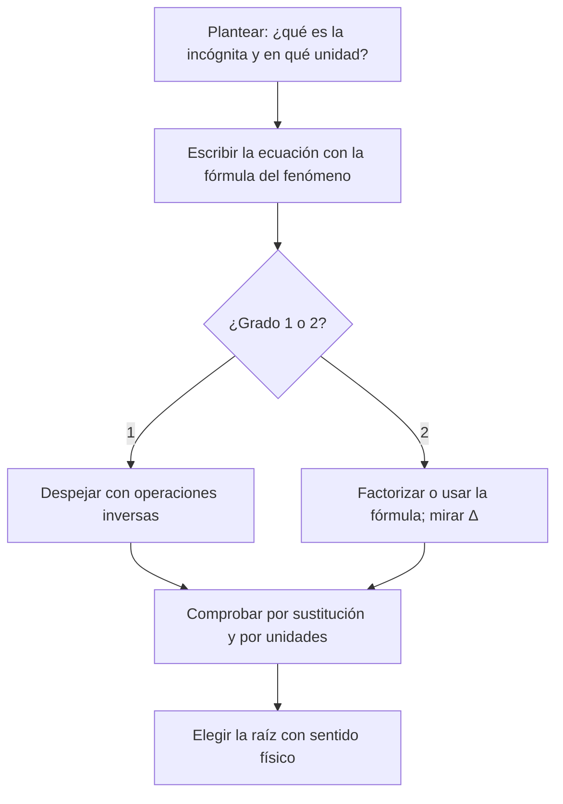

# B04-C02 — Ecuaciones lineales y cuadráticas

<!-- nav:top -->
[🏠 Programa](../../../../README.md) · [📚 Bloque B04](../../../tronco-comun/B04-algebra-trigonometria-y-geometria-espacial.md) · [← Anterior: B04-C01 — Polinomios y factorización](../B04-C01-polinomios-y-factorizacion/CLASE.md) · [Siguiente: B04-C03 — Sistemas de ecuaciones elementales →](../B04-C03-sistemas-de-ecuaciones-elementales/CLASE.md)
<!-- /nav -->

## 1. Ubicación, nivel y alcance

Segunda clase del bloque B04. En la [clase anterior](../B04-C01-polinomios-y-factorizacion/CLASE.md) aprendiste a leer, evaluar y factorizar polinomios. Ahora los igualas a un valor y preguntas: ¿para qué `x` se cumple? Nivel N1. Verás ecuaciones de primer y segundo grado, la fórmula cuadrática, el discriminante y cómo decidir qué solución tiene sentido físico. No verás sistemas (C03), ni ecuaciones de grado alto, ni resolución numérica general (B11).

## 2. Por qué esta clase existe

Una sonda desciende hacia la Luna; un instrumento cae desde una mesa de trabajo; una señal de radio viaja hasta un espejo y vuelve. En cada caso hay un número que no conoces (un tiempo, una distancia) y una relación que lo liga a otros que sí conoces. Despejarlo es resolver una ecuación.

La decisión central: **¿cómo despejo la incógnita, cuántas soluciones puede tener y cuál es la que corresponde al problema físico?** Aprenderás a plantear, resolver, comprobar por sustitución y descartar con argumentos de unidades y signo.

## 3. Lo que podrás hacer al terminar

1. Resolver `ax + b = 0` y despejar una variable en una fórmula.
2. Resolver `ax² + bx + c = 0` con factorización y con la fórmula cuadrática.
3. Interpretar el discriminante: dos raíces reales, una doble o ninguna real.
4. Elegir la raíz físicamente razonable y justificarla.
5. Comprobar toda solución sustituyéndola en la ecuación original.
6. Reconocer cuándo la fórmula directa pierde precisión y usar la forma estable.

La evidencia es el **informe de una ecuación física resuelta** del ejercicio 12 (sección 20).

## 4. Con qué llegas y cómo comprobarlo

Necesitas lo de C01: grado, factorización y raíces. Cinco preguntas:

1. Factoriza `x² − 5x + 6`.
2. Despeja `x` en `3x − 12 = 0`.
3. ¿Cuánto vale `√(2·2/1,62)`, aproximadamente?
4. Si `d = ct` con `c = 3 × 10⁸ m/s` y `t = 1,28 s`, ¿cuánto es `d`?
5. ¿Cuál es el orden de magnitud de 0,00005?

<details>
<summary>Ver respuestas</summary>

1. `(x − 2)(x − 3)`. 2. `x = 4`. 3. Cerca de 1,57 (`√2,47`). 4. `3,84 × 10⁸ m`. 5. 10⁻⁵ (5 × 10⁻⁵).
</details>

Con cuatro o cinco aciertos, sigue; si no, repasa C01 y B03.

## 5. Un caso real: cuánto tarda en caer algo en la Luna

La Luna tiene una gravedad superficial de 1,62 m/s², menos de la sexta parte de la terrestre (S1). Un astronauta suelta una herramienta desde 2 m de altura. ¿Cuánto tarda en llegar al suelo? Y si en vez de soltarla la lanza hacia abajo a 1 m/s, ¿cuánto? Ambas respuestas son soluciones de una ecuación de segundo grado en el tiempo. Una pregunta parecida, de primer grado, es cuánto tarda la luz en cruzar el espacio Tierra–Luna, que se responde con `d = ct`: la incógnita aparece solo elevada a 1.

## 6. Vocabulario

Una **ecuación** es una igualdad con una incógnita; **resolverla** es hallar los valores que la cumplen. Una ecuación es **lineal** si la incógnita aparece solo a la primera potencia, y **cuadrática** si el mayor exponente es 2. La **forma general** de la cuadrática es `ax² + bx + c = 0` con `a ≠ 0`. El **discriminante** es `Δ = b² − 4ac`. Una **raíz doble** ocurre cuando `Δ = 0`. **Despejar** es aislar una variable usando operaciones inversas, manteniendo la igualdad. La **comprobación** es sustituir la solución y verificar que la igualdad se cumple dentro de la tolerancia declarada.

## 7. Modelo mental: la balanza y la parábola

Una ecuación es una balanza en equilibrio: lo que hagas de un lado lo haces del otro. Para la lineal alcanza con deshacer operaciones en orden inverso. Para la cuadrática, piensa que `y = ax² + bx + c` dibuja una curva en forma de «U» (o «∩»), una **parábola**, y las raíces son los puntos donde corta el eje horizontal: dos, uno o ninguno.



*Descripción textual:* diagrama de decisión: plantear la incógnita con su unidad, escribir la ecuación, separar según el grado (despejar o factorizar/fórmula con el discriminante), comprobar por sustitución y unidades, y elegir la raíz con sentido físico.

Analogía: la balanza. Su límite: en la cuadrática hay dos «pesos» que equilibran, no uno, y hay que decidir cuál es el real.

## 8. La explicación, paso a paso

### 8.1 Ecuaciones lineales

`ax + b = 0` tiene solución `x = −b/a` si `a ≠ 0`. Si `a = 0` y `b ≠ 0`, no hay solución; si ambos son 0, todo `x` sirve. En física casi siempre se despeja de una fórmula: de `d = ct` sale `t = d/c`. Con `d = 3,844 × 10⁸ m` (distancia media Tierra–Luna, S1) y `c = 299 792 458 m/s` (S2): `t = 1,282 s`. Las unidades se cancelan: m ÷ (m/s) = s. Si el resultado saliera en m/s, habría un error de planteamiento.

### 8.2 La cuadrática: tres caminos

**Factorización**, si ves los factores: `x² − 5x + 6 = (x − 2)(x − 3) = 0` da `x = 2` o `x = 3`, porque un producto es cero solo si algún factor lo es.

**Raíz directa**, si falta el término lineal: `½ g t² = h` da `t = √(2h/g)`. Aquí solo interesa la raíz positiva porque el tiempo no es negativo.

**Fórmula general:**

`x = (−b ± √(b² − 4ac)) / (2a)`.

El discriminante decide: `Δ > 0` da dos raíces reales distintas; `Δ = 0`, una doble; `Δ < 0`, ninguna real (el fenómeno planteado no ocurre: por ejemplo, un proyectil que no alcanza cierta altura).

### 8.3 Plantear una caída

Elige el eje y su sentido. Tomemos el eje **hacia abajo**, origen en el punto de lanzamiento. La posición es `y = v₀ t + ½ g t²`, con `v₀` la velocidad inicial hacia abajo (m/s) y `g = 1,62 m/s²`. Para llegar a `y = h = 2 m`: `½ g t² + v₀ t − h = 0`. Con `v₀ = 0`: `t = √(2h/g) = √(4/1,62) = 1,571 s`. Con `v₀ = 1 m/s`: `0,81 t² + t − 2 = 0`; `Δ = 1 + 4·0,81·2 = 7,48`; `t = (−1 + 2,735)/1,62 = 1,071 s`. La otra raíz, `t = −2,3 s`, corresponde a un instante *anterior* al lanzamiento: matemática válida, física descartada.

### 8.4 Cuando la fórmula falla en la práctica

Si `b²` es enorme frente a `4ac`, `√Δ` casi iguala a `|b|` y restar dos números casi iguales borra cifras. Remedio: calcula la raíz de mayor módulo con el signo que suma (`q = −½(b + signo(b)√Δ)`, `x₁ = q/a`) y obtén la otra con `x₂ = c/q`, pues el producto de raíces es `c/a`. El laboratorio muestra el caso `x² − 10⁸x + 1 = 0`.

## 9. Magnitudes, símbolos y unidades

| Símbolo | Qué es | Unidad | Valor o nota |
|---|---|---|---|
| `a, b, c` | coeficientes de la ecuación | los que hagan coherente `ax²+bx+c` | pueden tener unidades distintas |
| `Δ` | discriminante `b² − 4ac` | unidad de `b²` | su signo decide |
| `g` | aceleración de la gravedad lunar | m/s² | 1,62 (S1) |
| `h` | altura de caída | m | dato del problema |
| `v₀` | velocidad inicial hacia abajo | m/s | dato |
| `t` | tiempo | s | incógnita |
| `c` | velocidad de la luz | m/s | 299 792 458 exacta (S2) |
| `d` | distancia | m | semieje mayor lunar 3,844 × 10⁸ (S1) |

## 10. Convenciones y referencias

En las caídas se fija un **eje positivo hacia abajo** con origen en el punto de partida; con otra elección cambian los signos de `v₀` y `g`, no el resultado físico. Las raíces se escriben con las cifras de los datos (3 cifras aquí). `x₁ ≤ x₂` por convención en el laboratorio. La Luna se trata como un cuerpo con gravedad uniforme en la altura de interés.

## 11. De dónde sale lo que afirmamos

| ID | Fuente | Localizador | Respalda | Estado |
|---|---|---|---|---|
| S1 | NASA NSSDC, *Moon Fact Sheet* (actualizada 2024-01-11) | https://nssdc.gsfc.nasa.gov/planetary/factsheet/moonfact.html | Gravedad superficial 1,62 m/s²; semieje mayor 0,3844 × 10⁶ km; radio medio 1737,4 km | Consultada el 2026-11-05 |
| S2 | BIPM, *The International System of Units (SI)*, 9.ª ed. (2019) | https://www.bipm.org/documents/20126/41483022/SI-Brochure-9-EN.pdf, definición del metro | `c = 299 792 458 m/s` exacta | PDF leído (texto) el 2026-11-05 |

Límites: la gravedad de la ficha es un valor de superficie medio; la aceleración real varía con el lugar. El tiempo de luz usa el semieje mayor, no la distancia instantánea (que va de 363 300 a 405 500 km según la misma ficha).

## 12. Cómo ver las soluciones

Alternativa accesible a la gráfica de la parábola (laboratorio, modelo):

| Caso (h = 2 m) | Ecuación | Raíces (s) | Útil |
|---|---|---|---|
| Soltar (`v₀ = 0`) | `0,81 t² − 2 = 0` | ±1,571 | +1,571 |
| Lanzar a 1 m/s | `0,81 t² + t − 2 = 0` | −2,306 y 1,071 | +1,071 |
| Soltar en la Tierra (referencia) | `4,905 t² − 2 = 0` | ±0,639 | +0,639 |

Descripción larga: la parábola abre hacia arriba y corta el eje del tiempo una vez en tiempos negativos y otra en positivos; solo la rama del futuro importa.

## 13. Ejemplo trabajado: lanzar hacia abajo a 1 m/s

Datos: `h = 2 m`, `v₀ = 1,0 m/s`, `g = 1,62 m/s²` (S1). Incógnita: `t`.

**Paso 1 · Plantear.** `½ g t² + v₀ t − h = 0` → `0,81 t² + 1,0 t − 2,0 = 0` (eje hacia abajo). Unidades: cada término en m.

**Paso 2 · Discriminante.** `Δ = 1,0² − 4·0,81·(−2,0) = 1 + 6,48 = 7,48`. Positivo: dos raíces reales.

**Paso 3 · Raíces.** `√7,48 = 2,735`; `t = (−1 ± 2,735)/1,62`, así que `t₁ = −2,306 s` y `t₂ = 1,071 s`.

**Paso 4 · Elegir.** `t₁` es anterior al lanzamiento: se descarta. `t = 1,07 s`.

**Paso 5 · Comprobar.** `0,81·1,071² + 1,071 = 0,929 + 1,071 = 2,000 m` ✓. Es menor que los 1,571 s de la caída libre, como debe: la velocidad inicial ayuda. Se da con 3 cifras porque `g` las tiene.

## 14. Distintas formas de resolver

**Despejar** es lo más corto en lineales y en cuadráticas sin término lineal. **Factorizar** es exacto cuando los factores son evidentes. La **fórmula general** siempre funciona, pero necesita cuidado numérico (sección 8.4). El método **gráfico** da intuición (¿cuántas raíces?) pero poca precisión. Un método **por tanteo** (probar valores) solo sirve de comprobación.

## 15. Práctica guiada

**Ejercicio 1 · con los pasos indicados.** Calcula el tiempo que tarda la luz en recorrer la distancia mínima Tierra–Luna, 363 300 km (S1). *Pasos:* `t = d/c`, convierte km a m.

<details><summary>Solución comentada</summary>

`d = 3,633 × 10⁸ m`; `t = 3,633 × 10⁸/2,998 × 10⁸ = 1,212 s`. Unidades: m ÷ (m/s) = s. Es algo menos que los 1,282 s del semieje mayor, como corresponde a una distancia menor.
</details>

**Ejercicio 2 · con una pista.** Resuelve `x² − 7x + 10 = 0`. *Pista:* busca dos números que sumen 7 y multipliquen 10.

<details><summary>Solución comentada</summary>

2 y 5: `(x − 2)(x − 5) = 0`, `x = 2` o `x = 5`. Sustitución: `4 − 14 + 10 = 0` ✓ y `25 − 35 + 10 = 0` ✓.
</details>

**Ejercicio 3 · casi autónomo.** Un objeto se suelta desde 5 m en la Luna. ¿Cuánto tarda y con qué rapidez llega? (Sección 8.3).

<details><summary>Solución comentada</summary>

`t = √(2·5/1,62) = √6,173 = 2,485 s`; `v = g t = 1,62·2,485 = 4,03 m/s`. Comprobación de energía rápida: `v² = 2gh = 16,2` → `v = 4,02`. (La diferencia es de redondeo.)
</details>

## 16. Práctica autónoma, transferencia e integrador

**Ejercicio 4.** Despeja `t` de `d = c t` y calcula cuánto tarda la luz en recorrer 1 au (`1,496 × 10¹¹ m`).

<details><summary>Solución comentada</summary>

`t = d/c = 1,496 × 10¹¹/2,998 × 10⁸ = 499 s ≈ 8,3 min`.
</details>

**Ejercicio 5.** Resuelve `2x² − 3x − 5 = 0` con la fórmula general.

<details><summary>Solución comentada</summary>

`Δ = 9 + 40 = 49`, `√Δ = 7`; `x = (3 ± 7)/4`: `x = 2,5` o `x = −1`. Comprobación: `12,5 − 7,5 − 5 = 0` ✓.
</details>

**Ejercicio 6.** ¿Cuántas raíces reales tiene `x² + 4x + 5 = 0`? ¿Y `x² − 6x + 9 = 0`?

<details><summary>Solución comentada</summary>

Primera: `Δ = 16 − 20 = −4 < 0`, ninguna real. Segunda: `Δ = 0`, una raíz doble `x = 3` (es `(x − 3)²`).
</details>

**Ejercicio 7.** Con `v₀ = 2 m/s` hacia abajo y `h = 2 m` en la Luna, plantea y resuelve la ecuación del tiempo.

<details><summary>Solución comentada</summary>

`0,81 t² + 2t − 2 = 0`; `Δ = 4 + 6,48 = 10,48`, `√Δ = 3,238`; `t = (−2 + 3,238)/1,62 = 0,764 s` (la otra, −3,23 s, se descarta). Comprobación: `0,81·0,584 + 1,528 = 2,0` ✓.
</details>

**Ejercicio 8.** Despeja `h` y `v₀` de `h = v₀ t + ½ g t²`.

<details><summary>Solución comentada</summary>

`h` ya está despejada. `v₀ = (h − ½ g t²)/t = h/t − ½ g t`. Comprueba con `h = 2`, `t = 1,071`: `1,867 − 0,868 = 0,999 ≈ 1 m/s` ✓.
</details>

**Ejercicio 9 · transferencia.** Un altímetro láser envía un pulso y recibe el eco 2,50 s después. ¿A qué distancia está la superficie? ¿Por qué se divide entre 2?

<details><summary>Solución comentada</summary>

`d = c t/2 = 2,998 × 10⁸·2,50/2 = 3,747 × 10⁸ m ≈ 374 700 km`, cercana a la distancia lunar (sección 8.1). Se divide entre 2 porque el pulso hace ida y vuelta.
</details>

**Ejercicio 10 · transferencia.** Un compañero obtiene `t = −2,3 s` para una caída y dice «da negativo: el problema está mal». ¿Qué le responderías?

<details><summary>Solución comentada</summary>

La ecuación tiene dos raíces; la negativa corresponde a un instante antes de lanzar (ver 8.3). El problema está bien: se elige la positiva. Habría que dudar si *ninguna* raíz fuera positiva, o si el discriminante saliera negativo.
</details>

**Ejercicio 11 · transferencia.** Resuelve `x² − 10⁸x + 1 = 0` con la fórmula estable y explica por qué la fórmula directa da un resultado distinto.

<details><summary>Solución comentada</summary>

Raíz grande: `≈ 10⁸`. Raíz pequeña: `c/q ≈ 1/10⁸ = 10⁻⁸`. La fórmula directa resta `10⁸ − √(10¹⁶ − 4)`, dos números casi iguales que en doble precisión comparten casi todas sus cifras: el laboratorio obtiene 7,45 × 10⁻⁹ en vez de 1,00 × 10⁻⁸, un error del 25 %.
</details>

**Ejercicio 12 · integrador.** Elabora tu *informe de una ecuación física resuelta* (sección 20): elige un problema (caída lunar con otros datos, o eco de un altímetro), plantea la ecuación con unidades y sentido de eje, resuélvela por dos caminos, comprueba por sustitución, justifica la raíz elegida y declara la fuente del dato.

<details><summary>Solución modelo</summary>

Un informe completo: enunciado con datos y fuentes; eje y signos; ecuación; discriminante; dos raíces; elección razonada; sustitución con tolerancia; comparación con un caso límite (por ejemplo, con `v₀ = 0` debe coincidir con `√(2h/g)`); límites del modelo (gravedad uniforme, sin atmósfera).
</details>

## 17. Laboratorio: ecuaciones lunares en código

El script [ecuaciones_lunares.py](ecuaciones_lunares.py) implementa la ecuación lineal y la cuadrática con la forma estable y, antes de calcular, comprueba: una lineal conocida, las raíces 2 y 3, un discriminante negativo, el caso de cancelación (el producto de raíces debe ser 1 y la forma ingenua debe perder cifras) y la sustitución de la solución.

**Datos:** publicados (NASA, SI). **Predice antes de ejecutar:** ¿tarda más en caer una herramienta en la Luna o en la Tierra, y cuántas veces más? (Unas 2,5 veces más en la Luna, porque `√(9,81/1,62) = 2,46`.) **Ejecución del 2026-11-05 (Python 3.12.9):**

```text
Soltar desde 2.0 m en la Luna (v0 = 0): t = 1.5713 s
Lanzar hacia abajo a 1,0 m/s desde 2.0 m: t = 1.0710 s
Con g terrestre 9,81 (referencia): t = 0.6386 s
Luz Tierra–Luna (semieje mayor): t = d/c = 1.2822 s
Un eco de 2,5 s corresponde a d = 374741 km
Cancelación: estable 1.000000e-08 | ingenua 7.450581e-09
```

```bash
python programa/clases/B04/B04-C02-ecuaciones-lineales-y-cuadraticas/ecuaciones_lunares.py
```

**Límites:** `g` uniforme y sin atmósfera; valores medios; no es una herramienta de diseño de descensos.

## 18. Errores frecuentes y cómo corregirlos

**Perder la raíz negativa o quedarse con ella sin pensar.** Se corrige con el ejercicio 10.

**Olvidar que `a` debe ser distinto de cero** o dividir entre `2a` mal (sección 8.2). Se corrige con el ejercicio 5.

**Mezclar signos del eje.** Si el eje apunta hacia arriba, `g` es negativa. Se corrige con la convención de la sección 10.

**No comprobar.** Una raíz mal calculada pasa inadvertida; se corrige con el paso 5 del ejemplo.

**Fórmula directa con números muy distintos** (sección 8.4). Se corrige con el ejercicio 11.

## 19. Cómo sabrás que vas bien

Tras 8.1: ¿despejas `t` en `d = ct` y compruebas unidades? Si no, repite el ejercicio 4. Tras 8.2: ¿decides cuántas raíces reales hay mirando solo `Δ`? Si no, haz el ejercicio 6. Tras el ejemplo: ¿puedes rehacerlo con `v₀ = 2 m/s`? Si no, ejercicio 7. Tras el laboratorio: ¿qué pierde la fórmula ingenua y por qué? Si no lo sabes, ejercicio 11.

## 20. Qué entregas y cómo se evalúa

El producto es tu **informe de una ecuación física resuelta** (ejercicio 12).

| Criterio | Inicial | En desarrollo | Logrado | Destacado |
|---|---|---|---|---|
| Planteamiento | Sin unidades ni eje | Eje o unidades parciales | Eje, signos y unidades declarados | Verifica con un caso límite |
| Resolución | Errores algebraicos | Una vía correcta | Dos vías coinciden | Explica cuál es más fiable |
| Elección de la raíz | No justifica | Justifica sin unidades | Justifica con sentido físico | Discute cuándo habría que descartar ambas |
| Comprobación | Ausente | Mental | Por sustitución con tolerancia | Compara con el valor de referencia |
| Fuentes | Sin fuente | Sin fecha | Con localizador y fecha | Distingue promedio de valor local |

**Condiciones críticas (no se compensan con promedio):** declarar eje y unidades; comprobar por sustitución; citar solo fuentes consultadas.

## 21. Ética, seguridad y límites

Un cálculo bien hecho con un dato mal declarado sigue siendo un mal resultado: se debe decir de dónde sale `g` y qué simplificaciones se hicieron. Nada aquí sirve para planificar descensos reales. Accesibilidad: ecuaciones en texto, tabla equivalente a la gráfica, ejercicios sin conexión.

## 22. Para cerrar y seguir

Una ecuación se resuelve despejando, factorizando o con la fórmula general; el discriminante dice cuántas soluciones reales hay y la física decide cuál conservar. Queda abierta una pregunta: ¿qué hacer cuando hay dos incógnitas a la vez, como la distancia a un objeto y su velocidad? Eso es C03.

**Glosario español–inglés.** ecuación · *equation*; incógnita · *unknown*; discriminante · *discriminant*; raíz · *root*; despejar · *to solve for*; parábola · *parabola*; fórmula cuadrática · *quadratic formula*.

**Continuidad.** B04-C03 usa tu capacidad de **despejar y comprobar** para resolver dos ecuaciones a la vez. B04-C18 retomará las raíces de cuadráticas al estudiar cónicas.

**Referencias:** ver sección 11.

<!-- nav:bottom -->
---

[← Anterior: B04-C01 — Polinomios y factorización](../B04-C01-polinomios-y-factorizacion/CLASE.md) · [📚 Bloque B04](../../../tronco-comun/B04-algebra-trigonometria-y-geometria-espacial.md) · [Siguiente: B04-C03 — Sistemas de ecuaciones elementales →](../B04-C03-sistemas-de-ecuaciones-elementales/CLASE.md)
<!-- /nav -->
