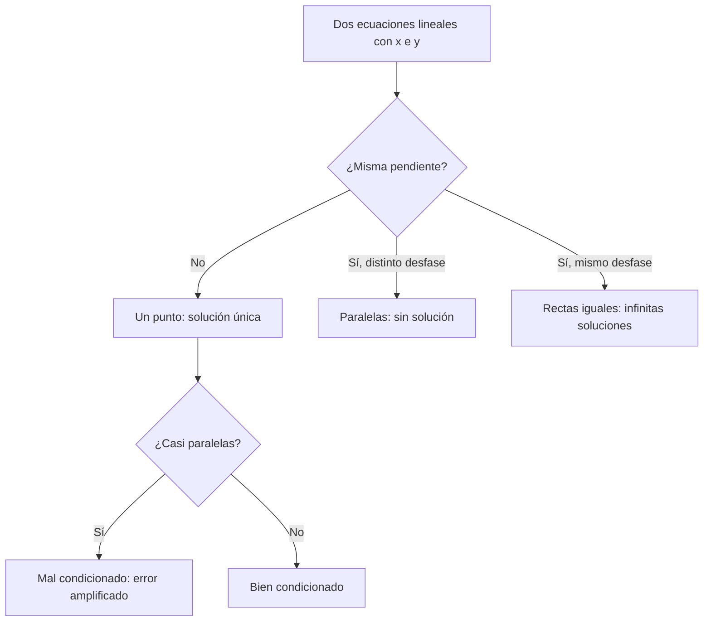

# B04-C03 — Sistemas de ecuaciones elementales

<!-- nav:top -->
[🏠 Programa](../../../../README.md) · [📚 Bloque B04](../../../tronco-comun/B04-algebra-trigonometria-y-geometria-espacial.md) · [← Anterior: B04-C02 — Ecuaciones lineales y cuadráticas](../B04-C02-ecuaciones-lineales-y-cuadraticas/CLASE.md) · [Siguiente: B04-C04 — Funciones y gráficas →](../B04-C04-funciones-y-graficas/CLASE.md)
<!-- /nav -->

## 1. Ubicación, nivel y alcance

Tercera clase del bloque B04. En la [clase anterior](../B04-C02-ecuaciones-lineales-y-cuadraticas/CLASE.md) resolviste una ecuación con una incógnita. Aquí hay varias incógnitas y varias ecuaciones que se cumplen a la vez. Nivel N1. Verás sistemas lineales de 2×2 y 3×3, sustitución, eliminación, interpretación geométrica, sistemas sin solución o con infinitas, y por qué algunos sistemas son frágiles ante pequeños errores. No verás matrices en general (B10) ni ajuste por mínimos cuadrados (B12).

## 2. Por qué esta clase existe

Un detector no entrega «brillo»: entrega cuentas. Para convertir cuentas en flujo hay que descubrir dos números, una pendiente y un desfase, y para ello se miden dos fuentes de referencia. Del mismo modo, dos observadores en lugares distintos, cada uno con su dirección hacia un objeto, deben encontrar el punto donde sus rectas se cruzan. Ambos problemas son sistemas de ecuaciones.

La decisión central: **¿qué método uso para hallar valores que cumplan todas las condiciones a la vez, cuándo tiene solución única y cuánto me puedo fiar de ella?** Aprenderás sustitución, eliminación y lectura geométrica, y a medir la fragilidad de una solución.

## 3. Lo que podrás hacer al terminar

1. Plantear un sistema a partir de un enunciado con unidades.
2. Resolver sistemas 2×2 por sustitución y por eliminación.
3. Resolver un sistema 3×3 por eliminación ordenada.
4. Decidir si hay solución única, ninguna o infinitas, y explicarlo geométricamente.
5. Comprobar la solución sustituyéndola en todas las ecuaciones.
6. Detectar un sistema mal condicionado y estimar cuánto amplifica un pequeño error.

La evidencia es la **calibración con su comprobación** del ejercicio 12 (sección 20).

## 4. Con qué llegas y cómo comprobarlo

Necesitas despejar y resolver ecuaciones lineales (C02). Cinco preguntas:

1. Resuelve `2x + 6 = 0`.
2. Despeja `y` en `3x + y = 10`.
3. ¿Cuánto es `x` si `5x − 2 = 3x + 8`?
4. Si `N = aF + b` con `a = 2`, `b = 1`, ¿cuánto es `N` para `F = 10`?
5. ¿Cuántos puntos comunes tienen dos rectas distintas no paralelas?

<details>
<summary>Ver respuestas</summary>

1. `x = −3`. 2. `y = 10 − 3x`. 3. `x = 5`. 4. 21. 5. Uno.
</details>

Con cuatro o cinco aciertos, sigue; si no, repasa C02.

## 5. Un caso: calibrar un detector con dos estrellas

Un fotómetro mide **cuentas** `N` (unidades arbitrarias del instrumento). Suponemos una respuesta lineal: `N = aF + b`, donde `F` es el flujo de la fuente (en unidades relativas), `a` es la sensibilidad (cuentas por unidad de flujo) y `b` el desfase del instrumento (cuentas con flujo cero). Para conocer `a` y `b` se observan dos fuentes de flujo conocido. **Los datos de esta clase son sintéticos**, inventados para enseñar; no son mediciones de un instrumento real. Con la estrella A (`F = 100`, `N = 2150`) y la B (`F = 400`, `N = 8450`) tienes dos ecuaciones y dos incógnitas. Después medirás una fuente desconocida con 5000 cuentas y obtendrás su flujo.

Un segundo caso, geométrico: dos estaciones separadas 10 km observan el mismo objeto y miden el rumbo desde cada una. Verás que, cuando las dos direcciones son casi paralelas, un error pequeño en un ángulo mueve la solución decenas de kilómetros. Esa fragilidad es la razón de que la triangulación (C20) exija bases largas.

## 6. Vocabulario

Un **sistema de ecuaciones** es un conjunto de ecuaciones con las mismas incógnitas. Es **lineal** si cada incógnita aparece solo a la primera potencia. Su **solución** es el conjunto de valores que cumple todas las ecuaciones. Es **compatible determinado** si tiene una solución, **compatible indeterminado** si tiene infinitas, **incompatible** si no tiene ninguna. La **sustitución** despeja una incógnita y la reemplaza en las demás. La **eliminación** suma o resta ecuaciones multiplicadas por números para anular una incógnita. El **pivote** es el coeficiente que se usa para eliminar. Un sistema **mal condicionado** es aquel cuya solución cambia mucho ante cambios pequeños de los datos.

## 7. Modelo mental: rectas que se cruzan

Cada ecuación lineal con dos incógnitas es una recta en el plano; la solución del sistema es donde se cortan. Si son rectas con distinta inclinación, se cortan en un punto; si son paralelas, no se cortan; si son la misma, se cortan en todos sus puntos.



*Descripción textual:* se comparan las pendientes de dos rectas; con pendientes distintas hay un punto de cruce, que será frágil si las rectas son casi paralelas; con igual pendiente no hay solución o hay infinitas.

Analogía: dos senderos que se cruzan. Su límite: con tres o más incógnitas ya no son rectas sino planos, y el dibujo deja de ayudar.

## 8. La explicación, paso a paso

### 8.1 Sustitución

De `N₁ = aF₁ + b` y `N₂ = aF₂ + b`. Despejar `b = N₁ − aF₁` y sustituirlo en la segunda: `N₂ = aF₂ + N₁ − aF₁`, así que `a = (N₂ − N₁)/(F₂ − F₁)`. Con los datos: `a = (8450 − 2150)/(400 − 100) = 21` cuentas por unidad. Luego `b = 2150 − 21·100 = 50` cuentas.

### 8.2 Eliminación

Se restan ecuaciones para anular una incógnita: `N₂ − N₁ = a(F₂ − F₁)`, que es lo mismo que antes, expresado como una operación entre ecuaciones. En un sistema general `a₁x + b₁y = c₁`, `a₂x + b₂y = c₂`, se multiplica la primera por `a₂` y la segunda por `a₁` y se restan; queda `y = (a₁c₂ − a₂c₁)/(a₁b₂ − a₂b₁)`. El denominador `a₁b₂ − a₂b₁` se llama **determinante**; si vale cero las rectas son paralelas o iguales.

### 8.3 Tres incógnitas

Se elimina la primera incógnita de las ecuaciones 2 y 3 usando la 1; luego se elimina la segunda de la 3. Queda una ecuación con una sola incógnita y se «sube» sustituyendo hacia atrás. Es el método de **eliminación gaussiana**. Al elegir en cada paso el pivote de mayor tamaño (**pivoteo parcial**) se reducen errores de redondeo. Por ejemplo, `2x + y − z = 1`, `−3x − y + 2z = 1`, `−2x + y + 2z = 6` tiene solución `(1, 2, 3)`, que se comprueba sustituyendo en las tres.

### 8.4 Qué significa «mal condicionado»

Si dos rectas se cortan con ángulo pequeño, desplazar una apenas hace que el punto de cruce se mueva mucho. Esto no depende del método: es una propiedad del problema. En el caso de las dos estaciones, rumbos de 56,31° y 123,69° (cruce con ángulo de 67,4°) dan el punto `(5,000; 7,500) km`; si el primer rumbo cambia 0,1°, el punto se mueve 0,017 km. Con rumbos de 56,31° y 57,31° (ángulo de 1°) el cruce queda a unos 480 km y el mismo cambio de 0,1° lo mueve más de 53 km. El laboratorio lo calcula.

## 9. Magnitudes, símbolos y unidades

| Símbolo | Qué es | Unidad | Nota |
|---|---|---|---|
| `N` | cuentas del detector | cuentas | sintético en esta clase |
| `F` | flujo de la fuente | unidades relativas | sintético |
| `a` | sensibilidad | cuentas por unidad de flujo | pendiente |
| `b` | desfase (cuentas con `F = 0`) | cuentas | ordenada |
| `(xᵢ, yᵢ)` | posición de la estación `i` | km | plano local |
| `θᵢ` | rumbo desde la estación `i` | grados | medido desde el eje `x`, antihorario |
| `det` | determinante `a₁b₂ − a₂b₁` | según coeficientes | cero: sin solución única |

## 10. Convenciones y referencias

Los sistemas se escriben con las incógnitas en el mismo orden en todas las ecuaciones. El plano de las estaciones usa el eje `x` hacia el este y `y` hacia el norte, con ángulos medidos desde `x` en sentido antihorario; es una convención de esta clase. Los datos de calibración y de rumbos son **sintéticos**. Los resultados se dan con 3 a 4 cifras.

## 11. De dónde sale lo que afirmamos

| ID | Fuente | Localizador | Respalda | Estado |
|---|---|---|---|---|
| S1 | Datos sintéticos del autor de la clase | script de la sección 17 | Cuentas y rumbos del caso | Sintético, no medido |
| S2 | Laboratorio de esta clase (cálculo propio) | `sistemas_y_calibracion.py` | Solución del sistema, residuos y sensibilidad | Ejecución del 2026-11-05 |

Límites: la clase no usa datos de un instrumento real; el método de eliminación es matemática estándar y no requiere cita específica; la revisión disciplinar deberá añadir un ejemplo con datos publicados de calibración.

## 12. Cómo ver la solución

| Rumbos (°) | Ángulo entre rectas | Cruce (km) | Desplazamiento con +0,1° |
|---|---|---|---|
| 56,31 y 123,69 | 67,4° | (5,000; 7,500) | 0,017 km |
| 56,31 y 57,31 | 1,0° | (267,5; 401,2) | 53,6 km |

Descripción larga: dibujadas, las rectas del primer caso forman una «X» abierta y el cruce apenas se mueve; las del segundo casi se solapan y el cruce se desliza a lo largo de ellas.

## 13. Ejemplo trabajado: calibrar y medir

Datos sintéticos: A (`F = 100`, `N = 2150`), B (`F = 400`, `N = 8450`); fuente desconocida con `N = 5000`.

**Paso 1 · Plantear.** `2150 = 100a + b` y `8450 = 400a + b`. Unidades: cuentas.

**Paso 2 · Eliminar `b`.** Se resta: `6300 = 300a`, de donde `a = 21` cuentas/unidad.

**Paso 3 · Hallar `b`.** `b = 2150 − 21·100 = 50` cuentas.

**Paso 4 · Comprobar.** En B: `21·400 + 50 = 8450` ✓; en A: `21·100 + 50 = 2150` ✓.

**Paso 5 · Usar la calibración.** `F = (5000 − 50)/21 = 235,7` unidades. Comprobación de orden de magnitud: entre A y B, como debía (5000 está entre 2150 y 8450).

**Paso 6 · Límite.** Con solo dos puntos no se puede verificar que la respuesta sea lineal; el modelo se supone. Con tres referencias, que no cumplan la misma recta, el sistema sería incompatible y habría que ajustar (B12).

## 14. Distintas formas de resolver

La **sustitución** es clara en 2×2 y cuando una incógnita queda despejada. La **eliminación** escala a 3×3 y más. La **regla de Cramer** (cocientes de determinantes) da fórmulas cerradas, pero es costosa si el sistema crece. El **método gráfico** muestra la geometría y el condicionamiento, pero da poca precisión. Todos dan lo mismo si el sistema es bien condicionado.

## 15. Práctica guiada

**Ejercicio 1 · con los pasos indicados.** Resuelve `x + y = 3`, `x − y = 1` por eliminación.

<details><summary>Solución comentada</summary>

Suma las dos: `2x = 4`, `x = 2`. Sustituye: `y = 3 − 2 = 1`. Comprobación: `2 − 1 = 1` ✓.
</details>

**Ejercicio 2 · con una pista.** Calibra: A (`F = 50`, `N = 1100`), B (`F = 200`, `N = 4100`). Halla `a` y `b`. *Pista:* `a = ΔN/ΔF`.

<details><summary>Solución comentada</summary>

`a = (4100 − 1100)/(200 − 50) = 20`; `b = 1100 − 20·50 = 100`. Comprobación en B: `20·200 + 100 = 4100` ✓.
</details>

**Ejercicio 3 · casi autónomo.** Con la calibración del ejemplo (a = 21, b = 50), ¿qué flujo corresponde a 3000 cuentas y cuántas cuentas daría `F = 10`?

<details><summary>Solución comentada</summary>

`F = (3000 − 50)/21 = 140,5`; `N = 21·10 + 50 = 260`. Ambos caen dentro o cerca del rango de calibración (100 a 400); `F = 10` está fuera, y el resultado depende de suponer linealidad: extrapolación.
</details>

## 16. Práctica autónoma, transferencia e integrador

**Ejercicio 4.** Resuelve `3x + 2y = 7`, `x − 4y = −5` por sustitución.

<details><summary>Solución comentada</summary>

De la segunda `x = 4y − 5`. En la primera: `12y − 15 + 2y = 7` → `14y = 22` → `y = 11/7 = 1,571`; `x = 4·11/7 − 5 = 9/7 = 1,286`. Comprobación: `3·9/7 + 2·11/7 = 49/7 = 7` ✓.
</details>

**Ejercicio 5.** ¿Cuántas soluciones tiene `2x + 4y = 6`, `x + 2y = 5`? ¿Y `2x + 4y = 6`, `x + 2y = 3`?

<details><summary>Solución comentada</summary>

Primer par: la primera equivale a `x + 2y = 3`, que contradice `x + 2y = 5`: ninguna (paralelas). Segundo: son la misma recta, infinitas.
</details>

**Ejercicio 6.** Resuelve `2x + y − z = 1`, `−3x − y + 2z = 1`, `−2x + y + 2z = 6` (sección 8.3).

<details><summary>Solución comentada</summary>

Suma de la 1 y la 2 (elimina `y`): `−x + z = 2`. Suma de la 2 y la 3 (elimina `y`): `−5x + 4z = 7`. De la primera, `z = x + 2`; en la segunda: `−5x + 4x + 8 = 7` → `x = 1`, `z = 3`. De la ecuación 1: `y = 1 − 2 + 3 = 2`. Solución `(1, 2, 3)`. Comprobación: ec. 2: `−3 − 2 + 6 = 1` ✓; ec. 3: `−2 + 2 + 6 = 6` ✓.
</details>

**Ejercicio 7.** Dos estaciones en `(0, 0)` y `(10, 0)` km ven un objeto con rumbos de 45° y 135°. Halla su posición.

<details><summary>Solución comentada</summary>

La recta 1 es `y = x`; la 2 es `y = −(x − 10)`. Igualando: `x = 5`, `y = 5`. Objeto en `(5, 5)` km. Comprobación: de la estación 2 el rumbo es `atan2(5, −5) = 135°` ✓.
</details>

**Ejercicio 8.** Si en el ejercicio 7 el primer rumbo fuera 45,1°, ¿se mueve mucho la solución? Estima sin calculadora.

<details><summary>Solución comentada</summary>

El ángulo entre las rectas es de 90°, el mejor caso: un error de 0,1° (0,00175 rad) a unos 7 km de la estación desplaza el punto del orden de `7·0,00175 ≈ 0,012 km`. Bien condicionado.
</details>

**Ejercicio 9 · transferencia.** Un sensor mide `N = aF + b`. Con A (`F = 10`, `N = 120`) y B (`F = 10`, `N = 130`) intentas calibrar. ¿Qué ocurre y por qué?

<details><summary>Solución comentada</summary>

`ΔF = 0` y el determinante es cero: son dos puntos en la misma vertical; no define una recta con pendiente. Mismas condiciones, resultados distintos: el sistema es incompatible, o hay ruido. Se necesita otra referencia con distinto flujo.
</details>

**Ejercicio 10 · transferencia.** Un colega propone triangular un objeto con dos estaciones separadas 1 km cuando el objeto está a 400 km. ¿Qué le adviertes?

<details><summary>Solución comentada</summary>

El ángulo entre las dos direcciones es del orden de `1/400 rad ≈ 0,14°`: casi paralelas, mal condicionado. Un error de 0,01° en un rumbo da un error de distancia del orden del 7 %. Necesita una base mayor o un método distinto (sección 8.4).
</details>

**Ejercicio 11 · transferencia.** Con `a = 21` y `b = 50`, un técnico lee 20 cuentas y concluye `F = −1,4`. ¿Qué significa un flujo negativo y qué conclusiones sacas?

<details><summary>Solución comentada</summary>

`F = (20 − 50)/21 = −1,43`. Un flujo no puede ser negativo: las cuentas están por debajo del desfase, lo que indica ruido, mala calibración de `b` o una resta de fondo mal hecha. No se corrige a mano: se revisa `b`.
</details>

**Ejercicio 12 · integrador.** Elabora tu *calibración con su comprobación* (sección 20): escoge dos fuentes de referencia (puedes inventarlas y rotularlas como sintéticas), plantea el sistema, resuélvelo por dos vías, comprueba en ambas ecuaciones, aplícalo a una tercera lectura y señala su rango de validez.

<details><summary>Solución modelo</summary>

Completa: sistema con unidades, dos resoluciones (sustitución y eliminación) que coinciden, comprobación en las dos ecuaciones, una tercera lectura convertida con el resultado y su límite (extrapolación fuera del rango; linealidad supuesta); los datos rotulados como sintéticos.
</details>

## 17. Laboratorio: eliminación gaussiana y sensibilidad

El script [sistemas_y_calibracion.py](sistemas_y_calibracion.py) resuelve sistemas con eliminación y pivoteo parcial. Antes de calcular, comprueba: un 2×2 y un 3×3 con fracciones exactas (para que no haya redondeo), que un sistema singular se detecte y que el residuo en coma flotante sea menor que 10⁻¹². Después calibra el detector y compara la posición de dos rumbos bien y mal condicionados.

**Datos:** sintéticos. **Predice antes de ejecutar:** ¿qué desplazamiento esperas con rumbos casi paralelos? (Mucho mayor: decenas de km.) **Ejecución del 2026-11-05 (Python 3.12.9):**

```text
Calibración (sintética): a = 21.0000 cuentas/unidad, b = 50.0000 cuentas
Fuente con 5000 cuentas -> flujo F = (N - b)/a = 235.71 unidades
rumbos bien separados: (5.000, 7.500) km; con +0,1°: (4.991, 7.514) km; desplazamiento 0.017 km
rumbos casi paralelos: (267.492, 401.239) km; con +0,1°: (296.432, 446.335) km; desplazamiento 53.583 km
```

```bash
python programa/clases/B04/B04-C03-sistemas-de-ecuaciones-elementales/sistemas_y_calibracion.py
```

**Límites:** plano euclídeo, ángulos exactos salvo la perturbación; no es una herramienta de posicionamiento.

## 18. Errores frecuentes y cómo corregirlos

**Sustituir solo en una ecuación y no comprobar en la otra.** Se corrige con el paso 4 del ejemplo.

**Restar ecuaciones con signos mal distribuidos.** Se corrige con el ejercicio 4.

**Creer que todo sistema tiene solución.** Se corrige con los ejercicios 5 y 9.

**Ignorar el condicionamiento.** Se corrige con los ejercicios 8 y 10.

**Extrapolar fuera del rango de calibración.** Se corrige con el ejercicio 3.

## 19. Cómo sabrás que vas bien

Tras 8.1: ¿obtienes `a` y `b` con los datos del ejemplo sin mirar? Si no, ejercicio 2. Tras 8.3: ¿resuelves un 3×3 y compruebas en las tres ecuaciones? Si no, ejercicio 6. Tras 8.4: ¿puedes decir por qué dos rectas casi paralelas son un problema? Si no, ejercicio 10. Tras el laboratorio: ¿qué pruebas hace antes de calcular? Si no lo sabes, lee su cabecera.

## 20. Qué entregas y cómo se evalúa

El producto es tu **calibración con su comprobación** (ejercicio 12).

| Criterio | Inicial | En desarrollo | Logrado | Destacado |
|---|---|---|---|---|
| Planteamiento | Sin unidades | Parcial | Sistema con unidades y datos rotulados | Explica el modelo lineal y su límite |
| Resolución | Errores | Una vía | Dos vías coinciden | Elige la más conveniente y por qué |
| Comprobación | Ausente | En una ecuación | En todas | Estima sensibilidad |
| Condicionamiento | No lo considera | Lo nombra | Lo evalúa en un caso | Propone cómo mejorarlo |
| Fuentes | Sin rótulo | Rótulo parcial | Sintético/real rotulado | Señala qué dato real lo sustituiría |

**Condiciones críticas (no se compensan con promedio):** rotular los datos sintéticos como tales; comprobar en todas las ecuaciones; no extrapolar sin avisar.

## 21. Ética, seguridad y límites

Presentar una calibración inventada como si fuera de un instrumento real sería engañoso; por eso los datos se rotulan. Un resultado con alto condicionamiento debe acompañarse de su incertidumbre. No hay riesgos físicos. Accesibilidad: ecuaciones en texto, tabla equivalente al dibujo, ejercicios sin conexión.

## 22. Para cerrar y seguir

Un sistema lineal pide valores que cumplan todas las ecuaciones; se resuelve por sustitución o eliminación, se comprueba en todas y se evalúa su fragilidad. Queda abierta una pregunta: ¿cómo describimos relaciones que no son rectas, y cómo las dibujamos? Eso es C04.

**Glosario español–inglés.** sistema de ecuaciones · *system of equations*; sustitución · *substitution*; eliminación · *elimination*; determinante · *determinant*; pivote · *pivot*; mal condicionado · *ill-conditioned*; calibración · *calibration*.

**Continuidad.** B04-C04 usa tu capacidad de **relacionar variables con una ecuación** para estudiar funciones y gráficas. B04-C20 retomará la fragilidad de las rectas casi paralelas en la triangulación espacial.

**Referencias:** ver sección 11.

<!-- nav:bottom -->
---

[← Anterior: B04-C02 — Ecuaciones lineales y cuadráticas](../B04-C02-ecuaciones-lineales-y-cuadraticas/CLASE.md) · [📚 Bloque B04](../../../tronco-comun/B04-algebra-trigonometria-y-geometria-espacial.md) · [Siguiente: B04-C04 — Funciones y gráficas →](../B04-C04-funciones-y-graficas/CLASE.md)
<!-- /nav -->
