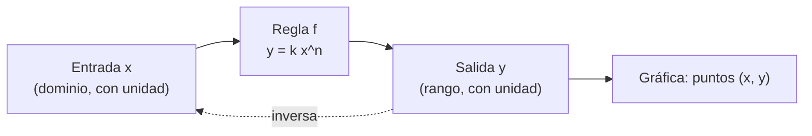

# B04-C04 — Funciones y gráficas

<!-- nav:top -->
[🏠 Programa](../../../../README.md) · [📚 Bloque B04](../../../tronco-comun/B04-algebra-trigonometria-y-geometria-espacial.md) · [← Anterior: B04-C03 — Sistemas de ecuaciones elementales](../B04-C03-sistemas-de-ecuaciones-elementales/CLASE.md) · [Siguiente: B04-C05 — Funciones exponenciales y logarítmicas →](../../../tronco-comun/B04-algebra-trigonometria-y-geometria-espacial.md#b04-c05)
<!-- /nav -->

## 1. Ubicación, nivel y alcance

Cuarta clase del bloque B04. Hasta aquí resolviste ecuaciones; ahora piensas en la **relación** entre dos magnitudes como un objeto completo: una función, su dominio, su gráfica y su inversa. Nivel N1. Verás función, dominio y rango, funciones lineal, cuadrática y de potencia, composición e inversa, y cómo leer una gráfica sin dejarse engañar por sus ejes. No verás derivadas (B09) ni ajuste estadístico (B12). Las funciones exponencial y logarítmica son la clase siguiente.

## 2. Por qué esta clase existe

Un astrónomo no solo calcula un valor: pregunta «¿qué pasa con el periodo de un planeta si su órbita es el doble de grande?». Responderlo con un solo caso no basta; hace falta la regla que liga ambas magnitudes. Esa regla es una función, y su gráfica es la forma más rápida de ver qué tan sensible es una magnitud a otra.

La decisión central: **¿qué función describe la relación, en qué intervalo vale y qué me dice su gráfica sobre cómo cambia una magnitud al cambiar la otra?** Aprenderás a describir funciones con fórmula, tabla y gráfica, y a leer ejes con honestidad.

## 3. Lo que podrás hacer al terminar

1. Distinguir variable independiente y dependiente, dominio y rango.
2. Evaluar y representar funciones lineales, cuadráticas y de potencia.
3. Componer funciones y hallar la inversa de una función creciente.
4. Predecir cómo cambia `y` cuando `x` se multiplica por un factor, en una función de potencia.
5. Leer una gráfica declarando ejes, unidades y escala.
6. Contrastar una función con datos publicados y decir cuánto difieren.

La evidencia es la **ficha de una relación contrastada con datos** del ejercicio 12 (sección 20).

## 4. Con qué llegas y cómo comprobarlo

Necesitas ecuaciones y potencias (C01–C02). Cinco preguntas:

1. Si `y = 3x + 2`, ¿cuánto vale `y` para `x = 4`?
2. ¿Cuánto es `4^(3/2)`? (Pista: raíz y luego potencia.)
3. Resuelve `2x − 6 = 0`.
4. ¿Cuántos puntos hay que ubicar para dibujar una recta?
5. ¿Qué número elevado al cuadrado da 2,25?

<details>
<summary>Ver respuestas</summary>

1. 14. 2. `√4 = 2`, `2³ = 8`. 3. 3. 4. Dos (un tercero sirve de comprobación). 5. 1,5.
</details>

Con cuatro o cinco aciertos, sigue; si no, repasa C01–C02.

## 5. Un caso real: ¿cuánto tarda un planeta en dar la vuelta?

La NASA publica, para cada planeta, su distancia media al Sol y su periodo orbital (S1). Para Venus: 108,2 millones de km y 224,7 días; Tierra: 149,6 y 365,2; Marte: 228,0 y 687,0; Júpiter: 778,5 y 4331. ¿Hay una regla que ligue ambas columnas? Si tomas el cociente `P/a^1,5` en los cuatro, sale casi lo mismo (≈ 0,1996). Esa regla es la tercera ley de Kepler en forma de función: `P(a) = k a^(3/2)`. Con ella puedes preguntar cuánto tardaría un cuerpo situado a 300 millones de km. Los números provienen de una fuente que veremos en la sección 11; la regla de Kepler se justificará en el bloque de física (B05).

## 6. Vocabulario

Una **función** `f` asigna a cada valor `x` de un conjunto (el **dominio**) un único valor `f(x)`; el conjunto de los resultados es el **rango**. `x` es la **variable independiente** y `y = f(x)` la **dependiente**. La **gráfica** es el conjunto de puntos `(x, f(x))`. Una **función de potencia** tiene la forma `y = k xⁿ`; el exponente `n` puede ser fraccionario. La **composición** `g(f(x))` aplica primero `f` y luego `g`. La **inversa** `f⁻¹` deshace `f`: `f⁻¹(f(x)) = x`. Una función es **creciente** si, al aumentar `x`, `f(x)` no disminuye. Una **escala** de un eje indica cuánto vale cada marca; en una escala **logarítmica** cada marca multiplica por un factor fijo (B01-C02).

## 7. Modelo mental: una máquina con entrada y salida

Imagina una máquina que recibe una distancia y devuelve un periodo. Lo importante no es un caso, sino que para cada entrada permitida haya una única salida.



*Descripción textual:* una entrada `x` con su unidad pasa por la regla `f` y produce una salida `y` con su unidad; de las parejas se forma la gráfica; la inversa devuelve de `y` a `x`.

Analogía: una máquina expendedora, donde cada botón da un producto. Su límite: a diferencia de la máquina, una función matemática no «se agota» ni tiene un número limitado de entradas; el dominio lo fija el problema físico, no la fórmula.

## 8. La explicación, paso a paso

### 8.1 Dominio y rango con sentido físico

La fórmula `P = k a^(3/2)` acepta cualquier `a ≥ 0`, pero físicamente hablamos de órbitas alrededor del Sol con `a` desde unas decenas de millones de km hasta miles de millones. El **dominio de la fórmula** y el **dominio físico** son cosas distintas; esta clase declara el segundo.

### 8.2 Tres familias

**Lineal:** `y = mx + b`; `m` es la pendiente (cuánto cambia `y` por unidad de `x`) y `b` el valor en `x = 0`. **Cuadrática:** `y = ax² + bx + c`; parábola con un vértice. **Potencia:** `y = kxⁿ`: si `x` se multiplica por `r`, `y` se multiplica por `rⁿ`. Para `n = 3/2`, duplicar `a` multiplica `P` por `2^1,5 = 2,83`; cuadruplicarla, por `4^1,5 = 8`.

### 8.3 La constante `k` y sus unidades

En `P = k a^(3/2)`, con `P` en días y `a` en 10⁶ km, `k` tiene unidades de días/(10⁶ km)^1,5. Con los datos de la Tierra: `k = 365,2/149,6^1,5 = 0,19959`; el laboratorio obtiene 0,199588 con la misma entrada. Cambiar de unidades cambia `k`, no la forma de la función.

### 8.4 Composición e inversa

Si `f(a) = k a^(3/2)`, su inversa es `a = (P/k)^(2/3)`. Es útil cuando conoces el periodo y buscas la distancia: un cuerpo con `P = 1000` días estaría a `a = (1000/0,19959)^(2/3) = 292` millones de km. Una composición típica: pasar de `P` en días a años con `g(P) = P/365,25` y luego aplicar otra regla.

### 8.5 Leer gráficas

Antes de interpretar, lee: ¿qué magnitud hay en cada eje, con qué unidad, con qué escala (lineal o logarítmica), y desde dónde empieza el eje? Un eje vertical que no parte de cero puede exagerar una diferencia. En escala **log-log**, una función de potencia aparece como una recta cuya pendiente es el exponente; entre Venus y Júpiter esa pendiente da 1,499, muy cerca de 1,5 (sección 17).

## 9. Magnitudes, símbolos y unidades

| Símbolo | Qué es | Unidad | Nota |
|---|---|---|---|
| `a` | distancia media al Sol («Distance from Sun» en S1) | 10⁶ km | variable independiente |
| `P` | periodo orbital | días | variable dependiente |
| `k` | constante de proporcionalidad | días/(10⁶ km)^1,5 | 0,1996 con estos datos |
| `n` | exponente | adimensional | 3/2 |
| `m`, `b` | pendiente y ordenada de una recta | según el caso | — |
| `f⁻¹` | función inversa | — | `a = (P/k)^(2/3)` |

## 10. Convenciones y referencias

La variable independiente va en el eje horizontal y la dependiente en el vertical. Los periodos son sidéreos (respecto de las estrellas) según la ficha; los valores de la fuente tienen 3 a 4 cifras significativas. Dominio físico en esta clase: planetas de Venus a Júpiter. La función es un **modelo** (idealización de órbitas casi circulares con el Sol dominante).

## 11. De dónde sale lo que afirmamos

| ID | Fuente | Localizador | Respalda | Estado |
|---|---|---|---|---|
| S1 | NASA NSSDC, *Planetary Fact Sheet – Metric* (actualizada 2025-03-18) | https://nssdc.gsfc.nasa.gov/planetary/factsheet/ | Distancia al Sol y periodo orbital de Venus (108,2; 224,7), Tierra (149,6; 365,2), Marte (228,0; 687,0), Júpiter (778,5; 4331) | Consultada el 2026-11-05; datos estimados |
| S2 | Laboratorio de esta clase | `funciones_y_kepler.py` | Cociente `P/a^1,5`, inversa y pendiente log-log | Ejecución del 2026-11-05 |

Límites: la fuente lista «Distance from Sun»; aquí se usa como distancia media (semieje mayor), lo que debe confirmar la revisión disciplinar. La ley `P ∝ a^(3/2)` no se demuestra en esta clase. En la consulta, la columna «Mean radius» de la tabla resumida no coincidía con el radio medio habitual de la Tierra; por eso la clase no usa esa columna.

## 12. Cómo ver la relación

Versión accesible de la gráfica (resultados del laboratorio, modelo frente a dato):

| Planeta | `a` (10⁶ km) | `P` observado (d) | `P` del modelo (d) | Diferencia |
|---|---|---|---|---|
| Venus | 108,2 | 224,7 | 224,6 | −0,03 % |
| Tierra | 149,6 | 365,2 | 365,2 | 0 % |
| Marte | 228,0 | 687,0 | 687,1 | +0,02 % |
| Júpiter | 778,5 | 4331 | 4335,3 | +0,10 % |

Descripción larga: la curva sube con una pendiente cada vez mayor; el punto de Júpiter está unas siete veces más lejos que el de Venus y su periodo es unas veinte veces mayor. En ejes log-log los cuatro puntos caen sobre una recta.

## 13. Ejemplo trabajado: un cuerpo a 300 millones de km

Datos: `k = 0,19959` días/(10⁶ km)^1,5 (S1, Tierra), `a = 300 × 10⁶ km`.

**Paso 1 · Dominio.** 300 está entre Marte (228) y Júpiter (778,5): dentro del dominio físico.

**Paso 2 · Evaluar.** `a^1,5 = 300·√300 = 300·17,32 = 5196`. `P = 0,19959·5196 = 1037 días`.

**Paso 3 · Comprobar con una proporción.** Respecto de la Tierra, `300/149,6 = 2,005`; `2,005^1,5 = 2,839`; `365,2·2,839 = 1037` ✓.

**Paso 4 · Inversa.** Si en cambio se observara un periodo de 1000 días: `a = (1000/0,19959)^(2/3) = 5010^(2/3) = 292` millones de km. Comprueba: la función creciente da `P(292) ≈ 996 d`, coherente con redondeo.

**Paso 5 · Interpretación.** Un cuerpo a 300 millones de km tarda 2,84 años; está en el cinturón de asteroides, donde el modelo es una buena primera aproximación. Se informa con 3 o 4 cifras, igual que los datos.

## 14. Distintas formas de representar una función

La **fórmula** es precisa y permite extrapolar con cuidado; la **tabla** muestra los datos exactos; la **gráfica lineal** da una impresión inmediata de la tendencia; la **gráfica log-log** vuelve rectas las leyes de potencia y permite comparar rangos enormes, pero exige leer los ejes con atención. Ninguna sustituye a las demás: una buena ficha usa al menos dos.

## 15. Práctica guiada

**Ejercicio 1 · con los pasos indicados.** Con `k = 0,19959` y `a = 228,0` calcula `P`. Compara con el valor publicado (687,0 d).

<details><summary>Solución comentada</summary>

`a^1,5 = 228·√228 = 228·15,10 = 3443`; `P = 0,19959·3443 = 687,2`. Diferencia con el dato: +0,03 %. Las cifras de entrada limitan la concordancia.
</details>

**Ejercicio 2 · con una pista.** Si el semieje se duplica, ¿cuántas veces aumenta el periodo? *Pista:* `2^(3/2)`.

<details><summary>Solución comentada</summary>

`2^1,5 = 2√2 = 2,83`. El periodo se multiplica por 2,83.
</details>

**Ejercicio 3 · casi autónomo.** Halla la inversa de `P = k a^(3/2)` y aplícala a Júpiter (`P = 4331 d`).

<details><summary>Solución comentada</summary>

`a = (P/k)^(2/3)`. `4331/0,19959 = 21 699`; `21 699^(2/3)`: `ln(21 699) = 9,985`, por 2/3 = 6,657, `e^6,657 = 778`. Obtienes ≈ 778 millones de km, como en la fuente (778,5).
</details>

## 16. Práctica autónoma, transferencia e integrador

**Ejercicio 4.** Dada `y = 3x + 2`, haz una tabla para `x = 0, 1, 2, 3` y di la pendiente y la ordenada.

<details><summary>Solución comentada</summary>

`y = 2, 5, 8, 11`; pendiente 3 (cada unidad de `x` suma 3 a `y`); ordenada 2.
</details>

**Ejercicio 5.** Para `P = k a^(3/2)`: si `a` se triplica, ¿cuánto aumenta `P`? ¿Y si `a` se reduce a la mitad?

<details><summary>Solución comentada</summary>

`3^1,5 = 5,196` veces mayor. `(1/2)^1,5 = 0,354`: el periodo baja a un 35 %.
</details>

**Ejercicio 6.** Un cuerpo tiene `P = 2000 d`. Halla `a` con la inversa y comprueba con el modelo directo.

<details><summary>Solución comentada</summary>

`a = (2000/0,19959)^(2/3) = 10 020^(2/3) = 464,6` millones de km. Directo: `464,6^1,5 = 464,6·21,55 = 10 014`; `0,19959·10 014 = 1999`. Coincide.
</details>

**Ejercicio 7.** Compón: pasa el periodo de `a = 300` a años con `g(P) = P/365,25`.

<details><summary>Solución comentada</summary>

`P = 1037 d`; `g = 1037/365,25 = 2,84` años (sección 13).
</details>

**Ejercicio 8.** ¿Cuál es el dominio físico razonable para usar `P(a)` con los datos de S1 y por qué no `a = 0`?

<details><summary>Solución comentada</summary>

De unos 100 a 800 millones de km, el de los cuatro planetas de la tabla. Con `a = 0` la fórmula da `P = 0`: un objeto dentro del Sol, fuera del modelo. Extrapolar a Neptuno o a Mercurio exigiría comprobar con datos, que no consultamos.
</details>

**Ejercicio 9 · transferencia.** Un compañero dibuja `P` frente a `a` con el eje vertical desde 4000 d y concluye que «Júpiter tiene un periodo 100 veces el de Venus». Evalúa.

<details><summary>Solución comentada</summary>

Real: `4331/224,7 = 19,3`. El eje truncado exagera visualmente la diferencia. Hay que leer siempre dónde comienza el eje (sección 8.5).
</details>

**Ejercicio 10 · transferencia.** En una gráfica log-log, dos puntos tienen coordenadas `(log a, log P) = (2,03; 2,35)` y `(2,89; 3,64)`. Calcula la pendiente e interpreta.

<details><summary>Solución comentada</summary>

`(3,64 − 2,35)/(2,89 − 2,03) = 1,29/0,86 = 1,50`. La pendiente es el exponente: `P ∝ a^1,5`.
</details>

**Ejercicio 11 · transferencia.** Un satélite artificial alrededor de la Tierra no sigue `k = 0,19959`. ¿Por qué?

<details><summary>Solución comentada</summary>

`k` depende del cuerpo central y de las unidades. El valor 0,1996 sale de planetas que orbitan el Sol; alrededor de la Tierra la masa central es otra, así que `k` cambia aunque la forma `a^(3/2)` se conserve (se justificará en B05).
</details>

**Ejercicio 12 · integrador.** Elabora tu *ficha de una relación contrastada con datos* (sección 20): elige dos magnitudes con datos publicados (por ejemplo `a` y `P` de otros dos planetas de S1 que consultes tú), propón una función, calcula la diferencia con cada dato, grafica o tabula, declara dominio y rango, y escribe una conclusión acotada.

<details><summary>Solución modelo</summary>

Ficha completa: fuente con fecha, tabla de datos con unidades, función con constante y su unidad, diferencias porcentuales, gráfica o tabla accesible con ejes declarados, dominio físico, y un párrafo que dice dónde el modelo funciona y dónde se desconoce.
</details>

## 17. Laboratorio: la función periodo(distancia)

El script [funciones_y_kepler.py](funciones_y_kepler.py) calcula `k` con la Tierra, la compara con los otros tres planetas y dibuja una gráfica de texto. Antes comprueba: que la inversa deshaga la función, que cuadruplicar `a` multiplique `P` por 8, que la función sea creciente, que `f(0) = 0` y que los datos coincidan con el modelo dentro del 2 %.

**Datos:** publicados (estimados). **Predice antes de ejecutar:** ¿cuál será la mayor diferencia porcentual? (Pequeña, del orden de 0,1 %, en Júpiter.) **Ejecución del 2026-11-05 (Python 3.12.9):**

```text
k = 1.995875e-01 días/(10^6 km)^1.5
Venus    108.2   224.7   224.6  -0.03 %
Tierra   149.6   365.2   365.2   0.00 %
Marte    228.0   687.0   687.1   0.02 %
Júpiter  778.5  4331.0  4335.3   0.10 %
Pendiente log-log entre Venus y Júpiter = 1.4993 (esperada 1,5)
```

```bash
python programa/clases/B04/B04-C04-funciones-y-graficas/funciones_y_kepler.py
```

**Límites:** cuatro planetas, órbitas medias; sin incertidumbres de los datos; no es un ajuste estadístico (B12).

## 18. Errores frecuentes y cómo corregirlos

**Confundir dominio de la fórmula con dominio físico.** Se corrige con el ejercicio 8.

**Creer que duplicar `x` duplica `y` en cualquier función.** Se corrige con el ejercicio 5.

**Leer una gráfica sin mirar el eje.** Se corrige con el ejercicio 9.

**Olvidar las unidades de la constante.** Se corrige con la sección 8.3.

**Aplicar la función a otro cuerpo central.** Se corrige con el ejercicio 11.

## 19. Cómo sabrás que vas bien

Tras 8.2: ¿predices en cuánto cambia `P` si `a` se multiplica por 4 sin calculadora? Si no, repite el ejercicio 2. Tras 8.4: ¿obtienes `a` a partir de `P`? Si no, ejercicio 3. Tras 8.5: ¿qué mirarías primero en una gráfica ajena? Si dudas, ejercicio 9. Tras el laboratorio: ¿qué comprueba el script antes de calcular? Si no lo sabes, lee su cabecera.

## 20. Qué entregas y cómo se evalúa

El producto es tu **ficha de una relación contrastada con datos** (ejercicio 12).

| Criterio | Inicial | En desarrollo | Logrado | Destacado |
|---|---|---|---|---|
| Función y unidades | Sin unidades | Unidades parciales | Función, constante y unidades correctas | Explica por qué cambia la constante con otras unidades |
| Dominio y rango | Ausente | Solo de la fórmula | Físico declarado | Justifica los extremos |
| Contraste con datos | No compara | Compara sin cuantificar | Diferencias porcentuales | Interpreta el patrón de las diferencias |
| Gráfica o tabla | Ejes sin rotular | Ejes parciales | Ejes con unidad y escala | Añade descripción para quien no ve |
| Fuentes | Sin fuente | Sin fecha | Con localizador y fecha | Señala qué parte es modelo |

**Condiciones críticas (no se compensan con promedio):** ejes con unidad y escala; no extrapolar fuera del dominio sin avisar; citar solo fuentes consultadas.

## 21. Ética, seguridad y límites

Una gráfica puede informar o engañar según cómo se dibuje; rotular los ejes y declarar el origen es una obligación honesta. El modelo es una idealización: la coincidencia del 0,1 % no demuestra la ley, solo la apoya en cuatro casos. Accesibilidad: gráfica con tabla y descripción, fórmulas en texto, ejercicios sin conexión.

## 22. Para cerrar y seguir

Una función es una regla con su dominio; su gráfica y su tabla son dos formas de leerla, y una potencia como `a^(3/2)` multiplica `y` por un factor fijo cuando `x` se multiplica por otro. Queda abierta una pregunta: ¿qué función describe magnitudes que crecen por factores, como el brillo de las estrellas o la fuerza de un sismo? Eso es C05.

**Glosario español–inglés.** función · *function*; dominio · *domain*; rango · *range*; gráfica · *graph*; función de potencia · *power function*; inversa · *inverse function*; pendiente · *slope*; escala logarítmica · *logarithmic scale*.

**Continuidad.** B04-C05 usa tu capacidad de **leer funciones y gráficas** para estudiar exponenciales y logaritmos. B04-C18 retomará la ley de Kepler al ver cónicas y órbitas.

**Referencias:** ver sección 11.

<!-- nav:bottom -->
---

[← Anterior: B04-C03 — Sistemas de ecuaciones elementales](../B04-C03-sistemas-de-ecuaciones-elementales/CLASE.md) · [📚 Bloque B04](../../../tronco-comun/B04-algebra-trigonometria-y-geometria-espacial.md) · [Siguiente: B04-C05 — Funciones exponenciales y logarítmicas →](../../../tronco-comun/B04-algebra-trigonometria-y-geometria-espacial.md#b04-c05)
<!-- /nav -->
