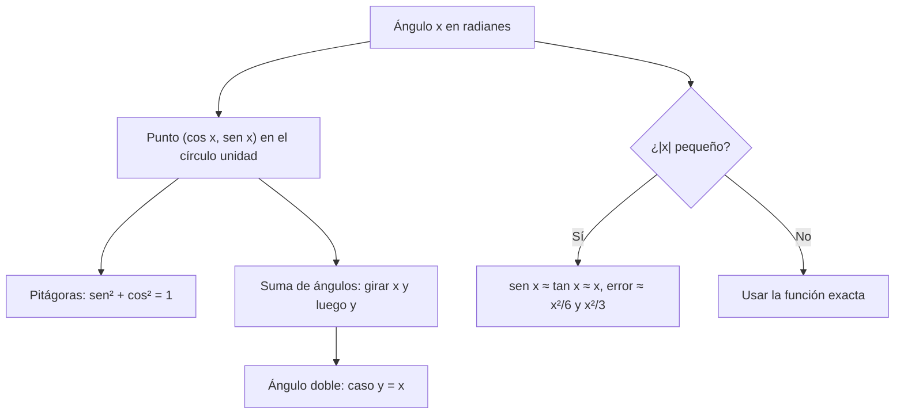

# B04-C06 — Identidades trigonométricas

<!-- nav:top -->
[🏠 Programa](../../../../README.md) · [📚 Bloque B04](../../../tronco-comun/B04-algebra-trigonometria-y-geometria-espacial.md) · [← Anterior: B04-C05 — Funciones exponenciales y logarítmicas](../B04-C05-funciones-exponenciales-y-logaritmicas/CLASE.md) · [Siguiente: B04-C07 — Triángulos y distancias angulares →](../B04-C07-triangulos-y-distancias-angulares/CLASE.md)
<!-- /nav -->

## 1. Ubicación, nivel y alcance

Sexta clase del bloque B04. Con las funciones y los logaritmos de las clases anteriores ya sabes describir relaciones; ahora entras en el terreno de los ángulos. Nivel N1. Verás el seno, el coseno y la tangente definidos con el círculo unidad, la medida de ángulos en radianes y segundos de arco, las identidades fundamentales (Pitágoras, suma de ángulos, ángulo doble) y la aproximación de ángulo pequeño con su error. No verás aún triángulos concretos (C07 y C08) ni vectores (C12).

## 2. Por qué esta clase existe

Casi toda medición astronómica es un ángulo: la posición de una estrella respecto de otra, el tamaño aparente de la Luna, el desplazamiento por paralaje. Y casi todos esos ángulos son diminutos, de segundos de arco. Para calcular con ellos se usa una simplificación (`sen x ≈ tan x ≈ x`); si no sabes cuándo vale y cuánto error introduce, puedes equivocarte sin darte cuenta, especialmente cuando el ángulo ya no es tan pequeño.

La decisión central: **¿en qué unidad escribo el ángulo, qué identidad me permite simplificar una expresión y cuándo puedo reemplazar sen o tan por el propio ángulo?** Aprenderás a verificar identidades con un cálculo numérico y a acotar el error de una aproximación.

## 3. Lo que podrás hacer al terminar

1. Convertir entre grados, radianes y segundos de arco.
2. Calcular seno, coseno y tangente a partir del círculo unidad y de valores notables.
3. Usar `sen²x + cos²x = 1`, la suma de ángulos y el ángulo doble.
4. Aplicar `sen x ≈ tan x ≈ x` y estimar el error relativo según el tamaño del ángulo.
5. Calcular el diámetro angular de un objeto de tamaño y distancia conocidos.
6. Verificar numéricamente una identidad antes de usarla.

La evidencia es la **hoja de identidades verificadas numéricamente** del ejercicio 12 (sección 20).

## 4. Con qué llegas y cómo comprobarlo

Necesitas funciones (C04), potencias y el teorema de Pitágoras. Cinco preguntas:

1. En un triángulo rectángulo de catetos 3 y 4, ¿cuánto mide la hipotenusa?
2. ¿Cuántos grados tiene un ángulo recto?
3. Si `x = 0,01`, ¿cuánto vale `x³`?
4. ¿Cuántos segundos de arco hay en un grado?
5. ¿Cuál es el valor aproximado de `π`?

<details>
<summary>Ver respuestas</summary>

1. 5. 2. 90°. 3. `10⁻⁶`. 4. 3600″. 5. 3,14159.
</details>

Con cuatro o cinco aciertos, sigue; si no, repasa B03 y C04.

## 5. Un caso real: ¿cuánto mide la Luna en el cielo?

La Luna tiene un radio medio de 1737,4 km y orbita a una distancia media (semieje mayor) de 384 400 km (S1). ¿Qué ángulo ocupa su disco? Con trigonometría exacta, su diámetro angular es `2 arctan(R/d)`; con la aproximación de ángulo pequeño, `2R/d`. Ambos dan 0,0090395 rad, unos 0,5179°; difieren en una parte en un millón y medio. Para el Sol, con el radio nominal `6,957 × 10⁸ m` (S2) a 1 au, sale 0,5329°. Que ambos discos sean casi del mismo tamaño aparente es lo que hace posibles los eclipses totales, y la aproximación permite hacer estos cálculos de cabeza. Pero la misma aproximación, con un ángulo de 30°, ya erraría un 4 %.

## 6. Vocabulario

El **círculo unidad** es la circunferencia de radio 1 centrada en el origen. Si un punto de esa circunferencia está en la dirección que forma un ángulo `x` con el eje horizontal, medido en sentido antihorario, su coordenada horizontal es `cos x` y la vertical es `sen x`; la **tangente** es `tan x = sen x / cos x`. Un **radián** (rad) es el ángulo que abarca un arco de longitud igual al radio (S3); por tanto `180° = π rad`. Un **segundo de arco** (″) es 1/3600 de grado, es decir `π/648 000 rad` (S3). Una **identidad** es una igualdad que se cumple para todos los valores donde está definida (a diferencia de una ecuación, que se cumple solo para algunos). Una **aproximación** sustituye una expresión por otra más sencilla con un error acotado. El **error relativo** es `(aproximado − exacto)/exacto`.

## 7. Modelo mental: el punto que gira en el círculo

Imagina un punto que recorre el círculo unidad. Su sombra sobre el eje horizontal es `cos x`; su sombra sobre el vertical, `sen x`. Como el punto está siempre a distancia 1 del centro, el teorema de Pitágoras da `sen²x + cos²x = 1`: es la identidad fundamental.



*Descripción textual:* a partir del ángulo se obtiene el punto del círculo unidad; de él salen la identidad de Pitágoras y, girando dos veces, la suma de ángulos y el ángulo doble; si el ángulo es pequeño se aproxima `sen` y `tan` por el ángulo; si no, se usa la función exacta.

Analogía: la sombra de una noria. Su límite: la noria real tiene un radio distinto de 1; las funciones trigonométricas trabajan con la razón entre longitudes, no con longitudes absolutas.

## 8. La explicación, paso a paso

### 8.1 Unidades de ángulo

`180° = π rad`, de modo que `1 rad = 57,2958°` y `1° = 0,0174533 rad`. Un segundo de arco es `π/648 000 rad = 4,848 × 10⁻⁶ rad`; recíprocamente, `1 rad = 206 264,806″` (S3; calculado en el laboratorio). Las calculadoras y los lenguajes de programación suelen usar radianes: si pones un ángulo en grados donde se esperan radianes, el resultado es erróneo sin aviso.

### 8.2 Valores notables

`sen 30° = 1/2`, `cos 30° = √3/2`, `sen 45° = cos 45° = √2/2`, `sen 60° = √3/2`, `cos 60° = 1/2`. Salen de triángulos con ángulos fáciles y sirven como comprobación de cualquier cálculo.

### 8.3 Las identidades

**Pitágoras:** `sen²x + cos²x = 1`; dividiéndola entre `cos²x`: `1 + tan²x = 1/cos²x`. **Suma de ángulos:** `sen(x + y) = sen x cos y + cos x sen y`; `cos(x + y) = cos x cos y − sen x sen y`. **Ángulo doble:** con `y = x`, `sen 2x = 2 sen x cos x`; `cos 2x = cos²x − sen²x`. Una identidad se puede *comprobar* sin demostrarla: se evalúa en varios ángulos distintos y se verifica que ambos lados coincidan dentro de la tolerancia. Esto no es una demostración, pero detecta casi todos los errores de transcripción. El laboratorio lo hace en 801 ángulos.

### 8.4 Ángulo pequeño

Para `x` en radianes, `sen x = x − x³/6 + …` y `tan x = x + x³/3 + …`. Por tanto, el error relativo de usar `x` en lugar de `sen x` es de aproximadamente `x²/6`, y en lugar de `tan x`, `−x²/3`. Con `x = 0,0045 rad` (el semiángulo lunar) el error es `3 × 10⁻⁶`; con `x = 0,1 rad` (5,7°), `1,7 × 10⁻³`; con `x = 0,5 rad` (28,6°), `4,3 %`. Regla práctica de esta clase: hasta 0,1 rad el error es menor que 0,5 %, siempre que se declare.

### 8.5 Diámetro angular

Un objeto de radio `R` a distancia `d` (`d ≫ R`) subtiende el ángulo `δ = 2 arctan(R/d) ≈ 2R/d`. El resultado queda en radianes; para pasar a grados se multiplica por `180/π`; a segundos de arco, por `206 265`.

## 9. Magnitudes, símbolos y unidades

| Símbolo | Qué es | Unidad | Nota |
|---|---|---|---|
| `x`, `y` | ángulo | rad (también ° y ″) | `1° = π/180 rad`; `1″ = π/648 000 rad` (S3) |
| `sen`, `cos`, `tan` | razones trigonométricas | adimensional | `tan = sen/cos` |
| `R` | radio del objeto | m (o km) | Luna 1737,4 km (S1); Sol 6,957 × 10⁸ m nominal (S2) |
| `d` | distancia al objeto | m (o km) | Luna 384 400 km (S1); Sol 1 au |
| `δ` | diámetro angular | rad | `δ = 2 arctan(R/d)` |
| `ε_rel` | error relativo | adimensional | `(aprox − exacto)/exacto` |

## 10. Convenciones y referencias

Los ángulos son **positivos en sentido antihorario** desde el eje horizontal positivo. En esta clase `sen²x` significa `(sen x)²`. Las funciones se evalúan en radianes salvo que se indique. Distancias: valores medios (semieje mayor lunar y 1 au para el Sol); la distancia real varía durante el año y el mes, por lo que los diámetros angulares varían unos puntos porcentuales.

## 11. De dónde sale lo que afirmamos

| ID | Fuente | Localizador | Respalda | Estado |
|---|---|---|---|---|
| S1 | NASA NSSDC, *Moon Fact Sheet* (actualizada 2024-01-11) | https://nssdc.gsfc.nasa.gov/planetary/factsheet/moonfact.html | Radio medio 1737,4 km; semieje mayor 384 400 km; perigeo 363 300 km y apogeo 405 500 km (medios) | Consultada el 2026-11-05 |
| S2 | IAU, Resolución B3 de 2015, arXiv:1510.07674 | https://arxiv.org/pdf/1510.07674 | `R_☉` nominal `6,957 × 10⁸ m` | Texto leído el 2026-11-05 |
| S3 | BIPM, *The International System of Units (SI)*, 9.ª ed. (2019), tablas de unidades no SI y de unidades derivadas | https://www.bipm.org/documents/20126/41483022/SI-Brochure-9-EN.pdf | `1° = π/180 rad`; `1″ = π/648 000 rad`; definición del radián | Texto leído el 2026-11-05 |
| S4 | IERS Conventions (2010), TN36 (constantes) | https://iers-conventions.obspm.fr/content/tn36.pdf | `1 au = 1,495978707 × 10¹¹ m` | Leída el 2026-11-05 |

Límites: las identidades son resultados matemáticos estándar y no requieren cita puntual; se comprueban en el laboratorio. Los diámetros angulares son valores medios, no efemérides.

## 12. Cómo ver el error de la aproximación

Tabla del laboratorio (equivalente accesible a una gráfica de error frente a ángulo):

| `x` (rad) | `x` (°) | `x/sen x − 1` | `x/tan x − 1` |
|---|---|---|---|
| 0,0045 | 0,258 | 3,4 × 10⁻⁶ | −6,8 × 10⁻⁶ |
| 0,01 | 0,573 | 1,7 × 10⁻⁵ | −3,3 × 10⁻⁵ |
| 0,1 | 5,73 | 1,7 × 10⁻³ | −3,3 × 10⁻³ |
| 0,5 | 28,6 | 4,3 × 10⁻² | −8,5 × 10⁻² |
| 1,0 | 57,3 | 0,188 | −0,358 |

Descripción larga: en ejes logarítmicos el error es una recta de pendiente 2: cada vez que el ángulo se multiplica por 10, el error se multiplica por 100.

## 13. Ejemplo trabajado: el tamaño aparente de la Luna

Datos (S1): `R = 1737,4 km`, `d = 384 400 km`.

**Paso 1 · Cociente.** `R/d = 1737,4/384 400 = 4,5198 × 10⁻³` (adimensional; ambas en km).

**Paso 2 · Aproximación.** `δ ≈ 2R/d = 9,0395 × 10⁻³ rad`.

**Paso 3 · Exacto.** `δ = 2 arctan(4,5198 × 10⁻³) = 9,0395 × 10⁻³ rad` (diferencia relativa `6,8 × 10⁻⁶`, según el laboratorio).

**Paso 4 · Unidades.** `9,0395 × 10⁻³ × 57,2958 = 0,5179°`; en minutos de arco, `0,5179 × 60 = 31,07′`; en segundos, `1864,6″`.

**Paso 5 · Contraste.** El Sol (S2, a 1 au) da `0,5329°`. El cociente Sol/Luna es 1,029: en promedio el Sol aparenta un 3 % más grande, pero las distancias reales varían (entre el perigeo y el apogeo medios de S1 el diámetro lunar varía de +5,8 % a −5,2 % respecto del valor medio: `384 400/363 300 = 1,058` y `384 400/405 500 = 0,948`), por lo que a veces la Luna cubre el Sol y a veces no. Resultado con 3–4 cifras, como los datos.

## 14. Distintas formas de calcular un ángulo

La **función exacta** (`arctan`) vale siempre; es la opción cuando el ángulo no es pequeño. La **aproximación de ángulo pequeño** simplifica mucho y permite estimar de cabeza, con un error que crece como `x²`. Una **identidad** permite reescribir la expresión para evitar restar números casi iguales o para reducir un problema a otro conocido. Una **comprobación numérica** no demuestra, pero detecta errores. En la práctica se combinan: se estima con la aproximación y se confirma con la función.

## 15. Práctica guiada

**Ejercicio 1 · con los pasos indicados.** Convierte 0,5° a radianes y a segundos de arco. *Pasos:* `rad = ° × π/180`; `″ = ° × 3600`.

<details><summary>Solución comentada</summary>

`0,5 × π/180 = 8,727 × 10⁻³ rad`; `0,5 × 3600 = 1800″`. Comprobación: `8,727 × 10⁻³ × 206 265 = 1800` ✓.
</details>

**Ejercicio 2 · con una pista.** Comprueba `sen²x + cos²x = 1` con `x = 30°` y con `x = 45°`. *Pista:* usa los valores notables.

<details><summary>Solución comentada</summary>

`(1/2)² + (√3/2)² = 1/4 + 3/4 = 1`; `(√2/2)² + (√2/2)² = 1/2 + 1/2 = 1`. Dos ángulos no demuestran la identidad, pero la apoyan.
</details>

**Ejercicio 3 · casi autónomo.** Calcula el diámetro angular del Sol con `R = 6,957 × 10⁸ m` y `d = 1,496 × 10¹¹ m`, en radianes y en grados.

<details><summary>Solución comentada</summary>

`R/d = 4,651 × 10⁻³`; `δ ≈ 9,301 × 10⁻³ rad`; `× 57,2958 = 0,5329°`. Concuerda con el laboratorio (0,5329°, 31,97′).
</details>

## 16. Práctica autónoma, transferencia e integrador

**Ejercicio 4.** Usa la suma de ángulos para calcular `sen 75°` (`= sen(45° + 30°)`).

<details><summary>Solución comentada</summary>

`sen 45° cos 30° + cos 45° sen 30° = (√2/2)(√3/2) + (√2/2)(1/2) = (√6 + √2)/4 = 0,9659`. Comprobación con calculadora: `sen 75° = 0,96593` ✓.
</details>

**Ejercicio 5.** Con el ángulo doble, calcula `sen 60°` a partir de `sen 30°` y `cos 30°`.

<details><summary>Solución comentada</summary>

`2·(1/2)(√3/2) = √3/2 = 0,866` ✓ (valor notable).
</details>

**Ejercicio 6.** ¿Cuánto error relativo comete al usar `x` en vez de `sen x` si `x = 0,2 rad`? Compáralo con `x²/6`.

<details><summary>Solución comentada</summary>

`sen 0,2 = 0,198669`; `0,2/0,198669 − 1 = 6,7 × 10⁻³`; `x²/6 = 0,04/6 = 6,7 × 10⁻³` ✓. La estimación por desarrollo coincide.
</details>

**Ejercicio 7.** Un planeta de radio 3396 km se ve desde 2,0 × 10⁸ km. ¿Qué diámetro angular tiene, en segundos de arco?

<details><summary>Solución comentada</summary>

`δ ≈ 2·3396/2 × 10⁸ = 3,396 × 10⁻⁵ rad`; `× 206 265 = 7,00″`. (Los 3396 km y los 2,0 × 10⁸ km son datos del enunciado, **sintéticos**.)
</details>

**Ejercicio 8.** Un ángulo de 3″ ¿cuántos radianes y cuántos milisegundos de arco son?

<details><summary>Solución comentada</summary>

`3 × 4,848 × 10⁻⁶ = 1,454 × 10⁻⁵ rad`; `3″ = 3000 mas` (1 mas = 10⁻³″).
</details>

**Ejercicio 9 · transferencia.** Un programa calcula `sin(30)` y devuelve −0,988. ¿Qué pasó?

<details><summary>Solución comentada</summary>

La función espera radianes: calculó `sen(30 rad) = −0,988`. Se debía pasar `30 × π/180`. Lo que se detecta con un valor notable: `sen 30° = 0,5`.
</details>

**Ejercicio 10 · transferencia.** Alguien dice que `sen(x + y) = sen x + sen y`. Refútalo con un ejemplo.

<details><summary>Solución comentada</summary>

Con `x = y = 30°`: `sen 60° = 0,866` y `sen 30° + sen 30° = 1`. No coinciden: una identidad falsa se detecta con un solo contraejemplo.
</details>

**Ejercicio 11 · transferencia.** Un telescopio mide la separación de dos estrellas: 2,0° (0,0349 rad). Un colega aproxima `tan x ≈ x` para calcular la distancia entre ellas a partir de su separación física de 10 unidades. ¿Qué error relativo comete?

<details><summary>Solución comentada</summary>

`x/tan x − 1 = −x²/3 = −4,1 × 10⁻⁴`: unas 4 partes en 10 000, aceptable para fines didácticos; con 30° sería −9 %, y habría que usar la función exacta.
</details>

**Ejercicio 12 · integrador.** Elabora tu *hoja de identidades verificadas numéricamente* (sección 20): elige tres identidades de la sección 8.3, evalúa ambos lados en cinco ángulos (incluidos negativos y mayores que 2π), tabula la diferencia y concluye hasta qué tolerancia coinciden. Añade el error de la aproximación de ángulo pequeño para dos tamaños de ángulo.

<details><summary>Solución modelo</summary>

Una hoja completa tiene: tabla con ángulo en rad y en °, lado izquierdo, lado derecho y diferencia (≲ 10⁻¹²); aviso de que no es una demostración; error del ángulo pequeño con su comparación con `x²/6`; declaración de unidades; comprobación con un valor notable.
</details>

## 17. Laboratorio: identidades y ángulo pequeño

El script [identidades_y_angulo_pequeno.py](identidades_y_angulo_pequeno.py) verifica las identidades en 801 ángulos entre −6,9 y 6,9 rad con tolerancia 10⁻¹², comprueba valores notables y la conversión `1 rad = 206 264,806″`, y después calcula los diámetros angulares de la Luna y el Sol y la tabla de errores de la sección 12.

**Datos:** publicados (NASA, IAU, BIPM); los ángulos de prueba son sintéticos. **Predice antes de ejecutar:** ¿qué error espera para `x = 0,1 rad`? (Cerca de `x²/6 = 1,7 × 10⁻³`.) **Ejecución del 2026-11-05 (Python 3.12.9):**

```text
Pruebas: OK (801 ángulos; identidades de Pitágoras, suma, doble ángulo, tan, valores notables, 1 rad en ″)
1 rad = 206264.80625″ = 57.29578°
Luna: diámetro angular exacto = 0.0090395 rad = 0.5179° = 31.075′; error relativo aprox = 6.81e-06
Sol: diámetro angular exacto = 0.0093009 rad = 0.5329° = 31.974′; error relativo aprox = 7.21e-06
Cociente Sol/Luna (diámetros angulares medios, calculado): 1.0289
```

```bash
python programa/clases/B04/B04-C06-identidades-trigonometricas/identidades_y_angulo_pequeno.py
```

**Límites:** distancias medias; las identidades se comprueban pero no se demuestran; no es una herramienta de efemérides.

## 18. Errores frecuentes y cómo corregirlos

**Usar grados donde se esperan radianes.** Se corrige con el ejercicio 9.

**Distribuir la función** (`sen(x + y) = sen x + sen y`). Se corrige con el ejercicio 10.

**Aplicar ángulo pequeño sin mirar el tamaño.** Se corrige con los ejercicios 6 y 11.

**Confundir `sen²x` con `sen x²`.** Se corrige con la sección 10.

**Olvidar que 1″ es muy pequeño.** `1″ = 4,85 × 10⁻⁶ rad`. Se corrige con el ejercicio 1.

## 19. Cómo sabrás que vas bien

Tras 8.1: ¿conviertes 0,5° a rad y a ″ sin mirar? Si no, ejercicio 1. Tras 8.3: ¿explicas por qué comprobar numéricamente no es demostrar? Si no, relee 8.3. Tras 8.4: ¿dices cuánto error comete `sen x ≈ x` con `x = 0,1`? Si no, ejercicio 6. Tras el laboratorio: ¿qué ángulos usa para probar identidades? Si no lo sabes, lee su cabecera.

## 20. Qué entregas y cómo se evalúa

El producto es tu **hoja de identidades verificadas numéricamente** (ejercicio 12).

| Criterio | Inicial | En desarrollo | Logrado | Destacado |
|---|---|---|---|---|
| Unidades de ángulo | Mezcla grados y radianes | Convierte con ayuda | Convierte y declara | Detecta el error de unidad en un código ajeno |
| Identidades | Las copia sin comprobar | Comprueba en un ángulo | Comprueba en varios y tabula | Explica por qué no es una demostración |
| Ángulo pequeño | Lo usa sin límite | Da un intervalo | Cuantifica el error | Lo compara con el término de desarrollo |
| Aplicación | Sin cálculo | Con errores | Diámetro angular correcto | Contrasta Sol y Luna con las distancias extremas |
| Fuentes | Sin fuente | Sin fecha | Con localizador y fecha | Distingue dato, definición y cálculo |

**Condiciones críticas (no se compensan con promedio):** declarar la unidad del ángulo; indicar la tolerancia de la aproximación; citar solo fuentes consultadas.

## 21. Ética, seguridad y límites

Una aproximación sin su error es una afirmación sin respaldo. Las mediciones solares exigen filtros certificados: esta clase calcula el tamaño del Sol, no propone observarlo directamente. Accesibilidad: fórmulas en texto, tabla equivalente a la gráfica de error, ejercicios sin conexión.

## 22. Para cerrar y seguir

Los ángulos se miden en radianes o en segundos de arco; las identidades de Pitágoras, suma y ángulo doble permiten simplificar y comprobar; y `sen x ≈ tan x ≈ x` vale mientras el ángulo sea pequeño y se declare el error. Queda abierta una pregunta: ¿cómo se obtiene una distancia a partir de un ángulo y una base? Eso es C07.

**Glosario español–inglés.** radián · *radian*; segundo de arco · *arcsecond*; círculo unidad · *unit circle*; identidad · *identity*; ángulo pequeño · *small angle*; diámetro angular · *angular diameter*; seno · *sine*; tangente · *tangent*.

**Continuidad.** B04-C07 usa tu capacidad de **pasar de ángulo a longitud** para resolver triángulos y distancias angulares. B04-C15 retomará la suma de ángulos al componer rotaciones.

**Referencias:** ver sección 11.

<!-- nav:bottom -->
---

[← Anterior: B04-C05 — Funciones exponenciales y logarítmicas](../B04-C05-funciones-exponenciales-y-logaritmicas/CLASE.md) · [📚 Bloque B04](../../../tronco-comun/B04-algebra-trigonometria-y-geometria-espacial.md) · [Siguiente: B04-C07 — Triángulos y distancias angulares →](../B04-C07-triangulos-y-distancias-angulares/CLASE.md)
<!-- /nav -->
