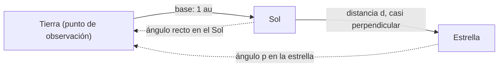

# B04-C07 — Triángulos y distancias angulares

<!-- nav:top -->
[🏠 Programa](../../../../README.md) · [📚 Bloque B04](../../../tronco-comun/B04-algebra-trigonometria-y-geometria-espacial.md) · [← Anterior: B04-C06 — Identidades trigonométricas](../B04-C06-identidades-trigonometricas/CLASE.md) · [Siguiente: B04-C08 — Ley de senos y ley de cosenos →](../B04-C08-ley-de-senos-y-ley-de-cosenos/CLASE.md)
<!-- /nav -->

## 1. Ubicación, nivel y alcance

Séptima clase del bloque B04. En la [clase anterior](../B04-C06-identidades-trigonometricas/CLASE.md) aprendiste a medir ángulos en radianes y segundos de arco y a simplificar con `sen x ≈ tan x ≈ x`. Ahora usas esos ángulos para obtener *longitudes*: un lado de un triángulo rectángulo a partir de otro lado y un ángulo. Nivel N1. Verás las razones trigonométricas en el triángulo rectángulo, el paralaje estelar y la distancia que implica, el paralaje horizontal de la Luna y el paso de tamaño angular a tamaño lineal. No verás triángulos oblicuos (C08) ni geometría sobre la esfera (C16).

## 2. Por qué esta clase existe

Nadie puede llevar una cinta métrica a una estrella. Pero sí se puede observar la misma estrella desde dos puntos separados una distancia conocida y medir cuánto cambia su dirección. Con esa base y ese ángulo, un triángulo basta para obtener la distancia. Es el primer peldaño de la escalera de distancias que viste en [B01-C02](../../B01/B01-C02-escalas-desde-la-tierra-al-cosmos-observable/CLASE.md).

La decisión central: **¿qué lado de un triángulo rectángulo conozco, qué ángulo mido y qué razón trigonométrica me da el lado que busco, con qué error?** Aprenderás a elegir la razón correcta, a declarar la base y el ángulo, y a propagar la incertidumbre del ángulo a la distancia.

## 3. Lo que podrás hacer al terminar

1. Elegir seno, coseno o tangente para resolver un triángulo rectángulo.
2. Hallar el tercer lado y los dos ángulos agudos a partir de dos datos.
3. Obtener la distancia de una estrella a partir de su paralaje y propagar su error.
4. Calcular el tamaño lineal de un objeto a partir de su tamaño angular y su distancia.
5. Usar la Tierra como base para medir la distancia a la Luna.
6. Decidir cuándo la distancia por paralaje deja de ser fiable.

La evidencia es el **cálculo de tamaño o distancia por ángulo** del ejercicio 12 (sección 20).

## 4. Con qué llegas y cómo comprobarlo

Necesitas ángulos en radianes y segundos de arco, y el teorema de Pitágoras (C06). Cinco preguntas:

1. ¿Cuánto mide la hipotenusa de un triángulo rectángulo de catetos 5 y 12?
2. ¿Cuántos radianes son 1 segundo de arco, aproximadamente?
3. ¿Cuánto vale `tan x` para `x` muy pequeño?
4. Si `sen θ = 0,5`, ¿cuánto vale `θ` en grados?
5. Convierte 768,5 mas a segundos de arco.

<details>
<summary>Ver respuestas</summary>

1. 13. 2. `4,85 × 10⁻⁶ rad`. 3. Casi igual a `x` (en radianes). 4. 30°. 5. 0,7685″.
</details>

Con cuatro o cinco aciertos, sigue; si no, repasa C06.

## 5. Un caso real: ¿a cuánta distancia está Próxima Centauri?

El NASA Exoplanet Archive recoge, para cada estrella con planetas conocidos, su paralaje. Para Próxima Centauri, `p = 768,5 ± 0,2 mas` (milisegundos de arco; S1, dato estimado a partir de observaciones). Es un ángulo pequeñísimo: 0,7685″, menos de una milésima de grado. Y sin embargo basta: la Tierra, en seis meses, se desplaza 2 au respecto del Sol, y la estrella cercana parece moverse respecto del fondo por ese cambio de punto de vista. El triángulo rectángulo con la Tierra, el Sol y la estrella (base 1 au, ángulo `p` en la estrella) da la distancia. En esta clase obtendrás `1,3012 pc ± 0,0003`, unos 4,244 años luz, y compararás con otras cuatro estrellas cercanas.

## 6. Vocabulario

Un **triángulo rectángulo** tiene un ángulo de 90°; el lado opuesto a él es la **hipotenusa** y los otros dos son los **catetos**. Para un ángulo agudo `θ`: `sen θ` = cateto opuesto / hipotenusa; `cos θ` = cateto adyacente / hipotenusa; `tan θ` = cateto opuesto / cateto adyacente. La **base** es la distancia conocida entre dos puntos de observación. El **paralaje** `p` es el ángulo que subtiende la base vista desde el objeto (o, equivalentemente, el cambio de dirección del objeto al cambiar de punto de vista). El **paralaje estelar anual** usa como base 1 au. El **paralaje horizontal** de la Luna usa como base el radio de la Tierra. El **parsec** es la distancia a la que 1 au subtiende 1″: `1 pc = 648 000/π au`. El **diámetro angular** es el ángulo que ocupa un objeto en el cielo. Un **milisegundo de arco** (mas) es `10⁻³″`.

## 7. Modelo mental: un triángulo muy delgado

La estrella está lejísimos; la base es de 1 au. El triángulo resultante es larguísimo y delgado: casi dos rectas paralelas. El ángulo en la estrella es minúsculo y está en la razón `base/distancia`.



*Descripción textual:* triángulo rectángulo con el ángulo recto en el Sol: un cateto es la base de 1 au hacia la Tierra, el otro es la distancia `d` hasta la estrella, y el ángulo `p` está en la estrella, opuesto a la base. La razón es `tan p = 1 au / d`.

Analogía: dos ojos que ven un dedo estirado; la separación entre ojos es la base y el cambio de dirección es el paralaje. Su límite: a mayor distancia, el ángulo es tan pequeño que el ruido de la medida lo oculta; por eso el método se acaba (B01-C02).

## 8. La explicación, paso a paso

### 8.1 Las razones en el triángulo rectángulo

Para los catetos `a` (opuesto a `θ`) y `b` (adyacente) y la hipotenusa `c`: `sen θ = a/c`, `cos θ = b/c`, `tan θ = a/b`, y `c² = a² + b²`. La clave es elegir la razón que une *el dato que tienes* con *el que buscas*. Si conoces la hipotenusa y un ángulo y buscas el cateto opuesto: seno. Si conoces los dos catetos y buscas el ángulo: `θ = arctan(a/b)`. Los triángulos 3-4-5 (ángulo de 36,87°) y de 30°-60°-90° sirven para comprobar.

### 8.2 Paralaje estelar

Con base 1 au y paralaje `p`: `tan p = 1 au / d`, es decir `d = 1 au / tan p`. Si `p` es tan pequeño que `tan p ≈ p` (en radianes), `d = 1 au / p`. Expresado en parsecs, esa relación se reduce a `d = 1/p` con `p` en segundos de arco: es la razón por la que el parsec está definido así. Para Próxima: `p = 0,7685″` → `d = 1/0,7685 = 1,3012 pc`. En kilómetros, `1,3012 × 3,0857 × 10¹³ = 4,015 × 10¹³ km`.

### 8.3 Propagación del error

Si `p` tiene una incertidumbre `δp`, la distancia `d = 1/p` tiene `δd = d · δp/p`: el error *relativo* de la distancia es el mismo que el del ángulo. Con `δp = 0,203 mas` y `p = 768,5 mas`, `δp/p = 2,6 × 10⁻⁴`, es decir `d = 1,3012 ± 0,0003 pc`. Si `p` fuera 2 mas con la misma incertidumbre, el error relativo sería del 10 %. La regla práctica de esta clase: con un error angular de 0,2 mas, el método da un 10 % de error relativo solo hasta unos 500 pc. Más allá el paralaje pierde sentido.

### 8.4 Paralaje horizontal de la Luna

Con base el radio de la Tierra `R` (visto desde la Luna, la Tierra subtiende un ángulo `π_L` con `sen π_L = R/d`): `d = R / sen π_L`. Con `R = 6,3781 × 10⁶ m` (radio ecuatorial nominal; S3) y `d = 384 400 km` (S4): `π_L = arcsen(6,3781 × 10⁶/3,844 × 10⁸) = 0,9507° = 57,04′`. Aquí `sen` y no `tan` porque la base es un radio terrestre, perpendicular a la visual en el borde de la Tierra visto desde la Luna.

### 8.5 De ángulo a tamaño lineal

Un objeto a distancia `d` con diámetro angular `δ` tiene un diámetro `D = 2 d tan(δ/2) ≈ d δ`. Con `δ = 0,5179° = 9,0395 × 10⁻³ rad` y `d = 384 400 km`: `D ≈ 3475 km`, que es el doble del radio lunar de 1737,4 km (S4).

## 9. Magnitudes, símbolos y unidades

| Símbolo | Qué es | Unidad | Nota |
|---|---|---|---|
| `θ`, `p` | ángulo, paralaje | rad, ″, mas | `1 mas = 10⁻³″ = 4,848 × 10⁻⁹ rad` |
| `a`, `b`, `c` | catetos e hipotenusa | m | `c² = a² + b²` |
| `d` | distancia | pc, ly, km | `d = 1/p` con `p` en ″ y `d` en pc |
| `δp`, `δd` | incertidumbre del paralaje y de la distancia | mas, pc | `δd/d = δp/p` |
| `R` | radio terrestre ecuatorial nominal | m | `6,3781 × 10⁶` (S3) |
| `π_L` | paralaje horizontal lunar | °, ′ | `sen π_L = R/d` |
| `D`, `δ` | diámetro lineal y angular | km; rad | `D ≈ d δ` |

## 10. Convenciones y referencias

Los paralajes son positivos y se miden respecto del fondo de objetos mucho más lejanos. Se toma la base como 1 au exacta (S2) y una geometría idealizada: estrella en la dirección perpendicular al plano de la órbita terrestre, órbita circular; para otras direcciones y la elipse real se usan correcciones que no se tratan aquí. `1 pc = 648 000/π au` y `1 ly` es la distancia que recorre la luz en un año juliano. Las cifras de S1 son **estimadas** y el archivo es **mutable**; los valores de la clase corresponden a la consulta del 2026-11-05.

## 11. De dónde sale lo que afirmamos

| ID | Fuente | Localizador | Respalda | Estado |
|---|---|---|---|---|
| S1 | NASA Exoplanet Archive, consulta TAP (tabla `pscomppars`, columnas `sy_plx`, `sy_plxerr1`, `sy_dist`) | https://exoplanetarchive.ipac.caltech.edu/TAP | Paralajes (mas) y errores de Próxima Cen, tau Cet, eps Eri, GJ 1061 y Teegarden's Star; `sy_dist` de Próxima = 1,30119 pc | Consulta del 2026-11-05 (archivo mutable; datos estimados) |
| S2 | IERS Conventions (2010), TN36, tabla de constantes | https://iers-conventions.obspm.fr/content/tn36.pdf | `1 au = 1,495978707 × 10¹¹ m` | Leída el 2026-11-05 |
| S3 | IAU, Resolución B3 de 2015, arXiv:1510.07674 | https://arxiv.org/pdf/1510.07674 | `R_eE` nominal `6,3781 × 10⁶ m` | Texto leído el 2026-11-05 |
| S4 | NASA NSSDC, *Moon Fact Sheet* (2024-01-11) | https://nssdc.gsfc.nasa.gov/planetary/factsheet/moonfact.html | Radio 1737,4 km; semieje mayor 384 400 km | Consultada el 2026-11-05 |

Límites: la columna `sy_plx` del archivo proviene de un catálogo de posiciones cuya identidad no se verificó en esta consulta; no se sabe si incluye correcciones de cero del instrumento. El `sy_dist` del archivo (1,30119 pc) difiere de `1000/p = 1,30124 pc` en 0,004 %, lo que sugiere que se obtuvo con otro método; no se investigó el motivo. La definición del parsec se cita desde B01-C02.

## 12. Cómo ver las distancias

| Estrella | `p` (mas) | `δp` (mas) | `d` (pc) | `δd` (pc) | `d` (ly) | `δp/p` |
|---|---|---|---|---|---|---|
| Próxima Cen | 768,500 | 0,203 | 1,3012 | 0,0003 | 4,244 | 2,6 × 10⁻⁴ |
| tau Cet | 277,516 | 0,517 | 3,6034 | 0,0067 | 11,753 | 1,9 × 10⁻³ |
| eps Eri | 312,219 | 0,467 | 3,2029 | 0,0048 | 10,446 | 1,5 × 10⁻³ |
| GJ 1061 | 272,245 | 0,066 | 3,6732 | 0,0009 | 11,980 | 2,4 × 10⁻⁴ |
| Teegarden | 261,015 | 0,269 | 3,8312 | 0,0039 | 12,496 | 1,0 × 10⁻³ |

Descripción larga: a mayor paralaje, menor distancia; las cinco estrellas están entre 1,3 y 3,8 pc y todas tienen error relativo inferior al 0,2 %. Si se dibuja `d` frente a `p`, es una hipérbola; en ejes log-log, una recta de pendiente −1.

## 13. Ejemplo trabajado: Próxima Centauri

Datos (S1): `p = 768,5 mas`, `δp = 0,203 mas`; base `1 au` (S2).

**Paso 1 · Unidades.** `p = 0,7685″ = 3,726 × 10⁻⁶ rad` (porque `1″ = 4,848 × 10⁻⁶ rad`).

**Paso 2 · Plantear.** `tan p = 1 au/d` → `d = 1 au / tan p`. Como `p ≪ 1`, `tan p ≈ p`.

**Paso 3 · Calcular.** `d = 1/3,726 × 10⁻⁶ au = 2,684 × 10⁵ au`; en parsecs, `d = 1/0,7685 = 1,3012 pc`. Comprobación: `2,684 × 10⁵ au ÷ 2,0626 × 10⁵ au/pc = 1,301 pc` ✓.

**Paso 4 · Error.** `δd = 1,3012 × (0,203/768,5) = 3,4 × 10⁻⁴ pc`. Resultado: `1,3012 ± 0,0003 pc`.

**Paso 5 · Años luz.** `1,3012 × 3,2616 = 4,244 ly`. Contraste: el archivo indica 1,30119 pc; la diferencia es de 0,004 %, dentro del error. Con 4 cifras: `d = 1,301 pc`.

## 14. Distintas formas de obtener una distancia

**Paralaje estelar:** directo y geométrico; no depende de un modelo del objeto, pero solo vale a pequeñas distancias. **Paralaje lunar:** base terrestre; da la distancia al cuerpo cercano. **Tamaño angular y tamaño lineal conocidos:** permite pasar de una cantidad a la otra (`D ≈ dδ`). **Módulo de distancia** (C05): requiere conocer la luminosidad, es un método indirecto. Cuando un método falla, se pasa a otro peldaño de la escalera (B01-C02).

## 15. Práctica guiada

**Ejercicio 1 · con los pasos indicados.** Un triángulo rectángulo tiene catetos 5 y 12. Halla la hipotenusa y el ángulo opuesto al cateto de 5. *Pasos:* Pitágoras; `θ = arctan(5/12)`.

<details><summary>Solución comentada</summary>

`c = √(25 + 144) = 13`; `θ = arctan(0,4167) = 22,62°`. Comprobación: `sen θ = 5/13 = 0,3846`, `sen 22,62° = 0,3846` ✓.
</details>

**Ejercicio 2 · con una pista.** Halla la distancia a tau Ceti con `p = 277,516 mas`. *Pista:* `d = 1/p` con `p` en segundos de arco.

<details><summary>Solución comentada</summary>

`p = 0,277516″`; `d = 1/0,277516 = 3,6034 pc`. Con `δp = 0,517 mas`, `δd/d = 1,9 × 10⁻³`, `δd = 0,0067 pc`. Resultado `3,603 ± 0,007 pc` (S1).
</details>

**Ejercicio 3 · casi autónomo.** Una estrella tiene `p = 50 mas` con `δp = 0,2 mas`. Halla `d` y su incertidumbre y exprésalo en años luz.

<details><summary>Solución comentada</summary>

`d = 1000/50 = 20 pc`; `δd = 20 × 0,2/50 = 0,08 pc`; resultado `20,00 ± 0,08 pc` = `65,2 ly`. Error relativo 0,4 %.
</details>

## 16. Práctica autónoma, transferencia e integrador

**Ejercicio 4.** Una torre tiene una sombra de 30 m cuando el Sol está 40° sobre el horizonte. ¿Qué altura tiene? (Triángulo rectángulo; el ángulo entre la sombra y la línea al Sol es 40°.)

<details><summary>Solución comentada</summary>

`tan 40° = altura/30` → `altura = 30 × 0,8391 = 25,2 m`. Es un caso terrestre sencillo del mismo método (base conocida, ángulo medido).
</details>

**Ejercicio 5.** Calcula `d` en km para `p = 0,7685″`: `d = 1 au/p` con `p` en radianes.

<details><summary>Solución comentada</summary>

`p = 3,726 × 10⁻⁶ rad`; `d = 1,496 × 10⁸ km/3,726 × 10⁻⁶ = 4,015 × 10¹³ km`.
</details>

**Ejercicio 6.** La Luna se ve con diámetro angular 0,5179° desde una distancia de 384 400 km. Halla su diámetro.

<details><summary>Solución comentada</summary>

`δ = 9,0395 × 10⁻³ rad`; `D ≈ 384 400 × 9,0395 × 10⁻³ = 3475 km`; frente a `2 × 1737,4 = 3474,8 km` ✓.
</details>

**Ejercicio 7.** Con `R = 6378,1 km` y `π_L = 0,9507°`, halla `d` de la Luna.

<details><summary>Solución comentada</summary>

`d = R/sen π_L = 6378,1/0,016592 = 384 400 km`. Coincide con S4 (el laboratorio lo recupera).
</details>

**Ejercicio 8.** ¿Qué paralaje tiene un objeto a 100 pc? ¿Y a 1000 pc? Compara con una incertidumbre de 0,2 mas.

<details><summary>Solución comentada</summary>

`p = 1/100 = 10 mas` (error relativo 2 %); `p = 1 mas` (error relativo 20 %): ya no es fiable. Coherente con la regla de 500 pc (10 %).
</details>

**Ejercicio 9 · transferencia.** Un compañero calcula `d` con `p` en milisegundos de arco como si fueran segundos y obtiene `d = 1/768,5 = 0,0013 pc`. ¿Qué error cometió?

<details><summary>Solución comentada</summary>

Usó `p` en mas donde la fórmula pide segundos de arco. El resultado correcto es `1000/768,5`. El error es de un factor 1000, que se detecta comparando con un orden de magnitud: no hay estrellas a 0,0013 pc (270 au).
</details>

**Ejercicio 10 · transferencia.** ¿Por qué la regla de que el error relativo de `d` es igual al de `p` falla si `p` es muy cercano a su incertidumbre?

<details><summary>Solución comentada</summary>

Porque `d = 1/p` no es lineal: si `p = 1 ± 0,5`, el intervalo de `d` va de 0,67 a 2, asimétrico y enorme. Con error relativo grande la propagación lineal ya no describe la incertidumbre.
</details>

**Ejercicio 11 · transferencia.** Un observador mide la paralaje de la Luna desde dos lugares separados 6000 km y obtiene un cambio de dirección de 0,90°. Estima la distancia con la aproximación de ángulo pequeño.

<details><summary>Solución comentada</summary>

`δ = 0,90° = 0,015708 rad`; `d ≈ base/δ = 6000/0,015708 = 3,82 × 10⁵ km`. Cercano a 384 400 km (error −0,6 %). Las condiciones reales (base no perpendicular, rotación) harían falta para precisión.
</details>

**Ejercicio 12 · integrador.** Elabora tu *cálculo de tamaño o distancia por ángulo* (sección 20): escoge dos estrellas de S1 que consultes tú en la tabla del archivo, calcula distancia y error por paralaje en pc y ly, estima el tamaño lineal de un objeto a partir de su tamaño angular, declara la geometría idealizada y compara con la distancia publicada.

<details><summary>Solución modelo</summary>

Completo: tabla con `p`, `δp`, `d`, `δd` y su error relativo, comprobación con otro método (`sy_dist`), un cálculo de tamaño lineal con unidades, declaración de límites (geometría idealizada, base de 1 au, archivo mutable) y fuentes con fecha.
</details>

## 17. Laboratorio: paralaje y triángulos

El script [paralaje_y_triangulos.py](paralaje_y_triangulos.py) calcula la distancia y su error para cinco estrellas. Antes comprueba: el triángulo 3-4-5, `sen 30° = 0,5`, que `tan p · d` devuelva 1 au, el valor del parsec, `d = 1/p` con tolerancia 10⁻⁶ y la conversión de mas a rad.

**Datos:** publicados (estimados, mutables). **Predice antes de ejecutar:** ¿cuál tendrá el mayor error relativo? (La de menor paralaje con error comparable: tau Ceti, 1,9 × 10⁻³.) **Ejecución del 2026-11-05 (Python 3.12.9):**

```text
Proxima Cen    768.500    0.203    1.3012   0.0003    4.244  2.64e-04
tau Cet        277.516    0.517    3.6034   0.0067   11.753  1.86e-03
Proxima: 1000/p = 1.30124 pc; archivo (sy_dist) = 1,30119 pc
Paralaje horizontal lunar: π = 0.9507° = 57.04′; se recupera d = 384400 km
Objeto de diámetro angular 0,5179° a 384 400 km: D = 3475 km
```

```bash
python programa/clases/B04/B04-C07-triangulos-y-distancias-angulares/paralaje_y_triangulos.py
```

**Límites:** geometría idealizada, sin movimiento propio ni excentricidad terrestre; errores independientes; no es una herramienta de astrometría.

## 18. Errores frecuentes y cómo corregirlos

**Elegir la razón equivocada.** Se corrige con la sección 8.1 y el ejercicio 1.

**Confundir mas con segundos de arco.** Se corrige con el ejercicio 9.

**Olvidar que el error de `d` es relativo igual al de `p`.** Se corrige con el ejercicio 3.

**Aplicar paralaje más allá de su alcance.** Se corrige con el ejercicio 8.

**Usar grados en funciones que esperan radianes.** Ver C06.

## 19. Cómo sabrás que vas bien

Tras 8.1: ¿eliges la razón sin dudar? Si no, ejercicio 1. Tras 8.2: ¿calculas `d` a partir de `p` en mas? Si no, ejercicio 2. Tras 8.3: ¿dices hasta qué distancia sirve el método? Si no, ejercicio 8. Tras el laboratorio: ¿qué comprueba antes de calcular? Si no lo sabes, lee su cabecera.

## 20. Qué entregas y cómo se evalúa

El producto es tu **cálculo de tamaño o distancia por ángulo** (ejercicio 12).

| Criterio | Inicial | En desarrollo | Logrado | Destacado |
|---|---|---|---|---|
| Razón trigonométrica | Elige mal | Elige con ayuda | Elige y justifica | Verifica con otra razón |
| Unidades | Mezcla mas y ″ | Convierte con errores | Convierte y declara | Detecta el error de un tercero |
| Incertidumbre | Ausente | Cita sin propagar | Propaga `δd/d = δp/p` | Discute cuándo falla la propagación lineal |
| Comprobación | Ausente | Un caso | Compara con el valor publicado | Explica la diferencia |
| Fuentes | Sin fuente | Sin fecha | Con localizador y fecha | Señala el carácter mutable del archivo |

**Condiciones críticas (no se compensan con promedio):** declarar la unidad del paralaje; incluir incertidumbre; citar solo fuentes consultadas.

## 21. Ética, seguridad y límites

Una distancia sin su incertidumbre es una afirmación incompleta; y un dato de un archivo mutable debe citarse con la fecha de consulta. La clase calcula tamaños del Sol y de la Luna pero no propone observarlos sin filtros certificados. Accesibilidad: fórmulas en texto, tabla equivalente a la gráfica, ejercicios sin conexión. Es material educativo; no sirve para astrometría profesional.

## 22. Para cerrar y seguir

Un ángulo y una base dan una distancia: `d = 1 au / tan p`, que para ángulos pequeños es `d = 1/p` en parsecs. El error relativo de la distancia es el del ángulo, y por eso el paralaje se acaba. Queda abierta una pregunta: ¿qué hacer cuando el triángulo no tiene un ángulo recto? Eso es C08.

**Glosario español–inglés.** triángulo rectángulo · *right triangle*; hipotenusa · *hypotenuse*; cateto · *leg*; paralaje · *parallax*; base · *baseline*; parsec · *parsec*; diámetro angular · *angular diameter*; milisegundo de arco · *milliarcsecond*.

**Continuidad.** B04-C08 usa tu capacidad de **resolver triángulos rectángulos** para tratar triángulos oblicuos. B04-C20 retomará el paralaje y su error en el diseño de una triangulación completa.

**Referencias:** ver sección 11.

<!-- nav:bottom -->
---

[← Anterior: B04-C06 — Identidades trigonométricas](../B04-C06-identidades-trigonometricas/CLASE.md) · [📚 Bloque B04](../../../tronco-comun/B04-algebra-trigonometria-y-geometria-espacial.md) · [Siguiente: B04-C08 — Ley de senos y ley de cosenos →](../B04-C08-ley-de-senos-y-ley-de-cosenos/CLASE.md)
<!-- /nav -->
