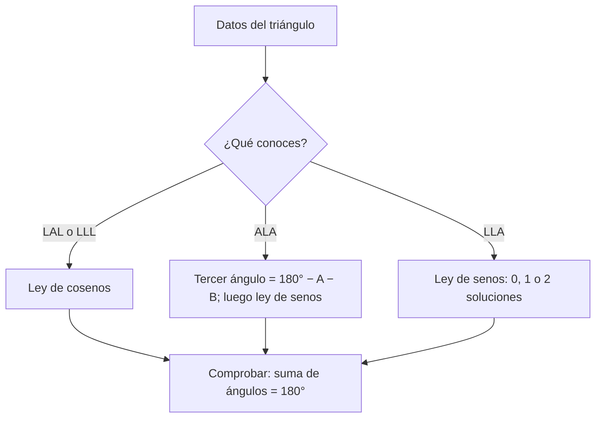

# B04-C08 — Ley de senos y ley de cosenos

<!-- nav:top -->
[🏠 Programa](../../../../README.md) · [📚 Bloque B04](../../../tronco-comun/B04-algebra-trigonometria-y-geometria-espacial.md) · [← Anterior: B04-C07 — Triángulos y distancias angulares](../B04-C07-triangulos-y-distancias-angulares/CLASE.md) · [Siguiente: B04-C09 — Circunferencias y elipses →](../../../tronco-comun/B04-algebra-trigonometria-y-geometria-espacial.md#b04-c09)
<!-- /nav -->

## 1. Ubicación, nivel y alcance

Octava clase del bloque B04. En la [clase anterior](../B04-C07-triangulos-y-distancias-angulares/CLASE.md) resolviste triángulos con un ángulo recto. Pero el triángulo Sol–Tierra–Marte casi nunca lo tiene. Aquí aprendes las dos leyes que sirven para *cualquier* triángulo plano. Nivel N1. Verás la ley de cosenos, la ley de senos, el caso ambiguo y una aplicación a las posiciones relativas de los planetas en su plano orbital. No verás triángulos sobre una esfera (C16) ni triangulación con errores (C20).

## 2. Por qué esta clase existe

Cuando una sonda se comunica con la Tierra, el tiempo de la señal depende de la distancia, que cambia de unos 55 millones de km a unos 400 millones según dónde estén ambos planetas en sus órbitas. Para planificar una operación o estimar el retardo hay que calcular esa distancia a partir de las posiciones relativas, y eso es un triángulo con ángulos arbitrarios.

La decisión central: **dado un triángulo con tres datos (dos lados y el ángulo entre ellos, o dos ángulos y un lado, o un lado, su ángulo opuesto y otro lado), ¿qué ley uso y cuántas soluciones puede tener?** Aprenderás a elegir, aplicar y comprobar.

## 3. Lo que podrás hacer al terminar

1. Enunciar y aplicar la ley de cosenos y la ley de senos.
2. Elegir la ley según los datos disponibles (LAL, LLL, ALA, LLA).
3. Reconocer el caso ambiguo y decidir cuántas soluciones tiene.
4. Calcular la distancia entre dos planetas en órbitas circulares coplanares según su ángulo heliocéntrico.
5. Calcular la elongación máxima de Venus con un triángulo.
6. Comprobar una solución con la suma de ángulos y con la ley no usada.

La evidencia es la **resolución de un triángulo astronómico con comprobación** del ejercicio 12 (sección 20).

## 4. Con qué llegas y cómo comprobarlo

Necesitas razones trigonométricas, ángulos agudos y Pitágoras (C06, C07). Cinco preguntas:

1. En un triángulo rectángulo de hipotenusa 13 y un cateto 5, ¿cuánto mide el otro?
2. ¿Cuánto suman los ángulos de un triángulo plano?
3. ¿Cuánto vale `cos 90°`?
4. Si `sen θ = 0,7233`, ¿qué ángulo agudo es `θ`, aproximadamente?
5. Si dos lados miden 3 y 5, ¿entre qué valores puede estar el tercero?

<details>
<summary>Ver respuestas</summary>

1. 12. 2. 180° (π rad). 3. 0. 4. 46,3°. 5. Entre 2 y 8 (desigualdad triangular, sin incluir los extremos).
</details>

Con cuatro o cinco aciertos, sigue; si no, repasa C06 y C07.

## 5. Un caso real: ¿a qué distancia está Marte?

La NASA publica la distancia media de cada planeta al Sol (S1): Venus 108,2, Tierra 149,6 y Marte 228,0, en millones de km. Si dibujas las órbitas como circunferencias con el Sol en el centro, la Tierra y Marte son dos puntos y el Sol el tercero: un triángulo con dos lados conocidos (149,6 y 228,0) y el ángulo entre ellos (el ángulo heliocéntrico `φ`). La ley de cosenos da la distancia Tierra–Marte. En oposición (`φ = 0`) sale 78,4 millones de km; en conjunción (`φ = 180°`), 377,6. Un cálculo más cuidadoso, con las excentricidades publicadas (0,017 y 0,094), da una cota inferior de 54,4 millones de km. Esa diferencia entre 78 y 54 ya es la primera lección: las órbitas circulares son una primera aproximación, no la verdad. Los ángulos `φ` de la tabla de esta clase son **sintéticos**, elegidos para enseñar.

## 6. Vocabulario

En un triángulo plano con lados `a, b, c` y ángulos opuestos `A, B, C`, la **ley de cosenos** dice `c² = a² + b² − 2ab cos C`; la **ley de senos** dice `a/sen A = b/sen B = c/sen C`. Un triángulo se **resuelve** cuando se conocen sus tres lados y sus tres ángulos. Los esquemas de datos se nombran **LAL** (lado–ángulo–lado), **LLL** (tres lados), **ALA** (ángulo–lado–ángulo) y **LLA** (lado–lado–ángulo no incluido). El **caso ambiguo** es el LLA, que puede tener cero, una o dos soluciones. La **elongación** de un planeta es el ángulo Sol–Tierra–planeta. El **ángulo heliocéntrico** es el ángulo entre las direcciones al Sol de dos planetas medido desde el Sol. Una **oposición** es la configuración en que Tierra y planeta exterior están alineados al mismo lado del Sol; una **conjunción**, la alineación al lado contrario.

## 7. Modelo mental: tres puntos en un plano

Fija el Sol en el origen. Cada planeta es un punto a distancia `a` del Sol. Tres puntos definen un triángulo, y sus lados son distancias; sus ángulos, direcciones. Lo que se conoce y lo que se busca determina la ley.



*Descripción textual:* según los datos (LAL o LLL, ALA o LLA) se usa la ley de cosenos, el tercer ángulo y la de senos, o la de senos con posible ambigüedad; todo termina comprobando que los ángulos suman 180°.

Analogía: un trípode de varillas articuladas: con dos varillas y el ángulo entre ellas, la tercera queda fija; con dos varillas y un ángulo opuesto a una de ellas, puede haber dos formas posibles. Su límite: las varillas reales no pueden tener longitud negativa ni ángulos imposibles; las leyes lo reflejan con resultados no reales (por ejemplo, `sen B > 1`).

## 8. La explicación, paso a paso

### 8.1 Ley de cosenos

Si conoces dos lados `b` y `c` y el ángulo `A` entre ellos: `a² = b² + c² − 2bc cos A`. Para `A = 90°` el último término desaparece y obtienes Pitágoras; para `A = 0°`, `a = |b − c|`; para `A = 180°`, `a = b + c`. Si conoces los tres lados: `cos A = (b² + c² − a²)/(2bc)` y `A = arccos(…)`.

### 8.2 Ley de senos

`a/sen A = b/sen B = c/sen C`: cada lado es proporcional al seno de su ángulo opuesto. Es útil con ALA y LLA. Con ALA, el tercer ángulo es `C = 180° − A − B`.

### 8.3 El caso ambiguo

Con `a = 8`, `A = 30°` y `b = 10`, `sen B = b sen A / a = 0,625`. Como `B` y `180° − B` tienen el mismo seno, salen `B = 38,68°` y `B = 141,32°`. Ambas son soluciones válidas si `A + B < 180°`: en este caso las dos cumplen. Si `sen B > 1`, no hay solución. Cuando el lado opuesto al ángulo dado es mayor o igual que el otro lado, la solución es única.

### 8.4 Aplicación 1: distancia Tierra–Marte

Con órbitas circulares coplanares de radios `a_T = 149,6` y `a_M = 228,0` (en 10⁶ km), la distancia en función de `φ` es `d = √(a_T² + a_M² − 2 a_T a_M cos φ)`. Para `φ = 90°`: `d = √(22 380 + 51 984) = 272,7`. El **retardo de luz** es `d/c`: en oposición circular, `78,4 × 10⁶ km / 299 792,458 km/s = 261,5 s = 4,36 min`; en conjunción, 20,99 min.

### 8.5 Aplicación 2: elongación máxima de Venus

Venus se ve más lejos del Sol cuando la visual Tierra–Venus es tangente a su órbita: el ángulo Sol–Venus–Tierra es de 90°. En ese triángulo rectángulo, `sen ε = a_V/a_T = 108,2/149,6 = 0,7233`, y `ε = 46,32°`. Es un caso particular de la ley de senos con un ángulo de 90°. La elongación observada varía algo con la excentricidad; el valor de la clase es el del modelo circular.

### 8.6 Cota con excentricidades

La distancia mínima posible no puede ser menor que la distancia de Marte al perihelio menos la de la Tierra al afelio: `q_M = a_M(1 − e_M) = 206,6` y `Q_T = a_T(1 + e_T) = 152,1`, es decir una cota de `54,4` millones de km. Es una cota calculada, no una efeméride.

## 9. Magnitudes, símbolos y unidades

| Símbolo | Qué es | Unidad | Nota |
|---|---|---|---|
| `a, b, c` | lados del triángulo | 10⁶ km (en el caso planetario) | `a_V = 108,2`; `a_T = 149,6`; `a_M = 228,0` (S1) |
| `A, B, C` | ángulos opuestos a `a, b, c` | rad o ° | suman 180° |
| `φ` | ángulo heliocéntrico | ° | sintético en las tablas |
| `ε` | elongación | ° | ángulo Sol–Tierra–planeta |
| `e` | excentricidad | adimensional | Tierra 0,017; Marte 0,094 (S1) |
| `c_luz` | velocidad de la luz | km/s | 299 792,458 (SI) |
| `t` | retardo de la señal | s o min | `t = d/c_luz` |

## 10. Convenciones y referencias

Los ángulos de los triángulos son interiores y están entre 0° y 180°. Se nombra cada lado con la letra minúscula del vértice opuesto. En el caso planetario: órbitas circulares, coplanares, con el Sol en el centro, y distancias medias; `φ` se mide en el plano de las órbitas. La «Distance from Sun» de S1 se toma como distancia media (semieje mayor). El cálculo de oposición con valores medios no reproduce las distancias reales mínimas (efecto de la excentricidad).

## 11. De dónde sale lo que afirmamos

| ID | Fuente | Localizador | Respalda | Estado |
|---|---|---|---|---|
| S1 | NASA NSSDC, *Planetary Fact Sheet – Metric* (actualizada 2025-03-18) | https://nssdc.gsfc.nasa.gov/planetary/factsheet/ | Distancias al Sol: Venus 108,2; Tierra 149,6; Marte 228,0 (10⁶ km); excentricidades Tierra 0,017 y Marte 0,094 | Consultada el 2026-11-05; datos estimados |
| S2 | BIPM, *SI Brochure*, 9.ª ed. (2019), definición del metro | https://www.bipm.org/documents/20126/41483022/SI-Brochure-9-EN.pdf | `c = 299 792 458 m/s` exacta | Leída el 2026-11-05 |

Límites: las leyes de senos y cosenos son resultados matemáticos estándar. Los ángulos heliocéntricos de la tabla son sintéticos; las distancias reales requieren efemérides (no consultadas). Los valores de excentricidad de la ficha tienen 2–3 cifras.

## 12. Cómo ver las distancias

| `φ` (°) | `d` Tierra–Marte (10⁶ km) | Elongación de Marte (°) | Retardo de luz (min) |
|---|---|---|---|
| 0 (oposición) | 78,4 | 180,0 | 4,4 |
| 60 | 200,6 | 79,8 | 11,2 |
| 90 | 272,7 | 56,7 | 15,2 |
| 120 | 329,4 | 36,8 | 18,3 |
| 180 (conjunción) | 377,6 | 0,0 | 21,0 |

Descripción larga: la distancia crece de forma suave y no lineal con `φ`, más deprisa cerca de la oposición y más despacio cerca de la conjunción; la elongación de Marte baja de 180° a 0°.

## 13. Ejemplo trabajado: Tierra y Marte a 90° heliocéntricos

Datos (S1): `a_T = 149,6`, `a_M = 228,0` (10⁶ km), `φ = 90°` (sintético).

**Paso 1 · Plantear.** Triángulo con lados `a_T` y `a_M` y ángulo entre ellos `φ`; buscas el lado opuesto `d`. Esquema LAL: ley de cosenos.

**Paso 2 · Calcular.** `d² = 149,6² + 228,0² − 2·149,6·228,0·cos 90° = 22 380 + 51 984 − 0 = 74 364`. `d = 272,7 × 10⁶ km`.

**Paso 3 · Ángulo en la Tierra.** Opuesto a `a_M`: `cos E = (a_T² + d² − a_M²)/(2 a_T d) = (22 380 + 74 364 − 51 984)/(2·149,6·272,7) = 44 760/81 590 = 0,5486`; `E = 56,7°`.

**Paso 4 · Comprobar con la ley de senos.** El ángulo en el Sol es `φ = 90°`, así que `d/sen 90° = 272,7`. En la Tierra, `a_M/sen E = 228,0/sen 56,7° = 228,0/0,8358 = 272,8` ✓. El ángulo en Marte es `180° − 90° − 56,7° = 33,3°`, y `a_T/sen 33,3° = 149,6/0,5490 = 272,5` ✓ (las diferencias son de redondeo). Los tres cocientes coinciden y los ángulos suman 180°.

**Paso 5 · Interpretación y límite.** La distancia es 272,7 × 10⁶ km, y la luz tarda `272,7 × 10⁶/299 792,458 = 909,7 s = 15,2 min`. Con 3–4 cifras. Es un modelo circular: con las excentricidades la distancia real a ese `φ` difiere de decenas de millones de km.

## 14. Distintas formas de resolver

La **ley de cosenos** es la más segura: no tiene ambigüedad y sirve con LAL y LLL. La **ley de senos** es más corta con ALA y LLA, pero exige vigilar el caso ambiguo. Una **construcción gráfica** (regla y transportador) comprueba cualitativamente. La **descomposición en dos triángulos rectángulos** (bajando una altura) vuelve a C07 y es útil para entender. En la práctica se resuelve con una ley y se verifica con la otra.

## 15. Práctica guiada

**Ejercicio 1 · con los pasos indicados.** Halla el tercer lado de un triángulo con lados 7 y 9 y ángulo entre ellos de 60°. *Pasos:* ley de cosenos.

<details><summary>Solución comentada</summary>

`c² = 49 + 81 − 2·7·9·cos 60° = 130 − 63 = 67`; `c = 8,185`. Comprobación con la desigualdad triangular: está entre 2 y 16 ✓.
</details>

**Ejercicio 2 · con una pista.** Calcula la distancia Tierra–Marte en oposición circular y su retardo de luz. *Pista:* `φ = 0°` y `d = a_M − a_T`.

<details><summary>Solución comentada</summary>

`d = 228,0 − 149,6 = 78,4 × 10⁶ km`; `t = 78,4 × 10⁶/299 792 = 261,5 s = 4,36 min`. Con la fórmula general, `cos 0° = 1` da `d = |a_M − a_T|`.
</details>

**Ejercicio 3 · casi autónomo.** Halla la elongación máxima de Venus (modelo circular) con `a_V = 108,2` y `a_T = 149,6`.

<details><summary>Solución comentada</summary>

Triángulo rectángulo con ángulo recto en Venus: `sen ε = 108,2/149,6 = 0,7233`; `ε = 46,32°`. Comprobación: `cos ε = 0,6905 = √(149,6² − 108,2²)/149,6 = 103,3/149,6` ✓.
</details>

## 16. Práctica autónoma, transferencia e integrador

**Ejercicio 4.** Un triángulo tiene lados 7, 9 y 12. Halla el ángulo mayor.

<details><summary>Solución comentada</summary>

El ángulo mayor es el opuesto al lado mayor: `cos C = (49 + 81 − 144)/(2·7·9) = −14/126 = −0,1111`; `C = 96,38°`. Es obtuso (coseno negativo).
</details>

**Ejercicio 5.** En un triángulo, `A = 40°`, `B = 60°` y `a = 10`. Halla `b` y `c`.

<details><summary>Solución comentada</summary>

`C = 80°`; `a/sen A = 10/0,6428 = 15,557`; `b = 15,557·sen 60° = 13,47`; `c = 15,557·sen 80° = 15,32`.
</details>

**Ejercicio 6.** Datos LLA: `a = 8`, `A = 30°`, `b = 10`. Halla `B` y explica por qué hay dos soluciones.

<details><summary>Solución comentada</summary>

`sen B = 0,625`; `B = 38,68°` o `141,32°`; ambas cumplen `A + B < 180°`, por lo que hay dos triángulos distintos (el segundo con `C = 8,68°`).
</details>

**Ejercicio 7.** Con `a = 3`, `A = 30°`, `b = 10`: ¿cuántas soluciones hay?

<details><summary>Solución comentada</summary>

`sen B = 10·0,5/3 = 1,667 > 1`: ninguna. El lado `a` es demasiado corto para alcanzar la tercera recta.
</details>

**Ejercicio 8.** Distancia Tierra–Marte para `φ = 120°` (sintético) y su retardo.

<details><summary>Solución comentada</summary>

`d² = 22 380 + 51 984 − 2·149,6·228,0·(−0,5) = 74 364 + 34 109 = 108 473`; `d = 329,4 × 10⁶ km`; `t = 18,3 min`.
</details>

**Ejercicio 9 · transferencia.** Un compañero afirma que, en oposición, Marte está siempre a 78,4 millones de km. Evalúa.

<details><summary>Solución comentada</summary>

Ese valor sale de órbitas circulares con las distancias medias. Con las excentricidades de S1, la cota inferior de la distancia es 54,4 × 10⁶ km; la distancia en oposición varía según en qué punto de sus órbitas estén. Es un valor del modelo, no una distancia universal.
</details>

**Ejercicio 10 · transferencia.** Un estudiante usa la ley de senos con LLA y obtiene `B = 38,68°` sin considerar otras opciones. ¿Qué advertirías?

<details><summary>Solución comentada</summary>

Con LLA hay que comprobar si `180° − B` también cumple `A + B < 180°`; en este caso sí: una segunda solución `B = 141,32°` (ejercicio 6). Antes de reportar un triángulo, hay que contar las soluciones.
</details>

**Ejercicio 11 · transferencia.** Una sonda en un planeta exterior debe recibir una orden con un retardo máximo de 25 min. Si la distancia Tierra–Marte llega a 377,6 × 10⁶ km en conjunción (modelo), ¿se cumple?

<details><summary>Solución comentada</summary>

`t = 377,6 × 10⁶/299 792 = 1260 s = 21,0 min`: cumple con el modelo circular. Pero con excentricidades la conjunción puede ser mayor; con la cota `Q_M + Q_T = 228,0·1,094 + 152,1 = 401,5 × 10⁶ km` → 22,3 min: aún cumple, con poco margen. Es una cota calculada con valores medios y requeriría efemérides.
</details>

**Ejercicio 12 · integrador.** Elabora tu *resolución de un triángulo astronómico con comprobación* (sección 20): elige dos planetas de S1 (por ejemplo, Venus y la Tierra), un ángulo heliocéntrico sintético, calcula la distancia y las elongaciones, comprueba con la ley de senos y con la suma de ángulos, y calcula el retardo de luz.

<details><summary>Solución modelo</summary>

Completo: esquema de datos (LAL), ley de cosenos, ángulo en cada vértice con la ley de cosenos y comprobación con la de senos, suma de ángulos de 180°, retardo `d/c`, declaración de modelo circular y de ángulo sintético, fuentes con fecha.
</details>

## 17. Laboratorio: triángulos planetarios

El script [triangulos_planetarios.py](triangulos_planetarios.py) implementa ambas leyes y antes comprueba: el caso de Pitágoras con `φ = 90°`, el triángulo equilátero, la suma de ángulos y la consistencia seno/lado en un triángulo 7-9-12, el caso ambiguo (dos soluciones), el caso sin solución, y los extremos `φ = 0` y `φ = π`.

**Datos:** publicados (estimados) y ángulos sintéticos. **Predice antes de ejecutar:** ¿qué elongación máxima sale para Venus? (Unos 46°.) **Ejecución del 2026-11-05 (Python 3.12.9):**

```text
Elongación máxima de Venus (órbitas circulares): sen ε = 0.7233 -> ε = 46.32°
  φ=90°: d = 272.7 (10^6 km); elongación de Marte 56.7°
Cota inferior de la distancia mínima (calculada): q_Marte - Q_Tierra = 206.6 - 152.1 = 54.4 ×10^6 km
Caso ambiguo a=8, A=30°, b=10: B = 38.68° o 141.32°
Luz Tierra–Marte (oposición circular): 4.36 min ; (conjunción): 20.99 min
```

```bash
python programa/clases/B04/B04-C08-ley-de-senos-y-ley-de-cosenos/triangulos_planetarios.py
```

**Límites:** órbitas circulares coplanares; ángulos heliocéntricos sintéticos; no es una herramienta de planificación de misión.

## 18. Errores frecuentes y cómo corregirlos

**Usar la ley de senos con LAL.** Se corrige con la sección 8.1 y el ejercicio 1.

**Ignorar el caso ambiguo.** Se corrige con los ejercicios 6, 7 y 10.

**Olvidar el signo del coseno en ángulos obtusos.** Se corrige con el ejercicio 4.

**Confundir la elongación con el ángulo heliocéntrico.** Se corrige con el ejercicio 3 y la sección 6.

**Tomar el modelo circular como distancia real.** Se corrige con el ejercicio 9.

## 19. Cómo sabrás que vas bien

Tras 8.1: ¿calculas el tercer lado de un LAL sin mirar? Si no, ejercicio 1. Tras 8.3: ¿explicas por qué LLA puede tener dos soluciones? Si no, ejercicio 6. Tras 8.4: ¿calculas el retardo de luz? Si no, ejercicio 2. Tras el laboratorio: ¿qué comprueba antes de calcular? Si no lo sabes, lee su cabecera.

## 20. Qué entregas y cómo se evalúa

El producto es tu **resolución de un triángulo astronómico con comprobación** (ejercicio 12).

| Criterio | Inicial | En desarrollo | Logrado | Destacado |
|---|---|---|---|---|
| Elección de la ley | Elige mal | Elige con ayuda | Elige y justifica | Anticipa el caso ambiguo |
| Cálculo | Errores | Resuelve sin comprobar | Resuelve y comprueba con otra ley | Explica la diferencia de redondeo |
| Interpretación | Sin unidades | Con unidades | Convierte a retardo de luz | Discute el modelo circular |
| Casos límite | Ausentes | Menciona | Comprueba `φ = 0` y `180°` | Los usa para validar |
| Fuentes | Sin fuente | Sin fecha | Con localizador y fecha | Marca lo sintético |

**Condiciones críticas (no se compensan con promedio):** declarar el esquema de datos; rotular los ángulos sintéticos; citar solo fuentes consultadas.

## 21. Ética, seguridad y límites

Los resultados de un modelo circular no son efemérides, y presentarlos como distancias reales sería engañoso. Nada aquí sirve para planificar comunicaciones con una sonda. Accesibilidad: fórmulas en texto, tabla equivalente al diagrama, ejercicios sin conexión.

## 22. Para cerrar y seguir

Con la ley de cosenos y la de senos se resuelve cualquier triángulo plano; hay que vigilar el caso ambiguo y comprobar con la otra ley. En el plano orbital, la distancia entre planetas depende del ángulo heliocéntrico. Queda abierta una pregunta: ¿qué curva describe en realidad la órbita? Eso es C09.

**Glosario español–inglés.** ley de cosenos · *law of cosines*; ley de senos · *law of sines*; caso ambiguo · *ambiguous case*; elongación · *elongation*; oposición · *opposition*; conjunción · *conjunction*; ángulo heliocéntrico · *heliocentric angle*; retardo de luz · *light-time delay*.

**Continuidad.** B04-C09 usa tu capacidad de **resolver triángulos** para estudiar la elipse y sus focos. B04-C16 retomará la ley de cosenos sobre la esfera.

**Referencias:** ver sección 11.

<!-- nav:bottom -->
---

[← Anterior: B04-C07 — Triángulos y distancias angulares](../B04-C07-triangulos-y-distancias-angulares/CLASE.md) · [📚 Bloque B04](../../../tronco-comun/B04-algebra-trigonometria-y-geometria-espacial.md) · [Siguiente: B04-C09 — Circunferencias y elipses →](../../../tronco-comun/B04-algebra-trigonometria-y-geometria-espacial.md#b04-c09)
<!-- /nav -->
