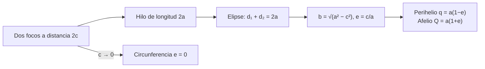

# B04-C09 — Circunferencias y elipses

<!-- nav:top -->
[🏠 Programa](../../../../README.md) · [📚 Bloque B04](../../../tronco-comun/B04-algebra-trigonometria-y-geometria-espacial.md) · [← Anterior: B04-C08 — Ley de senos y ley de cosenos](../B04-C08-ley-de-senos-y-ley-de-cosenos/CLASE.md) · [Siguiente: B04-C10 — Coordenadas polares y cartesianas →](../B04-C10-coordenadas-polares-y-cartesianas/CLASE.md)
<!-- /nav -->

## 1. Ubicación, nivel y alcance

Novena clase del bloque B04. En la [clase anterior](../B04-C08-ley-de-senos-y-ley-de-cosenos/CLASE.md) trataste las órbitas como circunferencias para calcular distancias entre planetas, y viste que era una primera aproximación. Aquí describes con precisión las dos curvas: la circunferencia y la elipse. Nivel N1. Verás sus ecuaciones, los semiejes, la excentricidad, los focos, las distancias extremas, el área y el perímetro, y su aplicación a órbitas reales. No verás coordenadas polares (C10), parábolas ni hipérbolas (C18), ni las leyes físicas que producen las órbitas (B05).

## 2. Por qué esta clase existe

Las órbitas de planetas y cometas son, en buena aproximación, elipses con el Sol en uno de sus focos. Si no sabes qué es un semieje, un foco o la excentricidad, no puedes leer una tabla de elementos orbitales ni distinguir una órbita casi circular, como la de la Tierra, de una muy alargada, como la del cometa Halley.

La decisión central: **¿qué parámetros definen una elipse, cómo se relacionan entre sí y qué distancias extremas implican?** Aprenderás a pasar de `(a, e)` a `b`, `c`, `q` y `Q`, y a comprobar numéricamente las propiedades.

## 3. Lo que podrás hacer al terminar

1. Escribir la ecuación de una circunferencia y de una elipse centradas en el origen.
2. Calcular `b`, `c`, `q`, `Q`, el área y un perímetro aproximado a partir de `a` y `e`.
3. Reconocer los focos y la propiedad `d₁ + d₂ = 2a`.
4. Distinguir una órbita casi circular de una muy excéntrica.
5. Calcular la distancia mínima y máxima al Sol de un cuerpo.
6. Comprobar numéricamente una propiedad geométrica con una tolerancia declarada.

La evidencia es la **ficha geométrica de una órbita** del ejercicio 12 (sección 20).

## 4. Con qué llegas y cómo comprobarlo

Necesitas ecuaciones, raíces y Pitágoras (C02, C08). Cinco preguntas:

1. ¿Cuánto vale `√(1 − 0,36)`?
2. Si `x² + y² = 25`, ¿cuánto vale `y` cuando `x = 3`? (Positivo.)
3. ¿Cuánto es `π × 5 × 4`?
4. Resuelve `x²/25 = 1`.
5. ¿Cuál es el área de un círculo de radio 3?

<details>
<summary>Ver respuestas</summary>

1. 0,8. 2. 4. 3. 62,83. 4. `x = ±5`. 5. `9π = 28,27`.
</details>

Con cuatro o cinco aciertos, sigue; si no, repasa C02 y C08.

## 5. Un caso real: Halley frente a la Tierra

Los elementos orbitales de un cuerpo menor se publican en la base de datos de pequeños cuerpos del JPL de la NASA. Para el cometa 1P/Halley, la solución del 2025-11-21 da un semieje mayor `a = 17,9286 au` y una excentricidad `e = 0,96794` (S1). Para la Tierra, la NASA da `a = 149,6 × 10⁶ km` y `e = 0,017` (S2). Con solo esos dos números por cuerpo puedes decir que la Tierra recorre una elipse casi indistinguible de una circunferencia (su semieje menor es el 99,986 % del mayor), mientras que Halley recorre una elipse muy afilada, con un semieje menor de 4,5 au frente a un mayor de 17,9. Su distancia al Sol oscila entre 0,575 au y 35,28 au: de dentro de la órbita de Venus a más allá de la de Neptuno.

## 6. Vocabulario

Una **circunferencia** de radio `r` es el conjunto de puntos a distancia `r` de un centro. Una **elipse** es el conjunto de puntos para los que la suma de las distancias a dos puntos fijos, los **focos**, es constante. El **semieje mayor** `a` es la mitad de la dimensión mayor; el **semieje menor** `b`, la mitad de la menor. La **distancia focal** `c` es la distancia del centro a cada foco; se cumple `a² = b² + c²`. La **excentricidad** `e = c/a` mide cuánto se aleja la elipse de una circunferencia: `e = 0` es una circunferencia y `e` cercano a 1 es una elipse muy alargada. El **perihelio** `q` es el punto de la órbita más cercano al Sol (que está en un foco) y el **afelio** `Q` el más lejano. El **semilado recto** `p = a(1 − e²)` es la distancia al foco medida en perpendicular al eje mayor.

## 7. Modelo mental: un hilo y dos chinchetas

Clava dos chinchetas (los focos), ata un hilo de longitud `2a` y tensa con un lápiz: dibujas una elipse. Cuando las chinchetas se juntan, el lápiz traza una circunferencia. Cuanto más separadas, más alargada.



*Descripción textual:* de dos focos separados `2c` y un hilo de longitud `2a` sale una elipse con `d₁ + d₂ = 2a`; de ahí `b = √(a² − c²)` y `e = c/a`; de la excentricidad se obtienen el perihelio y el afelio; si `c` tiende a 0, la elipse se vuelve una circunferencia.

Analogía: el hilo con chinchetas. Su límite: una órbita real no se «dibuja» con un hilo; la elipse describe la trayectoria y el Sol ocupa un foco, no el centro.

## 8. La explicación, paso a paso

### 8.1 Circunferencia

Centrada en el origen con radio `r`: `x² + y² = r²`. Su longitud es `2πr` y su área `πr²`. Es la elipse con `a = b = r`, `c = 0`.

### 8.2 Elipse

Centrada en el origen con el eje mayor en `x`: `x²/a² + y²/b² = 1`. Los vértices están en `(±a, 0)` y `(0, ±b)`. Los focos, en `(±c, 0)` con `c = √(a² − b²)`; equivalentemente `b = a√(1 − e²)`. Un punto cualquiera puede escribirse como `(a cos t, b sen t)`, y su suma de distancias a los focos vale `2a`: es la propiedad definitoria que el laboratorio comprueba en 52 puntos.

### 8.3 Distancias extremas

El Sol está en un foco, por lo que el punto más cercano está sobre el eje mayor, del lado del foco: `q = a − c = a(1 − e)`, y el más lejano, `Q = a + c = a(1 + e)`. Su suma es `q + Q = 2a`, y su diferencia `Q − q = 2ae = 2c`. Para Halley: `q = 17,9286 × 0,03206 = 0,5749 au`; `Q = 17,9286 × 1,96794 = 35,28 au`.

### 8.4 Área y perímetro

El área es `π a b`: la de una circunferencia con una dimensión «aplastada». Para Halley, `π × 17,9286 × 4,504 = 253,7 au²`. El perímetro **no tiene fórmula elemental**; se aproxima con la fórmula de Ramanujan: `L ≈ π(a + b)[1 + 3h/(10 + √(4 − 3h))]` con `h = ((a − b)/(a + b))²`. Para Halley, `L = 76,94 au`, y lo confirma una integración numérica. Observa que es mucho menor que `2πa = 112,65 au`: el perímetro de una elipse muy aplastada no es el de la circunferencia de su semieje mayor.

### 8.5 Excentricidad y forma

Con `b/a = √(1 − e²)`: para la Tierra (`e = 0,017`), `b/a = 0,99986`; para Marte (`e = 0,094`), `0,99557`; para Halley, `0,2512`. La excentricidad no dice el tamaño de la órbita sino su forma.

## 9. Magnitudes, símbolos y unidades

| Símbolo | Qué es | Unidad | Nota |
|---|---|---|---|
| `a` | semieje mayor | au o 10⁶ km | Halley 17,9286 au (S1); Tierra 149,6 (S2) |
| `b` | semieje menor | igual que `a` | `b = a√(1 − e²)` |
| `c` | distancia focal | igual que `a` | `c = ae` |
| `e` | excentricidad | adimensional | Halley 0,96794 (S1); Tierra 0,017; Marte 0,094 (S2) |
| `q`, `Q` | perihelio y afelio | igual que `a` | `q = a(1−e)`, `Q = a(1+e)` |
| `p` | semilado recto | igual que `a` | `p = a(1 − e²)` |
| `A`, `L` | área y perímetro | au² y au | `A = πab` |

## 10. Convenciones y referencias

La elipse se coloca con su centro en el origen y el eje mayor en el eje `x`; el Sol está en el foco `(c, 0)` o `(−c, 0)` según la convención del problema (en C10 se pondrá en el origen). Todas las longitudes llevan su unidad. Los elementos de Halley son una **solución estimada** del JPL, fechada el 2025-11-21 y mutable. Las excentricidades de la Tierra y Marte tienen 2–3 cifras. El modelo es kepleriano plano, sin perturbaciones.

## 11. De dónde sale lo que afirmamos

| ID | Fuente | Localizador | Respalda | Estado |
|---|---|---|---|---|
| S1 | NASA/JPL Small-Body Database API (solución de D. Farnocchia, 2025-11-21) | https://ssd-api.jpl.nasa.gov/sbdb.api?sstr=1P&full-prec=1 | 1P/Halley: `e = 0,9679359957`, `a = 17,928635 au`, `q = 0,574864 au`, `Q = 35,282406 au` | Consulta del 2026-11-05 (archivo mutable; estimado) |
| S2 | NASA NSSDC, *Planetary Fact Sheet – Metric* (actualizada 2025-03-18) | https://nssdc.gsfc.nasa.gov/planetary/factsheet/ | Tierra: distancia al Sol 149,6 × 10⁶ km, `e = 0,017`; Marte: 228,0 × 10⁶ km, `e = 0,094` | Consultada el 2026-11-05; estimado |

Límites: las propiedades de la elipse son resultados matemáticos estándar y se comprueban en el laboratorio. La fórmula de Ramanujan se contrasta con una integración numérica propia; no se consultó su fuente original. La «Distance from Sun» de S2 se trata como semieje mayor.

## 12. Cómo ver las órbitas

| Cuerpo | `a` | `e` | `b` | `c = ae` | `q` | `Q` | `b/a` |
|---|---|---|---|---|---|---|---|
| Halley (au) | 17,929 | 0,9679 | 4,504 | 17,354 | 0,575 | 35,282 | 0,2512 |
| Tierra (10⁶ km) | 149,600 | 0,0170 | 149,578 | 2,543 | 147,057 | 152,143 | 0,99986 |
| Marte (10⁶ km) | 228,000 | 0,0940 | 226,990 | 21,432 | 206,568 | 249,432 | 0,99557 |

Descripción larga: dibujada a escala, la órbita de la Tierra parece una circunferencia con el Sol ligeramente descentrado (2,5 millones de km del centro); la de Halley es una elipse muy delgada con el Sol cerca de un extremo.

## 13. Ejemplo trabajado: la ficha geométrica de Halley

Datos (S1): `a = 17,9286 au`, `e = 0,96794`.

**Paso 1 · Semieje menor.** `b = a√(1 − e²) = 17,9286 × √(1 − 0,93691) = 17,9286 × 0,25118 = 4,504 au`.

**Paso 2 · Distancia focal.** `c = ae = 17,354 au`. Comprobación: `b² + c² = 20,29 + 301,17 = 321,4 = a²` ✓ (`17,9286² = 321,43`).

**Paso 3 · Extremos.** `q = a − c = 0,575 au`; `Q = a + c = 35,283 au`. Comprobación con la fuente: 0,574864 y 35,282406 ✓.

**Paso 4 · Área.** `A = π a b = π × 17,9286 × 4,504 = 253,7 au²`.

**Paso 5 · Perímetro.** `h = ((17,9286 − 4,504)/(17,9286 + 4,504))² = 0,3582`; Ramanujan da `76,94 au`, igual que la integración numérica del laboratorio. Resultado con 3–4 cifras, el mismo orden que los datos.

## 14. Distintas formas de describir una elipse

La **forma canónica** `x²/a² + y²/b² = 1` es la más clara para propiedades geométricas. La **forma paramétrica** `(a cos t, b sen t)` es la más cómoda para calcular puntos y comprobar. La **definición por focos** (`d₁ + d₂ = 2a`) explica los extremos y el hilo. La **forma polar con un foco en el origen** (C10) es la que se usa para órbitas. Cada forma es válida; se elige por el cálculo que se necesita.

## 15. Práctica guiada

**Ejercicio 1 · con los pasos indicados.** Una elipse tiene `a = 5` y `e = 0,6`. Halla `b`, `c`, `q` y `Q`. *Pasos:* `c = ae`, `b = √(a² − c²)`.

<details><summary>Solución comentada</summary>

`c = 3`; `b = √(25 − 9) = 4` (triángulo 3-4-5); `q = 5 − 3 = 2`; `Q = 5 + 3 = 8`. Comprobación: `q + Q = 10 = 2a` ✓.
</details>

**Ejercicio 2 · con una pista.** ¿Pertenece `(3, 3,2)` a la elipse `x²/25 + y²/16 = 1`? *Pista:* sustituye.

<details><summary>Solución comentada</summary>

`9/25 + 10,24/16 = 0,36 + 0,64 = 1` ✓. Sí pertenece. Comprobación con los focos `(±3, 0)`: `d₁ = 3,2` y `d₂ = √(36 + 10,24) = 6,8`; suma 10 = 2a ✓.
</details>

**Ejercicio 3 · casi autónomo.** Marte: `a = 228,0 × 10⁶ km`, `e = 0,094`. Calcula `q` y `Q`, y su diferencia.

<details><summary>Solución comentada</summary>

`q = 228,0 × 0,906 = 206,6`; `Q = 228,0 × 1,094 = 249,4`; `Q − q = 42,9 × 10⁶ km = 2ae` ✓ (`2 × 228 × 0,094 = 42,9`).
</details>

## 16. Práctica autónoma, transferencia e integrador

**Ejercicio 4.** Escribe la ecuación de una circunferencia de radio 4 y comprueba que `(2,4; 3,2)` está en ella.

<details><summary>Solución comentada</summary>

`x² + y² = 16`; `5,76 + 10,24 = 16` ✓.
</details>

**Ejercicio 5.** La Tierra tiene `e = 0,017`. ¿Cuánto vale `b/a`? ¿Cuánto se aleja el Sol del centro de la órbita (en 10⁶ km)?

<details><summary>Solución comentada</summary>

`b/a = √(1 − 0,000289) = 0,99986`; `c = ae = 149,6 × 0,017 = 2,54 × 10⁶ km` (S2). El Sol está a 2,5 millones de km del centro, un 1,7 % del radio.
</details>

**Ejercicio 6.** Un cometa tiene `q = 0,5 au` y `Q = 40,5 au`. Halla `a`, `c`, `e` y `b`.

<details><summary>Solución comentada</summary>

`a = (q + Q)/2 = 20,5`; `c = (Q − q)/2 = 20`; `e = 20/20,5 = 0,9756`; `b = √(20,5² − 20²) = √20,25 = 4,5 au`. Comprobación: `a² = b² + c²` → `420,25 = 20,25 + 400` ✓.
</details>

**Ejercicio 7.** Calcula el área de la órbita de la Tierra (`a = 149,6`, `b = 149,578`) y la de la circunferencia de radio `a`. ¿En qué porcentaje difieren?

<details><summary>Solución comentada</summary>

`π a b = π × 149,6 × 149,578 = 70 299`; `π a² = 70 309` (en 10⁶ km × 10⁶ km). Difieren en `1 − b/a = 1,4 × 10⁻⁴`, un 0,014 %.
</details>

**Ejercicio 8.** El perímetro de la elipse `a = 5`, `b = 3` es 25,527. Compáralo con `2πa`, `2πb` y `π(a + b)`.

<details><summary>Solución comentada</summary>

`2πa = 31,42`; `2πb = 18,85`; `π(a + b) = 25,13`. El perímetro queda entre `2πb` y `2πa`; la media `π(a + b)` lo aproxima con error del 1,6 %.
</details>

**Ejercicio 9 · transferencia.** Un estudiante dice: «Halley tiene `a = 17,9 au`, así que su órbita mide `2π × 17,9 = 112 au`». Evalúa.

<details><summary>Solución comentada</summary>

Usó la fórmula de la circunferencia. La elipse con `e = 0,968` tiene perímetro 76,9 au, un 32 % menor. La fórmula `2πa` solo vale si `e = 0`.
</details>

**Ejercicio 10 · transferencia.** ¿Por qué el Sol no está en el centro de la elipse? ¿Qué se pierde si se coloca ahí?

<details><summary>Solución comentada</summary>

Está en un foco, desplazado `c = ae` del centro. Si se pone en el centro se pierde la asimetría perihelio–afelio: ambos extremos quedarían a distancia `a`, y no se explicaría por qué Halley se acerca mucho más al Sol de lo que se aleja.
</details>

**Ejercicio 11 · transferencia.** Con `e = 0,094`, ¿en qué porcentaje cambia la distancia Sol–Marte entre el perihelio y el afelio respecto del semieje mayor?

<details><summary>Solución comentada</summary>

`(Q − q)/a = 2e = 0,188`: la distancia varía un 18,8 % de `a`, es decir ±9,4 % respecto de la media. Es la razón por la que las distancias Tierra–Marte en oposición difieren tanto (C08).
</details>

**Ejercicio 12 · integrador.** Elabora tu *ficha geométrica de una órbita* (sección 20): elige un cuerpo cuyos `a` y `e` consultes (otro planeta de S2 o un cometa de S1), calcula `b`, `c`, `q`, `Q`, área y perímetro, comprueba `b² + c² = a²` y `q + Q = 2a`, y escribe qué dice `e` sobre su forma.

<details><summary>Solución modelo</summary>

Ficha completa: fuente con fecha, tabla de parámetros con unidades, comprobaciones numéricas con su tolerancia, perímetro por Ramanujan y comparación con `2πa`, frase interpretativa («órbita casi circular»/«muy excéntrica»), declaración de modelo plano y de datos estimados.
</details>

## 17. Laboratorio: elipses de órbitas reales

El script [elipses_orbitales.py](elipses_orbitales.py) calcula los parámetros de tres órbitas. Antes comprueba: que `e = 0` da una circunferencia con perímetro `2πa`, la elipse 5-4-3 (los semiejes y la distancia focal forman un triángulo 3-4-5), que `d₁ + d₂ = 2a` en 52 puntos, que el perímetro de la elipse 5×3 es 25,52699886 (valor conocido) y que la fórmula de Ramanujan coincide con la integración numérica dentro de 10⁻⁴.

**Datos:** publicados (estimados, mutables). **Predice antes de ejecutar:** ¿qué `b/a` tendrá Halley? (Pequeño, del orden de 0,25.) **Ejecución del 2026-11-05 (Python 3.12.9):**

```text
Halley (JPL)      17.929  0.9679     4.504    17.354     0.575    35.282  0.25120  au
Tierra (NASA)    149.600  0.0170   149.578     2.543   147.057   152.143  0.99986  10^6 km
Marte (NASA)     228.000  0.0940   226.990    21.432   206.568   249.432  0.99557  10^6 km
Halley: área = 253.66 au²; perímetro (Simpson) = 76.939 au; Ramanujan = 76.939 au; 2πa = 112.649 au
```

```bash
python programa/clases/B04/B04-C09-circunferencias-y-elipses/elipses_orbitales.py
```

**Límites:** órbitas planas sin perturbaciones; datos con 3–4 cifras para los planetas; no es una herramienta de mecánica orbital.

## 18. Errores frecuentes y cómo corregirlos

**Confundir semieje con diámetro.** `a` es la mitad. Se corrige con el ejercicio 1.

**Poner el Sol en el centro.** Se corrige con el ejercicio 10.

**Usar `2πa` para el perímetro.** Se corrige con los ejercicios 8 y 9.

**Creer que mayor `e` significa mayor órbita.** `e` es forma, no tamaño. Se corrige con la sección 8.5.

**Olvidar la unidad.** Ver la tabla de la sección 9.

## 19. Cómo sabrás que vas bien

Tras 8.2: ¿obtienes `b` y `c` a partir de `a` y `e`? Si no, ejercicio 1. Tras 8.3: ¿calculas `q` y `Q` sin mirar? Si no, ejercicio 3. Tras 8.4: ¿explicas por qué `2πa` no vale? Si no, ejercicio 9. Tras el laboratorio: ¿qué propiedad se comprueba en 52 puntos? Si no lo sabes, lee su cabecera.

## 20. Qué entregas y cómo se evalúa

El producto es tu **ficha geométrica de una órbita** (ejercicio 12).

| Criterio | Inicial | En desarrollo | Logrado | Destacado |
|---|---|---|---|---|
| Parámetros | Confunde `a`, `b`, `c` | Con errores de cálculo | Correctos con unidades | Verifica las relaciones entre ellos |
| Distancias extremas | No las calcula | Una de las dos | `q` y `Q` con comprobación | Interpreta su consecuencia física |
| Área y perímetro | Usa fórmulas de círculo | Solo el área | Área y perímetro aproximado | Compara dos métodos de perímetro |
| Interpretación de `e` | Ausente | La nombra | Describe la forma | Compara con otras órbitas |
| Fuentes | Sin fuente | Sin fecha | Con localizador y fecha | Marca lo mutable y lo estimado |

**Condiciones críticas (no se compensan con promedio):** declarar unidades; no confundir semieje con diámetro; citar solo fuentes consultadas.

## 21. Ética, seguridad y límites

Una elipse kepleriana es un modelo; los elementos publicados cambian con cada nueva solución. Presentarlos como constantes eternas es impreciso. Accesibilidad: ecuaciones en texto, tabla equivalente al dibujo, ejercicios sin conexión. Material educativo, no sirve para mecánica orbital.

## 22. Para cerrar y seguir

Una elipse queda definida por `a` y `e`; de ahí salen `b`, `c`, `q` y `Q`. La Tierra es casi circular y Halley muy alargada. Queda abierta una pregunta: ¿cómo se da la posición de un punto de la órbita con el Sol como origen? Eso es C10.

**Glosario español–inglés.** circunferencia · *circle*; elipse · *ellipse*; foco · *focus*; semieje mayor · *semi-major axis*; semieje menor · *semi-minor axis*; excentricidad · *eccentricity*; perihelio · *perihelion*; afelio · *aphelion*.

**Continuidad.** B04-C10 usa tu capacidad de **describir la elipse** para escribirla en coordenadas polares con el Sol en el origen. B04-C18 retomará la excentricidad para clasificar parábolas e hipérbolas.

**Referencias:** ver sección 11.

<!-- nav:bottom -->
---

[← Anterior: B04-C08 — Ley de senos y ley de cosenos](../B04-C08-ley-de-senos-y-ley-de-cosenos/CLASE.md) · [📚 Bloque B04](../../../tronco-comun/B04-algebra-trigonometria-y-geometria-espacial.md) · [Siguiente: B04-C10 — Coordenadas polares y cartesianas →](../B04-C10-coordenadas-polares-y-cartesianas/CLASE.md)
<!-- /nav -->
