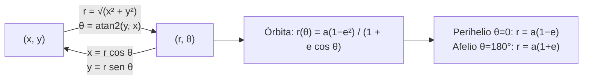

# B04-C10 — Coordenadas polares y cartesianas

<!-- nav:top -->
[🏠 Programa](../../../../README.md) · [📚 Bloque B04](../../../tronco-comun/B04-algebra-trigonometria-y-geometria-espacial.md) · [← Anterior: B04-C09 — Circunferencias y elipses](../B04-C09-circunferencias-y-elipses/CLASE.md) · [Siguiente: B04-C11 — Coordenadas esféricas →](../B04-C11-coordenadas-esfericas/CLASE.md)
<!-- /nav -->

## 1. Ubicación, nivel y alcance

Décima clase del bloque B04. En la [clase anterior](../B04-C09-circunferencias-y-elipses/CLASE.md) describiste la elipse con el centro como origen. Pero una órbita se estudia con el Sol en un foco, y para ese punto de vista las coordenadas naturales no son `(x, y)` sino **distancia y ángulo**. Nivel N1. Verás coordenadas cartesianas y polares en el plano, las conversiones con el cuadrante correcto (`atan2`), la ecuación polar de una elipse con el foco en el origen y su comprobación. No verás coordenadas en el espacio (C11) ni la física que determina cómo recorre la órbita un cuerpo (B05).

## 2. Por qué esta clase existe

Un cometa se describe mejor diciendo «está a 2,19 au del Sol, a 120° del perihelio» que dando dos coordenadas rectangulares. Y un programa que convierte mal el ángulo coloca el cometa en el lado opuesto del Sol. Convertir bien es una necesidad cotidiana de quien trabaja con órbitas, antenas o mapas del cielo.

La decisión central: **¿en qué sistema describo la posición, cómo paso de uno a otro sin perder el cuadrante y qué ventaja tiene cada uno?** Aprenderás las fórmulas, el uso de `atan2` y la ecuación polar `r(θ)` de una órbita.

## 3. Lo que podrás hacer al terminar

1. Pasar de `(x, y)` a `(r, θ)` y de `(r, θ)` a `(x, y)`.
2. Elegir el cuadrante correcto con `atan2` y explicar por qué `atan(y/x)` falla.
3. Escribir y usar `r(θ) = a(1 − e²)/(1 + e cos θ)`.
4. Obtener el perihelio y el afelio a partir de la ecuación polar.
5. Comprobar que los puntos calculados satisfacen la ecuación de la elipse.
6. Declarar origen, eje de referencia y sentido de los ángulos.

La evidencia es la **tabla de conversión y órbita en polares** del ejercicio 12 (sección 20).

## 4. Con qué llegas y cómo comprobarlo

Necesitas trigonometría (C06–C07) y la elipse (C09). Cinco preguntas:

1. ¿Cuánto valen `cos 0°` y `cos 180°`?
2. Si `x = 3` e `y = 4`, ¿cuánto vale `√(x² + y²)`?
3. ¿Cuál es el ángulo cuyo seno es 0,6 y cuyo coseno es 0,8?
4. ¿Cuánto es `a(1 − e)` con `a = 18` y `e = 0,97`?
5. ¿En qué cuadrante está el punto `(−3, 4)`?

<details>
<summary>Ver respuestas</summary>

1. 1 y −1. 2. 5. 3. Aprox. 36,87°. 4. 0,54. 5. Segundo cuadrante (x negativa, y positiva).
</details>

Con cuatro o cinco aciertos, sigue; si no, repasa C06 y C09.

## 5. Un caso real: Halley a lo largo de su órbita

Con la excentricidad `e = 0,96794` y el semieje `a = 17,9286 au` publicados por el JPL (S1), puedes escribir la distancia del cometa al Sol en función del ángulo `θ` desde el perihelio: `r(θ) = a(1 − e²)/(1 + e cos θ)`. En `θ = 0°` vale 0,575 au; a 90°, 1,131 au; a 120°, 2,192 au; a 150°, 6,994 au; y a 180°, 35,28 au. Fíjate en que casi todo el cambio ocurre en los últimos 60°: el cometa pasa casi todo su tiempo (aunque esto lo explicará B05) lejos del Sol y se acerca de golpe. Los resultados se comprueban contra el perihelio y el afelio publicados por el JPL.

## 6. Vocabulario

Las **coordenadas cartesianas** `(x, y)` dan la posición por las distancias a dos ejes perpendiculares. Las **coordenadas polares** `(r, θ)` la dan por la distancia `r` a un origen (el **polo**) y el ángulo `θ` medido desde un **eje polar**. La **anomalía verdadera** es el ángulo `θ` de un cuerpo en órbita medido desde el perihelio, con el Sol en el origen. El **semilado recto** `p = a(1 − e²)` es el valor de `r` en `θ = 90°`. `atan2(y, x)` es la función arcotangente que usa los signos de `y` y de `x` para devolver el ángulo en el cuadrante correcto, entre −180° y 180°. Una **función de ida y vuelta** es la composición de una conversión y su inversa que devuelve el punto original.

## 7. Modelo mental: «cuánto» y «hacia dónde»

Las cartesianas piden «cuánto a la derecha y cuánto arriba». Las polares piden «cuánto lejos y en qué dirección». El mismo punto tiene los dos pares de valores.



*Descripción textual:* se pasa de cartesianas a polares con la raíz de la suma de cuadrados y `atan2`, y de polares a cartesianas con coseno y seno; la ecuación polar de la órbita da el perihelio en `θ = 0` y el afelio en `θ = 180°`.

Analogía: dar indicaciones por «a 5 km hacia el noreste» frente a «3 km al este y 4 km al norte». Su límite: `θ` es periódico (360° es 0°), a diferencia de `x` e `y`, y en el polo `θ` no está definido.

## 8. La explicación, paso a paso

### 8.1 Conversiones

De polares a cartesianas: `x = r cos θ`, `y = r sen θ`. De cartesianas a polares: `r = √(x² + y²)` y `θ = atan2(y, x)`. Un ejemplo: `(3, 4)` → `r = 5`, `θ = 53,13°`. Y la vuelta: `5 cos 53,13° = 3` y `5 sen 53,13° = 4`.

### 8.2 El cuadrante

`atan(y/x)` solo devuelve ángulos entre −90° y 90°: no distingue `(3, 4)` de `(−3, −4)`, que dan el mismo cociente 4/3. Para `(−3, 4)` da −53,13° cuando el ángulo correcto es 126,87°. `atan2(y, x)` mira los signos de ambas y devuelve el ángulo en el cuadrante correcto. Regla de esta clase: **nunca** calcular `θ` con `atan(y/x)` salvo que se sepa que `x > 0`.

### 8.3 Ecuación polar de la elipse con un foco en el origen

Colocando el Sol (un foco) en el origen y el perihelio sobre el eje polar: `r(θ) = a(1 − e²)/(1 + e cos θ)`. Con `θ = 0`: `r = a(1 − e²)/(1 + e) = a(1 − e) = q`. Con `θ = 180°`: `r = a(1 − e²)/(1 − e) = a(1 + e) = Q`. Con `θ = 90°`: `r = a(1 − e²) = p`. Con `e = 0`, `r = a` para todo `θ`: la circunferencia.

### 8.4 Pasar la órbita a cartesianas

Aplicando 8.1: `x = r(θ) cos θ`, `y = r(θ) sen θ`. Con el Sol en el origen, el centro de la elipse queda en `(−ae, 0)`, de modo que los puntos cumplen `((x + ae)/a)² + (y/b)² = 1`. Es la comprobación que usa el laboratorio en 72 ángulos.

### 8.5 Ventajas de cada sistema

Las cartesianas son mejores para sumar desplazamientos y para programar movimientos rectos. Las polares son mejores cuando importa la distancia a un punto o el giro: órbitas, antenas, ondas circulares. Pasar de una a otra es una herramienta, no una opción definitiva.

## 9. Magnitudes, símbolos y unidades

| Símbolo | Qué es | Unidad | Nota |
|---|---|---|---|
| `x`, `y` | coordenadas cartesianas | au | origen en el Sol |
| `r` | distancia al origen | au | `r ≥ 0` |
| `θ` | ángulo desde el eje polar | rad o ° | antihorario; desde el perihelio en las órbitas |
| `a` | semieje mayor | au | Halley 17,9286 (S1) |
| `e` | excentricidad | adimensional | Halley 0,96794 (S1) |
| `p` | semilado recto | au | `a(1 − e²) = 1,1313` (calculado) |
| `q`, `Q` | perihelio y afelio | au | 0,574864 y 35,28241 (S1) |

## 10. Convenciones y referencias

El eje polar apunta al perihelio; los ángulos crecen en sentido antihorario visto desde el polo norte de la órbita (la dirección del movimiento del cuerpo en la órbita directa). El rango de `atan2` es `(−180°, 180°]`; para ángulos entre 0° y 360° se suma 360° si es negativo. El plano es el plano orbital: no se trata la orientación en el espacio (C14, C19). Los puntos `(3, 4)` y similares son **sintéticos**.

## 11. De dónde sale lo que afirmamos

| ID | Fuente | Localizador | Respalda | Estado |
|---|---|---|---|---|
| S1 | NASA/JPL Small-Body Database API (solución de D. Farnocchia, 2025-11-21) | https://ssd-api.jpl.nasa.gov/sbdb.api?sstr=1P&full-prec=1 | 1P/Halley: `e = 0,9679359957`, `a = 17,928635 au`, `q = 0,574864 au`, `Q = 35,282406 au` | Consulta del 2026-11-05 (mutable; estimado) |

Límites: la ecuación polar de la elipse es un resultado de geometría que el laboratorio comprueba contra los valores de S1. La afirmación sobre el tiempo que el cometa pasa lejos del Sol no se demuestra aquí; pertenece a la física del bloque B05.

## 12. Cómo ver la órbita

| `θ` (°) | `r` (au) | `x` (au) | `y` (au) |
|---|---|---|---|
| 0 | 0,5749 | 0,5749 | 0,0000 |
| 30 | 0,6154 | 0,5330 | 0,3077 |
| 60 | 0,7623 | 0,3812 | 0,6602 |
| 90 | 1,1313 | 0,0000 | 1,1313 |
| 120 | 2,1923 | −1,0961 | 1,8986 |
| 150 | 6,9944 | −6,0573 | 3,4972 |
| 180 | 35,2824 | −35,2824 | 0,0000 |

Descripción larga: si la dibujas con el Sol en el origen, la órbita arranca muy cerca del origen, se abre hacia el lado negativo de `x` y se aleja cada vez más rápido en ángulo hasta tocar `x = −35,28`. Los últimos 60° (de 120° a 180°) abarcan más del 95 % del aumento total de distancia.

## 13. Ejemplo trabajado: Halley a 120° del perihelio

Datos (S1): `a = 17,9286 au`, `e = 0,96794`, `θ = 120°`.

**Paso 1 · Semilado recto.** `p = a(1 − e²) = 17,9286 × 0,063093 = 1,1312 au`.

**Paso 2 · Distancia.** `cos 120° = −0,5`; `1 + e cos θ = 1 − 0,48397 = 0,51603`; `r = 1,1312/0,51603 = 2,192 au`.

**Paso 3 · Cartesianas.** `x = r cos θ = 2,192 × (−0,5) = −1,096 au`; `y = r sen θ = 2,192 × 0,8660 = 1,899 au`.

**Paso 4 · Comprobar con la elipse.** Centro en `(−ae, 0) = (−17,354; 0)`; `b = 4,504`. `((−1,096 + 17,354)/17,9286)² + (1,899/4,504)² = 0,8223 + 0,1777 = 1,000` ✓.

**Paso 5 · Vuelta a polares.** `r = √(1,096² + 1,899²) = 2,192`; `θ = atan2(1,899; −1,096) = 120°` ✓ (con `atan(y/x)` saldría −60°: error de cuadrante). Resultado con 3–4 cifras.

## 14. Distintas formas de dar una posición

**Cartesianas:** simples para sumar vectores y para integrar numéricamente. **Polares con foco en el origen:** la forma natural de las órbitas. **Polares con centro en el origen** (`r = ab/√(…)`): menos usada. **Paramétrica** (`(a cos t, b sen t)`, C09): cómoda para dibujar. La elección depende de lo que se calcule; el laboratorio comprueba que dan el mismo punto.

## 15. Práctica guiada

**Ejercicio 1 · con los pasos indicados.** Convierte `(3, 4)` a polares y regresa. *Pasos:* `r`, `atan2`, luego `r cos θ` y `r sen θ`.

<details><summary>Solución comentada</summary>

`r = 5`; `θ = atan2(4, 3) = 53,13°`; `5 cos 53,13° = 3,000`; `5 sen 53,13° = 4,000`. Ida y vuelta correcta.
</details>

**Ejercicio 2 · con una pista.** Convierte `(−3, 4)` a polares. *Pista:* el punto está en el segundo cuadrante.

<details><summary>Solución comentada</summary>

`r = 5`; `θ = atan2(4, −3) = 126,87°` (= 180° − 53,13°). `atan(4/−3) = −53,13°` sería un error de cuadrante.
</details>

**Ejercicio 3 · casi autónomo.** Halley a `θ = 90°`: calcula `r`, `x` e `y`. (Sección 8.3.)

<details><summary>Solución comentada</summary>

`cos 90° = 0` → `r = p = 1,1312 au`; `x = 0`, `y = 1,131 au` (coincide con la tabla de la sección 12).
</details>

## 16. Práctica autónoma, transferencia e integrador

**Ejercicio 4.** Convierte `r = 2`, `θ = 150°` a cartesianas.

<details><summary>Solución comentada</summary>

`x = 2 cos 150° = −1,732`; `y = 2 sen 150° = 1,000`. Comprobación: `√(3 + 1) = 2` ✓.
</details>

**Ejercicio 5.** Convierte `(−3, −4)` a polares con `θ` en `[0°, 360°)`.

<details><summary>Solución comentada</summary>

`r = 5`; `atan2(−4, −3) = −126,87°`; sumando 360°: `233,13°`. Tercer cuadrante ✓.
</details>

**Ejercicio 6.** Calcula `r` de Halley en `θ = 30°`.

<details><summary>Solución comentada</summary>

`cos 30° = 0,8660`; `1 + 0,96794 × 0,8660 = 1,83826`; `r = 1,1312/1,83826 = 0,6154 au` (tabla de 12).
</details>

**Ejercicio 7.** Comprueba con la ecuación polar que `r(180°) = Q`.

<details><summary>Solución comentada</summary>

`1 + e cos 180° = 1 − e = 0,03206`; `r = 1,1312/0,03206 = 35,28 au = a(1 + e)` ✓. Algebraicamente, `(1 − e²)/(1 − e) = 1 + e`.
</details>

**Ejercicio 8.** Una órbita circular tiene `e = 0` y `a = 1 au`. ¿Cuánto vale `r` en cualquier `θ`? ¿Por qué?

<details><summary>Solución comentada</summary>

`r = 1·(1 − 0)/(1 + 0) = 1 au` para todo `θ`: es una circunferencia; `r` no depende del ángulo.
</details>

**Ejercicio 9 · transferencia.** Un programa calcula `θ = atan(y/x)` y coloca un cometa en `(−2, 1)` a −26,6° en lugar de 153,4°. ¿Qué error ocurrió y cómo lo detectarías?

<details><summary>Solución comentada</summary>

Error de cuadrante por usar `atan` en lugar de `atan2`. Se detecta con una prueba de ida y vuelta: `r cos(−26,6°) = √5 × 0,894 = +2,0`, no −2. La comprobación de ida y vuelta es la defensa más simple.
</details>

**Ejercicio 10 · transferencia.** ¿Por qué `θ` no está definido en el origen? ¿Qué pasa en el Sol con `r = 0`?

<details><summary>Solución comentada</summary>

En el origen `x = y = 0` y cualquier ángulo da el mismo punto. En una órbita real con `q > 0`, `r` nunca es 0; solo una órbita degenerada (`e = 1` en línea recta) pasaría por el Sol.
</details>

**Ejercicio 11 · transferencia.** Con `θ` entre 150° y 180°, ¿cuánto cambia `r` en Halley? Compáralo con el cambio entre 0° y 150°.

<details><summary>Solución comentada</summary>

De 150° a 180°: `35,28 − 6,994 = 28,29 au`. De 0° a 150°: `6,994 − 0,575 = 6,42 au`. Un 82 % del cambio total en distancia ocurre en los últimos 30°: la distancia no es uniforme en el ángulo.
</details>

**Ejercicio 12 · integrador.** Elabora tu *tabla de conversión y órbita en polares* (sección 20): elige un cuerpo de S1 o de otra fuente consultada, tabula `r` y `(x, y)` en siete ángulos, comprueba la ida y vuelta y que los puntos cumplen la ecuación de la elipse.

<details><summary>Solución modelo</summary>

Tabla con `θ`, `r`, `x`, `y`, residuo de la ecuación de la elipse (≲ 10⁻⁹) y conversión de vuelta con `atan2`; comprobación de perihelio y afelio contra la fuente; frase que declare origen, eje polar y sentido; fuentes con fecha.
</details>

## 17. Laboratorio: polares, cuadrantes y órbita

El script [polares_y_orbita.py](polares_y_orbita.py) convierte puntos y tabula la órbita de Halley. Antes comprueba: la ida y vuelta en siete puntos (incluidos ejes y puntos casi nulos), que `atan2` corrige el cuadrante que `atan` no, el perihelio y el afelio, la ecuación de la elipse en 72 ángulos y que con `e = 0` `r` es constante.

**Datos:** publicados (estimados) y puntos sintéticos. **Predice antes de ejecutar:** ¿qué `r` tiene Halley a 150°? (Cerca de 7 au.) **Ejecución del 2026-11-05 (Python 3.12.9):**

```text
  (x, y) = (-3, +4)  ->  r = 5.0000, θ =  126.870°, atan(y/x) =  -53.130°
     90    1.1313    0.0000    1.1313
    150    6.9944   -6.0573    3.4972
    180   35.2824  -35.2824    0.0000
q = 0.574864 au (JPL: 0.574864); Q = 35.28241 au (JPL: 35.28241)
```

```bash
python programa/clases/B04/B04-C10-coordenadas-polares-y-cartesianas/polares_y_orbita.py
```

**Límites:** plano orbital, sin orientación espacial; solo la forma de la órbita, no el tiempo; no es una herramienta de mecánica orbital.

## 18. Errores frecuentes y cómo corregirlos

**Usar `atan(y/x)`.** Se corrige con los ejercicios 2 y 9.

**Mezclar grados y radianes.** Ver C06.

**Confundir el eje polar.** El perihelio es `θ = 0`. Se corrige con el ejercicio 7.

**Suponer que `r` crece uniformemente con `θ`.** Se corrige con el ejercicio 11.

**Olvidar que el centro de la elipse no es el Sol.** Se corrige con la sección 8.4.

## 19. Cómo sabrás que vas bien

Tras 8.1: ¿conviertes `(3, 4)` y regresas? Si no, ejercicio 1. Tras 8.2: ¿explicas por qué `atan` falla? Si no, ejercicio 9. Tras 8.3: ¿obtienes `q` y `Q` de la ecuación polar? Si no, ejercicio 7. Tras el laboratorio: ¿cuántos ángulos usa para comprobar la elipse? Si no lo sabes, lee su cabecera.

## 20. Qué entregas y cómo se evalúa

El producto es tu **tabla de conversión y órbita en polares** (ejercicio 12).

| Criterio | Inicial | En desarrollo | Logrado | Destacado |
|---|---|---|---|---|
| Conversión | Errores de fórmula | Correcta en el primer cuadrante | Correcta en todos con `atan2` | Detecta errores de cuadrante ajenos |
| Ecuación polar | No la usa | La usa con errores | Obtiene `r`, `q` y `Q` | Deduce `q` y `Q` algebraicamente |
| Comprobación | Ausente | Ida y vuelta en un punto | Ida y vuelta y ecuación de la elipse | Reporta residuos con tolerancia |
| Marco | Sin declarar | Parcial | Origen, eje y sentido | Explica por qué los declara |
| Fuentes | Sin fuente | Sin fecha | Con localizador y fecha | Marca lo estimado y mutable |

**Condiciones críticas (no se compensan con promedio):** declarar origen, eje polar y sentido; usar `atan2`; citar solo fuentes consultadas.

## 21. Ética, seguridad y límites

Un cambio de coordenadas mal hecho produce una posición falsa que parece verosímil; por eso se exige la prueba de ida y vuelta. Nada de esto sirve para navegar o planificar maniobras. Accesibilidad: fórmulas en texto, tabla equivalente al gráfico, ejercicios sin conexión.

## 22. Para cerrar y seguir

La misma posición se escribe en cartesianas o en polares; `atan2` evita el error de cuadrante; y con el Sol en el origen una elipse es `r(θ) = a(1 − e²)/(1 + e cos θ)`. Queda abierta una pregunta: ¿cómo se da una posición cuando el espacio tiene tres dimensiones, como una estrella en el cielo? Eso es C11.

**Glosario español–inglés.** coordenadas polares · *polar coordinates*; coordenadas cartesianas · *Cartesian coordinates*; polo · *pole*; anomalía verdadera · *true anomaly*; semilado recto · *semi-latus rectum*; cuadrante · *quadrant*; ida y vuelta · *round trip*.

**Continuidad.** B04-C11 usa tu capacidad de **dar dirección y distancia** para pasar a tres dimensiones con coordenadas esféricas. B04-C18 retomará `r(θ)` para parábolas e hipérbolas.

**Referencias:** ver sección 11.

<!-- nav:bottom -->
---

[← Anterior: B04-C09 — Circunferencias y elipses](../B04-C09-circunferencias-y-elipses/CLASE.md) · [📚 Bloque B04](../../../tronco-comun/B04-algebra-trigonometria-y-geometria-espacial.md) · [Siguiente: B04-C11 — Coordenadas esféricas →](../B04-C11-coordenadas-esfericas/CLASE.md)
<!-- /nav -->
