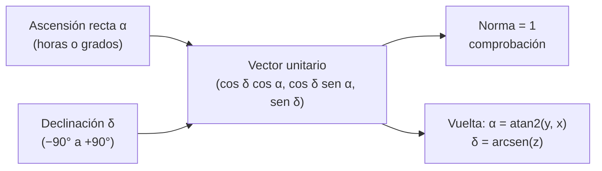

# B04-C11 — Coordenadas esféricas

<!-- nav:top -->
[🏠 Programa](../../../../README.md) · [📚 Bloque B04](../../../tronco-comun/B04-algebra-trigonometria-y-geometria-espacial.md) · [← Anterior: B04-C10 — Coordenadas polares y cartesianas](../B04-C10-coordenadas-polares-y-cartesianas/CLASE.md) · [Siguiente: B04-C12 — Vectores y componentes →](../B04-C12-vectores-y-componentes/CLASE.md)
<!-- /nav -->

## 1. Ubicación, nivel y alcance

Undécima clase del bloque B04. En la [clase anterior](../B04-C10-coordenadas-polares-y-cartesianas/CLASE.md) diste posiciones en el plano con distancia y ángulo. El cielo es tridimensional: una estrella se ubica con una distancia y dos ángulos. Nivel N1. Verás las coordenadas esféricas, su conversión a cartesianas, la ascensión recta y la declinación, y cómo una dirección del cielo se convierte en un vector unitario. No verás vectores en general (C12), rotaciones (C15) ni distancias sobre la esfera (C16).

## 2. Por qué esta clase existe

Un catálogo de estrellas da para cada una dos números: dónde está en el cielo. Pero un programa que cruza catálogos, calcula separaciones o apunta un telescopio no trabaja con horas y grados: trabaja con vectores. Convertir una dirección en vector y volver es la base de casi todo el cálculo astrométrico posterior.

La decisión central: **¿cómo describo una dirección con dos ángulos, cómo la convierto en tres números y qué convenciones (origen, signo, unidad) tengo que declarar para que otro obtenga el mismo vector?** Aprenderás las fórmulas, los rangos de cada ángulo y la forma de comprobar la conversión.

## 3. Lo que podrás hacer al terminar

1. Definir coordenadas esféricas `(r, θ, φ)` y su convención de ángulos.
2. Pasar de ascensión recta y declinación a un vector unitario y regresar.
3. Convertir la ascensión recta entre horas y grados, y la declinación entre grados decimales y grados–minutos–segundos.
4. Elegir el rango correcto de cada ángulo y detectar los puntos singulares (polos).
5. Comprobar una conversión con la norma del vector y con la ida y vuelta.
6. Declarar el marco de referencia y la época de unas coordenadas.

La evidencia es la **dirección de una estrella como vector** del ejercicio 12 (sección 20).

## 4. Con qué llegas y cómo comprobarlo

Necesitas polares y trigonometría (C06, C10). Cinco preguntas:

1. ¿Cuánto vale `cos²δ + sen²δ`?
2. Convierte 217,39° a horas (1 h = 15°).
3. ¿Cuántos minutos de arco tiene 0,5°?
4. Si `x = r cos α`, `y = r sen α` con `r = 1` y `α = 90°`, ¿cuánto valen `x` e `y`?
5. ¿Cuál es el valor de `atan2(1, −1)` en grados?

<details>
<summary>Ver respuestas</summary>

1. 1. 2. 14,49 h. 3. 30′. 4. `x = 0`, `y = 1`. 5. 135°.
</details>

Con cuatro o cinco aciertos, sigue; si no, repasa C06 y C10.

## 5. Un caso real: dónde apuntar para ver Próxima Centauri

El NASA Exoplanet Archive lista para Próxima Centauri una ascensión recta `α = 217,3934657°` y una declinación `δ = −62,6761821°` (S1; datos estimados, archivo mutable). Eso equivale a `α = 14 h 29 min 34,4 s` y `δ = −62° 40′ 34,3″`: una estrella del cielo austral. Convertida en vector unitario da `(−0,3647; −0,2788; −0,8884)`. El tercer componente, grande y negativo, dice que la estrella está cerca del polo sur celeste: es lo que se espera de `δ = −62,7°`. Las otras cuatro estrellas del laboratorio muestran otras direcciones: tau Ceti y eps Eridani cerca del ecuador celeste, GJ 1061 al sur, Teegarden's Star al norte. Esa tabla de vectores es la entrada de la clase siguiente. La documentación del archivo no declara el marco de referencia ni la época de estas coordenadas; la clase no los afirma y las trata como direcciones aproximadas, con fines didácticos.

## 6. Vocabulario

Las **coordenadas esféricas** dan un punto del espacio por su distancia `r` al origen y dos ángulos. En matemáticas y física se usan el **ángulo polar** `θ` (desde el eje `z`, de 0° a 180°) y el **ángulo azimutal** `φ` (en el plano `xy` desde el eje `x`, de 0° a 360°). En astronomía se usan la **ascensión recta** `α` (equivalente a `φ`) y la **declinación** `δ` (que se mide desde el ecuador: `δ = 90° − θ`, de −90° a +90°). La **ascensión recta** se da en horas, minutos y segundos (24 h = 360°) o en grados. Un **vector unitario** es un vector de módulo 1; una dirección del cielo sin distancia es un vector unitario. Los **polos** son los puntos `δ = ±90°`, donde `α` no está definida. El **marco de referencia** (por ejemplo, el ICRS) fija dónde están el ecuador, los ejes y el origen; la **época** dice a qué fecha se refieren las posiciones, porque las estrellas se mueven.

## 7. Modelo mental: la esfera celeste

Imagina una esfera enorme centrada en el observador con las estrellas pegadas en su superficie. La declinación es como la latitud terrestre y la ascensión recta como la longitud: dos ángulos bastan para fijar un punto en la esfera. Con una distancia `r` se completa la posición en el espacio.



*Descripción textual:* de la ascensión recta y la declinación sale un vector unitario con tres componentes; su norma debe valer 1; y de él se recuperan los ángulos con `atan2(y, x)` para `α` y `arcsen(z)` para `δ`.

Analogía: latitud y longitud de la Tierra. Su límite: la esfera celeste no existe físicamente; todas las estrellas «están» en ella solo como direcciones, y las distancias reales (de 1,3 pc para Próxima) son otra cosa.

## 8. La explicación, paso a paso

### 8.1 Coordenadas esféricas y cartesianas

Con `θ` desde el eje `z` y `φ` en el plano `xy`: `x = r sen θ cos φ`, `y = r sen θ sen φ`, `z = r cos θ`. Con la declinación (`δ = 90° − θ`): `sen θ = cos δ` y `cos θ = sen δ`, de modo que `x = r cos δ cos α`, `y = r cos δ sen α`, `z = r sen δ`. Esas son las fórmulas que se usarán a partir de aquí; el eje `x` apunta a `(α, δ) = (0°, 0°)`, el `y` a `(90°, 0°)` y el `z` al polo celeste norte, que es la convención del catálogo Hipparcos (S2).

### 8.2 Vuelta a ángulos

Dado `(x, y, z)`: `r = √(x² + y² + z²)`, `α = atan2(y, x)` (se suma 360° si resulta negativo) y `δ = arcsen(z/r)`. `δ` se obtiene con `arcsen` porque su rango, −90° a +90°, coincide con el del `arcsen`; para `α` hace falta `atan2` por el cuadrante (C10).

### 8.3 Unidades

`α` en horas: `h = α/15`. Para 217,3934657°: `14,4929 h = 14 h 29 min 34,4 s`. `δ` en sexagesimal: 62,6761821° = 62° 40′ 34,3″. Las horas se usan por tradición (el cielo gira 15° por hora); en los cálculos se pasa a radianes.

### 8.4 Casos especiales

En los polos (`δ = ±90°`) `x = y = 0` y `α` es indeterminada: la convención es dar `α = 0` o dejar la de entrada. En `α = 0°` y `α = 360°` el vector es el mismo. El rango de `α` es `[0°, 360°)`; sin ese rango, `α = −10°` y `350°` parecen distintos.

### 8.5 Marco y época

Las coordenadas dependen del marco de referencia (hacia dónde apunta el eje `x`) y de la época. Una estrella cercana como Próxima se desplaza por movimiento propio del orden de segundos de arco al año, de modo que unas coordenadas sin época pueden estar desplazadas de las actuales. Por eso toda tabla de posiciones debe decir marco y época.

## 9. Magnitudes, símbolos y unidades

| Símbolo | Qué es | Unidad | Nota |
|---|---|---|---|
| `α` | ascensión recta | h o ° | `α = 217,3934657°` Próxima (S1); 24 h = 360° |
| `δ` | declinación | ° | −90° a +90°; `−62,6761821°` Próxima (S1) |
| `θ` | ángulo polar | ° | `θ = 90° − δ` |
| `φ` | ángulo azimutal | ° | equivale a `α` |
| `r` | distancia al origen | pc, au, m | 1 para una dirección pura |
| `(x, y, z)` | componentes del vector | las de `r` | adimensionales si `r = 1` |

## 10. Convenciones y referencias

`x` hacia `(0°, 0°)`, `y` hacia `(90°, 0°)`, `z` hacia `δ = +90°` (S2). `α` crece en sentido antihorario vista desde el polo norte celeste (hacia el este). `δ` positivo al norte. Las posiciones de la clase son **estimadas** y corresponden al archivo consultado el 2026-11-05; la documentación del archivo no declara el marco ni la época de `ra` y `dec` (sección 11), de modo que no se afirman. Los dos ángulos de «latitud −24,6° y longitud −70,4°» del laboratorio son **sintéticos** y se usan solo para mostrar que las mismas fórmulas valen para cualquier esfera.

## 11. De dónde sale lo que afirmamos

| ID | Fuente | Localizador | Respalda | Estado |
|---|---|---|---|---|
| S1 | NASA Exoplanet Archive, consulta TAP (tabla `pscomppars`, columnas `ra`, `dec`) | consulta TAP https://exoplanetarchive.ipac.caltech.edu/TAP (tabla `pscomppars`, columnas `ra`, `dec`); documentación de columnas: https://exoplanetarchive.ipac.caltech.edu/docs/API_PS_columns.html | Coordenadas de Próxima Cen (217,3934657; −62,6761821), tau Cet (26,0093029; −15,9337987), eps Eri (53,2284306; −9,4581715), GJ 1061 (54,0032486; −44,5143104) y Teegarden's Star (43,2691449; 16,8649024), en grados | Consulta del 2026-11-05 (mutable; estimado). Documentación leída el 2026-11-05: `ra` y `dec` son ascensión recta y declinación «en grados decimales»; **no declara marco de referencia ni época** |
| S2 | ESA, *The Hipparcos and Tycho Catalogues*, SP-1200, vol. 1, § 1.5.3 (ec. 1.5.5) | https://www.cosmos.esa.int/documents/532822/552851/vol1_all.pdf, p. 91 | Vectores base: `x` hacia `(α, δ) = (0, 0)`, `y` hacia `(+90°, 0)`, `z` hacia `δ = +90°`; `u = (cos δ cos α, cos δ sen α, sen δ)` | PDF leído (texto) el 2026-11-05 |

Límites: La documentación de columnas del archivo (leída el 2026-11-05) define `ra` y `dec` como ascensión recta y declinación del sistema planetario en grados decimales, y `sy_dist` y `sy_plx` como distancia en pc y paralaje en mas; **no indica marco de referencia (ICRS, J2000…) ni época, ni el catálogo del que proceden**. La clase no afirma ninguno: usa los valores como direcciones aproximadas, con fines didácticos. La página de columnas leída corresponde a la tabla de sistemas planetarios (PS); la tabla compuesta `pscomppars` comparte esos nombres, pero su propia página de columnas vigente no se localizó (la que abrió está retirada desde 2015 y usa nombres `st_*`), por lo que esa correspondencia no se verificó. La afirmación sobre el movimiento propio es cualitativa y no se cuantifica con datos consultados.

## 12. Cómo ver las direcciones

| Estrella | `α` (°) | `α` (h m s) | `δ` (°) | `(x, y, z)` |
|---|---|---|---|---|
| Próxima Cen | 217,3935 | 14 h 29 m 34,43 s | −62,6762 | (−0,3647; −0,2788; −0,8884) |
| tau Cet | 26,0093 | 1 h 44 m 02,23 s | −15,9338 | (0,8642; 0,4217; −0,2745) |
| eps Eri | 53,2284 | 3 h 32 m 54,82 s | −9,4582 | (0,5905; 0,7901; −0,1643) |
| GJ 1061 | 54,0032 | 3 h 36 m 00,78 s | −44,5143 | (0,4191; 0,5769; −0,7011) |
| Teegarden | 43,2691 | 2 h 53 m 04,59 s | 16,8649 | (0,6968; 0,6559; 0,2901) |

Descripción larga: sobre la esfera, tau Ceti, eps Eridani y Teegarden están en el hemisferio de `x` positivo; Próxima, en el opuesto y cerca del polo sur; GJ 1061 y eps Eridani, con `α` similares (53–54°), separadas en declinación.

## 13. Ejemplo trabajado: el vector de Próxima Centauri

Datos (S1): `α = 217,3934657°`, `δ = −62,6761821°`.

**Paso 1 · Radianes.** `α = 217,3934657° × π/180 = 3,79423 rad`; `δ = −62,6761821° × π/180 = −1,09391 rad`.

**Paso 2 · Funciones.** `cos δ = 0,45902`; `sen δ = −0,88843`; `cos α = −0,79448`; `sen α = −0,60729`.

**Paso 3 · Componentes.** `x = cos δ cos α = 0,45902 × (−0,79448) = −0,36469`; `y = cos δ sen α = 0,45902 × (−0,60729) = −0,27876`; `z = sen δ = −0,88843`.

**Paso 4 · Comprobar la norma.** `x² + y² + z² = 0,13299 + 0,07771 + 0,78931 = 1,00001`: la norma es 1 dentro del redondeo ✓.

**Paso 5 · Vuelta a ángulos.** `α = atan2(−0,27876; −0,36469) = −142,61°`, y sumando 360°, `217,39°` ✓; `δ = arcsen(−0,88843) = −62,68°` ✓. El resultado, con 4 cifras: `(−0,3647; −0,2788; −0,8884)`, igual al del laboratorio.

## 14. Distintas formas de dar una dirección

**Ascensión recta y declinación:** compactas y legibles para catálogos y mapas. **Vector unitario:** necesario para productos escalares, rotaciones y composición de direcciones. **Latitud y longitud:** el mismo esquema aplicado a la Tierra. **Ángulo polar y azimut:** convención matemática; exige no confundir `θ` con `δ`. Elegir una u otra depende del cálculo, no de la «verdad» de la dirección; lo esencial es declarar la convención.

## 15. Práctica guiada

**Ejercicio 1 · con los pasos indicados.** Convierte `α = 90°`, `δ = 0°` a vector. *Pasos:* aplica 8.1.

<details><summary>Solución comentada</summary>

`x = cos 0° cos 90° = 0`; `y = cos 0° sen 90° = 1`; `z = sen 0° = 0`. El vector `(0, 1, 0)` es el eje `y` de la convención (sección 10).
</details>

**Ejercicio 2 · con una pista.** Convierte `α = 217,3934657°` a horas, minutos y segundos. *Pista:* divide entre 15.

<details><summary>Solución comentada</summary>

`217,3934657/15 = 14,49290 h`; `0,49290 × 60 = 29,574 min`; `0,574 × 60 = 34,4 s`: `14 h 29 min 34,4 s`.
</details>

**Ejercicio 3 · casi autónomo.** Calcula el vector de tau Ceti (`α = 26,0093°`, `δ = −15,9338°`) y compruébalo.

<details><summary>Solución comentada</summary>

`cos δ = 0,96158`; `sen δ = −0,27453`; `cos α = 0,89872`; `sen α = 0,43852`. `x = 0,86419`; `y = 0,42167`; `z = −0,27453`. Norma: `0,74683 + 0,17781 + 0,07537 = 1,0000` ✓. Coincide con el laboratorio (0,8642; 0,4217; −0,2745) dentro del redondeo.
</details>

## 16. Práctica autónoma, transferencia e integrador

**Ejercicio 4.** ¿Qué vector corresponde al polo celeste norte (`δ = +90°`)? ¿Qué pasa con `α`?

<details><summary>Solución comentada</summary>

`(0, 0, 1)` para cualquier `α`: `α` queda indeterminada (sección 8.4).
</details>

**Ejercicio 5.** Convierte el vector `(0,5; 0,5; 0,7071)` a `α` y `δ`.

<details><summary>Solución comentada</summary>

`α = atan2(0,5; 0,5) = 45°`; `δ = arcsen(0,7071) = 45°`. Norma: `0,25 + 0,25 + 0,5 = 1` ✓.
</details>

**Ejercicio 6.** Una estrella tiene `α = 350°`. Escríbela en horas y en el rango `[−180°, 180°)`.

<details><summary>Solución comentada</summary>

`350/15 = 23,333 h = 23 h 20 min`. En `[−180°, 180°)`: `−10°`. El vector es el mismo.
</details>

**Ejercicio 7.** ¿Cuál es el ángulo polar `θ` de Próxima? ¿Y el de tau Ceti?

<details><summary>Solución comentada</summary>

`θ = 90° − δ`: Próxima `152,68°`; tau Ceti `105,93°`. Un `θ` cercano a 180° indica proximidad al polo sur.
</details>

**Ejercicio 8.** Calcula `−62° 40′ 34,3″` en grados decimales.

<details><summary>Solución comentada</summary>

`62 + 40/60 + 34,3/3600 = 62,67619°`; con signo negativo, `−62,6762°` ✓.
</details>

**Ejercicio 9 · transferencia.** Un programa convierte `(x, y, z) = (−0,5; 0,5; 0,7071)` a `α` con `atan(y/x)` y obtiene −45°. ¿Qué error hay y cuál es el valor correcto?

<details><summary>Solución comentada</summary>

Error de cuadrante: `x < 0`, `y > 0`: segundo cuadrante. `atan2(0,5; −0,5) = 135°`. Defensa: prueba de ida y vuelta (C10).
</details>

**Ejercicio 10 · transferencia.** Dos catálogos dan la misma estrella con `α` diferentes en 0,005°. ¿Cuántos segundos de arco son y qué dos causas pueden explicarlo?

<details><summary>Solución comentada</summary>

`0,005° × 3600 = 18″`. Causas: épocas distintas con movimiento propio, o marcos distintos. Sin marco y época declarados no se puede decidir (sección 8.5).
</details>

**Ejercicio 11 · transferencia.** Un usuario usa `δ` como si fuera el ángulo polar `θ` en las fórmulas de la sección 8.1. ¿Qué vector obtiene para la declinación de Próxima? ¿Es razonable?

<details><summary>Solución comentada</summary>

Con `θ = −62,68°` (negativo, fuera de 0°–180°) se obtiene `z = cos θ = +0,459` en lugar de −0,888: el vector queda en el hemisferio norte, error de signo y de magnitud. La comprobación con la declinación (estrella austral → `z < 0`) lo detecta.
</details>

**Ejercicio 12 · integrador.** Elabora tu *dirección de una estrella como vector* (sección 20): toma dos estrellas de S1 o de otro catálogo que consultes, convierte sus coordenadas a horas y a vector unitario, comprueba la norma y la vuelta a ángulos, y declara marco, época y sentido de los ejes.

<details><summary>Solución modelo</summary>

Tabla con `α` (° y h m s), `δ` (° y ° ′ ″), vector, norma (1 ± 10⁻⁹) y ángulos recuperados con residuo; declaración de ejes (S2), marco y época como «no verificados» si lo son; fuentes con fecha.
</details>

## 17. Laboratorio: de ángulos a vectores

El script [direcciones_esfericas.py](direcciones_esfericas.py) convierte las cinco direcciones. Antes comprueba: los ejes `(0°, 0°)` y `(90°, 0°)`, los polos, que la norma sea 1 y la ida y vuelta en 25 direcciones (incluidos casos cerca del polo y de `α = 360°`).

**Datos:** publicados (estimados, mutables). **Predice antes de ejecutar:** ¿qué signo tendrá la componente `z` de Teegarden? (Positivo: `δ = +16,86°`.) **Ejecución del 2026-11-05 (Python 3.12.9):**

```text
Pruebas: OK (ejes, polos, norma 1 e ida y vuelta en 25 direcciones)
Proxima Cen    217.3935  14h29m34.43s  -62.6762  -62°40′34.3″  -0.3647  -0.2788  -0.8884
tau Cet         26.0093   1h44m02.23s  -15.9338  -15°56′01.7″   0.8642   0.4217  -0.2745
Teegarden       43.2691   2h53m04.59s   16.8649   16°51′53.6″   0.6968   0.6559   0.2901
```

```bash
python programa/clases/B04/B04-C11-coordenadas-esfericas/direcciones_esfericas.py
```

**Límites:** solo direcciones (sin distancia ni movimiento propio); marco y época de las posiciones del archivo no declarados por su documentación; no es una herramienta de apuntado.

## 18. Errores frecuentes y cómo corregirlos

**Confundir `δ` con `θ`.** Se corrige con los ejercicios 7 y 11.

**Usar `atan` en lugar de `atan2`.** Se corrige con el ejercicio 9.

**Olvidar que 24 h = 360°.** Se corrige con el ejercicio 2.

**Dar coordenadas sin marco ni época.** Se corrige con el ejercicio 10.

**Pasar grados a funciones que piden radianes.** Ver C06.

## 19. Cómo sabrás que vas bien

Tras 8.1: ¿conviertes `(α, δ)` a vector sin mirar? Si no, ejercicio 1. Tras 8.2: ¿recuperas los ángulos con `atan2` y `arcsen`? Si no, ejercicio 5. Tras 8.5: ¿dices por qué una posición sin época puede estar mal? Si no, ejercicio 10. Tras el laboratorio: ¿cuántas direcciones usa en su prueba de ida y vuelta? Si no lo sabes, lee su cabecera.

## 20. Qué entregas y cómo se evalúa

El producto es tu **dirección de una estrella como vector** (ejercicio 12).

| Criterio | Inicial | En desarrollo | Logrado | Destacado |
|---|---|---|---|---|
| Conversión | Errores de fórmula | Correcta con ayuda | Correcta con comprobación de norma | Detecta errores ajenos |
| Unidades | Mezcla h y ° | Convierte con errores | Convierte y declara | Cubre `α` y `δ` en sexagesimal |
| Marco y época | Ausente | Los nombra | Los declara y marca lo no verificado | Estima el efecto del movimiento propio |
| Vuelta | No la hace | Con `atan` | Con `atan2` y `arcsen` | Reporta residuos |
| Fuentes | Sin fuente | Sin fecha | Con localizador y fecha | Distingue dato de convención |

**Condiciones críticas (no se compensan con promedio):** declarar convención de ejes; marcar el marco y la época como verificados o no; citar solo fuentes consultadas.

## 21. Ética, seguridad y límites

Unas coordenadas sin marco ni época pueden apuntar a otro sitio; declarar lo que no se verificó es parte de la honestidad científica. No se usa esta clase para apuntar instrumentos. Accesibilidad: fórmulas en texto, tabla equivalente a la esfera, ejercicios sin conexión.

## 22. Para cerrar y seguir

Una dirección se da con dos ángulos y se calcula con un vector unitario; la conversión se comprueba con la norma y la ida y vuelta; y siempre hay que declarar marco y época. Queda abierta una pregunta: ¿cómo se combinan y comparan los vectores, por ejemplo la posición con la velocidad? Eso es C12.

**Glosario español–inglés.** coordenadas esféricas · *spherical coordinates*; ascensión recta · *right ascension*; declinación · *declination*; vector unitario · *unit vector*; ángulo polar · *polar angle*; azimut · *azimuth*; marco de referencia · *reference frame*; época · *epoch*.

**Continuidad.** B04-C12 usa tu capacidad de **escribir una dirección como vector** para operar con vectores y componentes. B04-C13 usará esos vectores para calcular ángulos entre estrellas.

**Referencias:** ver sección 11.

<!-- nav:bottom -->
---

[← Anterior: B04-C10 — Coordenadas polares y cartesianas](../B04-C10-coordenadas-polares-y-cartesianas/CLASE.md) · [📚 Bloque B04](../../../tronco-comun/B04-algebra-trigonometria-y-geometria-espacial.md) · [Siguiente: B04-C12 — Vectores y componentes →](../B04-C12-vectores-y-componentes/CLASE.md)
<!-- /nav -->
