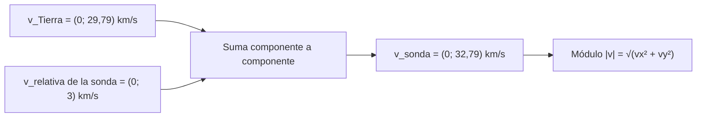

# B04-C12 — Vectores y componentes

<!-- nav:top -->
[🏠 Programa](../../../../README.md) · [📚 Bloque B04](../../../tronco-comun/B04-algebra-trigonometria-y-geometria-espacial.md) · [← Anterior: B04-C11 — Coordenadas esféricas](../B04-C11-coordenadas-esfericas/CLASE.md) · [Siguiente: B04-C13 — Producto escalar y ángulo entre vectores →](../B04-C13-producto-escalar-y-angulo-entre-vectores/CLASE.md)
<!-- /nav -->

## 1. Ubicación, nivel y alcance

Duodécima clase del bloque B04. En la [clase anterior](../B04-C11-coordenadas-esfericas/CLASE.md) convertiste una dirección en un vector unitario sin explicar bien qué es un vector. Aquí lo defines y aprendes a operar con él. Nivel N1. Verás vectores en el plano y el espacio, módulo, suma, multiplicación por un escalar, componentes, vectores unitarios y la descomposición en componentes radial y tangencial, aplicados a la velocidad orbital de la Tierra. No verás aún producto escalar ni vectorial (C13, C14), ni rotaciones (C15).

## 2. Por qué esta clase existe

Una sonda que sale de la Tierra tiene una velocidad respecto de la Tierra y la Tierra tiene una velocidad respecto del Sol. ¿Cuál es la velocidad de la sonda respecto del Sol? No basta con sumar números: la dirección importa. Si la sonda sale en el sentido del movimiento terrestre, su velocidad solar es mayor; si sale en sentido contrario, menor. Los vectores son la herramienta para sumar magnitudes con dirección.

La decisión central: **¿cómo describo una magnitud que tiene tamaño y dirección, cómo la combino con otras y en qué componentes la descompongo para el problema?** Aprenderás a operar con componentes y a elegir el sistema de ejes que simplifica.

## 3. Lo que podrás hacer al terminar

1. Representar un vector con sus componentes y calcular su módulo.
2. Sumar, restar y multiplicar por un escalar vectores, y verificar con un dibujo.
3. Descomponer un vector en componentes en ejes cartesianos y en radial/tangencial.
4. Calcular la rapidez orbital media de la Tierra a partir de `a` y `P`.
5. Combinar velocidades relativas (sonda respecto de la Tierra, Tierra respecto del Sol).
6. Estimar el efecto de la velocidad terrestre en la dirección aparente de una estrella (orden de magnitud).

La evidencia es la **descomposición de un movimiento en componentes** del ejercicio 12 (sección 20).

## 4. Con qué llegas y cómo comprobarlo

Necesitas trigonometría y coordenadas (C06, C10, C11). Cinco preguntas:

1. ¿Cuánto es `√(3² + 4²)`?
2. Si `v = (2, 5)`, ¿cuánto vale `3v`?
3. ¿Cuánto es `cos 0°` y `sen 90°`?
4. Si un cuerpo recorre 2πa en un periodo P, ¿cuál es su rapidez media?
5. Convierte `149,6 × 10⁶ km` a metros.

<details>
<summary>Ver respuestas</summary>

1. 5. 2. `(6, 15)`. 3. 1 y 1. 4. `2πa/P`. 5. `1,496 × 10¹¹ m`.
</details>

Con cuatro o cinco aciertos, sigue; si no, repasa C06, C10 y C11.

## 5. Un caso real: la velocidad de la Tierra y la de una sonda

La NASA publica la distancia media de la Tierra al Sol (149,6 millones de km) y su periodo orbital (365,2 días) (S1). Con una órbita circular, la rapidez media es `2πa/P = 29,79 km/s`, aproximadamente. Pero esa rapidez es solo el *módulo* de un vector: su dirección cambia a lo largo del año. Cuando la Tierra está en `θ = 0°` (sobre el eje `x`), su velocidad apunta en `+y`: `(0; 29,79) km/s`. Una sonda lanzada con una velocidad **sintética** de 3 km/s respecto de la Tierra en el sentido de su movimiento tiene una velocidad solar de 32,79 km/s; en sentido contrario, 26,79 km/s; y si sale 3 km/s hacia el Sol (eje `x`), 29,94 km/s con una dirección ligeramente desviada. La misma velocidad relativa produce resultados distintos según la dirección: es el sentido de usar vectores.

## 6. Vocabulario

Un **escalar** es una magnitud con solo tamaño (masa, tiempo). Un **vector** es una magnitud con tamaño y dirección (posición, velocidad). Sus **componentes** son los números que lo describen respecto de unos ejes: en el plano, `v = (vₓ, v_y)`. El **módulo** es su tamaño: `|v| = √(vₓ² + v_y²)`. La **suma** de vectores se hace componente a componente. Un **vector unitario** tiene módulo 1; `x̂`, `ŷ` y `ẑ` apuntan a lo largo de los ejes. El **vector de posición** `r` va del origen a un punto. La **rapidez** es el módulo de la velocidad. Los **vectores radial y tangencial** `r̂` y `t̂` apuntan, en cada punto de una órbita circular, alejándose del origen y a lo largo de la trayectoria, respectivamente. La **velocidad relativa** de A respecto de B es `v_A − v_B`.

## 7. Modelo mental: flechas que se encadenan

Dibuja un vector como una flecha. Para sumar dos, pon el inicio de la segunda en la punta de la primera: la suma es la flecha que va del inicio de la primera a la punta de la segunda. Los componentes son lo que cada flecha avanza a lo largo de `x` y de `y`.



*Descripción textual:* la velocidad de la Tierra y la velocidad de la sonda respecto de la Tierra se suman componente a componente para dar la velocidad de la sonda respecto del Sol, cuyo módulo se calcula con Pitágoras.

Analogía: una barca que cruza un río; su velocidad respecto de la orilla es la suma de la que da el remo y la de la corriente. Su límite: en velocidades cercanas a la de la luz la suma simple deja de valer (relatividad, B19); a las velocidades de esta clase el error es despreciable.

## 8. La explicación, paso a paso

### 8.1 Componentes y módulo

Un vector `v = (vₓ, v_y, v_z)` en tres dimensiones tiene módulo `|v| = √(vₓ² + v_y² + v_z²)`. Si `v = (3, 4)`, `|v| = 5`. Un vector es el mismo aunque cambien los ejes; sus componentes, no.

### 8.2 Operaciones

`u + v = (uₓ + vₓ, u_y + v_y)`, `k v = (kvₓ, kv_y)`, `u − v = u + (−1)v`. La suma es **conmutativa** (`u + v = v + u`). El módulo de una suma no es la suma de los módulos: `|u + v| ≤ |u| + |v|`, con igualdad solo si apuntan en la misma dirección. Un vector unitario en la dirección de `v` es `v/|v|`.

### 8.3 Descomposición en componentes

Para un vector `w` y una dirección unitaria `ê`, su componente a lo largo de `ê` es `w · ê` (el producto escalar, que se verá en C13; aquí se calcula como `wₓêₓ + w_yê_y`). En un punto de una órbita con ángulo `θ`: `r̂ = (cos θ, sen θ)` y `t̂ = (−sen θ, cos θ)`. Cualquier `w` se escribe `w = w_r r̂ + w_t t̂`, con `w_r = w · r̂` y `w_t = w · t̂`; y se cumple `|w|² = w_r² + w_t²`. Para una órbita circular, la velocidad es toda tangencial: `v = v₀ t̂`, con `v₀ = 2πa/P`.

### 8.4 La velocidad orbital de la Tierra

`a = 149,6 × 10⁶ km` y `P = 365,2 × 86 400 s = 3,1553 × 10⁷ s`. Entonces `v₀ = 2π × 149,6 × 10⁶/3,1553 × 10⁷ = 29,79 km/s`. En la posición `θ`, `v = v₀ (−sen θ, cos θ)`. Cuatro puntos del año: `θ = 0°`: `(0; 29,79)`; `90°`: `(−29,79; 0)`; `180°`: `(0; −29,79)`; `270°`: `(29,79; 0)`. El módulo es el mismo; las componentes cambian.

### 8.5 Velocidades relativas

La velocidad de la sonda respecto del Sol es `v_sonda = v_Tierra + v_rel`. Con `v_rel = (0; 3)` en `θ = 0°`: `(0; 32,79)`. Con `(0; −3)`: `(0; 26,79)`. Con `(3; 0)` (radial): `(3; 29,79)`, módulo `√(9 + 887,5) = 29,94 km/s`, cuya componente radial es 3 y la tangencial, 29,79.

### 8.6 Un orden de magnitud: aberración

El cociente `v₀/c` (con `c = 299 792,458 km/s`) vale `9,94 × 10⁻⁵ rad = 20,5″`. Es el orden de magnitud del desplazamiento aparente de las estrellas debido al movimiento de la Tierra (la aberración de la luz). La clase solo da el orden de magnitud; no se calcula la aberración completa.

## 9. Magnitudes, símbolos y unidades

| Símbolo | Qué es | Unidad | Nota |
|---|---|---|---|
| `a` | distancia media Tierra–Sol | 10⁶ km | 149,6 (S1) |
| `P` | periodo orbital | d o s | 365,2 d (S1) |
| `v₀` | rapidez orbital media (calculada) | km/s | `2πa/P = 29,79` |
| `v`, `w` | vectores velocidad | km/s | componentes `(vₓ; v_y)` |
| `r̂`, `t̂` | vectores radial y tangencial | adimensional | `r̂ = (cos θ, sen θ)` |
| `v_rel` | velocidad relativa de la sonda | km/s | sintética en esta clase |
| `c` | velocidad de la luz | km/s | 299 792,458 (S2) |

## 10. Convenciones y referencias

Plano orbital `xy` con el Sol en el origen; `θ` medido desde `x` en sentido antihorario; órbita recorrida en sentido antihorario (visto desde el norte de la eclíptica). Los vectores se escriben con punto y coma entre componentes. La rapidez usa el periodo de la ficha; con un año juliano (365,25 d) el valor cambiaría en la cuarta cifra. Las velocidades de la sonda son **sintéticas**.

## 11. De dónde sale lo que afirmamos

| ID | Fuente | Localizador | Respalda | Estado |
|---|---|---|---|---|
| S1 | NASA NSSDC, *Planetary Fact Sheet – Metric* (actualizada 2025-03-18) | https://nssdc.gsfc.nasa.gov/planetary/factsheet/ | Tierra: distancia al Sol 149,6 × 10⁶ km; periodo orbital 365,2 d | Consultada el 2026-11-05; estimado |
| S2 | BIPM, *SI Brochure*, 9.ª ed. (2019), definición del metro | https://www.bipm.org/documents/20126/41483022/SI-Brochure-9-EN.pdf | `c = 299 792 458 m/s` exacta | Leída el 2026-11-05 |

Límites: la rapidez de 29,79 km/s es un **cálculo propio** con los datos de S1 (órbita circular); no se consultó una cifra publicada de velocidad orbital para compararla, ni la constante de aberración. La excentricidad real hace variar la rapidez unos puntos porcentuales.

## 12. Cómo ver los vectores

| `θ` (°) | Posición (10⁶ km) | Velocidad (km/s) | `|v|` (km/s) |
|---|---|---|---|
| 0 | (149,60; 0) | (0; 29,79) | 29,79 |
| 90 | (0; 149,60) | (−29,79; 0) | 29,79 |
| 180 | (−149,60; 0) | (0; −29,79) | 29,79 |
| 270 | (0; −149,60) | (29,79; 0) | 29,79 |

Descripción larga: el vector posición gira con la Tierra; el vector velocidad es siempre perpendicular a él y del mismo módulo, de modo que, dibujado desde el Sol, el extremo de la velocidad recorre otra circunferencia de radio 29,79 km/s.

## 13. Ejemplo trabajado: una sonda sintética

Datos: `θ = 0°`; `v_Tierra = (0; 29,79)` km/s (de S1); `v_rel = (3; 0)` km/s (sintético: hacia el exterior, eje `x`).

**Paso 1 · Plantear.** `v_sonda = v_Tierra + v_rel`. Unidades: km/s en cada componente.

**Paso 2 · Sumar.** `(0 + 3; 29,79 + 0) = (3; 29,79)` km/s.

**Paso 3 · Módulo.** `|v| = √(3² + 29,79²) = √(9 + 887,4) = 29,94 km/s`. Comprobación: es menor que `29,79 + 3 = 32,79` (desigualdad triangular) y mayor que 29,79 ✓.

**Paso 4 · Componentes radial y tangencial.** En `θ = 0°`, `r̂ = (1; 0)` y `t̂ = (0; 1)`: `v_r = 3`, `v_t = 29,79`. Comprobación: `v_r² + v_t² = 9 + 887,4 = 896,4 = |v|²` ✓.

**Paso 5 · Ángulo y límite.** La dirección forma `arctan(3/29,79) = 5,75°` con la tangente. El resultado, con 4 cifras: `29,94 km/s`. Es un modelo circular con velocidades sintéticas.

## 14. Distintas formas de combinar magnitudes

**Con componentes:** exacto y programable. **Con dibujo (regla de la poligonal):** da intuición y comprobación. **Con módulo y ángulo** (ley de cosenos, C08): útil cuando se conocen módulos y ángulo entre vectores. **Con aproximación de la suma de módulos:** válida solo si los vectores son casi paralelos. Se elige según los datos; en el programa se usan siempre componentes.

## 15. Práctica guiada

**Ejercicio 1 · con los pasos indicados.** Dados `u = (3; 4)` y `v = (−1; 2)`, calcula `u + v`, `|u|`, `|v|` y `|u + v|`. *Pasos:* componente a componente.

<details><summary>Solución comentada</summary>

`u + v = (2; 6)`; `|u| = 5`; `|v| = √5 = 2,236`; `|u + v| = √40 = 6,325`. Es menor que `|u| + |v| = 7,236` ✓.
</details>

**Ejercicio 2 · con una pista.** Calcula la rapidez orbital de la Tierra. *Pista:* `v = 2πa/P` con `a` en km y `P` en s.

<details><summary>Solución comentada</summary>

`a = 1,496 × 10⁸ km`; `P = 365,2 × 86 400 = 3,1553 × 10⁷ s`; `v = 2π × 1,496 × 10⁸/3,1553 × 10⁷ = 29,79 km/s`. Orden de magnitud: `6 × 1,5 × 10⁸/3 × 10⁷ = 30` ✓.
</details>

**Ejercicio 3 · casi autónomo.** La Tierra está en `θ = 90°`. Escribe su posición y su velocidad como vectores.

<details><summary>Solución comentada</summary>

`r = 149,6 (cos 90°, sen 90°) = (0; 149,6) × 10⁶ km`; `v = 29,79 (−sen 90°, cos 90°) = (−29,79; 0) km/s`. La velocidad es perpendicular a la posición ✓.
</details>

## 16. Práctica autónoma, transferencia e integrador

**Ejercicio 4.** Halla el vector unitario en la dirección de `(6; 8)`.

<details><summary>Solución comentada</summary>

`|v| = 10`; `v/|v| = (0,6; 0,8)`; módulo 1 ✓.
</details>

**Ejercicio 5.** Una sonda sale a 3 km/s en el sentido opuesto al movimiento de la Tierra en `θ = 0°`. Halla su velocidad heliocéntrica y su módulo.

<details><summary>Solución comentada</summary>

`(0; 29,79) + (0; −3) = (0; 26,79)`; módulo 26,79 km/s.
</details>

**Ejercicio 6.** Descompón `w = (1,3; −2,1)` en componentes radial y tangencial para `θ = 0,7 rad`.

<details><summary>Solución comentada</summary>

`r̂ = (0,7648; 0,6442)`; `t̂ = (−0,6442; 0,7648)`. `w_r = 1,3 × 0,7648 − 2,1 × 0,6442 = −0,3585`; `w_t = −1,3 × 0,6442 − 2,1 × 0,7648 = −2,4435`. Comprobación: `|w|² = 1,69 + 4,41 = 6,10`; `w_r² + w_t² = 0,1285 + 5,9709 = 6,0994` ✓.
</details>

**Ejercicio 7.** ¿Cuánto vale `v/c` para `v = 29,79 km/s`? ¿Cuántos segundos de arco son?

<details><summary>Solución comentada</summary>

`29,79/299 792 = 9,937 × 10⁻⁵ rad`; `× 206 265 = 20,50″`.
</details>

**Ejercicio 8.** Dos naves tienen `v_A = (10; 5)` y `v_B = (4; 9)` km/s respecto del mismo marco. Halla la velocidad relativa de A respecto de B y su módulo.

<details><summary>Solución comentada</summary>

`v_A − v_B = (6; −4)`; módulo `√52 = 7,21 km/s`.
</details>

**Ejercicio 9 · transferencia.** Un estudiante dice: «sonda a 3 km/s respecto de la Tierra más la Tierra a 29,79 km/s da 32,79 km/s siempre». Evalúa.

<details><summary>Solución comentada</summary>

Solo si ambas velocidades apuntan en la misma dirección. Con `v_rel` radial el módulo es 29,94 km/s; en sentido opuesto, 26,79. Sumar módulos ignora la dirección (sección 8.2).
</details>

**Ejercicio 10 · transferencia.** ¿Por qué el módulo de la velocidad es el mismo en los cuatro puntos de la tabla de la sección 12 aunque las componentes cambian?

<details><summary>Solución comentada</summary>

Porque la órbita se modeló como circular uniforme: `v = v₀ t̂` con `t̂` unitario, así que `|v| = v₀` siempre. En una órbita elíptica real (`e = 0,017`) el módulo varía unos ±1,7 % (la razón entre el máximo y el mínimo es `(1 + e)/(1 − e) = 1,035`, consecuencia de la conservación del momento angular que se estudia en B05).
</details>

**Ejercicio 11 · transferencia.** Si cambias el eje `x` de la figura para que apunte a la dirección `θ = 90°`, ¿cambia el vector velocidad de la Tierra? ¿Y sus componentes?

<details><summary>Solución comentada</summary>

El vector (la flecha física) no cambia; sus componentes, sí, porque dependen de los ejes. Esa distinción se retoma en C15 con rotaciones de ejes.
</details>

**Ejercicio 12 · integrador.** Elabora tu *descomposición de un movimiento en componentes* (sección 20): elige un punto de la órbita terrestre (un `θ` a tu elección), calcula posición y velocidad como vectores, añade una velocidad relativa sintética de una sonda, calcula la velocidad heliocéntrica, su módulo y sus componentes radial y tangencial, y verifica `|v|² = v_r² + v_t²`.

<details><summary>Solución modelo</summary>

Completo: datos de S1 con fecha, ejes y sentido declarados, vectores con unidades, suma con comprobación de la desigualdad triangular, componentes radial y tangencial, verificación numérica, rótulo de las velocidades sintéticas y límite (órbita circular).
</details>

## 17. Laboratorio: velocidad orbital y suma de velocidades

El script [velocidad_orbital.py](velocidad_orbital.py) calcula la velocidad orbital y la tabla de la sección 12. Antes comprueba: módulo 5 del vector `(3; 4)`, la suma conmutativa, el producto por escalar, la descomposición radial/tangencial (que reconstruye el vector y conserva `|w|²`) y que la rapidez orbital esté en 29,8 km/s ± 1 %.

**Datos:** publicados y cálculo propio; sonda sintética. **Predice antes de ejecutar:** ¿cuál será el módulo con `v_rel = (3; 0)`? (Algo mayor que 29,79: 29,94.) **Ejecución del 2026-11-05 (Python 3.12.9):**

```text
Rapidez orbital media (calculada) v = 2πa/P = 29.790 km/s
Sonda sintética: v_heliocéntrica = (0.000, 32.790), módulo 32.790 km/s
En sentido opuesto (v_rel = (0, -3)): módulo 26.790 km/s
Con v_rel = (3, 0) km/s (radial): v = (3.000, 29.790), módulo 29.940 km/s
v/c = 9.9368e-05 rad = 20.50″
```

```bash
python programa/clases/B04/B04-C12-vectores-y-componentes/velocidad_orbital.py
```

**Límites:** órbita circular y plana; velocidades sintéticas; sin relatividad; no es una herramienta de diseño de trayectorias.

## 18. Errores frecuentes y cómo corregirlos

**Sumar módulos en lugar de vectores.** Se corrige con el ejercicio 9.

**Confundir el vector con sus componentes.** Se corrige con el ejercicio 11.

**Olvidar el sentido de giro al escribir `t̂`.** Se corrige con el ejercicio 3.

**Mezclar unidades (km/s y m/s).** Se corrige con el ejercicio 2.

**Creer que la rapidez media implica velocidad constante.** La velocidad cambia de dirección (ejercicio 10).

## 19. Cómo sabrás que vas bien

Tras 8.2: ¿sumas dos vectores y verificas la desigualdad triangular? Si no, ejercicio 1. Tras 8.3: ¿descompones un vector en radial y tangencial? Si no, ejercicio 6. Tras 8.5: ¿explicas por qué el módulo depende de la dirección relativa? Si no, ejercicio 9. Tras el laboratorio: ¿qué comprueba antes de calcular? Si no lo sabes, lee su cabecera.

## 20. Qué entregas y cómo se evalúa

El producto es tu **descomposición de un movimiento en componentes** (ejercicio 12).

| Criterio | Inicial | En desarrollo | Logrado | Destacado |
|---|---|---|---|---|
| Operaciones | Suma módulos | Suma con errores | Suma por componentes con comprobación | Usa la desigualdad triangular como prueba |
| Componentes | Confunde vector y componente | Descompone con ayuda | Radial y tangencial correctas | Verifica `|v|² = v_r² + v_t²` |
| Unidades y marco | Sin declarar | Parcial | Ejes, sentido y unidades | Explica la dependencia de los ejes |
| Modelo | Sin límites | Los nombra | Declara circular, plana y sintética | Estima el error por excentricidad |
| Fuentes | Sin fuente | Sin fecha | Con localizador y fecha | Distingue dato, cálculo y sintético |

**Condiciones críticas (no se compensan con promedio):** sumar vectores, no módulos; declarar ejes y unidades; rotular lo sintético y citar solo lo consultado.

## 21. Ética, seguridad y límites

Presentar una velocidad inventada como si fuera de una misión real sería engañoso: por eso se rotula. Nada aquí sirve para diseñar maniobras. Accesibilidad: fórmulas en texto, tabla equivalente al dibujo, ejercicios sin conexión.

## 22. Para cerrar y seguir

Un vector se suma por componentes, su módulo sale de Pitágoras y se descompone en las direcciones que conviene. La Tierra viaja a unos 29,8 km/s y la velocidad de una sonda respecto del Sol depende de la dirección relativa. Queda abierta una pregunta: ¿cómo se mide el ángulo entre dos vectores y cuánto de uno «cabe» en el otro? Eso es C13.

**Glosario español–inglés.** vector · *vector*; escalar · *scalar*; componente · *component*; módulo · *magnitude*; vector unitario · *unit vector*; velocidad relativa · *relative velocity*; radial · *radial*; tangencial · *tangential*.

**Continuidad.** B04-C13 usa tu capacidad de **trabajar con componentes** para definir el producto escalar y el ángulo entre vectores. B04-C14 usará el producto vectorial para la orientación de una órbita.

**Referencias:** ver sección 11.

<!-- nav:bottom -->
---

[← Anterior: B04-C11 — Coordenadas esféricas](../B04-C11-coordenadas-esfericas/CLASE.md) · [📚 Bloque B04](../../../tronco-comun/B04-algebra-trigonometria-y-geometria-espacial.md) · [Siguiente: B04-C13 — Producto escalar y ángulo entre vectores →](../B04-C13-producto-escalar-y-angulo-entre-vectores/CLASE.md)
<!-- /nav -->
