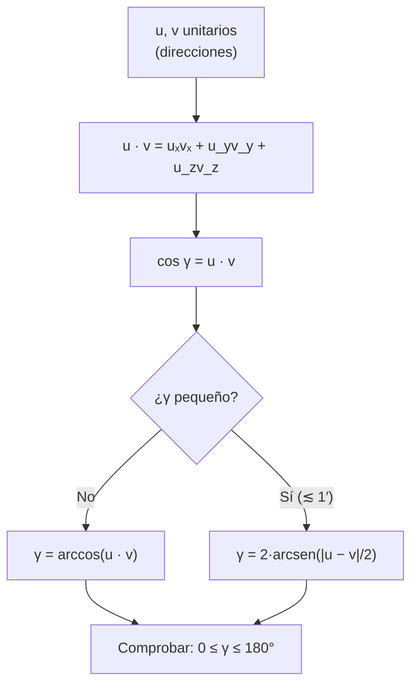

# B04-C13 — Producto escalar y ángulo entre vectores

<!-- nav:top -->
[🏠 Programa](../../../../README.md) · [📚 Bloque B04](../../../tronco-comun/B04-algebra-trigonometria-y-geometria-espacial.md) · [← Anterior: B04-C12 — Vectores y componentes](../B04-C12-vectores-y-componentes/CLASE.md) · [Siguiente: B04-C14 — Producto vectorial y orientación →](../B04-C14-producto-vectorial-y-orientacion/CLASE.md)
<!-- /nav -->

## 1. Ubicación, nivel y alcance

Decimotercera clase del bloque B04. En la [clase anterior](../B04-C12-vectores-y-componentes/CLASE.md) aprendiste a sumar vectores y a descomponerlos. Ahora haces una pregunta nueva: ¿qué ángulo forman dos direcciones? El producto escalar la responde. Nivel N1. Verás la definición, su cálculo por componentes, el ángulo entre vectores, la proyección de uno sobre otro y una variante numéricamente estable para ángulos pequeños, aplicadas a la separación angular entre estrellas. No verás el producto vectorial (C14) ni la geometría sobre la esfera como superficie (C16).

## 2. Por qué esta clase existe

Antes de apuntar un telescopio de una estrella a otra, antes de saber si dos objetos caben en el mismo campo de visión, antes de decidir si un planeta está demasiado cerca del Sol para observarlo, hay que saber cuántos grados los separan en el cielo. Con las direcciones convertidas en vectores unitarios (C11), esa separación sale de una multiplicación y una suma.

La decisión central: **¿cómo obtengo el ángulo entre dos direcciones, y qué fórmula uso para que el resultado siga siendo exacto cuando el ángulo es muy pequeño o cercano a 180°?** Aprenderás la definición, la fórmula con arccos y su alternativa estable.

## 3. Lo que podrás hacer al terminar

1. Calcular el producto escalar de dos vectores por componentes.
2. Obtener el ángulo entre dos vectores con `arccos` y comprobar su dominio.
3. Calcular la separación angular entre dos estrellas a partir de sus coordenadas.
4. Calcular la proyección de un vector sobre una dirección.
5. Reconocer cuándo `arccos` pierde precisión y usar la forma por cuerda.
6. Interpretar el signo del producto escalar (agudo, recto, obtuso).

La evidencia es la **tabla de separaciones angulares verificada** del ejercicio 12 (sección 20).

## 4. Con qué llegas y cómo comprobarlo

Necesitas vectores, módulo y conversión de coordenadas esféricas a vectores (C11, C12). Cinco preguntas:

1. ¿Cuánto vale `|(3; 4; 0)|`?
2. ¿Cuánto es `cos 60°`? ¿Y `cos 90°`?
3. ¿Qué es el vector unitario de `(0; 0; 5)`?
4. Calcula `1·4 + 2·5 + 3·6`.
5. ¿Qué ángulo tiene cuyo coseno es −1?

<details>
<summary>Ver respuestas</summary>

1. 5. 2. 0,5 y 0. 3. `(0; 0; 1)`. 4. 32. 5. 180°.
</details>

Con cuatro o cinco aciertos, sigue; si no, repasa C06, C11 y C12.

## 5. Un caso real: ¿cuán lejos están, en el cielo, dos estrellas vecinas?

Del NASA Exoplanet Archive (S1; datos estimados, archivo mutable) tomas las coordenadas de cinco estrellas cercanas. Convertidas a vectores unitarios en C11, el producto escalar de dos de ellas es el coseno del ángulo que las separa. Para tau Ceti (`(0,8642; 0,4217; −0,2745)`) y eps Eridani (`(0,5905; 0,7901; −0,1643)`): `0,5103 + 0,3332 + 0,0451 = 0,8886`, y `arccos(0,8886) = 27,30°`. Para Próxima Centauri y tau Ceti sale `−0,1888`, es decir `100,88°`: están casi en lados opuestos del cielo. En esta clase construyes la tabla de las diez parejas y la contrastas con una fórmula alternativa. Las coordenadas de la fuente se tratan como direcciones aproximadas, con marco y época no declarados por la documentación del archivo (sección 11).

## 6. Vocabulario

El **producto escalar** de `u = (uₓ; u_y; u_z)` y `v = (vₓ; v_y; v_z)` es el número `u · v = uₓvₓ + u_yv_y + u_zv_z`. Geométricamente `u · v = |u||v| cos γ`, donde `γ` es el **ángulo entre vectores** (entre 0° y 180°). Dos vectores son **perpendiculares** (ortogonales) si `u · v = 0`. La **proyección** de `w` sobre una dirección unitaria `ê` es el número `w · ê`. La **separación angular** de dos estrellas es el ángulo entre sus direcciones. La **cuerda** entre dos puntos de la esfera unidad es la longitud del segmento que los une, `|u − v|`; se relaciona con el ángulo por `|u − v| = 2 sen(γ/2)`. La **cancelación numérica** es la pérdida de cifras al restar dos números casi iguales; `arccos` cerca de 1 la sufre.

## 7. Modelo mental: la sombra de un vector sobre otro

Dos vectores que parten del mismo punto. El producto escalar mide cuánto «avanza» uno en la dirección del otro: si apuntan igual, es máximo; si son perpendiculares, cero; si se oponen, negativo.



*Descripción textual:* de dos vectores unitarios se obtiene su producto escalar, que es el coseno del ángulo entre ellos; si el ángulo no es pequeño se usa arccos, y si es muy pequeño se usa la fórmula por cuerda, que no pierde cifras; el resultado debe quedar entre 0° y 180°.

Analogía: la sombra de una varilla al mediodía; su longitud depende del ángulo entre la varilla y el rayo. Su límite: la sombra solo da el coseno, no el signo del giro; para eso se necesita el producto vectorial (C14).

## 8. La explicación, paso a paso

### 8.1 Cálculo por componentes

`(1; 2; 3) · (4; −5; 6) = 4 − 10 + 18 = 12`. Es conmutativo (`u · v = v · u`), lineal (`(ku) · v = k(u · v)`) y `u · u = |u|²`. Vectores unitarios dan `u · v = cos γ`, siempre entre −1 y 1.

### 8.2 Ángulo entre vectores

`cos γ = (u · v)/(|u||v|)` y `γ = arccos(...)`. Valores notables: `u · v = 0` → 90°; `u · v = 1` (unitarios iguales) → 0°; `u · v = −1` → 180°; `u · v = 0,5` → 60°. Si por redondeo `u · v` sale `1,0000000002`, hay que recortarlo a [−1, 1] antes de `arccos`: el laboratorio lo hace.

### 8.3 Separación angular de estrellas

Con `(α, δ)` convertidos a vectores unitarios `u` y `v` (C11): `γ = arccos(u · v)`. Con coordenadas ecuatoriales, para `δ₁ = δ₂ = 0` la separación es la diferencia de ascensiones rectas, comprobación inmediata. La fórmula en ángulos es `cos γ = sen δ₁ sen δ₂ + cos δ₁ cos δ₂ cos(α₁ − α₂)` (y se retoma en C16).

### 8.4 Proyección y componentes

Para `ê` unitario, `w · ê` es la componente de `w` a lo largo de `ê`; lo usaste en C12 para la descomposición radial/tangencial. Si `w = (3; 4; 0)` y `ê = (1; 0; 0)`, la proyección es 3: el vector avanza 3 unidades en esa dirección.

### 8.5 Cuando el ángulo es muy pequeño

Si `γ` es minúsculo, `cos γ` es casi 1 y `1 − cos γ ≈ γ²/2` se pierde entre las cifras que la máquina conserva (unas 16). Para `γ = 0,01″`, `arccos` devuelve `0,0092″` (8 % de error); para `γ = 0,001″`, devuelve `0″`. La **fórmula por cuerda**, `γ = 2 arcsen(|u − v|/2)`, no resta números casi iguales y da `1,000000 × 10⁻³″` en esos casos. Regla de la clase: usar la forma por cuerda cuando `γ` sea menor de unos minutos de arco.

## 9. Magnitudes, símbolos y unidades

| Símbolo | Qué es | Unidad | Nota |
|---|---|---|---|
| `u`, `v` | vectores (direcciones) | adimensional si son unitarios | de `(α, δ)` como en C11 |
| `u · v` | producto escalar | producto de las unidades | entre −1 y 1 si son unitarios |
| `γ` | ángulo entre vectores | rad o ° | `0 ≤ γ ≤ 180°` |
| `ê` | dirección unitaria | adimensional | para proyecciones |
| `|u − v|` | cuerda | adimensional | `= 2 sen(γ/2)` |
| `α`, `δ` | ascensión recta y declinación | ° | de S1 |

## 10. Convenciones y referencias

El ángulo entre vectores se define entre 0° y 180° sin signo. Las direcciones usan la convención de ejes de C11 (S2): `x` hacia `(α, δ) = (0, 0)`, `y` hacia `(90°, 0)`, `z` hacia el polo celeste norte. La separación angular no depende del marco mientras ambos vectores estén en el mismo; sí depende de que las coordenadas sean de la misma época. Los datos de S1 son **estimados**; la documentación del archivo no declara su marco ni su época (sección 11), de modo que la clase no los afirma.

## 11. De dónde sale lo que afirmamos

| ID | Fuente | Localizador | Respalda | Estado |
|---|---|---|---|---|
| S1 | NASA Exoplanet Archive, consulta TAP (tabla `pscomppars`, columnas `ra`, `dec`) | consulta TAP https://exoplanetarchive.ipac.caltech.edu/TAP (tabla `pscomppars`, columnas `ra`, `dec`); documentación de columnas: https://exoplanetarchive.ipac.caltech.edu/docs/API_PS_columns.html | Coordenadas de Próxima Cen, tau Cet, eps Eri, GJ 1061 y Teegarden's Star (grados) | Consulta del 2026-11-05 (mutable; estimado). Documentación leída el 2026-11-05: `ra` y `dec` son ascensión recta y declinación «en grados decimales»; **no declara marco de referencia ni época** |
| S2 | ESA, *The Hipparcos and Tycho Catalogues*, SP-1200, vol. 1, § 1.5.3 (ec. 1.5.5), p. 91 | https://www.cosmos.esa.int/documents/532822/552851/vol1_all.pdf | Vectores base del sistema ecuatorial: `x` hacia `(0, 0)`, `y` hacia `(+90°, 0)`, `z` hacia `δ = +90°` | PDF leído el 2026-11-05 |

Límites: La documentación de columnas del archivo (leída el 2026-11-05) define `ra` y `dec` como ascensión recta y declinación del sistema planetario en grados decimales, y `sy_dist` y `sy_plx` como distancia en pc y paralaje en mas; **no indica marco de referencia (ICRS, J2000…) ni época, ni el catálogo del que proceden**. La clase no afirma ninguno: usa los valores como direcciones aproximadas, con fines didácticos. La página de columnas leída corresponde a la tabla de sistemas planetarios (PS); la tabla compuesta `pscomppars` comparte esos nombres, pero su propia página de columnas vigente no se localizó (la que abrió está retirada desde 2015 y usa nombres `st_*`), por lo que esa correspondencia no se verificó. El producto escalar y sus propiedades son matemáticas estándar y se comprueban en el laboratorio. No se contrastan las separaciones con un valor publicado: son cálculos propios con direcciones de S1.

## 12. Cómo ver las separaciones

| Par | `u · v` | `γ` (°) |
|---|---|---|
| Próxima – tau Cet | −0,18880 | 100,8829 |
| Próxima – eps Eri | −0,28960 | 106,8342 |
| Próxima – GJ 1061 | 0,30921 | 71,9885 |
| Próxima – Teegarden | −0,69472 | 134,0046 |
| tau Cet – eps Eri | 0,88859 | 27,3039 |
| tau Cet – GJ 1061 | 0,79792 | 37,0681 |
| tau Cet – Teegarden | 0,79914 | 36,9519 |
| eps Eri – GJ 1061 | 0,81853 | 35,0626 |
| eps Eri – Teegarden | 0,88208 | 28,1053 |
| GJ 1061 – Teegarden | 0,46707 | 62,1557 |

Descripción larga: las cuatro estrellas distintas de Próxima están entre 72° y 134° de ella; tau Ceti, eps Eridani y Teegarden forman un grupo compacto con separaciones de 27° a 37° entre sí.

## 13. Ejemplo trabajado: tau Ceti y eps Eridani

Datos (S1): `u = (0,86419; 0,42167; −0,27453)` y `v = (0,59049; 0,79014; −0,16433)` (calculados con `(α, δ)` como en C11; el laboratorio los muestra con 4 cifras).

**Paso 1 · Producto escalar.** `u · v = 0,86419 × 0,59049 + 0,42167 × 0,79014 + (−0,27453) × (−0,16433) = 0,51030 + 0,33318 + 0,04511 = 0,88859`.

**Paso 2 · Dominio.** `0,88859` está entre −1 y 1 ✓ y es positivo: ángulo agudo.

**Paso 3 · Ángulo.** `γ = arccos(0,88859) = 27,30°`.

**Paso 4 · Comprobación con la cuerda.** `u − v = (0,27371; −0,36847; −0,11020)`; `|u − v| = √(0,07492 + 0,13576 + 0,01214) = √0,22282 = 0,47204`; `γ = 2 arcsen(0,23602) = 27,30°` ✓. Ambos métodos coinciden.

**Paso 5 · Interpretación y límite.** Las dos estrellas están a unos 27,3° una de otra en el cielo: unos 53 diámetros lunares (`27,3°/0,518°`, con el diámetro angular de C06). El valor depende de que las coordenadas usadas correspondan a la misma época. Resultado con 4 cifras: `27,30°`.

## 14. Distintas formas de calcular una separación

**Producto escalar con `arccos`:** directa y sirve casi siempre. **Fórmula por cuerda:** más estable para ángulos pequeños. **Fórmula con latitud y longitud** (C16): equivalente, sin pasar por vectores. **Aproximación plana** (`Δα cos δ`, `Δδ`): válida solo para separaciones pequeñas. En el laboratorio se calcula con las dos primeras y coinciden en 10⁻⁹.

## 15. Práctica guiada

**Ejercicio 1 · con los pasos indicados.** Calcula `(1; 2; 3) · (4; −5; 6)` y el ángulo entre `(1; 0; 0)` y `(0,5; 0,866; 0)`. *Pasos:* componentes y `arccos`.

<details><summary>Solución comentada</summary>

`4 − 10 + 18 = 12`. Para el segundo: `u · v = 0,5`; `γ = arccos(0,5) = 60°`. Comprobación: `|v| = √(0,25 + 0,75) = 1` ✓.
</details>

**Ejercicio 2 · con una pista.** ¿Qué ángulo forman `(3; 4; 0)` y `(4; −3; 0)`? *Pista:* producto escalar.

<details><summary>Solución comentada</summary>

`12 − 12 + 0 = 0`: perpendiculares, 90°.
</details>

**Ejercicio 3 · casi autónomo.** Calcula la separación de Próxima y tau Ceti con `u = (−0,36468; −0,27876; −0,88843)` y `v = (0,86419; 0,42167; −0,27453)`.

<details><summary>Solución comentada</summary>

`u · v = −0,31514 − 0,11754 + 0,24391 = −0,18877`; `γ = arccos(−0,18877) = 100,88°`. El producto negativo indica ángulo obtuso ✓.
</details>

## 16. Práctica autónoma, transferencia e integrador

**Ejercicio 4.** Dados `u = (1; 1; 0)` y `v = (1; 0; 1)`, calcula `γ` (no están normalizados).

<details><summary>Solución comentada</summary>

`u · v = 1`; `|u| = |v| = √2`; `cos γ = 1/2`; `γ = 60°`.
</details>

**Ejercicio 5.** Proyecta `w = (3; 4; 0)` sobre `ê = (0,6; 0,8; 0)` y sobre `(0; 0; 1)`.

<details><summary>Solución comentada</summary>

`w · ê = 1,8 + 3,2 = 5,0` (`w` es paralelo a `ê`, y `|w| = 5`); `w · (0; 0; 1) = 0` (perpendicular).
</details>

**Ejercicio 6.** Dos estrellas en el ecuador con `α = 10°` y `α = 47,5°`: ¿qué separación tienen?

<details><summary>Solución comentada</summary>

`u = (cos 10°; sen 10°; 0)`, `v = (cos 47,5°; sen 47,5°; 0)`; `u · v = cos(37,5°) = 0,7934`; `γ = 37,5°`: es la diferencia de ascensión recta (8.3).
</details>

**Ejercicio 7.** Si `u · v = 0,9999999` para dos direcciones unitarias, ¿cuánto vale `γ` aproximadamente? *Pista:* `1 − cos γ ≈ γ²/2`.

<details><summary>Solución comentada</summary>

`γ ≈ √(2 × 10⁻⁷) = 4,47 × 10⁻⁴ rad = 92″`. Con `u · v` dado con 7 cifras, el ángulo tiene solo 1–2 cifras fiables: cancelación (8.5).
</details>

**Ejercicio 8.** Calcula la cuerda para `γ = 60°` y verifica `γ = 2 arcsen(cuerda/2)`.

<details><summary>Solución comentada</summary>

`cuerda = 2 sen 30° = 1`; `2 arcsen(0,5) = 60°` ✓. (Un triángulo equilátero: la cuerda iguala al radio.)
</details>

**Ejercicio 9 · transferencia.** Un compañero calcula `arccos(1,0000000002)` y obtiene un error. ¿Qué pasó y cómo se evita?

<details><summary>Solución comentada</summary>

`arccos` no está definido fuera de [−1, 1]; el redondeo dejó `u · v` ligeramente mayor que 1. Se recorta a [−1, 1] antes de evaluar (o se usa la forma por cuerda).
</details>

**Ejercicio 10 · transferencia.** Un instrumento resuelve 0,01″. ¿Puede distinguir dos estrellas separadas por `0,01″` usando `arccos` en doble precisión? ¿Y con la fórmula por cuerda?

<details><summary>Solución comentada</summary>

Con `arccos` el cálculo da `0,0092″` (8 % de error): se pierde la medida. Con cuerda, `0,010000″`. Para separaciones tan pequeñas la elección de la fórmula importa más que el instrumento.
</details>

**Ejercicio 11 · transferencia.** Un telescopio tiene un campo de 2°. ¿Caben en él tau Ceti y eps Eridani (27,3°)? ¿Y dos estrellas con `u · v = 0,99999`?

<details><summary>Solución comentada</summary>

No: 27,3° > 2°. Para `u · v = 0,99999`: `γ ≈ √(2 × 10⁻⁵) = 4,47 × 10⁻³ rad = 0,256°`: sí caben. (El tamaño del campo es un dato de entrada, no un resultado de esta clase.)
</details>

**Ejercicio 12 · integrador.** Elabora tu *tabla de separaciones angulares verificada* (sección 20): elige cuatro estrellas de S1 (o de un catálogo que consultes), convierte a vectores unitarios, calcula las seis separaciones por dos métodos, comprueba que coinciden dentro de 10⁻⁹ y señala cuál es la pareja más cercana.

<details><summary>Solución modelo</summary>

Tabla con pareja, `u · v`, `γ` por arccos, `γ` por cuerda, diferencia; verificación de la desigualdad triangular en una terna; declaración de marco y época como no verificados; fuentes con fecha.
</details>

## 17. Laboratorio: separaciones entre cinco estrellas

El script [separaciones_angulares.py](separaciones_angulares.py) calcula las diez separaciones. Antes comprueba: ortogonales y paralelos, un ángulo de 60°, el producto `(1; 2; 3) · (4; −5; 6) = 12`, simetría y linealidad, que `arccos` y cuerda coincidan para 1° a 179°, el caso del ecuador y la desigualdad triangular en la esfera.

**Datos:** publicados (estimados, mutables). **Predice antes de ejecutar:** ¿qué par tendrá la menor separación? (tau Ceti – eps Eridani, 27,3°.) **Ejecución del 2026-11-05 (Python 3.12.9):**

```text
tau Cet – eps Eri             0.88859       27.3039       27.3039
Proxima Cen – Teegarden      -0.69472      134.0046      134.0046
   0.010″ exacto  0.010000″ | arccos   0.009221″ | cuerda   0.010000″
   0.001″ exacto  0.001000″ | arccos   0.000000″ | cuerda   0.001000″
```

```bash
python programa/clases/B04/B04-C13-producto-escalar-y-angulo-entre-vectores/separaciones_angulares.py
```

**Límites:** direcciones puras; marco y época de las coordenadas no declarados por la fuente; no es una herramienta de astrometría.

## 18. Errores frecuentes y cómo corregirlos

**Olvidar normalizar.** Con vectores no unitarios hay que dividir por `|u||v|`. Se corrige con el ejercicio 4.

**No recortar a [−1, 1].** Se corrige con el ejercicio 9.

**Usar `arccos` para ángulos diminutos.** Se corrige con los ejercicios 7 y 10.

**Interpretar el signo del producto.** Positivo: agudo; negativo: obtuso. Se corrige con el ejercicio 3.

**Confundir la separación angular con la distancia entre estrellas.** Son magnitudes distintas (la primera es un ángulo; la segunda, una longitud).

## 19. Cómo sabrás que vas bien

Tras 8.1: ¿calculas `(1; 2; 3) · (4; −5; 6)` sin mirar? Si no, ejercicio 1. Tras 8.3: ¿obtienes la separación de dos estrellas? Si no, ejercicio 3. Tras 8.5: ¿sabes cuándo usar la cuerda? Si no, ejercicio 10. Tras el laboratorio: ¿por qué falla arccos con 0,001″? Si no lo sabes, relee 8.5.

## 20. Qué entregas y cómo se evalúa

El producto es tu **tabla de separaciones angulares verificada** (ejercicio 12).

| Criterio | Inicial | En desarrollo | Logrado | Destacado |
|---|---|---|---|---|
| Producto escalar | Errores de cálculo | Correcto con ayuda | Correcto y con interpretación del signo | Lo usa para proyectar y descomponer |
| Ángulo | No acota el dominio | Usa arccos sin recorte | Usa arccos con recorte | Elige entre arccos y cuerda con criterio |
| Verificación | Ausente | Un par comprobado | Dos métodos coinciden | Prueba la desigualdad triangular |
| Marco y época | Sin declarar | Los nombra | Declara no verificados | Estima el efecto del movimiento propio |
| Fuentes | Sin fuente | Sin fecha | Con localizador y fecha | Distingue dato de cálculo |

**Condiciones críticas (no se compensan con promedio):** declarar marco y época; verificar con un segundo método; citar solo fuentes consultadas.

## 21. Ética, seguridad y límites

Una separación angular calculada con coordenadas de épocas distintas puede ser falsa aunque el cálculo sea impecable; declararlo es honestidad numérica. No se usa para apuntar instrumentos. Accesibilidad: fórmulas en texto, tabla equivalente a un mapa, ejercicios sin conexión.

## 22. Para cerrar y seguir

El producto escalar de dos vectores unitarios es el coseno del ángulo entre ellos; con él se calculan separaciones, y para ángulos muy pequeños se usa la fórmula por cuerda. Queda abierta una pregunta: ¿cómo se obtiene un vector perpendicular a otros dos, necesario para orientar planos y órbitas? Eso es C14.

**Glosario español–inglés.** producto escalar · *dot product*; ángulo entre vectores · *angle between vectors*; separación angular · *angular separation*; proyección · *projection*; cuerda · *chord*; cancelación · *cancellation*; ortogonal · *orthogonal*.

**Continuidad.** B04-C14 usa tu capacidad de **calcular ángulos entre vectores** para introducir el producto vectorial y la orientación de órbitas. B04-C16 retomará la fórmula de separación en ángulos de latitud y longitud.

**Referencias:** ver sección 11.

<!-- nav:bottom -->
---

[← Anterior: B04-C12 — Vectores y componentes](../B04-C12-vectores-y-componentes/CLASE.md) · [📚 Bloque B04](../../../tronco-comun/B04-algebra-trigonometria-y-geometria-espacial.md) · [Siguiente: B04-C14 — Producto vectorial y orientación →](../B04-C14-producto-vectorial-y-orientacion/CLASE.md)
<!-- /nav -->
