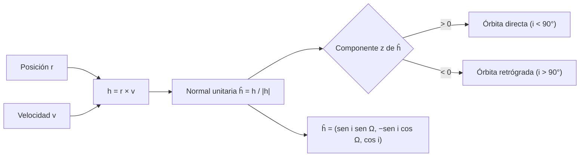

# B04-C14 — Producto vectorial y orientación

<!-- nav:top -->
[🏠 Programa](../../../../README.md) · [📚 Bloque B04](../../../tronco-comun/B04-algebra-trigonometria-y-geometria-espacial.md) · [← Anterior: B04-C13 — Producto escalar y ángulo entre vectores](../B04-C13-producto-escalar-y-angulo-entre-vectores/CLASE.md) · [Siguiente: B04-C15 — Rotación de puntos y ejes →](../B04-C15-rotacion-de-puntos-y-ejes/CLASE.md)
<!-- /nav -->

## 1. Ubicación, nivel y alcance

Decimocuarta clase del bloque B04. En la [clase anterior](../B04-C13-producto-escalar-y-angulo-entre-vectores/CLASE.md) obtuviste un *número* (el coseno) a partir de dos vectores. Ahora obtienes un *vector*: el que es perpendicular a ambos. Nivel N1. Verás el producto vectorial, la regla de la mano derecha, el área del paralelogramo, la normal a un plano y la orientación de una órbita a partir de su inclinación y del nodo ascendente, aplicada a la Tierra y al cometa Halley. No verás rotaciones (C15) ni la física del momento angular (B05).

## 2. Por qué esta clase existe

Una órbita no es solo una forma (C09): es una forma colocada en el espacio con una orientación. ¿Hacia dónde apunta su plano? ¿Gira en el mismo sentido que los planetas o en el contrario? La respuesta está en un solo vector, la normal al plano orbital, y se calcula con el producto vectorial de la posición y la velocidad.

La decisión central: **¿cómo obtengo un vector perpendicular a dos dados, cómo se interpreta su sentido y qué me dice sobre la orientación de un plano o de un giro?** Aprenderás el cálculo por componentes, la regla de la mano derecha y la relación entre normal, inclinación y nodo.

## 3. Lo que podrás hacer al terminar

1. Calcular `u × v` por componentes y verificar que es perpendicular a ambos.
2. Aplicar la regla de la mano derecha y la anticonmutatividad.
3. Obtener el área de un paralelogramo o triángulo a partir del módulo de `u × v`.
4. Calcular la normal unitaria a una órbita a partir de `i` y `Ω`.
5. Decidir si una órbita es directa o retrógrada con el signo de su componente `z`.
6. Comprobar numéricamente las propiedades del producto vectorial.

La evidencia es la **orientación de una órbita a partir de sus elementos** del ejercicio 12 (sección 20).

## 4. Con qué llegas y cómo comprobarlo

Necesitas vectores, producto escalar y trigonometría (C12, C13). Cinco preguntas:

1. ¿Cuánto vale `(1; 2; 3) · (4; −5; 6)`?
2. ¿Cuándo son perpendiculares dos vectores?
3. ¿Cuánto es `sen 90°` y `sen 0°`?
4. Calcula el área de un triángulo de base 6 y altura 4.
5. ¿Cuál es el vector unitario del eje `z`?

<details>
<summary>Ver respuestas</summary>

1. 12. 2. Cuando su producto escalar es 0. 3. 1 y 0. 4. 12. 5. `(0; 0; 1)`.
</details>

Con cuatro o cinco aciertos, sigue; si no, repasa C12 y C13.

## 5. Un caso real: Halley gira al revés

El cometa 1P/Halley tiene, según la solución del JPL del 2025-11-21, una inclinación orbital `i = 162,19°` y una longitud del nodo ascendente `Ω = 59,10°` (S1; estimados, archivo mutable). La inclinación es la del plano de su órbita respecto del plano de referencia de la solución. Con estos dos ángulos puedes construir la normal unitaria `ĥ = (0,2624; −0,1571; −0,9521)`. Su componente `z` es negativa: el cometa recorre su órbita en sentido contrario al de los planetas, es decir, en una órbita retrógrada. Para la Tierra, que define el plano, `ĥ = (0; 0; 1)` y el producto `r × v` apunta siempre a `+z`. En esta clase verificas ambas cosas con cálculo. El plano de referencia de la solución no se verificó en la consulta; se trata como «el plano de referencia».

## 6. Vocabulario

El **producto vectorial** `u × v` es el vector perpendicular a `u` y a `v` con módulo `|u||v| sen γ` y sentido dado por la **regla de la mano derecha**: si los dedos van de `u` hacia `v` por el ángulo menor, el pulgar apunta a `u × v`. Por componentes: `u × v = (u_yv_z − u_zv_y; u_zv_x − u_xv_z; u_xv_y − u_yv_x)`. Es **anticonmutativo**: `v × u = −(u × v)`. La **normal a un plano** es un vector perpendicular a él; su versión de módulo 1 es la **normal unitaria**. La **inclinación** `i` es el ángulo entre el plano orbital y el de referencia (de 0° a 180°); el **nodo ascendente** es el punto donde la órbita cruza el plano de referencia de sur a norte, y su longitud `Ω` se mide en ese plano desde la dirección de referencia. Una órbita es **directa** si `i < 90°` y **retrógrada** si `i > 90°`.

## 7. Modelo mental: la normal como eje de un giro

Un cuerpo que gira en un plano define un eje perpendicular a él. La regla de la mano derecha dice hacia qué lado apunta ese eje: si los dedos siguen el giro, el pulgar marca la normal. Cambiar el sentido del giro invierte la normal.



*Descripción textual:* de la posición y la velocidad se obtiene `h = r × v`, que se normaliza; el signo de su componente `z` indica si la órbita es directa o retrógrada; en función de la inclinación y del nodo, la normal es `(sen i sen Ω, −sen i cos Ω, cos i)`.

Analogía: el eje de un tornillo; girar hacia un lado lo hace avanzar y hacia el otro, retroceder. Su límite: la regla depende de la convención del sistema (mano derecha o izquierda); en todo este programa se usa la derecha.

## 8. La explicación, paso a paso

### 8.1 Cálculo

Para `u = (1; 0; 0)` y `v = (0; 1; 0)`: `u × v = (0·0 − 0·1; 0·0 − 1·0; 1·1 − 0·0) = (0; 0; 1)`. Y `v × u = (0; 0; −1)`. Con los ejes: `x̂ × ŷ = ẑ`, `ŷ × ẑ = x̂`, `ẑ × x̂ = ŷ` (sentido cíclico). Si `u` y `v` son paralelos, `u × v = 0`.

### 8.2 Propiedades

`u × v` es perpendicular a `u` y a `v` (`(u × v) · u = 0`). Su módulo vale `|u||v| sen γ`, el área del paralelogramo que forman; el triángulo tiene la mitad. La **identidad de Lagrange** relaciona ambos productos: `|u × v|² + (u · v)² = |u|²|v|²`; es la versión vectorial de `sen² + cos² = 1`. Con esta identidad, `γ = atan2(|u × v|, u · v)` da un ángulo estable en todo el rango.

### 8.3 Momento angular específico y plano orbital

Para un cuerpo en órbita, `h = r × v` es perpendicular al plano orbital y constante a lo largo de la órbita (la razón física se ve en B05). Para la Tierra en órbita circular, `|h| = a v₀ = 149,6 × 10⁶ km × 29,79 km/s = 4,457 × 10⁹ km²/s`, y su dirección es `+z` en todos los puntos del año (tabla de 12). El módulo `|h|/2` es el área que barre el radio vector por segundo.

### 8.4 La normal a partir de `i` y `Ω`

Si el plano de referencia es `xy`, el vector normal a una órbita con inclinación `i` y nodo `Ω` es `ĥ = (sen i sen Ω; −sen i cos Ω; cos i)`. Con `i = 0`: `(0; 0; 1)`, órbita en el plano de referencia. Con `i = 90°` y `Ω = 0`: `(0; −1; 0)`, órbita polar. La componente `z` es `cos i`: positiva si `i < 90°` (directa) y negativa si `i > 90°` (retrógrada). Para Halley: `sen 162,19° = 0,30585`, `cos 162,19° = −0,95208`, `sen 59,10° = 0,85806`, `cos 59,10° = 0,51356`; `ĥ = (0,30585 × 0,85806; −0,30585 × 0,51356; −0,95208) = (0,26244; −0,15707; −0,95208)`, igual que el laboratorio.

### 8.5 Comprobaciones

El ángulo entre `ĥ` y `ẑ` es `arccos(cos i) = i` (C13); para Halley, `162,19°` ✓. La línea de nodos, `ẑ × ĥ`, apunta a lo largo de la dirección del nodo ascendente: su ángulo desde `x` es `Ω`. El laboratorio lo comprueba: `59,0989°`.

## 9. Magnitudes, símbolos y unidades

| Símbolo | Qué es | Unidad | Nota |
|---|---|---|---|
| `u × v` | producto vectorial | producto de las unidades | perpendicular a `u` y `v` |
| `h = r × v` | momento angular específico | km²/s | Tierra: `4,457 × 10⁹` (calculado) |
| `ĥ` | normal unitaria a la órbita | adimensional | `(sen i sen Ω; −sen i cos Ω; cos i)` |
| `i` | inclinación | ° | Halley 162,1905° (S1) |
| `Ω` | longitud del nodo ascendente | ° | Halley 59,0989° (S1) |
| `a`, `P` | semieje y periodo de la Tierra | 10⁶ km; d | 149,6; 365,2 (S2) |

## 10. Convenciones y referencias

Sistema de coordenadas de mano derecha: `x̂ × ŷ = ẑ`. Los elementos de la órbita se miden respecto de un plano de referencia (`xy`) con `x` hacia la dirección de referencia (el equinoccio, en el caso eclíptico); el plano de referencia de la solución JPL no se verificó en la consulta. La inclinación va de 0° a 180°. Los elementos de Halley son una **solución estimada** del 2025-11-21 y cambian con nuevas observaciones. Los vectores de prueba `(3; 0; 0)` y `(1; 2; 0)` son **sintéticos**.

## 11. De dónde sale lo que afirmamos

| ID | Fuente | Localizador | Respalda | Estado |
|---|---|---|---|---|
| S1 | NASA/JPL Small-Body Database API (solución de D. Farnocchia, 2025-11-21) | https://ssd-api.jpl.nasa.gov/sbdb.api?sstr=1P&full-prec=1 | 1P/Halley: `i = 162,1905300439°`, `Ω = 59,0989472061°`, `e`, `a` | Consulta del 2026-11-05 (mutable; estimado) |
| S2 | NASA NSSDC, *Planetary Fact Sheet – Metric* (2025-03-18) | https://nssdc.gsfc.nasa.gov/planetary/factsheet/ | Tierra: distancia al Sol 149,6 × 10⁶ km; periodo 365,2 d | Consultada el 2026-11-05 |

Límites: el significado preciso de «plano de referencia» y la dirección del eje `x` en la solución JPL no se consultaron; el cálculo de `ĥ` es una consecuencia matemática de `i` y `Ω` y no una cifra publicada. Que el momento angular sea constante pertenece a B05 y no se demuestra aquí. La fórmula `ĥ = (sen i sen Ω; −sen i cos Ω; cos i)` es una identidad geométrica comprobada en el laboratorio.

## 12. Cómo ver las orientaciones

| Caso | `ĥ` | Ángulo con `ẑ` | Sentido |
|---|---|---|---|
| Tierra (plano de referencia) | (0; 0; 1) | 0° | directo |
| Halley | (0,26244; −0,15707; −0,95208) | 162,19° | retrógrado |
| Órbita polar sintética (`i = 90°`, `Ω = 0`) | (0; −1; 0) | 90° | — |

Tierra: `r × v = (0; 0; 4,4565 × 10⁹)` km²/s en θ = 0°, 45°, 90° y 200°.

Descripción larga: la normal de Halley apunta casi hacia −`z`, desviada 17,8° de esa dirección; el plano de su órbita está inclinado 162° respecto del de referencia, o sea, 18° respecto de él pero recorrido al revés.

## 13. Ejemplo trabajado: la normal de Halley

Datos (S1): `i = 162,19053°`, `Ω = 59,09895°`.

**Paso 1 · Funciones.** `sen i = 0,30585`; `cos i = −0,95208`; `sen Ω = 0,85806`; `cos Ω = 0,51356`.

**Paso 2 · Normal.** `ĥ = (sen i sen Ω; −sen i cos Ω; cos i) = (0,30585 × 0,85806; −0,30585 × 0,51356; −0,95208) = (0,26244; −0,15707; −0,95208)`, que coincide con el laboratorio.

**Paso 3 · Comprobar la norma.** `0,26244² + 0,15707² + 0,95208² = 0,06887 + 0,02467 + 0,90646 = 1,00000` ✓ (el laboratorio: 1,000000000000).

**Paso 4 · Interpretar.** `ĥ_z = −0,952 < 0` → órbita retrógrada. El ángulo entre `ĥ` y `ẑ` es `arccos(−0,952) = 162,19°` ✓.

**Paso 5 · Línea de nodos.** `ẑ × ĥ = (0 × ĥ_z − 1 × ĥ_y; 1 × ĥ_x − 0; 0) = (0,15707; 0,26244; 0)`; su ángulo desde `x` es `atan2(0,26244; 0,15707) = 59,10°` = `Ω` ✓.

## 14. Distintas formas de obtener la orientación

**Con `r × v`:** necesita posición y velocidad en un instante. **Con `i` y `Ω`:** directa si se publican los elementos. **Con tres puntos del plano:** `(P₂ − P₁) × (P₃ − P₁)` da la normal sin velocidades. **Con el signo de `h_z`:** decide directo o retrógrado sin más cálculo. Todas deben coincidir; es una buena comprobación cruzada.

## 15. Práctica guiada

**Ejercicio 1 · con los pasos indicados.** Calcula `(1; 2; 3) × (4; −5; 6)` y verifica la perpendicularidad. *Pasos:* fórmula de componentes.

<details><summary>Solución comentada</summary>

`(2·6 − 3·(−5); 3·4 − 1·6; 1·(−5) − 2·4) = (27; 6; −13)`. Comprobación: `(27; 6; −13) · (1; 2; 3) = 27 + 12 − 39 = 0` ✓ y `· (4; −5; 6) = 108 − 30 − 78 = 0` ✓.
</details>

**Ejercicio 2 · con una pista.** Área del triángulo con `u = (3; 0; 0)` y `v = (1; 2; 0)`. *Pista:* mitad del módulo.

<details><summary>Solución comentada</summary>

`u × v = (0; 0; 6)`; módulo 6; triángulo = 3. Comprobación: base 3, altura 2 → `3 × 2/2 = 3` ✓.
</details>

**Ejercicio 3 · casi autónomo.** Calcula `r × v` para la Tierra en `θ = 90°`: `r = (0; 149,6; 0) × 10⁶ km`, `v = (−29,79; 0; 0)` km/s.

<details><summary>Solución comentada</summary>

`(r_y v_z − r_z v_y; r_z v_x − r_x v_z; r_x v_y − r_y v_x) = (0; 0; 0 − 149,6 × (−29,79)) = (0; 0; 4,457 × 10⁹)` km²/s. Sentido `+z` ✓ (tabla de la sección 12).
</details>

## 16. Práctica autónoma, transferencia e integrador

**Ejercicio 4.** Muestra que `u × u = 0` y que `u × v = −v × u` con `u = (1; 2; 3)`, `v = (0; 1; 0)`.

<details><summary>Solución comentada</summary>

`u × u`: `(2·3 − 3·2; 3·1 − 1·3; 1·2 − 2·1) = (0; 0; 0)`. `u × v = (2·0 − 3·1; 3·0 − 1·0; 1·1 − 2·0) = (−3; 0; 1)`; `v × u = (1·3 − 0·2; 0·1 − 0·3; 0·2 − 1·1) = (3; 0; −1)`: opuestos ✓.
</details>

**Ejercicio 5.** Dos direcciones forman 30° y tienen módulos 2 y 5. ¿Cuánto vale `|u × v|` y `u · v`?

<details><summary>Solución comentada</summary>

`|u × v| = 2·5·sen 30° = 5`; `u · v = 2·5·cos 30° = 8,66`. Lagrange: `25 + 75 = 100 = 2²·5²` ✓.
</details>

**Ejercicio 6.** Calcula `ĥ` para `i = 90°`, `Ω = 0°`. ¿Qué orientación tiene la órbita?

<details><summary>Solución comentada</summary>

`ĥ = (sen 90° sen 0°; −sen 90° cos 0°; cos 90°) = (0; −1; 0)`. La órbita está en un plano perpendicular a `y`, que contiene a `x` y a `z`: órbita polar respecto del plano de referencia.
</details>

**Ejercicio 7.** Una órbita tiene `i = 23°` y otra `i = 157°`. ¿Cuál es retrógrada? ¿Qué ángulo hay entre sus normales si ambas tienen `Ω = 0°`?

<details><summary>Solución comentada</summary>

La de 157° es retrógrada. Las normales son `(0; −sen i; cos i)`: `(0; −0,3907; 0,9205)` y `(0; −0,3907; −0,9205)`; producto escalar `0,1527 − 0,8473 = −0,6946`; ángulo `arccos(−0,6946) = 134°` (= 157° − 23°) ✓.
</details>

**Ejercicio 8.** Halla la normal al plano que contiene los puntos `P₁ = (0; 0; 0)`, `P₂ = (1; 0; 0)`, `P₃ = (0; 1; 1)`.

<details><summary>Solución comentada</summary>

`(P₂ − P₁) × (P₃ − P₁) = (1; 0; 0) × (0; 1; 1) = (0·1 − 0·1; 0·0 − 1·1; 1·1 − 0·0) = (0; −1; 1)`; normalizada `(0; −0,7071; 0,7071)`.
</details>

**Ejercicio 9 · transferencia.** Un estudiante dice que una órbita de inclinación 162° está «casi en el plano, solo 18° inclinada, y gira igual que los planetas». Evalúa.

<details><summary>Solución comentada</summary>

La inclinación respecto del plano es de 18° (`180° − 162°`), pero el sentido de giro es opuesto: `ĥ_z = cos 162° < 0`. Es una órbita retrógrada. Con solo el ángulo del plano se pierde el sentido; por eso la normal es un vector.
</details>

**Ejercicio 10 · transferencia.** ¿Qué ocurre con `r × v` si la velocidad apunta exactamente hacia el Sol? ¿Qué órbita sería?

<details><summary>Solución comentada</summary>

`r` y `v` son paralelos: `r × v = 0`. No hay plano orbital definido: es una caída radial, un movimiento rectilíneo (caso límite que no se trata en esta clase).
</details>

**Ejercicio 11 · transferencia.** Un programa calcula `h = v × r` en lugar de `r × v` para la Tierra. ¿Qué concluye sobre el sentido de giro? ¿Qué error comete?

<details><summary>Solución comentada</summary>

Obtiene `−z` y concluye que la Tierra gira al revés. El orden importa: es anticonmutativo. Se detecta comprobando con el caso de referencia `x̂ × ŷ = ẑ`.
</details>

**Ejercicio 12 · integrador.** Elabora tu *orientación de una órbita a partir de sus elementos* (sección 20): elige un cuerpo cuyos `i` y `Ω` consultes tú (cometa o asteroide), calcula `ĥ`, su norma, el ángulo con `ẑ`, el sentido de giro y la línea de nodos, y compara con una órbita de referencia (por ejemplo, la de la Tierra).

<details><summary>Solución modelo</summary>

Ficha completa: fuente con fecha y plano de referencia declarado como verificado o no, `ĥ` con norma 1, ángulo con `ẑ` igual a `i`, signo de `ĥ_z` y conclusión directa/retrógrada, `ẑ × ĥ` con su ángulo igual a `Ω`, y ángulo entre las normales del cuerpo y de la Tierra.
</details>

## 17. Laboratorio: normales y momentos angulares

El script [orientacion_orbital.py](orientacion_orbital.py) calcula `ĥ` de Halley y `r × v` de la Tierra. Antes comprueba: la mano derecha (`x̂ × ŷ = ẑ` y cíclicas), la anticonmutatividad, la perpendicularidad con vectores generales, `|u × v| = |u||v| sen γ`, la identidad de Lagrange y que la normal de Halley tenga norma 1 y forme con `ẑ` el ángulo `i`.

**Datos:** publicados (estimados, mutables) y cálculo propio. **Predice antes de ejecutar:** ¿qué signo tiene `ĥ_z` de Halley? (Negativo: `i > 90°`.) **Ejecución del 2026-11-05 (Python 3.12.9):**

```text
Tierra (circular): v0 = 29.790 km/s; |r×v| esperado = a·v0 = 4.4565e+09 km²/s
  θ =  90°: r×v = (0.0, -0.0, 4.4565e+09) km²/s  -> sentido +z (órbita directa)
Halley: ĥ = (0.26244, -0.15707, -0.95208); |ĥ| = 1.000000000000
  Ángulo entre ĥ de Halley y ĥ del plano de referencia = 162.1905° (= i)
  Componente z de ĥ = -0.95208 < 0 -> órbita retrógrada (i > 90°)
Línea de nodos: ángulo desde x = 59.0989° (Ω = 59.0989°)
```

```bash
python programa/clases/B04/B04-C14-producto-vectorial-y-orientacion/orientacion_orbital.py
```

**Límites:** órbitas keplerianas planas; plano de referencia no verificado; no es una herramienta de determinación de órbitas.

## 18. Errores frecuentes y cómo corregirlos

**Invertir el orden.** Se corrige con el ejercicio 11.

**Confundir `|u × v|` con `u · v`.** Una es seno, el otro coseno. Se corrige con el ejercicio 5.

**Olvidar que la inclinación va de 0° a 180°.** Se corrige con el ejercicio 9.

**Usar la mano izquierda.** Se corrige con la convención de la sección 10.

**Confundir la normal con el vector posición.** Son distintos; ver 8.3.

## 19. Cómo sabrás que vas bien

Tras 8.1: ¿calculas `x̂ × ŷ` y `ŷ × x̂` sin mirar? Si no, ejercicio 4. Tras 8.2: ¿obtienes el área de un triángulo con el producto vectorial? Si no, ejercicio 2. Tras 8.4: ¿dices si una órbita es retrógrada con `i`? Si no, ejercicio 7. Tras el laboratorio: ¿qué comprueba antes de calcular? Si no lo sabes, lee su cabecera.

## 20. Qué entregas y cómo se evalúa

El producto es tu **orientación de una órbita a partir de sus elementos** (ejercicio 12).

| Criterio | Inicial | En desarrollo | Logrado | Destacado |
|---|---|---|---|---|
| Cálculo | Errores de componentes | Correcto con ayuda | Correcto y verificado como perpendicular | Usa Lagrange como prueba |
| Normal | No la construye | La construye con `i` y `Ω` | La verifica con norma y ángulo | La compara con `r × v` |
| Interpretación | Confunde sentidos | Decide con `i` | Decide con `ĥ_z` y la línea de nodos | Explica por qué importa el orden |
| Marco | Sin declarar | Parcial | Plano de referencia y mano derecha declarados | Señala lo no verificado |
| Fuentes | Sin fuente | Sin fecha | Con localizador y fecha | Marca lo mutable |

**Condiciones críticas (no se compensan con promedio):** declarar la convención de mano derecha y el plano de referencia; mantener el orden `r × v`; citar solo fuentes consultadas.

## 21. Ética, seguridad y límites

Los elementos orbitales son soluciones de ajuste que cambian con las observaciones; presentarlos como cifras definitivas sería impreciso. La clase no sirve para determinar órbitas ni planificar misiones. Accesibilidad: fórmulas en texto, tabla equivalente al dibujo, ejercicios sin conexión.

## 22. Para cerrar y seguir

El producto vectorial da el vector perpendicular a dos dados, con sentido de mano derecha; su módulo es un área y su dirección, la normal de un plano. Con ella se orienta una órbita y se decide si es directa o retrógrada. Queda abierta una pregunta: ¿cómo se pasa de un sistema de ejes a otro girado? Eso es C15.

**Glosario español–inglés.** producto vectorial · *cross product*; regla de la mano derecha · *right-hand rule*; normal · *normal vector*; inclinación · *inclination*; nodo ascendente · *ascending node*; órbita retrógrada · *retrograde orbit*; momento angular específico · *specific angular momentum*.

**Continuidad.** B04-C15 usa tu capacidad de **orientar planos y ejes** para estudiar matrices de rotación. B04-C19 retomará la orientación al encadenar sistemas de coordenadas.

**Referencias:** ver sección 11.

<!-- nav:bottom -->
---

[← Anterior: B04-C13 — Producto escalar y ángulo entre vectores](../B04-C13-producto-escalar-y-angulo-entre-vectores/CLASE.md) · [📚 Bloque B04](../../../tronco-comun/B04-algebra-trigonometria-y-geometria-espacial.md) · [Siguiente: B04-C15 — Rotación de puntos y ejes →](../B04-C15-rotacion-de-puntos-y-ejes/CLASE.md)
<!-- /nav -->
