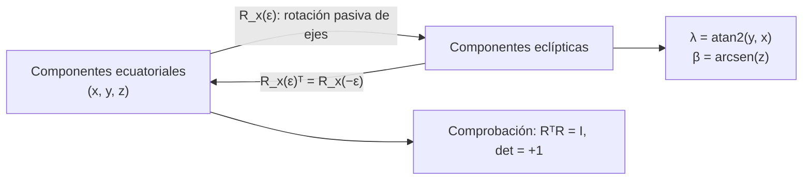

# B04-C15 — Rotación de puntos y ejes

<!-- nav:top -->
[🏠 Programa](../../../../README.md) · [📚 Bloque B04](../../../tronco-comun/B04-algebra-trigonometria-y-geometria-espacial.md) · [← Anterior: B04-C14 — Producto vectorial y orientación](../B04-C14-producto-vectorial-y-orientacion/CLASE.md) · [Siguiente: B04-C16 — Geometría de esferas y círculos máximos →](../B04-C16-geometria-de-esferas-y-circulos-maximos/CLASE.md)
<!-- /nav -->

## 1. Ubicación, nivel y alcance

Decimoquinta clase del bloque B04. Con la orientación del plano de una órbita (C14) ya sabes que los ejes elegidos importan. Aquí aprendes a cambiar de ejes: la **rotación**. Nivel N1. Verás matrices de rotación alrededor de los ejes `x` y `z`, la rotación activa (mueve el punto) y la pasiva (mueve los ejes), la composición, la inversa y su comprobación con valores publicados, aplicadas a pasar de coordenadas ecuatoriales a eclípticas. No verás las transformaciones completas entre sistemas astronómicos (C19) ni la precesión y nutación.

## 2. Por qué esta clase existe

El ecuador de la Tierra y el plano de su órbita (la eclíptica) forman un ángulo de unos 23,4°. Los catálogos de estrellas se dan en coordenadas ecuatoriales; el movimiento del Sol, la Luna y los planetas es más simple en coordenadas eclípticas. Pasar de unas a otras es girar los ejes un ángulo ε alrededor de un eje. Si te equivocas de signo, la estrella aparece 47° más al sur o al norte de donde está.

La decisión central: **¿alrededor de qué eje y en qué sentido giro, giro los puntos o los ejes, y cómo compruebo que la matriz que uso es correcta?** Aprenderás las matrices, sus propiedades y una comprobación contra valores publicados.

## 3. Lo que podrás hacer al terminar

1. Escribir las matrices de rotación `R_x(a)` y `R_z(a)` y aplicarlas a un vector.
2. Distinguir rotación activa (de puntos) y pasiva (de ejes) y sus signos.
3. Componer rotaciones y reconocer que el orden importa.
4. Comprobar que una matriz es una rotación: ortogonal y con determinante +1.
5. Pasar una dirección de ecuatoriales a eclípticas y regresar.
6. Contrastar una matriz con valores publicados y detectar diferencias por versión del modelo.

La evidencia es la **rotación documentada con sus pruebas** del ejercicio 12 (sección 20).

## 4. Con qué llegas y cómo comprobarlo

Necesitas vectores, coordenadas esféricas y trigonometría (C06, C11, C12). Cinco preguntas:

1. ¿Cuánto es `cos 30°` y `sen 30°`?
2. Si `u = (1; 0)`, ¿qué vector sale al girarlo 90° en sentido antihorario?
3. ¿Cuánto vale `sen²a + cos²a`?
4. Calcula `[[1; 2]; [3; 4]] · (1; 1)` (matriz por vector).
5. ¿Qué vector unitario corresponde a `α = 90°`, `δ = 0°`?

<details>
<summary>Ver respuestas</summary>

1. 0,866 y 0,5. 2. `(0; 1)`. 3. 1. 4. `(3; 7)`. 5. `(0; 1; 0)`.
</details>

Con cuatro o cinco aciertos, sigue; si no, repasa C06, C11 y C12.

## 5. Un caso real: de ecuatoriales a eclípticas con una matriz publicada

El catálogo Hipparcos de la ESA (S1) publica la matriz que lleva las componentes ecuatoriales a las eclípticas, con `ε = 23° 26′ 21,448″ = 23,4392911°`: sus elementos son `cos ε = +0,9174820621` y `sen ε = +0,3977771559`. Con ella, la dirección de Próxima Centauri (`α = 217,3934657°`, `δ = −62,6761821°`, S2) pasa a las coordenadas eclípticas `λ = 239,09°`, `β = −44,77°`. Y la declinación del Sol en el solsticio de junio sale `+23,44°`, igual que ε. Por otro lado, la Unión Astronómica Internacional adoptó en 2006 el valor `84381,406″` (S3): difiere en 42 milisegundos de arco del anterior. Elegir una versión u otra no cambia nada a nivel didáctico, pero sí a nivel de astrometría, y por eso hay que declararla.

## 6. Vocabulario

Una **matriz de rotación** `R` es una tabla 3×3 que, al multiplicarse por un vector, lo gira sin cambiar su módulo. Es **ortogonal** (`Rᵀ R = I`) y tiene **determinante** `+1`. La **inversa** de una rotación es su **traspuesta**: `R⁻¹ = Rᵀ`. Una **rotación activa** gira el punto manteniendo los ejes; una **rotación pasiva** gira los ejes y deja el punto, de modo que sus componentes cambian. Una rotación de ejes un ángulo `a` equivale a una rotación activa del punto en `−a`. La **composición** `R₂ R₁` aplica primero `R₁` y luego `R₂`. La **oblicuidad de la eclíptica** `ε` es el ángulo entre el ecuador y la eclíptica. Los símbolos `R₁`, `R₂`, `R₃` de la literatura indican rotaciones con ángulo positivo alrededor de los ejes 1, 2 y 3 (S4).

## 7. Modelo mental: girar el papel o girar la mano

Para describir un punto con ejes distintos, puedes girar el papel y dejar el punto, o girar el punto y dejar el papel. Ambos dan el mismo resultado numérico si cambias el signo del ángulo.



*Descripción textual:* de las componentes ecuatoriales se pasa a las eclípticas con la rotación pasiva `R_x(ε)`; la traspuesta devuelve las ecuatoriales; de las eclípticas salen longitud y latitud con `atan2` y `arcsen`; y la matriz se comprueba con ortogonalidad y determinante 1.

Analogía: un compás que gira sobre un mapa. Su límite: en tres dimensiones, las rotaciones alrededor de ejes distintos **no conmutan**: girar primero alrededor de `x` y luego de `z` no es lo mismo que al revés, a diferencia de lo que ocurre en un plano.

## 8. La explicación, paso a paso

### 8.1 Las matrices

Rotación de ejes un ángulo `a` alrededor de `x`: `R_x(a) = [[1; 0; 0]; [0; cos a; sen a]; [0; −sen a; cos a]]`. Alrededor de `z`: `R_z(a) = [[cos a; sen a; 0]; [−sen a; cos a; 0]; [0; 0; 1]]`. Con ellas, las nuevas componentes son `v' = R v`. Para `a = 0`, la identidad. Las columnas son los ejes viejos vistos desde los nuevos.

### 8.2 Propiedades

`R Rᵀ = I`, `det R = 1`, `|R v| = |v|` (no cambia el tamaño) y `R(−a) = R(a)ᵀ`. Las rotaciones alrededor del mismo eje se suman: `R_x(a) R_x(b) = R_x(a + b)`. Alrededor de ejes distintos no conmutan: el laboratorio muestra una diferencia máxima de 0,199 en los elementos de `R_z(30°) R_x(ε)` frente a `R_x(ε) R_z(30°)`.

### 8.3 Activa y pasiva

Girar los ejes `+0,5 rad` alrededor de `x` equivale a girar el punto `−0,5 rad`; la matriz de la segunda es la traspuesta de la primera. Para evitar errores, **siempre** se declara si `R` es activa o pasiva y alrededor de qué eje; en esta clase, `R_x(ε)` es pasiva (S1: ecuatorial → eclíptico).

### 8.4 Ecuatorial ↔ eclíptico

Con `v_ecl = R_x(ε) v_eq`: `x_ecl = x_eq`; `y_ecl = cos ε y_eq + sen ε z_eq`; `z_ecl = −sen ε y_eq + cos ε z_eq`. El eje `x` (equinoccio) es común. La vuelta es con la traspuesta. Dos comprobaciones: el polo norte celeste `(0; 0; 1)` pasa a `(0; sen ε; cos ε)`, es decir, latitud eclíptica `90° − ε = 66,56°` y longitud `90°`; el Sol del solsticio de junio, en la eclíptica con `λ = 90°`, `β = 0°` (vector `(0; 1; 0)`), pasa a `(0; cos ε; sen ε)`: `α = 90°`, `δ = ε`.

### 8.5 Versiones y precisión

Dos valores de ε, 23,4392911° (Hipparcos, S1) y 23,43927944° (IAU 2006, S3), dan `cos ε = 0,9174820621` y `0,9174821431`: difieren en `8 × 10⁻⁸`. Para Próxima, la latitud eclíptica cambia 36 milisegundos de arco. Para un uso didáctico no importa; para astrometría sí. Regla: declarar siempre la versión de ε y la época.

## 9. Magnitudes, símbolos y unidades

| Símbolo | Qué es | Unidad | Nota |
|---|---|---|---|
| `R_x(a)`, `R_z(a)` | matrices de rotación pasiva | adimensional | 3×3, ortogonales, det +1 |
| `a`, `ε` | ángulo de rotación; oblicuidad | rad o ° | `ε = 23,4392911°` (S1) |
| `v` | vector de componentes | adimensional | dirección o posición |
| `λ`, `β` | longitud y latitud eclípticas | ° | `λ = atan2(y, x)`, `β = arcsen z` |
| `α`, `δ` | ascensión recta y declinación | ° | de S2 |
| `Rᵀ` | matriz traspuesta | — | `= R⁻¹` |

## 10. Convenciones y referencias

Las matrices actúan sobre **componentes** (rotación pasiva de ejes) y siguen la convención de S1: `[x_K y_K z_K] = [x y z] A_K`, donde `A_K` tiene como columnas los ejes eclípticos escritos en el sistema ecuatorial; las componentes se transforman con la traspuesta `A_Kᵀ = R_x(ε)`. Los ángulos positivos siguen la regla de la mano derecha alrededor del eje. La dirección de Próxima de S2 se trata como aproximada: la documentación del archivo no declara su marco ni su época. El ángulo de 30° y los vectores de prueba son **sintéticos**.

## 11. De dónde sale lo que afirmamos

| ID | Fuente | Localizador | Respalda | Estado |
|---|---|---|---|---|
| S1 | ESA, *The Hipparcos and Tycho Catalogues*, SP-1200, vol. 1, § 1.5.3, ec. (1.5.6)–(1.5.7), pp. 91–92 | https://www.cosmos.esa.int/documents/532822/552851/vol1_all.pdf | `ε = 23° 26′ 21,448″ = 23,4392911…°`; `A_K` con `cos ε = 0,9174820621` y `sen ε = 0,3977771559`; relación `[x_K y_K z_K] = [x y z] A_K` | PDF leído (texto) el 2026-11-05 |
| S2 | NASA Exoplanet Archive, consulta TAP (`pscomppars`, `ra`, `dec`) | consulta TAP https://exoplanetarchive.ipac.caltech.edu/TAP (tabla `pscomppars`, columnas `ra`, `dec`); documentación de columnas: https://exoplanetarchive.ipac.caltech.edu/docs/API_PS_columns.html | Próxima Cen: `α = 217,3934657°`, `δ = −62,6761821°` | Consulta del 2026-11-05 (mutable; estimado). Documentación leída el 2026-11-05: `ra` y `dec` son ascensión recta y declinación «en grados decimales»; **no declara marco de referencia ni época** |
| S3 | IERS Conventions (2010), TN36, tabla de constantes y § 5 | https://iers-conventions.obspm.fr/content/tn36.pdf | `ε₀ = 84381,406″` (IAU 2006); `ε₀ = 84381,448″` era el valor de IAU 2000 | PDF leído el 2026-11-05 |
| S4 | IERS Conventions (2010), TN36, § 5.1 | idem | `R₁`, `R₂`, `R₃` denotan rotaciones con ángulo positivo alrededor de los ejes 1, 2 y 3 | PDF leído el 2026-11-05 (la forma explícita de la matriz no está ahí; se usa la de S1) |

Límites: La documentación de columnas del archivo (leída el 2026-11-05) define `ra` y `dec` como ascensión recta y declinación del sistema planetario en grados decimales, y `sy_dist` y `sy_plx` como distancia en pc y paralaje en mas; **no indica marco de referencia (ICRS, J2000…) ni época, ni el catálogo del que proceden**. La clase no afirma ninguno: usa los valores como direcciones aproximadas, con fines didácticos. La página de columnas leída corresponde a la tabla de sistemas planetarios (PS); la tabla compuesta `pscomppars` comparte esos nombres, pero su propia página de columnas vigente no se localizó (la que abrió está retirada desde 2015 y usa nombres `st_*`), por lo que esa correspondencia no se verificó. La clase usa solo el ángulo ε constante; no aplica precisión, nutación ni la época. No se consultó la definición explícita de `R₁`, `R₂` y `R₃` de la IERS; la forma de las matrices sale de S1 y se comprueba numéricamente en el laboratorio.

## 12. Cómo ver los resultados

| Cálculo | Resultado |
|---|---|
| `cos ε`, `sen ε` con ε de S1 | 0,9174820621; 0,3977771559 (coinciden con S1 en 10 cifras) |
| `cos ε`, `sen ε` con ε de S3 | 0,9174821431; 0,3977769691 |
| Diferencia de ε (S1 − S3) | 42,00 mas |
| Sol, λ = 90°, β = 0° → (α, δ) | (90,0000°; 23,4393°) |
| Próxima: (α, δ) → (λ, β) con ε de S1 | (239,0920°; −44,7676°) |
| Diferencia de β entre versiones de ε | 36,04 mas |

Descripción larga: la rotación de ejes inclina el sistema 23,4° alrededor del equinoccio. Las estrellas del hemisferio celeste austral tienen latitud eclíptica negativa; Próxima, con `δ = −62,7°`, queda en `β = −44,8°`.

## 13. Ejemplo trabajado: Próxima Centauri en coordenadas eclípticas

Datos: vector ecuatorial `v_eq = (−0,36468; −0,27876; −0,88843)` (C11, S2); `ε = 23,4392911°`, `cos ε = 0,91748`, `sen ε = 0,39778` (S1).

**Paso 1 · Matriz.** `R_x(ε) = [[1; 0; 0]; [0; 0,91748; 0,39778]; [0; −0,39778; 0,91748]]`. Comprobación: `0,91748² + 0,39778² = 0,84177 + 0,15823 = 1,00000` ✓.

**Paso 2 · Aplicar.** `x_ecl = −0,36468`; `y_ecl = 0,91748 × (−0,27876) + 0,39778 × (−0,88843) = −0,25576 − 0,35340 = −0,60916`; `z_ecl = −0,39778 × (−0,27876) + 0,91748 × (−0,88843) = 0,11088 − 0,81512 = −0,70424`.

**Paso 3 · Norma.** `0,13299 + 0,37107 + 0,49595 = 1,00001` ✓.

**Paso 4 · Ángulos.** `λ = atan2(−0,60916; −0,36468) = −120,91° + 360° = 239,09°`; `β = arcsen(−0,70424) = −44,77°`.

**Paso 5 · Vuelta y límite.** Con la traspuesta se recupera el vector original. El resultado depende de la versión de ε (36 mas en `β` entre S1 y S3) y de que `(α, δ)` esté en un marco y época que no se verificaron. Resultado con 4 cifras: `λ = 239,09°`, `β = −44,77°`.

## 14. Distintas formas de girar

**Matriz 3×3:** general, sirve para encadenar rotaciones. **Fórmulas explícitas** (`y_ecl = cos ε y + sen ε z`, …): equivalentes, más cortas para un solo giro. **Rotación del vector en el plano** con ángulos: válida si solo hay un eje. **Cuaterniones** (no tratados): evitan problemas de ejes y se usan en control de actitud (B16). El método se elige por claridad y comprobación.

## 15. Práctica guiada

**Ejercicio 1 · con los pasos indicados.** Gira los ejes 90° alrededor de `z` y calcula las nuevas componentes del vector `(1; 0; 0)`. *Pasos:* `R_z(90°)`.

<details><summary>Solución comentada</summary>

`R_z(90°) = [[0; 1; 0]; [−1; 0; 0]; [0; 0; 1]]`; `v' = (0; −1; 0)`. Con los ejes girados +90°, el punto, que no se movió, queda en `−y'`. Comprobación: módulo 1 ✓.
</details>

**Ejercicio 2 · con una pista.** Verifica que `R_x(ε)` con `ε = 23,4393°` es ortogonal. *Pista:* `cos² + sen² = 1`.

<details><summary>Solución comentada</summary>

Las filas `(0; cos ε; sen ε)` y `(0; −sen ε; cos ε)` son unitarias (`cos² + sen² = 1`) y ortogonales entre sí (`−cos sen + sen cos = 0`); y `det = cos² + sen² = 1` ✓.
</details>

**Ejercicio 3 · casi autónomo.** Halla la declinación y la ascensión recta del Sol en el solsticio de junio (`λ = 90°`, `β = 0°`) con `T = R_x(ε)ᵀ`.

<details><summary>Solución comentada</summary>

Vector eclíptico `(0; 1; 0)`; `R_x(ε)ᵀ · (0; 1; 0) = (0; cos ε; sen ε) = (0; 0,9175; 0,3978)`; `α = atan2(0,9175; 0) = 90°`; `δ = arcsen(0,3978) = 23,44°` ✓.
</details>

## 16. Práctica autónoma, transferencia e integrador

**Ejercicio 4.** Comprueba que `R_x(0,3) R_x(0,4) = R_x(0,7)` mirando un elemento.

<details><summary>Solución comentada</summary>

Elemento (2,2): `cos 0,3 cos 0,4 − sen 0,3 sen 0,4 = 0,95534 × 0,92106 − 0,29552 × 0,38942 = 0,87992 − 0,11508 = 0,76484 = cos 0,7` ✓. (Es la fórmula del coseno de la suma, C06.)
</details>

**Ejercicio 5.** Pasa a eclípticas el vector ecuatorial `(0; 1; 0)` (`α = 90°`, `δ = 0°`).

<details><summary>Solución comentada</summary>

`y_ecl = cos ε = 0,9175`; `z_ecl = −sen ε = −0,3978`; `λ = 90°`, `β = −23,44°`. Un punto del ecuador celeste a `α = 90°` está bajo la eclíptica.
</details>

**Ejercicio 6.** ¿Dónde está el polo norte celeste en coordenadas eclípticas?

<details><summary>Solución comentada</summary>

`(0; 0; 1) → (0; sen ε; cos ε) = (0; 0,3978; 0,9175)`: `λ = 90°`, `β = 90° − 23,44° = 66,56°` ✓.
</details>

**Ejercicio 7.** Gira el vector `(1; 1; 0)` +0,5 rad de forma activa alrededor de `x` y comprueba que es igual a la rotación pasiva de −0,5 rad.

<details><summary>Solución comentada</summary>

Pasiva −0,5: `R_x(−0,5) · (1; 1; 0) = (1; cos 0,5; sen 0,5) = (1; 0,87758; 0,47943)`. Activa +0,5 (con `R_x(0,5)ᵀ`): el mismo resultado: el laboratorio lo muestra.
</details>

**Ejercicio 8.** Compara `R_z(30°) R_x(ε)` y `R_x(ε) R_z(30°)` en un elemento.

<details><summary>Solución comentada</summary>

Elemento (1,2): primera: `Rz[0][0] Rx[0][1] + Rz[0][1] Rx[1][1] + ... = 0 + 0,5 × 0,9175 = 0,4587`; segunda: `1 × 0,5 + 0 + 0 = 0,5`. Distintas: las rotaciones no conmutan.
</details>

**Ejercicio 9 · transferencia.** Un programa usa `R_x(−ε)` en lugar de `R_x(ε)` para pasar Próxima a eclípticas. ¿Qué latitud obtiene?

<details><summary>Solución comentada</summary>

Con el signo cambiado, `z_ecl = 0,39778 × (−0,27876) + 0,91748 × (−0,88843) = −0,11088 − 0,81511 = −0,92599`, y `β = −67,8°` en lugar de −44,8°: un error de 23°. El tamaño del error depende de la posición de la estrella (puede llegar a `2ε = 46,9°` si está sobre el meridiano de los solsticios).
</details>

**Ejercicio 10 · transferencia.** Una hoja usa `ε = 23,44°` redondeado a 2 decimales en lugar de `23,4392911°`. ¿Cuánto cambia `β` de Próxima aproximadamente?

<details><summary>Solución comentada</summary>

`Δε = 0,0007°`; el cambio de `β` es del orden de `Δε × (componente en y)`: unos 2,5″ como máximo. Para un uso visual no importa; para astrometría (milisegundos de arco) sí.
</details>

**Ejercicio 11 · transferencia.** Dos amigos comparan matrices: una tiene `[0; cos ε; sen ε]` en la segunda fila y la otra `[0; cos ε; −sen ε]`. ¿Son ambas «correctas»?

<details><summary>Solución comentada</summary>

Una es la matriz de rotación pasiva y la otra su traspuesta (activa o inversa). Cada una es correcta si se declara su sentido; sin declaración no se sabe cuál usar. Se comprueba con el solsticio: debe dar `δ = +ε`.
</details>

**Ejercicio 12 · integrador.** Elabora tu *rotación documentada con sus pruebas* (sección 20): elige otra estrella de S2 (o de un catálogo que consultes), conviértela a eclípticas con la matriz de la sección 8.4, comprueba ortogonalidad, determinante, la vuelta con la traspuesta y el solsticio de junio, y compara el resultado con los valores de ε de S1 y S3.

<details><summary>Solución modelo</summary>

Documento con: matriz con su ε y fuente, pruebas numéricas (ortogonalidad, det, norma, vuelta, solsticio, polo), tabla de resultados con las dos versiones de ε y su diferencia en mas, declaración de rotación pasiva, y fuentes con fecha y alcance.
</details>

## 17. Laboratorio: rotaciones contra valores publicados

El script [rotaciones.py](rotaciones.py) implementa `R_x` y `R_z`. Antes comprueba: ortogonalidad y determinante, composición en el mismo eje, inversa = traspuesta, no conmutatividad, conservación del módulo, que `cos ε` y `sen ε` coincidan con los dígitos publicados de Hipparcos a 10⁻⁹, y que el polo norte celeste caiga en `λ = 90°`, `β = 90° − ε`.

**Datos:** publicados (Hipparcos, IERS); dirección de S2; ángulos de prueba sintéticos. **Predice antes de ejecutar:** ¿cuánto vale `δ` del Sol en el solsticio? (`ε`, 23,44°.) **Ejecución del 2026-11-05 (Python 3.12.9):**

```text
ε (Hipparcos) = 23.4392911°;  ε0 (IAU 2006) = 23.43927944°;  diferencia = 42.00 mas
cos ε (Hipparcos) = 0.9174820621;  cos ε (IAU 2006) = 0.9174821431
Sol en λ=90°, β=0° → ecuatoriales α = 90.0000°, δ = 23.4393° (δ debe ser +ε)
Próxima Cen (α=217.3934657°, δ=-62.6761821°) → eclípticas λ = 239.0920°, β = -44.7676°
   con ε IAU 2006: λ = 239.092026°, β = -44.767610°; diferencia en β = 36.04 mas
det(Rz·Rx) = 1.000000000000; Rz·Rx ≠ Rx·Rz: máx diferencia = 0.1989
```

```bash
python programa/clases/B04/B04-C15-rotacion-de-puntos-y-ejes/rotaciones.py
```

**Límites:** solo la inclinación ε; sin precesión ni nutación; sin época; no es una herramienta de astrometría.

## 18. Errores frecuentes y cómo corregirlos

**Confundir activa y pasiva.** Se corrige con los ejercicios 7 y 11.

**Cambiar el signo del ángulo.** Se corrige con el ejercicio 9 y el solsticio como prueba.

**Suponer que las rotaciones conmutan.** Se corrige con el ejercicio 8.

**Mezclar versiones de ε.** Se corrige con el ejercicio 10.

**No comprobar la matriz.** Se corrige con la ortogonalidad y el determinante (ejercicio 2).

## 19. Cómo sabrás que vas bien

Tras 8.1: ¿escribes `R_x(a)` y la usas? Si no, ejercicio 1. Tras 8.3: ¿explicas activa frente a pasiva? Si no, ejercicio 7. Tras 8.4: ¿usas el solsticio para comprobar el signo? Si no, ejercicio 3. Tras el laboratorio: ¿qué cifras publicadas compara? Si no lo sabes, lee su cabecera.

## 20. Qué entregas y cómo se evalúa

El producto es tu **rotación documentada con sus pruebas** (ejercicio 12).

| Criterio | Inicial | En desarrollo | Logrado | Destacado |
|---|---|---|---|---|
| Matriz | Errores de signo | Correcta con ayuda | Correcta, activa/pasiva declarada | Contrasta con un valor publicado |
| Propiedades | No las verifica | Verifica una | Ortogonalidad, det y módulo | Prueba composición y no conmutatividad |
| Aplicación | Sin resultado | Resultado sin vuelta | Ida y vuelta y solsticio | Compara versiones de ε |
| Marco | Sin declarar | Parcial | ε, versión y época declarados | Cuantifica el efecto de la versión |
| Fuentes | Sin fuente | Sin fecha | Con localizador y fecha | Señala lo no consultado (S4) |

**Condiciones críticas (no se compensan con promedio):** declarar rotación activa o pasiva y el eje; verificar el signo con un caso conocido; citar solo fuentes consultadas.

## 21. Ética, seguridad y límites

Un error de signo en una rotación produce posiciones plausibles pero falsas; la prueba del solsticio es una defensa barata. Aquí no se calculan efemérides. Accesibilidad: matrices en texto, tabla equivalente al diagrama, ejercicios sin conexión.

## 22. Para cerrar y seguir

Una rotación se escribe con una matriz ortogonal de determinante 1; su inversa es la traspuesta; activa y pasiva difieren en el signo; y el orden de las rotaciones importa. La oblicuidad del eje terrestre permite pasar de coordenadas ecuatoriales a eclípticas, y la versión de ε se declara. Queda abierta una pregunta: ¿cuál es la distancia más corta entre dos puntos de una esfera, y cómo se calcula sin perder precisión? Eso es C16.

**Glosario español–inglés.** matriz de rotación · *rotation matrix*; ortogonal · *orthogonal*; determinante · *determinant*; rotación activa · *active rotation*; rotación pasiva · *passive rotation*; traspuesta · *transpose*; oblicuidad · *obliquity*; composición · *composition*.

**Continuidad.** B04-C16 usa tu capacidad de **trabajar con ángulos y matrices** para estudiar distancias sobre la esfera. B04-C19 encadenará varias rotaciones para pasar entre sistemas astronómicos.

**Referencias:** ver sección 11.

<!-- nav:bottom -->
---

[← Anterior: B04-C14 — Producto vectorial y orientación](../B04-C14-producto-vectorial-y-orientacion/CLASE.md) · [📚 Bloque B04](../../../tronco-comun/B04-algebra-trigonometria-y-geometria-espacial.md) · [Siguiente: B04-C16 — Geometría de esferas y círculos máximos →](../B04-C16-geometria-de-esferas-y-circulos-maximos/CLASE.md)
<!-- /nav -->
