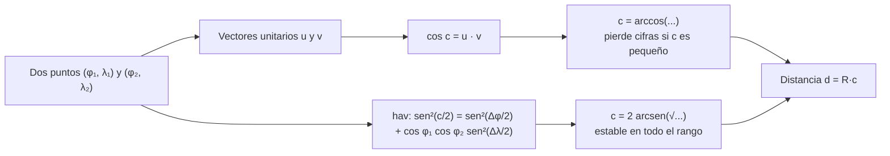

# B04-C16 — Geometría de esferas y círculos máximos

<!-- nav:top -->
[🏠 Programa](../../../../README.md) · [📚 Bloque B04](../../../tronco-comun/B04-algebra-trigonometria-y-geometria-espacial.md) · [← Anterior: B04-C15 — Rotación de puntos y ejes](../B04-C15-rotacion-de-puntos-y-ejes/CLASE.md) · [Siguiente: B04-C17 — Proyecciones cartográficas elementales →](../B04-C17-proyecciones-cartograficas-elementales/CLASE.md)
<!-- /nav -->

## 1. Ubicación, nivel y alcance

Decimosexta clase del bloque B04. Hasta ahora trabajaste con vectores y matrices en el espacio. Pero la Tierra y el cielo son (aproximadamente) esferas, y sus puntos se dan por dos ángulos; allí la distancia más corta entre dos puntos no es una recta sino un arco. Nivel N1. Verás círculos máximos, la distancia angular entre dos puntos de una esfera con la fórmula del coseno y con la del haversine, el acimut inicial y la comparación con distancias «planas», aplicadas a puntos de la Tierra y a estrellas. No verás proyecciones a un mapa (C17) ni elipsoides.

## 2. Por qué esta clase existe

Para pasar de un lugar a otro de la Tierra, un avión sigue (casi) un círculo máximo. Para decidir cuánto debe girar un telescopio entre dos estrellas, se calcula la distancia angular sobre la esfera celeste. La misma matemática sirve para ambas cosas, y la misma trampa también: la fórmula más conocida pierde precisión cuando los puntos están muy cerca.

La decisión central: **¿qué fórmula uso para la distancia más corta sobre una esfera, qué dirección inicial debo tomar y por qué lo «recto» sobre un mapa no es lo más corto?** Aprenderás las fórmulas, su dominio y la forma de comprobarlas.

## 3. Lo que podrás hacer al terminar

1. Definir círculo máximo y distinguirlo de un círculo menor (paralelo).
2. Calcular la distancia angular entre dos puntos con la fórmula del coseno y con la del haversine.
3. Convertir distancia angular en longitud de arco con el radio de la esfera.
4. Calcular el acimut inicial de un trayecto.
5. Comparar un círculo máximo con el arco de un paralelo y decir cuánto más corto es.
6. Decidir qué fórmula usar según la cercanía de los puntos.

La evidencia es la **distancia sobre la esfera por dos métodos** del ejercicio 12 (sección 20).

## 4. Con qué llegas y cómo comprobarlo

Necesitas ángulos, vectores y producto escalar (C06, C12, C13). Cinco preguntas:

1. ¿Cuánto vale la longitud de un arco de 90° en una esfera de radio 1?
2. ¿Cuánto es `sen²(x) + cos²(x)`?
3. Si dos vectores unitarios tienen `u · v = 0`, ¿qué ángulo forman?
4. Convierte `60°` a radianes.
5. ¿Cuánto es `cos 60°`?

<details>
<summary>Ver respuestas</summary>

1. `π/2 = 1,571`. 2. 1. 3. 90°. 4. `π/3 = 1,047`. 5. 0,5.
</details>

Con cuatro o cinco aciertos, sigue; si no, repasa C06 y C13.

## 5. Un caso real: tres distancias que no se parecen a lo que dicta el mapa

Con las radios nominales de la Tierra de la IAU (S1) se obtiene una esfera de radio 6371,00 km (cálculo propio: `(2R_e + R_p)/3`). En ella, 1° de círculo máximo mide 111,195 km y un cuarto de meridiano (del ecuador al polo), 10 007,5 km. Para dos puntos **sintéticos** a 60° N, uno en 10° E y el otro en 170° E, el círculo máximo mide 6560,2 km y el arco del paralelo, 8895,6 km: un 35,6 % más. Quien lea un mapa con ejes rectos pensará que ir «hacia el este» es lo más corto; el círculo máximo sube hacia el polo (su acimut inicial es 11,5°, casi hacia el norte) y es mucho más corto. Para el cielo, las mismas fórmulas dan la separación entre estrellas: Próxima Centauri y tau Ceti a 100,88°, igual que con el producto escalar de C13.

## 6. Vocabulario

Una **esfera** es el conjunto de puntos a una distancia `R` de un centro. Un **círculo máximo** es la intersección de la esfera con un plano que pasa por su centro; su radio es `R`. Un **círculo menor** es la intersección con un plano que no pasa por el centro; los paralelos de latitud (salvo el ecuador) lo son. La **distancia angular** `c` entre dos puntos es el ángulo, medido desde el centro, entre las direcciones a ambos; la **distancia de círculo máximo** es `d = R c` (con `c` en radianes). La **latitud** `φ` va de −90° (sur) a +90° (norte) y la **longitud** `λ` crece hacia el este. El **acimut** `Az` de un trayecto es el ángulo desde el norte, hacia el este (0° norte, 90° este). La función **haversine** es `hav(x) = sen²(x/2)`. Un **triángulo esférico** está formado por tres arcos de círculo máximo.

## 7. Modelo mental: cortar una naranja por el centro

Si cortas una naranja por un plano que pasa por su centro, el borde del corte es un círculo máximo; es el más grande que cabe en ella. Entre dos puntos de la cáscara, el camino más corto sobre ella es el arco de ese círculo.



*Descripción textual:* de dos puntos dados por latitud y longitud se obtienen dos caminos: el del coseno, igual al producto escalar de los vectores unitarios, y el del haversine; ambos dan la distancia angular `c`, que multiplicada por el radio da la distancia en longitud; el primero pierde precisión para `c` pequeño y el segundo no.

Analogía: un hilo tenso sobre una naranja. Su límite: la Tierra no es una esfera perfecta (es un elipsoide aplastado) y esta clase usa la esfera como aproximación; el error de forma llega a unas décimas de por ciento.

## 8. La explicación, paso a paso

### 8.1 Fórmula del coseno

`cos c = sen φ₁ sen φ₂ + cos φ₁ cos φ₂ cos(λ₂ − λ₁)` (S2, ec. 5-3). Es el producto escalar de los vectores unitarios de C13 escrito con latitud y longitud. Para `A = (0°, 0°)` y `B = (45° N, 90° E)`: `cos c = 0 + 1 × 0,7071 × 0 = 0`, `c = 90°`.

### 8.2 Fórmula del haversine

`sen(c/2) = √[sen²((φ₂ − φ₁)/2) + cos φ₁ cos φ₂ sen²((λ₂ − λ₁)/2)]` (S2, ec. 5-3a). Es exacta y precisa en todo el rango de 0° a casi 180°. La fuente avisa de que la del coseno «no es precisa» para valores de `c` muy cercanos a cero. En el laboratorio, con `c = 10⁻⁸ rad` (0,002″), el haversine da `1,000000 × 10⁻⁸` y el coseno da `0`.

### 8.3 Distancia y acimut

La distancia es `d = R c` con `c` en radianes. El acimut inicial sale de `tan Az = cos φ₂ sen Δλ / (cos φ₁ sen φ₂ − sen φ₁ cos φ₂ cos Δλ)` (S2, ec. 5-4b), que se evalúa con `atan2` para obtener el cuadrante (C10). Para `A = (0°, 0°)` y `B = (45° N, 90° E)`, `Az = 45°`. La fuente señala que esta forma «evita las imprecisiones» de usar arcsen cerca de 90° o arccos cerca de 0°.

### 8.4 Círculo máximo frente a paralelo

A latitud `φ`, el paralelo es un círculo de radio `R cos φ`. Dos puntos a 60° N con `Δλ = 160°` están a un arco de paralelo `R cos 60° × (160° en rad) = 0,5 × 2,7925 × 6371 = 8895,6 km` y a una distancia de círculo máximo `6560,2 km`. Un mapa que dibuja los paralelos como rectas hace que el camino «recto» sea el más largo (C17).

### 8.5 En el cielo

Para dos estrellas con ascensión recta `α` y declinación `δ`, las mismas fórmulas valen con `λ = α` y `φ = δ`. Para Próxima Centauri y tau Ceti dan `100,8829°` por las dos fórmulas, igual que el producto escalar (C13). La fórmula del haversine es la elegida en la práctica cuando las separaciones son pequeñas.

### 8.6 Forma de la Tierra

El cuarto de meridiano usando `R_e = 6378,1 km` da 10 018,7 km y con `R_p = 6356,8 km`, 9985,2 km: 0,34 % de diferencia. La esfera de la clase usa el radio medio `(2R_e + R_p)/3 = 6371,00 km` y su error sobre la distancia real es de ese orden. Para distancias geodésicas exactas se usa un elipsoide (no tratado).

## 9. Magnitudes, símbolos y unidades

| Símbolo | Qué es | Unidad | Nota |
|---|---|---|---|
| `R` | radio de la esfera | km | 6371,00 (cálculo propio con S1) |
| `φ`, `λ` | latitud y longitud | ° | `λ` positiva al este |
| `c` | distancia angular | rad o ° | `0 ≤ c ≤ 180°` |
| `d` | distancia de círculo máximo | km | `d = R c` |
| `Az` | acimut inicial | ° | desde el norte hacia el este |
| `hav(x)` | haversine | adimensional | `sen²(x/2)` |
| `R_e`, `R_p` | radios nominales ecuatorial y polar | km | 6378,1; 6356,8 (S1) |

## 10. Convenciones y referencias

Latitud al norte positiva, longitud al este positiva y acimut medido desde el norte en sentido horario (S2). Para las estrellas, `λ = α` y `φ = δ`. La esfera usada es una aproximación; los puntos terrestres son **sintéticos**; las coordenadas de las estrellas son las de S3 (estimadas, marco y época no verificados). Los nombres de lugares reales no se usan para evitar atribuir distancias reales a rutas concretas.

## 11. De dónde sale lo que afirmamos

| ID | Fuente | Localizador | Respalda | Estado |
|---|---|---|---|---|
| S1 | IAU, Resolución B3 de 2015, arXiv:1510.07674 | https://arxiv.org/pdf/1510.07674 | `R_eE = 6,3781 × 10⁶ m` y `R_pE = 6,3568 × 10⁶ m` nominales | Texto leído el 2026-11-05 |
| S2 | USGS, J. P. Snyder, *Map Projections – A Working Manual* (Prof. Paper 1395, 1987), cap. 5, ec. (5-2), (5-3), (5-3a), (5-4b) | https://pubs.usgs.gov/pp/1395/report.pdf, p. 30 | Fórmula del coseno, forma estable (haversine) y acimut | PDF leído (texto) el 2026-11-05 |
| S3 | NASA Exoplanet Archive, consulta TAP (`pscomppars`, `ra`, `dec`) | https://exoplanetarchive.ipac.caltech.edu/TAP | Coordenadas de Próxima Cen, tau Cet y eps Eri | Consulta del 2026-11-05 (mutable; estimado; marco y época no verificados) |

Límites: el radio medio de la esfera es un cálculo propio a partir de valores nominales y no una cifra publicada de radio medio. S2 describe la fórmula y avisa de su imprecisión; la magnitud de la pérdida de cifras sale del laboratorio. No se consultaron fórmulas de geodesia sobre elipsoide.

## 12. Cómo ver los resultados

| Trayecto (puntos sintéticos) | `c` (°) | `d` (km) | Acimut inicial (°) |
|---|---|---|---|
| A (0° N, 0° E) → B (45° N, 90° E) | 90,0000 | 10 007,5 | 45,000 |
| C (60° N, 10° E) → D (60° N, 170° E) | 58,9974 | 6560,2 | 11,508 |
| A → D | 119,4987 | 13 287,6 | 5,725 |

| Estrellas (S3) | `c` (°) |
|---|---|
| Próxima – tau Ceti | 100,8829 |
| Próxima – eps Eri | 106,8342 |
| tau Ceti – eps Eri | 27,3039 |

Descripción larga: en el globo, el círculo máximo entre C y D pasa por encima de 60° N, cerca del polo; la ruta de paralelo es un arco más largo que queda al sur de él.

## 13. Ejemplo trabajado: dos puntos a 60° N

Datos (sintéticos): `C = (60° N, 10° E)`, `D = (60° N, 170° E)`, `R = 6371,0 km`.

**Paso 1 · Planteamiento.** `Δφ = 0°`, `Δλ = 160°`, `cos φ₁ = cos φ₂ = 0,5`.

**Paso 2 · Haversine.** `sen²(Δλ/2) = sen²(80°) = 0,96985`; `hav = 0 + 0,5 × 0,5 × 0,96985 = 0,24246`; `sen(c/2) = 0,49241`; `c/2 = 29,499°`; `c = 58,997°` (el laboratorio: 58,9974°).

**Paso 3 · Distancia.** `c = 58,997° × π/180 = 1,02972 rad`; `d = 6371,0 × 1,02972 = 6560 km`.

**Paso 4 · Comprobar con la fórmula del coseno.** `cos c = sen²(60°) + cos²(60°) cos(160°) = 0,75 + 0,25 × (−0,93969) = 0,51508`; `c = arccos(0,51508) = 58,997°` ✓.

**Paso 5 · Contraste.** Arco del paralelo: `R cos 60° × 160° (2,7925 rad) = 8895,6 km`: 35,6 % más largo. Resultado con 3–4 cifras: `6560 km`. Es un modelo esférico y puntos sintéticos.

## 14. Distintas formas de calcular distancias sobre la esfera

**Fórmula del coseno:** simple y suficiente para distancias grandes. **Haversine:** estable para todo rango; la que conviene programar. **Cuerda** (C13): `c = 2 arcsen(|u − v|/2)`, equivalente. **Aproximación plana:** válida solo para separaciones pequeñas y cerca del ecuador. **Elipsoide:** necesario para precisión geodésica y no tratado aquí.

## 15. Práctica guiada

**Ejercicio 1 · con los pasos indicados.** Calcula la longitud de un cuarto de meridiano con `R = 6371,0 km`. *Pasos:* `d = R c`, `c = 90°`.

<details><summary>Solución comentada</summary>

`c = π/2 = 1,5708 rad`; `d = 6371,0 × 1,5708 = 10 007,5 km`. Un grado mide `10 007,5/90 = 111,19 km`.
</details>

**Ejercicio 2 · con una pista.** Distancia angular entre `(0°, 0°)` y `(0°, 90°)` con el haversine. *Pista:* `Δφ = 0`.

<details><summary>Solución comentada</summary>

`sen²(45°) = 0,5`; `sen(c/2) = 0,7071`; `c/2 = 45°`; `c = 90°`: un cuarto de ecuador.
</details>

**Ejercicio 3 · casi autónomo.** Distancia entre `(10° N, 20° E)` y `(30° N, 140° E)` con la fórmula del coseno.

<details><summary>Solución comentada</summary>

`cos c = sen 10° sen 30° + cos 10° cos 30° cos 120° = 0,17365 × 0,5 + 0,98481 × 0,86603 × (−0,5) = 0,08682 − 0,42642 = −0,33960`; `c = 109,85°`; `d = 109,85 × 111,195 = 12 215 km`. (Con el haversine se obtiene el mismo valor.)
</details>

## 16. Práctica autónoma, transferencia e integrador

**Ejercicio 4.** ¿Cuál es la distancia angular entre dos puntos antípodas? ¿Y la distancia en km?

<details><summary>Solución comentada</summary>

180°; `π × 6371,0 = 20 015 km`: la mitad de un círculo máximo.
</details>

**Ejercicio 5.** Acimut inicial de `(0°, 0°)` a `(10° N, 0°)`, a `(0°, 10° E)` y a `(10° S, 0°)`.

<details><summary>Solución comentada</summary>

0°, 90° y 180°: norte, este y sur. (`atan2(0; positivo)`, `atan2(positivo; 0)`, `atan2(0; negativo)`).
</details>

**Ejercicio 6.** ¿Cuánto mide el arco de un paralelo a 60° N entre dos puntos con `Δλ = 90°`? ¿Y su círculo máximo?

<details><summary>Solución comentada</summary>

Paralelo: `6371 × 0,5 × π/2 = 5004 km`. Círculo máximo: `sen²(c/2) = 0,25 × sen²(45°) = 0,125`; `c/2 = 20,70°`; `c = 41,41°`; `d = 4604 km`. El paralelo es 8,7 % más largo.
</details>

**Ejercicio 7.** Compara el cuarto de meridiano con `R_e = 6378,1 km` y con `R_p = 6356,8 km` (S1). ¿Qué error relativo tiene usar el radio medio de 6371,0 km?

<details><summary>Solución comentada</summary>

`10 018,7` y `9985,2 km`; con 6371,0: `10 007,5 km`. Error respecto del primero `−0,11 %`; respecto del segundo `+0,22 %`. La esfera sirve a décimas de por ciento.
</details>

**Ejercicio 8.** Dos estrellas con `(α, δ) = (10°, 0°)` y `(47,5°, 0°)`: ¿cuál es su separación? ¿Y con los vectores de C13?

<details><summary>Solución comentada</summary>

`Δδ = 0`: `sen²(18,75°) = 0,10332`; `c/2 = 18,75°`; `c = 37,5°`. Con vectores, `u · v = cos 37,5°`: igual.
</details>

**Ejercicio 9 · transferencia.** Un compañero dice: «a 60° N, ir del punto C al D siguiendo el paralelo es más corto porque no hay que cambiar de rumbo». Evalúa.

<details><summary>Solución comentada</summary>

Seguir el paralelo exige un rumbo constante este–oeste, pero mide 8895,6 km frente a los 6560,2 km del círculo máximo. El camino más corto cambia continuamente de acimut: sale con acimut 11,5° y llega con 168,5° (casi hacia el sur, por simetría). Cambiar de rumbo es el precio de la distancia mínima.
</details>

**Ejercicio 10 · transferencia.** Un programa usa la fórmula del coseno para separar dos estrellas de 0,002″ y obtiene 0. ¿Qué ocurre y cómo se corrige?

<details><summary>Solución comentada</summary>

`cos c` es `1 − 5 × 10⁻¹⁷`, menor que la resolución de la máquina (≈ 1,1 × 10⁻¹⁶): se redondea a 1 y `arccos` da 0. Se corrige con el haversine (o la cuerda), que no resta números casi iguales.
</details>

**Ejercicio 11 · transferencia.** El trayecto C→D sale con acimut 11,5° y llega con 168,5°. ¿Qué círculos máximos mantienen el mismo acimut en todo su recorrido? ¿Por qué los demás no?

<details><summary>Solución comentada</summary>

Solo los meridianos (acimut 0° o 180°) y el ecuador (acimut 90°). Cualquier otro círculo máximo cambia de acimut a lo largo de su trayecto porque los meridianos convergen en los polos.
</details>

**Ejercicio 12 · integrador.** Elabora tu *distancia sobre la esfera por dos métodos* (sección 20): elige dos puntos sintéticos y dos estrellas de S3, calcula `c` con la fórmula del coseno y con el haversine, el acimut inicial para los puntos terrestres, la distancia en km, y compara con el arco del paralelo (si están a la misma latitud).

<details><summary>Solución modelo</summary>

Tabla con puntos, `c` por ambos métodos con diferencia (≲ 10⁻⁹), `d`, acimut y comparación con el paralelo; declaración de esfera aproximada y de datos sintéticos; fuentes con fecha y alcance.
</details>

## 17. Laboratorio: círculos máximos y precisión

El script [circulos_maximos.py](circulos_maximos.py) implementa las tres fórmulas de S2. Antes comprueba: ecuador→polo = 90°, antípodas = 180°, un cuarto de ecuador, coincidencia coseno/haversine en tres trayectos, simetría, desigualdad triangular, acimutes de 0°, 90° y 180°, y que para `c = 10⁻⁸ rad` el haversine sea exacto y el coseno pierda precisión.

**Datos:** publicados (IAU, USGS, NASA) y puntos sintéticos. **Predice antes de ejecutar:** ¿cuánto vale `c` entre `(0°, 0°)` y `(45° N, 90° E)`? (90°.) **Ejecución del 2026-11-05 (Python 3.12.9):**

```text
Radio de la esfera de la clase R = (2 Re + Rp)/3 = 6371.00 km
Un grado de círculo máximo = 111.195 km; cuarto de meridiano = 10007.5 km
  C (60°N, 10°E) → D (60°N, 170°E): c =  58.9974° ; d =    6560.2 km ; acimut inicial =  11.508°
  Paralelo 60°N entre C y D: arco del paralelo = 8895.6 km frente al círculo máximo 6560.2 km (35.6 % más largo)
  Proxima Cen – tau Cet: 100.8829° (5-3a), 100.8829° (5-3)
c = 0.0021″: (5-3a) = 1.000000e-08 rad; (5-3) = 0.000000e+00 rad; exacto 1.000000e-08
```

```bash
python programa/clases/B04/B04-C16-geometria-de-esferas-y-circulos-maximos/circulos_maximos.py
```

**Límites:** esfera, no elipsoide; puntos sintéticos; sin relieve ni refracción; no es una herramienta de navegación.

## 18. Errores frecuentes y cómo corregirlos

**Confundir distancia angular con distancia en km.** Se corrige con `d = R c` y el ejercicio 1.

**Usar la fórmula del coseno para puntos muy cercanos.** Se corrige con el ejercicio 10.

**Suponer que el rumbo constante es el camino más corto.** Se corrige con los ejercicios 9 y 11.

**Mezclar grados y radianes.** Ver C06.

**Olvidar el cuadrante del acimut.** Se corrige con `atan2` y el ejercicio 5.

## 19. Cómo sabrás que vas bien

Tras 8.1: ¿calculas `c` con la fórmula del coseno? Si no, ejercicio 3. Tras 8.2: ¿explicas cuándo falla? Si no, ejercicio 10. Tras 8.4: ¿comparas paralelo y círculo máximo? Si no, ejercicio 6. Tras el laboratorio: ¿qué comprueba para `c` pequeño? Si no lo sabes, lee su cabecera.

## 20. Qué entregas y cómo se evalúa

El producto es tu **distancia sobre la esfera por dos métodos** (ejercicio 12).

| Criterio | Inicial | En desarrollo | Logrado | Destacado |
|---|---|---|---|---|
| Fórmulas | Confunde ángulos y kilómetros | Una fórmula correcta | Dos fórmulas coinciden | Explica el dominio de cada una |
| Acimut | Ausente | Sin cuadrante | Con `atan2` | Explica por qué cambia a lo largo del trayecto |
| Comparación | No compara | Con paralelo sin cuantificar | Cuantifica la diferencia | Discute el error de la esfera |
| Precisión | No la considera | La menciona | Prueba el caso pequeño | Elige la fórmula con criterio |
| Fuentes | Sin fuente | Sin fecha | Con localizador y fecha | Marca lo sintético y lo calculado |

**Condiciones críticas (no se compensan con promedio):** distinguir sintético de real; declarar el modelo de esfera; citar solo fuentes consultadas.

## 21. Ética, seguridad y límites

Las distancias de esta clase no deben usarse para planificar rutas reales; los puntos son sintéticos y el modelo es esférico. Aplicar sin criterio una fórmula que pierde precisión es una fuente de errores silenciosos. Accesibilidad: fórmulas en texto, tablas equivalentes al globo, ejercicios sin conexión.

## 22. Para cerrar y seguir

El camino más corto sobre una esfera es un arco de círculo máximo; su distancia angular sale del coseno o del haversine, y este último no pierde precisión cuando los puntos están cerca. Un mapa con paralelos rectos engaña. Queda abierta una pregunta: ¿cómo se aplana una esfera sobre un papel y qué se distorsiona? Eso es C17.

**Glosario español–inglés.** esfera · *sphere*; círculo máximo · *great circle*; círculo menor · *small circle*; distancia angular · *angular distance*; acimut · *azimuth*; latitud · *latitude*; longitud · *longitude*; haversine · *haversine*.

**Continuidad.** B04-C17 usa tu capacidad de **calcular sobre la esfera** para estudiar proyecciones cartográficas. B04-C20 usará las distancias angulares en el diseño de triangulaciones.

**Referencias:** ver sección 11.

<!-- nav:bottom -->
---

[← Anterior: B04-C15 — Rotación de puntos y ejes](../B04-C15-rotacion-de-puntos-y-ejes/CLASE.md) · [📚 Bloque B04](../../../tronco-comun/B04-algebra-trigonometria-y-geometria-espacial.md) · [Siguiente: B04-C17 — Proyecciones cartográficas elementales →](../B04-C17-proyecciones-cartograficas-elementales/CLASE.md)
<!-- /nav -->
