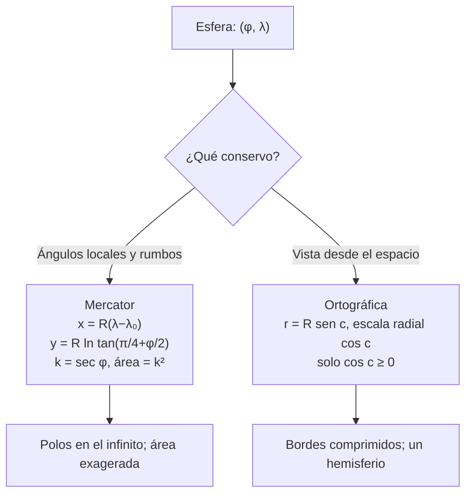

# B04-C17 — Proyecciones cartográficas elementales

<!-- nav:top -->
[🏠 Programa](../../../../README.md) · [📚 Bloque B04](../../../tronco-comun/B04-algebra-trigonometria-y-geometria-espacial.md) · [← Anterior: B04-C16 — Geometría de esferas y círculos máximos](../B04-C16-geometria-de-esferas-y-circulos-maximos/CLASE.md) · [Siguiente: B04-C18 — Cónicas y secciones orbitales →](../B04-C18-conicas-y-secciones-orbitales/CLASE.md)
<!-- /nav -->

## 1. Ubicación, nivel y alcance

Decimoséptima clase del bloque B04. En la [clase anterior](../B04-C16-geometria-de-esferas-y-circulos-maximos/CLASE.md) calculaste distancias sobre la esfera y viste que un mapa con paralelos rectos engaña. Aquí se explica por qué: aplanar una esfera sobre un papel obliga a distorsionar algo. Nivel N1. Verás qué es una proyección, la proyección de Mercator (cilíndrica, conforme) y la ortográfica (vista desde el espacio), los factores de escala, cómo medir la distorsión de ángulos, distancias y áreas, y cómo elegir según el uso, aplicadas a mapas de la Tierra y de cuerpos esféricos. No verás proyecciones sobre elipsoides ni los mapas del cielo completos (otros bloques).

## 2. Por qué esta clase existe

Casi todo lo que ves del espacio, de la Tierra o de otro cuerpo, llega en forma de mapa: la superficie de un planeta, el cielo entero, la huella de un satélite. Y un mapa es una proyección. Si no sabes qué conserva y qué distorsiona la que estás mirando, mides mal, comparas mal y concluyes mal.

La decisión central: **¿qué propiedad necesito conservar (ángulos, áreas, distancias desde un punto) y qué distorsión estoy dispuesto a aceptar?** Aprenderás las fórmulas de dos proyecciones, a calcular su factor de escala y a elegir con criterio.

## 3. Lo que podrás hacer al terminar

1. Definir proyección, factor de escala y distorsión.
2. Calcular las coordenadas de un punto en la proyección de Mercator y en la ortográfica.
3. Calcular el factor de escala `k = sec φ` de Mercator y su factor de área `k²`.
4. Explicar por qué los círculos máximos no son rectas en Mercator.
5. Reconocer el hemisferio visible de la ortográfica y su escala radial `cos c`.
6. Elegir una proyección según la propiedad que debe conservarse.

La evidencia es la **comparación de distorsiones de dos proyecciones** del ejercicio 12 (sección 20).

## 4. Con qué llegas y cómo comprobarlo

Necesitas latitud, longitud y círculos máximos (C16), y logaritmos (C05). Cinco preguntas:

1. ¿Cuánto es `1/cos 60°`?
2. ¿Cuánto vale `ln(e²)`?
3. ¿Qué es un círculo máximo?
4. ¿A qué distancia del centro de la Tierra, en un mapa de radio `R`, queda un punto a 90° del centro de proyección en una ortográfica? (Pista: `R sen 90°`.)
5. Si una longitud se amplía por un factor 2 en ambas direcciones, ¿por cuánto se amplía el área?

<details>
<summary>Ver respuestas</summary>

1. 2. 2. 2. 3. La intersección de la esfera con un plano que pasa por su centro. 4. `R`. 5. Por 4.
</details>

Con cuatro o cinco aciertos, sigue; si no, repasa C05 y C16.

## 5. Un caso real: la esfera no cabe en un papel plano sin pagar un precio

El manual de proyecciones del Servicio Geológico de EE. UU. (S1) describe la proyección de Mercator como una de las más conocidas: conserva los ángulos locales (por eso las formas pequeñas se ven bien), muestra los rumbos constantes como rectas, pero distorsiona el área, tanto más cuanto más cerca de los polos. En ella, el factor de escala es `k = sec φ`: a 60° vale 2 (las longitudes se ven al doble) y el factor de área vale `k² = 4`: una región a 60° de latitud ocupa cuatro veces el área aparente de una igual en el ecuador. La proyección ortográfica, en cambio, muestra el globo como se ve desde lejos: conserva lo que está cerca del centro y comprime los bordes con una escala radial `cos c`. En esta clase calculas ambas con una esfera de 6371,0 km y los puntos de ejemplo son **sintéticos**.

## 6. Vocabulario

Una **proyección cartográfica** es una regla que asigna a cada punto `(φ, λ)` de la esfera un punto `(x, y)` del plano. El **factor de escala** `k` en un punto y dirección es la razón entre la longitud en el mapa y la longitud real; `k = 1` significa sin distorsión. Una proyección **conforme** conserva los ángulos locales; una **equivalente** conserva las áreas; ninguna puede conservar a la vez ángulos y áreas (salvo en una esfera, que no cabe en un plano). **Mercator** es cilíndrica y conforme: `x = R(λ − λ₀)`, `y = R ln tan(π/4 + φ/2)`. **Ortográfica** es una perspectiva desde un punto infinitamente lejano: `x = R cos φ sen(λ − λ₀)`, `y = R[cos φ₁ sen φ − sen φ₁ cos φ cos(λ − λ₀)]`, con `(φ₁, λ₀)` el centro de la proyección. Una **línea de rumbo constante** (loxodrómica) corta a los meridianos siempre con el mismo ángulo. El **meridiano central** `λ₀` es el que queda como eje `y`.

## 7. Modelo mental: pelar una naranja

Si intentas aplastar la cáscara de una naranja sobre una mesa, se rompe o se estira. Cada proyección decide dónde estirar y dónde romper. Mercator estira hacia los polos de modo que los ángulos se conserven; la ortográfica deja ver una cara y comprime los bordes.



*Descripción textual:* de la esfera se elige una proyección según lo que se quiere conservar: Mercator conserva ángulos y rumbos pero exagera el área hacia los polos, que quedan en el infinito; la ortográfica muestra un hemisferio con los bordes comprimidos.

Analogía: pelar una naranja. Su límite: la naranja real es un sólido; una esfera matemática no se «rompe», pero una proyección introduce discontinuidades o estiramientos que no existen en el objeto.

## 8. La explicación, paso a paso

### 8.1 Mercator

`x = R(λ − λ₀)` y `y = R ln tan(π/4 + φ/2)` (S1). Con `R = 1`, `y(45°) = 0,88137`, `y(60°) = 1,31696`, `y(75°) = 2,02759` y `y(85°) = 3,13130`, que coinciden con la tabla impresa en S1. En el ecuador, `y = 0`; hacia los polos, `y → ∞`. La inversa es `φ = arctan(sinh(y/R))` y `λ = x/R + λ₀`.

### 8.2 Escala de Mercator

`h = k = sec φ` (S1): el factor de escala es igual en todas las direcciones del punto (por eso es conforme), pero cambia con la latitud. `k(0°) = 1`, `k(30°) = 1,155`, `k(45°) = 1,414`, `k(60°) = 2`, `k(75°) = 3,864`, `k(85°) = 11,47`. El factor de área es `k²` (S1): ×4 a 60° y ×131,6 a 85°. S1 añade que a 10° del ecuador la escala es solo 1,5 % mayor, lo que el laboratorio confirma (`sec 10° = 1,0154`).

### 8.3 Ortográfica

Con centro `(φ₁, λ₀)` se define `cos c = sen φ₁ sen φ + cos φ₁ cos φ cos(λ − λ₀)`; el punto es visible si `cos c ≥ 0`. La escala a lo largo de una línea que parte del centro es `h' = cos c`, y en dirección perpendicular `k' = 1` (S1). La distancia del punto al centro del mapa es `R sen c` (S1). Con centro en `(0°, 0°)` y el punto `(60° N, 0°)`: `y = R sen 60° = 5517 km`, `h' = 0,5`. El límite del mapa es una circunferencia de radio `R`.

### 8.4 Círculos máximos y rumbos

En Mercator, las líneas de rumbo constante (como el paralelo a 60° N) son rectas; el círculo máximo entre dos puntos no lo es. Para `C = (60° N, 10° E)` y `D = (60° N, 170° E)`, el punto medio del círculo máximo está en `84,27° N`, `y = 2,9957 R` frente a `y = 1,3170 R` de la recta CD: el camino más corto «sube» mucho en el mapa, aunque en el globo es el más corto (C16).

### 8.5 Elegir una proyección

Para navegar a rumbo constante o ver formas locales: Mercator, con cuidado en altas latitudes. Para comparar áreas: una proyección equivalente (no tratada aquí). Para ilustrar la apariencia de un cuerpo desde lejos: ortográfica. Para medir distancias: no sobre un mapa, sino con la esfera (C16).

## 9. Magnitudes, símbolos y unidades

| Símbolo | Qué es | Unidad | Nota |
|---|---|---|---|
| `R` | radio de la esfera | km | 6371,0 (cálculo de C16) |
| `φ`, `λ` | latitud y longitud | ° o rad | las fórmulas piden radianes |
| `λ₀` | meridiano central | ° | origen de `x` |
| `(x, y)` | coordenadas del mapa | km | `y` creciente hacia el norte |
| `k`, `h` | factores de escala | adimensional | Mercator: `sec φ` |
| `k²` | factor de área | adimensional | solo en proyecciones conformes |
| `c` | distancia angular al centro | ° | `cos c ≥ 0` en la ortográfica |

## 10. Convenciones y referencias

`x` crece hacia el este e `y` hacia el norte; `(λ − λ₀)` se ajusta a `[−180°, 180°]`. Las fórmulas de Snyder se dan en radianes (S1). Las latitudes de los ejemplos y los puntos `C` y `D` son **sintéticos**. La esfera es una aproximación de la Tierra (C16); S1 contiene también las fórmulas del elipsoide, que no se usan aquí. Mercator no se define en los polos.

## 11. De dónde sale lo que afirmamos

| ID | Fuente | Localizador | Respalda | Estado |
|---|---|---|---|---|
| S1 | USGS, J. P. Snyder, *Map Projections – A Working Manual* (Prof. Paper 1395, 1987), cap. 7 (Mercator), cap. 20 (Ortográfica), cap. 5 | https://pubs.usgs.gov/pp/1395/report.pdf, pp. 38–46 y cap. 20 | `h = k = sec φ`, factor de área `k²`, inversa `φ = arctan(sinh(y/R))`; tabla 7 de `y` para la esfera; ec. (20-3)–(20-5) de la ortográfica; «distancia del centro proporcional al seno de la distancia angular» | PDF leído (texto) el 2026-11-05 |
| S2 | IAU, Resolución B3 de 2015, arXiv:1510.07674 | https://arxiv.org/pdf/1510.07674 | Radios nominales de la Tierra usados en el radio de la esfera (C16) | Texto leído el 2026-11-05 |

Límites: el manual se leyó con extracción de texto; la fórmula `y = R ln tan(π/4 + φ/2)` se contrasta con la tabla impresa (valores de `y`) y con la inversa citada (7-4a), no con la ecuación (7-2) transcrita. Las frases sobre «ninguna proyección conserva a la vez ángulos y áreas» son resultados clásicos de cartografía que S1 trata; aquí se enuncian sin cita puntual de página. No se consultó el elipsoide.

## 12. Cómo ver las distorsiones

| `φ` (°) | `y` Mercator (km) | `k` | `k²` (área) |
|---|---|---|---|
| 0 | 0 | 1,0000 | 1,000 |
| 30 | 3500 | 1,1547 | 1,333 |
| 45 | 5615 | 1,4142 | 2,000 |
| 60 | 8390 | 2,0000 | 4,000 |
| 75 | 12 918 | 3,8637 | 14,93 |
| 85 | 19 950 | 11,474 | 131,6 |

| `c` (°) | `y` ortográfica (km) | `h' = cos c` |
|---|---|---|
| 0 | 0 | 1,0000 |
| 30 | 3185 | 0,8660 |
| 60 | 5517 | 0,5000 |
| 80 | 6274 | 0,1736 |
| 90 | 6371 | 0,0000 |

Descripción larga: en Mercator, las distancias entre paralelos crecen sin límite hacia el polo; en la ortográfica, los paralelos del hemisferio visible se acercan cada vez más al borde y la última franja de 10° (80° a 90°) ocupa solo 97 km de los 6371.

## 13. Ejemplo trabajado: un punto a 60° N en las dos proyecciones

Datos: `R = 6371,0 km`; punto `(60° N, 0°)`; centro de la ortográfica en `(0°, 0°)`; meridiano central de Mercator `λ₀ = 0°`.

**Paso 1 · Mercator `y`.** `y = R ln tan(45° + 30°) = 6371 × ln tan 75° = 6371 × 1,31696 = 8390 km`; `x = 0`. Comprobación con S1: `y(60°)` con `R = 1` es 1,31696 ✓.

**Paso 2 · Mercator, escala.** `k = sec 60° = 2`; `k² = 4`: un cuadrado de 100 × 100 km a 60° N se dibujaría de 200 × 200 km, cuatro veces el área.

**Paso 3 · Ortográfica.** `cos c = sen 0° sen 60° + cos 0° cos 60° cos 0° = 0,5`; `c = 60°`; visible (`cos c ≥ 0`). `y = R[cos 0° sen 60° − sen 0° …] = 6371 × 0,86603 = 5517 km`; `x = R cos 60° sen 0° = 0`.

**Paso 4 · Ortográfica, escala.** `h' = cos c = 0,5`: a lo largo del meridiano las longitudes se ven a la mitad; `k' = 1` en dirección perpendicular. Comprobación: `R sen c = 6371 × 0,86603 = 5517` ✓.

**Paso 5 · Interpretación y límite.** Mercator agranda lo que está cerca del polo; la ortográfica lo comprime. Ambos son modelos sobre una esfera y los puntos son sintéticos. Resultados con 3–4 cifras.

## 14. Distintas formas de dibujar una esfera

**Cilíndricas** (Mercator): fáciles de leer en filas y columnas; el polo es un problema. **Perspectivas** (ortográfica): muestran lo que vería un observador lejano, de un hemisferio por vez. **Equivalentes** (no tratadas): conservan áreas y son mejores para comparar superficies. **Compromiso** (no tratadas): reparten la distorsión. La elección es el resultado de la pregunta que se quiere responder, no de la preferencia.

## 15. Práctica guiada

**Ejercicio 1 · con los pasos indicados.** Calcula `y` de Mercator para `φ = 45°` con `R = 6371,0 km`. *Pasos:* `y = R ln tan(π/4 + φ/2)`.

<details><summary>Solución comentada</summary>

`tan(67,5°) = 2,41421`; `ln 2,41421 = 0,88137`; `y = 6371 × 0,88137 = 5615 km`. Coincide con S1 (`y = 0,88137` para `R = 1`).
</details>

**Ejercicio 2 · con una pista.** ¿Cuántas veces se amplía el área a 45° de latitud en Mercator? *Pista:* `k²`.

<details><summary>Solución comentada</summary>

`k = sec 45° = 1,4142`; `k² = 2,000`. Un cuadrado a 45° se dibuja con el doble del área real.
</details>

**Ejercicio 3 · casi autónomo.** Ortográfica con centro `(0°, 0°)`: calcula `x`, `y` y `h'` para el punto `(30° N, 40° E)`.

<details><summary>Solución comentada</summary>

`x = R cos 30° sen 40° = 6371 × 0,86603 × 0,64279 = 3547 km`; `y = R[cos 0° sen 30° − 0] = 3185,5 km`; `cos c = cos 30° cos 40° = 0,66341`; `h' = 0,663` (visible: positivo). `r = √(3547² + 3185,5²) = 4767 km`; `R sen c = 6371 × 0,74827 = 4767` ✓.
</details>

## 16. Práctica autónoma, transferencia e integrador

**Ejercicio 4.** ¿Qué escala tiene Mercator a 10° de latitud? ¿Concuerda con la afirmación de S1 de «1,5 % mayor»?

<details><summary>Solución comentada</summary>

`sec 10° = 1/0,98481 = 1,0154`: 1,5 % ✓.
</details>

**Ejercicio 5.** Calcula `φ` si en Mercator (esfera, `R = 1`) `y = 2,02759`. Usa la inversa.

<details><summary>Solución comentada</summary>

`φ = arctan(sinh 2,02759)`; `sinh 2,02759 = 3,7321`; `arctan(3,7321) = 75,0°` ✓ (tabla de S1).
</details>

**Ejercicio 6.** ¿Cuál es el factor de área a 80° N? Si una isla mide 1000 km² reales a esa latitud, ¿cuánto «parece» medir?

<details><summary>Solución comentada</summary>

`k² = sec² 80° = 33,16`; la isla se dibuja con `33 160 km²`: parece 33 veces mayor.
</details>

**Ejercicio 7.** Ortográfica con centro en el ecuador: ¿qué `x` tiene el punto `(0°, 60° E)`? ¿Y qué escala radial?

<details><summary>Solución comentada</summary>

`x = R cos 0° sen 60° = 5517 km`; `cos c = cos 60° = 0,5`: escala radial 0,5 (en esa dirección, `x`).
</details>

**Ejercicio 8.** Un punto con `cos c < 0` en una ortográfica, ¿dónde está?

<details><summary>Solución comentada</summary>

En el hemisferio oculto, el opuesto al observador. La fórmula daría coordenadas dentro del círculo, pero no son visibles: hay que descartarlo (`cos c ≥ 0`).
</details>

**Ejercicio 9 · transferencia.** Un titular (hipotético) dice: «Groenlandia es tan grande como África»; la impresión viene de un mapa de Mercator. ¿Qué propiedad de qué proyección explica ese error de percepción? ¿Qué cálculo harías para evaluarlo?

<details><summary>Solución comentada</summary>

El factor de área `k² = sec² φ` de Mercator: a unos 70° N es `1/cos² 70° = 8,5`, y en África (cerca del ecuador) es ~1. Habría que calcular las áreas reales con datos consultados (no consultados aquí) y compararlas con las áreas del mapa dividiendo por `k²`.
</details>

**Ejercicio 10 · transferencia.** Un mapa estelar usa una proyección cuyo factor de escala crece hacia los bordes. ¿Qué conclusión incorrecta sobre separaciones entre estrellas podría extraer un lector?

<details><summary>Solución comentada</summary>

Que dos estrellas cerca del borde están más lejos de lo que están en realidad. Para medir separaciones hay que calcular con las coordenadas (C13, C16), no con la regla sobre el mapa.
</details>

**Ejercicio 11 · transferencia.** ¿Por qué un astrónomo no puede dibujar el cielo completo con la ortográfica?

<details><summary>Solución comentada</summary>

Porque solo muestra un hemisferio (el visible, `cos c ≥ 0`) y comprime los bordes; para el cielo completo se necesitan dos hemisferios o una proyección de toda la esfera.
</details>

**Ejercicio 12 · integrador.** Elabora tu *comparación de distorsiones de dos proyecciones* (sección 20): elige cinco latitudes, calcula `y`, `k` y `k²` en Mercator y `h'` en la ortográfica (centro en el ecuador), comprueba dos valores con S1, y escribe cuál usarías para cada uso de la sección 8.5 y por qué.

<details><summary>Solución modelo</summary>

Tabla con los valores calculados y su comprobación contra la tabla impresa de S1; texto que asocia cada proyección con la propiedad que conserva; declaración de esfera, datos sintéticos y límites; fuentes con fecha.
</details>

## 17. Laboratorio: Mercator y ortográfica contra la tabla impresa

El script [proyecciones.py](proyecciones.py) implementa ambas proyecciones. Antes comprueba: cuatro valores de la tabla de Snyder (45°, 60°, 75°, 85°, a 10⁻⁵), la ida y vuelta de Mercator, que `k = sec φ` (con una derivada numérica), `sec 10° = 1,0154`, que en la ortográfica la distancia al centro sea `R sen c` y que el borde del mapa sea la circunferencia de radio `R`.

**Datos:** publicados (USGS) y cálculo propio; puntos sintéticos. **Predice antes de ejecutar:** ¿qué factor de área hay a 60°? (4.) **Ejecución del 2026-11-05 (Python 3.12.9):**

```text
Pruebas: OK (tabla 7 de Snyder, ida y vuelta, k = sec φ, ortográfica: r = R sen c y límite R)
    60       8390   2.0000       4.000
    85      19950  11.4737     131.646
    60       0       5517     0.5000       5517
Trayecto C(60°N,10°E)→D(60°N,170°E): punto medio del círculo máximo = (84.27°N, 90.0°E);
  en Mercator la recta C–D está en y = 1.3170 y el punto medio del círculo máximo en y = 2.9957
```

```bash
python programa/clases/B04/B04-C17-proyecciones-cartograficas-elementales/proyecciones.py
```

**Límites:** esfera; sin elipsoide; puntos sintéticos; no es una herramienta de cartografía.

## 18. Errores frecuentes y cómo corregirlos

**Medir distancias con regla sobre un mapa.** Se corrige con el ejercicio 10.

**Ignorar el factor de área.** Se corrige con los ejercicios 6 y 9.

**Olvidar que Mercator no incluye los polos.** `y → ∞`. Ver sección 8.1.

**Aplicar la ortográfica a puntos ocultos.** Se corrige con el ejercicio 8.

**Usar grados en las funciones de Mercator.** Ver C06.

## 19. Cómo sabrás que vas bien

Tras 8.1: ¿calculas `y(45°)` y la comparas con S1? Si no, ejercicio 1. Tras 8.2: ¿dices cuánto se amplía el área a 60°? Si no, ejercicio 2. Tras 8.3: ¿distingues los puntos visibles? Si no, ejercicio 8. Tras el laboratorio: ¿qué valores publicados contrasta? Si no lo sabes, lee su cabecera.

## 20. Qué entregas y cómo se evalúa

El producto es tu **comparación de distorsiones de dos proyecciones** (ejercicio 12).

| Criterio | Inicial | En desarrollo | Logrado | Destacado |
|---|---|---|---|---|
| Fórmulas | Errores | Correctas con ayuda | Correctas y contrastadas con S1 | Aplica la inversa |
| Distorsión | No la considera | La nombra | Calcula `k` y `k²` | Interpreta con un ejemplo real |
| Elección | Sin criterio | Elige sin justificar | Justifica con la propiedad conservada | Discute alternativas |
| Límites | Ausentes | Menciona la esfera | Declara esfera y sintético | Estima el error de la esfera |
| Fuentes | Sin fuente | Sin fecha | Con localizador y fecha | Marca qué parte se contrastó |

**Condiciones críticas (no se compensan con promedio):** declarar la proyección y su propiedad; no medir distancias con la regla sobre un mapa; citar solo fuentes consultadas.

## 21. Ética, seguridad y límites

Un mapa es un argumento visual; elegir una proyección que exagere un territorio es una decisión con consecuencias. Esta clase no sirve para navegación ni cartografía profesional. Accesibilidad: fórmulas en texto, tablas equivalentes a los mapas, ejercicios sin conexión.

## 22. Para cerrar y seguir

Una proyección de la esfera siempre distorsiona algo: Mercator conserva los ángulos y exagera el área hacia los polos (`k² = sec² φ`); la ortográfica muestra un hemisferio con escala radial `cos c`. Se elige según lo que se necesite conservar y las distancias se calculan sobre la esfera. Queda abierta una pregunta: ¿qué curvas describen las trayectorias de los cuerpos en el espacio? Eso es C18.

**Glosario español–inglés.** proyección cartográfica · *map projection*; factor de escala · *scale factor*; conforme · *conformal*; equivalente · *equal-area*; Mercator · *Mercator*; ortográfica · *orthographic*; meridiano central · *central meridian*; rumbo constante · *rhumb line*.

**Continuidad.** B04-C18 usa tu capacidad de **elegir una descripción según lo que se quiere conservar** para estudiar las cónicas orbitales. B04-C19 retomará los sistemas de coordenadas de esferas al encadenar transformaciones astronómicas.

**Referencias:** ver sección 11.

<!-- nav:bottom -->
---

[← Anterior: B04-C16 — Geometría de esferas y círculos máximos](../B04-C16-geometria-de-esferas-y-circulos-maximos/CLASE.md) · [📚 Bloque B04](../../../tronco-comun/B04-algebra-trigonometria-y-geometria-espacial.md) · [Siguiente: B04-C18 — Cónicas y secciones orbitales →](../B04-C18-conicas-y-secciones-orbitales/CLASE.md)
<!-- /nav -->
