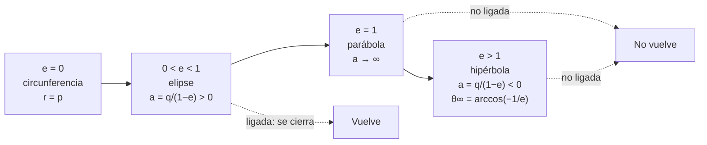

# B04-C18 — Cónicas y secciones orbitales

<!-- nav:top -->
[🏠 Programa](../../../../README.md) · [📚 Bloque B04](../../../tronco-comun/B04-algebra-trigonometria-y-geometria-espacial.md) · [← Anterior: B04-C17 — Proyecciones cartográficas elementales](../B04-C17-proyecciones-cartograficas-elementales/CLASE.md) · [Siguiente: B04-C19 — Transformaciones de coordenadas astronómicas →](../B04-C19-transformaciones-de-coordenadas-astronomicas/CLASE.md)
<!-- /nav -->

## 1. Ubicación, nivel y alcance

Decimoctava clase del bloque B04. En C09 describiste la elipse y en C10 la escribiste en polares con el Sol en un foco. Ahora generalizas: la misma ecuación describe también la parábola y la hipérbola, y la excentricidad decide cuál es. Nivel N1. Verás las cuatro cónicas (circunferencia, elipse, parábola, hipérbola) como secciones de un cono, la ecuación polar común `r = p/(1 + e cos θ)`, la propiedad foco–directriz, la clasificación por excentricidad y su aplicación a un cometa periódico (Halley) y a un objeto interestelar (ʻOumuamua). No verás por qué un cuerpo sigue una u otra (energía, B05) ni la mecánica de transferencias.

## 2. Por qué esta clase existe

En 2017 se descubrió un objeto que cruzaba el sistema solar con una órbita que no se cerraba: su excentricidad era mayor que 1. Eso significó que no estaba ligado al Sol: venía de fuera y se iba. Un solo número, la excentricidad, distingue un cometa que vuelve cada 76 años de un visitante que no vuelve.

La decisión central: **¿cómo clasifico una trayectoria a partir de su excentricidad, qué cambia en la ecuación y qué cantidades (perihelio, semieje, ángulo de las asíntotas) siguen definidas?** Aprenderás a usar la ecuación polar común, a distinguir el semieje mayor positivo del negativo y a calcular la geometría de una hipérbola.

## 3. Lo que podrás hacer al terminar

1. Nombrar las cuatro cónicas y su excentricidad: `e = 0`, `0 < e < 1`, `e = 1`, `e > 1`.
2. Usar `r(θ) = p/(1 + e cos θ)` con `p = q(1 + e)` para cualquier cónica.
3. Comprobar la propiedad foco–directriz `|PF| = e·d(P, directriz)`.
4. Calcular el ángulo de las asíntotas de una hipérbola: `θ∞ = arccos(−1/e)`.
5. Entender que `a < 0` en una hipérbola y que `q = a(1 − e)` sigue valiendo.
6. Clasificar una órbita a partir de sus elementos publicados y justificar el resultado.

La evidencia es la **clasificación de órbitas con justificación** del ejercicio 12 (sección 20).

## 4. Con qué llegas y cómo comprobarlo

Necesitas elipse, polares y trigonometría (C09, C10, C06). Cinco preguntas:

1. ¿Cuánto vale `a(1 − e)` con `a = 17,93` y `e = 0,968`?
2. ¿Qué valor tiene `cos 180°`?
3. Si `1 + e cos θ = 0`, ¿cuánto vale `r = p/(1 + e cos θ)`?
4. Resuelve `cos θ = −1/1,2`.
5. ¿Qué es el semilado recto?

<details>
<summary>Ver respuestas</summary>

1. 0,574. 2. −1. 3. Infinito (el denominador es 0). 4. `θ = arccos(−0,8333) = 146,4°`. 5. `p = a(1 − e²)`, el valor de `r` en `θ = 90°`.
</details>

Con cuatro o cinco aciertos, sigue; si no, repasa C09 y C10.

## 5. Un caso real: Halley frente a ʻOumuamua

La base de datos de pequeños cuerpos del JPL (S1) da, para 1P/Halley, una excentricidad `e = 0,96794` y un semieje mayor `a = 17,93 au`: una elipse alargada que se recorre en unos 76 años. Para el objeto 1I/ʻOumuamua (A/2017 U1), la solución de 2018 da `e = 1,2011`, `q = 0,25591 au` y `a = −1,27235 au`: un semieje **negativo**, característico de una hipérbola. Con esos números puedes calcular el ángulo de sus asíntotas (146,36°) y el giro total de su dirección de movimiento por el Sol (112,72°). La diferencia entre ambos no es de tamaño sino de naturaleza: uno está ligado al Sol y vuelve; el otro no. La razón física de ese corte en `e = 1` la dará B05; aquí lo clasificas con geometría.

## 6. Vocabulario

Una **cónica** es la curva que resulta de cortar un cono con un plano: circunferencia, elipse, parábola o hipérbola. Todas cumplen la **propiedad foco–directriz**: hay un punto (el **foco**) y una recta (la **directriz**) tales que la distancia de cada punto de la curva al foco es `e` veces su distancia a la directriz; `e` es la **excentricidad**. La **ecuación polar común** con el foco en el origen y `θ` desde el punto más cercano (periastro) es `r = p/(1 + e cos θ)`, con `p` el **semilado recto**; la distancia mínima es `q = p/(1 + e)`. En la **hipérbola**, `1 + e cos θ` se anula en el ángulo `θ∞ = arccos(−1/e)`: allí `r → ∞` y la dirección se llama **asíntota**. El **semieje mayor** `a` se define como `a = q/(1 − e)`: positivo en la elipse, infinito en la parábola y negativo en la hipérbola. Una órbita **ligada** se cierra; una **no ligada** (parabólica o hiperbólica) no.

## 7. Modelo mental: una familia con un solo parámetro

Fija el foco y el perihelio `q`, y mueve solo `e`: con `e = 0`, una circunferencia; al crecer `e < 1`, una elipse cada vez más estirada; en `e = 1`, la curva se abre y no vuelve (parábola); con `e > 1`, se abre aún más (hipérbola).



*Descripción textual:* una sola ecuación da cuatro curvas según la excentricidad: circunferencia (0), elipse (entre 0 y 1, con semieje positivo), parábola (1, semieje infinito) e hipérbola (mayor que 1, semieje negativo, con asíntotas a `arccos(−1/e)`); las dos primeras son ligadas y las otras dos no.

Analogía: la trayectoria de un chorro de agua que se abre más cuanto más rápido sale. Su límite: el chorro está sujeto a la gravedad terrestre y la cónica orbital a otra ley (la gravitación del Sol, B05); la analogía sirve para la forma, no para la causa.

## 8. La explicación, paso a paso

### 8.1 La ecuación común

`r(θ) = p/(1 + e cos θ)`, con `p = q(1 + e)`. En `θ = 0`: `r = p/(1 + e) = q`. En `θ = 90°`: `r = p`. Para `e = 0`: `r = p` (circunferencia de radio `p`). Para `0 < e < 1`: elipse con `a = p/(1 − e²)`. Para `e = 1`: `r = p/(1 + cos θ)`, parábola; `r → ∞` en `θ → 180°`. Para `e > 1`: hipérbola; solo valen los ángulos con `1 + e cos θ > 0`, es decir `|θ| < θ∞`.

### 8.2 Foco–directriz

Con la directriz `x = p/e` (si `e > 0`), todo punto `P = (r cos θ, r sen θ)` cumple `r = e (p/e − r cos θ)`, que reproduce la ecuación común: `r + e r cos θ = p`. El laboratorio lo comprueba para cinco excentricidades con `e > 0` (0,3, 0,968, 1, 1,201 y 3) en 17 ángulos cada una.

### 8.3 El semieje mayor y su signo

`q = a(1 − e)` vale para todas. En la elipse `a = q/(1 − e) > 0`; si `e → 1`, `a → ∞`; si `e > 1`, `1 − e < 0` y `a < 0`. Para ʻOumuamua: `a(1 − e) = (−1,27235) × (−0,20113) = 0,25591 au = q` ✓ (S1). El «semieje» negativo es la distancia del centro de la hipérbola al vértice, con signo por convención.

### 8.4 Geometría de la hipérbola

El semilado recto es `p = q(1 + e) = 0,25591 × 2,20113 = 0,56330 au`. Las asíntotas están en `θ∞ = arccos(−1/e) = arccos(−0,83255) = 146,36°`. La dirección de movimiento del cuerpo gira, entre muy lejos al llegar y muy lejos al irse, `2θ∞ − 180° = 112,72°` (que coincide con `2 arcsen(1/e)`). A mayor `e`, menor giro: una trayectoria muy abierta se desvía poco.

### 8.5 Clasificar con los elementos publicados

Se mira `e`: Halley, `0,968 < 1`: elipse. ʻOumuamua, `1,201 > 1`: hipérbola. Una órbita con `e = 1,0000` exacto es un caso límite que en la práctica no se puede distinguir de una hipérbola por la incertidumbre de `e`; por eso se reporta `e` con su error. La excentricidad publicada es una **estimación** y cambia con nuevas observaciones.

## 9. Magnitudes, símbolos y unidades

| Símbolo | Qué es | Unidad | Nota |
|---|---|---|---|
| `e` | excentricidad | adimensional | Halley 0,96794; ʻOumuamua 1,20113 (S1) |
| `q` | distancia en el periastro | au | Halley 0,57486; ʻOumuamua 0,25591 (S1) |
| `a` | semieje mayor | au | Halley 17,9286; ʻOumuamua −1,27235 (S1) |
| `p` | semilado recto `q(1 + e)` | au | Halley 1,1313; ʻOumuamua 0,5633 (calculado) |
| `θ` | ángulo desde el periastro | ° | `θ∞ = arccos(−1/e)` |
| `θ∞` | ángulo de las asíntotas | ° | ʻOumuamua 146,36° |
| `r` | distancia al foco | au | `r = p/(1 + e cos θ)` |

## 10. Convenciones y referencias

El foco (el Sol) está en el origen; `θ` se mide desde el periastro en el sentido del movimiento. El **signo de `a`** negativo para las hipérbolas es una convención que S1 aplica. Los valores de S1 son **estimados** y se refieren a las soluciones fechadas (Halley 2025-11-21; ʻOumuamua 2018-06-26, «Sol. 7c, Micheli et al. 2018»); ambos archivos son mutables. Esta clase no usa la inclinación ni los demás elementos. Los valores `e = 0,5` y `e = 3` de las tablas y las pruebas son **sintéticos**.

## 11. De dónde sale lo que afirmamos

| ID | Fuente | Localizador | Respalda | Estado |
|---|---|---|---|---|
| S1 | NASA/JPL Small-Body Database API, objetos `1P` y `1I` | https://ssd-api.jpl.nasa.gov/sbdb.api?sstr=1P&full-prec=1 y `…?sstr=1I&full-prec=1` | 1P/Halley: `e = 0,9679359957`, `a = 17,928635 au`, `q = 0,574864 au` (solución del 2025-11-21); ʻOumuamua (A/2017 U1): `e = 1,201133796`, `a = −1,272345007 au`, `q = 0,255911581 au` (solución del 2018-06-26, productor D. Farnocchia) | Consulta del 2026-11-05 (mutable; estimado) |

Límites: el enunciado de que las órbitas con `e < 1` están ligadas y las de `e ≥ 1` no lo están es un resultado físico (B05) que aquí se enuncia sin derivar. Las propiedades de las cónicas son matemática estándar y se comprueban en el laboratorio. El periodo de Halley de unos 76 años no se usa para ningún cálculo; el periodo de la solución consultada fue de 27 728 días (≈ 75,9 años), que es la cifra del JPL. No se consultó una fuente de observación de ʻOumuamua distinta del JPL.

## 12. Cómo ver las cónicas

| `θ` (°) | `e = 0` | `e = 0,5` | `e = 1` | `e = 1,2011` |
|---|---|---|---|---|
| 0 | 0,2559 | 0,2559 | 0,2559 | 0,2559 |
| 30 | 0,2559 | 0,2679 | 0,2743 | 0,2761 |
| 60 | 0,2559 | 0,3071 | 0,3412 | 0,3519 |
| 90 | 0,2559 | 0,3839 | 0,5118 | 0,5633 |
| 120 | 0,2559 | 0,5118 | 1,0236 | 1,4102 |
| 140 | 0,2559 | 0,6222 | 2,1877 | 7,0519 |

(Todas con `q = 0,2559 au`, el perihelio de ʻOumuamua; distancias en au; `e = 0,5` y `e = 0` son hipotéticos.)

Descripción larga: con el mismo perihelio, la circunferencia se queda en `r = q`; la elipse se aleja moderadamente; la parábola y la hipérbola crecen cada vez más rápido y la hipérbola llega al infinito en 146,36°, antes de los 180° de la parábola.

## 13. Ejemplo trabajado: ʻOumuamua

Datos (S1): `e = 1,201134`, `q = 0,255912 au`, `a = −1,272345 au`.

**Paso 1 · Clasificar.** `e > 1`: hipérbola. Comprobación: `a < 0` ✓.

**Paso 2 · Semilado recto.** `p = q(1 + e) = 0,255912 × 2,201134 = 0,56330 au`.

**Paso 3 · Asíntotas.** `θ∞ = arccos(−1/1,201134) = arccos(−0,83255) = 146,36°`: el objeto solo existe a ángulos `|θ| < 146,36°`.

**Paso 4 · Giro.** `2θ∞ − 180° = 292,72° − 180° = 112,72°`; con la otra fórmula, `2 arcsen(0,83255) = 2 × 56,36° = 112,72°` ✓.

**Paso 5 · Comprobar con la distancia.** A `θ = 90°`: `r = p = 0,5633 au`; a `θ = 140°`: `1 + 1,2011 cos 140° = 1 − 0,92007 = 0,07993`; `r = 0,5633/0,07993 = 7,05 au` ✓ (tabla de la sección 12). Resultado con 4 cifras. Es un modelo de dos cuerpos sin perturbaciones.

## 14. Distintas formas de clasificar

**Por excentricidad:** la más directa. **Por el signo de `a`:** `a > 0` elipse, `a < 0` hipérbola. **Por la ecuación cuadrática general** `Ax² + Bxy + Cy² + … = 0`: el discriminante `B² − 4AC` es negativo (elipse), cero (parábola) o positivo (hipérbola); no se desarrolla aquí. **Por el comportamiento de `r`:** acotado (elipse) o con `r → ∞` (parábola e hipérbola). Todas deben coincidir; es una comprobación cruzada.

## 15. Práctica guiada

**Ejercicio 1 · con los pasos indicados.** Clasifica una órbita con `e = 0,3` y otra con `e = 2` y calcula `r(0)` y `r(90°)` si `q = 1 au`. *Pasos:* `p = q(1 + e)`.

<details><summary>Solución comentada</summary>

`e = 0,3`: elipse, `p = 1,3`; `r(0) = 1`; `r(90°) = 1,3`. `e = 2`: hipérbola, `p = 3`; `r(0) = 1`; `r(90°) = 3`. La hipérbola solo existe para `|θ| < arccos(−0,5) = 120°`.
</details>

**Ejercicio 2 · con una pista.** Halla `θ∞` para `e = 2`. *Pista:* `arccos(−1/e)`.

<details><summary>Solución comentada</summary>

`arccos(−0,5) = 120°`. Giro total `2 × 120° − 180° = 60°` (igual que `2 arcsen(0,5) = 60°`).
</details>

**Ejercicio 3 · casi autónomo.** Verifica la propiedad foco–directriz para `e = 0,5`, `p = 1,5` y `θ = 60°`.

<details><summary>Solución comentada</summary>

`r = 1,5/(1 + 0,5 cos 60°) = 1,5/1,25 = 1,2`; el punto `(0,6; 1,0392)`; la directriz `x = p/e = 3`; distancia `3 − 0,6 = 2,4`; `e × 2,4 = 1,2 = r` ✓.
</details>

## 16. Práctica autónoma, transferencia e integrador

**Ejercicio 4.** Halley: `a = 17,9286` y `e = 0,96794`; comprueba `q = a(1 − e)` y calcula `p`.

<details><summary>Solución comentada</summary>

`q = 17,9286 × 0,03206 = 0,5748` ✓; `p = q(1 + e) = 0,5748 × 1,96794 = 1,1312 au` (= `a(1 − e²)`).
</details>

**Ejercicio 5.** ¿Cuál es el valor de `r(180°)` para `e = 0,5`, `q = 1`? ¿Y para `e = 1`?

<details><summary>Solución comentada</summary>

`e = 0,5`: `p = 1,5`; `r = 1,5/0,5 = 3` (el afelio, `a(1 + e)` con `a = 2`). `e = 1`: `1 + cos 180° = 0`, `r → ∞`: la parábola nunca llega a 180°.
</details>

**Ejercicio 6.** Calcula `a` si `e = 1,5` y `q = 0,5 au`. ¿Qué signo tiene y qué significa?

<details><summary>Solución comentada</summary>

`a = q/(1 − e) = 0,5/(−0,5) = −1 au`. Negativo: hipérbola (S1 usa la misma convención). Comprobación: `a(1 − e) = (−1)(−0,5) = 0,5` ✓.
</details>

**Ejercicio 7.** ¿Qué `θ` alcanza `r = 2` para ʻOumuamua? (`p = 0,5633`, `e = 1,2011`.)

<details><summary>Solución comentada</summary>

`1 + e cos θ = p/r = 0,28165`; `cos θ = (0,28165 − 1)/1,2011 = −0,5981`; `θ = 126,7°`. Menor que `θ∞ = 146,36°` ✓.
</details>

**Ejercicio 8.** Para cada `e` de la sección 12, ¿en qué ángulo `r = 2q`?

<details><summary>Solución comentada</summary>

`r = 2q` ⇒ `1 + e cos θ = (1 + e)/2` ⇒ `cos θ = (1 − e)/(2e)`. `e = 0,5`: `cos θ = 0,5`, `θ = 60°`; `e = 1`: `cos θ = 0`, `θ = 90°`; `e = 1,2011`: `cos θ = −0,0837`, `θ = 94,8°`. (Con `e = 0` no se alcanza: `r = q` siempre.)
</details>

**Ejercicio 9 · transferencia.** Un artículo da `e = 1,0002 ± 0,0010` para un cuerpo. ¿Se puede afirmar que es interestelar?

<details><summary>Solución comentada</summary>

No: el valor `e = 1` cae dentro de la incertidumbre (`1,0002 − 1 = 0,0002 < 0,0010`). Podría ser una hipérbola casi parabólica, una parábola o una elipse muy alargada (`e = 0,9992`). Hace falta una incertidumbre menor o más observaciones.
</details>

**Ejercicio 10 · transferencia.** Dos órbitas tienen el mismo `q` y distinto `e`. ¿Cuál tiene la asíntota más cerrada? ¿Cuál se desvía más?

<details><summary>Solución comentada</summary>

`θ∞ = arccos(−1/e)` crece con `e` hacia 180°, así que mayor `e` da asíntotas más abiertas; el giro `2 arcsen(1/e)` baja con `e`: la más excéntrica se desvía menos.
</details>

**Ejercicio 11 · transferencia.** ¿Por qué una parábola es un caso límite entre dos tipos de órbita y qué significa en la práctica?

<details><summary>Solución comentada</summary>

En `e = 1`, `a → ∞` y `r → ∞` en 180°: es el límite entre elipse (se cierra) e hipérbola (se abre). En la práctica casi nunca se puede asegurar `e = 1` exacto: se informa de `e ± δe`.
</details>

**Ejercicio 12 · integrador.** Elabora tu *clasificación de órbitas con justificación* (sección 20): elige tres cuerpos cuyos `e`, `q` y `a` consultes en el JPL (un planeta o asteroide, un cometa periódico y un objeto con `e ≥ 1`), clasifícalos, calcula `p` y, si procede, `θ∞`, y comprueba `q = a(1 − e)` en cada uno.

<details><summary>Solución modelo</summary>

Tabla con `e`, tipo, `q`, `a` (con su signo), `p`, `θ∞` si aplica, comprobación de `q = a(1 − e)`, fecha y solución de cada consulta, y una frase sobre la incertidumbre de `e` en el caso límite.
</details>

## 17. Laboratorio: cónicas y órbitas reales

El script [conicas_orbitales.py](conicas_orbitales.py) tabula `r(θ)` para cuatro excentricidades y clasifica las órbitas de S1. Antes comprueba: la clasificación de cuatro valores, `r(0) = q` en seis excentricidades, la propiedad foco–directriz en 17 ángulos para cada una de las cinco con `e > 0`, que `a(1 − e) = q` para Halley y ʻOumuamua y que `r → ∞` en la asíntota.

**Datos:** publicados (estimados, mutables) y valores sintéticos. **Predice antes de ejecutar:** ¿qué signo tiene `a` de ʻOumuamua? (Negativo.) **Ejecución del 2026-11-05 (Python 3.12.9):**

```text
Halley (JPL)       0.96794       elipse   0.57486    17.9286   1.13130
ʻOumuamua (JPL)    1.20113    hipérbola   0.25591    -1.2723   0.56330
ʻOumuamua: p = q(1+e) = 0.56330 au; ángulo de la asíntota θ∞ = arccos(−1/e) = 146.36°
  giro total de la dirección de movimiento = 2θ∞ − 180° = 112.72° (cálculo propio; coincide con 2·arcsen(1/e) = 112.72°)
```

```bash
python programa/clases/B04/B04-C18-conicas-y-secciones-orbitales/conicas_orbitales.py
```

**Límites:** dos cuerpos, sin perturbaciones; elementos de una solución fechada; no es una herramienta de determinación de órbitas.

## 18. Errores frecuentes y cómo corregirlos

**Usar `a` positivo para la hipérbola.** Se corrige con el ejercicio 6.

**Evaluar `r` fuera del rango de la hipérbola.** `1 + e cos θ ≤ 0` da resultados sin sentido. Se corrige con el ejercicio 7.

**Afirmar `e = 1` con incertidumbre.** Se corrige con el ejercicio 9.

**Confundir `p` con `a` o con `q`.** Se corrige con el ejercicio 4.

**Suponer que una órbita abierta «no es órbita».** Es una trayectoria; su clasificación es geométrica.

## 19. Cómo sabrás que vas bien

Tras 8.1: ¿evalúas `r(θ)` para cualquier `e`? Si no, ejercicio 1. Tras 8.3: ¿explicas por qué `a < 0`? Si no, ejercicio 6. Tras 8.4: ¿calculas `θ∞`? Si no, ejercicio 2. Tras el laboratorio: ¿qué relación comprueba antes de calcular? Si no lo sabes, lee su cabecera.

## 20. Qué entregas y cómo se evalúa

El producto es tu **clasificación de órbitas con justificación** (ejercicio 12).

| Criterio | Inicial | En desarrollo | Logrado | Destacado |
|---|---|---|---|---|
| Clasificación | Incorrecta | Correcta sin justificar | Correcta con `e` y `a` | Considera la incertidumbre de `e` |
| Ecuación común | No la usa | La usa con errores | Calcula `p`, `r(θ)` y comprueba | Verifica foco–directriz |
| Hipérbola | Ignora las asíntotas | Las calcula con ayuda | `θ∞` y giro correctos | Interpreta el rango de `θ` |
| Comprobación | Ausente | Parcial | `q = a(1 − e)` en cada caso | Compara con una segunda forma |
| Fuentes | Sin fuente | Sin fecha | Con localizador, fecha y solución | Marca lo mutable y estimado |

**Condiciones críticas (no se compensan con promedio):** declarar fecha y solución de los elementos; no afirmar `e = 1` ni «interestelar» sin considerar la incertidumbre; citar solo fuentes consultadas.

## 21. Ética, seguridad y límites

Clasificar un objeto como interestelar es una afirmación con consecuencias científicas y mediáticas; hacerlo sin su incertidumbre es un error de honestidad numérica. Los elementos son estimaciones. Accesibilidad: fórmulas en texto, tabla equivalente a la gráfica, ejercicios sin conexión.

## 22. Para cerrar y seguir

Una sola ecuación, `r = p/(1 + e cos θ)`, describe la circunferencia, la elipse, la parábola y la hipérbola; la excentricidad decide cuál es y, con ella, si la órbita está ligada. El semieje negativo es la marca de una hipérbola. Queda abierta una pregunta: ¿cómo se pasa de las coordenadas de un objeto en un sistema a otro, por ejemplo del ecuatorial al galáctico? Eso es C19.

**Glosario español–inglés.** cónica · *conic section*; excentricidad · *eccentricity*; parábola · *parabola*; hipérbola · *hyperbola*; directriz · *directrix*; semilado recto · *semi-latus rectum*; asíntota · *asymptote*; órbita ligada · *bound orbit*.

**Continuidad.** B04-C19 usa tu capacidad de **describir direcciones y trayectorias** para encadenar sistemas de coordenadas. B04-C20 aplicará los ángulos y las bases a la triangulación.

**Referencias:** ver sección 11.

<!-- nav:bottom -->
---

[← Anterior: B04-C17 — Proyecciones cartográficas elementales](../B04-C17-proyecciones-cartograficas-elementales/CLASE.md) · [📚 Bloque B04](../../../tronco-comun/B04-algebra-trigonometria-y-geometria-espacial.md) · [Siguiente: B04-C19 — Transformaciones de coordenadas astronómicas →](../B04-C19-transformaciones-de-coordenadas-astronomicas/CLASE.md)
<!-- /nav -->
