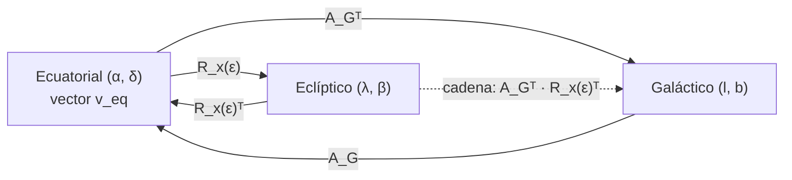

# B04-C19 — Transformaciones de coordenadas astronómicas

<!-- nav:top -->
[🏠 Programa](../../../../README.md) · [📚 Bloque B04](../../../tronco-comun/B04-algebra-trigonometria-y-geometria-espacial.md) · [← Anterior: B04-C18 — Cónicas y secciones orbitales](../B04-C18-conicas-y-secciones-orbitales/CLASE.md) · [Siguiente: B04-C20 — Triangulación espacial aplicada →](../B04-C20-triangulacion-espacial-aplicada/CLASE.md)
<!-- /nav -->

## 1. Ubicación, nivel y alcance

Decimonovena clase del bloque B04. Reúne tres herramientas: las coordenadas esféricas (C11), los vectores (C12–C14) y las rotaciones (C15). Con ellas encadenas transformaciones entre los sistemas ecuatorial, eclíptico y galáctico. Nivel N1. Verás cómo se define cada sistema a partir de un polo y un origen, cómo se construye su matriz, cómo se contrasta con valores publicados y cómo se encadenan las transformaciones y se comprueban con casos conocidos. No verás los sistemas dependientes del observador (horizontal, ángulo horario) ni la precesión y la nutación, que dependen del tiempo (bloque B13 y posteriores).

## 2. Por qué esta clase existe

Un catálogo da las posiciones en ecuatoriales; un estudio de la Vía Láctea necesita galácticas; un análisis del plano del sistema solar usa eclípticas. Cambiar de sistema es rutina, y un error de signo o de matriz mueve el objeto decenas de grados. La buena práctica es contrastar la matriz con valores publicados y probar el resultado con puntos cuya imagen se conoce, como el polo galáctico.

La decisión central: **¿cómo defino un sistema a partir de un polo y un origen, cómo construyo la matriz que me lleva de un sistema a otro y cómo sé que la transformación es correcta?** Aprenderás a construir y a verificar cada paso.

## 3. Lo que podrás hacer al terminar

1. Describir un sistema de coordenadas por su polo, su círculo fundamental y su origen de longitud.
2. Transformar una dirección de ecuatoriales a eclípticas y a galácticas.
3. Construir la matriz galáctica a partir de las tres constantes que la definen.
4. Verificar que la construcción coincide con la matriz publicada.
5. Encadenar transformaciones y comprobar que la cadena equivale a la transformación directa.
6. Evitar la pérdida de precisión de `arcsen` cerca de los polos usando `atan2`.

La evidencia es la **cadena de transformaciones con pruebas** del ejercicio 12 (sección 20).

## 4. Con qué llegas y cómo comprobarlo

Necesitas vectores unitarios, rotaciones y producto vectorial (C11, C14, C15). Cinco preguntas:

1. ¿Cómo se pasa de `(α, δ)` a un vector unitario?
2. ¿Qué propiedades tiene una matriz de rotación?
3. ¿Qué vector es `ẑ × n` si `n` es perpendicular a `ẑ`?
4. ¿Cuál es la inversa de una rotación?
5. ¿Qué función da el ángulo de longitud con el cuadrante correcto?

<details>
<summary>Ver respuestas</summary>

1. `(cos δ cos α, cos δ sen α, sen δ)`. 2. Ortogonal y de determinante +1. 3. Un vector perpendicular a ambos (de módulo 1 si `n` es unitario). 4. Su traspuesta. 5. `atan2`.
</details>

Con cuatro o cinco aciertos, sigue; si no, repasa C11, C14 y C15.

## 5. Un caso real: ¿dónde está Próxima Centauri en la Vía Láctea?

El catálogo Hipparcos de la ESA (S1) define el sistema galáctico con tres constantes en el ICRS: el polo norte galáctico en `α_G = 192,85948°`, `δ_G = +27,12825°` y la longitud galáctica `l_Ω = 32,93192°` del nodo ascendente del plano galáctico sobre el ecuador. A partir de ellas se obtiene la matriz que publica S1 con diez decimales. Con ella, Próxima Centauri (`α = 217,3934657°`, `δ = −62,6761821°`, S2) queda en `l = 313,93°`, `b = −1,92°`: muy cerca del plano de la galaxia. Y en eclípticas, `λ = 239,09°`, `β = −44,77°` (C15). Tres sistemas, tres pares de ángulos, una misma dirección. El laboratorio reconstruye la matriz de S1 desde las tres constantes y coincide en `5 × 10⁻¹¹`, que es el redondeo de los diez decimales impresos.

## 6. Vocabulario

Un **sistema de coordenadas esféricas** se define por un **polo** (el eje de la latitud), un **círculo fundamental** (el «ecuador» del sistema, a 90° del polo) y un **origen de longitud** sobre él. El sistema **ecuatorial** usa el polo celeste norte y el equinoccio como origen; el **eclíptico**, el polo de la eclíptica y el mismo equinoccio; el **galáctico**, el polo norte galáctico y, como origen, la dirección con `l = 0` en el plano galáctico (el centro de la galaxia). La **línea de nodos** es la intersección de dos círculos fundamentales; el **nodo ascendente** es el punto donde un plano cruza al otro de sur a norte. La **matriz de transformación** `A` pasa componentes de un sistema a otro. Una **cadena de transformaciones** es una composición de matrices: `v_G = A_Gᵀ v_eq` y `v_ecl = R_x(ε) v_eq`; la cadena ecliptica→galáctica es `A_Gᵀ R_x(ε)ᵀ`. El **ICRS** es el sistema de referencia celeste de la IAU, que realiza el ecuatorial en la práctica.

## 7. Modelo mental: cambiar el polo y el origen

Un sistema de coordenadas es una forma de numerar la esfera. Cambiar de sistema es girar la esfera hasta que un nuevo polo ocupe el sitio del anterior; el vector no cambia, pero sus componentes sí.



*Descripción textual:* desde el sistema ecuatorial se llega al eclíptico con una rotación alrededor del eje `x` y al galáctico con la traspuesta de la matriz `A_G`; las vueltas usan las traspuestas; y del eclíptico al galáctico se pasa componiendo las dos: primero de vuelta a ecuatoriales y luego a galácticas.

Analogía: un mismo paisaje descrito con tres mapas orientados distinto. Su límite: los sistemas aquí tratados son fijos en el ICRS; en cuanto el sistema depende del tiempo (precesión) o del observador, se necesitan más piezas.

## 8. La explicación, paso a paso

### 8.1 Construir un sistema a partir de su polo y de un origen

Para el galáctico: `ẑ_G` es la dirección del polo norte galáctico, `(α_G, δ_G)`. La línea de nodos del plano galáctico sobre el ecuador es perpendicular a `ẑ` y a `ẑ_G`: `N = ẑ × ẑ_G / |ẑ × ẑ_G|`. Los puntos del plano galáctico a longitud `l` son `u(l) = N cos(l − l_Ω) + (ẑ_G × N) sen(l − l_Ω)`, de modo que `x̂_G = u(0) = N cos l_Ω − (ẑ_G × N) sen l_Ω` e `ŷ_G = ẑ_G × x̂_G`. Las tres columnas `[x̂_G ŷ_G ẑ_G]` forman la matriz `A_G`.

### 8.2 Contrastar con la matriz publicada

S1 da `A_G` con diez decimales; por ejemplo la tercera columna, `(−0,8676661490; −0,1980763734; +0,4559837762)`, es el polo norte galáctico escrito en ecuatoriales. El laboratorio construye `A_G` con 8.1 y encuentra una diferencia máxima de `4,9 × 10⁻¹¹`: la matriz publicada es consistente con las tres constantes. Una de las dos elecciones de signo para `N` reproduce la matriz y la otra no (el laboratorio prueba ambas); el signo correcto es el que hace que el nodo sea ascendente.

### 8.3 Las transformaciones

Convención de S1: `[x_G y_G z_G] = [x y z] A_G`: las columnas de `A_G` son los ejes galácticos escritos en el sistema ecuatorial. Las **componentes** se transforman con la traspuesta: `v_G = A_Gᵀ v_eq`, y la vuelta es `v_eq = A_G v_G`. De `v_G` salen `l = atan2(y, x)` y `b = atan2(z, √(x² + y²))`. Para eclípticas: `v_ecl = R_x(ε) v_eq` (C15).

### 8.4 Comprobar con casos conocidos

Tres pruebas: (1) el polo norte galáctico `(192,85948°; 27,12825°)` debe tener `b = +90°`; (2) el nodo `(l, b) = (32,93192°, 0°)` debe quedar en el ecuador (`δ = 0°`); (3) la dirección `(l, b) = (0°, 0°)` debe quedar donde la matriz lo dice: `α = 266,405°`, `δ = −28,936°` (cálculo con `A_G`). Y la ida y vuelta debe devolver el punto original.

### 8.5 Una trampa numérica: `arcsen` cerca del polo

Con `b = arcsen(z)`, el polo norte galáctico da `b = 89,99973°` en lugar de 90°: la diferencia de `z = 1 − 1,1 × 10⁻¹¹` con 1 se pierde en `arcsen`, que cerca de 1 amplifica el error (error de 1″). Con `b = atan2(z, √(x² + y²))` el resultado es exacto en toda la esfera. Es el mismo problema de `arccos` en C13; la solución es la misma: usar una función bien condicionada en ese rango.

### 8.6 Encadenar y comprobar

La cadena `ecuatorial → eclíptico → ecuatorial → galáctico` es igual a la transformación directa `ecuatorial → galáctico`: el laboratorio lo verifica para una dirección arbitraria a `10⁻¹²`. Una cadena larga acumula errores de matrices truncadas; por eso conviene componer en vez de redondear los pasos intermedios.

## 9. Magnitudes, símbolos y unidades

| Símbolo | Qué es | Unidad | Nota |
|---|---|---|---|
| `(α, δ)` | ascensión recta y declinación | ° | sistema ecuatorial |
| `(λ, β)` | longitud y latitud eclípticas | ° | `R_x(ε)` |
| `(l, b)` | longitud y latitud galácticas | ° | `A_Gᵀ` |
| `α_G`, `δ_G` | polo norte galáctico | ° | 192,85948°; +27,12825° (S1) |
| `l_Ω` | longitud galáctica del nodo | ° | 32,93192° (S1) |
| `ε` | oblicuidad | ° | 23,4392911° (S1) |
| `A_G` | matriz galáctica | adimensional | 10 decimales (S1) |

## 10. Convenciones y referencias

Las matrices de S1 están definidas respecto del ICRS (ecuatorial); los vectores de la clase se consideran referidos a él por construcción didáctica. La convención de matrices es la de S1: las columnas de `A` son los ejes del sistema nuevo escritos en el viejo. Los ángulos de longitud van de 0° a 360° y los de latitud, de −90° a +90°. La dirección de Próxima es la de S2, cuyo marco y época la documentación del archivo no declara (por tanto, que esté en el ICRS es una hipótesis didáctica, no un dato); los ángulos de prueba `(0°, 0°)`, `(90°, 0°)` y `(266,4°; −28,94°)` son **sintéticos**. La matriz eclíptica usa solo ε (sin precesión).

## 11. De dónde sale lo que afirmamos

| ID | Fuente | Localizador | Respalda | Estado |
|---|---|---|---|---|
| S1 | ESA, *The Hipparcos and Tycho Catalogues*, SP-1200, vol. 1, § 1.5.3, ec. (1.5.5)–(1.5.11), pp. 91–92 | https://www.cosmos.esa.int/documents/532822/552851/vol1_all.pdf | `α_G = 192,85948°`, `δ_G = +27,12825°` (1.5.9); `l_Ω = 32,93192°` (1.5.10); matriz `A_G` (1.5.11); `ε = 23° 26′ 21,448″` y `A_K` (1.5.7); relación `[x_G y_G z_G] = [x y z] A_G` | PDF leído (texto) el 2026-11-05 |
| S2 | NASA Exoplanet Archive, consulta TAP (`pscomppars`, `ra`, `dec`) | consulta TAP https://exoplanetarchive.ipac.caltech.edu/TAP (tabla `pscomppars`, columnas `ra`, `dec`); documentación de columnas: https://exoplanetarchive.ipac.caltech.edu/docs/API_PS_columns.html | Próxima Cen: `α = 217,3934657°`, `δ = −62,6761821°` | Consulta del 2026-11-05 (mutable; estimado). Documentación leída el 2026-11-05: `ra` y `dec` son ascensión recta y declinación «en grados decimales»; **no declara marco de referencia ni época** |

Límites: La documentación de columnas del archivo (leída el 2026-11-05) define `ra` y `dec` como ascensión recta y declinación del sistema planetario en grados decimales, y `sy_dist` y `sy_plx` como distancia en pc y paralaje en mas; **no indica marco de referencia (ICRS, J2000…) ni época, ni el catálogo del que proceden**. La clase no afirma ninguno: usa los valores como direcciones aproximadas, con fines didácticos. La página de columnas leída corresponde a la tabla de sistemas planetarios (PS); la tabla compuesta `pscomppars` comparte esos nombres, pero su propia página de columnas vigente no se localizó (la que abrió está retirada desde 2015 y usa nombres `st_*`), por lo que esa correspondencia no se verificó. No se consultó ninguna cifra publicada de las coordenadas galácticas de Próxima ni del centro galáctico; `l = 313,93°`, `b = −1,92°` y `(266,405°; −28,936°)` son cálculos propios con las matrices de S1. S1 afirma que estas constantes son consistentes con la definición de 1960 «al nivel» de la calidad de los marcos ópticos previos; la clase no lo contrasta. No se tratan la precesión ni el cambio de época.

## 12. Cómo ver los resultados

| Dirección (ecuatorial, °) | Eclíptica (λ, β) | Galáctica (l, b) |
|---|---|---|
| Próxima Cen (217,3935; −62,6762) | (239,0920; −44,7676) | (313,9259; −1,9180) |
| (0; 0) (sintético) | (0,0000; 0,0000) | (96,3373; −60,1886) |
| (90; 0) (sintético) | (90,0000; −23,4393) | (206,9891; −11,4245) |
| Polo galáctico (192,8595; 27,1283) | (180,0232; 29,8114) | (—; 90,0000) |
| (266,4; −28,94) (sintético) | (266,8352; −5,5402) | (359,9945; 0,0017) |

Descripción larga: el plano galáctico (`b = 0`) está inclinado unos 62,9° respecto del ecuador celeste (el ángulo entre sus normales es `90° − δ_G`); Próxima queda a menos de 2° del plano galáctico.

## 13. Ejemplo trabajado: Próxima Centauri en tres sistemas

Datos: `v_eq = (−0,36468; −0,27876; −0,88843)` (C11), `ε = 23,4392911°` (S1), `A_G` de S1.

**Paso 1 · Eclípticas.** Como en C15: `v_ecl = (−0,36468; −0,60916; −0,70424)`; `λ = 239,09°`, `β = −44,77°`.

**Paso 2 · Galácticas, `x_G`.** Primera fila de `A_Gᵀ` = primera columna de `A_G` = `(−0,0548756; −0,8734371; −0,4838350)`: `x_G = (−0,0548756)(−0,36468) + (−0,8734371)(−0,27876) + (−0,4838350)(−0,88843) = 0,02001 + 0,24348 + 0,42985 = 0,69334`.

**Paso 3 · `y_G` y `z_G`.** Segunda columna `(0,4941094; −0,4448296; 0,7469822)`: `y_G = −0,18019 + 0,12400 − 0,66364 = −0,71983`. Tercera `(−0,8676661; −0,1980764; 0,4559838)`: `z_G = 0,31642 + 0,05522 − 0,40511 = −0,03347`.

**Paso 4 · Ángulos.** `l = atan2(−0,71983; 0,69334) = −46,07° + 360° = 313,93°`; `b = atan2(−0,03347; 0,99944) = −1,92°`. Comprobación de norma: `0,48072 + 0,51816 + 0,00112 = 1,00000` ✓.

**Paso 5 · Vuelta y límite.** `A_G v_G` devuelve `v_eq` a `10⁻⁶` (la matriz tiene 10 decimales). Resultado con 4 cifras: `l = 313,93°`, `b = −1,92°`. Depende de que `(α, δ)` esté en el marco ICRS (hipótesis didáctica: la documentación del archivo no declara el marco) y no incluye movimiento propio.

## 14. Distintas formas de transformar

**Con matrices (vectores):** exacta, compone, se verifica con ortogonalidad. **Con fórmulas trigonométricas directas:** equivalentes; más sensibles a errores de signo y de cuadrante. **Con bibliotecas** (por ejemplo, de astronomía): rápidas, pero hay que saber qué convención y qué época usan. **Con tablas de casos conocidos:** sirven de prueba, no de método. Se recomienda construir con vectores y verificar con casos conocidos.

## 15. Práctica guiada

**Ejercicio 1 · con los pasos indicados.** Pasa `(α, δ) = (90°, 0°)` a eclípticas con `ε = 23,4393°`. *Pasos:* vector, `R_x(ε)`, ángulos.

<details><summary>Solución comentada</summary>

`v = (0; 1; 0)`; `y_ecl = cos ε = 0,9175`; `z_ecl = −sen ε = −0,3978`; `λ = 90°`, `β = −23,44°` (tabla de la sección 12).
</details>

**Ejercicio 2 · con una pista.** Comprueba que el polo norte galáctico queda en `b = +90°`. *Pista:* la tercera fila de `A_Gᵀ` es el polo mismo.

<details><summary>Solución comentada</summary>

`z_G = n · n = 1` para `n` unitario: `b = atan2(1; 0) = 90°`. El laboratorio da `90,0000°` con `atan2`; con `arcsen` daría `89,99973°` (8.5).
</details>

**Ejercicio 3 · casi autónomo.** Obtén `(α, δ)` del punto galáctico `(l, b) = (0°, 0°)` con `A_G`. *Pista:* primera columna.

<details><summary>Solución comentada</summary>

Primera columna `(−0,0548756; −0,8734371; −0,4838350)`; `α = atan2(−0,8734371; −0,0548756) = 266,405°`; `δ = arcsen(−0,4838350) = −28,936°` ✓.
</details>

## 16. Práctica autónoma, transferencia e integrador

**Ejercicio 4.** ¿Qué `δ` tiene el nodo `(l, b) = (32,93192°, 0°)`? ¿Por qué?

<details><summary>Solución comentada</summary>

`δ = 0°`: por definición, `l_Ω` es la longitud galáctica del punto donde el plano galáctico cruza el ecuador celeste (S1).
</details>

**Ejercicio 5.** Convierte `(l, b) = (90°, 0°)` a ecuatoriales con la segunda columna de `A_G`.

<details><summary>Solución comentada</summary>

`(0,4941094; −0,4448296; 0,7469822)`; `α = atan2(−0,4448296; 0,4941094) = −42,0° + 360° = 318,0°`; `δ = arcsen(0,7469822) = 48,3°`.
</details>

**Ejercicio 6.** Verifica que dos columnas de `A_G` son ortogonales: haz el producto escalar de la primera y la segunda.

<details><summary>Solución comentada</summary>

`(−0,0548756)(0,4941094) + (−0,8734371)(−0,4448296) + (−0,4838350)(0,7469822) = −0,027115 + 0,388531 − 0,361416 = 0,000000` ✓ (con todas las cifras, `6 × 10⁻¹¹`).
</details>

**Ejercicio 7.** Con `ε = 23,4393°`, calcula la latitud eclíptica del polo norte galáctico (`δ_G = 27,128°`, `α_G = 192,859°`) y compáralo con la tabla.

<details><summary>Solución comentada</summary>

`v = (−0,86767; −0,19808; 0,45598)`; `z_ecl = −sen ε y + cos ε z = 0,39778 × 0,19808 + 0,91748 × 0,45598 = 0,07879 + 0,41835 = 0,49714`; `β = 29,81°` ✓ (tabla: 29,8114°).
</details>

**Ejercicio 8.** ¿Qué `b` tiene una dirección en el plano de la eclíptica a `λ = 266,8°`? ¿Se parece al centro galáctico?

<details><summary>Solución comentada</summary>

Según la tabla, el punto `(266,4°; −28,94°)` (que es, con `A_G`, el de `(l, b) = (0°, 0°)`) tiene `β = −5,5°` y `λ = 266,8°`: la eclíptica (`β = 0`) pasa a unos 5,5° de la dirección `l = b = 0` según este cálculo.
</details>

**Ejercicio 9 · transferencia.** Un script tiene `l = arcsen(...)` para la longitud. ¿Qué falla?

<details><summary>Solución comentada</summary>

`arcsen` devuelve solo −90° a 90° y no distingue cuadrantes: la longitud necesita `atan2(y, x)` (C10). Los resultados solo serían correctos para un hemisferio.
</details>

**Ejercicio 10 · transferencia.** Dos astrónomos obtienen `l` de la misma estrella con 0,0003° de diferencia; uno usa la matriz completa y otro la matriz con 4 decimales. ¿Es plausible?

<details><summary>Solución comentada</summary>

Sí: una matriz con 4 decimales tiene un error de unos `10⁻⁴ rad = 20″ = 0,006°` en las componentes; la diferencia observada es del orden esperado. Para precisión de milisegundos de arco se necesitan los 10 decimales (o más).
</details>

**Ejercicio 11 · transferencia.** ¿Por qué no basta con comprobar la ida y vuelta para decir que una transformación es correcta?

<details><summary>Solución comentada</summary>

Una matriz equivocada pero ortogonal (por ejemplo, con un signo cambiado) también da ida y vuelta exacta. Hay que contrastar con casos de resultado conocido (polo, nodo, valores publicados).
</details>

**Ejercicio 12 · integrador.** Elabora tu *cadena de transformaciones con pruebas* (sección 20): elige una estrella de S2, transfórmala a eclípticas y a galácticas, compón la cadena `eclíptica → galáctica`, y documenta cuatro pruebas: ortogonalidad, ida y vuelta, polo galáctico y nodo.

<details><summary>Solución modelo</summary>

Documento con matrices y fuente, resultados con 4 decimales, ida y vuelta, polo en `b = 90°`, nodo en `δ = 0°`, cadena igual a la directa a 10⁻¹², declaración de marco y época no verificados y fuentes con fecha.
</details>

## 17. Laboratorio: construir y contrastar la matriz galáctica

El script [cadena_de_coordenadas.py](cadena_de_coordenadas.py) construye `A_G` desde `(α_G, δ_G, l_Ω)`, la compara con la de S1, y transforma direcciones. Antes comprueba: `A_G` es ortogonal (5 × 10⁻¹⁰); la matriz construida coincide con la publicada (2 × 10⁻⁹); el polo está en `b = 90°` (con `atan2`); la ida y vuelta (con la publicada, a 10⁻⁶°; con la construida, a 10⁻¹⁰°); el nodo está en `δ = 0°` y la cadena es igual a la transformación directa (10⁻¹²).

**Datos:** publicados (ESA; NASA, mutable). **Predice antes de ejecutar:** ¿qué `b` tiene Próxima? (Pequeño, cerca del plano galáctico: unos −2°.) **Ejecución del 2026-11-05 (Python 3.12.9):**

```text
A_G publicada frente a A_G construida desde (α_G, δ_G, l_Ω): diferencia máxima = 4.87e-11 (signo de nodo elegido: +1)
Dirección (l, b) = (0°, 0°) → ecuatoriales α = 266.4050°, δ = -28.9362° (calculado desde A_G)
Próxima Cen: eclípticas λ = 239.0920°, β = -44.7676°; galácticas l = 313.9259°, b = -1.9180°
  (α,δ)=(192.8595, 27.1283) → eclíptica (180.0232, 29.8114); galáctica (275.8673, 90.0000)
```

```bash
python programa/clases/B04/B04-C19-transformaciones-de-coordenadas-astronomicas/cadena_de_coordenadas.py
```

**Límites:** matrices constantes (ICRS); sin precesión, nutación ni movimiento propio; la longitud galáctica del polo no está definida (el valor 275,87° es irrelevante).

## 18. Errores frecuentes y cómo corregirlos

**Usar la matriz en vez de su traspuesta (o al revés).** Se corrige con los ejercicios 3 y 11.

**Cuadrante en la longitud.** Se corrige con el ejercicio 9.

**`arcsen` en la latitud cerca del polo.** Se corrige con la sección 8.5 y el ejercicio 2.

**Confundir la ida y vuelta con la corrección.** Se corrige con el ejercicio 11.

**Usar una matriz truncada.** Se corrige con el ejercicio 10.

## 19. Cómo sabrás que vas bien

Tras 8.1: ¿construyes `x̂_G`, `ŷ_G` y `ẑ_G` desde el polo y el nodo? Si no, relee 8.1. Tras 8.3: ¿pasas de `(α, δ)` a `(l, b)`? Si no, ejercicio 3. Tras 8.4: ¿qué tres pruebas harías? Si no lo sabes, ejercicios 2 y 4. Tras el laboratorio: ¿qué diferencia hay entre la matriz publicada y la construida? Si no lo sabes, lee su salida.

## 20. Qué entregas y cómo se evalúa

El producto es tu **cadena de transformaciones con pruebas** (ejercicio 12).

| Criterio | Inicial | En desarrollo | Logrado | Destacado |
|---|---|---|---|---|
| Matrices | Sin convención | Convención parcial | Convención de S1 y traspuesta correcta | Construye la matriz desde el polo |
| Pruebas | Solo ida y vuelta | Una prueba de casos conocidos | Polo, nodo e ida y vuelta | Prueba la cadena frente a la directa |
| Precisión | Ignora el redondeo | Lo menciona | Usa `atan2` y declara tolerancia | Cuantifica el efecto de una matriz truncada |
| Marco | Sin declarar | Parcial | ICRS (hipótesis) y época declarados como no declarados por la fuente | Explica qué faltaría (precesión) |
| Fuentes | Sin fuente | Sin fecha | Con localizador y fecha | Marca cálculo propio frente a publicado |

**Condiciones críticas (no se compensan con promedio):** declarar marco y convención de matrices; probar con casos conocidos además de la ida y vuelta; citar solo fuentes consultadas.

## 21. Ética, seguridad y límites

Una transformación mal hecha da resultados que parecen válidos; la comprobación con casos conocidos es una obligación, no un adorno. Esta clase no sirve para astrometría de precisión: no incluye precesión, nutación ni movimiento propio. Accesibilidad: matrices en texto, tabla equivalente al diagrama, ejercicios sin conexión.

## 22. Para cerrar y seguir

Cada sistema astronómico queda definido por un polo y un origen; las matrices se construyen con vectores, se contrastan con valores publicados y se encadenan; y se comprueban con casos conocidos, no solo con la ida y vuelta. Queda abierta una pregunta: ¿cómo se obtienen las distancias a esos objetos, ya no sus direcciones? Esa es la última clase del bloque, C20.

**Glosario español–inglés.** sistema de coordenadas · *coordinate system*; polo galáctico · *Galactic pole*; nodo ascendente · *ascending node*; matriz de transformación · *transformation matrix*; cadena de transformaciones · *transformation chain*; ICRS · *ICRS*; oblicuidad · *obliquity*; equinoccio · *equinox*.

**Continuidad.** B04-C20 usa tu capacidad de **trabajar con direcciones en sistemas distintos** para diseñar una triangulación. Los bloques posteriores añadirán el tiempo (precesión) y el observador (coordenadas horizontales).

**Referencias:** ver sección 11.

<!-- nav:bottom -->
---

[← Anterior: B04-C18 — Cónicas y secciones orbitales](../B04-C18-conicas-y-secciones-orbitales/CLASE.md) · [📚 Bloque B04](../../../tronco-comun/B04-algebra-trigonometria-y-geometria-espacial.md) · [Siguiente: B04-C20 — Triangulación espacial aplicada →](../B04-C20-triangulacion-espacial-aplicada/CLASE.md)
<!-- /nav -->
