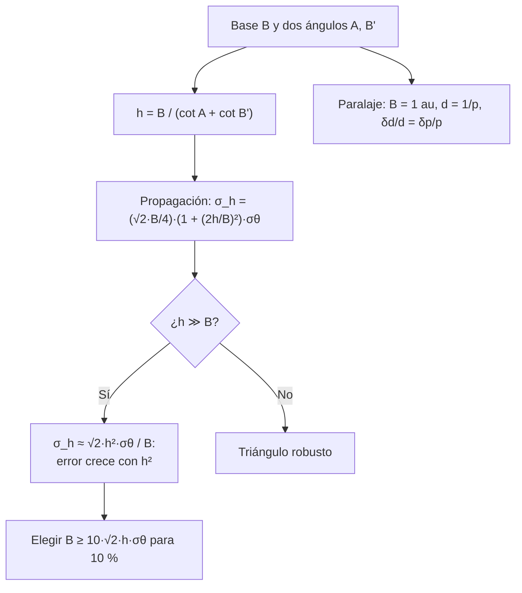

# B04-C20 — Triangulación espacial aplicada

<!-- nav:top -->
[🏠 Programa](../../../../README.md) · [📚 Bloque B04](../../../tronco-comun/B04-algebra-trigonometria-y-geometria-espacial.md) · [← Anterior: B04-C19 — Transformaciones de coordenadas astronómicas](../B04-C19-transformaciones-de-coordenadas-astronomicas/CLASE.md) · [Siguiente: B05-C01 — Magnitudes físicas y dimensiones →](../../B05/B05-C01-magnitudes-fisicas-y-dimensiones/CLASE.md)
<!-- /nav -->

## 1. Ubicación, nivel y alcance

Última clase del bloque B04 y su integrador. Reúne lo aprendido: ecuaciones y sistemas (C02, C03), trigonometría y paralaje (C06–C08), vectores y ángulos (C12–C13) y esfera (C16). Con ellas diseñas una **triangulación**: medir la distancia a un objeto desde dos puntos separados una base, y decir con qué incertidumbre. Nivel N1. Verás la triangulación plana con dos ángulos, su propagación de errores, cómo elegir la base, el paralaje estelar como caso particular y una simulación que comprueba la propagación. No verás ajuste por mínimos cuadrados con muchas estaciones (B12), ni triangulación geodésica sobre elipsoide, ni trilateración con tiempos de señal.

## 2. Por qué esta clase existe

Las distancias a las estrellas más cercanas se obtienen con un triángulo (el paralaje de C07): la base es la órbita de la Tierra y el ángulo es lo que cambia la dirección de la estrella. Pero un triángulo delgado, con base corta frente a la distancia, convierte un pequeño error angular en un gran error de distancia (lo viste en C03 con rumbos casi paralelos). Diseñar la medición significa elegir la base y el instrumento antes de medir.

La decisión central: **dada una distancia que quiero medir y la precisión angular de mi instrumento, ¿qué base necesito para lograr cierto error relativo, y qué error tendré con la base que tengo?** Aprenderás a plantear la triangulación, propagar el error, dimensionar la base y comprobar con una simulación.

## 3. Lo que podrás hacer al terminar

1. Calcular la distancia a un objeto a partir de la base y de los dos ángulos.
2. Propagar la incertidumbre angular a la distancia en el caso simétrico.
3. Calcular la base necesaria para un error relativo dado.
4. Aplicar el caso del paralaje estelar (`δd/d = δp/p`) y su alcance.
5. Comprobar una propagación analítica con una simulación y una tolerancia.
6. Redactar un plan de triangulación con datos, supuestos, límites y fuentes.

La evidencia es el **plan de triangulación con incertidumbre** del ejercicio 12 (sección 20), integrador del bloque.

## 4. Con qué llegas y cómo comprobarlo

Necesitas trigonometría, ley de senos, paralaje y propagación elemental (C07, C08, C03). Cinco preguntas:

1. Si `p = 0,7685″`, ¿cuánto vale `d = 1/p` en pc?
2. En un triángulo con base 10 y ángulos 60° y 60°, ¿cuánto mide la altura? (Equilátero.)
3. Si `δp/p = 0,03 %`, ¿cuánto vale `δd/d`?
4. ¿Qué pasa con la intersección de dos rectas casi paralelas si un ángulo cambia un poco?
5. ¿Cuántos radianes es 1 minuto de arco?

<details>
<summary>Ver respuestas</summary>

1. 1,301 pc. 2. `10 sen 60° = 8,66`. 3. 0,03 %. 4. La intersección se mueve mucho (mal condicionado). 5. `2,909 × 10⁻⁴ rad`.
</details>

Con cuatro o cinco aciertos, sigue; si no, repasa C03, C07 y C08.

## 5. Un caso: medir la distancia a la Luna con dos estaciones

La distancia media de la Luna es de 384 400 km (S1). Imagina dos estaciones **sintéticas** separadas 6000 km en la superficie terrestre que miden, con un instrumento de un minuto de arco (1′), la dirección de la Luna respecto de la línea que las une. Cada ángulo medido es de unos 89,55°: las dos visuales son casi paralelas, y el triángulo es muy delgado. El resultado, con la propagación a primer orden, tiene una desviación típica de 10 132 km (2,6 %); una simulación con 40 000 repeticiones da 10 202 km. Con una base de 1000 km el error sube al 15,8 % y con 12 000 km baja al 1,3 %. Para llegar al 10 % con 1′ hacen falta unos 1581 km de base. Esa es la pregunta de diseño de la clase. El mismo marco explica el paralaje de las estrellas: con la base de 1 au y un instrumento de 0,2 mas, Próxima Centauri se mide al 0,03 %.

## 6. Vocabulario

La **triangulación** es la medición de la distancia a un objeto a partir de una **base** conocida y de los ángulos que forman con ella las visuales desde sus extremos. La **altura** `h` es la distancia del objeto a la base. La **incertidumbre angular** `σθ` es la desviación típica de la medida de cada ángulo. La **propagación de errores** calcula cómo `σθ` se transmite a `h` (a primer orden, con derivadas). El **error relativo** es `σ_h/h`. La **simulación de Monte Carlo** repite la medición con ruido aleatorio muchas veces y estima `σ_h` como desviación típica de los resultados. El **caso simétrico** es aquel en que ambas visuales forman el mismo ángulo con la base. El **paralaje estelar** es la triangulación con base 1 au. El **buen condicionamiento** es la propiedad de que un pequeño error en los datos produzca un pequeño error en el resultado (C03).

## 7. Modelo mental: un triángulo delgado amplifica

Cuanto más cerca de 90° están los dos ángulos (visuales casi paralelas) y más corta es la base respecto de la distancia, más delgado es el triángulo; un cambio mínimo de ángulo desplaza mucho la intersección.



*Descripción textual:* de la base y los dos ángulos se obtiene la altura; la propagación da la incertidumbre, que para distancias mucho mayores que la base crece con el cuadrado de la distancia; de ahí se obtiene la base necesaria; el paralaje estelar es el caso con base 1 au.

Analogía: una regla corta usada para apuntar a lo lejos: un pequeño temblor del pulso desplaza mucho el punto señalado. Su límite: aquí el «temblor» es el ruido del instrumento y se supone gaussiano e independiente; errores sistemáticos (una base mal medida) no se reducen repitiendo.

## 8. La explicación, paso a paso

### 8.1 La triangulación con dos ángulos

Con la base `B` entre dos estaciones y los ángulos `A` y `B'` entre la base y las visuales, la altura es `h = B/(cot A + cot B')`. Se deduce de que `B = h cot A + h cot B'`. Por la ley de senos, la distancia a la primera estación es `h/sen A = B sen B'/sen(A + B')`. En un caso con base 10 y objeto en `(5; 7,5)`: `A = B' = 56,31°` y `h = 10/(2 × 0,6667) = 7,5` ✓ (el de C03).

### 8.2 Propagación de errores en el caso simétrico

Con ambos ángulos iguales y `σθ` independientes: `∂h/∂A = ∂h/∂B' = B/(4 cos² A)`, así que `σ_h = √2 (B/4)(1 + (2h/B)²) σθ`, usando `1/cos²A = 1 + tan²A` y `tan A = 2h/B`. Para `h ≫ B`: `σ_h ≈ √2 h² σθ/B`. Este resultado es una aproximación de primer orden y vale mientras `σθ` sea pequeña frente a la desviación de `A` respecto de 90°.

### 8.3 La base necesaria

Para un error relativo `ε = σ_h/h` y `h ≫ B`: `ε ≈ √2 h σθ/B`, de donde `B ≈ √2 h σθ/ε`. Con `h = 384 400 km`, `σθ = 2,909 × 10⁻⁴ rad` y `ε = 0,1`: `B = √2 × 384 400 × 2,909 × 10⁻⁴/0,1 = 1581 km` (laboratorio). Una base de 1000 km da un 15,8 % y una de 12 000 km, un 1,3 %.

### 8.4 El paralaje como caso particular

Con base 1 au y paralaje `p`, `d = 1 au/tan p` y `δd/d = δp/p` (C07). Para Próxima: `p = 768,5 ± 0,203 mas` da `δd/d = 2,6 × 10⁻⁴`. Con `δp = 0,2 mas` y 10 % de error se alcanza `p ≥ 2 mas`, es decir `d ≤ 500 pc`. La base de 1 au (en vez de 1 radio terrestre) es lo que hace posible llegar a las estrellas.

### 8.5 Comprobar con una simulación

La simulación genera 40 000 mediciones con ruido gaussiano en ambos ángulos y calcula `h` en cada una; su desviación típica (10 202 km) debe coincidir con la propagación analítica (10 132 km) dentro de un 5 %. Que coincidan (diferencia del 0,7 %) valida la fórmula en ese caso; si hubiera diferencias grandes, el ruido sería demasiado grande para la aproximación de primer orden.

### 8.6 Diseñar el plan

Un plan de triangulación fija: el objeto y su distancia esperada, la base disponible, la precisión angular del instrumento, el error relativo exigido, la base necesaria, la comprobación (simulación o caso conocido), los supuestos (plano, sin error de base, ruido gaussiano) y las fuentes de cada cifra.

## 9. Magnitudes, símbolos y unidades

| Símbolo | Qué es | Unidad | Nota |
|---|---|---|---|
| `B` | base entre estaciones | km | 6000 (sintético) |
| `A`, `B'` | ángulos con la base | rad o ° | caso simétrico: iguales |
| `h` | distancia a la base | km | Luna: 384 400 (S1) |
| `σθ` | incertidumbre angular | rad | 1′ = 2,909 × 10⁻⁴ rad (sintético) |
| `σ_h` | incertidumbre de `h` | km | propagación a primer orden |
| `p`, `δp` | paralaje y su error | mas | Próxima 768,5 ± 0,203 (S2) |
| `d`, `δd` | distancia estelar y su error | pc | `d = 1/p` |
| `1 au` | base del paralaje | m | 1,495978707 × 10¹¹ (S3) |

## 10. Convenciones y referencias

Los ángulos se miden entre la base y la visual, de 0° a 180°. El caso es plano (las estaciones y el objeto en un plano). La base se supone conocida sin error y los ángulos tienen ruido gaussiano independiente de la misma `σθ`. En las simulaciones se fija la semilla (20261105) para que el resultado sea reproducible. La base de 6000 km, el ruido de 1′ y la posición de las estaciones son **sintéticos**; la distancia lunar y los paralajes son **publicados** (estimados). Los paralajes del archivo son mutables.

## 11. De dónde sale lo que afirmamos

| ID | Fuente | Localizador | Respalda | Estado |
|---|---|---|---|---|
| S1 | NASA NSSDC, *Moon Fact Sheet* (actualizada 2024-01-11) | https://nssdc.gsfc.nasa.gov/planetary/factsheet/moonfact.html | Semieje mayor lunar 384 400 km | Consultada el 2026-11-05 |
| S2 | NASA Exoplanet Archive, consulta TAP (`pscomppars`: `sy_plx`, `sy_plxerr1`) | https://exoplanetarchive.ipac.caltech.edu/TAP | Próxima Cen 768,5 ± 0,203 mas; tau Cet 277,516 ± 0,517 mas; GJ 1061 272,245 ± 0,066 mas | Consulta del 2026-11-05 (mutable; estimado) |
| S3 | IERS Conventions (2010), TN36, tabla de constantes | https://iers-conventions.obspm.fr/content/tn36.pdf | `1 au = 1,495978707 × 10¹¹ m` | Leída el 2026-11-05 |
| S4 | IAU, Resolución B3 de 2015, arXiv:1510.07674 | https://arxiv.org/pdf/1510.07674 | `R_eE` nominal `6,3781 × 10⁶ m` (comparación con la base) | Texto leído el 2026-11-05 |

Límites: la propagación de errores y la simulación son matemática estándar; el laboratorio las compara entre sí. Los números de la Luna con la base de 6000 km son un ejercicio de diseño, no una medición real. No se consultó cómo se miden hoy las distancias lunares: el ejemplo de las dos estaciones es un ejercicio de diseño y no describe un método real de medición. La incertidumbre `δp` del archivo no se verificó contra la fuente del catálogo.

## 12. Cómo ver el diseño

| Base `B` (km) | Error relativo `σ_h/h` (Luna, 1′) |
|---|---|
| 1000 | 15,81 % |
| 6000 | 2,64 % |
| 12 000 | 1,32 % |
| ≈ 1581 | 10 % (diseño) |

| Estrella (S2) | `p` (mas) | `δp` (mas) | `d` (pc) | `δd` (pc) | `δd/d` |
|---|---|---|---|---|---|
| Próxima Cen | 768,500 | 0,203 | 1,3012 | 0,0003 | 2,6 × 10⁻⁴ |
| tau Cet | 277,516 | 0,517 | 3,6034 | 0,0067 | 1,9 × 10⁻³ |
| GJ 1061 | 272,245 | 0,066 | 3,6732 | 0,0009 | 2,4 × 10⁻⁴ |

Descripción larga: el error relativo baja casi inversamente con la base (de 15,8 % a 1,3 % al multiplicar la base por 12); las estrellas están a 1,3–3,7 pc, y su error relativo es menor del 0,2 %.

## 13. Ejemplo trabajado: la Luna con dos estaciones

Datos: `h = 384 400 km` (S1); `B = 6000 km`, `σθ = 1′` (sintéticos); objeto sobre la mediatriz.

**Paso 1 · Ángulos.** `A = B' = arctan(h/(B/2)) = arctan(384 400/3000) = arctan(128,13) = 89,553°`.

**Paso 2 · Comprobar la triangulación.** `h = B/(cot A + cot B') = 6000/(2 × 0,007805) = 384 400 km` ✓ (`cot 89,553° = 0,007805`).

**Paso 3 · Propagación.** `σ_h = √2 (B/4)(1 + (2h/B)²) σθ = 1,4142 × 1500 × (1 + 16 418) × 2,909 × 10⁻⁴ = 1,0132 × 10⁴ km`. Error relativo `10 132/384 400 = 2,64 %`.

**Paso 4 · Aproximación.** `√2 h² σθ/B = 1,4142 × (3,844 × 10⁵)² × 2,909 × 10⁻⁴/6000 = 10 131 km`: coincide con el paso 3 (el término «1» es despreciable).

**Paso 5 · Comprobación y límite.** La simulación de 40 000 casos da 10 202 km (0,7 % de diferencia). Es un caso plano, sintético y con la base sin error; el resultado con 3 cifras: `σ_h ≈ 1,0 × 10⁴ km`, un 2,6 %.

## 14. Distintas formas de medir una distancia

**Triangulación con base terrestre:** sirve hasta objetos cercanos; el error crece con `h²`. **Paralaje con base orbital (1 au):** llega a las estrellas próximas (hasta unos 500 pc con 0,2 mas). **Módulo de distancia** (C05): necesita la luminosidad. **Tiempo de ida y vuelta de una señal:** no usa ángulos ni base (otro bloque). Cada método tiene su alcance y su incertidumbre, y se encadenan en la escalera de distancias (B01-C02).

## 15. Práctica guiada

**Ejercicio 1 · con los pasos indicados.** Dos estaciones separadas 10 km ven un objeto con ángulos `A = B' = 56,31°`. Halla `h` y la distancia a cada estación. *Pasos:* `h = B/(cot A + cot B')`; ley de senos.

<details><summary>Solución comentada</summary>

`cot 56,31° = 0,6667`; `h = 10/1,3333 = 7,5 km`. Distancia a cada estación: `h/sen A = 7,5/0,8321 = 9,01 km`. Comprobación de Pitágoras: `√(5² + 7,5²) = 9,01` ✓.
</details>

**Ejercicio 2 · con una pista.** Con `B = 6000 km`, `h = 384 400 km` y `σθ = 1′`, calcula `√2 h² σθ/B`. *Pista:* convierte 1′ a radianes.

<details><summary>Solución comentada</summary>

`σθ = 2,909 × 10⁻⁴ rad`; `h² = 1,478 × 10¹¹`; `√2 × 1,478 × 10¹¹ × 2,909 × 10⁻⁴/6000 = 1,013 × 10⁴ km` (2,6 %).
</details>

**Ejercicio 3 · casi autónomo.** ¿Qué base necesitas para un 5 % con el mismo instrumento y la Luna?

<details><summary>Solución comentada</summary>

`B ≈ √2 h σθ/ε = 1,4142 × 384 400 × 2,909 × 10⁻⁴/0,05 = 3162 km`. (Para 10 %, 1581 km: el doble de exigencia exige el doble de base.)
</details>

## 16. Práctica autónoma, transferencia e integrador

**Ejercicio 4.** Un instrumento mejora a 10″. ¿Qué error da con `B = 6000 km` sobre la Luna?

<details><summary>Solución comentada</summary>

`σθ = 10/206 265 = 4,848 × 10⁻⁵ rad`; `σ_h ≈ 1,013 × 10⁴ × (4,848/29,09) = 1688 km` (0,44 %). El error es proporcional a `σθ`.
</details>

**Ejercicio 5.** Para `B = 12 756 km` (un diámetro terrestre) y la misma situación, estima `σ_h/h` con `σθ = 1′`.

<details><summary>Solución comentada</summary>

`ε ≈ √2 h σθ/B = 1,4142 × 384 400 × 2,909 × 10⁻⁴/12 756 = 1,24 %`. La base de un diámetro terrestre permite 1,2 % con un minuto de arco. (Comprobación con la fórmula completa: 1,24 %.)
</details>

**Ejercicio 6.** Calcula `δd` para `p = 50 ± 0,2 mas`. ¿Dentro del 10 %?

<details><summary>Solución comentada</summary>

`d = 20 pc`; `δd/d = 0,2/50 = 0,4 %`; `δd = 0,08 pc`. Sí, con holgura.
</details>

**Ejercicio 7.** ¿Hasta qué distancia llega el paralaje con `δp = 0,5 mas` y 10 %?

<details><summary>Solución comentada</summary>

`p ≥ 5 mas`; `d ≤ 200 pc`. Con 0,2 mas llegaba a 500 pc: la distancia máxima es inversamente proporcional a `δp`.
</details>

**Ejercicio 8.** En el caso lunar, ¿cuánto vale el error si las estaciones miden los ángulos con 1′ pero la base tiene un error del 1 %?

<details><summary>Solución comentada</summary>

El error de la base es **sistemático**: `h` es proporcional a `B`, así que `δh/h = 1 %` además del 2,6 % aleatorio. Combinados en cuadratura (si son independientes): `√(2,64² + 1²) = 2,82 %`. Repetir las medidas reduce el aleatorio, no el sistemático.
</details>

**Ejercicio 9 · transferencia.** Un compañero propone medir la distancia a la estrella más cercana con dos estaciones de 12 756 km y un instrumento de 1 mas. ¿Es viable?

<details><summary>Solución comentada</summary>

El ángulo máximo es `B/d = 12 756 km/4,0 × 10¹³ km = 3,2 × 10⁻¹⁰ rad = 0,066 mas`: 15 veces menor que la resolución de 1 mas. No es viable: por eso se usa la base de 1 au.
</details>

**Ejercicio 10 · transferencia.** La simulación da 14 000 km y la propagación 10 100 km. ¿Qué podría explicar la diferencia?

<details><summary>Solución comentada</summary>

Una diferencia del 39 % indica que alguna hipótesis falla: ruido demasiado grande para la aproximación de primer orden, un error de programa, ángulos con distinta `σθ` o un número insuficiente de repeticiones. Hay que revisar antes de confiar en cualquiera de las dos.
</details>

**Ejercicio 11 · transferencia.** Una triangulación se hace con visuales casi paralelas (ángulo entre ellas de 0,05°). ¿Qué decisión tomarías: aumentar la base, mejorar el instrumento o repetir las mediciones?

<details><summary>Solución comentada</summary>

Aumentar la base o mejorar el instrumento reducen el error sistemáticamente (proporcional a `σθ/B`); repetir reduce solo el ruido aleatorio con `1/√N`. Con un triángulo tan delgado lo más eficiente es ampliar la base (y comprobar si hay sesgo).
</details>

**Ejercicio 12 · integrador.** Elabora tu *plan de triangulación con incertidumbre* (sección 20): elige un objeto cuya distancia consultes en una fuente (la Luna, un planeta o una estrella), fija una base y un instrumento sintéticos o publicados, calcula la altura y su `σ`, la base necesaria para 10 % y 1 %, comprueba con una simulación o con el caso conocido, y escribe los supuestos y límites.

<details><summary>Solución modelo</summary>

Documento con: objeto y distancia con fuente y fecha; base y `σθ` rotuladas (sintéticas/publicadas); triangulación y su comprobación (ley de senos); propagación analítica y simulación con semilla y tolerancia; tabla de bases para 10 % y 1 %; discusión de errores sistemáticos; supuestos (plano, ruido gaussiano, base sin error); mejora propuesta.
</details>

## 17. Laboratorio: plan de triangulación con simulación

El script [plan_de_triangulacion.py](plan_de_triangulacion.py) calcula la triangulación, su propagación analítica y una simulación de Monte Carlo. Antes comprueba: la triangulación sin ruido (tres casos), la ley de senos, el paralaje (`tan p · d = 1 au` y `δd/d = δp/p`), y que la desviación típica de 40 000 simulaciones coincida con la analítica dentro del 5 % (semilla 20261105).

**Datos:** publicados (NASA, IERS) y sintéticos (base, ruido). **Predice antes de ejecutar:** ¿qué error relativo da una base de 12 000 km? (Alrededor de 1,3 %.) **Ejecución del 2026-11-05 (Python 3.12.9):**

```text
Luna (S1) con dos estaciones sintéticas: B = 6000 km, σθ = 1′ = 2.909e-04 rad, h = 384400 km
  ángulos en las estaciones: 89.5529° y 89.5529°
  σ_h analítica = 10132 km (2.64 %); simulada = 10202 km
  aproximación h² σθ √2 / B = 10131 km
Base necesaria para 10 % de error relativo (σθ = 1′): B ≈ 10·√2·h·σθ = 1581 km
  B =    1000 km → σ_h/h =  15.81 %
  B =    6000 km → σ_h/h =   2.64 %
  B =   12000 km → σ_h/h =   1.32 %
Alcance con 10 % y δp = 0,2 mas: p ≥ 2 mas → d ≤ 500 pc
```

```bash
python programa/clases/B04/B04-C20-triangulacion-espacial-aplicada/plan_de_triangulacion.py
```

**Límites:** plano; ruido gaussiano independiente; base sin error; primer orden; no es una herramienta de medición.

## 18. Errores frecuentes y cómo corregirlos

**Olvidar que el error crece con `h²`.** Se corrige con los ejercicios 2 y 5.

**Confundir error aleatorio y sistemático.** Se corrige con el ejercicio 8.

**Aplicar la propagación lineal con ruido grande.** Se corrige con el ejercicio 10.

**Suponer que repetir arregla todo.** Se corrige con el ejercicio 11.

**Usar milisegundos de arco como segundos.** Se corrige con el ejercicio 9 y C07.

## 19. Cómo sabrás que vas bien

Tras 8.1: ¿calculas `h` con base y dos ángulos? Si no, ejercicio 1. Tras 8.2: ¿propagas el error? Si no, ejercicio 2. Tras 8.3: ¿dices qué base se necesita? Si no, ejercicio 3. Tras el laboratorio: ¿cómo comprueba la fórmula? Si no lo sabes, relee 8.5.

## 20. Qué entregas y cómo se evalúa

El producto, integrador del bloque, es tu **plan de triangulación con incertidumbre** (ejercicio 12).

| Criterio | Inicial | En desarrollo | Logrado | Destacado |
|---|---|---|---|---|
| Triangulación | Errores de planteamiento | Correcta con ayuda | Correcta y comprobada con la ley de senos | Elige la geometría con criterio |
| Incertidumbre | Ausente | La menciona | Propaga y compara con una simulación | Distingue aleatorio de sistemático |
| Diseño | Sin base necesaria | Base sin justificar | Base necesaria para dos errores relativos | Discute alternativas (paralaje, otro método) |
| Rotulado | Mezcla sintético y real | Rotula en parte | Rotula todo | Señala qué dato real sustituiría al sintético |
| Fuentes | Sin fuente | Sin fecha | Con localizador y fecha | Declara lo no consultado |

**Condiciones críticas (no se compensan con promedio):** incluir incertidumbre; rotular sintético frente a publicado; citar solo fuentes consultadas; declarar supuestos y límites.

## 21. Ética, seguridad y límites

Una distancia sin incertidumbre es una afirmación incompleta; una simulación que «coincide» con una fórmula no valida la medición real. Aquí no se miden distancias reales con las estaciones inventadas. Accesibilidad: fórmulas en texto, tablas equivalentes a los gráficos, ejercicios sin conexión.

## 22. Para cerrar y seguir

Una triangulación da la distancia con `h = B/(cot A + cot B')`; su error crece con el cuadrado de la distancia y decrece con la base, y se comprueba con una simulación; el paralaje es el caso con base de 1 au. Con ello se cierra el bloque: ecuaciones, funciones, trigonometría, vectores, rotaciones, esferas, proyecciones, cónicas, transformaciones y triangulación. Queda abierta una pregunta: ¿cómo se combinan muchas mediciones con errores para obtener la mejor estimación? Eso es el bloque B12 (probabilidad y estadística).

**Glosario español–inglés.** triangulación · *triangulation*; base · *baseline*; paralaje · *parallax*; propagación de errores · *error propagation*; Monte Carlo · *Monte Carlo*; error sistemático · *systematic error*; error aleatorio · *random error*; incertidumbre · *uncertainty*.

**Continuidad.** El bloque B05 estudia la física que hay detrás de las órbitas y de las distancias; B12 sistematiza la incertidumbre y el ajuste; B13 trata las medidas de tiempo y de ángulo con precisión.

**Referencias:** ver sección 11.

<!-- nav:bottom -->
---

[← Anterior: B04-C19 — Transformaciones de coordenadas astronómicas](../B04-C19-transformaciones-de-coordenadas-astronomicas/CLASE.md) · [📚 Bloque B04](../../../tronco-comun/B04-algebra-trigonometria-y-geometria-espacial.md) · [Siguiente: B05-C01 — Magnitudes físicas y dimensiones →](../../B05/B05-C01-magnitudes-fisicas-y-dimensiones/CLASE.md)
<!-- /nav -->
