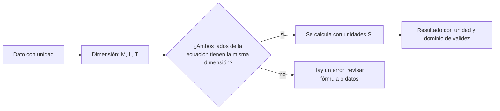

# B05-C01 — Magnitudes físicas y dimensiones

<!-- nav:top -->
[🏠 Programa](../../../../README.md) · [📚 Bloque B05](../../../tronco-comun/B05-fisica-fundamental-para-el-espacio.md) · [← Anterior: B04-C20 — Triangulación espacial aplicada](../../B04/B04-C20-triangulacion-espacial-aplicada/CLASE.md) · [Siguiente: B05-C02 — Posición, velocidad y aceleración →](../B05-C02-posicion-velocidad-y-aceleracion/CLASE.md)
<!-- /nav -->

## 1. Ubicación, nivel y alcance

Primera clase del bloque B05, «Física fundamental para el espacio». Arrancas el bloque con la herramienta más barata y más poderosa de la física: saber qué *tipo* de cosa es cada número. Sigues en el nivel N1 y usas solo lo de B03 (aritmética, potencias y notación científica).

Verás qué es una magnitud, cómo se distingue de su unidad, qué es una dimensión y cómo el análisis dimensional detecta errores y sugiere fórmulas. No verás todavía movimiento (C02) ni fuerzas (C04): aquí solo preparas el lenguaje.

## 2. Por qué esta clase existe

La pregunta motivadora es: **¿cómo sé que una fórmula o un cálculo tiene sentido antes de confiar en su resultado?** La decisión central es qué declarar junto a cada número (magnitud, unidad y dimensión) y cómo comprobar que las ecuaciones son coherentes.

Aprenderás a escribir cada cantidad con su unidad SI, a comprobar dimensionalmente una ecuación y a convertir unidades sin perder el control. Es la base de todo el bloque y de la clase final (C20), donde calcularás la órbita de un satélite ideal.

## 3. Lo que podrás hacer al terminar

1. Distinguir magnitud, unidad, valor numérico y dimensión.
2. Nombrar las siete unidades base del SI y expresar fuerza, energía e impulso con ellas.
3. Convertir unidades con factores y verificar el resultado.
4. Comprobar que una ecuación es dimensionalmente coherente.
5. Deducir la forma de una ley simple con análisis dimensional, sabiendo qué no determina (los factores numéricos).
6. Redactar un cálculo con unidades, supuestos y dominio de validez.

La evidencia es la **hoja de verificación dimensional** del ejercicio 12 (sección 20).

## 4. Con qué llegas y cómo comprobarlo

1. Escribe 0,000 045 en notación científica.
2. ¿Cuánto es 10³ × 10⁻⁵?
3. ¿Cuántos metros son 400 km?
4. Si un tren recorre 120 km en 2 h, ¿cuántos km/h lleva?
5. ¿Qué es una raíz cuadrada de `x⁴`?

<details>
<summary>Ver respuestas</summary>

1. 4,5 × 10⁻⁵. 2. 10⁻². 3. 400 000 m = 4 × 10⁵ m. 4. 60 km/h. 5. `x²`.
</details>

Con cuatro o cinco aciertos, sigue; con menos, repasa B03.

## 5. Un caso real: la unidad que perdió una sonda

La NASA resume que la sonda Mars Climate Orbiter se perdió en 1999 por «un fallo al traducir unidades inglesas a métricas»: el programa en tierra usaba unas y el de a bordo otras, lo que produjo cálculos de trayectoria erróneos y llevó la nave demasiado cerca de Marte (S3). Nadie aplicó mal una ley física; el error estuvo en los **números sin unidad declarada** que dos equipos intercambiaron.

Usaremos ese caso como brújula. Pero la ingeniería real de la misión excede esta clase: S3 es una página divulgativa que resume la causa, no el informe de la investigación.

## 6. Vocabulario

Una **magnitud física** es una propiedad medible de un sistema, como la longitud o la masa. Una **unidad** es una cantidad de referencia de la misma naturaleza que se adopta por convención para medirla; el **valor numérico** es cuántas veces cabe la unidad. Se escribe `Q = {Q}·[Q]`: por ejemplo, `h = 400 km`, donde 400 es el valor y km la unidad. Una **dimensión** es la naturaleza de la magnitud expresada con las magnitudes base: la dimensión de la velocidad es longitud / tiempo, sea cual sea la unidad que uses.

El **Sistema Internacional (SI)** es el conjunto de unidades acordado internacionalmente; tiene siete **unidades base**: segundo, metro, kilogramo, amperio, kelvin, mol y candela (S1). Una **magnitud derivada** se forma multiplicando potencias de las base: la fuerza se mide en newton, `1 N = 1 kg·m/s²`. Una cantidad **adimensional** tiene todas las potencias en cero, como un cociente de dos longitudes. Los **factores de conversión** son cocientes iguales a 1, por ejemplo `1000 m / 1 km`.

## 7. Modelo mental: el cálculo como cadena de tipos

Piensa en cada número como una pieza con una etiqueta de forma: solo encajan piezas de formas compatibles. Sumar solo se permite entre piezas de la misma forma; multiplicar combina formas.



*Descripción textual:* un dato con unidad se reduce a su dimensión; se comprueba que los dos miembros de la ecuación tengan la misma; si sí, se calcula en SI y se reporta con unidad y dominio de validez; si no, se detecta el error antes de calcular.

Una analogía: las piezas de lego de distintos tipos. El análisis dimensional te dice qué piezas pueden unirse, no qué construcción es la correcta. Su límite: dos fórmulas distintas pueden tener la misma dimensión (por ejemplo, `m v²` y `m g h` son ambas energías), así que la coherencia dimensional es condición necesaria, no suficiente.

## 8. La explicación, paso a paso

### 8.1 Magnitud, unidad y valor

Nunca separes un número de su unidad. `400` no es una altura; `400 km` sí. Cuando escribes una fórmula, cada símbolo representa la magnitud completa (valor y unidad), no solo el número. Por eso `h = 400 km = 4,00 × 10⁵ m` es una igualdad verdadera: el mismo objeto con dos descripciones.

### 8.2 Las unidades base del SI y las derivadas

En esta clase te bastan tres magnitudes base: masa `M` (kg), longitud `L` (m) y tiempo `T` (s). El SI fija sus unidades mediante constantes definidas; por ejemplo, el segundo se define con la frecuencia del cesio 133 y la velocidad de la luz es exactamente 299 792 458 m/s (S1). Con ellas se construyen las demás. La velocidad es `L T⁻¹`, la aceleración `L T⁻²`, la fuerza `M L T⁻²` (newton), la energía `M L² T⁻²` (julio) y el impulso `M L T⁻¹` (N·s).

### 8.3 Convertir unidades

Convertir es multiplicar por 1 escrito de forma conveniente. Para pasar 7,67 km/s a m/s: `7,67 km/s × (1000 m / 1 km) = 7670 m/s`. Las unidades se simplifican como si fueran números, y si no se simplifican hasta dejar la unidad buscada, te falta o te sobra un factor. La libra-fuerza (lbf) usada en ingeniería anglosajona vale `0,453 592 37 kg × 9,806 65 m/s² = 4,448 221 615 N`; olvidar ese factor es justo el tipo de error del caso real (S2, S3).

### 8.4 Comprobar una ecuación

La **regla de homogeneidad** dice: en una ecuación válida, todos los términos que se suman o igualan tienen la misma dimensión. Si propones `F = m v`, comparas `M L T⁻²` con `M L T⁻¹`: no coinciden, la fórmula es errónea (esa cantidad es el impulso, no la fuerza). Los argumentos de funciones como seno o exponencial deben ser adimensionales.

### 8.5 Deducir la forma de una ley

Si crees que el período `T` de una órbita circular depende del radio `r` y del parámetro gravitatorio `GM` (dimensión `L³ T⁻²`), propones `T ∝ rᵃ (GM)ᵇ` y exiges la dimensión del tiempo: `L^(a+3b) T^(−2b) = T¹`, de donde `b = −1/2` y `a = 3/2`. Obtienes `T ∝ √(r³/GM)`, que es la forma de la tercera ley de Kepler. El análisis dimensional **no** da el factor numérico (en este caso `2π`); ese lo aporta la física detallada (C03 y C10) o un experimento.

## 9. Magnitudes, símbolos y unidades

| Símbolo | Magnitud | Dimensión | Unidad SI | Valor o nota |
|---|---|---|---|---|
| `m` | masa | M | kg | — |
| `r`, `h` | longitud | L | m | — |
| `t`, `T` | tiempo, período | T | s | — |
| `v` | velocidad | L T⁻¹ | m/s | — |
| `a` | aceleración | L T⁻² | m/s² | — |
| `F` | fuerza | M L T⁻² | N | `1 lbf = 4,448 221 615 N` |
| `E` | energía | M L² T⁻² | J | — |
| `GM` | parámetro gravitatorio | L³ T⁻² | m³/s² | Tierra: 3,9860 × 10¹⁴ (S4) |
| `g_n` | aceleración estándar | L T⁻² | m/s² | 9,806 65 (exacto, S2) |

## 10. Convenciones y referencias

Los números decimales se escriben con coma y los miles con espacio. En el laboratorio, el código usa punto decimal por la sintaxis de Python. Todo cálculo se hace en unidades SI y solo se convierte al informar. El **ejemplo conductor** de todo el bloque es un **satélite ideal** (dato sintético): una masa puntual de 1000 kg en órbita circular a 400 km sobre el ecuador de la Tierra, sin atmósfera, sin rotación y sin más cuerpos. Es un modelo de enseñanza, no de ninguna nave real.

## 11. De dónde sale lo que afirmamos

| ID | Fuente | Localizador | Respalda | Estado |
|---|---|---|---|---|
| S1 | BIPM, *The International System of Units (SI)* — página «SI defining constants» | https://www.bipm.org/en/measurement-units/si-defining-constants | Siete constantes definitorias con valores exactos (`ΔνCs`, `c`, `h`, `e`, `k`, `N_A`, `K_cd`) | Página consultada el 2026-11-05 |
| S2 | NIST, CODATA 2022, «standard acceleration of gravity» | https://physics.nist.gov/cgi-bin/cuu/Value?gn | `g_n = 9,806 65 m/s²` exacto | Página consultada el 2026-11-05 |
| S3 | NASA Science, «Mars Climate Orbiter» | https://science.nasa.gov/mars-climate-orbiter/ | Pérdida en 1999 por fallo al traducir unidades inglesas a métricas | Página consultada el 2026-11-05 |
| S4 | NASA NSSDC, *Earth Fact Sheet* (act. 15-nov-2024) | https://nssdc.gsfc.nasa.gov/planetary/factsheet/earthfact.html | Radio ecuatorial 6378,137 km; GM = 0,39860 × 10⁶ km³/s² | Página consultada el 2026-11-05 |
| S5 | NASA, «Space Station Facts and Figures» | https://www.nasa.gov/international-space-station/space-station-facts-and-figures/ | La ISS da unas 16 órbitas al día, una cada ~90 minutos | Página consultada el 2026-11-05 |

Límites: la masa de la libra (0,453 592 37 kg exactos) es la definición internacional de 1959, que no se consultó en una fuente en esta sesión; se usa como dato de convención y está pendiente de contraste. La deducción de la sección 8.5 es nuestra y se comprueba con el laboratorio.

## 12. Cómo ver las dimensiones

Esta tabla es la versión accesible de un diagrama que une cada magnitud derivada con las tres base.

| Magnitud | M | L | T |
|---|---|---|---|
| Velocidad | 0 | 1 | −1 |
| Aceleración | 0 | 1 | −2 |
| Fuerza | 1 | 1 | −2 |
| Impulso | 1 | 1 | −1 |
| Energía | 1 | 2 | −2 |
| GM | 0 | 3 | −2 |

Si lo dibujas, usa una tabla o una cuadrícula con exponentes escritos (no solo colores). Descripción larga: la energía difiere de la fuerza solo en un metro de más; el impulso difiere de la fuerza solo en un segundo de más.

## 13. Ejemplo trabajado: el período del satélite ideal

**Planteamiento.** Satélite ideal a `h = 400 km`; quieres su período y quieres confiar en el resultado.

**Paso 1 · Datos.** `R = 6 378 137 m` (S4), `h = 4,00 × 10⁵ m`, `GM = 3,9860 × 10¹⁴ m³/s²` (S4). El radio orbital es `r = R + h = 6 778 137 m`.

**Paso 2 · Fórmula y comprobación.** Propones `T = 2π √(r³/GM)`. Dimensionalmente: `√(L³ / (L³ T⁻²)) = √(T²) = T`. Coincide con tiempo, aunque `2π` no lo podemos comprobar así.

**Paso 3 · Cálculo.** `r³ = 3,1141 × 10²⁰ m³`; `r³/GM = 7,8126 × 10⁵ s²`; la raíz es `883,89 s`; multiplicada por `2π` da `T = 5553,6 s = 92,56 min`, igual que el laboratorio.

**Paso 4 · Sentido físico.** Unos 92,6 minutos: del orden de los 90 minutos por órbita que NASA da para la ISS (S5). Esa concordancia de orden de magnitud respalda el modelo, que es válido aquí solo como aproximación de enseñanza (sin atmósfera, sin achatamiento, sin otros cuerpos).

## 14. Comparación de métodos

**Análisis dimensional** es rápido y sirve para detectar errores y deducir proporcionalidades, pero ignora factores numéricos. **Cálculo explícito** da el número, pero un error de unidades pasa inadvertido. **Estimación por orden de magnitud** (B03) da una cifra aproximada sin detalle. Conviene combinarlos: primero la comprobación dimensional, luego el cálculo, luego el orden de magnitud como sentido común.

## 15. Práctica guiada

**Ejercicio 1.** Convierte `7,67 km/s` a `m/s` y a `km/h`. *Pasos:* aplica factores de conversión (sección 8.3).

<details><summary>Solución comentada</summary>

`7,67 km/s × 1000 m/km = 7670 m/s`. A km/h: `7,67 km/s × 3600 s/h = 27 612 km/h`. Los segundos se simplifican; si dejaras km/s², habrías multiplicado por un factor de más.
</details>

**Ejercicio 2.** ¿Tiene sentido dimensionalmente `E = m v²`? ¿Y `E = ½ m v²`? *Pista:* compara con `M L² T⁻²`.

<details><summary>Solución comentada</summary>

`M (L T⁻¹)² = M L² T⁻²`: ambas tienen dimensión de energía. El factor ½ no cambia la dimensión: el análisis dimensional no lo detecta (límite de la sección 7).
</details>

**Ejercicio 3.** Un equipo en tierra entrega «impulso = 100» en lbf·s. ¿Cuántos N·s son?

<details><summary>Solución comentada</summary>

`100 × 4,448 222 = 444,8 N·s`. Tomar 100 como N·s subestimaría el impulso en un factor 4,45: el tipo de fallo del caso de la sección 5.
</details>

## 16. Práctica autónoma, transferencia e integrador

**Ejercicio 4.** Expresa el newton, el julio y el vatio (`J/s`) con kg, m y s.

<details><summary>Solución comentada</summary>

`N = kg·m/s²`; `J = N·m = kg·m²/s²`; `W = J/s = kg·m²/s³`.
</details>

**Ejercicio 5.** Convierte la altura de 400 km a pies (1 pie = 0,3048 m).

<details><summary>Solución comentada</summary>

`400 000 m / 0,3048 m/pie = 1,3123 × 10⁶ pies`. Si usaras km por pies a ojo, errarías por un factor 3281.
</details>

**Ejercicio 6.** Verifica dimensionalmente `v = √(GM/r)`.

<details><summary>Solución comentada</summary>

`√(L³T⁻² / L) = √(L² T⁻²) = L T⁻¹`: es una velocidad, coherente.
</details>

**Ejercicio 7.** ¿Qué dimensión tiene `G` si `F = G m₁ m₂ / r²`?

<details><summary>Solución comentada</summary>

`G = F r² / (m₁ m₂)`: `M L T⁻² L² / M² = M⁻¹ L³ T⁻²`. Su valor en el SI es `6,674 30 × 10⁻¹¹ m³ kg⁻¹ s⁻²` (CODATA 2022; se estudia en C10, con la fuente correspondiente).
</details>

**Ejercicio 8.** Una fórmula afirma `v = a t²`. ¿Es posible? Corrígela.

<details><summary>Solución comentada</summary>

`a t² = L T⁻² T² = L`: es una longitud, no una velocidad. La forma correcta de velocidad ganada con aceleración constante es `v = a t` (dimensión `L T⁻¹`).
</details>

**Ejercicio 9 · transferencia.** Un periodista escribe «la ISS va a 5 millas por segundo». Convierte a m/s con 1 milla = 1609,344 m y compara con 7,67 km/s.

<details><summary>Solución comentada</summary>

`5 × 1609,344 = 8046,7 m/s`. NASA da «unos 5 millas por segundo» (redondeado, S5); 7,67 km/s son 4,77 mi/s. Es coherente dentro del redondeo. Con datos redondeados, no reclames más de dos cifras.
</details>

**Ejercicio 10 · transferencia.** Con `T ∝ √(r³/GM)`, ¿cómo cambia el período si se duplica `r` con el mismo `GM`?

<details><summary>Solución comentada</summary>

`T ∝ r^{3/2}`: el factor es `2^{3/2} = 2,83`. Es la forma dimensional de la tercera ley de Kepler; el factor `2π` no lo necesitas para comparar.
</details>

**Ejercicio 11 · transferencia.** Redacta tres reglas de equipo para evitar un error de unidades como el de la sección 5.

<details><summary>Solución comentada</summary>

(1) Todo dato se transmite con su unidad escrita. (2) Se acuerda un sistema de unidades y se verifica en la interfaz con valores de prueba conocidos. (3) Los programas validan dimensiones o usan tipos con unidad. Son convenciones, no física.
</details>

**Ejercicio 12 · integrador.** Elabora la *hoja de verificación dimensional* de la sección 20 para el cálculo del período del satélite ideal: datos con unidad, dimensión de cada símbolo, comprobación de la ecuación, resultado, orden de magnitud y dominio de validez.

<details><summary>Solución modelo</summary>

Debe incluir: `R`, `h`, `GM` con unidades y fuente; `r = R + h`; comprobación `√(L³/(L³T⁻²)) = T`; resultado `T ≈ 5,55 × 10³ s` con unidad; comparación con ~90 min (S5); dominio: órbita circular, masa puntual, sin atmósfera ni achatamiento.
</details>

## 17. Laboratorio: un comprobador dimensional

El script [analisis_dimensional.py](analisis_dimensional.py) representa cada dimensión como un vector de exponentes (M, L, T) y comprueba las igualdades de la sección 12, la dimensión del período de Kepler y el valor de la libra-fuerza. Calcula además el período y la velocidad del satélite ideal. Se detiene si falla una comprobación.

**Datos:** constantes y datos publicados (S1–S5). **Predice antes de ejecutar:** ¿cuánto vale 1 lbf en newton? (Cerca de 4,45.) **Resultados (2026-11-05, Python 3.12.9):** `1 lbf = 4,4482216153 N`; impulso de 1 lbf·s = 4,4482 N·s; para el satélite ideal, `v = 7668,6 m/s` y `T = 5553,6 s = 92,56 min`. Si la altura se leyera en pies sin convertir, el radio sería 6 500 057 m en vez de 6 778 137 m.

```bash
python programa/clases/B05/B05-C01-magnitudes-fisicas-y-dimensiones/analisis_dimensional.py
```

**Límites:** solo mecánica con tres dimensiones base; no maneja temperatura ni carga, y no valida ecuaciones con sumas ni funciones.

## 18. Errores frecuentes y cómo corregirlos

**Escribir un número sin unidad.** Se detecta cuando alguien pregunta «¿cuánto de qué?». Se corrige con el ejercicio 3.

**Sumar magnitudes de distinta dimensión.** Se corrige con el ejercicio 8.

**Confundir «dimensionalmente correcto» con «correcto».** Ver el ejercicio 2.

**Convertir al revés** (multiplicar donde se debía dividir). Se detecta porque las unidades no se simplifican. Ejercicio 5.

**Mezclar masa y peso o kg y lbf.** Se corrige con el ejercicio 3.

## 19. Cómo sabrás que vas bien

Tras 8.2: ¿puedes escribir la dimensión de la energía sin mirar? Si no, repite el ejercicio 4. Tras 8.4: ¿qué pasa con `F = m v`? Si dudas, vuelve al ejercicio 8. Tras 8.5: ¿qué no te da el análisis dimensional? Si no lo sabes, relee la analogía de la sección 7. Tras el laboratorio: ¿qué comprobaciones hace el script antes de calcular? Léelo.

## 20. Qué entregas y cómo se evalúa

El producto es tu **hoja de verificación dimensional**: una página que lista datos con unidad y fuente, dimensiones, comprobación de ecuaciones, resultado con unidad y dominio de validez.

| Criterio | Inicial | En desarrollo | Logrado | Destacado |
|---|---|---|---|---|
| Unidades | Faltan | Algunas | Todas y en SI | Verifica por conversión inversa |
| Dimensiones | Ausentes | Parciales | Correctas | Deduce una proporcionalidad |
| Comprobación | No comprueba | Con ayuda | Comprueba cada ecuación | Señala qué no puede detectar |
| Fuentes y alcance | Sin fuente | Fuente sin alcance | Con alcance | Distingue dato de convención |

**Condiciones críticas:** no entregar números sin unidad; no presentar el modelo como nave real; citar solo fuentes consultadas.

## 21. Ética, seguridad y límites

Declarar unidades es honestidad científica y seguridad en misiones reales: un error de convención costó una sonda (S3). Esta clase es educativa y no sirve para diseñar ni operar naves. Accesibilidad: ecuaciones en texto, diagramas descritos, tablas equivalentes, funciona sin conexión.

## 22. Para cerrar y seguir

Una magnitud es un valor con unidad y una dimensión; las ecuaciones deben ser homogéneas; el análisis dimensional detecta errores y sugiere formas, pero no da factores numéricos. Queda una pregunta: ¿cómo describir *dónde* está el satélite y *cómo* se mueve? Es el tema de C02.

**Glosario español–inglés.** magnitud · *quantity*; dimensión · *dimension*; unidad base · *base unit*; análisis dimensional · *dimensional analysis*; factor de conversión · *conversion factor*; adimensional · *dimensionless*.

**Continuidad.** B05-C02 usa tu capacidad de **declarar unidad y dimensión** para definir posición, velocidad y aceleración sin ambigüedad.

**Referencias:** ver sección 11.

<!-- nav:bottom -->
---

[← Anterior: B04-C20 — Triangulación espacial aplicada](../../B04/B04-C20-triangulacion-espacial-aplicada/CLASE.md) · [📚 Bloque B05](../../../tronco-comun/B05-fisica-fundamental-para-el-espacio.md) · [Siguiente: B05-C02 — Posición, velocidad y aceleración →](../B05-C02-posicion-velocidad-y-aceleracion/CLASE.md)
<!-- /nav -->
