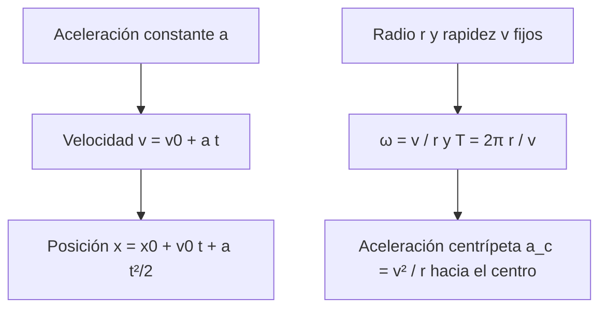

# B05-C03 — Movimiento rectilíneo y circular

<!-- nav:top -->
[🏠 Programa](../../../../README.md) · [📚 Bloque B05](../../../tronco-comun/B05-fisica-fundamental-para-el-espacio.md) · [← Anterior: B05-C02 — Posición, velocidad y aceleración](../B05-C02-posicion-velocidad-y-aceleracion/CLASE.md) · [Siguiente: B05-C04 — Leyes del movimiento de Newton →](../B05-C04-leyes-del-movimiento-de-newton/CLASE.md)
<!-- /nav -->

## 1. Ubicación, nivel y alcance

Tercera clase de B05. Ya sabes definir `r`, `v` y `a` (C02); ahora obtienes las fórmulas de los dos movimientos más sencillos y más útiles en el espacio: la línea recta con aceleración constante y la circunferencia con rapidez constante. Nivel N1. No verás todavía las causas del movimiento (C04) ni órbitas elípticas (C10 y B-posteriores).

## 2. Por qué esta clase existe

Un cohete que enciende su motor un tiempo corto y un satélite que da vueltas son, a primera aproximación, estos dos movimientos. La pregunta motivadora es: **¿qué fórmulas valen cuando la aceleración es constante o cuando la rapidez es constante en un círculo, y hasta dónde son confiables?** La decisión central es reconocer, para cada problema, si el modelo aplica (aceleración constante o círculo) y qué supuestos asumes.

## 3. Lo que podrás hacer al terminar

1. Deducir `x = x₀ + v₀t + ½at²` y `v² = v₀² + 2aΔx` a partir de las definiciones.
2. Resolver problemas de frenado y de aceleración uniforme con unidades.
3. Relacionar período, frecuencia, velocidad angular y rapidez en un círculo.
4. Calcular la aceleración centrípeta de un satélite en órbita circular.
5. Elegir el modelo adecuado y declarar su dominio de validez.
6. Contrastar una fórmula con un cálculo numérico independiente.

La evidencia es la **hoja de modelo cinemático** del ejercicio 12 (sección 20).

## 4. Con qué llegas y cómo comprobarlo

1. ¿Cuál es la aceleración media si `v` pasa de 0 a 30 m/s en 6 s?
2. Despeja `t` de `x = ½ a t²`.
3. ¿Cuántos radianes tiene una vuelta completa?
4. Si `v = 5 m/s` constante, ¿qué distancia en 12 s?
5. ¿Qué dimensión tiene `v²/r`?

<details>
<summary>Ver respuestas</summary>

1. 5 m/s². 2. `t = √(2x/a)`. 3. `2π`. 4. 60 m. 5. `L T⁻²`, es una aceleración.
</details>

Con cuatro o cinco aciertos, sigue; con menos, repasa C02.

## 5. Un caso real: un satélite que «se queda quieto» sobre un punto

Algunos satélites de comunicaciones permanecen sobre un mismo punto del ecuador porque su período orbital coincide con la rotación de la Tierra. NASA da esa rotación sidérea: 23,9345 horas (S1). Esa coincidencia es una consecuencia directa de las fórmulas de movimiento circular: elige el radio para que `T` sea ese valor. En el laboratorio verás que, probando un radio de órbita, se obtiene un período de 23,934 h, igual a la rotación sidérea. Límite: la altitud usada es una prueba para ilustrar el cálculo; no se consultó una fuente de órbitas geoestacionarias en esta clase.

## 6. Vocabulario

El **movimiento rectilíneo uniforme (MRU)** tiene velocidad constante y aceleración cero. El **movimiento rectilíneo uniformemente acelerado (MRUA)** tiene aceleración constante. El **movimiento circular uniforme (MCU)** recorre una circunferencia con rapidez constante. El **período** `T` es el tiempo de una vuelta; la **frecuencia** `f = 1/T` es el número de vueltas por segundo (hertz, Hz); la **velocidad angular** `ω = 2π/T` (rad/s) es el ángulo recorrido por unidad de tiempo. La **aceleración centrípeta** `a_c` es la que apunta al centro de la circunferencia. Un **radián** es el ángulo cuyo arco mide lo mismo que el radio; es adimensional.

## 7. Modelo mental: dos movimientos con un solo par de ideas

Ambos movimientos se construyen con la misma idea: sumar efectos pequeños de `a` sobre `v` y de `v` sobre `x`.



*Descripción textual:* dos ramas. En la recta, una aceleración constante da la velocidad y luego la posición. En el círculo, un radio y una rapidez fijos dan la velocidad angular y el período, y de ahí la aceleración hacia el centro.

Una analogía: un ciclista en una recta que pedalea cada vez más fuerte (MRUA) frente a otro que da vueltas a una pista con el velocímetro fijo (MCU). El límite: en la pista, el ciclista cambia de dirección, por lo que acelera aunque su rapidez sea constante.

## 8. La explicación, paso a paso

### 8.1 MRUA desde las definiciones

Si `a` es constante, la velocidad cambia lo mismo en cada segundo, de modo que `v = v₀ + a t`. La velocidad media en el intervalo es el promedio de `v₀` y `v`, es decir `v₀ + ½ a t`, y por tanto `x = x₀ + v₀ t + ½ a t²`. Eliminando `t` entre ambas se obtiene `v² = v₀² + 2 a (x − x₀)`. Las tres son válidas **solo** con `a` constante.

### 8.2 El caso MRU y el frenado

Con `a = 0` solo queda `x = x₀ + v t`. Para un frenado a `a = −5 m/s²` desde `v₀ = 100 m/s`, el cuerpo se detiene cuando `v = 0`: `t = v₀/|a| = 20 s`, y recorre `Δx = v₀²/(2|a|) = 1000 m`. Observa que duplicar `v₀` cuadruplica la distancia de frenado.

### 8.3 MCU: ángulo, período y rapidez

En una vuelta recorres `2π r` en un tiempo `T`, por lo que `v = 2π r / T = ω r`. La frecuencia `f = 1/T` y `ω = 2π f`. El vector `v` es siempre tangente a la circunferencia; su módulo no cambia, su dirección sí.

### 8.4 La aceleración centrípeta

Tras un tiempo corto `Δt`, el vector velocidad gira un ángulo `ω Δt`; su cambio tiene módulo `v ω Δt` (para ángulos pequeños) y apunta al centro, así que `a_c = v ω = v²/r = ω² r`. Es decir, para un satélite en órbita circular, `a_c` es el valor que la gravedad debe proporcionar; igualándolo con `GM/r²` obtienes `v = √(GM/r)` (esto se enuncia con rigor en C04 y C10; aquí lo usas como dato de consistencia).

### 8.5 Dominio de validez

Las fórmulas del MRUA fallan si `a` cambia (por ejemplo, un cohete que quema combustible y pierde masa) y las del MCU, si el radio o la rapidez varían (órbita elíptica). Las dos suponen velocidades mucho menores que la de la luz, tema de A02.

## 9. Magnitudes, símbolos y unidades

| Símbolo | Magnitud | Dimensión | Unidad SI | Valor o nota |
|---|---|---|---|---|
| `x`, `x₀` | posición en la recta | L | m | — |
| `v`, `v₀` | velocidad | L T⁻¹ | m/s | — |
| `a` | aceleración constante | L T⁻² | m/s² | — |
| `t` | tiempo | T | s | — |
| `T`, `f` | período, frecuencia | T, T⁻¹ | s, Hz | `f = 1/T` |
| `ω` | velocidad angular | T⁻¹ | rad/s | `ω = 2π/T` |
| `a_c` | aceleración centrípeta | L T⁻² | m/s² | `v²/r` |
| `GM` | parámetro gravitatorio | L³ T⁻² | m³/s² | 3,9860 × 10¹⁴ (S1) |

## 10. Convenciones y referencias

En la recta, el eje `x` tiene sentido positivo declarado; una aceleración opuesta a `v` es negativa. En el círculo, el ángulo crece en sentido antihorario. Datos del MRUA: **sintéticos**. Datos orbitales: GM y radio de la Tierra de S1; la altitud de 400 km es sintética.

## 11. De dónde sale lo que afirmamos

| ID | Fuente | Localizador | Respalda | Estado |
|---|---|---|---|---|
| S1 | NASA NSSDC, *Earth Fact Sheet* (act. 15-nov-2024) | https://nssdc.gsfc.nasa.gov/planetary/factsheet/earthfact.html | GM = 0,39860 × 10⁶ km³/s²; radio ecuatorial 6378,137 km; rotación sidérea 23,9345 h | Página consultada el 2026-11-05 |

Límites: las fórmulas del movimiento son resultados estándar de cinemática, deducidas aquí y comprobadas en el laboratorio contra cálculos independientes; no se cita un texto concreto. No se consultó una fuente de altitud geoestacionaria.

## 12. Cómo ver los movimientos

Tabla accesible de un gráfico de `v(t)` para el frenado de la sección 8.2 (datos sintéticos).

| t (s) | v (m/s) | x (m) |
|---|---|---|
| 0 | 100 | 0 |
| 5 | 75 | 437,5 |
| 10 | 50 | 750 |
| 15 | 25 | 937,5 |
| 20 | 0 | 1000 |

Descripción larga: `v(t)` es una recta descendente y `x(t)` una parábola que se aplana al llegar a 1000 m; el área bajo la recta `v(t)` es el desplazamiento.

## 13. Ejemplo trabajado: el satélite ideal a 400 km

**Planteamiento.** Hallar `v`, `T`, `ω` y `a_c` del satélite ideal.

**Paso 1 · Datos.** `r = 6 378 137 + 400 000 = 6 778 137 m`; `GM = 3,9860 × 10¹⁴ m³/s²` (S1).

**Paso 2 · Rapidez.** Con `a_c = v²/r = GM/r²`, `v = √(GM/r) = 7668,6 m/s`.

**Paso 3 · Período y velocidad angular.** `T = 2π r/v = 5553,6 s = 1,543 h`; `ω = 2π/T = 1,1314 × 10⁻³ rad/s`.

**Paso 4 · Aceleración.** `a_c = v²/r = 8,676 m/s²`.

**Sentido físico.** Una órbita cada 92,6 minutos concuerda con el orden de «una cada ~90 min» que da NASA para la ISS (C02, S3 allí). Si subes a 2000 km de altura, `T = 2,120 h` y `a_c = 5,679 m/s²`: más alto, más lento y con menos aceleración.

## 14. Comparación de métodos

**Fórmulas cerradas** son exactas pero exigen `a` o `v` constantes. **Integración paso a paso** (C04) sirve para aceleración variable, a costa de error numérico. **Argumentos de energía** (C06 y C07) evitan el tiempo cuando solo importa la velocidad final. Para un frenado a `a` constante, usa `v² = v₀² + 2aΔx`; para un tiempo, `v = v₀ + at`.

## 15. Práctica guiada

**Ejercicio 1.** Un cuerpo parte del reposo con `a = 3 m/s²`. ¿Qué velocidad y qué posición tiene a los 8 s? *Pasos:* sección 8.1.

<details><summary>Solución comentada</summary>

`v = 3 × 8 = 24 m/s`; `x = ½ × 3 × 64 = 96 m`. Comprueba con `v² = 2 a x`: `576 = 2×3×96 = 576`.
</details>

**Ejercicio 2.** ¿Qué distancia necesita para detenerse un vehículo a 50 m/s con `a = −5 m/s²`? *Pista:* `v² = v₀² + 2aΔx` con `v = 0`.

<details><summary>Solución comentada</summary>

`Δx = 50²/(2×5) = 250 m`. Si la velocidad inicial fuese 100 m/s, serían 1000 m.
</details>

**Ejercicio 3.** Un punto recorre un círculo de 50 m de radio con período 20 s. Halla `v` y `a_c`.

<details><summary>Solución comentada</summary>

`v = 2π × 50/20 = 15,71 m/s`; `a_c = v²/r = 4,93 m/s²`. Comprobación: `ω² r = (0,314)² × 50 = 4,93`.
</details>

## 16. Práctica autónoma, transferencia e integrador

**Ejercicio 4.** Una sonda gana 0,5 m/s² durante 120 s desde 1000 m/s (todo en una recta). ¿Velocidad final y distancia?

<details><summary>Solución comentada</summary>

`v = 1000 + 0,5×120 = 1060 m/s`; `Δx = 1000×120 + ½×0,5×120² = 123 600 m`. La velocidad media 1030 m/s por 120 s da lo mismo.
</details>

**Ejercicio 5.** Convierte `ω = 1,1314 × 10⁻³ rad/s` a vueltas por día.

<details><summary>Solución comentada</summary>

`f = ω/2π = 1,8006 × 10⁻⁴ Hz`; en 86 400 s son `15,56` vueltas por día. NASA dice «16 órbitas» (redondeo) para la ISS, que orbita a una altitud algo distinta.
</details>

**Ejercicio 6.** ¿Cuánto vale `a_c` si se duplica el radio con la misma rapidez? ¿Y si se duplica la rapidez con el mismo radio?

<details><summary>Solución comentada</summary>

`a_c = v²/r`: con `r` doble, la mitad; con `v` doble, el cuádruple.
</details>

**Ejercicio 7.** Con `T = 23,9345 h`, `GM = 3,9860 × 10¹⁴ m³/s²`, despeja `r` de `T = 2π√(r³/GM)` y compara con `R + 35 786 km`.

<details><summary>Solución comentada</summary>

`r = (GM T²/4π²)^{1/3} = 4,2164 × 10⁷ m`; restando `R = 6,378 × 10⁶ m`, `h ≈ 3,578 × 10⁷ m`, es decir unos 35 786 km: compatible con la altitud de prueba del laboratorio.
</details>

**Ejercicio 8.** Verifica dimensionalmente `x = ½ a t²` y `v² = v₀² + 2aΔx`.

<details><summary>Solución comentada</summary>

`L T⁻² · T² = L` y `(L T⁻¹)² = L² T⁻²` en todos los términos: `L T⁻² · L = L² T⁻²`. Ambas son homogéneas.
</details>

**Ejercicio 9 · transferencia.** Un motor da a una nave `a = 2 m/s²` solo durante 30 s. Entre 30 s y 100 s no hay empuje. Describe la velocidad usando MRUA y luego MRU.

<details><summary>Solución comentada</summary>

A los 30 s: `v = 60 m/s` (desde el reposo). Después, MRU a 60 m/s. Una sola fórmula no cubre todo: se parte el problema por tramos con `a` constante en cada uno.
</details>

**Ejercicio 10 · transferencia.** Un artículo dice que «un satélite que se mueve más rápido está en una órbita más alta». Evalúa con los datos del laboratorio.

<details><summary>Solución comentada</summary>

Es falso: a 400 km, `v = 7668,6 m/s`; a 2000 km, 6897,6; a 35 786 km, 3074,7. A mayor altitud, menor rapidez en una órbita circular.
</details>

**Ejercicio 11 · transferencia.** Un control de tierra calcula la distancia de frenado con `a` constante, pero el empuje decrece un 20 % durante la maniobra. ¿Qué supuesto falla y qué haces?

<details><summary>Solución comentada</summary>

Falla `a` constante. Se parte la maniobra en tramos de `a` casi constante o se integra paso a paso (C04). Presentar el resultado con la fórmula única subestimaría la distancia.
</details>

**Ejercicio 12 · integrador.** Elabora la *hoja de modelo cinemático* (sección 20): elige MRUA o MCU para un caso (frenado de una sonda o satélite en círculo), justifica el modelo, resuelve con unidades, comprueba por otra vía y declara el dominio de validez.

<details><summary>Solución modelo</summary>

Debe incluir el criterio de elección (aceleración constante o círculo), datos con unidad y fuente o rótulo sintético, el cálculo, una verificación independiente (por ejemplo `v² = v₀² + 2aΔx` o `ω² r = v²/r`) y el límite del modelo.
</details>

## 17. Laboratorio: MRUA y órbitas circulares

El script [movimiento_uniforme_y_circular.py](movimiento_uniforme_y_circular.py) resuelve un MRUA y compara pasos sucesivos con el salto único, verifica `v² = v₀² + 2aΔx` y `a_c = GM/r²`, y calcula `v`, `T` y `a_c` para tres altitudes.

**Datos:** sintéticos (MRUA) y NASA (GM, R). **Predice antes de ejecutar:** ¿qué período tendrá una órbita a 35 786 km? **Resultados (2026-11-05, Python 3.12.9):** MRUA: tras 10 s con `a = 2` y `v₀ = 100`: `x = 1100,0 m`, `v = 120,0 m/s`; frenado: `t = 20,0 s`, `1000,0 m`. Órbitas: 400 km → `v = 7668,6 m/s`, `T = 1,543 h`, `a_c = 8,676 m/s²`; 2000 km → `6897,6`, `2,120 h`, `5,679`; 35 786 km → `3074,7`, `23,934 h`, `0,224`.

```bash
python programa/clases/B05/B05-C03-movimiento-rectilineo-y-circular/movimiento_uniforme_y_circular.py
```

**Límites:** órbitas circulares y sin perturbaciones; no es una herramienta de diseño de misión.

## 18. Errores frecuentes y cómo corregirlos

**Aplicar MRUA con aceleración variable.** Ejercicio 11. **Olvidar que una vuelta son `2π` rad.** Ejercicio 5. **Creer que más rápido significa órbita más alta.** Ejercicio 10. **Confundir `v = ωr` con `v = ω/r`.** Ejercicio 3. **No verificar con una segunda vía.** Ejercicio 1.

## 19. Cómo sabrás que vas bien

Tras 8.1: ¿puedes deducir `v²` sin mirar? Si no, repite el ejercicio 1. Tras 8.4: ¿por qué `a_c = v²/r`? Si no lo explicas, relee. Tras el laboratorio: ¿qué comprobaciones hace el script? Léelo.

## 20. Qué entregas y cómo se evalúa

El producto es tu **hoja de modelo cinemático**: elección del modelo, datos, cálculo, comprobación independiente y dominio de validez.

| Criterio | Inicial | En desarrollo | Logrado | Destacado |
|---|---|---|---|---|
| Elección del modelo | Sin criterio | Con ayuda | Justificada | Discute alternativas |
| Cálculo y unidades | Errores | Parcial | Correcto | Verificación dimensional |
| Comprobación | Ninguna | Una | Independiente | Dos vías y su discrepancia |
| Fuentes y alcance | Sin fuente | Sin alcance | Con alcance | Distingue sintético de observado |

**Condiciones críticas:** no usar el modelo fuera de su dominio; rotular datos sintéticos; citar solo lo consultado.

## 21. Ética, seguridad y límites

Una fórmula aplicada fuera de su dominio es una causa clásica de fallo de ingeniería. Esta clase es educativa: no calcula maniobras ni órbitas de misión. Accesibilidad: ecuaciones en texto, tablas equivalentes de las gráficas, sin conexión.

## 22. Para cerrar y seguir

El MRUA y el MCU se derivan de las definiciones de C02; sus fórmulas valen solo con `a` constante o con radio y rapidez fijos. Queda abierta la causa: ¿qué hace que un cuerpo acelere? Es el tema de C04.

**Glosario español–inglés.** movimiento rectilíneo · *rectilinear motion*; movimiento circular uniforme · *uniform circular motion*; período · *period*; frecuencia · *frequency*; velocidad angular · *angular velocity*; aceleración centrípeta · *centripetal acceleration*.

**Continuidad.** B05-C04 usa tu capacidad de **calcular `a` de un movimiento** para conectarla con la fuerza mediante las leyes de Newton.

**Referencias:** ver sección 11.

<!-- nav:bottom -->
---

[← Anterior: B05-C02 — Posición, velocidad y aceleración](../B05-C02-posicion-velocidad-y-aceleracion/CLASE.md) · [📚 Bloque B05](../../../tronco-comun/B05-fisica-fundamental-para-el-espacio.md) · [Siguiente: B05-C04 — Leyes del movimiento de Newton →](../B05-C04-leyes-del-movimiento-de-newton/CLASE.md)
<!-- /nav -->
