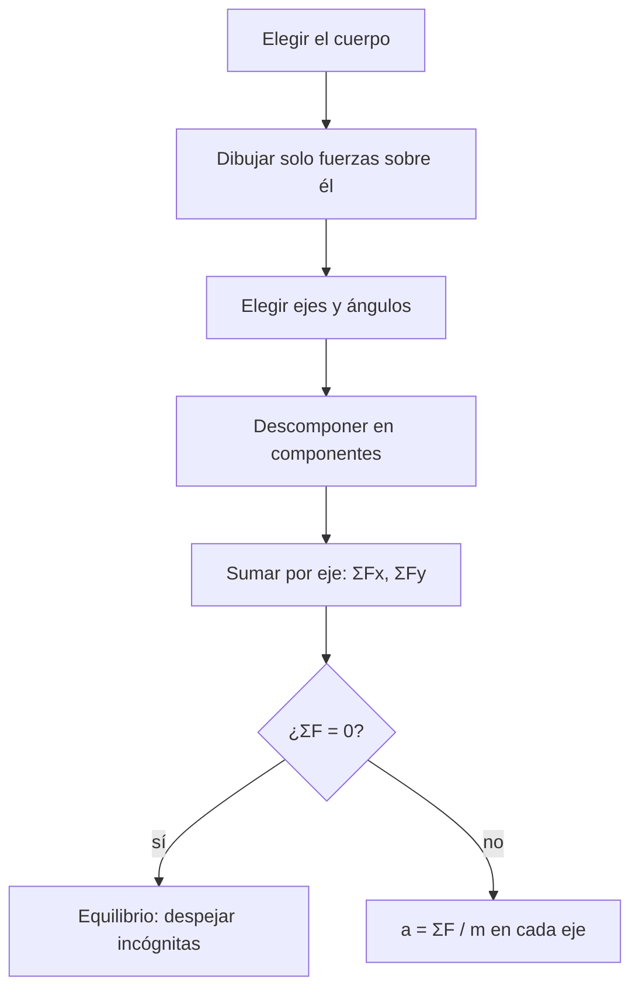

# B05-C05 — Diagramas de cuerpo libre

<!-- nav:top -->
[🏠 Programa](../../../../README.md) · [📚 Bloque B05](../../../tronco-comun/B05-fisica-fundamental-para-el-espacio.md) · [← Anterior: B05-C04 — Leyes del movimiento de Newton](../B05-C04-leyes-del-movimiento-de-newton/CLASE.md) · [Siguiente: B05-C06 — Trabajo y energía →](../B05-C06-trabajo-y-energia/CLASE.md)
<!-- /nav -->

## 1. Ubicación, nivel y alcance

Quinta clase de B05. Sabes que `ΣF = m a` (C04); ahora aprendes a **organizar las fuerzas** para aplicarlo sin olvidar ninguna. Nivel N1; usas trigonometría básica de B04 (seno y coseno de un ángulo). No verás todavía torques ni rotación (C09), solo partículas bajo fuerzas concurrentes.

## 2. Por qué esta clase existe

En un lanzamiento o en una maniobra hay varias fuerzas a la vez: gravedad, empuje, tensiones, rozamiento. La pregunta motivadora es: **¿cómo dejo de olvidar fuerzas y de contar dos veces una misma?** La decisión central es dibujar, antes de calcular, un diagrama con un solo cuerpo, las fuerzas que actúan *sobre él* y un sistema de ejes elegido a propósito.

## 3. Lo que podrás hacer al terminar

1. Aislar un cuerpo y listar solo las fuerzas externas que actúan sobre él.
2. Dibujar un diagrama de cuerpo libre con ejes y ángulos declarados.
3. Descomponer una fuerza en componentes y recomponer una suma.
4. Resolver un problema de equilibrio (aceleración cero) y uno de aceleración.
5. Reconocer cómo cambia la tensión cuando cambia el ángulo.
6. Verificar un resultado con una condición límite o un caso conocido.

La evidencia es el **diagrama y planteamiento** del ejercicio 12 (sección 20).

## 4. Con qué llegas y cómo comprobarlo

1. ¿Cuánto vale `sen 30°` y `cos 60°`?
2. ¿Qué es una fuerza neta?
3. Si `ΣF = 0`, ¿qué sabes de la aceleración?
4. Descompón un vector de módulo 10 a 90° en `x` e `y`.
5. ¿Pueden anularse acción y reacción? (C04)

<details>
<summary>Ver respuestas</summary>

1. 0,5 y 0,5. 2. La suma vectorial de todas las fuerzas sobre el cuerpo. 3. Es cero: el cuerpo está en reposo o en MRU. 4. `(0, 10)`. 5. No, actúan sobre cuerpos diferentes.
</details>

Con cuatro o cinco aciertos, sigue; con menos, repasa C04 y B04.

## 5. Un caso real: cargas que se sostienen con cables

Cuando se levanta una carga con dos cables, cada cable tira con una tensión que depende del ángulo; cuanto más horizontales, más tensión. No hace falta un dato de misión para entenderlo: es geometría y equilibrio. Usaremos un **caso sintético** (200 kg colgando de dos cables simétricos) porque no consultamos un dato de una operación real; así evitamos presentar cifras inventadas como si fueran de una misión. Límite: es un modelo de enseñanza; el diseño real de eslingas exige normas y factores de seguridad que esta clase no cubre.

## 6. Vocabulario

Un **diagrama de cuerpo libre (DCL)** es un esquema que muestra un cuerpo aislado y todas las fuerzas externas que actúan sobre él, como flechas desde el cuerpo. El **peso** (gravedad sobre el cuerpo) apunta hacia el centro del astro. La **normal** es la fuerza de contacto perpendicular a una superficie. La **tensión** es la fuerza que ejerce una cuerda o cable tirando. El **empuje** es la fuerza de un motor o un fluido. El **rozamiento** es la fuerza de contacto paralela a la superficie que se opone al deslizamiento. Una **componente** es la parte de un vector sobre un eje. El **equilibrio** es el estado en que `ΣF = 0`.

## 7. Modelo mental: el cuerpo como punto con flechas

Imagina que encierras el cuerpo en una burbuja: cada flecha que entra o sale de la burbuja es una fuerza externa; lo que ocurre dentro no cuenta. Después, eliges ejes que simplifiquen la suma.



*Descripción textual:* se elige el cuerpo, se dibujan solo las fuerzas que actúan sobre él, se fijan ejes y ángulos, se descompone cada fuerza, se suma por ejes; si la suma es cero hay equilibrio y se despejan incógnitas, y si no, se divide por la masa para obtener la aceleración.

Una analogía: una radiografía aísla un hueso del resto del cuerpo. El límite: una radiografía muestra la estructura interna; el DCL deliberadamente la ignora y solo muestra lo que viene de fuera.

## 8. La explicación, paso a paso

### 8.1 Qué entra y qué no

Entran solo fuerzas **sobre** el cuerpo elegido. No se dibuja la fuerza que el cuerpo ejerce sobre otros (es la reacción, y actúa en otro DCL). Tampoco se dibuja «la fuerza del movimiento»: la velocidad no es una fuerza.

### 8.2 Elegir ejes

Elige ejes que alineen la mayor cantidad de fuerzas. En un plano inclinado, un eje a lo largo de la rampa y otro perpendicular evita descomponer la normal y el rozamiento. En órbita, los ejes radial (hacia el centro) y tangencial hacen que la gravedad quede en un solo eje.

### 8.3 Descomponer y sumar

Una fuerza de módulo `F` que forma un ángulo `θ` con el eje `x` tiene componentes `F_x = F cos θ` y `F_y = F sen θ`. Se suman por separado: `ΣF_x = ΣF_xi`, `ΣF_y = ΣF_yi`. El módulo de la neta es `√(ΣF_x² + ΣF_y²)`. Cada componente tiene su unidad (N) y su signo según el sentido del eje.

### 8.4 Equilibrio: cables simétricos

Una masa `m` cuelga de dos cables que forman un ángulo `θ` con la horizontal. Hay tres fuerzas: dos tensiones `T` y el peso `m g_n` (S1). En el eje `y`: `2 T sen θ − m g_n = 0`, de donde `T = m g_n / (2 sen θ)`. Con `θ = 30°`, `T = m g_n` (cada cable aguanta tanto como el peso entero). Con `θ = 5°`, `T = 5,74 m g_n`: un cable casi horizontal soporta una fuerza enorme. No hay equilibrio con cable perfectamente horizontal (`sen 0 = 0`).

### 8.5 Con aceleración: empuje y peso

Un cohete de masa `m` en una plataforma, con empuje vertical `E` y peso `m g_n`, tiene `a = (E − m g_n)/m`. Si `E < m g_n` no despega (la normal de la plataforma completa el equilibrio); si `E > m g_n`, sube con `a` positiva. En el espacio, el satélite ideal bajo gravedad y un empuje tangencial pequeño tiene `ΣF` con dos componentes: una radial (gravedad) y otra tangencial (empuje).

## 9. Magnitudes, símbolos y unidades

| Símbolo | Magnitud | Dimensión | Unidad SI | Valor o nota |
|---|---|---|---|---|
| `F_x`, `F_y` | componentes de fuerza | M L T⁻² | N | con signo |
| `T` | tensión | M L T⁻² | N | cable |
| `N` | normal | M L T⁻² | N | contacto |
| `E` | empuje | M L T⁻² | N | motor |
| `θ` | ángulo con la horizontal | — | rad o ° | adimensional |
| `g_n` | aceleración estándar | L T⁻² | m/s² | 9,806 65 (S1) |

## 10. Convenciones y referencias

`x` horizontal hacia la derecha, `y` vertical hacia arriba, ángulos medidos desde `+x` en sentido antihorario. Todos los datos de masa, ángulo y empuje de esta clase son **sintéticos**; solo `g_n` es un valor publicado. El peso se calcula con `g_n` por convención de enseñanza; en un lugar concreto, `g` difiere ligeramente.

## 11. De dónde sale lo que afirmamos

| ID | Fuente | Localizador | Respalda | Estado |
|---|---|---|---|---|
| S1 | NIST, CODATA 2022, «standard acceleration of gravity» | https://physics.nist.gov/cgi-bin/cuu/Value?gn | `g_n = 9,806 65 m/s²` exacto | Página consultada el 2026-11-05 |

Límites: la teoría de equilibrio de partículas es mecánica clásica estándar, deducida aquí y comprobada con un caso analítico en el laboratorio; no se cita un texto concreto. Las cifras de masa, empuje y ángulos son inventadas para enseñanza.

## 12. Cómo ver las fuerzas

Tabla accesible del DCL de los cables simétricos (200 kg, `θ = 30°`; datos sintéticos).

| Fuerza | Eje x (N) | Eje y (N) |
|---|---|---|
| Tensión cable derecho | +1698,5 | +980,7 |
| Tensión cable izquierdo | −1698,5 | +980,7 |
| Peso | 0 | −1961,3 |
| Suma | 0 | 0 |

Descripción larga: tres flechas parten del mismo punto: dos hacia arriba y afuera, de igual módulo, y una hacia abajo; sus componentes horizontales se anulan y las verticales equilibran el peso. Usa líneas de distinto trazo para cada flecha, no solo color.

## 13. Ejemplo trabajado: el satélite con un empuje lateral

**Planteamiento.** El satélite ideal (1000 kg, 400 km) enciende un propulsor pequeño con 50 N tangencial. ¿Qué aceleración neta tiene?

**Paso 1 · Cuerpo y ejes.** Satélite; en el instante inicial está en `x = r`; eje radial `−x` (hacia el centro) y tangencial `+y`.

**Paso 2 · Fuerzas.** Gravedad `8675,9 N` hacia `−x`; empuje `50 N` en `+y`. No hay otras (modelo ideal).

**Paso 3 · Suma.** `ΣF = (−8675,9; 50,0) N`, `a = (−8,6759; 0,0500) m/s²`.

**Paso 4 · Sentido físico.** La componente radial sigue siendo la gravedad: curva la trayectoria. La tangencial es el 0,6 % de la radial: cambia lentamente la rapidez. Aquí un empuje pequeño modifica la órbita poco a poco, no de golpe. Comprobación: en el límite empuje = 0 se recupera `a_c = 8,676 m/s²` de C03.

## 14. Comparación de métodos

**DCL con componentes** es general y sirve en 2D. **Triángulo de fuerzas** (dibujo a escala) da una idea rápida en equilibrio con tres fuerzas. **Cálculo numérico** (código) sirve cuando hay muchos cuerpos o fuerzas variables. Para un problema con tres fuerzas concurrentes, el DCL con componentes es el método estándar; el triángulo sirve para comprobar.

## 15. Práctica guiada

**Ejercicio 1.** Descompón una fuerza de 100 N a 30° sobre la horizontal. *Pasos:* sección 8.3.

<details><summary>Solución comentada</summary>

`F_x = 100 cos 30° = 86,6 N`; `F_y = 100 sen 30° = 50,0 N`. Comprueba: `√(86,6² + 50²) = 100`.
</details>

**Ejercicio 2.** Un cuerpo de 10 kg en una mesa sin aceleración vertical: ¿cuánto vale la normal? *Pista:* equilibrio en `y` con `g_n`.

<details><summary>Solución comentada</summary>

`N − m g_n = 0`, `N = 98,07 N`. La normal no es la reacción del peso: la reacción del peso actúa sobre la Tierra.
</details>

**Ejercicio 3.** Dos cables simétricos a 60° con la horizontal sostienen 200 kg. ¿Qué tensión tiene cada uno?

<details><summary>Solución comentada</summary>

`T = 200 × 9,806 65/(2 sen 60°) = 1132,4 N`, es decir, 0,58 veces el peso. Más inclinado hacia la vertical, menos tensión.
</details>

## 16. Práctica autónoma, transferencia e integrador

**Ejercicio 4.** Con la misma carga, calcula la tensión de cada cable a 10° y a 5°.

<details><summary>Solución comentada</summary>

A 10°: `5647,4 N` (2,88 pesos); a 5°: `11 251,9 N` (5,74 pesos). La tensión crece sin límite cuando el ángulo tiende a 0.
</details>

**Ejercicio 5.** Un cohete sintético de 5,0 × 10⁵ kg tiene un empuje de 7,0 × 10⁶ N. ¿Despega? ¿Con qué aceleración?

<details><summary>Solución comentada</summary>

Peso `= 4,903 × 10⁶ N < 7,0 × 10⁶ N`; `a = (7,0 × 10⁶ − 4,903 × 10⁶)/5,0 × 10⁵ = 4,19 m/s²` (0,43 `g_n`). Si el empuje fuese menor que el peso, la plataforma lo sostiene y `a = 0`.
</details>

**Ejercicio 6.** Un bloque de 20 kg en una rampa de 30° sin rozamiento: ¿qué componente del peso va a lo largo de la rampa?

<details><summary>Solución comentada</summary>

`m g_n sen 30° = 98,07 N`; la perpendicular, `m g_n cos 30° = 169,9 N`, la compensa la normal. Aceleración: `g_n sen 30° = 4,90 m/s²`.
</details>

**Ejercicio 7.** Un cuerpo recibe tres fuerzas: `(10, 0)`, `(0, 15)` y `(−10, −15)` N. ¿Está en equilibrio? ¿Qué pasa si se retira la tercera?

<details><summary>Solución comentada</summary>

La suma es `(0, 0)`: equilibrio. Sin la tercera, `ΣF = (10, 15)`, módulo `18,0 N` y dirección `56,3°`.
</details>

**Ejercicio 8.** Un astronauta de 80 kg empuja con 100 N un módulo de 2000 kg en el espacio. Dibuja el DCL de cada uno y calcula las aceleraciones.

<details><summary>Solución comentada</summary>

Astronauta: 100 N en un sentido, `a = 1,25 m/s²`. Módulo: 100 N en el sentido contrario, `a = 0,05 m/s²`. Pares acción–reacción en DCL distintos; no se anulan.
</details>

**Ejercicio 9 · transferencia.** Alguien dice: «los cables a casi 0° son más seguros porque están más tensos». Evalúa con la sección 8.4.

<details><summary>Solución comentada</summary>

Es falso: la tensión crece como `1/sen θ`; un cable casi horizontal necesita soportar muchas veces el peso y la rotura es más probable. En diseño se evitan ángulos pequeños.
</details>

**Ejercicio 10 · transferencia.** En el satélite ideal, ¿qué empuje tangencial haría que la aceleración tangencial fuera 1 % de la radial?

<details><summary>Solución comentada</summary>

`a_t = 0,01 × 8,676 = 0,0868 m/s²`; `E = 1000 × 0,0868 = 86,8 N`. Es un dato sintético; no se compara con propulsores reales porque no se consultó ninguna fuente.
</details>

**Ejercicio 11 · transferencia.** Un compañero dibuja en el DCL de una caja sobre una mesa la fuerza «la caja empuja la mesa». ¿Qué corrige?

<details><summary>Solución comentada</summary>

Esa fuerza actúa sobre la mesa, no sobre la caja: no pertenece al DCL de la caja (sección 8.1). Debe dibujarse la normal que la mesa ejerce sobre la caja.
</details>

**Ejercicio 12 · integrador.** Elabora un *diagrama y planteamiento* (sección 20) para una carga sintética de 500 kg sostenida por tres cables concurrentes o por dos cables y una pared: DCL, ejes, ecuaciones por componentes, resultado con unidades y comprobación con un caso límite.

<details><summary>Solución modelo</summary>

Incluir dibujo o tabla de componentes, ecuaciones `ΣF_x = 0` y `ΣF_y = 0`, valores con unidad, el límite (ángulo → 0 o ángulo → 90°) y una verificación de que las componentes suman cero.
</details>

## 17. Laboratorio: suma de fuerzas y equilibrio

El script [equilibrio_de_fuerzas.py](equilibrio_de_fuerzas.py) descompone fuerzas, suma por componentes, resuelve la tensión de los cables simétricos y calcula la aceleración de un cohete sintético y del satélite con empuje. Antes comprueba que cuatro fuerzas iguales opuestas se anulen, que los cables en equilibrio sumen cero y que a 30° la tensión valga el peso.

**Datos:** sintéticos, más `g_n` de S1. **Predice antes de ejecutar:** ¿qué ángulo hace que `T` iguale el peso? (30°.) **Resultados (2026-11-05, Python 3.12.9):** cables a 30°: `T = 1961,3 N` para 200 kg (peso `1961,3 N`); a 60°: 1132,4 N; a 10°: 5647,4 N; a 5°: 11 251,9 N (5,74 pesos). Cohete sintético: peso `4 903 325 N`, `a = 4,193 m/s²` (0,428 `g_n`). Satélite: suma de fuerzas `(−8675,9; 50,0) N`, `a = (−8,6759; 0,0500) m/s²`.

```bash
python programa/clases/B05/B05-C05-diagramas-de-cuerpo-libre/equilibrio_de_fuerzas.py
```

**Límites:** partícula en 2D con fuerzas concurrentes; no trata torques ni cuerpos extensos.

## 18. Errores frecuentes y cómo corregirlos

**Dibujar fuerzas que el cuerpo ejerce sobre otros.** Ejercicio 11. **Incluir una «fuerza del movimiento».** Se corrige con la sección 8.1. **Olvidar la normal o el peso.** Ejercicio 2. **Confundir componentes seno y coseno.** Ejercicio 1. **Creer que cables más horizontales son más seguros.** Ejercicio 9.

## 19. Cómo sabrás que vas bien

Tras 8.1: ¿puedes decidir qué fuerzas van en un DCL concreto? Rehaz el ejercicio 11. Tras 8.4: ¿qué pasa con `T` cuando `θ → 0`? Si no lo sabes, repite el ejercicio 4. Tras el laboratorio: ¿qué comprobación demuestra que el equilibrio está bien resuelto? Léelo.

## 20. Qué entregas y cómo se evalúa

El producto es tu **diagrama y planteamiento**: DCL con ejes, ecuaciones por componentes, resultado con unidades y una comprobación.

| Criterio | Inicial | En desarrollo | Logrado | Destacado |
|---|---|---|---|---|
| Diagrama | Incompleto | Faltan fuerzas | Completo | Distingue pares acción–reacción |
| Componentes | Errores | Con ayuda | Correctos | Elige ejes que simplifican |
| Resultado y unidades | Sin unidad | Parcial | Correcto | Comprueba con un caso límite |
| Fuentes y alcance | Sin fuente | Sin alcance | Con alcance | Rotula datos sintéticos |

**Condiciones críticas:** rotular los datos sintéticos; no presentarlo como diseño real; citar solo lo consultado.

## 21. Ética, seguridad y límites

En ingeniería real, cables y eslingas se dimensionan con normas, factores de seguridad y ensayo; esta clase no sustituye eso y no debe usarse para decidir cargas reales. Accesibilidad: ecuaciones en texto, tablas equivalentes de los diagramas, sin conexión.

## 22. Para cerrar y seguir

Un DCL aísla el cuerpo y muestra solo las fuerzas externas; descomponer y sumar por ejes convierte un problema geométrico en álgebra; el equilibrio y la aceleración salen de `ΣF = m a`. Queda abierto cómo aprovechar el *recorrido* de una fuerza: es el trabajo, tema de C06.

**Glosario español–inglés.** diagrama de cuerpo libre · *free-body diagram*; tensión · *tension*; normal · *normal force*; empuje · *thrust*; equilibrio · *equilibrium*; componente · *component*.

**Continuidad.** B05-C06 usa tu capacidad de **sumar fuerzas por componentes** para calcular el trabajo que realizan a lo largo de un desplazamiento.

**Referencias:** ver sección 11.

<!-- nav:bottom -->
---

[← Anterior: B05-C04 — Leyes del movimiento de Newton](../B05-C04-leyes-del-movimiento-de-newton/CLASE.md) · [📚 Bloque B05](../../../tronco-comun/B05-fisica-fundamental-para-el-espacio.md) · [Siguiente: B05-C06 — Trabajo y energía →](../B05-C06-trabajo-y-energia/CLASE.md)
<!-- /nav -->
