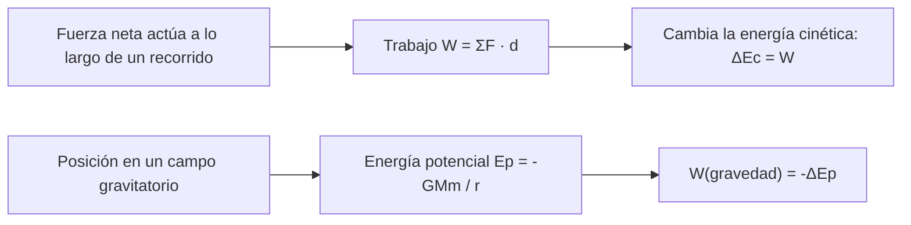

# B05-C06 — Trabajo y energía

<!-- nav:top -->
[🏠 Programa](../../../../README.md) · [📚 Bloque B05](../../../tronco-comun/B05-fisica-fundamental-para-el-espacio.md) · [← Anterior: B05-C05 — Diagramas de cuerpo libre](../B05-C05-diagramas-de-cuerpo-libre/CLASE.md) · [Siguiente: B05-C07 — Conservación de energía mecánica →](../B05-C07-conservacion-de-energia-mecanica/CLASE.md)
<!-- /nav -->

## 1. Ubicación, nivel y alcance

Sexta clase de B05. Hasta C05 trabajaste con fuerzas y aceleraciones en cada instante; ahora sumas el efecto de una fuerza **a lo largo de un recorrido**. Nivel N1. Usas `ΣF = m a` (C04), componentes (C05) y la fórmula de movimiento con aceleración constante (C03). No verás todavía la conservación de la energía (C07).

## 2. Por qué esta clase existe

Poner 1000 kg en órbita cuesta mucho más que subirlos 400 km. La pregunta motivadora es: **¿cuánta energía hay que entregar para cambiar el estado de un cuerpo, y en qué se convierte?** La decisión central es separar el trabajo de una fuerza (lo que se transfiere), la energía cinética (lo que se mueve) y la potencial (lo que queda almacenado por la posición).

## 3. Lo que podrás hacer al terminar

1. Calcular el trabajo de una fuerza constante con `W = F d cos θ`.
2. Enunciar y aplicar el teorema trabajo–energía cinética.
3. Calcular energía cinética y energía potencial gravitatoria (cerca y lejos de la Tierra).
4. Distinguir trabajo, energía y potencia, con unidades.
5. Estimar cuándo la aproximación `m g h` deja de servir.
6. Calcular la energía necesaria para llevar el satélite ideal a su órbita.

La evidencia es la **hoja de balance energético** del ejercicio 12 (sección 20).

## 4. Con qué llegas y cómo comprobarlo

1. ¿Qué es `cos 90°`?
2. ¿Cuánto vale `½ m v²` con `m = 2 kg` y `v = 3 m/s`?
3. Calcula `4 × 10³ × 5 × 10²`.
4. ¿Qué dimensión tiene la energía? (C01)
5. ¿Puede una fuerza no cambiar la rapidez? (C02, C03)

<details>
<summary>Ver respuestas</summary>

1. 0. 2. 9 J. 3. 2 × 10⁶. 4. `M L² T⁻²`. 5. Sí: una fuerza perpendicular al movimiento, como la centrípeta.
</details>

Con cuatro o cinco aciertos, sigue; con menos, repasa C01–C05.

## 5. Un caso real: subir 400 km no es lo caro

NASA da para la Tierra un radio ecuatorial de 6378,137 km y un parámetro gravitatorio GM = 3,9860 × 10¹⁴ m³/s² (S2). Con esos datos podemos calcular cuánta energía separa a un satélite en reposo en la superficie de uno en órbita a 400 km: veremos que la mayor parte es energía cinética (la que da la rapidez orbital), no la altura. Límite: es un cálculo ideal sin rotación terrestre, sin atmósfera y sin pérdidas; no dice cuánto combustible hace falta.

## 6. Vocabulario

El **trabajo** `W` de una fuerza constante es `F d cos θ`, donde `d` es el desplazamiento y `θ` el ángulo entre la fuerza y el desplazamiento. Se mide en julios: `1 J = 1 N·m`. La **energía cinética** es `E_c = ½ m v²`. La **energía potencial gravitatoria** de una masa `m` a distancia `r` del centro de un astro de parámetro `GM` es `E_p = −GMm/r`, con cero en el infinito. La **energía mecánica** es `E = E_c + E_p`. La **potencia** `P = W/t` (o `F v`) se mide en vatios (W). Una fuerza **conservativa** es aquella cuyo trabajo no depende del camino, solo de los extremos (la gravedad lo es).

## 7. Modelo mental: la energía como cuenta bancaria con tres cuentas

El trabajo es el movimiento de dinero entre cuentas; la energía cinética y la potencial son dos de ellas. El teorema trabajo–energía dice cuánto cambia la cuenta cinética.



*Descripción textual:* a la izquierda, una fuerza neta que actúa a lo largo de un recorrido produce un trabajo, y ese trabajo es igual al cambio de energía cinética; a la derecha, la posición en un campo gravitatorio define la energía potencial y el trabajo de la gravedad es menos el cambio de potencial.

Una analogía: un tobogán con gente; subir cuesta esfuerzo y queda «guardado» en altura, que al bajar se convierte en velocidad. El límite: en el tobogán real hay rozamiento y se disipa calor; aquí lo ignoramos.

## 8. La explicación, paso a paso

### 8.1 Trabajo de una fuerza constante

Si empujas 50 N a lo largo de 10 m en la misma dirección, `W = 50 × 10 = 500 J`. Si la fuerza forma un ángulo `θ` con el desplazamiento, solo cuenta su componente a lo largo: `W = F d cos θ`. Si `θ = 90°`, `W = 0`: una fuerza perpendicular al movimiento no cambia la rapidez. Si `θ > 90°`, el trabajo es negativo: la fuerza frena.

### 8.2 Teorema trabajo–energía cinética

Con `ΣF = m a` y `v² = v₀² + 2 a d` (C03) se obtiene `ΣF d = ½ m v² − ½ m v₀²`; es decir, **el trabajo de la fuerza neta es el cambio de energía cinética**: `W_neto = ΔE_c`. Se cumple en general, aunque la fuerza no sea constante.

### 8.3 Energía potencial gravitatoria

Cerca de la superficie, subir una altura `h` con `g` casi constante da `ΔE_p = m g h`. Pero `g` disminuye con la altura: el trabajo exacto de la gravedad entre `r₁` y `r₂` es `W = GMm (1/r₂ − 1/r₁)`, negativo al subir. Define `E_p = −GMm/r`, y entonces `W_gravedad = −ΔE_p`. Para el satélite ideal, de `R = 6 378 137 m` a `r = 6 778 137 m`, el trabajo de la gravedad vale `−3,688 × 10⁹ J` (el laboratorio lo calcula por integración y por fórmula). La aproximación `m g_n h = 3,923 × 10⁹ J` se desvía un 6 %.

### 8.4 Energía de una órbita circular

Con `v = √(GM/r)`, la energía cinética es `E_c = GMm/(2r)` y la potencial `E_p = −GMm/r`; la mecánica vale `E = −GMm/(2r) = −E_c`. Para 1000 kg a 400 km: `E_c = 2,9403 × 10¹⁰ J`, `E_p = −5,8807 × 10¹⁰ J`, `E = −2,9403 × 10¹⁰ J`. Un valor negativo significa **ligado**: falta energía para escapar (C07).

### 8.5 Energía para llegar a la órbita

Desde reposo en la superficie (sin rotación), la energía que debe entregarse es `E_orbita − E_sup = −2,9403 × 10¹⁰ − (−6,2494 × 10¹⁰) = 3,3091 × 10¹⁰ J`, es decir, 33,09 MJ por kilogramo. De ellos solo `3,688 × 10⁹ J` suben el cuerpo y `2,940 × 10¹⁰ J` le dan la rapidez orbital. La potencia es energía por tiempo: `P = W/t`; a igual energía, más potencia significa menos tiempo.

## 9. Magnitudes, símbolos y unidades

| Símbolo | Magnitud | Dimensión | Unidad SI | Valor o nota |
|---|---|---|---|---|
| `W` | trabajo | M L² T⁻² | J | `1 J = 1 N·m` |
| `E_c` | energía cinética | M L² T⁻² | J | `½ m v²` |
| `E_p` | energía potencial | M L² T⁻² | J | `−GMm/r` |
| `E` | energía mecánica | M L² T⁻² | J | `E_c + E_p` |
| `P` | potencia | M L² T⁻³ | W | `W/t` |
| `GM` | parámetro gravitatorio | L³ T⁻² | m³/s² | 3,9860 × 10¹⁴ (S2) |
| `g_n` | aceleración estándar | L T⁻² | m/s² | 9,806 65 (S1) |

## 10. Convenciones y referencias

Energía potencial con cero en el infinito (por eso es negativa). Satélite de 1000 kg (**sintético**), Tierra puntual sin rotación ni atmósfera. «Superficie» significa el radio ecuatorial de S2. Los resultados se dan en julios; MJ = 10⁶ J.

## 11. De dónde sale lo que afirmamos

| ID | Fuente | Localizador | Respalda | Estado |
|---|---|---|---|---|
| S1 | NIST, CODATA 2022, «standard acceleration of gravity» | https://physics.nist.gov/cgi-bin/cuu/Value?gn | `g_n = 9,806 65 m/s²` exacto | Página consultada el 2026-11-05 |
| S2 | NASA NSSDC, *Earth Fact Sheet* (act. 15-nov-2024) | https://nssdc.gsfc.nasa.gov/planetary/factsheet/earthfact.html | Radio ecuatorial 6378,137 km; GM = 0,39860 × 10⁶ km³/s² | Página consultada el 2026-11-05 |

Límites: el teorema trabajo–energía y la energía potencial gravitatoria son resultados clásicos deducidos aquí y verificados contra integración numérica en el laboratorio; no se cita un texto. La cifra de 33 MJ/kg es un valor ideal y no equivale al costo de un lanzamiento real.

## 12. Cómo ver la energía

Tabla accesible de un gráfico de barras de energías del satélite ideal (1000 kg; cálculo propio).

| Estado | `E_c` (J) | `E_p` (J) | `E` (J) |
|---|---|---|---|
| Reposo en la superficie | 0 | −6,249 × 10¹⁰ | −6,249 × 10¹⁰ |
| Órbita a 400 km | 2,940 × 10¹⁰ | −5,881 × 10¹⁰ | −2,940 × 10¹⁰ |
| Diferencia | +2,940 × 10¹⁰ | +3,69 × 10⁹ | +3,309 × 10¹⁰ |

Descripción larga: tres pares de barras con las energías de dos estados y su diferencia; la barra potencial es negativa en ambos estados y sube; la cinética pasa de cero a un valor grande.

## 13. Ejemplo trabajado: la energía del satélite ideal

**Planteamiento.** ¿Cuánta energía hay que entregar a 1000 kg para llevarlos de reposo en `R` a una órbita circular a 400 km?

**Paso 1 · Datos.** `GM = 3,9860 × 10¹⁴ m³/s²`, `R = 6 378 137 m`, `r = 6 778 137 m` (S2).

**Paso 2 · Potencial.** `E_p(R) = −GMm/R = −6,2494 × 10¹⁰ J`; `E_p(r) = −5,8807 × 10¹⁰ J`. Subir cuesta `3,688 × 10⁹ J`.

**Paso 3 · Cinética.** `v = 7668,6 m/s`, `E_c = ½ × 1000 × 7668,6² = 2,9403 × 10¹⁰ J`.

**Paso 4 · Suma.** `ΔE = 3,688 × 10⁹ + 2,9403 × 10¹⁰ = 3,3091 × 10¹⁰ J`, o 33,09 MJ/kg.

**Sentido físico.** El 89 % de la energía va a la rapidez, no a la altura. Esto explica por qué un objeto subido a 400 km y soltado se cae: no tiene la rapidez lateral. Comprobación: el trabajo por la fórmula y por integración numérica coincide (`−3,6880 × 10⁹ J`).

## 14. Comparación de métodos

**Fuerza y trayectoria** (C04) permiten todo pero exigen conocer el camino. **Trabajo–energía** da rapideces sin resolver el tiempo, útil si las fuerzas varían. **`m g h`** es simple pero solo vale si `g` es casi constante: en 400 km ya falla un 6 %. Elige el método más corto que sea válido y verifica con otro.

## 15. Práctica guiada

**Ejercicio 1.** Un astronauta empuja un módulo con 40 N durante 5 m en línea recta. ¿Qué trabajo hace? *Pasos:* sección 8.1.

<details><summary>Solución comentada</summary>

`W = 40 × 5 × cos 0 = 200 J`. Si hubiera tirado en ángulo de 60°, serían 100 J.
</details>

**Ejercicio 2.** Un cuerpo de 4 kg pasa de 2 m/s a 6 m/s. ¿Qué trabajo neto se hizo? *Pista:* sección 8.2.

<details><summary>Solución comentada</summary>

`ΔE_c = ½ × 4 × (36 − 4) = 64 J`.
</details>

**Ejercicio 3.** Calcula la energía cinética del satélite ideal (1000 kg a 7668,6 m/s).

<details><summary>Solución comentada</summary>

`½ × 1000 × (7668,6)² = 2,940 × 10¹⁰ J`. Equivale a unos 29,4 GJ.
</details>

## 16. Práctica autónoma, transferencia e integrador

**Ejercicio 4.** Una fuerza de 100 N forma 60° con un desplazamiento de 8 m. Halla `W`.

<details><summary>Solución comentada</summary>

`100 × 8 × cos 60° = 400 J`.
</details>

**Ejercicio 5.** Un motor entrega 2000 N a una nave que avanza a 50 m/s. ¿Qué potencia?

<details><summary>Solución comentada</summary>

`P = F v = 100 000 W = 100 kW`.
</details>

**Ejercicio 6.** Verifica que la gravedad no hace trabajo en una órbita circular perfecta.

<details><summary>Solución comentada</summary>

La fuerza apunta al centro y el desplazamiento instantáneo es tangente: `θ = 90°`, `cos θ = 0`, `W = 0`. Por eso `E_c` es constante (sección 8.1).
</details>

**Ejercicio 7.** Con la aproximación `m g_n h`, ¿qué energía da para subir 1000 kg a 400 km? ¿Qué error relativo hay frente a `3,688 × 10⁹ J`?

<details><summary>Solución comentada</summary>

`1000 × 9,806 65 × 4 × 10⁵ = 3,923 × 10⁹ J`; error `(3,923 − 3,688)/3,688 = 6,4 %`. Se comete porque `g` decrece con la altura.
</details>

**Ejercicio 8.** Si `E = −GMm/(2r)` y `r` crece, ¿la energía mecánica aumenta o disminuye? Interpreta.

<details><summary>Solución comentada</summary>

Aumenta (se acerca a cero desde valores negativos). Subir de órbita exige entregar energía, aunque la rapidez disminuya.
</details>

**Ejercicio 9 · transferencia.** Un titular afirma «poner un satélite en órbita es sobre todo vencer la gravedad subiendo». Contrasta con los datos.

<details><summary>Solución comentada</summary>

Subir cuesta 3,69 × 10⁹ J y la rapidez orbital 2,94 × 10¹⁰ J: el 89 % es energía cinética. Es una afirmación a matizar en un modelo ideal.
</details>

**Ejercicio 10 · transferencia.** Un propulsor entrega 2,0 kW durante 1 h a una nave sintética. ¿Qué energía? ¿Alcanza para llevar 1000 kg a órbita en el modelo?

<details><summary>Solución comentada</summary>

`2000 × 3600 = 7,2 × 10⁶ J`; hacen falta `3,309 × 10¹⁰ J`: unas 4600 veces más. Un propulsor eléctrico de baja potencia no sustituye a un lanzador; es un cálculo orden de magnitud sin datos reales.
</details>

**Ejercicio 11 · transferencia.** Un compañero calcula el costo de lanzamiento con 33 MJ/kg × precio de electricidad. ¿Qué omite?

<details><summary>Solución comentada</summary>

Omite la eficiencia, las pérdidas atmosféricas, la rotación terrestre, la masa del propelente y el hecho de que el cohete transporta su propia energía química. Es un mínimo ideal, no un costo.
</details>

**Ejercicio 12 · integrador.** Elabora una *hoja de balance energético* (sección 20) para un cuerpo de 500 kg que pasa de reposo en la superficie a una órbita circular de altitud a tu elección: datos con fuente, `E_p`, `E_c`, `ΔE`, comprobación y límites.

<details><summary>Solución modelo</summary>

Debe calcular `r = R + h`, `v = √(GM/r)`, `E_c`, `E_p`, `ΔE`, contrastar con `m g h` y declarar que ignora rotación, atmósfera y pérdidas.
</details>

## 17. Laboratorio: trabajo, energía y órbita

El script [trabajo_y_energia.py](trabajo_y_energia.py) integra numéricamente el trabajo de la gravedad entre `R` y `R + 400 km` (regla del trapecio) y lo compara con la fórmula; verifica el teorema trabajo–energía y que `E = −E_c` en la órbita circular; luego calcula la energía hasta la órbita.

**Datos:** GM y R de S2; masa sintética. **Predice antes de ejecutar:** ¿qué parte de la energía va a la rapidez? (La mayor.) **Resultados (2026-11-05, Python 3.12.9):** trabajo de la gravedad `−3,6880 × 10⁹ J` (numérico y analítico); órbita: `E_c = 2,9403 × 10¹⁰ J`, `E_p = −5,8807 × 10¹⁰ J`, `E = −2,9403 × 10¹⁰ J`; energía desde reposo en la superficie `3,3091 × 10¹⁰ J` (33,09 MJ/kg), de ellos `3,6880 × 10⁹ J` para subir y `2,9403 × 10¹⁰ J` para la rapidez; aproximación `m g h = 3,9227 × 10⁹ J`.

```bash
python programa/clases/B05/B05-C06-trabajo-y-energia/trabajo_y_energia.py
```

**Límites:** modelo ideal sin rotación ni atmósfera; no estima combustible ni costo de lanzamiento.

## 18. Errores frecuentes y cómo corregirlos

**Olvidar el coseno del ángulo.** Ejercicio 4. **Creer que toda fuerza hace trabajo.** Ejercicio 6. **Usar `m g h` a cualquier altura.** Ejercicio 7. **Confundir energía y potencia.** Ejercicio 5. **Pensar que `E` negativa es un error.** Ejercicio 8.

## 19. Cómo sabrás que vas bien

Tras 8.1: ¿cuándo el trabajo es cero? Si dudas, repite el ejercicio 6. Tras 8.3: ¿cuánto falla `m g h` a 400 km? Revisa el ejercicio 7. Tras el laboratorio: ¿qué verifica el script antes de imprimir? Léelo.

## 20. Qué entregas y cómo se evalúa

El producto es tu **hoja de balance energético**: datos con fuente, energías inicial y final, diferencia, comprobación independiente y límites.

| Criterio | Inicial | En desarrollo | Logrado | Destacado |
|---|---|---|---|---|
| Energías | Sin unidad | Parciales | Correctas | Interpreta signos |
| Método | No justifica | Con ayuda | Justificado | Compara con `m g h` |
| Comprobación | Ninguna | Una | Independiente | Dos vías |
| Alcance | No declara | Parcial | Declara límites | Distingue ideal de real |

**Condiciones críticas:** no presentar la energía ideal como costo de lanzamiento; unidades; citar solo lo consultado.

## 21. Ética, seguridad y límites

Los números de energía ideales sirven para comprender, no para presupuestar ni diseñar un lanzamiento. Esta clase es educativa. Accesibilidad: ecuaciones en texto, tablas equivalentes de los gráficos, sin conexión.

## 22. Para cerrar y seguir

El trabajo transfiere energía a lo largo de un recorrido, la energía cinética mide el movimiento y la potencial gravitatoria `−GMm/r` mide la posición; llegar a órbita cuesta sobre todo rapidez. Queda abierta una pregunta: ¿se puede intercambiar entre cinética y potencial sin pérdida? Es la conservación de la energía mecánica (C07).

**Glosario español–inglés.** trabajo · *work*; energía cinética · *kinetic energy*; energía potencial · *potential energy*; potencia · *power*; julio · *joule*; fuerza conservativa · *conservative force*.

**Continuidad.** B05-C07 usa tu capacidad de **calcular `E_c` y `E_p`** para comprobar que la energía mecánica se conserva y deducir la velocidad de escape.

**Referencias:** ver sección 11.

<!-- nav:bottom -->
---

[← Anterior: B05-C05 — Diagramas de cuerpo libre](../B05-C05-diagramas-de-cuerpo-libre/CLASE.md) · [📚 Bloque B05](../../../tronco-comun/B05-fisica-fundamental-para-el-espacio.md) · [Siguiente: B05-C07 — Conservación de energía mecánica →](../B05-C07-conservacion-de-energia-mecanica/CLASE.md)
<!-- /nav -->
