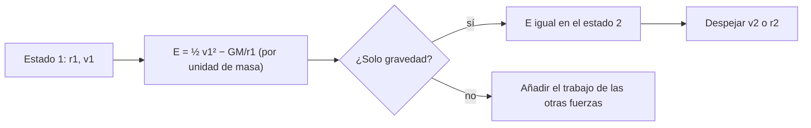

# B05-C07 — Conservación de energía mecánica

<!-- nav:top -->
[🏠 Programa](../../../../README.md) · [📚 Bloque B05](../../../tronco-comun/B05-fisica-fundamental-para-el-espacio.md) · [← Anterior: B05-C06 — Trabajo y energía](../B05-C06-trabajo-y-energia/CLASE.md) · [Siguiente: B05-C08 — Momento lineal e impulsos →](../B05-C08-momento-lineal-e-impulsos/CLASE.md)
<!-- /nav -->

## 1. Ubicación, nivel y alcance

Séptima clase de B05. En C06 definiste energía cinética y potencial; ahora usas una propiedad poderosa: bajo fuerzas conservativas, su suma **no cambia**. Nivel N1. Usas `E_c = ½mv²`, `E_p = −GMm/r` y el teorema trabajo–energía. No verás todavía energía térmica ni disipación en detalle (C13).

## 2. Por qué esta clase existe

Si lanzas algo hacia arriba, ¿hasta dónde sube? ¿Con qué rapidez hay que lanzarlo para que no vuelva? La pregunta motivadora es: **¿puedo contestar «cuánto» y «con qué rapidez» sin resolver el movimiento instante a instante?** La decisión central es reconocer cuándo la energía mecánica se conserva (solo fuerzas conservativas) y cuándo hay que contar el trabajo de otras fuerzas.

## 3. Lo que podrás hacer al terminar

1. Enunciar la conservación de la energía mecánica y sus condiciones.
2. Usarla para hallar rapidez o altura entre dos puntos.
3. Deducir la velocidad de escape y calcularla para la Tierra y la Luna.
4. Distinguir órbita ligada (`E < 0`), parabólica (`E = 0`) y no ligada (`E > 0`).
5. Comprobar un integrador numérico midiendo la deriva de la energía.
6. Reconocer cuándo la conservación no aplica (empuje, rozamiento).

La evidencia es el **informe de energía y escape** del ejercicio 12 (sección 20).

## 4. Con qué llegas y cómo comprobarlo

1. ¿Qué trabajo hace la gravedad en una órbita circular? (C06)
2. ¿Cuánto vale `E_p` a distancia `r` de un cuerpo de parámetro `GM`?
3. Calcula `√(2 × 8 × 10¹⁴ / 8 × 10⁶)`.
4. Si `E_c` sube 50 J y la energía total se conserva, ¿qué pasa con `E_p`?
5. ¿Qué signo tiene la energía de un cuerpo ligado?

<details>
<summary>Ver respuestas</summary>

1. Cero. 2. `−GMm/r`. 3. `√(2 × 10⁸) = 14 142`. 4. Baja 50 J. 5. Negativo.
</details>

Con cuatro o cinco aciertos, sigue; con menos, repasa C06.

## 5. Un caso real: cuánto cuesta irse de la Luna y de la Tierra

NASA publica la velocidad de escape de la Tierra, 11,186 km/s, y la de la Luna, 2,38 km/s (S1, S2): la Luna retiene mucho menos, de ahí que su gravedad en superficie sea 1,62 m/s² frente a 9,82 m/s². En esta clase calcularás ambos valores con conservación de energía y los compararás con los publicados. Límite: la velocidad de escape es un resultado ideal (sin atmósfera, sin rotación, sin otros cuerpos), por lo que no equivale a la rapidez que alcanza un cohete real.

## 6. Vocabulario

La **energía mecánica** `E = E_c + E_p` se **conserva** si solo actúan fuerzas conservativas, o si las demás no hacen trabajo. La **velocidad de escape** `v_esc` es la rapidez mínima, desde una distancia `r`, para alejarse sin límite sin más impulso: `E = 0`. Una **órbita ligada** tiene `E < 0`. La **energía específica** es energía por unidad de masa (J/kg), útil porque no depende de `m`. La **deriva de energía** es el cambio de `E` que produce un error numérico, no la física.

## 7. Modelo mental: el balance que no pierde

La energía mecánica pasa de una cuenta a otra, pero el total no cambia. Para saberlo basta comparar dos instantes.



*Descripción textual:* se calcula la energía específica en el estado 1; si solo actúa la gravedad, la energía es la misma en el estado 2 y de ahí se despeja la rapidez o la distancia; si hay otras fuerzas, se suma su trabajo.

Una analogía: una montaña rusa sin rozamiento, que al bajar convierte altura en rapidez y al subir devuelve rapidez en altura. El límite: en la vida real hay fricción, y entonces parte de la energía se vuelve calor (C13).

## 8. La explicación, paso a paso

### 8.1 Conservación entre dos puntos

Por unidad de masa: `½ v₁² − GM/r₁ = ½ v₂² − GM/r₂`. Con ella, sin conocer el tiempo, si conoces `r₁`, `v₁` y `r₂`, obtienes `v₂`. Al revés, si quieres saber hasta dónde llega un cuerpo, pides `v₂ = 0` y despejas `r₂`.

### 8.2 Altura máxima de un lanzamiento vertical

Un cuerpo lanzado hacia arriba desde el radio medio `R = 6371 km` con `v₀ = 5000 m/s` tiene `E = ½ v₀² − GM/R = −5,0 × 10⁷ J/kg`. Sube hasta que `v = 0`: `r_max = GM/(GM/R − ½ v₀²) = 7962 km`, es decir, `1591 km` de altura. Si hubieras usado `g` constante, `h = v₀²/2g = 1275 km`: 20 % menos. La aproximación falla porque `g` decrece al subir.

### 8.3 Velocidad de escape

Pedir `E = 0` en `r`: `½ v² = GM/r`, por lo que `v_esc = √(2GM/r)`. Para la Tierra con `GM = 3,9860 × 10¹⁴` y `R = 6371 km`, `v_esc = 11 186 m/s`, igual al valor de NASA (S1). Para la Luna, con `G = 6,674 30 × 10⁻¹¹` (S3), `M = 0,07346 × 10²⁴ kg` y `R = 1737,4 km` (S2), `v_esc = 2376 m/s`, frente a los 2,38 km/s publicados (S2).

### 8.4 Orbitas ligadas y escape desde una órbita

En una órbita circular, `v = √(GM/r)`, de modo que `v_esc = √2 · v_circ`. En 400 km: `v_circ = 7668,6 m/s`, `v_esc = 10 845 m/s`. Para escapar desde esa órbita basta un aumento de energía igual a `|E|`: `2,94 × 10¹⁰ J` por 1000 kg. Si `E < 0` el cuerpo vuelve; si `E = 0` se aleja a velocidad cero en el infinito; si `E > 0` llega con rapidez sobrante.

### 8.5 Cuando no se conserva

Con empuje, rozamiento atmosférico o disipación, la energía mecánica cambia en el trabajo de esas fuerzas. Un método numérico también puede violarla por error: medir la deriva de energía es una prueba de calidad del integrador. En el laboratorio, Verlet con paso de 0,01 s en 600 s tiene una deriva de `1,7 × 10⁻¹¹`.

## 9. Magnitudes, símbolos y unidades

| Símbolo | Magnitud | Dimensión | Unidad SI | Valor o nota |
|---|---|---|---|---|
| `ε` | energía específica | L² T⁻² | J/kg = m²/s² | `½v² − GM/r` |
| `v_esc` | velocidad de escape | L T⁻¹ | m/s | `√(2GM/r)` |
| `GM_T` | parámetro de la Tierra | L³ T⁻² | m³/s² | 3,9860 × 10¹⁴ (S1) |
| `G` | constante de gravitación | M⁻¹ L³ T⁻² | m³ kg⁻¹ s⁻² | 6,674 30(15) × 10⁻¹¹ (S3) |
| `M_L`, `R_L` | masa y radio lunares | M, L | kg, m | 0,07346 × 10²⁴; 1737,4 km (S2) |

## 10. Convenciones y referencias

Energía potencial nula en el infinito. Movimiento radial y un solo cuerpo atractor. Radio medio volumétrico de la Tierra 6371,000 km (S1) para la velocidad de escape publicada. El lanzamiento de 5000 m/s es un **dato sintético**.

## 11. De dónde sale lo que afirmamos

| ID | Fuente | Localizador | Respalda | Estado |
|---|---|---|---|---|
| S1 | NASA NSSDC, *Earth Fact Sheet* (act. 15-nov-2024) | https://nssdc.gsfc.nasa.gov/planetary/factsheet/earthfact.html | Radio medio 6371,000 km; GM; velocidad de escape 11,186 km/s; gravedad media 9,820 m/s² | Página consultada el 2026-11-05 |
| S2 | NASA NSSDC, *Moon Fact Sheet* (act. 11-ene-2024) | https://nssdc.gsfc.nasa.gov/planetary/factsheet/moonfact.html | Masa 0,07346 × 10²⁴ kg; radio 1737,4 km; escape 2,38 km/s; gravedad 1,62 m/s² | Página consultada el 2026-11-05 |
| S3 | NIST, CODATA 2022, «Newtonian constant of gravitation» | https://physics.nist.gov/cgi-bin/cuu/Value?bg | `G = 6,674 30(15) × 10⁻¹¹ m³ kg⁻¹ s⁻²` | Página consultada el 2026-11-05 |

Límites: la conservación de la energía mecánica y la fórmula de escape son resultados clásicos deducidos aquí y contrastados con los valores de NASA; no se cita un texto.

## 12. Cómo ver la energía

Tabla accesible de energía específica a lo largo del lanzamiento vertical de 5000 m/s (cálculo propio).

| Punto | `r` (km) | `v` (m/s) | `ε` (J/kg) |
|---|---|---|---|
| Salida | 6371 | 5000 | −5,0 × 10⁷ |
| Cima | 7962 | 0 | −5,0 × 10⁷ |
| Escape (referencia) | ∞ | 0 | 0 |

Descripción larga: la energía total, por unidad de masa, es una línea horizontal; la cinética decrece y la potencial crece al subir, y su suma se mantiene.

## 13. Ejemplo trabajado: ¿hasta dónde sube un lanzamiento vertical?

**Planteamiento.** Un cuerpo sale del radio medio terrestre a 5000 m/s, vertical, sin atmósfera ni rotación. ¿Altura máxima?

**Paso 1 · Datos.** `GM = 3,9860 × 10¹⁴ m³/s²`, `R = 6 371 000 m` (S1), `v₀ = 5000 m/s` (sintético).

**Paso 2 · Energía.** `ε = ½ × 5000² − 3,9860 × 10¹⁴/6 371 000 = 1,25 × 10⁷ − 6,2565 × 10⁷ = −5,0065 × 10⁷ J/kg`.

**Paso 3 · Cima.** `ε = −GM/r_max` ⇒ `r_max = 7,962 × 10⁶ m`, altura `1591 km`.

**Paso 4 · Sentido físico.** Con `g` constante saldrían 1275 km: la conservación con `E_p = −GM/r` es más fiel. El valor es menor que la velocidad de escape (11,2 km/s), así que el cuerpo vuelve. Comprobación en laboratorio: tras 600 s, `r = 7 937 959 m` (aún sin llegar a `r_max`), `v = 547,1 m/s`, y la deriva de energía es `1,7 × 10⁻¹¹`.

## 14. Comparación de métodos

**Energía** da estados inicial y final sin el tiempo; **fuerza e integración** (C04) dan la trayectoria completa; **`g` constante** es la aproximación más simple y falla a alturas de cientos de kilómetros. Si quieres saber *cuánto*, usa energía; si quieres saber *cuándo*, integra.

## 15. Práctica guiada

**Ejercicio 1.** Un cuerpo cae desde el reposo una altura `h = 20 m` (`g = g_n`, sin aire). ¿Con qué rapidez llega? *Pasos:* `m g h = ½ m v²`.

<details><summary>Solución comentada</summary>

`v = √(2 × 9,806 65 × 20) = 19,8 m/s`. La masa se cancela: todo cae igual.
</details>

**Ejercicio 2.** Calcula `v_esc` en la superficie de la Tierra con `GM = 3,9860 × 10¹⁴` y `R = 6,371 × 10⁶ m`.

<details><summary>Solución comentada</summary>

`√(2 × 3,9860 × 10¹⁴/6,371 × 10⁶) = √(1,2513 × 10⁸) = 11 186 m/s`: coincide con NASA.
</details>

**Ejercicio 3.** Compara `v_esc` y `v_circ` a 400 km para el satélite ideal. *Pista:* sección 8.4.

<details><summary>Solución comentada</summary>

`v_circ = 7668,6 m/s`; `v_esc = √2 × 7668,6 = 10 845 m/s`. La diferencia es 3177 m/s, mucho menos que 11 186 m/s: escapar desde la órbita cuesta menos que desde el suelo.
</details>

## 16. Práctica autónoma, transferencia e integrador

**Ejercicio 4.** Un cuerpo se lanza hacia arriba a 30 m/s (`g_n`, sin aire). ¿Altura máxima?

<details><summary>Solución comentada</summary>

`h = v²/(2g) = 900/19,6133 = 45,9 m`. A esta altura `g` es prácticamente constante.
</details>

**Ejercicio 5.** Con los datos lunares de S2 y `G` de S3, calcula `v_esc` lunar y compárala con 2,38 km/s.

<details><summary>Solución comentada</summary>

`GM = 6,674 30 × 10⁻¹¹ × 7,346 × 10²² = 4,903 × 10¹²`; `v_esc = √(2 × 4,903 × 10¹²/1,7374 × 10⁶) = 2376 m/s`. La diferencia con 2380 m/s es del 0,2 %, por redondeo del dato publicado.
</details>

**Ejercicio 6.** ¿Qué energía por kilogramo hay que añadir a un cuerpo en órbita a 400 km para que escape?

<details><summary>Solución comentada</summary>

`|ε| = ½ v_circ² = 2,94 × 10⁷ J/kg`. Para 1000 kg: `2,94 × 10¹⁰ J`, el mismo valor que `|E|` de C06.
</details>

**Ejercicio 7.** Un cuerpo en `r = 10 000 km` tiene `v = 5 km/s`. ¿Está ligado a la Tierra? Usa `GM = 3,9860 × 10¹⁴`.

<details><summary>Solución comentada</summary>

`ε = ½ × 25 × 10⁶ − 3,9860 × 10¹⁴/10⁷ = 1,25 × 10⁷ − 3,986 × 10⁷ = −2,74 × 10⁷ J/kg < 0`: ligado.
</details>

**Ejercicio 8.** Un integrador muestra una deriva de energía del 3 % tras una órbita. ¿Qué haces?

<details><summary>Solución comentada</summary>

El error numérico es mayor que cualquier efecto físico pequeño que quieras ver. Reduces el paso o cambias a un método que conserve mejor la energía (como Verlet), y vuelves a medir la deriva.
</details>

**Ejercicio 9 · transferencia.** Un artículo dice «la velocidad de escape es la rapidez que debe mantener un cohete para salir». Corrígelo.

<details><summary>Solución comentada</summary>

Es la rapidez de un cuerpo *sin propulsión adicional*, ideal. Un cohete puede salir a menor rapidez si mantiene el empuje; la fórmula supone un impulso inicial y nada más.
</details>

**Ejercicio 10 · transferencia.** Un compañero afirma que en la Luna los objetos «no tienen peso» porque la escape es baja. Evalúa con S2.

<details><summary>Solución comentada</summary>

Falso: la gravedad lunar de 1,62 m/s² implica peso (≈ 16,5 % del terrestre). Escape baja y peso no nulo son consistentes: ambas dependen de `GM/R`.
</details>

**Ejercicio 11 · transferencia.** Si las lecturas de tu código muestran que `E` crece en cada órbita, ¿es física o numérico?

<details><summary>Solución comentada</summary>

Con solo gravedad en un modelo conservativo, es numérico (Euler, por ejemplo, aumenta `E`). Se verifica reduciendo el paso: si la deriva disminuye, era el método.
</details>

**Ejercicio 12 · integrador.** Elabora un *informe de energía y escape* (sección 20) para un cuerpo sintético en un astro de datos publicados (Tierra o Luna): `ε`, `v_esc`, estado ligado o no, altura máxima de un lanzamiento y contraste con la cifra publicada.

<details><summary>Solución modelo</summary>

Incluye datos con fuente, `ε`, `v_esc` calculada y publicada, lanzamiento con `v < v_esc` y su `r_max`, discusión de la diferencia con `g` constante y límites del modelo ideal.
</details>

## 17. Laboratorio: velocidad de escape y deriva de energía

El script [velocidad_de_escape.py](velocidad_de_escape.py) calcula `v_esc` de la Tierra y de la Luna, las compara con NASA (tolerancia 0,1 % y 1 %), integra con velocity-Verlet un lanzamiento vertical y mide la deriva de energía (debe ser menor que `10⁻⁶`).

**Datos:** publicados (S1–S3) y un lanzamiento sintético. **Predice antes de ejecutar:** ¿qué tan cerca estará de la cifra de la NASA? **Resultados (2026-11-05, Python 3.12.9):** `v_esc` Tierra `11 186,1 m/s` (NASA 11 186); Luna `2375,7 m/s` (NASA 2380). Lanzamiento a 5000 m/s: `r(600 s) = 7 937 959 m`, `v = 547,1 m/s`, deriva `1,7 × 10⁻¹¹`; altura máxima analítica `1591 km` (con `g` constante, `1275 km`).

```bash
python programa/clases/B05/B05-C07-conservacion-de-energia-mecanica/velocidad_de_escape.py
```

**Límites:** simulación educativa radial de un solo cuerpo; no es una herramienta de diseño de trayectorias ni certifica nada sobre vuelo.

## 18. Errores frecuentes y cómo corregirlos

**Aplicar conservación con fuerzas no conservativas.** Ejercicios 8 y 11. **Confundir `v_esc` con la rapidez de un cohete.** Ejercicio 9. **Usar `g` constante a gran altura.** Sección 8.2. **Olvidar el signo de `E_p`.** Ejercicio 7. **No medir la deriva del integrador.** Ejercicio 8.

## 19. Cómo sabrás que vas bien

Tras 8.1: ¿puedes obtener `v₂` sin usar el tiempo? Repite el ejercicio 1. Tras 8.3: ¿de dónde sale `√2` entre `v_esc` y `v_circ`? Rehaz el ejercicio 3. Tras el laboratorio: ¿qué te dice la deriva? Si dudas, relee 8.5.

## 20. Qué entregas y cómo se evalúa

El producto es tu **informe de energía y escape**: energías específicas, `v_esc` calculada y publicada, estado ligado o no, comprobaciones y límites.

| Criterio | Inicial | En desarrollo | Logrado | Destacado |
|---|---|---|---|---|
| Cálculo | Errores | Parcial | Correcto | Compara con fuente |
| Interpretación del signo de `E` | Ausente | Parcial | Correcta | Clasifica la órbita |
| Contraste | Ninguno | Con ayuda | Con fuente | Explica la discrepancia |
| Límites | No declara | Parcial | Declara | Diferencia ideal de real |

**Condiciones críticas:** no confundir escape ideal con maniobra real; unidades; citar solo lo consultado.

## 21. Ética, seguridad y límites

Las velocidades de escape ideales no sirven para planificar lanzamientos ni maniobras. Esta clase es educativa y su simulación no certifica vuelo ni seguridad. Accesibilidad: ecuaciones en texto, tablas equivalentes, sin conexión.

## 22. Para cerrar y seguir

Con solo gravedad, `E_c + E_p` se conserva; de ahí salen la altura máxima y la velocidad de escape `√(2GM/r)`, y la energía negativa indica un cuerpo ligado. Queda abierto cómo cambian la velocidad y el empuje cuando hay masa que se expulsa o choques: es el momento lineal (C08).

**Glosario español–inglés.** conservación de la energía · *energy conservation*; velocidad de escape · *escape velocity*; energía específica · *specific energy*; órbita ligada · *bound orbit*; deriva · *drift*.

**Continuidad.** B05-C08 usa tu capacidad de **comparar estados con una cantidad conservada** para aplicarla al momento lineal en propulsión y choques.

**Referencias:** ver sección 11.

<!-- nav:bottom -->
---

[← Anterior: B05-C06 — Trabajo y energía](../B05-C06-trabajo-y-energia/CLASE.md) · [📚 Bloque B05](../../../tronco-comun/B05-fisica-fundamental-para-el-espacio.md) · [Siguiente: B05-C08 — Momento lineal e impulsos →](../B05-C08-momento-lineal-e-impulsos/CLASE.md)
<!-- /nav -->
