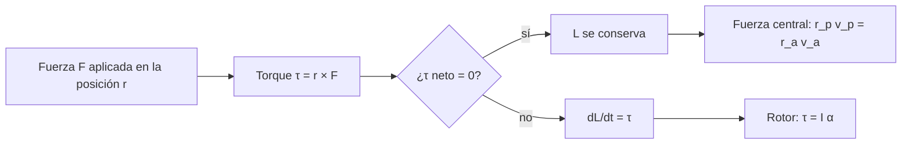

# B05-C09 — Momento angular y torque

<!-- nav:top -->
[🏠 Programa](../../../../README.md) · [📚 Bloque B05](../../../tronco-comun/B05-fisica-fundamental-para-el-espacio.md) · [← Anterior: B05-C08 — Momento lineal e impulsos](../B05-C08-momento-lineal-e-impulsos/CLASE.md) · [Siguiente: B05-C10 — Gravitación universal →](../B05-C10-gravitacion-universal/CLASE.md)
<!-- /nav -->

## 1. Ubicación, nivel y alcance

Novena clase de B05 y apertura de su tercer tramo (gravitación y oscilaciones). Hasta aquí estudiaste cómo se desplaza un punto; ahora, **cómo gira**. Nivel N1. Usas momento lineal (C08), componentes (C05) y el producto de un vector por otro en 2D (solo la fórmula `x v_y − y v_x`). No verás todavía tensores de inercia ni giroscopios en 3D.

## 2. Por qué esta clase existe

Un satélite en órbita elíptica va más rápido cerca de la Tierra que lejos; un patinador gira más rápido al recoger los brazos. La pregunta motivadora es: **¿qué cantidad se mantiene constante cuando algo gira bajo una fuerza central, y qué hace falta para cambiar un giro?** La decisión central es identificar el punto respecto del cual calculas el momento angular y si el torque neto sobre ese punto es cero.

## 3. Lo que podrás hacer al terminar

1. Calcular el momento angular de una partícula respecto de un punto.
2. Definir el torque y relacionarlo con el cambio del momento angular.
3. Explicar por qué en una fuerza central el momento angular se conserva.
4. Deducir `r_p v_p = r_a v_a` y la segunda ley de Kepler como consecuencia.
5. Resolver un problema simple de rotación con `τ = I α`.
6. Separar qué dice la conservación y qué no dice (forma de la órbita, tiempo).

La evidencia es la **hoja de momento angular** del ejercicio 12 (sección 20).

## 4. Con qué llegas y cómo comprobarlo

1. ¿Qué dimensión tiene el momento lineal? (C08)
2. Calcula `x v_y − y v_x` para `(x, y) = (3, 0)` y `(v_x, v_y) = (0, 2)`.
3. ¿Qué es una fuerza central?
4. Si `ΣF = 0` sobre un cuerpo, ¿qué pasa con su momento lineal?
5. ¿Cuánto vale `r × v` si `r` y `v` son paralelos?

<details>
<summary>Ver respuestas</summary>

1. `M L T⁻¹`. 2. `6` (unidades m²/s). 3. Una fuerza dirigida siempre hacia (o desde) un punto fijo, como la gravedad respecto del centro de un astro. 4. Se conserva. 5. Cero.
</details>

Con cuatro o cinco aciertos, sigue; con menos, repasa C04 y C08.

## 5. Un caso real: la Luna y su órbita ligeramente elíptica

NASA indica para la Luna una excentricidad de 0,0549, un perigeo de 0,3633 × 10⁶ km y un apogeo de 0,4055 × 10⁶ km (S2). Esos dos extremos son consecuencia de la conservación del momento angular: la Luna se mueve más rápido en el perigeo. Con los datos de S2 puedes comprobar que `r_p v_p` y `r_a v_a` son iguales (ejercicio 5), siempre que conozcas ambas velocidades; aquí solo se publica la velocidad media (1,022 km/s), así que la comprobación completa se hace con el satélite ideal, no con la Luna. Límite: S2 da valores medios, no efemérides.

## 6. Vocabulario

El **momento angular** de una partícula respecto de un punto `O` es `L = r × p = m (r × v)`; en 2D su valor es `L = m (x v_y − y v_x)` y se mide en `kg·m²/s`. El **momento angular específico** es `h = L/m` (m²/s). El **torque** (o momento de una fuerza) respecto de `O` es `τ = r × F`; en 2D, `τ = x F_y − y F_x`, en `N·m`. El **momento de inercia** `I` mide la resistencia de un cuerpo a cambiar su giro: para una masa puntual a distancia `r`, `I = m r²` (kg·m²). La **aceleración angular** `α` es el cambio de velocidad angular por unidad de tiempo (rad/s²). La **velocidad areolar** es el área barrida por el vector de posición por unidad de tiempo.

## 7. Modelo mental: el giro y su «empujón»

El momento angular es al giro lo que el momento lineal a la traslación; el torque es a `L` lo que la fuerza es a `p`: `τ = dL/dt`. Si no hay torque, `L` no cambia.



*Descripción textual:* una fuerza aplicada en una posición crea un torque; si el torque neto es cero, el momento angular se conserva (caso de la fuerza central, que da `r_p v_p = r_a v_a`); si no, el momento angular cambia a razón del torque (en un rotor, `τ = I α`).

Una analogía: abrir una puerta. Empujar cerca de la bisagra cuesta más que lejos: lo que importa es la fuerza *y* dónde la aplicas. El límite: la puerta gira en torno a un eje fijo; en el espacio un cuerpo libre gira en torno a su centro de masa, sin eje externo.

## 8. La explicación, paso a paso

### 8.1 Momento angular de una partícula

Para el satélite ideal en `(r, 0)` con velocidad `(0, v)`, `L = m r v = 1000 × 6 778 137 × 7668,55 = 5,1979 × 10¹³ kg·m²/s`. Es un vector perpendicular al plano de la órbita; en 2D basta su valor con signo (positivo si gira en sentido antihorario).

### 8.2 Torque y su efecto

`τ = r × F` mide la capacidad de la fuerza para hacer girar: crece con la distancia al punto y con la componente perpendicular de `F`. El resultado fundamental es `τ_neto = dL/dt`. Por eso un torque constante durante un tiempo `t` da `ΔL = τ t`, análogo al impulso (C08). Para un rotor de momento de inercia `I = 200 kg·m²` con `τ = 0,05 N·m` durante 600 s (todo sintético), `ΔL = 30 kg·m²/s` y `ω = ΔL/I = 0,150 rad/s` (1,43 rpm).

### 8.3 Fuerza central: el torque es cero

La gravedad de un astro puntual apunta siempre hacia su centro. Respecto de ese centro, `r` y `F` son antiparalelos y `r × F = 0`; luego `L` se conserva. Consecuencias inmediatas: la órbita es plana y `r v_perp` es constante. En el periapsis y el apoapsis la velocidad es perpendicular a `r`, así que `r_p v_p = r_a v_a`: más lejos, más lento.

### 8.4 Segunda ley de Kepler

En un tiempo `dt` el vector `r` barre un área `dA = ½ |r × v| dt = ½ h dt`. Como `h` es constante, **el área barrida por unidad de tiempo es constante**: eso es la segunda ley de Kepler, demostrada aquí como consecuencia de la fuerza central. Para el satélite en órbita elíptica del laboratorio, `h/2 = 2,858818 × 10¹⁰ m²/s`, igual al área de la elipse dividida por el período.

### 8.5 Qué no dice

La conservación de `L` no determina por sí sola la forma de la órbita: hace falta también la energía. Con `v₀ = 1,10 v_c` en `r = 6 778 137 m` (datos sintéticos), la energía da el apoapsis `r_a = 10 381,7 km` y la excentricidad `0,2100`; con `L` sola no se obtiene. Tampoco da el tiempo, que sale de integrar.

## 9. Magnitudes, símbolos y unidades

| Símbolo | Magnitud | Dimensión | Unidad SI | Valor o nota |
|---|---|---|---|---|
| `L` | momento angular | M L² T⁻¹ | kg·m²/s | `m (x v_y − y v_x)` |
| `h` | momento angular específico | L² T⁻¹ | m²/s | `L/m` |
| `τ` | torque | M L² T⁻² | N·m | `r × F` |
| `I` | momento de inercia | M L² | kg·m² | masa puntual: `m r²` |
| `α` | aceleración angular | T⁻² | rad/s² | `τ/I` |
| `GM` | parámetro gravitatorio | L³ T⁻² | m³/s² | 3,9860 × 10¹⁴ (S1) |

## 10. Convenciones y referencias

Ángulos y giros positivos en sentido antihorario. El punto de referencia es el centro de la Tierra. Una nota de unidades: `N·m` es la unidad del torque y también la del julio; no son lo mismo: el torque es un vector con otra interpretación física, no una energía. Los datos del rotor y la condición inicial elíptica (`1,10 v_c`) son **sintéticos**.

## 11. De dónde sale lo que afirmamos

| ID | Fuente | Localizador | Respalda | Estado |
|---|---|---|---|---|
| S1 | NASA NSSDC, *Earth Fact Sheet* (act. 15-nov-2024) | https://nssdc.gsfc.nasa.gov/planetary/factsheet/earthfact.html | GM = 0,39860 × 10⁶ km³/s²; radio ecuatorial 6378,137 km | Página consultada el 2026-11-05 |
| S2 | NASA NSSDC, *Moon Fact Sheet* (act. 11-ene-2024) | https://nssdc.gsfc.nasa.gov/planetary/factsheet/moonfact.html | Excentricidad 0,0549; perigeo 0,3633 × 10⁶ km; apogeo 0,4055 × 10⁶ km; velocidad media 1,022 km/s | Página consultada el 2026-11-05 |

Límites: la conservación del momento angular y la segunda ley de Kepler se deducen aquí y se comprueban numéricamente; no se cita un texto. No se consultaron datos de rotación de ninguna nave.

## 12. Cómo ver el momento angular

Tabla accesible de un gráfico de la órbita elíptica sintética (cálculo propio).

| Punto | `r` (km) | `v` (m/s) | `r v` (m²/s) |
|---|---|---|---|
| Periapsis | 6778,1 | 8435,4 | 5,7176 × 10¹⁰ |
| Apoapsis | 10 381,7 | 5507,4 | 5,7176 × 10¹⁰ |

Descripción larga: una elipse con la Tierra en un foco; el periapsis a la izquierda, el apoapsis a la derecha; sectores de igual área unen el centro con tramos de órbita recorridos en tiempos iguales: delgados y largos cerca del apoapsis, cortos y anchos cerca del periapsis.

## 13. Ejemplo trabajado: del periapsis al apoapsis

**Planteamiento.** Un satélite en el periapsis (`r_p = 6 778 137 m`) con `v_p = 1,10 v_c = 8435,4 m/s`. ¿Qué rapidez y distancia tendrá en el apoapsis?

**Paso 1 · Conservación de `h`.** `h = r_p v_p = 5,7176 × 10¹⁰ m²/s`.

**Paso 2 · Conservación de energía.** `ε = ½ v_p² − GM/r_p = 3,5578 × 10⁷ − 5,8806 × 10⁷ = −2,3228 × 10⁷ J/kg`.

**Paso 3 · Apoapsis.** En él `v_a = h/r_a`, y `½(h/r_a)² − GM/r_a = ε` es una ecuación de segundo grado en `1/r_a`; con la raíz mayor, `r_a = 10 381,7 km` y `v_a = 5507,4 m/s`.

**Paso 4 · Sentido físico.** `r_p v_p = r_a v_a`, como se esperaba; el período por Kepler (semieje `8579,9 km`) es `7909,3 s = 131,8 min`. El laboratorio integra la órbita paso a paso y obtiene el mismo apoapsis; el momento angular varía menos de `2 × 10⁻¹⁴` relativo.

## 14. Comparación de métodos

**Conservación de `L`** da velocidades en dos puntos conocidos; **conservación de `E`** da la rapidez según la distancia; juntas determinan la órbita. **Integración** (C04) da la trayectoria completa y sirve de comprobación. **`τ = Iα`** es el método para giros con torque aplicado (rotores, ruedas de reacción).

## 15. Práctica guiada

**Ejercicio 1.** Calcula `L` del satélite ideal (1000 kg, `r = 6 778 137 m`, `v = 7668,55 m/s`). *Pasos:* `m r v` (sección 8.1).

<details><summary>Solución comentada</summary>

`1000 × 6 778 137 × 7668,55 = 5,1979 × 10¹³ kg·m²/s`. Dimensión `M L² T⁻¹`: `kg m (m/s)`.
</details>

**Ejercicio 2.** Una fuerza de 20 N actúa perpendicular a una llave de 0,30 m. ¿Qué torque? *Pista:* `τ = r F` con perpendicular.

<details><summary>Solución comentada</summary>

`τ = 0,30 × 20 = 6 N·m`. Si la fuerza formara 30° con la llave, solo contaría `F sen 30°`: 3 N·m.
</details>

**Ejercicio 3.** Un rotor de `I = 50 kg·m²` recibe `τ = 2 N·m` durante 30 s desde el reposo. ¿Qué `ω`?

<details><summary>Solución comentada</summary>

`α = τ/I = 0,04 rad/s²`; `ω = α t = 1,2 rad/s` (11,5 rpm).
</details>

## 16. Práctica autónoma, transferencia e integrador

**Ejercicio 4.** En el apoapsis de una órbita `r_a = 10 000 km`, `v_a = 5700 m/s`. ¿Qué `v` tendrá en `r_p = 7000 km`?

<details><summary>Solución comentada</summary>

`v_p = r_a v_a/r_p = 10 000 × 5700/7000 = 8143 m/s`. Más cerca, más rápido.
</details>

**Ejercicio 5.** Con el perigeo y el apogeo lunares de S2, calcula el cociente `v_p/v_a`.

<details><summary>Solución comentada</summary>

`v_p/v_a = r_a/r_p = 0,4055/0,3633 = 1,116`: la Luna es un 11,6 % más rápida en el perigeo. La excentricidad `(r_a − r_p)/(r_a + r_p) = 0,0549` concuerda con la publicada.
</details>

**Ejercicio 6.** Verifica que `h/2 = área/T` para una elipse con `a = 8579,9 km` y `e = 0,2100`, `T = 7909,3 s`.

<details><summary>Solución comentada</summary>

Área `= π a² √(1 − e²) = π (8,5799 × 10⁶)² × 0,97770 = 2,2611 × 10¹⁴ m²`; dividida por `T = 7909,3 s` da `2,8588 × 10¹⁰ m²/s`, igual a `h/2` (sección 8.4). Si te sale una potencia de 10 distinta, revisa la conversión de km a m.
</details>

**Ejercicio 7.** Una rueda de reacción sintética (`I = 0,02 kg·m²`) pasa de 0 a 3000 rpm. ¿Qué `ΔL` recibe y, por conservación, qué `ΔL` pierde el satélite?

<details><summary>Solución comentada</summary>

`ω = 3000 × 2π/60 = 314,2 rad/s`; `ΔL = 0,02 × 314,2 = 6,28 kg·m²/s`. El satélite gana `−6,28` (sentido contrario) si el sistema está aislado: así se gira sin gastar propelente. Es un dato sintético.
</details>

**Ejercicio 8.** ¿Por qué es plana la órbita bajo una fuerza central?

<details><summary>Solución comentada</summary>

`L` se conserva en dirección y módulo; como `L ⟂ r` y `L ⟂ v`, la posición y la velocidad quedan siempre en el plano perpendicular a `L`.
</details>

**Ejercicio 9 · transferencia.** Un titular dice «un cuerpo cuya rapidez baja ha perdido energía y momento angular». Contrasta con una órbita elíptica.

<details><summary>Solución comentada</summary>

En una órbita sin perturbaciones la rapidez baja al alejarse, pero `E` y `L` se conservan: la energía cinética se convierte en potencial. Una variación de rapidez no implica pérdida.
</details>

**Ejercicio 10 · transferencia.** Una nave de 1000 kg usa un propulsor tangencial de 50 N a 6 778 137 m del centro. ¿Qué torque ejerce respecto de la Tierra y cuánto cambia `L` en 120 s?

<details><summary>Solución comentada</summary>

`τ = r F = 6 778 137 × 50 = 3,389 × 10⁸ N·m`; `ΔL = τ t = 4,07 × 10¹⁰ kg·m²/s`, un 0,08 % de `L = 5,1979 × 10¹³`. Coincide con el `Δv = 6 m/s` de C08 (0,08 % de 7668 m/s).
</details>

**Ejercicio 11 · transferencia.** Un compañero afirma que la segunda ley de Kepler necesita que la órbita sea elíptica. Corrígelo.

<details><summary>Solución comentada</summary>

Basta una fuerza central: `L` se conserva y el área barrida por unidad de tiempo es constante, sea cual sea la forma de la trayectoria (sección 8.4).
</details>

**Ejercicio 12 · integrador.** Elabora una *hoja de momento angular* (sección 20): para una órbita sintética elíptica de tu elección (v₀ entre 1,0 y 1,3 `v_c`), calcula `L`, `ε`, `r_a`, `v_a` y verifica `r_p v_p = r_a v_a`; añade un caso de rotor con `τ = I α`.

<details><summary>Solución modelo</summary>

Debe fijar datos (rotulados sintéticos), calcular `h` y `ε`, resolver `r_a`, comprobar la igualdad y, en el rotor, usar `ω = τ t/I`. Declara los límites: fuerza central, masa puntual, sin perturbaciones.
</details>

## 17. Laboratorio: momento angular en una órbita elíptica

El script [momento_angular_orbita.py](momento_angular_orbita.py) integra una órbita elíptica con velocity-Verlet y comprueba que el momento angular específico no varíe (< 10⁻⁹), que el apoapsis integrado coincida con el analítico (10⁻³) y que `h/2 = área/T` (10⁻⁶).

**Datos:** GM y R de S1; condición inicial sintética. **Predice antes de ejecutar:** ¿en qué punto la velocidad es menor? (En el apoapsis.) **Resultados (2026-11-05, Python 3.12.9):** periapsis `6778,1 km`, apoapsis `10 381,7 km` (integrado `10 381,7 km`), `e = 0,2100`; `L = 5,717636 × 10¹⁰ m²/s` con variación máxima `2,0 × 10⁻¹⁴`; `v_p = 8435,4 m/s`, `v_a = 5507,4 m/s`; semieje `8579,9 km`; `T = 7909,3 s` (131,82 min). Satélite circular: `L = 5,1979 × 10¹³ kg·m²/s`. Rotor: `ω = 0,150 rad/s` (1,43 rpm).

```bash
python programa/clases/B05/B05-C09-momento-angular-y-torque/momento_angular_orbita.py
```

**Límites:** órbita plana de masa puntual; el rotor es un modelo sintético sin dinámica 3D; no sirve para diseñar control de actitud.

## 18. Errores frecuentes y cómo corregirlos

**Olvidar el punto de referencia.** Sin punto, `L` y `τ` no están definidos. **Confundir torque con fuerza.** Ejercicio 2. **Pensar que `L` fija la forma de la órbita.** Sección 8.5. **Creer que menos rapidez es pérdida.** Ejercicio 9. **Atribuir Kepler II a las elipses.** Ejercicio 11.

## 19. Cómo sabrás que vas bien

Tras 8.3: ¿por qué `τ = 0` en una fuerza central? Rehaz el ejercicio 8. Tras 8.4: ¿de dónde sale el área constante? Si no puedes explicarlo, relee. Tras el laboratorio: ¿qué comprobaciones hace? Léelo.

## 20. Qué entregas y cómo se evalúa

El producto es tu **hoja de momento angular**: punto de referencia, `L`, torque, conservación o balance y comprobación.

| Criterio | Inicial | En desarrollo | Logrado | Destacado |
|---|---|---|---|---|
| Punto de referencia y signo | Ausentes | Parcial | Declarados | Cambia de punto y compara |
| Conservación | No aplica | Con ayuda | Aplica y justifica | Combina con energía |
| Cálculo y unidades | Errores | Parcial | Correcto | Verificación numérica |
| Alcance | No declara | Parcial | Declara | Distingue sintético de observado |

**Condiciones críticas:** no usar torque sin punto de referencia; rotular datos sintéticos; citar solo lo consultado.

## 21. Ética, seguridad y límites

Los modelos de rotación de naves reales involucran control, actuadores y fallos que esta clase no cubre; no es una guía de diseño. Accesibilidad: ecuaciones en texto, tablas equivalentes de los diagramas, sin conexión.

## 22. Para cerrar y seguir

El momento angular `m (r × v)` se conserva cuando el torque neto es cero; en una fuerza central eso da órbitas planas, `r_p v_p = r_a v_a` y la segunda ley de Kepler; con torque, `τ = dL/dt = I α`. Queda abierta la fuerza central más importante del espacio: la gravitación universal (C10).

**Glosario español–inglés.** momento angular · *angular momentum*; torque · *torque*; momento de inercia · *moment of inertia*; fuerza central · *central force*; velocidad areolar · *areal velocity*; periapsis · *periapsis*.

**Continuidad.** B05-C10 usa tu capacidad de **identificar una fuerza central** para escribir la ley de gravitación y deducir la tercera ley de Kepler.

**Referencias:** ver sección 11.

<!-- nav:bottom -->
---

[← Anterior: B05-C08 — Momento lineal e impulsos](../B05-C08-momento-lineal-e-impulsos/CLASE.md) · [📚 Bloque B05](../../../tronco-comun/B05-fisica-fundamental-para-el-espacio.md) · [Siguiente: B05-C10 — Gravitación universal →](../B05-C10-gravitacion-universal/CLASE.md)
<!-- /nav -->
