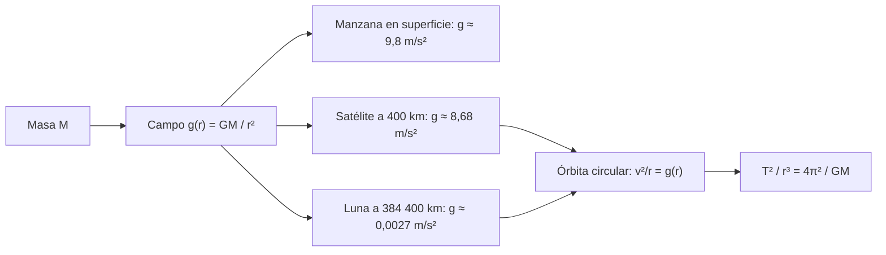

# B05-C10 — Gravitación universal

<!-- nav:top -->
[🏠 Programa](../../../../README.md) · [📚 Bloque B05](../../../tronco-comun/B05-fisica-fundamental-para-el-espacio.md) · [← Anterior: B05-C09 — Momento angular y torque](../B05-C09-momento-angular-y-torque/CLASE.md) · [Siguiente: B05-C11 — Movimiento oscilatorio →](../B05-C11-movimiento-oscilatorio/CLASE.md)
<!-- /nav -->

## 1. Ubicación, nivel y alcance

Décima clase de B05, a mitad del bloque. Usaste `GM` como dato en C03–C09; ahora lo explicas: de dónde viene la fuerza que sostiene a satélites, a la Luna y a los planetas. Nivel N1. Usas `ΣF = m a` (C04), movimiento circular (C03) y momento angular (C09). No verás relatividad general (bloque B19) ni mareas.

## 2. Por qué esta clase existe

La misma fuerza que hace caer una manzana mantiene a la Luna en órbita: esa idea unificó el cielo y la Tierra. La pregunta motivadora es: **¿cómo comprobar con números que la gravedad de la superficie y la órbita de la Luna son la misma fuerza?** La decisión central es plantear una ley de fuerza (inversa del cuadrado de la distancia), contrastarla con datos publicados y declarar hasta dónde vale.

## 3. Lo que podrás hacer al terminar

1. Enunciar la ley de gravitación `F = G M m / r²` con su constante y unidades.
2. Calcular `g` a cualquier distancia y su cambio con la altura.
3. Deducir la tercera ley de Kepler para órbitas circulares.
4. Hacer la «prueba de la Luna»: comparar la aceleración lunar con `g` en superficie.
5. Distinguir `G` (constante universal medida) de `GM` (parámetro de un astro).
6. Declarar el dominio de validez de la gravitación newtoniana.

La evidencia es la **prueba de consistencia gravitatoria** del ejercicio 12 (sección 20).

## 4. Con qué llegas y cómo comprobarlo

1. ¿Cuánto vale `a_c` si `v = 7668,6 m/s` y `r = 6 778 137 m`? (C03)
2. ¿Cuál es la unidad del momento angular? (C09)
3. Si `r` se duplica, ¿qué pasa con `1/r²`?
4. ¿Qué es una fuerza central? (C09)
5. ¿Qué dimensión tiene `GM`? (C01)

<details>
<summary>Ver respuestas</summary>

1. 8,676 m/s². 2. kg·m²/s. 3. Se divide por 4. 4. Una fuerza dirigida a un punto fijo. 5. `L³ T⁻²`.
</details>

Con cuatro o cinco aciertos, sigue; con menos, repasa C01–C09.

## 5. Un caso real: la Luna como caída

NASA publica la distancia media de la Luna (semieje mayor 384 400 km), su período sidéreo (27,3217 días) y su velocidad orbital media (1,022 km/s) (S3); y para la Tierra, su radio ecuatorial y su parámetro gravitatorio (S2). Con esos datos y `G` de CODATA (S1) calcularás que la aceleración de la Luna hacia la Tierra es `2,70 × 10⁻³ m/s²`, unas 3632 veces menor que `g` en la superficie, que coincide con `(384 400/6378)² = 3632`: la gravedad disminuye como `1/r²`. Límite: se trata la órbita lunar como circular (la excentricidad es 0,0549) y se ignora al Sol, que perturba la órbita real.

## 6. Vocabulario

La **ley de gravitación universal** dice que dos masas puntuales `M` y `m` separadas una distancia `r` se atraen con una fuerza `F = G M m / r²`, a lo largo de la recta que las une. La **constante de gravitación** `G` tiene un valor medido (con incertidumbre) y unidades `m³ kg⁻¹ s⁻²`. La **aceleración gravitatoria** a distancia `r` de una masa `M` es `g(r) = GM/r²`. La **ley del cuadrado inverso** es la dependencia `1/r²`. El **parámetro gravitatorio** `GM` es el producto, conocido con mucha más precisión que `G` o `M` por separado en el caso de la Tierra. La **tercera ley de Kepler** (versión circular) afirma que `T²/r³ = 4π²/GM` es constante para todos los cuerpos que orbitan el mismo astro.

## 7. Modelo mental: una sola ley, dos escalas

Una masa crea alrededor un «campo» de aceleración que disminuye con el cuadrado de la distancia; cualquier cuerpo de prueba se acelera según el valor del campo en su posición, sin importar su masa.



*Descripción textual:* una masa crea un campo que decrece como `1/r²`; evaluado en la superficie, a 400 km y en la órbita de la Luna da tres valores; en cada órbita circular la aceleración centrípeta iguala al campo, y de ahí sale que `T²/r³` es constante.

Una analogía: la luz de una lámpara se reparte sobre la superficie de una esfera creciente y su intensidad cae con `1/r²`. El límite: la gravedad no se «reparte» ni se «agota»; la analogía solo explica la geometría del cuadrado inverso.

## 8. La explicación, paso a paso

### 8.1 La ley y la constante

`F = G M m / r²`, con `G = 6,674 30 × 10⁻¹¹ m³ kg⁻¹ s⁻²` y una incertidumbre estándar de `0,000 15 × 10⁻¹¹` según CODATA 2022 (S1): se conoce con cuatro o cinco cifras, a diferencia de la mayoría de las constantes. Su dimensión sale de despejar `G = F r²/(M m)` (C01). La fuerza que ejerce `m` sobre `M` es la misma por la tercera ley de Newton (C04).

### 8.2 `g` según la distancia

`g(r) = GM/r²`. Con `GM = 3,9860 × 10¹⁴ m³/s²` (S2): en el radio ecuatorial, `g = 9,7983 m/s²`; a 400 km, `8,6759 m/s²` (88,5 % de `g_n`); a 35 786 km, `0,2242 m/s²` (2,3 %). NASA da una media en superficie de `9,820 m/s²` (S2); la diferencia con el valor puntual proviene de la forma y la rotación de la Tierra, que el modelo puntual ignora. Cerca del suelo, `g` cambia unos 0,3 m/s² por cada 100 km, como lo muestra la caída 9,80 → 8,68 en 400 km.

### 8.3 Órbita circular y tercera ley de Kepler

Igualando la aceleración centrípeta `v²/r` con `GM/r²` (C03, C04) resulta `v = √(GM/r)`, y con `T = 2π r/v` se obtiene `T² = 4π² r³/(GM)`. El cociente `T²/r³ = 4π²/GM = 9,904 × 10⁻¹⁴ s²/m³` es el mismo para un satélite a 400 km, uno geoestacionario y la Luna (lo comprueba el laboratorio). Hecho clave: el período **no depende de la masa del satélite**.

### 8.4 La prueba de la Luna

La aceleración lunar hacia la Tierra debe ser `g(r_L) = GM/r_L² = 2,6976 × 10⁻³ m/s²`; el cociente con `g` en el radio terrestre es `(r_L/R)² = 3632,3`. El período que da Kepler para `r = 384 400 km` es `27,452 d`, un 0,48 % mayor que el sidéreo publicado (27,3217 d, S3); la velocidad, `1023,2 m/s`, frente a `1022 m/s` publicados. Una mejora: usar la masa total Tierra + Luna (`GM_T + G M_L = 4,0350 × 10¹⁴ m³/s²`) da `27,285 d`, a un 0,13 % del valor publicado: el resto lo explican la órbita no circular y la acción del Sol.

### 8.5 Dominio de validez

La ley en forma puntual vale también para cuerpos esféricos de densidad simétrica (resultado de Newton que usamos sin demostrar) con `r` medido desde el centro. Falla para distancias comparables al tamaño del cuerpo si este no es esférico, para campos muy fuertes o velocidades cercanas a `c` (relatividad general, B19) y para ajustes de alta precisión de órbitas reales, donde se añaden el achatamiento terrestre, el Sol, la Luna y la atmósfera.

## 9. Magnitudes, símbolos y unidades

| Símbolo | Magnitud | Dimensión | Unidad SI | Valor o nota |
|---|---|---|---|---|
| `G` | constante de gravitación | M⁻¹ L³ T⁻² | m³ kg⁻¹ s⁻² | 6,674 30(15) × 10⁻¹¹ (S1) |
| `M_T` | masa de la Tierra | M | kg | 5,9722 × 10²⁴ (S2) |
| `GM_T` | parámetro de la Tierra | L³ T⁻² | m³/s² | 3,9860 × 10¹⁴ (S2) |
| `g(r)` | aceleración gravitatoria | L T⁻² | m/s² | `GM/r²` |
| `R_eq` | radio ecuatorial terrestre | L | m | 6 378 137 (S2) |
| `a_L` | semieje mayor lunar | L | m | 3,844 × 10⁸ (S3) |
| `T_L` | período sidéreo lunar | T | d | 27,3217 (S3) |

## 10. Convenciones y referencias

Masas puntuales o esféricas; distancia medida desde el centro; aceleración positiva hacia el centro. Valores de `GM` con las cifras publicadas por NASA (cinco cifras); `G` con su incertidumbre estándar de CODATA 2022. El cociente `G·M_T = 3,98603 × 10¹⁴` coincide con `GM` de NASA en `6 × 10⁻⁶` relativo. Los datos de los satélites ideales son **sintéticos**; los de la Tierra y la Luna, **publicados**.

## 11. De dónde sale lo que afirmamos

| ID | Fuente | Localizador | Respalda | Estado |
|---|---|---|---|---|
| S1 | NIST, CODATA 2022, «Newtonian constant of gravitation» | https://physics.nist.gov/cgi-bin/cuu/Value?bg | `G = 6,674 30(15) × 10⁻¹¹ m³ kg⁻¹ s⁻²` | Página consultada el 2026-11-05 |
| S2 | NASA NSSDC, *Earth Fact Sheet* (act. 15-nov-2024) | https://nssdc.gsfc.nasa.gov/planetary/factsheet/earthfact.html | Masa 5,9722 × 10²⁴ kg; GM; radio ecuatorial; gravedad media 9,820 m/s² | Página consultada el 2026-11-05 |
| S3 | NASA NSSDC, *Moon Fact Sheet* (act. 11-ene-2024) | https://nssdc.gsfc.nasa.gov/planetary/factsheet/moonfact.html | Semieje 0,3844 × 10⁶ km; período 27,3217 d; velocidad 1,022 km/s; excentricidad 0,0549; masa 0,07346 × 10²⁴ kg | Página consultada el 2026-11-05 |

Límites: la deducción de Kepler III y la prueba de la Luna son cálculos propios; no se consultó un texto histórico ni los datos originales de Newton. Que la ley valga para cuerpos esféricos se enuncia como resultado clásico sin demostrarlo en esta clase.

## 12. Cómo ver el cuadrado inverso

Tabla accesible de un gráfico de `g` frente a la distancia (cálculo propio con `GM` de S2).

| Distancia al centro | `g` (m/s²) | Fracción de `g_n` |
|---|---|---|
| 6 378 137 m (superficie) | 9,7983 | 0,999 |
| 6 778 137 m (400 km) | 8,6759 | 0,885 |
| 4,2164 × 10⁷ m (35 786 km) | 0,2242 | 0,023 |
| 3,844 × 10⁸ m (Luna) | 0,0027 | 0,0003 |

Descripción larga: una curva decreciente muy pronunciada; con ejes logarítmicos en ambas coordenadas, es una recta de pendiente −2.

## 13. Ejemplo trabajado: ¿es la Luna una caída?

**Planteamiento.** Con la ley de gravitación, predecir la aceleración y el período de la Luna y compararlos con S3.

**Paso 1 · Datos.** `GM_T = 3,9860 × 10¹⁴ m³/s²` (S2), `r = 3,844 × 10⁸ m` (S3). Se supone órbita circular y Tierra puntual.

**Paso 2 · Aceleración.** `a = GM/r² = 3,9860 × 10¹⁴/(3,844 × 10⁸)² = 2,6976 × 10⁻³ m/s²`.

**Paso 3 · Período.** `T = 2π √(r³/GM) = 2,3718 × 10⁶ s = 27,45 d`.

**Paso 4 · Comparación y sentido físico.** El valor publicado es `27,3217 d`: la diferencia (0,48 %) es pequeña, y se reduce a 0,13 % al sumar la masa de la Luna. Es la coincidencia que mostró que la gravedad terrestre y la fuerza que retiene a la Luna son la misma ley. Comprobación cruzada: `a_L = g(R)(R/r_L)² = 9,7983/3632,3 = 2,6976 × 10⁻³`.

## 14. Comparación de métodos

**Ley de fuerza** (`F = GMm/r²`) es la causa y sirve para cualquier distancia. **`g` constante** es la versión local, válida a pocos kilómetros. **Kepler III** da períodos sin integrar. **Integración numérica** (C04) maneja órbitas no circulares. Para comparar dos órbitas del mismo astro, basta el cociente `T²/r³`.

## 15. Práctica guiada

**Ejercicio 1.** Calcula la fuerza gravitatoria entre dos masas de 1000 kg separadas 1,0 m. *Pasos:* `F = G M m/r²` (sección 8.1).

<details><summary>Solución comentada</summary>

`F = 6,674 30 × 10⁻¹¹ × 10⁶/1 = 6,67 × 10⁻⁵ N`. Es minúscula: la gravedad entre objetos cotidianos pasa inadvertida frente a otras fuerzas.
</details>

**Ejercicio 2.** Calcula `g` a 400 km de altura con `GM = 3,9860 × 10¹⁴` y `R = 6 378 137 m`. *Pista:* `g = GM/r²`.

<details><summary>Solución comentada</summary>

`r = 6 778 137 m`; `g = 3,9860 × 10¹⁴/4,5944 × 10¹³ = 8,676 m/s²`.
</details>

**Ejercicio 3.** ¿Cuánto cambia `g` si la distancia al centro se triplica?

<details><summary>Solución comentada</summary>

Se divide por 9: `g' = g/9`. A 3 radios del centro (2 radios de altura), `g ≈ 1,09 m/s²`.
</details>

## 16. Práctica autónoma, transferencia e integrador

**Ejercicio 4.** Calcula `T` para una órbita circular a 2000 km de altura.

<details><summary>Solución comentada</summary>

`r = 8 378 137 m`; `T = 2π √(r³/GM) = 7632 s = 2,120 h`, igual que el valor del laboratorio de C03.
</details>

**Ejercicio 5.** Si `T²/r³` es constante para un astro, ¿cuál es el período a `r = 4 r₀` en función de `T₀`?

<details><summary>Solución comentada</summary>

`T² ∝ r³` ⇒ `T = T₀ · 4^{3/2} = 8 T₀`.
</details>

**Ejercicio 6.** Calcula `G·M_T` con `M_T = 5,9722 × 10²⁴ kg` y compáralo con `GM` de NASA.

<details><summary>Solución comentada</summary>

`6,674 30 × 10⁻¹¹ × 5,9722 × 10²⁴ = 3,98603 × 10¹⁴`; diferencia con `3,9860 × 10¹⁴`: `6 × 10⁻⁶` relativo, dentro del redondeo de las cifras publicadas.
</details>

**Ejercicio 7.** Con la masa total Tierra + Luna (`GM = 4,0350 × 10¹⁴`), recalcula `T` de la Luna y compáralo.

<details><summary>Solución comentada</summary>

`T = 27,285 d`, 0,13 % por debajo de 27,3217 d; antes era 0,48 % por encima. El problema de dos cuerpos usa la suma de masas.
</details>

**Ejercicio 8.** ¿A qué distancia del centro de la Tierra `g` vale 1 m/s²?

<details><summary>Solución comentada</summary>

`r = √(GM/g) = √(3,9860 × 10¹⁴) = 1,9965 × 10⁷ m`, unos 19 965 km del centro, 13 587 km de altura.
</details>

**Ejercicio 9 · transferencia.** Un artículo afirma «la gravedad disminuye linealmente con la altura». Contrasta con los datos de la sección 8.2.

<details><summary>Solución comentada</summary>

Disminuye como `1/r²`: de 9,80 a 8,68 m/s² en 400 km, un 11 %; a 35 786 km sería casi 0,2 m/s²; una caída lineal desde 9,8 a 0 a razón de 0,3 m/s²/100 km daría 0 hacia 3270 km. No coincide con la ley.
</details>

**Ejercicio 10 · transferencia.** Un compañero dice que el período de un satélite depende de su masa. ¿Qué respondes con la sección 8.3?

<details><summary>Solución comentada</summary>

`T² = 4π² r³/GM` no incluye `m`: la masa del satélite se cancela entre la fuerza y la inercia. Solo importa la masa del astro (y en rigor, la suma de ambas, un efecto despreciable para satélites).
</details>

**Ejercicio 11 · transferencia.** El cálculo lunar da 27,452 d y NASA 27,3217 d. ¿Qué haces con esa discrepancia?

<details><summary>Solución comentada</summary>

No la ocultas: la cuantificas (0,48 %), identificas hipótesis simplificadas (órbita circular, Tierra puntual, sin Sol, sin masa lunar) y compruebas que mejorar una de ellas (masa total) la reduce.
</details>

**Ejercicio 12 · integrador.** Elabora una *prueba de consistencia gravitatoria* (sección 20): elige un cuerpo que orbite la Tierra con datos publicados (Luna o satélite con fuente) y compara período, velocidad y aceleración calculados con los publicados, con la discrepancia explicada.

<details><summary>Solución modelo</summary>

Debe tabular datos con fuente, calcular `g(r)`, `v`, `T`, hallar discrepancias relativas, enumerar supuestos (circular, puntual) y mejorar una hipótesis (por ejemplo, masa total) para ver el efecto.
</details>

## 17. Laboratorio: ley de gravitación y prueba de la Luna

El script [gravitacion_y_kepler.py](gravitacion_y_kepler.py) calcula `g(r)` a tres alturas, la aceleración y el período de la Luna, y el cociente `T²/r³` para tres radios. Antes comprueba que `G·M_T` coincida con `GM` de NASA (0,5 %), que el período lunar quede a menos de 1 % del publicado y que la velocidad lunar quede a menos de 5 %.

**Datos:** publicados (S1–S3). **Predice antes de ejecutar:** ¿qué tan cerca estará el período de la Luna del publicado? **Resultados (2026-11-05, Python 3.12.9):** `G·M_T = 3,98603 × 10¹⁴ m³/s²` (diferencia `6,4 × 10⁻⁶`); `g(R) = 9,7983 m/s²` (0,999 `g_n`), `g(400 km) = 8,6759` (0,885), `g(35 786 km) = 0,2242` (0,023); aceleración lunar `2,6976 × 10⁻³ m/s²`; cociente `g(R)/a = 3632,3 = (r_L/R)²`; período lunar `27,452 d` (NASA 27,3217 d); velocidad `1023,2 m/s` (NASA 1022); `T²/r³ = 9,904269 × 10⁻¹⁴ s²/m³` en los tres radios.

```bash
python programa/clases/B05/B05-C10-gravitacion-universal/gravitacion_y_kepler.py
```

**Límites:** órbita lunar circular y Tierra puntual; no es un modelo de efemérides.

## 18. Errores frecuentes y cómo corregirlos

**Pensar que `g` es constante.** Ejercicio 9. **Creer que el período depende de la masa del satélite.** Ejercicio 10. **Confundir `G` y `g`.** Ejercicio 1. **Olvidar medir desde el centro y no desde la superficie.** Ejercicio 2. **Ocultar discrepancias.** Ejercicio 11.

## 19. Cómo sabrás que vas bien

Tras 8.2: ¿puedes estimar `g` a otra distancia sin calculadora? Rehaz el ejercicio 3. Tras 8.3: ¿qué se cancela y por qué? Revisa el ejercicio 10. Tras el laboratorio: ¿qué comprueba el script antes de calcular? Léelo.

## 20. Qué entregas y cómo se evalúa

El producto es tu **prueba de consistencia gravitatoria**: datos con fuente, cálculo, comparación, discrepancia explicada y límites.

| Criterio | Inicial | En desarrollo | Logrado | Destacado |
|---|---|---|---|---|
| Datos y fuentes | Sin fuente | Parcial | Completos | Distingue `G` de `GM` |
| Cálculo | Errores | Con ayuda | Correcto | Verificación cruzada |
| Discrepancia | Ignorada | Cuantificada | Explicada | Mejora una hipótesis |
| Alcance | No declara | Parcial | Declara | Cita límites relativistas |

**Condiciones críticas:** no ocultar discrepancias; rotular datos sintéticos; citar solo lo consultado.

## 21. Ética, seguridad y límites

La gravitación newtoniana es un modelo con dominio de validez; las predicciones de misiones reales usan modelos más completos. Esta clase es educativa y no sirve para calcular trayectorias reales. Accesibilidad: ecuaciones en texto, tablas equivalentes, sin conexión.

## 22. Para cerrar y seguir

Una sola ley, `F = G M m/r²`, explica `g` en el suelo, la órbita de un satélite y la de la Luna; de ella sale `T² = 4π² r³/GM`. Queda abierta otra clase de movimiento muy común: lo que vibra y vuelve, desde un resorte hasta una nave bajo vibración (C11).

**Glosario español–inglés.** gravitación universal · *universal gravitation*; cuadrado inverso · *inverse square*; parámetro gravitatorio · *gravitational parameter*; semieje mayor · *semi-major axis*; período sidéreo · *sidereal period*; tercera ley de Kepler · *Kepler's third law*.

**Continuidad.** B05-C11 usa tu capacidad de **plantear una ley de fuerza y resolver su movimiento** para estudiar la fuerza elástica y el movimiento oscilatorio.

**Referencias:** ver sección 11.

<!-- nav:bottom -->
---

[← Anterior: B05-C09 — Momento angular y torque](../B05-C09-momento-angular-y-torque/CLASE.md) · [📚 Bloque B05](../../../tronco-comun/B05-fisica-fundamental-para-el-espacio.md) · [Siguiente: B05-C11 — Movimiento oscilatorio →](../B05-C11-movimiento-oscilatorio/CLASE.md)
<!-- /nav -->
