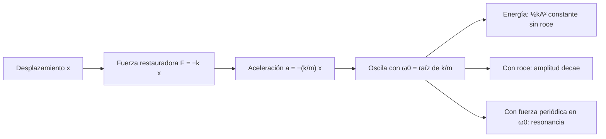

# B05-C11 — Movimiento oscilatorio

<!-- nav:top -->
[🏠 Programa](../../../../README.md) · [📚 Bloque B05](../../../tronco-comun/B05-fisica-fundamental-para-el-espacio.md) · [← Anterior: B05-C10 — Gravitación universal](../B05-C10-gravitacion-universal/CLASE.md) · [Siguiente: B05-C12 — Ondas mecánicas y frecuencia →](../B05-C12-ondas-mecanicas-y-frecuencia/CLASE.md)
<!-- /nav -->

## 1. Ubicación, nivel y alcance

Undécima clase de B05. Hasta ahora el movimiento avanzaba o daba vueltas; ahora **va y viene** alrededor de un punto de equilibrio. Nivel N1. Usas `ΣF = m a` (C04), energía (C06–C07) y el período como `T = 1/f` (C03). No verás ecuaciones diferenciales de forma general (bloque B11): aquí las soluciones se presentan y se verifican numéricamente.

## 2. Por qué esta clase existe

Una estructura que vibra puede amplificar una excitación hasta romperse; un reloj de péndulo mide tiempo; un átomo vibra en un cristal. La pregunta motivadora es: **¿qué determina la frecuencia a la que algo oscila y qué pasa cuando se le empuja a esa frecuencia?** La decisión central es reconocer un oscilador por su fuerza restauradora proporcional al desplazamiento y calcular su frecuencia natural.

## 3. Lo que podrás hacer al terminar

1. Reconocer una fuerza restauradora lineal y escribir `m x'' = −k x`.
2. Calcular frecuencia, período, amplitud y energía de un oscilador masa–resorte.
3. Aplicar `T = 2π√(L/g)` al péndulo y conocer su límite de ángulo pequeño.
4. Explicar el amortiguamiento y la resonancia con números.
5. Comprobar una solución numérica contra la analítica y vigilar la energía.
6. Declarar el dominio de validez de un modelo oscilatorio lineal.

La evidencia es la **ficha de oscilador** del ejercicio 12 (sección 20).

## 4. Con qué llegas y cómo comprobarlo

1. Si `T = 0,25 s`, ¿cuánto vale `f`?
2. ¿Cuánto vale `√(4 × 10⁴)`?
3. ¿Qué dimensión tiene `k` en `F = k x`?
4. ¿Qué es la energía cinética a una velocidad nula?
5. ¿Cuántos radianes tiene una vuelta?

<details>
<summary>Ver respuestas</summary>

1. 4 Hz. 2. 200. 3. `M T⁻²` (N/m). 4. Cero. 5. `2π`.
</details>

Con cuatro o cinco aciertos, sigue; con menos, repasa C03 y C06.

## 5. Un caso real: un mástil que vibra a una frecuencia propia

No se consultó un dato de vibración de ninguna misión, así que el caso de esta clase es **sintético**: un mástil de enseñanza de 50 kg de masa efectiva y rigidez de 2,0 × 10⁵ N/m. Aun así, la idea es real: toda estructura tiene frecuencias propias, y los ingenieros las calculan para no excitarlas. Aquí lo calcularás en dos pasos y verás qué pasa si la excitación coincide con la frecuencia natural. Límite: un modelo de una masa y un resorte no representa una estructura real, que tiene muchas frecuencias propias.

## 6. Vocabulario

El **movimiento armónico simple (MAS)** es el que sigue `x(t) = A cos(ω t + φ)`. La **amplitud** `A` es el desplazamiento máximo; `ω` la **frecuencia angular** (rad/s); `φ` la **fase**. La **fuerza restauradora** apunta al equilibrio y es proporcional al desplazamiento: `F = −k x` (ley de Hooke), con `k` la **rigidez** (N/m). La **frecuencia natural** `ω₀ = √(k/m)` es la del sistema libre. El **amortiguamiento** disipa energía; su medida adimensional es `ζ` (razón de amortiguamiento). La **resonancia** es la respuesta máxima cuando la frecuencia de una fuerza periódica coincide con `ω₀`. Un **péndulo simple** es una masa puntual en un hilo sin masa.

## 7. Modelo mental: una bola en un valle

La energía pasa de cinética a potencial y viceversa, como una bola que rueda dentro de un cuenco; si hay roce, cada subida es más baja.



*Descripción textual:* un desplazamiento genera una fuerza hacia el equilibrio, que da una aceleración proporcional y opuesta; el sistema oscila con `ω₀ = √(k/m)`; sin roce la energía total `½kA²` es constante, con roce la amplitud decae, y una fuerza periódica a `ω₀` produce resonancia.

Una analogía: empujar a un niño en un columpio. Si empujas con el ritmo propio del columpio, la amplitud crece mucho con poco esfuerzo. El límite: el columpio es un péndulo, que solo es armónico para ángulos pequeños.

## 8. La explicación, paso a paso

### 8.1 Masa y resorte

Con `F = −k x` y `ΣF = m a`: `m x'' = −k x`, es decir `x'' = −(k/m) x`. La solución es `x = A cos(ω₀ t + φ)` con `ω₀ = √(k/m)`; su derivada da la velocidad `−A ω₀ sen(ω₀ t + φ)`. El período es `T = 2π√(m/k)`, **independiente de la amplitud**. Para el mástil sintético (`m = 50 kg`, `k = 2,0 × 10⁵ N/m`): `ω₀ = 63,246 rad/s`, `f = 10,066 Hz`, `T = 99,35 ms`.

### 8.2 Energía del oscilador

La energía mecánica `E = ½ m v² + ½ k x² = ½ k A²` se conserva. Con `A = 10 mm`, `E = 10 J`. En `x = 0` toda es cinética (velocidad máxima `A ω₀ = 0,632 m/s`) y en `x = ±A` toda es potencial elástica. Si un integrador viola esta conservación, hay error numérico (C07): el laboratorio mide una deriva de `2,5 × 10⁻⁶` tras 10 períodos.

### 8.3 El péndulo y el ángulo pequeño

Para un péndulo de longitud `L`, la fuerza restauradora es `−m g sen θ`. Con `sen θ ≈ θ` (ángulos pequeños) se vuelve armónico y `T₀ = 2π√(L/g)`. Con `L = 1,00 m` y `g_n = 9,806 65 m/s²` (S1): `T₀ = 2,0064 s`. Para ángulos grandes el período aumenta: a 30° es `1,74 %` mayor, a 60° `7,3 %` y a 90° `18 %`. La fórmula simple solo vale cuando `θ₀` es pequeño.

### 8.4 Amortiguamiento y resonancia

Con roce proporcional a la velocidad, la amplitud decae exponencialmente. Si una fuerza de amplitud fija actúa a la frecuencia `ω`, la respuesta se amplifica por un factor `1/√((1 − r²)² + (2ζ r)²)` con `r = ω/ω₀`. En resonancia (`r = 1`) vale `1/(2ζ)`: `50` con `ζ = 0,01`, `10` con `ζ = 0,05` y `2,5` con `ζ = 0,2`. Menos amortiguamiento, más amplificación; por eso se evita excitar una estructura en su frecuencia propia.

### 8.5 Dominio de validez

Los resultados valen si `F = −k x` (resorte lineal, deformaciones pequeñas) y si el amortiguamiento es simple. Una estructura real, con varios modos, grandes deformaciones o rozamientos no lineales, exige modelos más complejos; esta clase solo enseña los fundamentos.

## 9. Magnitudes, símbolos y unidades

| Símbolo | Magnitud | Dimensión | Unidad SI | Valor o nota |
|---|---|---|---|---|
| `x`, `A` | desplazamiento, amplitud | L | m | — |
| `k` | rigidez | M T⁻² | N/m | sintético: 2,0 × 10⁵ |
| `m` | masa | M | kg | sintético: 50 |
| `ω₀` | frecuencia angular natural | T⁻¹ | rad/s | `√(k/m)` |
| `f`, `T` | frecuencia, período | T⁻¹, T | Hz, s | `f = ω/2π` |
| `ζ` | razón de amortiguamiento | 1 | — | adimensional |
| `g_n` | aceleración estándar | L T⁻² | m/s² | 9,806 65 (S1) |

## 10. Convenciones y referencias

`x = 0` en el equilibrio; el signo de `x` indica el lado. `ω` en rad/s, `f` en Hz. Los datos del mástil son **sintéticos** (no de ninguna nave real); el péndulo usa `g_n` de S1 como valor de referencia (el `g` local difiere ligeramente).

## 11. De dónde sale lo que afirmamos

| ID | Fuente | Localizador | Respalda | Estado |
|---|---|---|---|---|
| S1 | NIST, CODATA 2022, «standard acceleration of gravity» | https://physics.nist.gov/cgi-bin/cuu/Value?gn | `g_n = 9,806 65 m/s²` exacto | Página consultada el 2026-11-05 |

Límites: las fórmulas del MAS, del péndulo y de la amplificación son resultados clásicos; se deducen o se presentan aquí y se verifican numéricamente en el laboratorio; no se cita un texto. El período exacto del péndulo se calcula con la media aritmético-geométrica, una técnica matemática estándar que no se consultó en fuente alguna en esta sesión.

## 12. Cómo ver la oscilación

Tabla accesible de un gráfico de `x(t)` del mástil (sintético, `A = 10 mm`, `T = 99,35 ms`).

| t (ms) | x (mm) | v (m/s) |
|---|---|---|
| 0 | 10,0 | 0 |
| 24,8 (T/4) | 0 | −0,632 |
| 49,7 (T/2) | −10,0 | 0 |
| 74,5 (3T/4) | 0 | +0,632 |
| 99,35 (T) | 10,0 | 0 |

Descripción larga: una onda cosenoidal que parte del máximo; la velocidad es otra onda desfasada un cuarto de período; ambas se repiten sin cambio de amplitud (sin roce).

## 13. Ejemplo trabajado: el mástil sintético y su frecuencia propia

**Planteamiento.** Hallar la frecuencia natural del mástil, su energía a 10 mm de amplitud y el efecto de una excitación a esa frecuencia.

**Paso 1 · Modelo y datos.** Una masa de 50 kg unida a un resorte de `2,0 × 10⁵ N/m`; sin roce al principio. Datos sintéticos.

**Paso 2 · Frecuencia.** `ω₀ = √(2,0 × 10⁵/50) = √4000 = 63,25 rad/s`; `f = 10,07 Hz`; `T = 99,35 ms`.

**Paso 3 · Energía.** `E = ½ k A² = ½ × 2,0 × 10⁵ × (0,01)² = 10 J`; velocidad máxima `0,632 m/s`.

**Paso 4 · Resonancia.** Con `ζ = 0,05`, una fuerza a `10,07 Hz` amplifica el desplazamiento diez veces respecto del estático; con `ζ = 0,01`, cincuenta.

**Sentido físico.** Una estructura que se excita en su frecuencia propia se mueve mucho más de lo previsto. El laboratorio comprueba que, tras 10 períodos, el integrador devuelve `x = 10,0000 mm`, igual que la solución analítica.

## 14. Comparación de métodos

**Solución analítica** es exacta pero solo existe en casos lineales. **Integración numérica** (C04) sirve cuando la fuerza no es lineal (péndulo grande, roce complicado), a costa de error acumulado. **Energía** da amplitudes y rapideces máximas sin resolver el tiempo. Para elegir: si el resorte es lineal, usa la fórmula; si no, integra y verifica con energía.

## 15. Práctica guiada

**Ejercicio 1.** Calcula `f` y `T` de una masa de 2 kg en un resorte de `k = 200 N/m`. *Pasos:* sección 8.1.

<details><summary>Solución comentada</summary>

`ω₀ = √(200/2) = 10 rad/s`; `f = 1,59 Hz`; `T = 0,628 s`.
</details>

**Ejercicio 2.** ¿Qué energía tiene el oscilador del ejercicio 1 si `A = 5 cm`? *Pista:* `½ k A²`.

<details><summary>Solución comentada</summary>

`½ × 200 × 0,05² = 0,25 J`. Velocidad máxima `A ω₀ = 0,5 m/s`.
</details>

**Ejercicio 3.** Calcula el período de un péndulo de 1,00 m con `g_n` en ángulo pequeño.

<details><summary>Solución comentada</summary>

`T₀ = 2π√(1,00/9,806 65) = 2,0064 s`. Un péndulo de unos 99,4 cm da `T = 2,00 s`.
</details>

## 16. Práctica autónoma, transferencia e integrador

**Ejercicio 4.** Si se cuadruplica la masa en un resorte, ¿qué pasa con `T`?

<details><summary>Solución comentada</summary>

`T = 2π√(m/k)`: se duplica (`√4 = 2`).
</details>

**Ejercicio 5.** Si se cuadruplica `k`, ¿qué pasa con la frecuencia?

<details><summary>Solución comentada</summary>

`f ∝ √k`: se duplica.
</details>

**Ejercicio 6.** Un péndulo se suelta desde 60° y se calcula con la fórmula simple. ¿Qué error relativo se comete en el período?

<details><summary>Solución comentada</summary>

El período exacto es 7,3 % mayor que `T₀`; la fórmula simple lo subestima en ≈ 6,8 % (`1/1,0732`).
</details>

**Ejercicio 7.** Con `ζ = 0,02`, ¿qué amplificación hay en resonancia?

<details><summary>Solución comentada</summary>

`1/(2 × 0,02) = 25`.
</details>

**Ejercicio 8.** En el laboratorio, la deriva de energía es 2,5 × 10⁻⁶. Si usaras un paso 10 veces mayor, ¿qué esperas?

<details><summary>Solución comentada</summary>

Verlet es de segundo orden: la deriva crece como el cuadrado del paso, unas 100 veces (2,5 × 10⁻⁴). Comprobado con 200 pasos por período en vez de 2000: la deriva sale `2,47 × 10⁻⁴`.
</details>

**Ejercicio 9 · transferencia.** Un artículo afirma que «un péndulo oscila más lento si lo sueltas desde más alto». ¿Qué precisión necesita?

<details><summary>Solución comentada</summary>

Es cierto, pero solo para amplitudes grandes: a 5° la diferencia es 0,05 %, a 90° es 18 %. La afirmación «el período no depende de la amplitud» vale solo en ángulo pequeño.
</details>

**Ejercicio 10 · transferencia.** Una estructura con `f₀ = 10,07 Hz` recibe una vibración de 10 Hz durante un tiempo. ¿Por qué es peligroso?

<details><summary>Solución comentada</summary>

La frecuencia está casi en resonancia (`r = 0,993`), la amplificación se acerca al máximo `1/(2ζ)`. La conclusión depende del amortiguamiento real, que aquí no conocemos: es un caso sintético.
</details>

**Ejercicio 11 · transferencia.** Un compañero afirma que el período de un resorte vertical cambia por la gravedad. Evalúa.

<details><summary>Solución comentada</summary>

La gravedad solo desplaza el equilibrio (`x_eq = m g/k`); el período `2π√(m/k)` no cambia. En un satélite en caída libre, el resorte oscila igual: la frecuencia es la misma.
</details>

**Ejercicio 12 · integrador.** Elabora una *ficha de oscilador* (sección 20): para un sistema sintético (masa y rigidez a tu elección), calcula `ω₀`, `f`, `T`, energía, amplificación en resonancia con dos `ζ`, y compáralo con una integración numérica.

<details><summary>Solución modelo</summary>

Debe incluir datos rotulados sintéticos con unidades, las fórmulas, el contraste con una integración (error de amplitud y deriva de energía), el efecto de `ζ` y el límite del modelo lineal.
</details>

## 17. Laboratorio: oscilador y péndulo

El script [oscilador.py](oscilador.py) integra con velocity-Verlet el mástil sintético y compara con la solución analítica; calcula el período exacto del péndulo por la media aritmético-geométrica y el factor de amplificación en resonancia. Antes comprueba que `x` tras 10 períodos coincida con `A cos(ω t)` (10⁻⁶ A), que la deriva de energía sea menor que 10⁻⁵ y que el período del péndulo para 10⁻³ rad coincida con `2π√(L/g)`.

**Datos:** sintéticos y `g_n` de S1. **Predice antes de ejecutar:** ¿cuánto más lento es un péndulo a 90°? (Algo menos de un 20 %.) **Resultados (2026-11-05, Python 3.12.9):** `ω₀ = 63,246 rad/s`, `f = 10,066 Hz`, `T = 99,35 ms`; tras 10 períodos `x = 10,0000 mm`, deriva `2,5 × 10⁻⁶`. Péndulo de 1,00 m: `T₀ = 2,0064 s`; `T/T₀ = 1,0005` (5°), `1,0174` (30°), `1,0732` (60°), `1,1803` (90°). Amplificación en resonancia: `50,0` (`ζ = 0,01`), `10,0` (0,05), `2,5` (0,2).

```bash
python programa/clases/B05/B05-C11-movimiento-oscilatorio/oscilador.py
```

**Límites:** oscilador lineal de un grado de libertad; no analiza estructuras reales ni certifica nada sobre vuelo o seguridad.

## 18. Errores frecuentes y cómo corregirlos

**Pensar que el período depende de la amplitud.** Ejercicio 9. **Confundir `ω` y `f`.** Ejercicio 1. **Usar la fórmula del péndulo a ángulos grandes.** Ejercicio 6. **Creer que la gravedad cambia el período del resorte.** Ejercicio 11. **Ignorar el amortiguamiento al hablar de resonancia.** Ejercicio 7.

## 19. Cómo sabrás que vas bien

Tras 8.1: ¿puedes derivar `ω₀ = √(k/m)` desde `ΣF = m a`? Si no, repite el ejercicio 1. Tras 8.4: ¿qué hace el amortiguamiento? Rehaz el ejercicio 7. Tras el laboratorio: ¿qué dice la deriva de energía? Léelo.

## 20. Qué entregas y cómo se evalúa

El producto es tu **ficha de oscilador**: datos con rótulo, frecuencia natural, energía, respuesta en resonancia, comparación numérica y límites.

| Criterio | Inicial | En desarrollo | Logrado | Destacado |
|---|---|---|---|---|
| Modelo | No identifica el oscilador | Con ayuda | Correcto | Discute linealidad |
| Cálculo y unidades | Errores | Parcial | Correcto | Verificación dimensional |
| Verificación numérica | Ninguna | Con ayuda | Contra analítico | Analiza el paso y la energía |
| Alcance | No declara | Parcial | Declara | Distingue modelo y estructura real |

**Condiciones críticas:** no presentar un modelo sintético como estructura real; unidades; citar solo lo consultado.

## 21. Ética, seguridad y límites

Las vibraciones y resonancias causan fallos reales en estructuras; esta clase es educativa y no sustituye el análisis estructural ni los ensayos. Accesibilidad: ecuaciones en texto, tablas equivalentes de las gráficas, sin conexión.

## 22. Para cerrar y seguir

Una fuerza restauradora `−k x` produce oscilaciones armónicas de frecuencia `√(k/m)/2π`, cuyo período no depende de la amplitud; el péndulo es armónico solo para ángulos pequeños; el amortiguamiento y la resonancia determinan cuánto se amplifica una excitación. Queda abierto cómo se *propaga* una oscilación de un punto a otro: las ondas (C12).

**Glosario español–inglés.** oscilador armónico · *harmonic oscillator*; amplitud · *amplitude*; fase · *phase*; frecuencia natural · *natural frequency*; amortiguamiento · *damping*; resonancia · *resonance*; péndulo · *pendulum*.

**Continuidad.** B05-C12 usa tu capacidad de **calcular frecuencia y período de una oscilación** para estudiar ondas mecánicas y su frecuencia.

**Referencias:** ver sección 11.

<!-- nav:bottom -->
---

[← Anterior: B05-C10 — Gravitación universal](../B05-C10-gravitacion-universal/CLASE.md) · [📚 Bloque B05](../../../tronco-comun/B05-fisica-fundamental-para-el-espacio.md) · [Siguiente: B05-C12 — Ondas mecánicas y frecuencia →](../B05-C12-ondas-mecanicas-y-frecuencia/CLASE.md)
<!-- /nav -->
