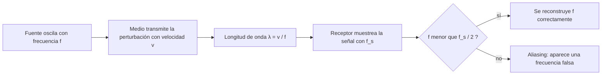

# B05-C12 — Ondas mecánicas y frecuencia

<!-- nav:top -->
[🏠 Programa](../../../../README.md) · [📚 Bloque B05](../../../tronco-comun/B05-fisica-fundamental-para-el-espacio.md) · [← Anterior: B05-C11 — Movimiento oscilatorio](../B05-C11-movimiento-oscilatorio/CLASE.md) · [Siguiente: B05-C13 — Temperatura y energía térmica →](../../../tronco-comun/B05-fisica-fundamental-para-el-espacio.md#b05-c13)
<!-- /nav -->

## 1. Ubicación, nivel y alcance

Duodécima clase de B05 y cierre de su tercer tramo (gravitación y oscilaciones). En C11 una masa oscilaba en un punto; ahora la oscilación **viaja** de un punto a otro llevando energía, sin llevar materia en conjunto. Nivel N1. Usas período y frecuencia (C03, C11) y un poco de trigonometría. No verás ondas electromagnéticas (C18–C19).

## 2. Por qué esta clase existe

Un sensor de vibración a bordo de una nave registra 30 Hz cuando la estructura vibra a 130 Hz. Un trueno llega segundos después del rayo. La pregunta motivadora es: **¿qué relaciona la frecuencia, la longitud de onda y la velocidad de una onda, y cómo se mide bien una frecuencia?** La decisión central es identificar el medio (qué vibra), la velocidad en ese medio y cómo muestrear la señal sin engañarse.

## 3. Lo que podrás hacer al terminar

1. Distinguir ondas transversales y longitudinales y explicar que necesitan un medio.
2. Usar `v = f λ` con unidades.
3. Calcular la velocidad del sonido con `a = √(γ R T)` y entender su dependencia de la temperatura.
4. Interpretar superposición, ondas estacionarias y batidos.
5. Calcular un corrimiento Doppler mecánico simple.
6. Explicar el teorema de muestreo y el aliasing, y verificarlo con una DFT.

La evidencia es el **informe de señal y frecuencia** del ejercicio 12 (sección 20).

## 4. Con qué llegas y cómo comprobarlo

1. Si `T = 0,02 s`, ¿cuánto vale `f`?
2. ¿Qué dimensión tiene la velocidad?
3. Calcula `√(1,4 × 8,31 × 290/0,029)` con una calculadora (≈ 341).
4. ¿Qué es una frecuencia en Hz?
5. ¿Cuánto es `2 × 10⁻³ × 5 × 10⁴`?

<details>
<summary>Ver respuestas</summary>

1. 50 Hz. 2. `L T⁻¹`. 3. ≈ 341 m/s (si dudas, repasa C01). 4. Ciclos por segundo (s⁻¹). 5. 100.
</details>

Con cuatro o cinco aciertos, sigue; con menos, repasa C11 y C01.

## 5. Un caso real: el sonido y su velocidad en el aire

La NASA explica que la velocidad del sonido en un gas es `a = √(γ R T)`, con `T` la temperatura absoluta, y da como referencia que en un día estándar a nivel del mar vale unos 761 mph, o 1100 pies por segundo (S2). Eso equivale a unos 340 m/s, una cifra que verificaremos con el modelo del gas ideal. Un detalle importante: esa velocidad depende de la temperatura, no de la presión. Límite: la página no da los valores de `γ` ni de la masa molar del aire; en el laboratorio usamos `γ = 1,4` y `0,028 965 kg/mol` como **supuestos no consultados**, y la comprobación consiste en que el resultado coincida con los 340 m/s de NASA.

## 6. Vocabulario

Una **onda mecánica** es una perturbación que se propaga por un medio material (aire, agua, una cuerda, un sólido). En una onda **transversal**, el medio se mueve perpendicular a la propagación (cuerda); en una **longitudinal**, paralelo (sonido). La **longitud de onda** `λ` es la distancia entre dos puntos iguales consecutivos (m); la **frecuencia** `f` (Hz) es el número de ciclos por segundo en un punto; la **velocidad de propagación** `v` cumple `v = f λ`. La **superposición** dice que dos ondas se suman. Una **onda estacionaria** surge al superponer dos ondas iguales en sentidos opuestos. Los **batidos** son la variación de amplitud al superponer dos frecuencias cercanas, a la frecuencia diferencia. El **efecto Doppler** es el cambio de frecuencia percibida por el movimiento relativo entre fuente y observador. La **frecuencia de muestreo** `f_s` es cuántas medidas por segundo se toman; la **frecuencia de Nyquist** es `f_s/2`. El **aliasing** es el falso aspecto de baja frecuencia que adopta una señal más rápida que Nyquist.

## 7. Modelo mental: una perturbación que corre

Una onda es un patrón que se mueve, no un trozo de materia que viaja. Cada partícula solo oscila en torno a su sitio y pasa el movimiento a la siguiente.



*Descripción textual:* una fuente que oscila a frecuencia `f` transmite la perturbación por el medio a velocidad `v`, lo que define `λ = v/f`; el receptor muestrea con `f_s`; si `f` es menor que `f_s/2` la frecuencia se reconstruye bien y si no, aparece una frecuencia falsa (aliasing).

Una analogía: la «ola» de un estadio. La ola avanza, pero cada persona solo se levanta y se sienta. El límite: en un estadio hay un retraso de reacción; en un medio elástico la velocidad la fijan sus propiedades (rigidez y densidad).

## 8. La explicación, paso a paso

### 8.1 `v = f λ`

En un período `T` la onda avanza una longitud de onda: `v = λ/T = f λ`. Con `v = 343,2 m/s` en aire a 20 °C (modelo de la sección 8.2): a 20 Hz, `λ = 17,16 m`; a 440 Hz, `0,780 m`; a 20 kHz, `1,72 cm`. Las frecuencias bajas dan ondas largas, difíciles de apantallar; las altas, ondas cortas.

### 8.2 Velocidad del sonido y el medio

Con `a = √(γ R T/M)` (gas ideal; `M` la masa molar), `R = 8,314 462 618 J/(mol·K)` (S3), `γ = 1,4` y `M = 0,028 965 kg/mol` (supuestos no consultados): −40 °C → `306,1 m/s`; 0 °C → `331,3`; 15 °C → `340,3`; 20 °C → `343,2`. El valor a 15 °C coincide con los 340 m/s de la NASA (S2). **El sonido necesita un medio**: es una oscilación de las moléculas del gas; en el vacío no hay qué oscilar. Esto sigue de la definición de onda mecánica y es nuestra explicación, no una cita. La luz y las ondas de radio, en cambio, son electromagnéticas y se tratan en C18–C19.

### 8.3 Superposición, ondas estacionarias y batidos

Dos ondas que coinciden suman sus amplitudes. En una cuerda de longitud `L` fija en los extremos, solo caben ondas con `λ_n = 2L/n`, así que `f_n = n v/(2L)`: frecuencias discretas, como los modos de una estructura (C11). Si suenan a la vez 440 Hz y 444 Hz, se oye una variación de volumen a `|f₁ − f₂| = 4 Hz`: los batidos.

### 8.4 Efecto Doppler (sonido)

Si una fuente emite `f` y se acerca al observador con velocidad `u_s` respecto del aire, este recibe `f' = f v/(v − u_s)`; si se aleja, `f' = f v/(v + u_s)`. Con `f = 500 Hz`, `u_s = 20 m/s` y `v = 340,3 m/s`, se perciben `531,2 Hz` al acercarse y `472,2 Hz` al alejarse. Es una versión mecánica: **no** vale tal cual para la luz (relatividad, bloque posterior).

### 8.5 Muestreo, Nyquist y aliasing

Una señal medida cada `1/f_s` segundos solo permite distinguir frecuencias menores que `f_s/2`. Una de 130 Hz muestreada a 100 Hz se confunde con una de `|130 − 100| = 30 Hz`. La **transformada discreta de Fourier (DFT)** estima en qué frecuencias hay energía. El laboratorio muestra una señal de 50 Hz recuperada como 50,00 Hz con `f_s = 1000 Hz`, y la de 130 Hz que aparece en 30,00 Hz con `f_s = 100 Hz`. Moraleja: antes de interpretar un espectro, confirma que `f_s` es mayor que el doble de la frecuencia máxima presente.

## 9. Magnitudes, símbolos y unidades

| Símbolo | Magnitud | Dimensión | Unidad SI | Valor o nota |
|---|---|---|---|---|
| `f` | frecuencia | T⁻¹ | Hz | `1/T` |
| `λ` | longitud de onda | L | m | `v/f` |
| `v` | velocidad de propagación | L T⁻¹ | m/s | del medio |
| `a` | velocidad del sonido | L T⁻¹ | m/s | `√(γ R T/M)`; ≈ 340 m/s a 15 °C (S2) |
| `R` | constante molar de los gases | M L² T⁻² mol⁻¹ K⁻¹ | J/(mol·K) | 8,314 462 618… exacto (S3) |
| `γ` | razón de calores específicos | 1 | — | supuesto: 1,4 |
| `f_s` | frecuencia de muestreo | T⁻¹ | Hz | — |

## 10. Convenciones y referencias

Temperatura en kelvin (`T = t_{°C} + 273,15`). Frecuencia en Hz y frecuencia angular `ω = 2π f` en rad/s. Las señales del laboratorio son **sintéticas** (generadas); la velocidad del sonido calculada es **simulada** con un modelo ideal contrastado con un valor publicado.

## 11. De dónde sale lo que afirmamos

| ID | Fuente | Localizador | Respalda | Estado |
|---|---|---|---|---|
| S1 | NASA Glenn, «Speed of Sound» (página de enlace) | https://www.grc.nasa.gov/www/k-12/airplane/sound.html | La página original redirige a la nueva dirección; sin contenido físico | Consultada el 2026-11-05; no se usa para datos |
| S2 | NASA Glenn, *Beginner's Guide to Aeronautics*, «Speed of Sound» | https://www1.grc.nasa.gov/beginners-guide-to-aeronautics/speed-of-sound-interactive/ | `a = √(γ R T)`; ≈ 761 mph (1100 ft/s) a nivel del mar en día estándar | Página consultada el 2026-11-05 |
| S3 | NIST, CODATA 2022, «molar gas constant» | https://physics.nist.gov/cgi-bin/cuu/Value?r | `R = 8,314 462 618… J mol⁻¹ K⁻¹` exacto | Página consultada el 2026-11-05 |

Límites: S1 se consultó pero solo redirige y no respalda nada. `γ = 1,4` y la masa molar del aire son supuestos no verificados con fuente en esta clase. La necesidad de un medio, `v = f λ`, el Doppler, los modos de una cuerda y el teorema de muestreo son resultados clásicos que se enuncian o deducen aquí y se contrastan en el laboratorio (muestreo) o con valores publicados (sonido); no se cita un texto.

## 12. Cómo ver la señal

Tabla accesible de un gráfico de amplitud frente a frecuencia (espectro) de las dos señales sintéticas del laboratorio.

| Señal | `f` real (Hz) | `f_s` (Hz) | Pico estimado (Hz) | ¿Correcto? |
|---|---|---|---|---|
| A | 50 | 1000 | 50,00 | Sí |
| B | 130 | 100 | 30,00 | No (aliasing) |

Descripción larga: un espectro con una barra aguda en 50 Hz para la señal A; para B, una barra en 30 Hz, que no corresponde a ninguna frecuencia real de la fuente.

## 13. Ejemplo trabajado: el sensor que ve 30 Hz

**Planteamiento.** Un sensor de vibración del satélite ideal (sintético) muestrea a 100 Hz y reporta un pico a 30 Hz. ¿Es fiable?

**Paso 1 · Datos.** `f_s = 100 Hz` ⇒ Nyquist = 50 Hz. Pico en 30 Hz.

**Paso 2 · Posibles fuentes.** Frecuencias que, muestreadas a 100 Hz, aparecen en 30 Hz: `30`, `70`, `130`, `170`… (`|f − k f_s| = 30`).

**Paso 3 · Decisión.** Sin información extra no se puede distinguir. Se repite con `f_s` mayor (por ejemplo, 1000 Hz) o se añade un filtro antes de muestrear.

**Paso 4 · Sentido físico.** El laboratorio genera 130 Hz y la DFT a `f_s = 100 Hz` entrega `30,00 Hz`. Con `f_s = 1000 Hz` y una señal de 50 Hz se recupera 50,00 Hz. Una medición con muestreo insuficiente no es un dato dudoso: es un dato engañoso.

## 14. Comparación de métodos

**Medir el período** (en el tiempo) es simple para una señal limpia; **DFT** (en frecuencia) separa varias componentes; **medir `λ` y `v`** da la frecuencia indirectamente. Para señales con ruido o varios tonos, la DFT; para un tono limpio, el período. En todos, verifica `f_s`.

## 15. Práctica guiada

**Ejercicio 1.** Calcula la longitud de onda de un tono de 440 Hz en aire a 20 °C (`v = 343,2 m/s`). *Pasos:* `λ = v/f`.

<details><summary>Solución comentada</summary>

`λ = 343,2/440 = 0,780 m`. Compruebe unidades: `(m/s)/(1/s) = m`.
</details>

**Ejercicio 2.** ¿Cuánto tarda el sonido en recorrer 1 km a 340,3 m/s? ¿Y la luz?

<details><summary>Solución comentada</summary>

Sonido: `1000/340,3 = 2,94 s`; luz: `1000/299 792 458 = 3,34 µs`. Por eso el trueno llega después del rayo.
</details>

**Ejercicio 3.** Una señal de 130 Hz se muestrea a 100 Hz. ¿En qué frecuencia aparece? *Pista:* sección 8.5.

<details><summary>Solución comentada</summary>

`|130 − 100| = 30 Hz`. Si fuese 170 Hz, también aparecería en 30 Hz (`|170 − 200|`).
</details>

## 16. Práctica autónoma, transferencia e integrador

**Ejercicio 4.** Una cuerda de 0,50 m con `v = 100 m/s`. ¿Qué frecuencia fundamental y primer armónico?

<details><summary>Solución comentada</summary>

`f_n = n v/(2L)`: `f₁ = 100 Hz`, `f₂ = 200 Hz`.
</details>

**Ejercicio 5.** ¿Qué frecuencia de batido producen 440 Hz y 444 Hz?

<details><summary>Solución comentada</summary>

`|444 − 440| = 4 Hz`: cuatro variaciones de volumen por segundo.
</details>

**Ejercicio 6.** Una fuente de 500 Hz se acerca a 20 m/s con `v = 340,3 m/s`. Calcula la frecuencia recibida y si se aleja.

<details><summary>Solución comentada</summary>

Acercándose, `500 × 340,3/320,3 = 531,2 Hz`; alejándose, `500 × 340,3/360,3 = 472,2 Hz`.
</details>

**Ejercicio 7.** ¿Qué `f_s` mínima necesitas para registrar sin aliasing una vibración de hasta 250 Hz?

<details><summary>Solución comentada</summary>

Más de `2 × 250 = 500 Hz`; en la práctica, 2,5 a 5 veces la frecuencia máxima para margen. (El criterio práctico no se consultó; el mínimo teórico es Nyquist.)
</details>

**Ejercicio 8.** Con `a = √(γ R T/M)`, ¿cuál es el cociente `a(293,15 K)/a(233,15 K)`?

<details><summary>Solución comentada</summary>

`√(293,15/233,15) = 1,121`: 343,2/306,1. La velocidad crece como la raíz de la temperatura absoluta.
</details>

**Ejercicio 9 · transferencia.** Un artículo dice «en el espacio se oye el rugido de las explosiones». Evalúa con la sección 8.2.

<details><summary>Solución comentada</summary>

El sonido es una onda mecánica que necesita un medio; en el vacío no se propaga. Dentro de una nave con aire sí; por contacto con una estructura sólida se pueden transmitir vibraciones. No hay sonido a través del vacío.
</details>

**Ejercicio 10 · transferencia.** Un compañero afirma que el sonido va más rápido a mayor presión. Evalúa con S2.

<details><summary>Solución comentada</summary>

La fórmula `√(γ R T)` solo contiene la temperatura: la presión, a igual temperatura, no la cambia (en un gas ideal). Mayor temperatura, más rapidez.
</details>

**Ejercicio 11 · transferencia.** Tu espectro muestra un pico a 30 Hz con `f_s = 100 Hz`, pero la maquinaria vibra a 130 Hz. ¿Qué error cometiste y cómo lo corriges?

<details><summary>Solución comentada</summary>

Muestreo por debajo de 260 Hz: aliasing. Se corrige aumentando `f_s` o filtrando antes de muestrear, y comprobando el espectro a dos `f_s` distintas.
</details>

**Ejercicio 12 · integrador.** Elabora un *informe de señal y frecuencia* (sección 20): genera una señal sintética con dos tonos (elige las frecuencias), mide sus frecuencias con DFT a dos `f_s` distintas y explica cualquier aliasing, con unidades y límites.

<details><summary>Solución modelo</summary>

Debe incluir las frecuencias reales, `f_s` y Nyquist, los picos estimados, la explicación de cualquier pico falso con `|f − k f_s|` y el criterio de validez del muestreo.
</details>

## 17. Laboratorio: DFT, aliasing y velocidad del sonido

El script [ondas_y_muestreo.py](ondas_y_muestreo.py) genera señales senoidales sintéticas, estima su frecuencia con una DFT, muestra el aliasing y calcula la velocidad del sonido. Antes comprueba que 50 Hz se recupere a 0,5 Hz, que 130 Hz a `f_s = 100 Hz` aparezca en 30 Hz y que la velocidad del sonido a 15 °C quede a 5 m/s de 340 m/s.

**Datos:** sintéticos; velocidad del sonido simulada con un modelo ideal (supuestos `γ`, `M` no consultados) y contrastada con S2. **Predice antes de ejecutar:** ¿qué frecuencia mostrará la señal de 130 Hz? (30 Hz.) **Resultados (2026-11-05, Python 3.12.9):** 50 Hz → `50,00 Hz`; 130 Hz con `f_s = 100 Hz` → `30,00 Hz`; velocidad del sonido: `306,1 m/s` (−40 °C), `331,3` (0 °C), `340,3` (15 °C), `343,2` (20 °C); longitudes de onda a 20 °C: `17,1617 m` (20 Hz), `0,7801 m` (440 Hz), `0,0172 m` (20 kHz).

```bash
python programa/clases/B05/B05-C12-ondas-mecanicas-y-frecuencia/ondas_y_muestreo.py
```

**Límites:** DFT directa (lenta) de señales sin ruido; no es una herramienta de análisis de vibraciones reales ni de certificación.

## 18. Errores frecuentes y cómo corregirlos

**Creer que el sonido viaja en el vacío.** Ejercicio 9. **Confundir `ω` y `f`.** Ejercicio 1. **Muestrear por debajo de Nyquist.** Ejercicios 3 y 11. **Usar Celsius en la fórmula de `a`.** Ejercicio 8. **Aplicar Doppler mecánico a la luz.** Sección 8.4.

## 19. Cómo sabrás que vas bien

Tras 8.1: ¿puedes pasar de `f` a `λ` en cualquier medio? Rehaz el ejercicio 1. Tras 8.5: ¿cómo detectas un aliasing? Repite el ejercicio 11. Tras el laboratorio: ¿qué pruebas hace el script? Léelo.

## 20. Qué entregas y cómo se evalúa

El producto es tu **informe de señal y frecuencia**: señales rotuladas como sintéticas, frecuencias estimadas, discusión de Nyquist y límites.

| Criterio | Inicial | En desarrollo | Logrado | Destacado |
|---|---|---|---|---|
| Frecuencias y unidades | Errores | Parciales | Correctas | Verificación dimensional |
| Muestreo | Ignorado | Con ayuda | Aplica Nyquist | Detecta y corrige aliasing |
| Interpretación | Ausente | Parcial | Explica | Relaciona con el medio |
| Alcance | No declara | Parcial | Declara | Distingue simulado de observado |

**Condiciones críticas:** no afirmar que el sonido viaja por el vacío; rotular datos sintéticos; citar solo lo consultado.

## 21. Ética, seguridad y límites

Las vibraciones y el ruido intenso pueden dañar equipos y oídos; esta clase es educativa y no establece límites de exposición ni de diseño. Accesibilidad: ecuaciones en texto, tablas equivalentes de espectros, sin conexión.

## 22. Para cerrar y seguir

Una onda mecánica transporta energía por un medio con `v = f λ`; el sonido necesita medio y su velocidad depende de la temperatura; superposición, ondas estacionarias y batidos describen cómo se combinan; para medir una frecuencia hay que muestrear al menos al doble de ella. Queda abierto cómo se reparte la energía entre muchas partículas: la temperatura y la energía térmica (C13).

**Glosario español–inglés.** onda · *wave*; longitud de onda · *wavelength*; frecuencia · *frequency*; velocidad del sonido · *speed of sound*; batido · *beat*; muestreo · *sampling*; aliasing · *aliasing*.

**Continuidad.** B05-C13 usa tu capacidad de **vincular una propiedad macroscópica con el movimiento de partículas** para estudiar temperatura y energía térmica.

**Referencias:** ver sección 11. S1 solo redirige; S2 y S3 respaldan lo indicado.

<!-- nav:bottom -->
---

[← Anterior: B05-C11 — Movimiento oscilatorio](../B05-C11-movimiento-oscilatorio/CLASE.md) · [📚 Bloque B05](../../../tronco-comun/B05-fisica-fundamental-para-el-espacio.md) · [Siguiente: B05-C13 — Temperatura y energía térmica →](../../../tronco-comun/B05-fisica-fundamental-para-el-espacio.md#b05-c13)
<!-- /nav -->
