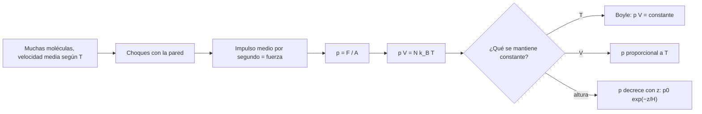

# B05-C14 — Gases y presión

<!-- nav:top -->
[🏠 Programa](../../../../README.md) · [📚 Bloque B05](../../../tronco-comun/B05-fisica-fundamental-para-el-espacio.md) · [← Anterior: B05-C13 — Temperatura y energía térmica](../B05-C13-temperatura-y-energia-termica/CLASE.md) · [Siguiente: B05-C15 — Campos eléctricos →](../B05-C15-campos-electricos/CLASE.md)
<!-- /nav -->

## 1. Ubicación, nivel y alcance

Decimocuarta clase de B05. En C13 viste que la temperatura mide la energía media de las partículas; ahora esas partículas llenan un recipiente y **empujan sus paredes**. Nivel N1. Usas fuerza y área, `k_B`, `R` y `N_A` (C13) y el cociente de magnitudes. No verás termodinámica general (calor, entropía) ni dinámica de fluidos.

## 2. Por qué esta clase existe

La cabina de una nave contiene aire a una presión que debe mantenerse, y una escotilla soporta decenas de miles de newtons. La pregunta motivadora es: **¿qué relaciona presión, volumen, temperatura y cantidad de gas, y cómo cambia la presión con la altura en una atmósfera?** La decisión central es identificar qué magnitud se mantiene constante en cada proceso (temperatura, volumen) y elegir la ecuación correspondiente.

## 3. Lo que podrás hacer al terminar

1. Definir presión y convertir entre pascal, milibar y otras unidades.
2. Aplicar la ecuación del gas ideal `p V = n R T = N k_B T`.
3. Resolver procesos a `T` constante (Boyle) y a `V` constante.
4. Calcular densidad y número de moléculas por unidad de volumen.
5. Deducir y usar la atmósfera isoterma (presión frente a altura) y su altura de escala.
6. Calcular la fuerza sobre una superficie y declarar los límites del gas ideal.

La evidencia es la **hoja de gas y presión** del ejercicio 12 (sección 20).

## 4. Con qué llegas y cómo comprobarlo

1. ¿Qué dimensión tiene una presión? (C01)
2. Si una fuerza de 200 N actúa sobre 0,5 m², ¿qué presión?
3. ¿Cuánto es `e^{−1}`? (≈ 0,368)
4. ¿Cuál es el valor de `k_B T` a 288 K? (C13)
5. ¿Qué es una constante exacta del SI? (C13)

<details>
<summary>Ver respuestas</summary>

1. `M L⁻¹ T⁻²` (Pa = N/m²). 2. 400 Pa. 3. 0,368. 4. `3,976 × 10⁻²¹ J`. 5. Un valor fijado por definición, sin incertidumbre.
</details>

Con cuatro o cinco aciertos, sigue; con menos, repasa C01 y C13.

## 5. Un caso real: el aire de la Estación Espacial

NASA indica que el volumen presurizado de la ISS es de unos 1005 m³ (35 491 pies cúbicos) (S2); y la ficha de la Tierra da una presión media en superficie de 1014 mb y una temperatura media de 288 K (S1). Si la estación se mantuviera a una presión similar a la de la superficie terrestre, podemos calcular con el modelo de gas ideal cuánto aire contiene: unos 1233 kg (con una masa molar supuesta de 0,028 965 kg/mol, no consultada). Límite: no sabemos la presión ni la temperatura reales de la cabina porque no se consultó esa información; el cálculo es un ejercicio de ordenes de magnitud.

## 6. Vocabulario

La **presión** es la fuerza normal por unidad de área, `p = F/A`; en el SI, pascal (`1 Pa = 1 N/m²`). Un **milibar** (mb) es `100 Pa` por definición de bar (`1 bar = 10⁵ Pa`), así que `1014 mb = 101,4 kPa`. Un **gas ideal** es un modelo en que las partículas no interactúan salvo por choques elásticos; cumple `p V = n R T`. La **ley de Boyle** dice que, a temperatura constante, `p V` es constante. La **densidad** `ρ = m/V`; para un gas ideal, `ρ = p M/(R T)`, con `M` la masa molar. La **presión hidrostática** es la que crece con la profundidad (o decrece con la altura) por el peso del fluido. La **altura de escala** `H` es la distancia en que la presión baja un factor `e` en una atmósfera isoterma.

## 7. Modelo mental: choques contra una pared

Cada molécula que rebota en la pared le transfiere un pequeño impulso (C08). Muchas moléculas por segundo producen una fuerza media constante: la presión. Más moléculas, o más rápidas (más `T`), o menos volumen, y la presión sube.



*Descripción textual:* las moléculas, con velocidad media fijada por la temperatura, chocan con la pared; el impulso medio por segundo es una fuerza y la fuerza por área es la presión; se llega a `pV = N k_B T`; según lo que se mantenga constante, se obtiene la ley de Boyle (`T` fija), la proporcionalidad `p ∝ T` (`V` fijo) o la caída exponencial con la altura.

Una analogía: lluvia de granizo sobre un tejado. Cada piedra es un golpe; muchos golpes dan una fuerza continua. El límite: el granizo cae en una dirección; las moléculas se mueven en todas, por eso la presión de un gas actúa igual en todas direcciones.

## 8. La explicación, paso a paso

### 8.1 La ecuación del gas ideal

`p V = n R T = N k_B T`, con `n` moles y `N` moléculas, `R = 8,314 462 618… J/(mol·K)` y `k_B = 1,380 649 × 10⁻²³ J/K`, ambas exactas (S3, S4). En un metro cúbico a 101,4 kPa y 288 K hay `N/V = p/(k_B T) = 2,5501 × 10²⁵` moléculas, o `n = 42,35 mol`. La temperatura debe estar en kelvin y la presión en pascal para que los resultados salgan en unidades SI (C01).

### 8.2 Procesos con una magnitud fija

**Boyle** (`T` constante): `p₁V₁ = p₂V₂`; comprimir un gas a un tercio de su volumen triplica su presión. **Volumen constante**: `p/T` constante: un recipiente sellado a 288 K y 101,4 kPa que se calienta a 345,6 K (×1,2) alcanza `121,7 kPa`. Ambas leyes valen solo para una cantidad fija de gas (recipiente sellado).

### 8.3 Densidad

`ρ = p M/(R T)`: con `p = 101,4 kPa`, `T = 288 K` y `M = 0,028 965 kg/mol` (supuesto no consultado), `ρ = 1,2265 kg/m³`. La densidad crece con la presión y decrece con la temperatura, por lo que el aire caliente asciende.

### 8.4 Atmósfera isoterma

Una capa de aire de espesor `dz` soporta el peso de la que tiene encima: `dp = −ρ g dz`. Con `ρ = pM/(RT)` y `T` constante se obtiene `p(z) = p₀ e^{−z/H}`, con `H = R T/(M g) = 8430 m` (con `g_n = 9,806 65 m/s²`, S5). Con `p₀ = 101,4 kPa`: a 1 km, `90,06 kPa` (88,8 % de `p₀`); a 8 km, `39,26 kPa` (38,7 %); a 20 km, `9,46 kPa` (9,3 %). El laboratorio integra la ecuación diferencial con RK4 y concuerda con la fórmula a menos de `10⁻⁴`. La atmósfera real no es isoterma: la temperatura cambia con la altura, así que el modelo solo sirve a escala didáctica y a altitudes moderadas; a 100 km da 0,72 Pa, un valor que no debe tomarse como medida (el modelo ya no vale).

### 8.5 Presión y fuerza: la escotilla

La fuerza sobre una superficie es `F = Δp · A`. Sobre una escotilla sintética de `0,50 m²` con `101,4 kPa` de diferencia, `F = 50 700 N`, comparable al peso de unos 5170 kg en la Tierra. Por eso las cabinas se tratan como recipientes a presión: una fuga o una puerta mal cerrada es un problema de ingeniería serio. Esta clase no entra en ese diseño; solo enseña la magnitud.

## 9. Magnitudes, símbolos y unidades

| Símbolo | Magnitud | Dimensión | Unidad SI | Valor o nota |
|---|---|---|---|---|
| `p` | presión | M L⁻¹ T⁻² | Pa | `1014 mb = 101,4 kPa` (S1) |
| `V` | volumen | L³ | m³ | ISS presurizado ≈ 1005 m³ (S2) |
| `n` | cantidad de sustancia | N | mol | — |
| `T` | temperatura | Θ | K | 288 K (S1) |
| `R` | constante molar | M L² T⁻² mol⁻¹ Θ⁻¹ | J/(mol·K) | 8,314 462 618… (S3) |
| `k_B` | constante de Boltzmann | M L² T⁻² Θ⁻¹ | J/K | 1,380 649 × 10⁻²³ (S4) |
| `H` | altura de escala | L | m | `R T/(M g)` |

## 10. Convenciones y referencias

Presión absoluta, en pascal. Temperatura en kelvin. Se usa `g_n` como valor constante de `g`. La masa molar del aire (0,028 965 kg/mol) es un **supuesto no consultado**; la escotilla, el recipiente sellado y la presión de la cabina son **sintéticos**. La atmósfera isoterma es un resultado **simulado** de un modelo ideal.

## 11. De dónde sale lo que afirmamos

| ID | Fuente | Localizador | Respalda | Estado |
|---|---|---|---|---|
| S1 | NASA NSSDC, *Earth Fact Sheet* (act. 15-nov-2024) | https://nssdc.gsfc.nasa.gov/planetary/factsheet/earthfact.html | Presión media en superficie 1014 mb; temperatura media 288 K | Página consultada el 2026-11-05 |
| S2 | NASA, «Space Station Facts and Figures» | https://www.nasa.gov/international-space-station/space-station-facts-and-figures/ | Volumen presurizado 1005 m³ (35 491 ft³) | Página consultada el 2026-11-05 |
| S3 | NIST, CODATA 2022, «molar gas constant» | https://physics.nist.gov/cgi-bin/cuu/Value?r | `R = 8,314 462 618… J mol⁻¹ K⁻¹` exacto | Página consultada el 2026-11-05 |
| S4 | NIST, CODATA 2022, «Boltzmann constant» | https://physics.nist.gov/cgi-bin/cuu/Value?k | `k_B = 1,380 649 × 10⁻²³ J/K` exacto | Página consultada el 2026-11-05 |
| S5 | NIST, CODATA 2022, «standard acceleration of gravity» | https://physics.nist.gov/cgi-bin/cuu/Value?gn | `g_n = 9,806 65 m/s²` exacto | Página consultada el 2026-11-05 |

Límites: la equivalencia `1 mb = 100 Pa` es una conversión por definición del bar, no consultada. La ecuación del gas ideal, la ley de Boyle y la deducción hidrostática son resultados clásicos; se deducen o enuncian aquí y se verifican numéricamente. No se consultó la presión de cabina de ninguna nave.

## 12. Cómo ver la presión

Tabla accesible de un gráfico de `p` frente a la altura en la atmósfera isoterma (cálculo propio).

| Altura (km) | `p` (Pa) | Fracción de `p₀` |
|---|---|---|
| 0 | 101 400 | 1,000 |
| 1 | 90 058 | 0,888 |
| 8 | 39 256 | 0,387 |
| 20 | 9456 | 0,093 |

Descripción larga: una curva exponencial decreciente; en un eje de presión logarítmico es una recta con pendiente `−1/H`; cada 8,43 km la presión baja un factor `e`.

## 13. Ejemplo trabajado: el aire en una cabina y en una escotilla

**Planteamiento.** Una cabina de 1005 m³ (S2) contiene aire a 101,4 kPa y 288 K (S1), con una escotilla sintética de 0,5 m². ¿Cuánto aire contiene y qué fuerza soporta la escotilla?

**Paso 1 · Datos.** `V = 1005 m³`, `p = 101 400 Pa`, `T = 288 K`, `M = 0,028 965 kg/mol` (supuesto).

**Paso 2 · Cantidad de aire.** `n = pV/(RT) = 101 400 × 1005/(8,314 462 618 × 288) = 4,256 × 10⁴ mol`; `m = nM = 1233 kg`; comprobación: `ρ V = 1,2265 × 1005 = 1233 kg`.

**Paso 3 · Fuerza.** Con vacío del otro lado, `F = Δp A = 101 400 × 0,5 = 50 700 N`.

**Paso 4 · Sentido físico.** Algo más de una tonelada de aire en la cabina y una fuerza equivalente al peso de unas cinco toneladas sobre una escotilla pequeña: de ahí que la estanqueidad sea un requisito de seguridad. La presión real de la cabina no se consultó.

## 14. Comparación de métodos

**Ecuación del gas ideal** cubre cualquier estado de un gas diluido; **leyes de proceso** (Boyle, volumen constante) son casos particulares útiles para comparar dos estados; **ecuación hidrostática** trata la variación con la altura; **gases reales** (ecuaciones de estado más complejas) se usan a alta presión o baja temperatura y exceden esta clase.

## 15. Práctica guiada

**Ejercicio 1.** Una fuerza de 1000 N actúa perpendicular sobre 0,02 m². Calcula `p` en Pa y kPa. *Pasos:* `p = F/A`.

<details><summary>Solución comentada</summary>

`p = 1000/0,02 = 50 000 Pa = 50 kPa`. Si el área fuese 0,2 m², la presión sería 10 veces menor.
</details>

**Ejercicio 2.** Calcula el número de moles en 1 m³ de aire a 101,4 kPa y 288 K. *Pista:* `n = pV/(RT)`.

<details><summary>Solución comentada</summary>

`n = 101 400 × 1/(8,314 462 618 × 288) = 42,35 mol`, equivalente a `2,55 × 10²⁵` moléculas.
</details>

**Ejercicio 3.** Un gas ocupa 3 m³ a 100 kPa y se comprime isotérmicamente a 1 m³. ¿Presión final?

<details><summary>Solución comentada</summary>

Boyle: `p₂ = p₁V₁/V₂ = 100 × 3/1 = 300 kPa`.
</details>

## 16. Práctica autónoma, transferencia e integrador

**Ejercicio 4.** Un recipiente sellado a 288 K y 101,4 kPa se calienta a 345,6 K. ¿Presión final?

<details><summary>Solución comentada</summary>

`p₂ = p₁ T₂/T₁ = 101,4 × 1,2 = 121,7 kPa`.
</details>

**Ejercicio 5.** Calcula `H = R T/(M g)` a 288 K y a 220 K, con `M = 0,028 965` y `g_n`.

<details><summary>Solución comentada</summary>

A 288 K: 8430 m. A 220 K: `8430 × 220/288 = 6440 m`. Una atmósfera más fría es más delgada.
</details>

**Ejercicio 6.** ¿A qué altura la presión cae a la mitad en la atmósfera isoterma de 288 K?

<details><summary>Solución comentada</summary>

`z = H ln 2 = 8430 × 0,693 = 5843 m`.
</details>

**Ejercicio 7.** ¿Qué presión da el modelo a 5 km?

<details><summary>Solución comentada</summary>

`101,4 × e^{−5000/8430} = 101,4 × 0,5526 = 56,03 kPa`.
</details>

**Ejercicio 8.** Una escotilla de 0,5 m² con presión interior de 50 kPa y exterior de vacío. ¿Fuerza?

<details><summary>Solución comentada</summary>

`F = 50 000 × 0,5 = 25 000 N`. Es la mitad del caso de 101,4 kPa.
</details>

**Ejercicio 9 · transferencia.** Un artículo dice «en el espacio no hay presión, por eso explota un globo». Corrige con lo aprendido.

<details><summary>Solución comentada</summary>

La presión externa es muy baja, no nula; lo que importa es la diferencia `Δp` entre el interior y el exterior. El globo se infla y se rompe por exceso de presión interna sin contrapeso, no por «falta de presión». No se cita valor de la presión del espacio porque no se consultó.
</details>

**Ejercicio 10 · transferencia.** Un compañero calcula `p V = n R T` con `T` en °C. ¿Qué error y cómo afecta?

<details><summary>Solución comentada</summary>

La ecuación exige kelvin: con 15 °C en vez de 288 K, el resultado sería 19 veces menor. Se corrige sumando 273,15 antes de calcular.
</details>

**Ejercicio 11 · transferencia.** Con el modelo isotermo, a 100 km la presión sería 0,72 Pa. ¿Por qué no es fiable?

<details><summary>Solución comentada</summary>

Porque se supuso `T` constante y `g` constante; a esa altitud la temperatura real y la composición son distintas y el modelo no se ajustó con datos de esa región. Un modelo vale solo dentro del dominio donde se contrastó (C10, C07).
</details>

**Ejercicio 12 · integrador.** Elabora una *hoja de gas y presión* (sección 20): para un recipiente sintético (volumen, `T`, `p` iniciales a tu elección) calcula `n`, `ρ`, la presión tras dos procesos (Boyle y volumen constante), la fuerza sobre una tapa y la presión a una altura dada con el modelo isotermo.

<details><summary>Solución modelo</summary>

Debe dar datos con unidades y rótulo (sintético/publicado), aplicar `pV = nRT`, los dos procesos, `F = Δp A` y `p(z)`, y declarar el dominio (gas ideal, `T` constante en la atmósfera).
</details>

## 17. Laboratorio: gas ideal y atmósfera isoterma

El script [gas_ideal_y_presion.py](gas_ideal_y_presion.py) calcula densidad y número de moléculas, integra con RK4 la presión hidrostática y la compara con `p₀ e^{−z/H}` a 1, 8 y 20 km (< 10⁻⁴), y la fuerza sobre una escotilla. Verifica también la ley de Boyle.

**Datos:** publicados (S1, S3–S5) y supuestos rotulados. **Predice antes de ejecutar:** ¿a qué fracción de `p₀` cae la presión a 8 km? (Cerca de 0,39.) **Resultados (2026-11-05, Python 3.12.9):** `ρ = 1,2265 kg/m³`; `N/V = 2,5501 × 10²⁵ m⁻³`; `H = 8430 m`; `p(1 km) = 90 057,69 Pa` (0,8881), `p(8 km) = 39 255,52 Pa` (0,3871), `p(20 km) = 9455,73 Pa` (0,0933), `p(100 km) = 0,72 Pa` (el modelo no vale ahí); escotilla de 0,5 m²: `50 700 N`.

```bash
python programa/clases/B05/B05-C14-gases-y-presion/gas_ideal_y_presion.py
```

**Límites:** gas ideal y atmósfera isoterma con `g` constante; no sustituye a modelos atmosféricos ni a normas de recipientes a presión.

## 18. Errores frecuentes y cómo corregirlos

**Usar °C.** Ejercicio 10. **Confundir presión y fuerza.** Ejercicios 1 y 8. **Creer que el espacio tiene presión cero exacta.** Ejercicio 9. **Aplicar Boyle sin temperatura constante.** Ejercicio 4. **Extrapolar el modelo atmosférico.** Ejercicio 11.

## 19. Cómo sabrás que vas bien

Tras 8.1: ¿puedes calcular `n` en un volumen dado? Repite el ejercicio 2. Tras 8.4: ¿qué significa `H`? Rehaz el ejercicio 6. Tras el laboratorio: ¿qué valida la integración numérica? Léelo.

## 20. Qué entregas y cómo se evalúa

El producto es tu **hoja de gas y presión**: datos rotulados, ecuación aplicada, procesos, fuerza y alcance.

| Criterio | Inicial | En desarrollo | Logrado | Destacado |
|---|---|---|---|---|
| Unidades (K, Pa) | Errores | Parciales | Correctas | Verificación dimensional |
| Ecuaciones | Mal elegidas | Con ayuda | Correctas | Justifica la que se mantiene constante |
| Interpretación | Ausente | Parcial | Explica | Compara modelo y dato |
| Alcance | No declara | Parcial | Declara | Cita el límite del gas ideal |

**Condiciones críticas:** kelvin y pascal; rotular supuestos; citar solo lo consultado.

## 21. Ética, seguridad y límites

Los recipientes a presión y las cabinas son riesgos reales; esta clase no sustituye normas ni cálculos de seguridad. Accesibilidad: ecuaciones en texto, tablas equivalentes de las gráficas, sin conexión.

## 22. Para cerrar y seguir

La presión es fuerza por área y resulta de los choques moleculares; `pV = N k_B T` relaciona presión, volumen y temperatura; con altura, la presión cae exponencialmente en una atmósfera isoterma. Queda abierto cómo actúan las cargas eléctricas a distancia: los campos eléctricos (C15).

**Glosario español–inglés.** presión · *pressure*; gas ideal · *ideal gas*; ley de Boyle · *Boyle's law*; altura de escala · *scale height*; densidad · *density*; presión hidrostática · *hydrostatic pressure*; escotilla · *hatch*.

**Continuidad.** B05-C15 usa tu capacidad de **relacionar una fuerza con una magnitud de campo** para introducir el campo eléctrico y la ley de Coulomb.

**Referencias:** ver sección 11.

<!-- nav:bottom -->
---

[← Anterior: B05-C13 — Temperatura y energía térmica](../B05-C13-temperatura-y-energia-termica/CLASE.md) · [📚 Bloque B05](../../../tronco-comun/B05-fisica-fundamental-para-el-espacio.md) · [Siguiente: B05-C15 — Campos eléctricos →](../B05-C15-campos-electricos/CLASE.md)
<!-- /nav -->
