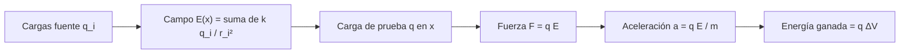

# B05-C15 — Campos eléctricos

<!-- nav:top -->
[🏠 Programa](../../../../README.md) · [📚 Bloque B05](../../../tronco-comun/B05-fisica-fundamental-para-el-espacio.md) · [← Anterior: B05-C14 — Gases y presión](../B05-C14-gases-y-presion/CLASE.md) · [Siguiente: B05-C16 — Corriente y circuitos elementales →](../B05-C16-corriente-y-circuitos-elementales/CLASE.md)
<!-- /nav -->

## 1. Ubicación, nivel y alcance

Decimoquinta clase de B05. Hasta C14 las únicas interacciones a distancia eran gravitatorias; ahora aparece la **fuerza eléctrica**, que domina todo lo que ocurre entre átomos y partículas cargadas. Nivel N1. Usas fuerza (C04), ley del cuadrado inverso (C10), energía (C06) y notación científica. No verás todavía campos magnéticos (C17) ni ondas electromagnéticas (C18).

## 2. Por qué esta clase existe

El espacio está lleno de partículas cargadas que un satélite atraviesa, y un satélite puede acumular carga. La pregunta motivadora es: **¿cómo describir la fuerza eléctrica sobre una carga sin conocer a la vez todas las demás, y cuánto más fuerte es que la gravedad?** La decisión central es introducir una magnitud (el campo eléctrico) que depende solo de las fuentes y de la posición, y luego multiplicar por la carga de prueba.

## 3. Lo que podrás hacer al terminar

1. Enunciar la ley de Coulomb con su constante y unidades.
2. Definir el campo eléctrico `E = F/q` y calcularlo para cargas puntuales.
3. Aplicar el principio de superposición a varias cargas.
4. Calcular la aceleración de una partícula cargada en un campo uniforme y su energía ganada.
5. Comparar la fuerza eléctrica con la gravitatoria entre partículas.
6. Declarar el dominio de validez de la electrostática.

La evidencia es la **hoja de campo eléctrico** del ejercicio 12 (sección 20).

## 4. Con qué llegas y cómo comprobarlo

1. ¿Qué dimensión tiene la fuerza? (C01)
2. Si la distancia se duplica, ¿cómo cambia `1/r²`?
3. ¿Cuánto vale `1/(4π × 8,854 × 10⁻¹²)`? (≈ `8,99 × 10⁹`)
4. ¿Qué relaciona `E_c` con `½mv²`? (C06)
5. ¿Qué es una constante exacta? (C13)

<details>
<summary>Ver respuestas</summary>

1. `M L T⁻²`. 2. Se divide por 4. 3. `8,99 × 10⁹`. 4. Es la definición de energía cinética. 5. Un valor fijado por definición en el SI.
</details>

Con cuatro o cinco aciertos, sigue; con menos, repasa C06 y C10.

## 5. Un caso real: protón y electrón, dos fuerzas muy distintas

CODATA 2022 da la carga elemental `e = 1,602 176 634 × 10⁻¹⁹ C` (exacta, S2), la masa del protón `1,672 621 925 95 × 10⁻²⁷ kg` y la del electrón `9,109 383 7139 × 10⁻³¹ kg` (S3, S4), la permitividad del vacío `8,854 187 8188 × 10⁻¹² F/m` (S1) y la constante de gravitación `6,674 30 × 10⁻¹¹` (S5). Con ellas se calcula que la repulsión eléctrica entre dos protones es unas `1,24 × 10³⁶` veces mayor que su atracción gravitatoria, y entre un protón y un electrón (en módulo) `2,27 × 10³⁹` veces. Por eso, a escala atómica, la gravedad es irrelevante, y a escala de planetas, la carga neta casi se compensa. Límite: el cálculo trata partículas puntuales; a distancias nucleares intervienen otras fuerzas.

## 6. Vocabulario

La **carga eléctrica** `q` es una propiedad de la materia, con signo; su unidad es el culombio (C); la **carga elemental** es `e`. La **ley de Coulomb** dice que dos cargas puntuales `q₁` y `q₂` separadas `r` se ejercen una fuerza `F = k_e |q₁ q₂|/r²`, repulsiva si tienen el mismo signo y atractiva si es distinto, con `k_e = 1/(4π ε₀)`. El **campo eléctrico** `E` en un punto es la fuerza por unidad de carga de prueba, `E = F/q` (N/C = V/m). El **potencial eléctrico** `V` es energía por carga (J/C = V); un campo uniforme `E` da una caída de potencial `E d` en una distancia `d`. El **principio de superposición** dice que el campo de varias cargas es la suma vectorial de los campos de cada una. Un **dipolo** son dos cargas opuestas muy próximas.

## 7. Modelo mental: la carga fuente y la carga de prueba

Una carga fuente modifica el espacio alrededor; una carga de prueba colocada en un punto siente la fuerza `q E`. La separación evita recalcular la fuente en cada caso.



*Descripción textual:* las cargas fuente generan un campo que es la suma de sus contribuciones; una carga de prueba en ese punto siente `F = q E`, adquiere la aceleración `a = qE/m` y gana una energía igual a `q` por la diferencia de potencial.

Una analogía: la gravedad como campo `g` (C10): la fuerza sobre una masa de prueba es `m g`. El límite: la masa gravitatoria siempre atrae, pero la carga puede atraer o repeler; y el campo eléctrico se puede apantallar con conductores, la gravedad no.

## 8. La explicación, paso a paso

### 8.1 Ley de Coulomb

`k_e = 1/(4π ε₀) = 8,987 552 × 10⁹ N·m²/C²` con `ε₀ = 8,854 187 8188 × 10⁻¹² F/m` (S1). Dos cargas elementales a 1 m se repelen con `2,3071 × 10⁻²⁸ N`; dos cargas de 1 µC y 2 µC a 0,1 m, con `1,80 N`. La dependencia `1/r²` es la misma que la de la gravedad (C10), pero la constante es mucho mayor para cargas macroscópicas.

### 8.2 Campo de una carga puntual

`E = k_e q/r²`, hacia fuera si `q > 0`. Una carga de `1 µC` produce a 0,5 m un campo de `35 950 V/m`; sobre la superficie de una esfera de 1 m de radio con la misma carga (dato sintético), `8988 V/m` y un potencial `V = k_e q/r = 8988 V`. Unidades: `V/m = N/C`.

### 8.3 Superposición

Con dos cargas iguales de `1 µC` en `x = ±0,5 m`, el campo en el origen es cero (se cancelan); en `x = 1 m` vale `k_e q (1/0,5² + 1/1,5²) = 39 945 V/m`. Un dipolo de separación `d` y carga `e`, a una distancia `r ≫ d` sobre su eje, da `E ≈ 2 k_e p/r³` con `p = e d`: decae más rápido (`1/r³`) que una carga sola. A `r = 100 d`, la fórmula aproximada difiere del campo exacto en `5 × 10⁻⁵` relativo (laboratorio).

### 8.4 Partículas en un campo uniforme

En un campo uniforme `E = 10⁵ V/m`, un protón sufre `a = eE/m_p = 9,579 × 10¹² m/s²`; tras 0,10 m, `v = √(2 a d) = 1,384 × 10⁶ m/s` (0,0046 c, aún no relativista) y ha ganado una energía `e E d = 10 000 eV`. El electrón, en el mismo campo, acelera `1836` veces más (`1,759 × 10¹⁶ m/s²`) por tener menos masa y la misma carga en módulo. Un electrón acelerado por 100 V alcanza `5,93 × 10⁶ m/s` (1,98 % de `c`).

### 8.5 Eléctrico frente a gravitatorio

El cociente `k_e e²/(G m_p²) = 1,24 × 10³⁶` es independiente de la distancia (ambas fuerzas caen como `1/r²`). Por eso la materia ordinaria es casi neutra a gran escala: pequeñas cargas netas bastarían para dominar la gravedad. En el espacio, la carga neta de un satélite puede crecer al interactuar con partículas ambientales; esta clase solo introduce la magnitud: no se consultó ningún dato de carga de una nave.

## 9. Magnitudes, símbolos y unidades

| Símbolo | Magnitud | Dimensión | Unidad SI | Valor o nota |
|---|---|---|---|---|
| `q` | carga | I T | C | `e = 1,602 176 634 × 10⁻¹⁹` exacta (S2) |
| `ε₀` | permitividad del vacío | M⁻¹ L⁻³ T⁴ I² | F/m | 8,854 187 8188(14) × 10⁻¹² (S1) |
| `k_e` | constante de Coulomb | M L³ T⁻⁴ I⁻² | N·m²/C² | 8,987 552 × 10⁹ (cálculo) |
| `E` | campo eléctrico | M L T⁻³ I⁻¹ | V/m = N/C | `F/q` |
| `V` | potencial | M L² T⁻³ I⁻¹ | V | `E d` en campo uniforme |
| `m_p`, `m_e` | masas del protón y del electrón | M | kg | 1,672 621 925 95 × 10⁻²⁷ (S3); 9,109 383 7139 × 10⁻³¹ (S4) |
| `G` | constante de gravitación | M⁻¹ L³ T⁻² | m³ kg⁻¹ s⁻² | 6,674 30(15) × 10⁻¹¹ (S5) |

## 10. Convenciones y referencias

Se añade la corriente (`I`) como dimensión base (amperio) para las magnitudes eléctricas. Cargas puntuales en el vacío; fuerza positiva = repulsión. Los valores de las constantes son **publicados**; los campos de 10⁵ V/m, las cargas de µC y las distancias son **sintéticos**; las cantidades derivadas (aceleraciones, cocientes) son cálculos propios (**simulados** con modelo ideal).

## 11. De dónde sale lo que afirmamos

| ID | Fuente | Localizador | Respalda | Estado |
|---|---|---|---|---|
| S1 | NIST, CODATA 2022, «vacuum electric permittivity» | https://physics.nist.gov/cgi-bin/cuu/Value?ep0 | `ε₀ = 8,854 187 8188(14) × 10⁻¹² F/m` | Página consultada el 2026-11-05 |
| S2 | BIPM, «SI defining constants» | https://www.bipm.org/en/measurement-units/si-defining-constants | `e = 1,602 176 634 × 10⁻¹⁹ C` exacta | Página consultada el 2026-11-05 |
| S3 | NIST, CODATA 2022, «proton mass» | https://physics.nist.gov/cgi-bin/cuu/Value?mp | `m_p = 1,672 621 925 95(52) × 10⁻²⁷ kg` | Página consultada el 2026-11-05 |
| S4 | NIST, CODATA 2022, «electron mass» | https://physics.nist.gov/cgi-bin/cuu/Value?me | `m_e = 9,109 383 7139(28) × 10⁻³¹ kg` | Página consultada el 2026-11-05 |
| S5 | NIST, CODATA 2022, «Newtonian constant of gravitation» | https://physics.nist.gov/cgi-bin/cuu/Value?bg | `G = 6,674 30(15) × 10⁻¹¹ m³ kg⁻¹ s⁻²` | Página consultada el 2026-11-05 |

Límites: la ley de Coulomb, la superposición y el campo dipolar son resultados clásicos que se enuncian aquí y se verifican numéricamente; no se cita un texto. No se consultaron datos de carga de naves ni de plasma espacial.

## 12. Cómo ver el campo

Tabla accesible de un gráfico de líneas de campo de dos cargas iguales `+1 µC` en `x = ±0,5 m` (cálculo propio).

| Punto | `E_x` (V/m) | Interpretación |
|---|---|---|
| x = 0 | 0 | Los campos se cancelan |
| x = 1 | +39 945 | Apunta hacia fuera (repulsión) |
| x = −1 | −39 945 | Simétrico |

Descripción larga: las líneas salen de cada carga positiva y se curvan al alejarse una de otra; en el punto medio no hay campo; lejos de ambas se parecen a las de una sola carga de `2 µC`.

## 13. Ejemplo trabajado: un protón en un campo uniforme

**Planteamiento.** Un protón entra en una región de campo uniforme `E = 1,0 × 10⁵ V/m` y recorre 0,10 m a lo largo del campo. ¿Qué aceleración, velocidad y energía?

**Paso 1 · Datos.** `e`, `m_p` (S2, S3); `E`, `d` sintéticos.

**Paso 2 · Aceleración.** `a = eE/m_p = 1,602 × 10⁻¹⁹ × 10⁵ / 1,6726 × 10⁻²⁷ = 9,579 × 10¹² m/s²`.

**Paso 3 · Velocidad.** `v = √(2 a d) = 1,384 × 10⁶ m/s = 0,0046 c`; tiempo `1,44 × 10⁻⁷ s`.

**Paso 4 · Energía y sentido.** `ΔE_c = e E d = 1,0 × 10⁴ eV`. La velocidad es mucho menor que `c`, por lo que la mecánica no relativista es válida (C04). Comprobación: `½ m_p v² = e E d` (el laboratorio la verifica a `10⁻¹²`). La aceleración es 10¹² veces la gravedad: la gravedad es despreciable aquí.

## 14. Comparación de métodos

**Coulomb** es directo para pocas cargas puntuales; **campo y superposición** escalan a muchas cargas; **energía y potencial** evitan el vector si solo interesa la rapidez; **simulación numérica** sirve para configuraciones complejas. Para una sola carga, Coulomb; para varias, el campo; para energía, el potencial.

## 15. Práctica guiada

**Ejercicio 1.** Calcula la fuerza entre cargas de 1 µC y 2 µC separadas 0,10 m (`k_e = 8,9876 × 10⁹`). *Pasos:* sección 8.1.

<details><summary>Solución comentada</summary>

`F = 8,9876 × 10⁹ × 2 × 10⁻¹²/0,01 = 1,80 N`, repulsiva si ambas son positivas.
</details>

**Ejercicio 2.** Calcula `E` a 0,5 m de una carga de 1 µC. *Pista:* `E = k_e q/r²`.

<details><summary>Solución comentada</summary>

`E = 8,9876 × 10⁹ × 10⁻⁶/0,25 = 35 950 V/m`, radial hacia fuera.
</details>

**Ejercicio 3.** ¿Qué fuerza sufre una carga de `+2 nC` en ese punto?

<details><summary>Solución comentada</summary>

`F = qE = 2 × 10⁻⁹ × 35 950 = 7,19 × 10⁻⁵ N`.
</details>

## 16. Práctica autónoma, transferencia e integrador

**Ejercicio 4.** Dos cargas `+1 µC` en `x = ±0,5 m`: ¿campo en `x = 1 m`?

<details><summary>Solución comentada</summary>

`k_e q (1/0,5² + 1/1,5²) = 8987,6 × 4,444 = 39 945 V/m` en `+x`.
</details>

**Ejercicio 5.** Un electrón se acelera por una diferencia de potencial de 100 V desde el reposo. ¿Su velocidad final?

<details><summary>Solución comentada</summary>

`e V = ½ m v²` ⇒ `v = √(2 e V/m_e) = 5,93 × 10⁶ m/s` (0,0198 c).
</details>

**Ejercicio 6.** ¿Qué campo uniforme resulta de 1000 V entre dos placas separadas 1 cm?

<details><summary>Solución comentada</summary>

`E = V/d = 1000/0,01 = 10⁵ V/m`.
</details>

**Ejercicio 7.** ¿Cuántas veces más rápido se acelera un electrón que un protón en el mismo campo?

<details><summary>Solución comentada</summary>

`m_p/m_e = 1836,2` veces más (la carga en módulo es la misma). Es coherente con `1,759 × 10¹⁶/9,579 × 10¹²`.
</details>

**Ejercicio 8.** ¿Cuál es la energía potencial de dos cargas de 1 µC y 2 µC separadas 0,10 m, `U = k_e q₁q₂/r`?

<details><summary>Solución comentada</summary>

`U = 8,9876 × 10⁹ × 2 × 10⁻¹²/0,1 = 0,180 J`. Positiva: hay que gastar energía para acercarlas.
</details>

**Ejercicio 9 · transferencia.** Un artículo dice «la gravedad es la fuerza más fuerte del universo porque sostiene a los planetas». Contrasta con la sección 8.5.

<details><summary>Solución comentada</summary>

Entre dos protones, la fuerza eléctrica es 10³⁶ veces la gravitatoria. La gravedad domina a gran escala porque la materia es casi neutra y sus efectos se acumulan; no es «la más fuerte», es la que sobrevive a la cancelación.
</details>

**Ejercicio 10 · transferencia.** Un compañero afirma que el campo de un dipolo cae como `1/r²`. Evalúa con la sección 8.3.

<details><summary>Solución comentada</summary>

Cae como `1/r³` en el eje a gran distancia: las dos cargas opuestas se cancelan casi del todo. Comprobado en el laboratorio: a 100 separaciones, exacto y aproximado coinciden a `5 × 10⁻⁵`.
</details>

**Ejercicio 11 · transferencia.** Una nave acumula `1 µC` en una superficie equivalente a una esfera de 1 m de radio. ¿Qué potencial alcanza? ¿Es peligroso?

<details><summary>Solución comentada</summary>

`V = k_e q/r = 8988 V` (dato sintético). Si es peligroso depende de umbrales de descarga y de materiales que no se consultaron; una carga real y su riesgo requieren datos y normas que esta clase no cubre.
</details>

**Ejercicio 12 · integrador.** Elabora una *hoja de campo eléctrico* (sección 20): para dos cargas puntuales de tu elección, calcula el campo en tres puntos, la fuerza sobre una carga de prueba, y la aceleración de un protón o electrón en un campo uniforme; compara una fuerza eléctrica con la gravitatoria.

<details><summary>Solución modelo</summary>

Debe dar datos con unidades y rótulo, calcular `E` por superposición con signos, `F = qE`, `a = qE/m` con masas citadas, el cociente eléctrico/gravitatorio y los límites del modelo (estático, puntual, vacío).
</details>

## 17. Laboratorio: cargas, campos y partículas

El script [campo_de_cargas.py](campo_de_cargas.py) calcula la constante de Coulomb, el campo de un dipolo (exacto y aproximado), el movimiento de un protón y un electrón en un campo uniforme y el cociente entre fuerza eléctrica y gravitatoria. Antes comprueba que el dipolo aproximado coincida a `10⁻³` y que la energía cinética ganada sea `q E d` a `10⁻¹²`.

**Datos:** publicados (S1–S5), campos sintéticos. **Predice antes de ejecutar:** ¿qué cociente eléctrico/gravitatorio protón–protón? (≈ 10³⁶.) **Resultados (2026-11-05, Python 3.12.9):** `k_e = 8,987552 × 10⁹ N·m²/C²`; fuerza entre dos `e` a 1 m: `2,3071 × 10⁻²⁸ N`; cociente protón–protón `1,2356 × 10³⁶`, protón–electrón `2,2687 × 10³⁹`; dipolo a 100 separaciones: exacto `2,880073 × 10³ V/m`, aproximado `2,879929 × 10³`; protón en `10⁵ V/m`: `a = 9,5788 × 10¹² m/s²`, `v = 1,3841 × 10⁶ m/s` (0,0046 c) a 0,1 m, energía `10 000 eV`; electrón: `1,7588 × 10¹⁶ m/s²` (cociente de masas `1836,2`).

```bash
python programa/clases/B05/B05-C15-campos-electricos/campo_de_cargas.py
```

**Límites:** cargas puntuales estáticas en el vacío; sin radiación ni campo magnético; no es un modelo de plasma espacial.

## 18. Errores frecuentes y cómo corregirlos

**Olvidar el signo de la carga.** Ejercicio 4. **Confundir fuerza y campo.** Ejercicios 2 y 3. **Aplicar `1/r²` a un dipolo.** Ejercicio 10. **Usar la masa equivocada.** Ejercicio 7. **Creer que la gravedad es la fuerza más fuerte.** Ejercicio 9.

## 19. Cómo sabrás que vas bien

Tras 8.1: ¿puedes escribir la fuerza entre dos cargas con signo? Repite el ejercicio 1. Tras 8.3: ¿por qué se cancelan los campos en el punto medio? Rehaz el ejercicio 4. Tras el laboratorio: ¿qué comprobaciones valida? Léelo.

## 20. Qué entregas y cómo se evalúa

El producto es tu **hoja de campo eléctrico**: configuración de cargas, campo por superposición, fuerza y aceleración, comparación con la gravedad y límites.

| Criterio | Inicial | En desarrollo | Logrado | Destacado |
|---|---|---|---|---|
| Signos y vectores | Errores | Parciales | Correctos | Verifica por simetría |
| Cálculo y unidades | Errores | Con ayuda | Correcto | Verificación dimensional |
| Comparación | Ausente | Parcial | Eléctrica vs gravitatoria | Explica la neutralidad |
| Alcance | No declara | Parcial | Declara | Cita el límite estático |

**Condiciones críticas:** no inventar cargas de naves como reales; signos y unidades; citar solo lo consultado.

## 21. Ética, seguridad y límites

Las descargas eléctricas y las altas tensiones son peligrosas para personas y equipos; esta clase es educativa y no sustituye normas de seguridad eléctrica ni análisis de carga de naves. Accesibilidad: ecuaciones en texto, tablas equivalentes de los diagramas de campo, sin conexión.

## 22. Para cerrar y seguir

La carga crea un campo `E = k_e q/r²` que se suma vectorialmente; una carga de prueba siente `F = qE` y gana energía `q ΔV`; la fuerza eléctrica entre partículas es enormemente mayor que la gravitatoria, pero la neutralidad macroscópica la oculta. Queda abierto qué pasa cuando las cargas *fluyen*: corriente y circuitos (C16).

**Glosario español–inglés.** carga eléctrica · *electric charge*; campo eléctrico · *electric field*; potencial · *potential*; superposición · *superposition*; dipolo · *dipole*; permitividad · *permittivity*; ley de Coulomb · *Coulomb's law*.

**Continuidad.** B05-C16 usa tu capacidad de **calcular `V`, `F` y energía de cargas** para describir la corriente, la resistencia y la potencia eléctrica.

**Referencias:** ver sección 11.

<!-- nav:bottom -->
---

[← Anterior: B05-C14 — Gases y presión](../B05-C14-gases-y-presion/CLASE.md) · [📚 Bloque B05](../../../tronco-comun/B05-fisica-fundamental-para-el-espacio.md) · [Siguiente: B05-C16 — Corriente y circuitos elementales →](../B05-C16-corriente-y-circuitos-elementales/CLASE.md)
<!-- /nav -->
