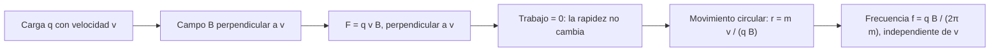

# B05-C17 — Campos magnéticos

<!-- nav:top -->
[🏠 Programa](../../../../README.md) · [📚 Bloque B05](../../../tronco-comun/B05-fisica-fundamental-para-el-espacio.md) · [← Anterior: B05-C16 — Corriente y circuitos elementales](../B05-C16-corriente-y-circuitos-elementales/CLASE.md) · [Siguiente: B05-C18 — Electromagnetismo y radiación →](../B05-C18-electromagnetismo-y-radiacion/CLASE.md)
<!-- /nav -->

## 1. Ubicación, nivel y alcance

Decimoséptima clase de B05. En C15 las cargas estaban quietas y producían campo eléctrico; en C16 fluían por circuitos. Ahora aprendes que **una carga en movimiento crea y siente un campo magnético**. Nivel N1. Usas fuerza y movimiento circular (C03, C04), campo eléctrico (C15) y corriente (C16). No verás inducción (ley de Faraday) ni materiales magnéticos.

## 2. Por qué esta clase existe

La Tierra tiene un campo magnético que un satélite puede medir con un magnetómetro y que actúa sobre las partículas cargadas que lo atraviesan; además, una corriente a bordo crea su propio campo, que puede perturbar esas medidas. La pregunta motivadora es: **¿qué fuerza siente una carga que se mueve en un campo magnético, qué trayectoria sigue y cómo se produce el campo?** La decisión central es separar la fuerza eléctrica (sobre cualquier carga) de la magnética (solo sobre cargas en movimiento y perpendicular a su velocidad).

## 3. Lo que podrás hacer al terminar

1. Enunciar la fuerza de Lorentz magnética `F = q v × B` y su dirección.
2. Explicar por qué el campo magnético no cambia la rapidez ni hace trabajo.
3. Calcular el radio y la frecuencia de giro de una partícula en un campo uniforme.
4. Calcular el campo de un hilo recto con corriente.
5. Comparar órdenes de magnitud con el campo magnético terrestre publicado.
6. Verificar numéricamente la trayectoria y la conservación de la rapidez.

La evidencia es la **hoja de partícula en campo magnético** del ejercicio 12 (sección 20).

## 4. Con qué llegas y cómo comprobarlo

1. ¿Qué es la aceleración centrípeta de un círculo de radio `r` y rapidez `v`? (C03)
2. ¿Cuánto vale `q E` para `q = e` y `E = 10⁵ V/m`? (C15)
3. ¿Qué hace una fuerza perpendicular a la velocidad con la energía cinética? (C06)
4. ¿Cuál es la unidad de corriente? (C16)
5. ¿Cuánto es `2 × 10⁻⁷ × 10/0,1`?

<details>
<summary>Ver respuestas</summary>

1. `v²/r`. 2. `1,6 × 10⁻¹⁴ N`. 3. No hace trabajo: la energía cinética no cambia. 4. Amperio (C/s). 5. `2 × 10⁻⁵`.
</details>

Con cuatro o cinco aciertos, sigue; con menos, repasa C03 y C15.

## 5. Un caso real: el campo magnético de la Tierra

NOAA, en su descripción del Modelo Magnético Mundial, indica que el campo principal de la Tierra en superficie es típicamente de 20 000 a 60 000 nT, es decir de 20 a 60 µT, y que el modelo vigente tiene época 2025,0 con validez de 2025 a 2030 (S1). Es un campo débil en términos absolutos, pero actúa sobre todo el volumen que rodea al planeta. Por otra parte, NASA informa que la misión Van Allen Probes estudió las cinturas de Van Allen durante casi siete años y encontró una tercera cintura transitoria durante actividad solar intensa (S2). Esa página no describe por qué las partículas quedan atrapadas; el mecanismo que enseñamos aquí (giro en un campo magnético) es nuestra explicación, no una cita. Límite: no se consultaron valores del campo a la altura de un satélite.

## 6. Vocabulario

El **campo magnético** `B` es un campo vectorial que ejerce fuerza sobre cargas en movimiento; su unidad es el tesla (T): `1 T = 1 N/(A·m)`. La **fuerza magnética** sobre una carga `q` con velocidad `v` es `F = q v × B`, de módulo `q v B sen θ` y perpendicular a `v` y a `B`. El **radio de giro** es `r = m v/(|q| B)` y la **frecuencia ciclotrónica** `f = |q| B/(2π m)`. La **permeabilidad del vacío** `μ₀ = 1,256 637 061 27 × 10⁻⁶ N/A²` (S3) liga la corriente con el campo que produce: para un hilo recto, `B = μ₀ I/(2π r)`. Un **hilo con corriente** en un campo `B` siente `F/L = I B` (perpendicular). Un **magnetómetro** mide `B`.

## 7. Modelo mental: una fuerza que solo gira

La fuerza magnética siempre es perpendicular a la velocidad: no empuja ni frena, solo desvía. Por eso, en un campo uniforme, la partícula describe un círculo con rapidez constante.



*Descripción textual:* una carga con velocidad entra en un campo perpendicular; la fuerza resultante es perpendicular a la velocidad, por lo que no hace trabajo y la rapidez se mantiene; la partícula describe un círculo de radio `m v/(qB)` con una frecuencia que no depende de la velocidad.

Una analogía: la tensión de una cuerda que hace girar una piedra en círculo; la cuerda tira hacia el centro y no cambia la rapidez de la piedra. Su límite: la tensión es una fuerza de contacto; la fuerza magnética actúa a distancia y solo sobre cargas.

## 8. La explicación, paso a paso

### 8.1 La fuerza de Lorentz magnética

`F = q v × B`: se anula si la carga está quieta o se mueve paralela a `B`. Un protón a `10⁶ m/s` en `B = 50 µT` (perpendicular) siente `F = 1,602 × 10⁻¹⁹ × 10⁶ × 5 × 10⁻⁵ = 8,0 × 10⁻¹⁸ N`: minúscula en términos absolutos, pero la masa del protón es también minúscula. El signo de `q` invierte el sentido del giro (un electrón gira al revés que un protón).

### 8.2 Sin trabajo, sin cambio de rapidez

Como `F ⟂ v`, `F · v = 0` y la potencia es cero: `E_c` no cambia (C06). El campo magnético cambia la dirección, no la rapidez. Esto es distinto del campo eléctrico, que sí acelera (C15). En el laboratorio, la rapidez tras 10 vueltas se conserva a `10⁻¹²`.

### 8.3 Giro en un campo uniforme

Igualando `q v B = m v²/r` (C03, C04): `r = m v/(|q| B)` y el período `T = 2π m/(|q| B)`, **independiente de la rapidez**. Para el protón del ejemplo: `r = 208,79 m` y `T = 1,312 ms` (`f = 762,3 Hz`). Un electrón a `10⁷ m/s` en el mismo campo: `r = 1,137 m` y `f = 1,400 MHz`. A igual rapidez, el radio del protón es `1836` veces mayor (cociente de masas).

### 8.4 Campo de un hilo con corriente

`B = μ₀ I/(2π r)`: con `I = 10 A` a `r = 0,10 m`, `B = 20 µT`; con `I = 1 A` a `1 m`, `0,2 µT`; con `I = 100 A` a `1 m`, `20 µT`. Compara con el campo terrestre en superficie (20 a 60 µT, S1): un cable con 10 A a diez centímetros de un magnetómetro crea un campo comparable al de la Tierra. Por eso los instrumentos de medida magnética en una nave se alejan de las corrientes grandes o se compensan.

### 8.5 Dominio de validez

El modelo vale para campos uniformes y velocidades no relativistas; en un campo no uniforme (como el terrestre) la trayectoria es una espiral que puede oscilar entre polos, un tema que excede esta clase. Tampoco se trata la radiación de las partículas aceleradas ni la inducción de campos variables.

## 9. Magnitudes, símbolos y unidades

| Símbolo | Magnitud | Dimensión | Unidad SI | Valor o nota |
|---|---|---|---|---|
| `B` | campo magnético | M T⁻² I⁻¹ | T | Tierra, superficie: 20 a 60 µT (S1) |
| `q` | carga | I T | C | `e = 1,602 176 634 × 10⁻¹⁹` (exacta, S4) |
| `v` | velocidad | L T⁻¹ | m/s | — |
| `r` | radio de giro | L | m | `m v/(|q| B)` |
| `f` | frecuencia ciclotrónica | T⁻¹ | Hz | `|q| B/(2π m)` |
| `μ₀` | permeabilidad del vacío | M L T⁻² I⁻² | N/A² | 1,256 637 061 27(20) × 10⁻⁶ (S3) |
| `m_p`, `m_e` | masas | M | kg | 1,672 621 925 95 × 10⁻²⁷; 9,109 383 7139 × 10⁻³¹ (S5, S6) |

## 10. Convenciones y referencias

`B` a lo largo de `+z`; velocidad inicial en el plano `x`–`y`; ángulos antihorarios positivos. Los campos de 50 µT, las velocidades y las corrientes son **sintéticos** (50 µT cae dentro del intervalo publicado); las constantes y el rango terrestre son **publicados**; las trayectorias son **simuladas** con el algoritmo de Boris (una rotación exacta del vector velocidad por paso).

## 11. De dónde sale lo que afirmamos

| ID | Fuente | Localizador | Respalda | Estado |
|---|---|---|---|---|
| S1 | NOAA NCEI, «World Magnetic Model» | https://www.ncei.noaa.gov/products/world-magnetic-model | Campo principal 20 000–60 000 nT en superficie; época 2025,0 (WMM-2025), validez 2025–2030 | Página consultada el 2026-11-05 |
| S2 | NASA Science, «Van Allen Probes» | https://science.nasa.gov/mission/van-allen-probes/ | La misión estudió las cinturas de Van Allen casi siete años; halló una tercera cintura transitoria | Página consultada el 2026-11-05; no describe el mecanismo |
| S3 | NIST, CODATA 2022, «vacuum magnetic permeability» | https://physics.nist.gov/cgi-bin/cuu/Value?mu0 | `μ₀ = 1,256 637 061 27(20) × 10⁻⁶ N A⁻²` | Página consultada el 2026-11-05 |
| S4 | BIPM, «SI defining constants» | https://www.bipm.org/en/measurement-units/si-defining-constants | `e = 1,602 176 634 × 10⁻¹⁹ C` exacta | Página consultada el 2026-11-05 |
| S5 | NIST, CODATA 2022, «proton mass» | https://physics.nist.gov/cgi-bin/cuu/Value?mp | `m_p = 1,672 621 925 95(52) × 10⁻²⁷ kg` | Página consultada el 2026-11-05 |
| S6 | NIST, CODATA 2022, «electron mass» | https://physics.nist.gov/cgi-bin/cuu/Value?me | `m_e = 9,109 383 7139(28) × 10⁻³¹ kg` | Página consultada el 2026-11-05 |

Límites: la fuerza de Lorentz, el radio de giro y el campo de un hilo son resultados clásicos que se enuncian o deducen aquí y se verifican numéricamente; no se cita un texto. No se consultó el valor del campo magnético a la altitud de un satélite ni el mecanismo físico de las cinturas de Van Allen.

## 12. Cómo ver el giro

Tabla accesible de un gráfico de la trayectoria de un protón (sintético) en `B = 50 µT`, velocidad inicial en `+x`.

| Instante | Posición (relativa al centro, en radios) | Dirección de la velocidad |
|---|---|---|
| 0 | `(0, +1)` | `+x` |
| T/4 | `(+1, 0)` | `−y` |
| T/2 | `(0, −1)` | `−x` |
| 3T/4 | `(−1, 0)` | `+y` |

Descripción larga: una circunferencia de 208,8 m de radio recorrida en 1,312 ms; el vector velocidad es siempre tangente y gira en sentido horario para el protón (antihorario para el electrón).

## 13. Ejemplo trabajado: protón en el campo terrestre (sintético)

**Planteamiento.** Un protón con `v = 1,0 × 10⁶ m/s` entra perpendicular a un campo de 50 µT. ¿Radio, período y fuerza?

**Paso 1 · Datos.** `e`, `m_p` (S4, S5); `B` y `v` sintéticos.

**Paso 2 · Radio.** `r = m_p v/(e B) = 1,6726 × 10⁻²⁷ × 10⁶/(1,602 × 10⁻¹⁹ × 5 × 10⁻⁵) = 208,8 m`.

**Paso 3 · Período.** `T = 2π r/v = 1,312 × 10⁻³ s`; frecuencia 762,3 Hz.

**Paso 4 · Sentido físico.** Una partícula de unos 5 keV da vueltas de 209 m en un campo comparable al terrestre: pequeño frente al planeta, de modo que queda ligada a una línea de campo. El laboratorio integra la trayectoria y obtiene `208,82 m` con la rapidez conservada a `10⁻¹²`. La energía cinética es `½ m v² = 8,36 × 10⁻¹⁶ J = 5220 eV`.

## 14. Comparación de métodos

**Fórmulas cerradas** (`r`, `f`) valen en campo uniforme. **Integración numérica con Boris** maneja campos variables y conserva la rapidez; **Euler** la aumenta artificialmente. **Energía** no sirve para el giro puro porque el campo no hace trabajo. Para una trayectoria completa, integra; para el radio, usa la fórmula.

## 15. Práctica guiada

**Ejercicio 1.** Calcula `F = q v B` para un protón a `10⁶ m/s` en `50 µT`. *Pasos:* sección 8.1.

<details><summary>Solución comentada</summary>

`F = 1,602 × 10⁻¹⁹ × 10⁶ × 5 × 10⁻⁵ = 8,01 × 10⁻¹⁸ N`. La aceleración es `F/m_p = 4,8 × 10⁹ m/s²`.
</details>

**Ejercicio 2.** Calcula `r` para un electrón a `10⁶ m/s` en `50 µT`. *Pista:* `r = m v/(e B)`.

<details><summary>Solución comentada</summary>

`r = 9,109 × 10⁻³¹ × 10⁶/(1,602 × 10⁻¹⁹ × 5 × 10⁻⁵) = 0,1137 m`. A `10⁷ m/s`, 1,137 m.
</details>

**Ejercicio 3.** Calcula el campo a 5 cm de un hilo con 5 A.

<details><summary>Solución comentada</summary>

`B = μ₀ I/(2π r) = 2 × 10⁻⁷ × 5/0,05 = 2 × 10⁻⁵ T = 20 µT`.
</details>

## 16. Práctica autónoma, transferencia e integrador

**Ejercicio 4.** ¿Qué frecuencia ciclotrónica tiene un protón en 50 µT? ¿Y un electrón?

<details><summary>Solución comentada</summary>

Protón: `f = e B/(2π m_p) = 762,3 Hz`. Electrón: `1,400 × 10⁶ Hz`. Ninguna depende de la rapidez.
</details>

**Ejercicio 5.** Si se duplica `B`, ¿qué pasa con el radio y con la frecuencia?

<details><summary>Solución comentada</summary>

El radio se reduce a la mitad; la frecuencia se duplica.
</details>

**Ejercicio 6.** Un hilo con 10 A en un campo de 50 µT perpendicular, ¿qué fuerza por metro?

<details><summary>Solución comentada</summary>

`F/L = I B = 10 × 5 × 10⁻⁵ = 5 × 10⁻⁴ N/m`.
</details>

**Ejercicio 7.** ¿Cuánta energía cinética gana un protón que da una vuelta completa en un campo magnético uniforme?

<details><summary>Solución comentada</summary>

Cero: la fuerza magnética no hace trabajo (sección 8.2).
</details>

**Ejercicio 8.** ¿Qué pasa si una partícula entra paralela a `B`?

<details><summary>Solución comentada</summary>

`v × B = 0`: no siente fuerza y sigue en línea recta. Si entra en ángulo, la componente paralela se mantiene y la perpendicular gira: una hélice.
</details>

**Ejercicio 9 · transferencia.** Un artículo dice «el campo magnético acelera las partículas hasta altas energías». Corrige con la sección 8.2.

<details><summary>Solución comentada</summary>

Un campo magnético estático no cambia la rapidez ni la energía; solo desvía. La aceleración la producen campos eléctricos (o magnéticos variables, que no se estudian aquí).
</details>

**Ejercicio 10 · transferencia.** Un magnetómetro registra 20 µT extra cuando se enciende un cable de 10 A a 10 cm. ¿Qué mide?

<details><summary>Solución comentada</summary>

Mide el campo del cable, no el ambiental (`B = 20 µT`, ejemplo del laboratorio). Hay que alejar el sensor, trenzar los cables de ida y vuelta o restar el efecto con una medición con el cable apagado.
</details>

**Ejercicio 11 · transferencia.** La integración con Euler del giro de un protón muestra que la rapidez crece vuelta tras vuelta. ¿Es física?

<details><summary>Solución comentada</summary>

No: es error numérico (el campo magnético no cambia la rapidez). Con Boris se conserva a `10⁻¹²`; el método forma parte del modelo y debe validarse contra un caso conocido.
</details>

**Ejercicio 12 · integrador.** Elabora una *hoja de partícula en campo magnético* (sección 20): elige partícula, `B` (dentro de 20–60 µT) y velocidad; calcula `F`, `r`, `T`, `f`; compara con una integración numérica; y calcula el campo de un cable cercano para comparar.

<details><summary>Solución modelo</summary>

Debe incluir datos con rótulo, fórmulas con unidades, el contraste numérico (radio y rapidez), la comparación con 20–60 µT y los límites (campo uniforme, no relativista).
</details>

## 17. Laboratorio: giro de una partícula con el algoritmo de Boris

El script [giro_en_campo_magnetico.py](giro_en_campo_magnetico.py) integra con Boris el movimiento de un protón y un electrón y compara radio, período y rapidez con las fórmulas; calcula también el campo de un hilo. Antes comprueba que el radio medido coincida a `10⁻³`, que el período sea el teórico (`10⁻¹²`), que la rapidez se conserve (`10⁻¹²`) y que el protón vuelva al origen tras 10 vueltas dentro del 1 % del radio.

**Datos:** constantes publicadas (S3–S6); campo de prueba sintético. **Predice antes de ejecutar:** ¿qué radio tiene el protón? (Unos 200 m.) **Resultados (2026-11-05, Python 3.12.9):** protón: radio teórico `208,79 m`, medido `208,82 m`, período `1,312 ms`, `f = 762,3 Hz`; electrón (10⁷ m/s): radio `1,1371 m`, `f = 1,3996 × 10⁶ Hz`; cociente de radios `1836,2`; hilo: `20,000 µT` (10 A, 0,10 m), `0,200 µT` (1 A, 1 m), `20,000 µT` (100 A, 1 m).

```bash
python programa/clases/B05/B05-C17-campos-magneticos/giro_en_campo_magnetico.py
```

**Límites:** campo uniforme, sin campo eléctrico ni radiación, no relativista; no es un modelo de las cinturas de Van Allen ni de la magnetosfera.

## 18. Errores frecuentes y cómo corregirlos

**Pensar que `B` acelera.** Ejercicio 9. **Confundir `F` eléctrica y magnética.** Ejercicio 1. **Olvidar el signo de la carga.** Sección 8.1. **Creer que `f` depende de `v`.** Ejercicio 4. **Usar un integrador sin validarlo.** Ejercicio 11.

## 19. Cómo sabrás que vas bien

Tras 8.2: ¿por qué la rapidez no cambia? Rehaz el ejercicio 7. Tras 8.3: ¿por qué el período es independiente de `v`? Repite el ejercicio 4. Tras el laboratorio: ¿qué comprueba el script? Léelo.

## 20. Qué entregas y cómo se evalúa

El producto es tu **hoja de partícula en campo magnético**: datos rotulados, fuerza, radio, período, verificación numérica y límites.

| Criterio | Inicial | En desarrollo | Logrado | Destacado |
|---|---|---|---|---|
| Fórmulas y unidades | Errores | Parciales | Correctas | Verificación dimensional |
| Interpretación | Ausente | Parcial | Explica el giro | Argumenta que no hay trabajo |
| Verificación | Ninguna | Con ayuda | Numérica vs fórmula | Compara integradores |
| Alcance | No declara | Parcial | Declara | Cita el límite de campo uniforme |

**Condiciones críticas:** no presentar el modelo uniforme como la magnetosfera real; rotular lo sintético; citar solo lo consultado.

## 21. Ética, seguridad y límites

Los campos magnéticos intensos afectan a marcapasos y a objetos metálicos; las partículas energéticas del espacio son un riesgo real para tripulaciones y electrónica (se aborda en C18). Esta clase es educativa y no sirve para evaluar la exposición. Accesibilidad: ecuaciones en texto, trayectorias descritas con tabla, sin conexión.

## 22. Para cerrar y seguir

El campo magnético desvía cargas en movimiento sin acelerarlas; en un campo uniforme las cargas giran con `r = m v/(qB)` y `f = qB/(2πm)`; una corriente crea un campo `μ₀ I/(2π r)`. Queda abierto qué ocurre cuando los campos eléctrico y magnético varían juntos: ondas electromagnéticas y radiación (C18).

**Glosario español–inglés.** campo magnético · *magnetic field*; tesla · *tesla*; fuerza de Lorentz · *Lorentz force*; frecuencia ciclotrónica · *cyclotron frequency*; magnetómetro · *magnetometer*; permeabilidad · *permeability*; cinturas de Van Allen · *Van Allen belts*.

**Continuidad.** B05-C18 usa tu capacidad de **describir campos eléctricos y magnéticos y su efecto sobre cargas** para introducir las ondas electromagnéticas y la radiación.

**Referencias:** ver sección 11.

<!-- nav:bottom -->
---

[← Anterior: B05-C16 — Corriente y circuitos elementales](../B05-C16-corriente-y-circuitos-elementales/CLASE.md) · [📚 Bloque B05](../../../tronco-comun/B05-fisica-fundamental-para-el-espacio.md) · [Siguiente: B05-C18 — Electromagnetismo y radiación →](../B05-C18-electromagnetismo-y-radiacion/CLASE.md)
<!-- /nav -->
