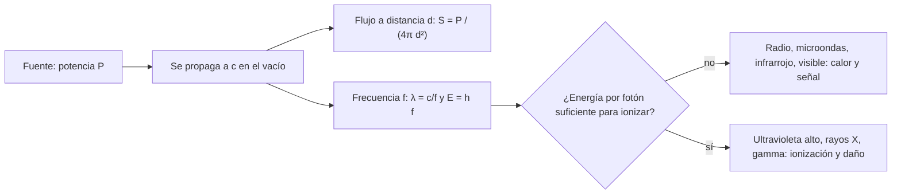

# B05-C18 — Electromagnetismo y radiación

<!-- nav:top -->
[🏠 Programa](../../../../README.md) · [📚 Bloque B05](../../../tronco-comun/B05-fisica-fundamental-para-el-espacio.md) · [← Anterior: B05-C17 — Campos magnéticos](../B05-C17-campos-magneticos/CLASE.md) · [Siguiente: B05-C19 — Óptica y velocidad de la luz →](../B05-C19-optica-y-velocidad-de-la-luz/CLASE.md)
<!-- /nav -->

## 1. Ubicación, nivel y alcance

Decimoctava clase de B05. Con C15–C17 conoces campos eléctricos y magnéticos y sus fuentes; ahora los dejas **variar juntos** y se propagan como ondas: la radiación electromagnética, que es casi toda la información que recibimos del cosmos. Nivel N1. Usas ondas y frecuencia (C12), campos (C15, C17) y el cuadrado inverso (C10). No verás las ecuaciones de Maxwell en forma diferencial ni la relatividad.

## 2. Por qué esta clase existe

Un satélite se comunica con ondas de radio, un telescopio observa luz y rayos X, y la misma radiación a otras energías puede dañar electrónica y tejidos. La pregunta motivadora es: **¿qué es la radiación electromagnética, cómo se ordena por frecuencia y energía, cómo decae con la distancia y qué la hace peligrosa?** La decisión central es identificar qué banda interviene, qué energía lleva cada fotón y cuánta potencia llega a un receptor, y reconocer qué bandas son ionizantes.

## 3. Lo que podrás hacer al terminar

1. Explicar que luz, radio y rayos X son ondas electromagnéticas que viajan a `c` en el vacío.
2. Verificar `c = 1/√(ε₀ μ₀)` con datos de CODATA.
3. Calcular longitud de onda y energía del fotón (`E = h f`) de una banda.
4. Aplicar la ley del cuadrado inverso al flujo de una fuente isótropa.
5. Distinguir radiación ionizante de no ionizante y explicar por qué importa.
6. Describir medidas preventivas y declarar el alcance de esta clase.

La evidencia es la **ficha de banda y flujo** del ejercicio 12 (sección 20).

## 4. Con qué llegas y cómo comprobarlo

1. Si `f = 100 MHz`, ¿cuál es `λ = c/f`?
2. ¿Cómo cambia `1/d²` si `d` se duplica? (C10)
3. ¿Qué es el electronvoltio? (`1 eV = 1,602 × 10⁻¹⁹ J`, C15)
4. ¿Qué es un campo magnético variable? (C17)
5. ¿Qué es una potencia y su unidad? (C06)

<details>
<summary>Ver respuestas</summary>

1. `≈ 3 m`. 2. Se divide por 4. 3. La energía que gana un electrón al cruzar 1 V. 4. Uno cuya intensidad cambia con el tiempo. 5. Energía por tiempo: vatio.
</details>

Con cuatro o cinco aciertos, sigue; con menos, repasa C12 y C15.

## 5. Un caso real: todo el espectro, una sola familia

NASA describe el espectro electromagnético como un continuo desde las ondas de radio muy largas hasta los rayos gamma muy cortos, con la luz visible como una pequeña porción; indica que algunas longitudes de onda atraviesan la atmósfera terrestre («ventanas atmosféricas») mientras que otras son absorbidas por vapor de agua, dióxido de carbono y ozono; y señala que rayos gamma, rayos X y parte del ultravioleta son «ionizantes», pues pueden arrancar electrones de los átomos (S2). Eso explica por qué ciertas bandas solo se observan desde el espacio. Límite: la página no da longitudes de onda ni valores de energía; esos los calculamos nosotros con `c` y `h`.

## 6. Vocabulario

Una **onda electromagnética** es una oscilación acoplada de campo eléctrico y magnético que se propaga sin medio material; en el vacío viaja a `c = 299 792 458 m/s`, exacta por definición del SI (S3). Sus **magnitudes** son frecuencia `f`, longitud de onda `λ = c/f` y energía de cada fotón `E = h f`, con `h = 6,626 070 15 × 10⁻³⁴ J·s` (exacta, S3). Un **fotón** es el cuanto de la radiación. La **intensidad o flujo** es la potencia por unidad de área (W/m²). Una **fuente isótropa** emite igual en todas direcciones. La **radiación ionizante** tiene energía suficiente para arrancar electrones; la **no ionizante** no. El **espectro electromagnético** ordena las ondas por frecuencia: radio, microondas, infrarrojo, visible, ultravioleta, rayos X y gamma.

## 7. Modelo mental: una onda y una lluvia de fotones

La misma radiación tiene dos descripciones: como onda (frecuencia, longitud de onda) y como flujo de fotones (energía por fotón). Más frecuencia, más energía por fotón.



*Descripción textual:* una fuente de potencia `P` emite ondas que viajan a `c`; el flujo a una distancia `d` cae como `1/d²`; la frecuencia fija la longitud de onda y la energía de cada fotón, y según esa energía la radiación puede ionizar (ultravioleta alto, rayos X, gamma) o no (radio, microondas, infrarrojo, visible).

Una analogía: la luz de una bombilla en una habitación: lejos, más tenue; la potencia total no cambia, solo se reparte. El límite: una bombilla emite en todas las frecuencias visibles a la vez, mientras que una antena puede emitir en una banda estrecha.

## 8. La explicación, paso a paso

### 8.1 Una sola velocidad: `c = 1/√(ε₀ μ₀)`

Con `ε₀ = 8,854 187 8188 × 10⁻¹² F/m` (S1) y `μ₀ = 1,256 637 061 27 × 10⁻⁶ N/A²` (S4), `1/√(ε₀ μ₀) = 299 792 458,0 m/s`, que coincide con `c` a `6 × 10⁻¹³` relativo (S3). Es un resultado notable: dos constantes eléctricas y magnéticas dan la velocidad de la luz, lo que indica que la luz es una onda electromagnética. En esta clase lo usamos como comprobación numérica.

### 8.2 Bandas, longitud de onda y energía de fotón

`λ = c/f` y `E = h f`. Con `h` exacta (S3) y `e` exacta (S3): radio de 100 MHz, `λ = 3,0 m`, `E = 4,1 × 10⁻⁷ eV`; microondas de 2,2 GHz, `13,6 cm` y `9,1 × 10⁻⁶ eV`; infrarrojo de 30 THz, `10 µm` y `0,124 eV`; visible de 545 THz, `550 nm` y `2,25 eV`; ultravioleta de `3 × 10¹⁵ Hz`, `100 nm` y `12,4 eV`; rayos X de `3 × 10¹⁸ Hz`, `0,1 nm` y `12 407 eV`. La energía por fotón sube más de diez órdenes de magnitud desde la radio hasta los rayos X.

### 8.3 Cuadrado inverso para una fuente isótropa

La potencia `P` se reparte sobre una esfera de área `4π d²`, así que `S = P/(4π d²)`. Una fuente sintética de 10 W a 400 km da `S = 4,97 × 10⁻¹² W/m²`; a 4000 km, `4,97 × 10⁻¹⁴ W/m²` (cien veces menos); al nivel de la distancia Tierra–Luna, `5,39 × 10⁻¹⁸ W/m²`. Para comparar, el flujo solar a 1 au calculado en C13 es `1361,2 W/m²`. Que la señal recibida sea tan pequeña es la razón de ser del diseño de enlaces, tema de bloques posteriores.

### 8.4 Retardos

La señal viaja a `c`: de la Tierra a la Luna (384 400 km, S5) tarda `1,2822 s`; a un satélite en vertical a 400 km, `1,3343 ms`. Una conversación con la Luna tiene, por tanto, un retardo de ida y vuelta de unos 2,6 s: es una consecuencia de la finitud de `c`, no de la tecnología. (El semieje mayor lunar es un valor medio; la distancia real varía con la excentricidad.)

### 8.5 Radiación ionizante, riesgos y medidas

Los fotones de rayos X y gamma, y parte del ultravioleta, tienen energía suficiente para ionizar (S2), y por eso pueden dañar tejidos y componentes electrónicos; las bandas de radio, microondas, infrarrojo y visible no ionizan por fotón, aunque una potencia alta puede calentar. Las tres palancas de protección habituales son **distancia** (el flujo cae como `1/d²`, sección 8.3), **tiempo de exposición** y **blindaje**; esas tres palancas son un principio general de protección radiológica que no se consultó en una fuente en esta clase, por lo que no se cuantifican dosis ni límites. Para observar bandas absorbidas por la atmósfera (S2) se usan instrumentos en el espacio.

## 9. Magnitudes, símbolos y unidades

| Símbolo | Magnitud | Dimensión | Unidad SI | Valor o nota |
|---|---|---|---|---|
| `c` | velocidad de la luz en el vacío | L T⁻¹ | m/s | 299 792 458 exacta (S3) |
| `h` | constante de Planck | M L² T⁻¹ | J·s | 6,626 070 15 × 10⁻³⁴ exacta (S3) |
| `f`, `λ` | frecuencia, longitud de onda | T⁻¹, L | Hz, m | `λ = c/f` |
| `E` | energía del fotón | M L² T⁻² | J, eV | `h f`; `1 eV = 1,602 176 634 × 10⁻¹⁹ J` |
| `S` | flujo | M T⁻³ | W/m² | `P/(4π d²)` |
| `ε₀`, `μ₀` | permitividad y permeabilidad | — | F/m, N/A² | S1, S4 |

## 10. Convenciones y referencias

Vacío, fuente isótropa, sin absorción. Las frecuencias de cada banda del laboratorio son ejemplos **sintéticos** representativos, no límites oficiales; la potencia de 10 W es **sintética**; `c`, `h`, `e`, `ε₀`, `μ₀` y la distancia lunar son **publicados**; el flujo y los retardos son cálculos propios.

## 11. De dónde sale lo que afirmamos

| ID | Fuente | Localizador | Respalda | Estado |
|---|---|---|---|---|
| S1 | NIST, CODATA 2022, «vacuum electric permittivity» | https://physics.nist.gov/cgi-bin/cuu/Value?ep0 | `ε₀ = 8,854 187 8188(14) × 10⁻¹² F/m` | Página consultada el 2026-11-05 |
| S2 | NASA Science, «Electromagnetic Spectrum: Introduction» | https://science.nasa.gov/ems/01_intro/ | Espectro de radio a gamma; ventanas atmosféricas; gamma, rayos X y parte del UV son ionizantes | Página consultada el 2026-11-05; sin valores numéricos |
| S3 | BIPM, «SI defining constants» | https://www.bipm.org/en/measurement-units/si-defining-constants | `c`, `h`, `e` exactas | Página consultada el 2026-11-05 |
| S4 | NIST, CODATA 2022, «vacuum magnetic permeability» | https://physics.nist.gov/cgi-bin/cuu/Value?mu0 | `μ₀ = 1,256 637 061 27(20) × 10⁻⁶ N A⁻²` | Página consultada el 2026-11-05 |
| S5 | NASA NSSDC, *Moon Fact Sheet* (act. 11-ene-2024) | https://nssdc.gsfc.nasa.gov/planetary/factsheet/moonfact.html | Semieje mayor 0,3844 × 10⁶ km | Página consultada el 2026-11-05 |

Límites: la identidad `c = 1/√(ε₀ μ₀)`, `E = h f` y el cuadrado inverso se enuncian o verifican aquí sin citar un texto. No se consultaron dosis ni límites de exposición, por lo que esta clase no los da. No se dan fronteras numéricas oficiales entre bandas.

## 12. Cómo ver el espectro

Tabla accesible de un gráfico del espectro con un ejemplo por banda (valores del laboratorio; frecuencias sintéticas representativas).

| Banda (ejemplo) | `f` | `λ` | `E` del fotón | ¿Ionizante? (S2) |
|---|---|---|---|---|
| Radio | 100 MHz | 3,0 m | 4,1 × 10⁻⁷ eV | No |
| Microondas | 2,2 GHz | 13,6 cm | 9,1 × 10⁻⁶ eV | No |
| Infrarrojo | 30 THz | 10 µm | 0,124 eV | No |
| Visible | 545 THz | 550 nm | 2,25 eV | No |
| Ultravioleta | 3 × 10¹⁵ Hz | 100 nm | 12,4 eV | Parte del UV |
| Rayos X | 3 × 10¹⁸ Hz | 0,1 nm | 12 407 eV | Sí |

Descripción larga: un eje horizontal de frecuencia en escala logarítmica que va de 10⁸ a 10¹⁹ Hz; la longitud de onda baja y la energía sube a lo largo del eje; la franja visible es estrecha.

## 13. Ejemplo trabajado: ¿cuánta señal llega y cuándo?

**Planteamiento.** Un transmisor sintético isótropo de 10 W en el satélite ideal (400 km). ¿Cuánto flujo llega a la superficie justo debajo y cuánto tarda la señal?

**Paso 1 · Datos.** `P = 10 W` (sintético), `d = 400 km`, `c` (S3).

**Paso 2 · Flujo.** `S = P/(4π d²) = 10/(4π (4 × 10⁵)²) = 4,97 × 10⁻¹² W/m²`.

**Paso 3 · Retardo.** `t = d/c = 1,334 ms`.

**Paso 4 · Sentido físico.** Una antena de 1 m² recoge unos 5 pW (`5 × 10⁻¹² W`): extremadamente poco, comparado con los 1361 W/m² de la luz solar (un factor `2,7 × 10¹⁴`). Eso explica la necesidad de receptores sensibles. A 4000 km sería cien veces menos. Es un ejercicio de escala, no un presupuesto de enlace (faltan ganancias de antena, pérdidas y ruido).

## 14. Comparación de métodos

**Descripción ondulatoria** (`f`, `λ`) sirve para propagación, difracción y antenas; **descripción de fotones** (`E = h f`) sirve para ionización y detectores; **flujo y cuadrado inverso** para potencias recibidas. Usa la que corresponda a la pregunta: para el alcance de una señal, flujo; para el daño, energía por fotón.

## 15. Práctica guiada

**Ejercicio 1.** Calcula `λ` y `E` de un fotón de 100 MHz. *Pasos:* `λ = c/f`; `E = h f` (sección 8.2).

<details><summary>Solución comentada</summary>

`λ = 299 792 458/10⁸ = 3,0 m`; `E = 6,626 × 10⁻³⁴ × 10⁸ = 6,63 × 10⁻²⁶ J = 4,1 × 10⁻⁷ eV`.
</details>

**Ejercicio 2.** Calcula la energía de un fotón de 500 nm en eV. *Pista:* `f = c/λ`.

<details><summary>Solución comentada</summary>

`f = 5,996 × 10¹⁴ Hz`; `E = h f = 3,97 × 10⁻¹⁹ J = 2,48 eV`.
</details>

**Ejercicio 3.** Una fuente isótropa de 10 W: ¿cuánto vale el flujo a 2 m?

<details><summary>Solución comentada</summary>

`S = 10/(4π × 4) = 0,199 W/m²`. A 1 m sería cuatro veces mayor.
</details>

## 16. Práctica autónoma, transferencia e integrador

**Ejercicio 4.** Verifica `c = 1/√(ε₀ μ₀)` con los valores de S1 y S4.

<details><summary>Solución comentada</summary>

`ε₀ μ₀ = 8,854 187 8188 × 10⁻¹² × 1,256 637 061 27 × 10⁻⁶ = 1,112 650 056 × 10⁻¹⁷ s²/m²`; su raíz inversa da `2,997 924 58 × 10⁸ m/s`.
</details>

**Ejercicio 5.** ¿Cuánto tarda una señal en ir de la Tierra a la Luna y volver?

<details><summary>Solución comentada</summary>

`2 × 1,2822 = 2,564 s`.
</details>

**Ejercicio 6.** ¿Cómo cambia el flujo si la distancia pasa de 400 km a 800 km?

<details><summary>Solución comentada</summary>

Cae a la cuarta parte: `4,97 × 10⁻¹² → 1,24 × 10⁻¹² W/m²`.
</details>

**Ejercicio 7.** ¿Cuántas veces más energía tiene un fotón de 3 × 10¹⁸ Hz que uno de 545 THz?

<details><summary>Solución comentada</summary>

`E ∝ f`: `3 × 10¹⁸/5,45 × 10¹⁴ = 5505` veces (coincide con `12 407/2,254 = 5505`).
</details>

**Ejercicio 8.** Un receptor de 2 m² a 4000 km de la fuente de 10 W. ¿Qué potencia capta?

<details><summary>Solución comentada</summary>

`P = S A = 4,97 × 10⁻¹⁴ × 2 = 9,9 × 10⁻¹⁴ W` (≈ 0,1 pW), suponiendo una antena ideal que capta toda la señal incidente.
</details>

**Ejercicio 9 · transferencia.** Un titular dice «la radiación en el espacio siempre es peligrosa». Corrige con la sección 8.5.

<details><summary>Solución comentada</summary>

Depende de la banda y la energía: la radio, el infrarrojo y el visible no son ionizantes por fotón; los rayos X, gamma y parte del ultravioleta sí. El riesgo requiere identificar fuente, banda, intensidad y tiempo de exposición.
</details>

**Ejercicio 10 · transferencia.** Un compañero afirma que alejarse del doble de distancia reduce la exposición a la mitad. Corrige.

<details><summary>Solución comentada</summary>

Para una fuente puntual el flujo cae a la cuarta parte (`1/d²`). Si la fuente es extensa, el modelo no se aplica tal cual; el cuadrado inverso vale para fuentes puntuales o lejanas.
</details>

**Ejercicio 11 · transferencia.** Un instrumento en tierra no detecta ciertas bandas del cielo. ¿Por qué se usan satélites?

<details><summary>Solución comentada</summary>

Porque la atmósfera absorbe esas bandas (vapor de agua, CO₂, ozono; S2): solo pasan las «ventanas»; para el resto se observa desde el espacio.
</details>

**Ejercicio 12 · integrador.** Elabora una *ficha de banda y flujo* (sección 20): elige una banda y una frecuencia, calcula `λ`, `E` (J y eV), el flujo de una fuente isótropa a dos distancias, el retardo y si la banda es ionizante (con la fuente).

<details><summary>Solución modelo</summary>

Debe incluir las fórmulas con unidades, los valores con rótulo (sintético/publicado), la comparación entre dos distancias (factor `1/d²`), el retardo `d/c`, la clasificación con cita de S2 y los límites (vacío, fuente isótropa, sin ruido).
</details>

## 17. Laboratorio: `c` desde `ε₀` y `μ₀`, espectro y flujo

El script [espectro_y_flujo.py](espectro_y_flujo.py) calcula `c` a partir de `ε₀` y `μ₀`, longitudes de onda y energías de fotón de seis ejemplos, retardos y flujos de una fuente isótropa. Antes comprueba que `c` calculada coincida con la exacta a `10⁻⁹` y que el flujo cumpla el cuadrado inverso.

**Datos:** publicados (S1, S3–S5) y sintéticos rotulados. **Predice antes de ejecutar:** ¿qué energía tiene un fotón visible de 545 THz? (Unos 2 eV.) **Resultados (2026-11-05, Python 3.12.9):** `c = 299 792 458,000 m/s` (diferencia `6,0 × 10⁻¹³`); 100 MHz → `2,9979 m`, `4,1357 × 10⁻⁷ eV`; 2,2 GHz → `0,13627 m`, `9,0985 × 10⁻⁶ eV`; 30 THz → `9,9931 µm`, `0,12407 eV`; 545 THz → `550,08 nm`, `2,2539 eV`; `3 × 10¹⁵ Hz` → `99,931 nm`, `12,407 eV`; `3 × 10¹⁸ Hz` → `0,099931 nm`, `12 407 eV`. Retardo Tierra–Luna `1,2822 s`; satélite `1,3343 ms`. Flujo de 10 W: `4,9736 × 10⁻¹² W/m²` (400 km), `4,9736 × 10⁻¹⁴` (4000 km), `5,3855 × 10⁻¹⁸` (384 400 km).

```bash
python programa/clases/B05/B05-C18-electromagnetismo-y-radiacion/espectro_y_flujo.py
```

**Límites:** vacío, fuente isótropa, sin ruido, sin ganancias de antena; no es un presupuesto de enlace ni un cálculo de dosis.

## 18. Errores frecuentes y cómo corregirlos

**Pensar que toda radiación ioniza.** Ejercicio 9. **Creer que el flujo cae con `1/d`.** Ejercicio 10. **Confundir frecuencia y longitud de onda.** Ejercicio 1. **Olvidar el retardo de `c`.** Ejercicio 5. **Dar dosis sin fuente.** Sección 8.5.

## 19. Cómo sabrás que vas bien

Tras 8.2: ¿por qué sube `E` con `f`? Repite el ejercicio 7. Tras 8.3: ¿por qué `1/d²`? Rehaz el ejercicio 6. Tras el laboratorio: ¿cuál es la prueba analítica del script? Léelo.

## 20. Qué entregas y cómo se evalúa

El producto es tu **ficha de banda y flujo**: banda, frecuencia, longitud de onda, energía de fotón, flujo, retardo y clasificación con fuente.

| Criterio | Inicial | En desarrollo | Logrado | Destacado |
|---|---|---|---|---|
| Fórmulas y unidades | Errores | Parciales | Correctas | Verificación dimensional |
| Flujo y retardo | Ausentes | Parciales | Correctos | Compara dos distancias |
| Clasificación | Sin fuente | Con ayuda | Con fuente | Explica la ventana atmosférica |
| Alcance | No declara | Parcial | Declara | Evita dar dosis sin fuente |

**Condiciones críticas:** no dar dosis ni límites sin fuente; rotular lo sintético; citar solo lo consultado.

## 21. Ética, seguridad y límites

La radiación ionizante y las altas potencias de radiofrecuencia pueden causar daño; esta clase es educativa y **no** da dosis, límites ni medidas de protección para personas. Las decisiones de exposición exigen normas vigentes, profesionales y medición. Accesibilidad: ecuaciones en texto, gráficos con tabla equivalente, sin conexión.

## 22. Para cerrar y seguir

Campos eléctricos y magnéticos variables forman ondas que viajan a `c = 1/√(ε₀ μ₀)`; cada banda lleva fotones de energía `h f`; el flujo decae con `1/d²`; la radiación ionizante exige precaución. Queda abierto cómo la luz se refleja, se refracta y se enfoca: la óptica (C19).

**Glosario español–inglés.** onda electromagnética · *electromagnetic wave*; espectro · *spectrum*; fotón · *photon*; radiación ionizante · *ionizing radiation*; flujo · *flux*; cuadrado inverso · *inverse square law*; ventana atmosférica · *atmospheric window*.

**Continuidad.** B05-C19 usa tu capacidad de **tratar la luz como onda con `λ` y `c`** para estudiar refracción, lentes y el límite de difracción.

**Referencias:** ver sección 11.

<!-- nav:bottom -->
---

[← Anterior: B05-C17 — Campos magnéticos](../B05-C17-campos-magneticos/CLASE.md) · [📚 Bloque B05](../../../tronco-comun/B05-fisica-fundamental-para-el-espacio.md) · [Siguiente: B05-C19 — Óptica y velocidad de la luz →](../B05-C19-optica-y-velocidad-de-la-luz/CLASE.md)
<!-- /nav -->
