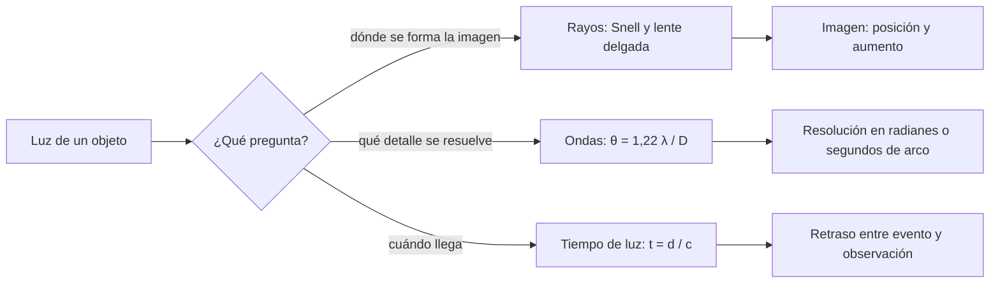

# B05-C19 — Óptica y velocidad de la luz

<!-- nav:top -->
[🏠 Programa](../../../../README.md) · [📚 Bloque B05](../../../tronco-comun/B05-fisica-fundamental-para-el-espacio.md) · [← Anterior: B05-C18 — Electromagnetismo y radiación](../B05-C18-electromagnetismo-y-radiacion/CLASE.md) · [Siguiente: B05-C20 — Problema físico integrado de satélite ideal →](../B05-C20-problema-fisico-integrado-de-satelite-ideal/CLASE.md)
<!-- /nav -->

## 1. Ubicación, nivel y alcance

Decimonovena clase de B05. En C18 la luz era una onda electromagnética que viaja a `c`; ahora estudias qué le ocurre al **llegar a un material, a una lente o a una abertura**, y qué consecuencias tiene que `c` sea finita. Nivel N1. Usas ondas y frecuencia (C12, C18), trigonometría básica (seno) y ángulos en radianes (C03). No verás óptica ondulatoria avanzada ni relatividad.

## 2. Por qué esta clase existe

Un telescopio espacial o una cámara en órbita baja distinguen detalles hasta cierto límite que no depende de la calidad de la electrónica, y la luz de un objeto lejano llega con retraso. La pregunta motivadora es: **¿qué determina cuán pequeño es el detalle que un instrumento óptico puede resolver y cuánto tarda la luz en llegar?** La decisión central es elegir el modelo adecuado (rayos para formar imágenes, ondas para el límite de resolución) y calcular con `c` exacta.

## 3. Lo que podrás hacer al terminar

1. Enunciar la ley de la reflexión y la ley de Snell de la refracción.
2. Calcular ángulos de refracción y el ángulo crítico de reflexión total.
3. Usar la ecuación de la lente delgada para ubicar una imagen y su aumento.
4. Estimar el límite de difracción `1,22 λ/D` y la resolución en el suelo desde una órbita.
5. Calcular tiempos de luz entre cuerpos con `c` exacta.
6. Declarar qué modelo óptico se usa y su dominio de validez.

La evidencia es la **hoja de óptica y tiempo de luz** del ejercicio 12 (sección 20).

## 4. Con qué llegas y cómo comprobarlo

1. Calcula `sen 30°` y `arcsen 0,5`.
2. ¿Cuántos segundos de arco tiene un radián? (≈ 206 265)
3. ¿Cuánto tarda la luz en recorrer 1 km? (C12: unos 3,3 µs)
4. ¿Qué es `λ = c/f`? (C18)
5. Convierte 550 nm a metros.

<details>
<summary>Ver respuestas</summary>

1. `0,5` y `30°`. 2. `180/π × 3600 = 206 264,8`. 3. `3,34 µs`. 4. La longitud de onda es la velocidad dividida por la frecuencia. 5. `5,5 × 10⁻⁷ m`.
</details>

Con cuatro o cinco aciertos, sigue; con menos, repasa C12 y C18.

## 5. Un caso real: el Sol visto con retraso

NASA da para la Tierra un semieje mayor de 149,598 × 10⁶ km (S2). Dividido por la velocidad de la luz, que el SI fija en 299 792 458 m/s (S1), resulta `499,0 s = 8,32 min`: lo que vemos del Sol es la luz que salió hace unos ocho minutos y medio, el mismo valor que usaste en B01-C04. Y a la Luna (384 400 km, S3) la luz llega en `1,28 s`. Límite: son distancias medias; la distancia real cambia con la excentricidad de cada órbita, y el tiempo con ella.

## 6. Vocabulario

La **velocidad de la luz en el vacío** `c = 299 792 458 m/s` es exacta por definición del SI y fija el metro (S1). En un medio, la luz va más lenta: `v = c/n`, con `n` el **índice de refracción**. La **reflexión** devuelve la luz en la superficie con ángulo igual al de incidencia. La **refracción** cambia su dirección al pasar de un medio a otro, según la **ley de Snell** `n₁ sen θ₁ = n₂ sen θ₂` (ángulos medidos respecto de la normal). La **reflexión total** ocurre al pasar a un medio de menor índice con un ángulo mayor que el **ángulo crítico** `arcsen(n₂/n₁)`. Una **lente delgada** de distancia focal `f` cumple `1/f = 1/d_o + 1/d_i`, con `d_o` la distancia del objeto y `d_i` la de la imagen. La **difracción** limita la resolución angular de una abertura circular de diámetro `D` a `θ ≈ 1,22 λ/D` (criterio de Rayleigh). Un **segundo de arco** es `1/3600` de grado.

## 7. Modelo mental: rayos para la imagen, ondas para el límite

Con rayos puedes trazar cómo una lente forma una imagen; pero los rayos no explican que incluso una lente perfecta dé un punto borroso: ese límite viene de la naturaleza ondulatoria de la luz.



*Descripción textual:* según la pregunta se elige el modelo: para la posición de la imagen, rayos con Snell y la ecuación de la lente; para el detalle que se resuelve, ondas con `θ = 1,22 λ/D`; para el retraso, `t = d/c`.

Una analogía: el oleaje que pasa por una apertura en un rompeolas se abre a la salida; cuanto más estrecha es la abertura frente a la longitud de onda, más se abre. El límite: las olas del mar son ondas mecánicas en superficie; la luz es electromagnética y su «abertura» es un espejo o una lente.

## 8. La explicación, paso a paso

### 8.1 Reflexión y refracción

En un espejo, el ángulo reflejado es igual al incidente. En una frontera aire–vidrio con `n = 1,00` y `n = 1,50` (valores sintéticos), un rayo a `40°` se refracta a `25,37°`, más cerca de la normal; con incidencia normal (`0°`) no se desvía. Dentro del vidrio, la luz va a `c/n = 1,9986 × 10⁸ m/s`. El camino inverso devuelve el rayo al ángulo original (reversibilidad), propiedad que el laboratorio verifica.

### 8.2 Reflexión total

Al pasar del vidrio al aire, el ángulo crítico es `arcsen(1/1,5) = 41,81°`. Por encima, no hay rayo refractado: toda la luz se refleja. Es el principio de las fibras ópticas. Para un medio de `n = 1,33` (sintético) el ángulo crítico es `48,75°`.

### 8.3 Lente delgada

`1/f = 1/d_o + 1/d_i`. Con `f = 0,50 m` y un objeto a `d_o = 2,0 m`: `d_i = 0,667 m` y el aumento lateral `m = −d_i/d_o = −0,333` (imagen real, invertida y más pequeña). Si intercambias objeto e imagen, el resultado se conserva: las posiciones son **conjugadas**. Un telescopio refractor simple combina dos lentes y aumenta `f_obj/f_ocular`: con `1,0 m` y `0,025 m`, `40` veces.

### 8.4 El límite de difracción

`θ ≈ 1,22 λ/D`. Con `λ = 550 nm` (verde, sintético) y `D = 0,10 m`, `θ = 6,71 × 10⁻⁶ rad = 1,384″`; con `D = 1 m`, `0,138″`; con `D = 8 m`, `0,0173″`. Desde una órbita a `h = 400 km`, un detalle en el suelo mide como mínimo `θ h`: `2,68 m` con `D = 0,10 m` y `0,268 m` con `D = 1 m`. Este es un límite **inferior** (ideal): la atmósfera, las aberraciones y el sensor lo empeoran. Para resolver detalles más pequeños se necesita mayor `D` o menor `λ`.

### 8.5 Tiempos de luz

`t = d/c`. La luz tarda `1,2822 s` en llegar de la Luna (`384 400 km`), `499,0 s` del Sol (`1 au`) y `1,334 ms` de un satélite a `400 km`. En astronomía esto significa que observar es mirar el pasado: un evento solar visto hoy ocurrió hace 8,3 minutos (B01-C04). Y para comunicaciones, un retardo mínimo ineludible: no se puede enviar una señal más rápido que `c`.

## 9. Magnitudes, símbolos y unidades

| Símbolo | Magnitud | Dimensión | Unidad SI | Valor o nota |
|---|---|---|---|---|
| `c` | velocidad de la luz | L T⁻¹ | m/s | 299 792 458 exacta (S1) |
| `n` | índice de refracción | 1 | — | `c/v`; sintéticos 1,00 y 1,50 |
| `θ₁`, `θ₂` | ángulos con la normal | 1 | ° o rad | Snell |
| `f`, `d_o`, `d_i` | focal, distancias objeto e imagen | L | m | `1/f = 1/d_o + 1/d_i` |
| `λ` | longitud de onda | L | m | 550 nm (sintético) |
| `D` | diámetro de la abertura | L | m | — |
| `θ` | resolución angular | 1 | rad, arcsec | `1,22 λ/D` |

## 10. Convenciones y referencias

Ángulos respecto de la normal; distancias positivas del lado del objeto real; imagen real si `d_i > 0`. Índices, focales, longitud de onda y diámetros son **sintéticos**; `c` y las distancias astronómicas son **publicadas**; los resultados (ángulos, imágenes, resoluciones) son cálculos **simulados** de un modelo ideal sin aberraciones ni atmósfera.

## 11. De dónde sale lo que afirmamos

| ID | Fuente | Localizador | Respalda | Estado |
|---|---|---|---|---|
| S1 | BIPM, «SI defining constants» | https://www.bipm.org/en/measurement-units/si-defining-constants | `c = 299 792 458 m/s` exacta | Página consultada el 2026-11-05 |
| S2 | NASA NSSDC, *Earth Fact Sheet* (act. 15-nov-2024) | https://nssdc.gsfc.nasa.gov/planetary/factsheet/earthfact.html | Semieje mayor 149,598 × 10⁶ km | Página consultada el 2026-11-05 |
| S3 | NASA NSSDC, *Moon Fact Sheet* (act. 11-ene-2024) | https://nssdc.gsfc.nasa.gov/planetary/factsheet/moonfact.html | Semieje mayor 0,3844 × 10⁶ km | Página consultada el 2026-11-05 |

Límites: la ley de Snell, la ecuación de la lente delgada y el criterio de Rayleigh (`1,22 λ/D`) son resultados clásicos de óptica que se enuncian aquí sin citar un texto; el laboratorio verifica solo su consistencia interna (reversibilidad, conjugados, conversión de unidades), no la física contra un experimento. No se consultaron índices de refracción de materiales reales.

## 12. Cómo ver la resolución

Tabla accesible de un gráfico de la resolución en el suelo frente al diámetro de la abertura, para `λ = 550 nm` y `h = 400 km` (cálculo propio).

| `D` (m) | `θ` (arcsec) | Detalle mínimo en el suelo (m) |
|---|---|---|
| 0,10 | 1,384 | 2,68 |
| 0,20 | 0,692 | 1,34 |
| 1,0 | 0,138 | 0,268 |
| 8,0 | 0,0173 | 0,0335 |

Descripción larga: una curva descendente en escala logarítmica, una recta de pendiente −1: duplicar el diámetro reduce a la mitad el detalle mínimo.

## 13. Ejemplo trabajado: ¿qué detalle ve la cámara del satélite ideal?

**Planteamiento.** Una cámara sintética de abertura `D = 0,10 m`, `λ = 550 nm`, en el satélite ideal a 400 km. ¿Qué tamaño mínimo de detalle distingue en el suelo y cuánto tarda la luz en llegar?

**Paso 1 · Datos.** `λ = 5,5 × 10⁻⁷ m`, `D = 0,10 m`, `h = 4 × 10⁵ m`, `c` (S1).

**Paso 2 · Resolución angular.** `θ = 1,22 × 5,5 × 10⁻⁷/0,10 = 6,71 × 10⁻⁶ rad = 1,384″`.

**Paso 3 · Detalle en el suelo.** `Δx = θ h = 6,71 × 10⁻⁶ × 4 × 10⁵ = 2,68 m`.

**Paso 4 · Retardo.** `t = h/c = 1,334 ms`.

**Sentido físico.** Con una abertura de 10 cm no se distinguen objetos menores de unos 2,7 m desde 400 km, aunque el sensor tenga muchísimos píxeles. El límite es físico, no tecnológico, y es un mínimo: la atmósfera y las aberraciones lo empeoran. Para llegar a 0,27 m se necesita un diámetro de 1 m.

## 14. Comparación de métodos

**Óptica de rayos** da imágenes y aumentos pero ignora la difracción; **criterio de Rayleigh** da el límite de resolución pero no la posición de la imagen; **tiempo de luz** es independiente de ambos. Úsalos juntos: rayos para formar la imagen, ondas para saber cuánto detalle tiene, `t = d/c` para saber cuándo ocurrió lo observado.

## 15. Práctica guiada

**Ejercicio 1.** Un rayo incide a 30° desde el aire (`n = 1,00`) en vidrio (`n = 1,50`). ¿Ángulo refractado? *Pasos:* ley de Snell.

<details><summary>Solución comentada</summary>

`sen θ₂ = sen 30°/1,5 = 0,3333`; `θ₂ = 19,47°`. Se acerca a la normal al entrar en un medio más denso.
</details>

**Ejercicio 2.** Calcula la velocidad de la luz en un medio de `n = 1,5`. *Pista:* `v = c/n`.

<details><summary>Solución comentada</summary>

`299 792 458/1,5 = 1,9986 × 10⁸ m/s`.
</details>

**Ejercicio 3.** Una lente con `f = 0,20 m` y un objeto a 1,0 m. ¿Dónde se forma la imagen y cuál es el aumento?

<details><summary>Solución comentada</summary>

`1/d_i = 5 − 1 = 4 → d_i = 0,25 m`; `m = −0,25/1,0 = −0,25`: imagen real, invertida, cuatro veces menor.
</details>

## 16. Práctica autónoma, transferencia e integrador

**Ejercicio 4.** Calcula el ángulo crítico vidrio–aire con `n = 1,5` y agua–aire con `n = 1,33` (sintéticos).

<details><summary>Solución comentada</summary>

`arcsen(1/1,5) = 41,81°`; `arcsen(1/1,33) = 48,75°`.
</details>

**Ejercicio 5.** Un telescopio con objetivo de `f = 1,0 m` y ocular de `f = 0,025 m`: ¿aumento?

<details><summary>Solución comentada</summary>

`1,0/0,025 = 40` veces.
</details>

**Ejercicio 6.** Calcula el límite de difracción en arcsec para `D = 0,20 m` y 550 nm.

<details><summary>Solución comentada</summary>

`θ = 1,22 × 5,5 × 10⁻⁷/0,2 = 3,355 × 10⁻⁶ rad = 0,692″` (mitad que con 0,10 m).
</details>

**Ejercicio 7.** ¿Qué detalle mínimo distingue en el suelo esa abertura de 0,20 m desde 400 km?

<details><summary>Solución comentada</summary>

`Δx = 3,355 × 10⁻⁶ × 4 × 10⁵ = 1,34 m`.
</details>

**Ejercicio 8.** ¿Cuánto tarda la luz del Sol en llegar a la Tierra con `149,598 × 10⁶ km`?

<details><summary>Solución comentada</summary>

`1,49598 × 10¹¹/299 792 458 = 499,0 s = 8,32 min`.
</details>

**Ejercicio 9 · transferencia.** Un compañero afirma «con un sensor de más píxeles se distingue cualquier detalle». Corrige con la sección 8.4.

<details><summary>Solución comentada</summary>

El límite de difracción `1,22 λ/D` depende de la abertura, no del número de píxeles; más píxeles no mejoran la resolución real más allá de ese límite (solo la muestrean mejor). Para más detalle hay que aumentar `D` o disminuir `λ`.
</details>

**Ejercicio 10 · transferencia.** Un titular dice «la luz de una estrella llega instantáneamente». Corrige.

<details><summary>Solución comentada</summary>

La luz viaja a `c` finita: el Sol se ve con 499 s de retraso y la Luna con 1,28 s; la de las estrellas, años. Lo que se observa es el pasado del objeto (B01-C04).
</details>

**Ejercicio 11 · transferencia.** Un instrumento de 1 m desde 400 km logra `0,27 m` teórico. En la práctica logra 0,5 m. ¿Es una contradicción?

<details><summary>Solución comentada</summary>

No: el límite de difracción es el mejor caso posible; la atmósfera, las aberraciones y el sensor empeoran el resultado. Una cifra peor que el límite es coherente; una mejor, no.
</details>

**Ejercicio 12 · integrador.** Elabora una *hoja de óptica y tiempo de luz* (sección 20): para un instrumento sintético (diámetro, longitud de onda, altura) calcula la resolución angular y en el suelo, un caso de refracción o de lente y los tiempos de luz a dos cuerpos con datos citados.

<details><summary>Solución modelo</summary>

Debe incluir `θ = 1,22 λ/D`, `Δx = θ h`, un cálculo de Snell o de lente con unidades, `t = d/c` con fuente y los límites (ideal, sin atmósfera, sin aberraciones).
</details>

## 17. Laboratorio: Snell, lente, difracción y tiempos de luz

El script [optica_basica.py](optica_basica.py) calcula refracción, ángulo crítico, una imagen de lente, límites de difracción y tiempos de luz. Antes comprueba la reversibilidad de Snell, que la incidencia normal no se desvíe, y que objeto e imagen sean conjugados.

**Datos:** `c` y distancias publicadas (S1–S3); índices, focales y diámetros sintéticos. **Predice antes de ejecutar:** ¿cuántos segundos de arco son 6,7 × 10⁻⁶ rad? (Algo más de 1.) **Resultados (2026-11-05, Python 3.12.9):** refracción aire→vidrio a 40°: `25,374°`; ángulo crítico `41,81°`; lente `f = 0,5 m`, objeto a `2,0 m`: imagen a `0,6667 m`, aumento `−0,3333`; difracción a 550 nm: `1,3840″` (0,1 m), `0,1384″` (1 m), `0,0173″` (8 m); `1 rad = 206 264,806″`; tiempos de luz: Luna `1,2822 s`, Sol `499,01 s = 8,317 min`, satélite `1,3343 ms`.

```bash
python programa/clases/B05/B05-C19-optica-y-velocidad-de-la-luz/optica_basica.py
```

**Límites:** óptica geométrica ideal y criterio de Rayleigh; no hay aberraciones, atmósfera ni ruido; no es un diseño de instrumento.

## 18. Errores frecuentes y cómo corregirlos

**Medir los ángulos desde la superficie y no desde la normal.** Ejercicio 1. **Creer que más píxeles siempre mejoran la resolución.** Ejercicio 9. **Olvidar el retraso de la luz.** Ejercicio 10. **Confundir segundos de arco y segundos de tiempo.** Sección 6. **Tomar el límite de difracción como cifra alcanzable.** Ejercicio 11.

## 19. Cómo sabrás que vas bien

Tras 8.1: ¿hacia dónde se desvía un rayo que entra a un medio más denso? Repite el ejercicio 1. Tras 8.4: ¿qué limita la resolución de una cámara? Rehaz el ejercicio 9. Tras el laboratorio: ¿qué comprobaciones valida? Léelo.

## 20. Qué entregas y cómo se evalúa

El producto es tu **hoja de óptica y tiempo de luz**: cálculo de refracción o lente, resolución, tiempos de luz y límites.

| Criterio | Inicial | En desarrollo | Logrado | Destacado |
|---|---|---|---|---|
| Fórmulas y unidades | Errores | Parciales | Correctas | Verificación dimensional |
| Resolución y tiempos | Ausentes | Parciales | Correctos | Compara con un valor publicado |
| Interpretación | Ausente | Parcial | Explica el límite | Distingue ideal de real |
| Alcance | No declara | Parcial | Declara | Cita lo no consultado |

**Condiciones críticas:** no presentar el límite de difracción como cifra de un instrumento real; rotular lo sintético; citar solo lo consultado.

## 21. Ética, seguridad y límites

Los láseres y las fuentes intensas de luz pueden dañar la vista; observar el Sol exige filtros certificados (B01). Esta clase es educativa y no sirve para diseñar instrumentos ni evaluar riesgos oculares. Accesibilidad: ecuaciones en texto, tablas equivalentes de los gráficos, sin conexión.

## 22. Para cerrar y seguir

La luz viaja a `c` exacta y más lenta en un medio; la ley de Snell y la ecuación de la lente forman imágenes; la difracción fija el detalle mínimo `1,22 λ/D`; y `t = d/c` convierte distancias en retrasos. Queda abierto reunir todo lo del bloque en un solo problema: el satélite ideal completo (C20).

**Glosario español–inglés.** refracción · *refraction*; reflexión · *reflection*; índice de refracción · *refractive index*; ángulo crítico · *critical angle*; lente delgada · *thin lens*; límite de difracción · *diffraction limit*; segundo de arco · *arcsecond*.

**Continuidad.** B05-C20 usa tu capacidad de **encadenar modelos con sus dominios de validez** para resolver un problema integrado de un satélite ideal.

**Referencias:** ver sección 11.

<!-- nav:bottom -->
---

[← Anterior: B05-C18 — Electromagnetismo y radiación](../B05-C18-electromagnetismo-y-radiacion/CLASE.md) · [📚 Bloque B05](../../../tronco-comun/B05-fisica-fundamental-para-el-espacio.md) · [Siguiente: B05-C20 — Problema físico integrado de satélite ideal →](../B05-C20-problema-fisico-integrado-de-satelite-ideal/CLASE.md)
<!-- /nav -->
