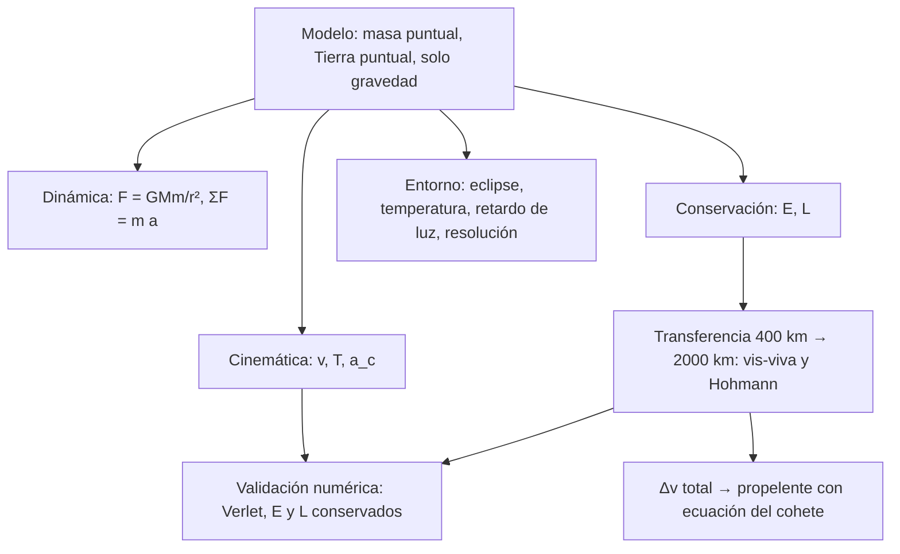

# B05-C20 — Problema físico integrado de satélite ideal

<!-- nav:top -->
[🏠 Programa](../../../../README.md) · [📚 Bloque B05](../../../tronco-comun/B05-fisica-fundamental-para-el-espacio.md) · [← Anterior: B05-C19 — Óptica y velocidad de la luz](../B05-C19-optica-y-velocidad-de-la-luz/CLASE.md) · [Siguiente: B06-C01 — Estructura atómica →](../../B06/B06-C01-estructura-atomica/CLASE.md)
<!-- /nav -->

## 1. Ubicación, nivel y alcance

Vigésima y última clase de B05. A lo largo del bloque hiciste crecer un mismo ejemplo conductor, el **satélite ideal**: 1000 kg en órbita circular a 400 km. Aquí lo reúnes todo: lo describes (C01–C03), calculas fuerzas y energía (C04–C07), aplicas momento y momento angular (C08–C09), usas gravitación (C10), lo conectas con su entorno térmico, eléctrico y luminoso (C13–C19) y resuelves una maniobra de cambio de órbita. Nivel N1. No hay teoría nueva: es una clase de **integración**, con una excepción — la transferencia entre dos órbitas, que se deduce con lo que ya sabes.

## 2. Por qué esta clase existe

Un problema real no viene etiquetado «esto es de energía» o «esto es de momento». La pregunta motivadora es: **¿cómo planteo, resuelvo y valido un problema físico completo, eligiendo el modelo correcto para cada parte y declarando dónde dejan de valer?** La decisión central es elegir el sistema, el marco, los modelos y las comprobaciones antes de calcular, y reportar el resultado con sus supuestos.

## 3. Lo que podrás hacer al terminar

1. Describir la órbita del satélite ideal con magnitudes, unidades y marco.
2. Calcular sus energía, momento angular y fuerza gravitatoria y verificar su coherencia.
3. Deducir una transferencia entre dos órbitas circulares con conservación de energía y momento angular.
4. Estimar el propelente con la ecuación del cohete.
5. Conectar la órbita con eclipse, temperatura, retardo de luz y resolución de una cámara.
6. Validar numéricamente el resultado y redactar un informe con alcance y límites honestos.

La evidencia es el **informe de problema integrado** del ejercicio 12 (sección 20).

## 4. Con qué llegas y cómo comprobarlo

1. ¿Cuánto vale la velocidad circular a 400 km de altura? (C03)
2. ¿Cuál es la energía de una órbita circular en función de `r`? (C06)
3. ¿Qué cantidad se conserva en una fuerza central? (C09)
4. ¿Qué dice la ecuación del cohete? (C08)
5. ¿Qué es un dato sintético y qué un dato publicado? (C01–C19)

<details>
<summary>Ver respuestas</summary>

1. `√(GM/r) = 7668,6 m/s`. 2. `E = −GMm/(2r)`. 3. El momento angular. 4. `Δv = v_e ln(m₀/m_f)`. 5. El sintético lo inventamos para enseñar; el publicado viene de una fuente consultada.
</details>

Con cuatro o cinco aciertos, sigue; con menos, repasa la clase correspondiente.

## 5. Un caso real: lo que dice NASA de la estación

NASA indica que la Estación Espacial Internacional da unas 16 órbitas por día, una cada unos 90 minutos (S6): el período de nuestro satélite ideal a 400 km, 92,56 minutos, es coherente con ese orden de magnitud. También recuerda una lección de ingeniería: la sonda Mars Climate Orbiter se perdió en 1999 por un fallo al traducir unidades inglesas a métricas (S5). Por eso, en este problema integrado, cada cifra lleva su unidad y cada resultado una comprobación. Límite: la ISS no es el satélite ideal (tiene atmósfera residual, forma, otras masas y maniobras); la comparación es de escala.

## 6. Vocabulario

Una **órbita de transferencia de Hohmann** es una elipse que toca dos órbitas circulares coplanares: su perigeo está en la menor y su apogeo en la mayor. Un **impulso** es un cambio de velocidad `Δv` que se supone instantáneo. Un **semieje mayor** `a` es la mitad del eje largo de la elipse; para una órbita con energía específica `ε`, `ε = −GM/(2a)`. La **ecuación vis-viva** `v² = GM (2/r − 1/a)` da la rapidez en cualquier punto (se deduce con la conservación de la energía, C07). El **impulso específico** no se estudia; aquí la maniobra se resume con la velocidad de escape de gases `v_e` (C08). La **fracción de propelente** es `1 − m_f/m₀`. Un **informe integrado** reúne datos, modelo, resultados, verificación y límites.

## 7. Modelo mental: un solo cuerpo, muchas preguntas

El satélite ideal es una masa puntual sobre la que solo actúa la gravedad de la Tierra. Cada pregunta del bloque es una lente distinta sobre el mismo modelo.



*Descripción textual:* el modelo central (masa puntual, Tierra puntual, solo gravedad) alimenta cinemática, dinámica y conservación; de la conservación sale la transferencia entre órbitas, de la que sale el propelente; el modelo también alimenta las preguntas del entorno (eclipse, temperatura, retardo y resolución); todo se valida con integración numérica.

Una analogía: el mismo mapa con distintas capas (relieve, carreteras, clima). El límite: en el mapa las capas son independientes; en física una decisión de modelo en una capa afecta a las demás (por ejemplo, ignorar la atmósfera afecta a la órbita y a la temperatura).

## 8. La explicación, paso a paso

### 8.1 La órbita inicial

`r₁ = R + h = 6 378 137 + 400 000 = 6 778 137 m` (S1). `v₁ = √(GM/r₁) = 7668,55 m/s`; `T₁ = 2π r₁/v₁ = 5553,6 s = 92,56 min`; `a_c = v₁²/r₁ = 8,6759 m/s²`. La fuerza gravitatoria sobre 1000 kg es `8675,9 N`, que es 0,885 del peso con `g_n = 9,806 65 m/s²` (S4). La energía es `E₁ = −GMm/(2r₁) = −2,9403 × 10¹⁰ J`; el momento angular, `L₁ = m r₁ v₁ = 5,1979 × 10¹³ kg·m²/s`.

### 8.2 Conservación y vis-viva

Para cualquier punto de una órbita con semieje `a`, `½ v² − GM/r = −GM/(2a)`; despejando, `v² = GM(2/r − 1/a)`. En órbita circular `a = r` y se recupera `v = √(GM/r)`. El momento angular específico es `h = r v_⊥` constante (C09). Con estas dos ideas puedes obtener la rapidez en cualquier punto de una órbita elíptica.

### 8.3 Transferencia de Hohmann: de 400 km a 2000 km

Se busca una elipse con perigeo `r₁` y apogeo `r₂ = R + 2 000 000 = 8 378 137 m`. Su semieje es `a_t = (r₁ + r₂)/2 = 7 578 137 m`. Con vis-viva: `v_p = 8063,17 m/s` en el perigeo y `v_a = 6523,32 m/s` en el apogeo. La órbita circular inicial tiene `7668,55 m/s`, así que el primer impulso es `Δv₁ = 394,62 m/s` (en la dirección del movimiento) y, en el apogeo, el circular final de `v₂ = 6897,55 m/s` exige `Δv₂ = 374,23 m/s`. Total: `Δv = 768,85 m/s`. La duración de la transferencia es medio período de la elipse: `t = π √(a_t³/GM) = 3282,7 s = 54,71 min` (tercera ley de Kepler, C10). Comprobación de energía: la órbita de transferencia tiene `E_t = −2,6299 × 10¹⁰ J`, entre `E₁ = −2,9403 × 10¹⁰` y `E₂ = −2,3788 × 10¹⁰ J`; la energía añadida total es `5,6153 × 10⁹ J`, y el primer impulso aporta `3,104 × 10⁹ J` y el segundo `2,511 × 10⁹ J`, que suman el mismo total.

### 8.4 Propelente

Con `v_e = 3000 m/s` (dato **sintético**, sin comparación con motores reales) y la ecuación del cohete (C08): `m_f/m₀ = e^{−Δv/v_e} = e^{−768,85/3000} = 0,7739`, es decir, hacen falta `226,1 kg` de propelente (22,6 %) para los 1000 kg iniciales. Atención: la ecuación del cohete exige una sola recta y masa que varía; para dos impulsos separados se suman los `Δv` y se aplica con el total, que es válido porque la fórmula depende solo de la suma de los `Δv` en el vacío con `v_e` constante.

### 8.5 El supuesto impulsivo y el entorno

Los impulsos se tratan como instantáneos. Eso exige que el encendido dure mucho menos que el período: con un empuje de `50 N` sobre 1000 kg, dar `394,62 m/s` llevaría `7892 s`, más que la propia órbita; el supuesto no vale. Con `50 kN` serían `7,9 s`, y sí. En el entorno del satélite en 400 km: la fracción de la órbita en sombra es `0,3901` (36,1 min, C16); la temperatura de equilibrio de una esfera negra a 1 au es `278,3 K` (C13); la luz de la superficie al satélite tarda `1,334 ms` (C19); y una cámara de 10 cm distingue a lo sumo `2,68 m` en el suelo (C19). A 2000 km, la fracción en sombra baja a `0,2754` (35,0 min de 127,2).

## 9. Magnitudes, símbolos y unidades

| Símbolo | Magnitud | Dimensión | Unidad SI | Valor o nota |
|---|---|---|---|---|
| `GM` | parámetro gravitatorio de la Tierra | L³ T⁻² | m³/s² | 3,9860 × 10¹⁴ (S1) |
| `R` | radio ecuatorial | L | m | 6 378 137 (S1) |
| `m` | masa del satélite | M | kg | 1000 (sintético) |
| `r₁`, `r₂` | radios orbitales inicial y final | L | m | 6 778 137; 8 378 137 |
| `v₁`, `v₂` | rapideces circulares | L T⁻¹ | m/s | 7668,55; 6897,55 |
| `a_t` | semieje de transferencia | L | m | 7 578 137 |
| `Δv₁`, `Δv₂` | impulsos | L T⁻¹ | m/s | 394,62; 374,23 |
| `v_e` | velocidad de escape de gases | L T⁻¹ | m/s | 3000 (sintética) |
| `t` | duración de la transferencia | T | s | 3282,7 |

## 10. Convenciones y referencias

Marco geocéntrico no rotante, órbitas circulares coplanares, impulsos tangenciales instantáneos, masa constante entre impulsos. El modelo es un problema de dos cuerpos con Tierra puntual y **simulado** con Verlet; las alturas, la masa y `v_e` son **sintéticos**; `GM`, `R`, `c`, `g_n` y `L_Sol` son **publicados**. Los resultados son de un modelo educativo: **no son un cálculo de misión ni certifican nada sobre vuelo o seguridad**.

## 11. De dónde sale lo que afirmamos

| ID | Fuente | Localizador | Respalda | Estado |
|---|---|---|---|---|
| S1 | NASA NSSDC, *Earth Fact Sheet* (act. 15-nov-2024) | https://nssdc.gsfc.nasa.gov/planetary/factsheet/earthfact.html | GM = 0,39860 × 10⁶ km³/s²; radio ecuatorial 6378,137 km; semieje mayor 149,598 × 10⁶ km | Página consultada el 2026-11-05 |
| S2 | NASA NSSDC, *Sun Fact Sheet* (act. 9-may-2024) | https://nssdc.gsfc.nasa.gov/planetary/factsheet/sunfact.html | Luminosidad 382,8 × 10²⁴ W | Página consultada el 2026-11-05 |
| S3 | BIPM, «SI defining constants» | https://www.bipm.org/en/measurement-units/si-defining-constants | `c = 299 792 458 m/s` exacta | Página consultada el 2026-11-05 |
| S4 | NIST, CODATA 2022, «standard acceleration of gravity» | https://physics.nist.gov/cgi-bin/cuu/Value?gn | `g_n = 9,806 65 m/s²` exacto | Página consultada el 2026-11-05 |
| S5 | NASA Science, «Mars Climate Orbiter» | https://science.nasa.gov/mars-climate-orbiter/ | Pérdida en 1999 por fallo al traducir unidades inglesas a métricas | Página consultada el 2026-11-05 |
| S6 | NASA, «Space Station Facts and Figures» | https://www.nasa.gov/international-space-station/space-station-facts-and-figures/ | ~16 órbitas por día, una cada ~90 min | Página consultada el 2026-11-05 |

Límites: la transferencia de Hohmann y la ecuación vis-viva se deducen aquí con conservación de energía y momento angular y se verifican por integración numérica; no se consultó un texto de mecánica orbital ni se contrastó con una herramienta de astrodinámica externa. `v_e` y todos los datos del satélite son sintéticos; no hay comparación con motores ni naves reales.

## 12. Cómo ver la maniobra

Tabla accesible de un diagrama de la transferencia (cálculo propio).

| Fase | Radio (km) | Rapidez (m/s) | Evento |
|---|---|---|---|
| Órbita inicial | 6778,1 | 7668,55 | circular a 400 km |
| Primer impulso (perigeo) | 6778,1 | 7668,55 → 8063,17 | `Δv₁ = +394,62 m/s` |
| Transferencia | 6778,1 → 8378,1 | 8063,17 → 6523,32 | 54,71 min |
| Segundo impulso (apogeo) | 8378,1 | 6523,32 → 6897,55 | `Δv₂ = +374,23 m/s` |
| Órbita final | 8378,1 | 6897,55 | circular a 2000 km, `T = 127,2 min` |

Descripción larga: dos circunferencias concéntricas (la interior de 6778 km y la exterior de 8378 km) y una media elipse tangente a ambas, que parte del punto más cercano al centro de la interior y llega al punto opuesto de la exterior; en cada tangencia, una flecha corta indica el impulso en el sentido del movimiento.

## 13. Ejemplo trabajado: del planteamiento al informe

**Planteamiento.** Subir el satélite ideal de 400 a 2000 km y estimar propelente y tiempo, con validación.

**Paso 1 · Sistema, marco y datos.** Satélite (1000 kg), Tierra puntual (S1), marco geocéntrico no rotante; solo gravedad; impulsos instantáneos.

**Paso 2 · Estado inicial.** `v₁ = 7668,55 m/s`, `E₁ = −2,9403 × 10¹⁰ J`, `L₁ = 5,1979 × 10¹³ kg·m²/s` (8.1).

**Paso 3 · Elipse de transferencia.** `a_t = 7 578 137 m`; `v_p = 8063,17 m/s` y `v_a = 6523,32 m/s` (8.3).

**Paso 4 · Impulsos y tiempo.** `Δv₁ = 394,62 m/s`, `Δv₂ = 374,23 m/s`, `t = 54,71 min`.

**Paso 5 · Propelente.** `226,1 kg` con `v_e = 3000 m/s` sintética.

**Paso 6 · Validación.** El script integra la elipse con Verlet: tras `3282,7 s`, el radio es `8 378 137 m`, igual al analítico, con una deriva de energía de `2,8 × 10⁻⁹` y de momento angular de `7,4 × 10⁻¹⁵`; tras el segundo impulso, la órbita es circular (radio mínimo y máximo iguales en una vuelta).

**Sentido físico.** Cambiar de órbita es cambiar de energía: `5,615 × 10⁹ J`, repartida en dos impulsos. Subir de órbita **reduce** la rapidez circular (de 7668 a 6898 m/s) aunque se aumente la energía, algo que contradice la intuición; es la lección de C06 y C10. Y recuerda la sección 5: sin unidades coherentes, este resultado no valdría nada.

## 14. Comparación de métodos

**Fórmulas cerradas** (vis-viva, Hohmann) dan resultados inmediatos, pero suponen impulsos instantáneos y dos cuerpos. **Integración numérica** valida y admite fuerzas adicionales, a costa de código y error de método. **Estimación por orden de magnitud** sirve como sentido común: `Δv` de cientos de m/s para subir 1600 km, frente a 7,7 km/s para la rapidez orbital. Un buen problema usa los tres y compara.

## 15. Práctica guiada

**Ejercicio 1.** Repite la órbita inicial: `v`, `T` y `a_c` a 400 km. *Pasos:* C03.

<details><summary>Solución comentada</summary>

`v = 7668,55 m/s`; `T = 5553,6 s`; `a_c = 8,6759 m/s²`. Comprobación: `a_c` iguala a `GM/r²`.
</details>

**Ejercicio 2.** Calcula `E`, `L` y la fuerza gravitatoria sobre 1000 kg a 2000 km. *Pista:* `E = −GMm/(2r)`, `L = m r v`, `F = GMm/r²`.

<details><summary>Solución comentada</summary>

`E = −2,3788 × 10¹⁰ J`; `L = 1000 × 8 378 137 × 6897,55 = 5,7789 × 10¹³ kg·m²/s`; `F = 3,986 × 10¹⁷/(8 378 137)² = 5678,6 N`.
</details>

**Ejercicio 3.** Con vis-viva, calcula la rapidez en el perigeo de la elipse `a_t = 7 578 137 m`, `r = 6 778 137 m`.

<details><summary>Solución comentada</summary>

`v = √(GM(2/r − 1/a)) = 8063,2 m/s`.
</details>

## 16. Práctica autónoma, transferencia e integrador

**Ejercicio 4.** Halla `Δv₁` con la fórmula cerrada `v₁ (√(2 r₂/(r₁ + r₂)) − 1)` y compáralo con 394,62 m/s.

<details><summary>Solución comentada</summary>

`7668,55 × (√(2 × 8 378 137/15 156 274) − 1) = 7668,55 × (1,05146 − 1) = 394,6 m/s`. Coincide (el laboratorio lo exige a `10⁻⁹`).
</details>

**Ejercicio 5.** ¿Cuánto dura la transferencia? Usa la tercera ley (C10).

<details><summary>Solución comentada</summary>

Medio período de la elipse: `π √(a_t³/GM) = 3282,7 s = 54,71 min`.
</details>

**Ejercicio 6.** Calcula la energía aportada por cada impulso como `½ m (v_después² − v_antes²)`.

<details><summary>Solución comentada</summary>

Primero: `½ × 1000 × (8063,17² − 7668,55²) = 3,104 × 10⁹ J`; segundo: `½ × 1000 × (6897,55² − 6523,32²) = 2,511 × 10⁹ J`; suman `5,615 × 10⁹ J` = `E₂ − E₁`.
</details>

**Ejercicio 7.** ¿Cuántos kilogramos de propelente con `v_e = 3000 m/s` para `Δv = 768,85 m/s` si `m₀ = 1000 kg`? ¿Y con `v_e = 2000 m/s`?

<details><summary>Solución comentada</summary>

`1000 (1 − e^{−768,85/3000}) = 226,1 kg`; con 2000 m/s: `1000 (1 − e^{−0,3844}) = 319,2 kg`. Menor `v_e`, más propelente.
</details>

**Ejercicio 8.** ¿Qué empuje hace falta para dar `Δv₁` en 10 s con 1000 kg? ¿Es razonable el supuesto impulsivo?

<details><summary>Solución comentada</summary>

`F = m Δv/t = 1000 × 394,62/10 = 39 462 N`. Un encendido de 10 s frente a 5554 s de período es el 0,18 %: el supuesto impulsivo es razonable. Con 50 N tardaría 7892 s y no lo sería.
</details>

**Ejercicio 9 · transferencia.** Calcula el período de la órbita final y compáralo con el del geoestacionario de C03 (23,934 h). ¿Qué relación guardan?

<details><summary>Solución comentada</summary>

`T₂ = 7631,9 s = 2,12 h`, mucho menor que 23,934 h: el geoestacionario está a 35 786 km. A más altura, más lento (tercera ley, C10).
</details>

**Ejercicio 10 · transferencia.** Un compañero afirma: «para subir de órbita basta una sola vez acelerar». Contrasta con la sección 8.3.

<details><summary>Solución comentada</summary>

Con un solo impulso en el perigeo la órbita pasa a una elipse que vuelve al perigeo y no alcanza una circular alta; el segundo impulso en el apogeo es el que circulariza. Se necesitan dos impulsos (en este modelo).
</details>

**Ejercicio 11 · transferencia.** El cálculo da `226,1 kg` de propelente. ¿Puedes decir cuánto cuesta una misión así? ¿Por qué?

<details><summary>Solución comentada</summary>

No: `v_e` es sintética, el modelo ignora pérdidas, atmósfera, gravedad de otros cuerpos y reservas, y no se consultó ninguna fuente de costos. La cifra solo ordena magnitudes.
</details>

**Ejercicio 12 · integrador.** Elabora un *informe de problema integrado* (sección 20) para una transferencia entre dos órbitas circulares de tu elección (alturas entre 300 y 3000 km): datos con fuente y rótulo, `Δv₁`, `Δv₂`, `t`, propelente con una `v_e` rotulada, verificación por conservación de energía y por integración, y límites.

<details><summary>Solución modelo</summary>

Debe incluir sistema y marco, datos con unidades, fórmulas (vis-viva y Hohmann) deducidas, tabla de resultados, verificación (suma de energías, integración o el script con otras alturas), la discusión del supuesto impulsivo y la declaración explícita de que no es cálculo de misión.
</details>

## 17. Laboratorio: el problema integrado completo

El script [satelite_ideal_integrado.py](satelite_ideal_integrado.py) calcula la órbita inicial, la transferencia de Hohmann (400 → 2000 km) y el propelente; integra la elipse con velocity-Verlet y comprueba que se alcance el radio final y que `E` y `L` se conserven; aplica el segundo impulso y verifica que la órbita resultante sea circular. Antes de imprimir comprueba además que `Δv₁` coincida con la fórmula cerrada de Hohmann.

**Datos:** `GM`, `R`, `c`, `g_n`, luminosidad solar y distancia publicados; masa, alturas y `v_e` sintéticos. **Predice antes de ejecutar:** ¿qué `Δv` total hará falta para subir 1600 km? (Unos cientos de m/s.) **Resultados (2026-11-05, Python 3.12.9):** órbita inicial `r = 6 778 137 m`, `v = 7668,55 m/s`, `T = 5553,6 s = 92,56 min`, `a_c = 8,6759 m/s²`; `F = 8675,9 N` (0,885 del peso con `g_n`); `L = 5,1979 × 10¹³ kg·m²/s`; `E = −2,9403 × 10¹⁰ J`. Órbita final: `r = 8 378 137 m`, `v = 6897,55 m/s`, `T = 7631,9 s`, `E = −2,3788 × 10¹⁰ J`. Transferencia: `a_t = 7 578 137 m`, `v_p = 8063,17 m/s`, `v_a = 6523,32 m/s`, `Δv₁ = 394,62 m/s`, `Δv₂ = 374,23 m/s`, `Δv = 768,85 m/s`, `t = 3282,7 s = 54,71 min`; integración: radio alcanzado `8 378 137 m` (analítico igual), deriva de `E` `2,8 × 10⁻⁹` y de `L` `7,4 × 10⁻¹⁵`; órbita final integrada: radio mínimo y máximo `8 378 137 m`. Propelente `226,08 kg` (22,61 %); energía añadida `5,6153 × 10⁹ J`. Contexto: flujo solar `1361,2 W/m²`, equilibrio de esfera negra `278,3 K`, eclipse `0,3901`, luz vertical `1,3343 ms`.

```bash
python programa/clases/B05/B05-C20-problema-fisico-integrado-de-satelite-ideal/satelite_ideal_integrado.py
```

**Límites:** simulación educativa de dos cuerpos con impulsos instantáneos y datos sintéticos; **no es un cálculo de misión y no certifica nada sobre vuelo ni seguridad.**

## 18. Errores frecuentes y cómo corregirlos

**Mezclar unidades o marcos.** El caso de la sección 5. **Creer que subir de órbita aumenta la rapidez.** Sección 13. **Usar un solo impulso para circularizar.** Ejercicio 10. **Aceptar el supuesto impulsivo sin comprobarlo.** Ejercicio 8. **Presentar un resultado educativo como cálculo de misión.** Ejercicio 11.

## 19. Cómo sabrás que vas bien

Tras 8.1: ¿recuerdas cómo se obtiene cada magnitud del satélite? Rehaz el ejercicio 1. Tras 8.3: ¿puedes deducir `Δv₁` sin mirar? Repite el ejercicio 4. Tras el laboratorio: ¿qué comprobaciones hace? Léelo. Al final: ¿sabes decir qué no demuestra este informe? Si dudas, relee la sección 11.

## 20. Qué entregas y cómo se evalúa

El producto es tu **informe de problema integrado**: planteamiento, datos rotulados, modelo, resultados con unidades, verificación y límites, para una transferencia entre dos órbitas circulares.

| Criterio | Inicial | En desarrollo | Logrado | Destacado |
|---|---|---|---|---|
| Planteamiento y marco | Ausentes | Parciales | Completos | Justifica supuestos |
| Cálculo y unidades | Errores | Con ayuda | Correcto | Verificación dimensional |
| Verificación | Ninguna | Una | Energía e integración | Analiza el supuesto impulsivo |
| Fuentes y alcance | Sin fuente | Sin alcance | Con alcance | Distingue sintético, publicado y simulado |
| Honestidad de límites | Presenta como misión | Con ayuda | Declara que es educativo | Enumera qué faltaría para una misión |

**Condiciones críticas:** no presentar el resultado como cálculo de misión ni certificación; unidades y marco declarados; citar solo lo consultado. No se compensan con promedio.

## 21. Ética, seguridad y límites

Una simulación educativa no es certificación de vuelo, de seguridad ni de misión. Las maniobras reales requieren modelos completos, datos medidos, verificación independiente y personas responsables; un error de convención ya costó una sonda (S5). Esta clase no sirve para planear ni operar naves. Accesibilidad: ecuaciones en texto, diagramas descritos y tablas equivalentes, sin conexión.

## 22. Para cerrar y seguir

Un problema físico se resuelve eligiendo modelo y marco, aplicando conservación donde corresponde, verificando con una vía independiente y declarando dónde deja de valer. Con ello terminas B05: sabes describir el movimiento, sus causas, la energía, el momento, la gravitación, las oscilaciones, el calor, los campos y la luz, y has integrado todo en un satélite ideal. Queda abierto afinar el modelo (atmósfera, achatamiento, otros cuerpos), tema de los bloques de mecánica orbital y simulación numérica.

**Glosario español–inglés.** transferencia de Hohmann · *Hohmann transfer*; impulso · *impulsive burn*; semieje mayor · *semi-major axis*; vis-viva · *vis-viva*; propelente · *propellant*; supuesto impulsivo · *impulsive assumption*; validación · *validation*.

**Continuidad.** Los bloques siguientes del área A01 (B06 en adelante) reutilizan tu capacidad de **plantear, verificar y declarar límites** de un modelo físico; los bloques de matemática (B09–B11) la formalizan con cálculo y simulación.

**Referencias:** ver sección 11.

<!-- nav:bottom -->
---

[← Anterior: B05-C19 — Óptica y velocidad de la luz](../B05-C19-optica-y-velocidad-de-la-luz/CLASE.md) · [📚 Bloque B05](../../../tronco-comun/B05-fisica-fundamental-para-el-espacio.md) · [Siguiente: B06-C01 — Estructura atómica →](../../B06/B06-C01-estructura-atomica/CLASE.md)
<!-- /nav -->
