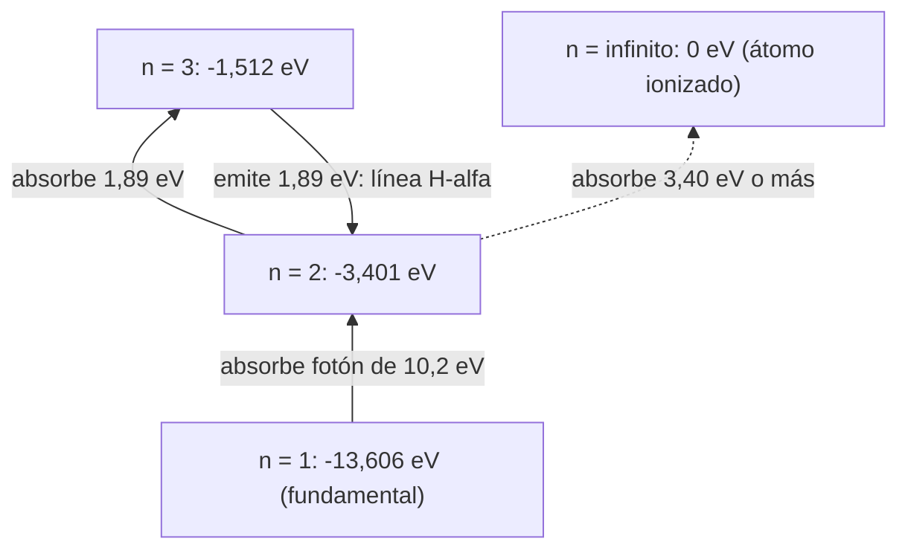

# B06-C01 — Estructura atómica

<!-- nav:top -->
[🏠 Programa](../../../../README.md) · [📚 Bloque B06](../../../tronco-comun/B06-quimica-y-materia-del-universo.md) · [← Anterior: B05-C20 — Problema físico integrado de satélite ideal](../../B05/B05-C20-problema-fisico-integrado-de-satelite-ideal/CLASE.md) · [Siguiente: B06-C02 — Tabla periódica y abundancias cósmicas →](../B06-C02-tabla-periodica-y-abundancias-cosmicas/CLASE.md)
<!-- /nav -->

## 1. Ubicación, nivel y alcance

Primera clase del bloque B06, «Química y materia del universo». Hasta aquí has usado la luz como mensajera (B01-C09) y has visto que una galaxia revela su velocidad por una línea de color. En esta clase abres esa línea y miras dentro del átomo que la produce. Sigues en el nivel N1.

Verás de qué está hecho un átomo, qué significa que sus electrones tengan «niveles» de energía, cómo un salto entre niveles emite un fotón de un color exacto y cómo un modelo sencillo, el de Bohr, predice las líneas del hidrógeno con una exactitud notable. No verás todavía mecánica cuántica formal, orbitales ni átomos con muchos electrones; eso queda para B24.

## 2. Por qué esta clase existe

Casi todo lo que sabemos de la composición de una estrella o de una nebulosa lo sabemos porque sus átomos emiten o absorben luz en colores muy precisos. Una línea roja a 656 nm no es «un color cualquiera»: es la firma del hidrógeno. Sin entender por qué el átomo elige esos colores, un espectro es una colección de rayitas sin sentido.

La decisión central es: **¿qué debo saber de un átomo para predecir en qué longitudes de onda interactúa con la luz, y hasta dónde puedo confiar en esa predicción?** Aprenderás a calcular la energía de un nivel, el fotón que emite una transición, y a declarar el dominio donde el modelo vale. Es la base de la tabla periódica (C02), de los enlaces (C04) y de los espectros (C17).

## 3. Lo que podrás hacer al terminar

1. Describir el átomo como núcleo (protones y neutrones) y electrones, y distinguir número atómico de número másico.
2. Calcular la energía y el radio de un nivel del hidrógeno con el modelo de Bohr.
3. Calcular la energía y la longitud de onda del fotón de una transición.
4. Predecir las líneas de Balmer y compararlas con valores medidos.
5. Explicar por qué el modelo falla para átomos con más de un electrón.
6. Redactar una ficha del átomo de hidrógeno con unidades, constantes con su edición y límites.

La evidencia es la **ficha del átomo de hidrógeno** del ejercicio 12 (sección 20).

## 4. Con qué llegas y cómo comprobarlo

Necesitas notación científica y unidades (B01-C02, B01-C08) y la idea de que la luz tiene longitud de onda (B01-C09). Cinco preguntas:

1. Escribe 0,000 000 656 m en nanómetros.
2. Si una línea está a 656 nm y otra a 486 nm, ¿cuál es más azul?
3. ¿Cuánto es 13,6 dividido entre 9?
4. ¿Qué significa que una cantidad sea «proporcional a 1/n²»? Da un ejemplo de qué pasa al duplicar n.
5. ¿Por qué un número sin unidad no se puede comparar?

<details>
<summary>Ver respuestas</summary>

1. 656 nm (1 nm = 10⁻⁹ m). 2. La de 486 nm, porque menor longitud de onda es más azul. 3. 1,51. 4. Que al duplicar n la cantidad se divide por 4. 5. Porque no sabes en qué escala está.
</details>

Con cuatro o cinco aciertos, sigue. Con tres o menos, repasa B01-C02 y B01-C09.

## 5. Un caso real: la línea roja de las nebulosas

Las regiones donde nacen estrellas brillan de rojo porque el hidrógeno que las llena emite una línea intensa a 656,28 nm en el aire, llamada H-alfa (S2). Esa misma línea, desplazada a 662,9 nm, es la que usamos en B01-C01 para estimar la velocidad de una galaxia. Hoy vamos a calcular de dónde sale el valor de reposo con sólo cuatro constantes físicas (S1).

Ten presente el límite: lo que calculamos es el color de un átomo aislado de hidrógeno. En un gas real el color se ensancha y se desplaza por temperatura, presión y movimiento, efectos que no tratamos aquí.

## 6. Vocabulario

El **átomo** es la unidad más pequeña de un elemento que conserva sus propiedades químicas. Tiene un **núcleo**, minúsculo y denso, formado por **protones** (carga positiva) y **neutrones** (sin carga), y a su alrededor **electrones** (carga negativa). El **número atómico** `Z` es el número de protones y define el elemento; el **número másico** `A` es la suma de protones y neutrones. Un átomo neutro tiene tantos electrones como protones.

Un **nivel de energía** es uno de los valores permitidos para la energía del electrón en el átomo; se numera con `n = 1, 2, 3…`. El **estado fundamental** es el de menor energía (`n = 1`). Una **transición** es el salto de un electrón entre dos niveles. Un **fotón** es el paquete de luz que se emite o se absorbe en ese salto. La **energía de ionización** es la necesaria para arrancar el electrón desde un nivel hasta el infinito. Una **serie espectral** es el conjunto de transiciones que terminan en el mismo nivel: la de **Lyman** termina en `n = 1` y la de **Balmer** en `n = 2`.

## 7. Modelo mental: la escalera del electrón

Imagina una escalera de peldaños que se juntan cada vez más hacia arriba. El electrón sólo puede estar en un peldaño, nunca entre dos. Para subir, absorbe un fotón con la energía exacta de la diferencia; al bajar, emite uno igual.



*Descripción textual:* una escalera vertical con niveles cada vez más cercanos. De `n = 1` a `n = 2` hay un salto grande; de `n = 2` a `n = 3`, uno menor. Una flecha descendente de 3 a 2 emite el fotón de H-alfa. Con 3,40 eV o más desde `n = 2` el electrón escapa (ionización).

La analogía de la escalera es útil para entender que la energía está **cuantizada**, pero tiene un límite: los peldaños de una escalera están en el espacio, mientras que los niveles son valores de energía; el electrón no «sube» físicamente un escalón. Además, en el modelo de Bohr el electrón sigue una órbita circular; hoy sabemos que eso es una imagen simplificada (verás por qué en la sección 8.5).

## 8. La explicación, paso a paso

### 8.1 El átomo por dentro

Un átomo de hidrógeno ordinario tiene un protón y un electrón; el helio, dos protones (`Z = 2`); el carbono, seis. La masa está casi toda en el núcleo: un protón pesa unas 1836 veces más que un electrón (S1). Por eso, a la primera aproximación, el electrón se mueve alrededor de un núcleo que apenas se mueve.

### 8.2 Niveles de energía en el modelo de Bohr

En 1913 Niels Bohr propuso que, en el hidrógeno, el electrón sólo puede tener ciertas energías:

```text
E_n = - Ry / n²          Ry = h c R_inf = 13,605 693 eV (CODATA 2022)
```

El signo menos indica que el electrón está ligado: hay que dar energía para liberarlo. En `n = 1`, `E₁ = −13,606 eV`; en `n = 2`, `−13,606/4 = −3,401 eV`; en `n = 3`, `−1,512 eV` (el script de la sección 17 imprime estos valores). La energía de ionización del hidrógeno en su estado fundamental es entonces 13,606 eV (S1); el valor medido que publica la NIST es 13,5984 eV (S2), 0,05 % menor por la misma corrección de masa del núcleo que verás en 8.3.

El radio también se cuantiza: `r_n = n² a₀`, con el **radio de Bohr** `a₀ = 5,291 77 × 10⁻¹¹ m` (S1). El nivel `n = 2` tiene un radio cuatro veces mayor que el fundamental.

### 8.3 De un salto a un color

Cuando el electrón baja de `n_alto` a `n_bajo`, la energía que sobra sale como un fotón: `E_fotón = E_alto − E_bajo`. La energía de un fotón y su longitud de onda se relacionan por `E = h c / λ`. Con `h c = 1239,84 eV·nm` (que sale de las constantes exactas del SI, S1), una transición de 1,89 eV corresponde a `λ = 1239,84/1,89 ≈ 656 nm`, justamente la línea H-alfa.

La fórmula completa en términos de longitud de onda se llama **fórmula de Rydberg**:

```text
1/λ = R_H (1/n_bajo² − 1/n_alto²)        R_H = R_inf / (1 + m_e/m_p)
```

La corrección `1 + m_e/m_p` aparece porque el núcleo también se mueve un poco; es la razón por la que `R_H` (10 967 758 m⁻¹) es 0,054 % menor que `R_inf` (10 973 731,568 m⁻¹, S1).

### 8.4 Las series

Si `n_bajo = 2` se obtiene la **serie de Balmer**, las únicas líneas del hidrógeno en el visible: H-alfa (3→2), H-beta (4→2), H-gamma (5→2) y H-delta (6→2). Si `n_bajo = 1`, la serie de **Lyman**, toda en el ultravioleta. Cuando `n_alto` crece, las líneas se juntan hacia un **límite de la serie**: para Balmer, `λ = 4/R_H ≈ 364,7 nm`.

### 8.5 Hasta dónde llega el modelo

El modelo de Bohr acierta con el hidrógeno y con iones de un solo electrón (por ejemplo He⁺, donde la energía se multiplica por `Z²`), pero falla cuando hay dos o más electrones, porque estos se repelen entre sí y la fórmula deja de valer. Tampoco explica por qué algunas líneas se parten en componentes muy cercanas: la NIST registra para H-alfa componentes entre 656,2710 y 656,2909 nm (S2), una «estructura fina» que el modelo de Bohr ignora. Para ir más allá hace falta la mecánica cuántica (B24).

## 9. Magnitudes, símbolos y unidades

| Símbolo | Qué es | Unidad | Valor o nota |
|---|---|---|---|
| `Z` | número atómico | — | protones del núcleo |
| `A` | número másico | — | protones + neutrones |
| `n` | número cuántico principal | — | 1, 2, 3… |
| `E_n` | energía del nivel | eV | `−13,6057/n²` |
| `a₀` | radio de Bohr | m | 5,291 772 105 44 × 10⁻¹¹ (CODATA 2022) |
| `R_inf` | constante de Rydberg | m⁻¹ | 10 973 731,568 157 (CODATA 2022) |
| `m_p/m_e` | razón de masas | — | 1836,152 673 426 (CODATA 2022) |
| `h` | constante de Planck | J s | 6,626 070 15 × 10⁻³⁴ (exacta) |
| `c` | velocidad de la luz | m/s | 299 792 458 (exacta) |
| `eV` | electronvoltio | J | 1,602 176 634 × 10⁻¹⁹ (exacto) |
| `λ` | longitud de onda | nm | 1 nm = 10⁻⁹ m |

## 10. Convenciones y referencias

El cero de energía se toma en el átomo ionizado (`n = ∞`); por eso los niveles ligados son negativos. Las longitudes de onda se dan **en aire** o **en el vacío**, y hay que declarar cuál: en el visible difieren en unas 0,28 partes por mil (a 656 nm, 0,18 nm). La NIST publica las del visible en aire; la fórmula de Rydberg da las del vacío, por lo que el laboratorio las convierte con un índice de aire aproximado de 1,000277. Usamos las constantes de la edición CODATA 2022.

## 11. De dónde sale lo que afirmamos

| ID | Fuente | Localizador | Respalda | Estado |
|---|---|---|---|---|
| S1 | NIST, *CODATA Recommended Values* (edición 2022): `R_inf`, `a₀`, `Ry·hc`, `m_p/m_e`, `h` | https://physics.nist.gov/cgi-bin/cuu/Value?ryd (y `?bohrrada0`, `?rydhcev`, `?mpsme`, `?h`) | Valores y exactitud de las constantes citadas | Páginas consultadas el 2026-11-05 |
| S2 | NIST, *Atomic Spectra Database*, v5.12: líneas de H I, 380–700 nm, y energías de ionización | https://physics.nist.gov/cgi-bin/ASD/lines1.pl y https://physics.nist.gov/cgi-bin/ASD/ie.pl (consulta con `spectra=H I`) | Longitudes de onda en aire de las componentes de Balmer; energía de ionización de H I, 13,598 435 eV | Consulta del 2026-11-05 |
| S3 | NIST, *CODATA Recommended Values* (edición 2022): `c` y `e` | https://physics.nist.gov/cgi-bin/cuu/Value?c (y `?e`) | `c` y `e` exactas por definición | Páginas consultadas el 2026-11-05 |

Límites: el índice del aire (1,000277) es una aproximación de la clase, no una cifra de S2; se verifica que el residuo es menor que 0,02 nm. La fórmula de Bohr y su explicación son nuestras y se contrastan con S1 y S2.

## 12. Cómo ver los niveles

Esta tabla es la versión accesible del diagrama de la sección 7.

| n | Energía (eV) | Radio (pm) | Salto al nivel anterior (eV) |
|---|---|---|---|
| 1 | −13,606 | 52,92 | — |
| 2 | −3,401 | 211,67 | 10,204 |
| 3 | −1,512 | 476,26 | 1,890 |
| 4 | −0,850 | 846,68 | 0,661 |
| 5 | −0,544 | 1322,94 | 0,306 |

Si dibujas los niveles, usa un eje vertical de energía y distingue los niveles por etiqueta y no por color. Descripción larga: los niveles se acercan unos a otros al subir; el salto 1→2 es más de cinco veces el salto 2→3.

## 13. Ejemplo trabajado: ¿de dónde sale el rojo de H-alfa?

**Dato de partida:** la transición 3→2 del hidrógeno, con constantes CODATA 2022 (S1). **Pregunta:** ¿qué longitud de onda tiene?

**Paso 1 · Niveles.** `E₂ = −13,6057/4 = −3,4014 eV`; `E₃ = −13,6057/9 = −1,5117 eV`.

**Paso 2 · Energía del fotón.** `ΔE = −1,5117 − (−3,4014) = 1,8897 eV` (con masa nuclear infinita; con la corrección de masa reducida, 1,8887 eV).

**Paso 3 · Longitud de onda.** `λ = 1239,84 / 1,8887 = 656,47 nm` en el vacío.

**Paso 4 · Aire.** Dividiendo por 1,000277: `656,29 nm`. La NIST da para H-alfa componentes entre 656,271 y 656,291 nm (S2): la predicción cae dentro del rango.

**Sentido físico.** Con una escalera de energías y una división sencilla se reproduce un color medido con precisión de centésimas de nanómetro. Lo que no explica el modelo es la separación de la línea en componentes ni el ensanchamiento por temperatura; por eso el resultado se declara «dentro del rango observado», no «exacto».

## 14. Dos formas de calcular la misma línea

Puedes calcular `λ` por **energías** (restar dos niveles y dividir `hc` por la diferencia) o directamente con la **fórmula de Rydberg**. Ambos caminos dan el mismo resultado; el primero es mejor para entender qué pasa físicamente (una resta de energías) y para el laboratorio de fotoquímica (C18), y el segundo es más rápido para listas de líneas. Ninguno corrige la estructura fina ni sirve para átomos con varios electrones; para ellos se usan tablas medidas, como la base de datos de la NIST, que además declaran su procedencia.

## 15. Práctica guiada

**Ejercicio 1 · con los pasos indicados.** Calcula la energía del nivel `n = 5` del hidrógeno. *Pasos:* `E_n = −13,6057/n²` (sección 8.2).

<details><summary>Solución comentada</summary>

`E₅ = −13,6057/25 = −0,5442 eV`. Fíjate en que el signo sigue siendo negativo: el electrón está ligado, sólo que más débilmente que en `n = 1`.
</details>

**Ejercicio 2 · con una pista.** ¿Cuál es el radio del nivel `n = 3`? *Pista:* `r_n = n² a₀`, con `a₀ = 52,92 pm`.

<details><summary>Solución comentada</summary>

`r₃ = 9 × 52,92 = 476,3 pm`, es decir, 0,476 nm. Es nueve veces el radio de Bohr. Si te dio 158,8 pm, multiplicaste por 3 en lugar de por 9: el radio crece como `n²`.
</details>

**Ejercicio 3 · casi autónomo.** Calcula la longitud de onda del fotón de la transición 4→2 (H-beta), con masa nuclear infinita.

<details><summary>Solución comentada</summary>

`ΔE = 13,6057 (1/4 − 1/16) = 2,5511 eV`; `λ = 1239,84/2,5511 = 486,0 nm`. Con la corrección de masa reducida da 486,27 nm en el vacío y 486,14 nm en el aire, que cae cerca del rango medido (486,128–486,137 nm, S2).
</details>

## 16. Práctica autónoma, transferencia e integrador

**Ejercicio 4.** Calcula el límite de la serie de Balmer (`n_alto → ∞`) con masa nuclear infinita.

<details><summary>Solución comentada</summary>

Con `n_alto → ∞`, `1/λ = R_inf/4`; `λ = 4/10 973 731,57 m⁻¹ = 3,6451 × 10⁻⁷ m = 364,5 nm`. Es el límite hacia el que se acumulan las líneas de Balmer (sección 8.4).
</details>

**Ejercicio 5.** ¿Cuánta energía hace falta para ionizar un átomo de hidrógeno que está en `n = 2`? ¿Qué longitud de onda máxima tiene un fotón capaz de hacerlo?

<details><summary>Solución comentada</summary>

`3,4014 eV`. Longitud de onda: `1239,84/3,4014 = 364,5 nm`. Es la misma cifra del ejercicio 4: el límite de Balmer es el umbral para ionizar desde `n = 2`.
</details>

**Ejercicio 6.** Calcula la energía y la longitud de onda de la línea Lyman-alfa (2→1). ¿Es visible?

<details><summary>Solución comentada</summary>

`ΔE = 13,6057 × 3/4 = 10,204 eV`; `λ = 1239,84/10,204 = 121,5 nm`. Está en el ultravioleta, por lo que el ojo no la ve (B01-C10) y hay que observarla desde el espacio.
</details>

**Ejercicio 7.** ¿Cuántas veces mayor es el radio en `n = 4` que en `n = 1`? ¿Y la energía de ligadura?

<details><summary>Solución comentada</summary>

El radio crece como `n²`: 16 veces. La energía de ligadura es `13,6057/n²`: 16 veces menor (0,850 eV). Cuanto más lejos del núcleo, más débil la atadura.
</details>

**Ejercicio 8.** Explica por qué H-alfa es roja y Lyman-alfa no se ve, usando energías.

<details><summary>Solución comentada</summary>

H-alfa tiene 1,89 eV (656 nm, rojo); Lyman-alfa tiene 10,2 eV (121,5 nm, ultravioleta). El ojo ve fotones de unos 1,8 a 3,1 eV; los de 10 eV tienen demasiada energía para estar en el visible.
</details>

**Ejercicio 9 · transferencia.** Una galaxia muestra H-alfa observada a 662,9 nm. Con el valor de reposo en aire de 656,28 nm (S2), calcula `z` y la velocidad aparente.

<details><summary>Solución comentada</summary>

`z = 662,9/656,28 − 1 = 0,01009`; `v = c z = 299 792 km/s × 0,01009 ≈ 3,0 × 10³ km/s`. Es coherente con el valor `z = 0,0101` usado en B01-C01. Observa que el resultado sólo es válido si ambas longitudes de onda están en el mismo medio (aire con aire).
</details>

**Ejercicio 10 · transferencia.** Para el ion He⁺ (`Z = 2`, un solo electrón) la energía es `E_n = −Z² × 13,6057/n²`. ¿Cuál es su energía de ionización?

<details><summary>Solución comentada</summary>

`4 × 13,6057 = 54,42 eV`. Sólo se puede aplicar el modelo porque He⁺ tiene un único electrón (sección 8.5); en el helio neutro, con dos electrones, la fórmula no vale.
</details>

**Ejercicio 11 · transferencia.** Un compañero dice: «con la fórmula de Bohr puedo calcular las líneas del hierro». Responde con lo aprendido.

<details><summary>Solución comentada</summary>

El hierro tiene 26 electrones que se repelen entre sí; el modelo supone un solo electrón en el campo del núcleo. Las líneas del hierro se toman de tablas medidas (como la ASD de la NIST) o se calculan con mecánica cuántica. Aplicar Bohr aquí es salir de su dominio de validez.
</details>

**Ejercicio 12 · integrador.** Elabora la *ficha del átomo de hidrógeno* (sección 20): niveles de `n = 1` a `5` con energía y radio; la línea 5→2 con su energía y longitud de onda (vacío y aire); su comparación con el rango de la NIST (434,043–434,050 nm); constantes con su edición; y una frase sobre los límites del modelo.

<details><summary>Solución modelo</summary>

Niveles y radios como en la sección 12. Línea 5→2: `ΔE = 13,6057 (1/4 − 1/25) = 2,8572 eV` (infinita) → con masa reducida, 434,17 nm en el vacío y 434,05 nm en el aire, que cae dentro de 0,003 nm del rango de S2. Constantes: CODATA 2022. Límite: átomo de un electrón, sin estructura fina; el residuo mayor es el índice del aire.
</details>

## 17. Laboratorio: niveles y líneas de Balmer

El script [niveles_del_hidrogeno.py](niveles_del_hidrogeno.py) calcula los niveles del hidrógeno y las líneas de Balmer H-alfa a H-delta con la fórmula de Rydberg y masa reducida, las pasa a aire y las compara con el rango de componentes de la NIST. Antes de imprimir comprueba cuatro cosas: que `Ry·hc` coincida con el valor CODATA (13,605 693 eV), que `1/R_inf = 91,1267 nm`, que la energía de ionización con masa reducida (13,5983 eV) coincida con la de la NIST ASD (13,5984 eV) dentro de 0,0002 eV y que cada línea caiga a menos de 0,02 nm del rango observado; si algo falla, se detiene.

**Datos:** publicados (CODATA 2022; NIST ASD v5.12). **Predice antes de ejecutar:** ¿en qué nivel queda `E₃`? (cerca de −1,51 eV). **Resultados (2026-11-05, Python 3.12.9):** `E₁ = −13,6057`, `E₂ = −3,4014`, `E₃ = −1,5117`, `E₄ = −0,8504 eV`; líneas en aire 656,2878; 486,1391; 434,0528; 410,1799 nm, frente a rangos observados 656,2710–656,2909; 486,1279–486,1375; 434,0427–434,0500; 410,1702–410,1766 nm; ionización con masa reducida 13,5983 eV; fotón H-alfa 1,8887 eV.

```bash
python programa/clases/B06/B06-C01-estructura-atomica/niveles_del_hidrogeno.py
```

**Límites:** átomo aislado; sin estructura fina, sin ensanchamiento por temperatura ni presión; el índice del aire es una aproximación. No sirve para átomos de varios electrones.

## 18. Errores frecuentes y cómo corregirlos

**Olvidar el signo de la energía.** Se escribe `E₂ = 3,4 eV`. Se detecta porque la energía de ionización sale negativa. Se corrige con el ejercicio 1.

**Confundir «radio crece como n» con «como n²».** Se corrige con el ejercicio 2.

**Mezclar aire y vacío.** Comparar una línea calculada en el vacío con una medida en aire produce un error de unas 0,18 nm a 656 nm. Se corrige con el ejemplo trabajado (sección 13) y el ejercicio 9.

**Usar la fórmula de Bohr para cualquier átomo.** Se corrige con los ejercicios 10 y 11.

**Creer que el electrón «gira» como un planeta.** Es una imagen del modelo, no una descripción física completa (sección 8.5).

## 19. Cómo sabrás que vas bien

Tras 8.2: ¿puedes calcular `E₄` sin mirar la fórmula? Si no, repite el ejercicio 1. Tras 8.3: ¿puedes pasar de un salto de energía a un color? Si no, repite el ejercicio 3. Tras 8.4: ¿por qué las líneas de Balmer se juntan hacia 364,5 nm? Si dudas, relee y haz el ejercicio 4. Tras 8.5: ¿cuándo deja de valer el modelo? Si no lo sabes, haz el ejercicio 11. Tras el laboratorio: ¿qué comprueba el script antes de mostrar resultados? Si no lo sabes, lee su cabecera.

## 20. Qué entregas y cómo se evalúa

El producto es tu **ficha del átomo de hidrógeno**: una página con los niveles `n = 1…5` (energía y radio), una línea de Balmer calculada y comparada con el rango medido, las constantes con su edición y una frase sobre los límites del modelo.

| Criterio | Inicial | En desarrollo | Logrado | Destacado |
|---|---|---|---|---|
| Cálculo de niveles | Con errores de signo o potencia | Correcto con ayuda | Correcto y con unidades | Verifica casos límite (ionización) |
| Transición y fotón | No la calcula | La calcula con error | Energía y `λ` correctas | Distingue vacío de aire |
| Comparación con el dato | Sin comparación | Compara sin residuo | Compara con residuo | Explica el residuo |
| Constantes y fuentes | Sin edición | Algunas con edición | Todas con edición | Distingue exactas de medidas |
| Límites | No los declara | Los menciona | Los explica | Propone cuándo cambiar de modelo |

**Condiciones críticas:** no omitir unidades; no mezclar aire y vacío sin declararlo; no aplicar el modelo fuera de su dominio; citar sólo fuentes consultadas.

## 21. Ética, seguridad y límites

Esta clase es un cálculo: no requiere laboratorio ni reactivos. Si más adelante observas líneas con una lámpara espectral o con un espectroscopio de aula, usa fuentes certificadas, no mires directamente lámparas de ultravioleta y sigue las instrucciones del fabricante y de un docente. Accesibilidad: ecuaciones escritas en texto, diagramas descritos, tablas equivalentes, sin dependencia de color. El modelo de Bohr es una simplificación histórica: usarlo fuera de su dominio es un error científico, no una variante legítima.

## 22. Para cerrar y seguir

El átomo tiene niveles de energía cuantizados; un salto entre niveles emite o absorbe un fotón de color exacto; el modelo de Bohr predice las líneas del hidrógeno dentro de centésimas de nanómetro, pero sólo para un electrón. Queda abierta una pregunta que respondes en la próxima clase: si cada elemento tiene su propia escalera, ¿cómo se ordenan los elementos y cuánto de cada uno hay en el cosmos?

**Glosario español–inglés.** átomo · *atom*; número atómico · *atomic number*; nivel de energía · *energy level*; transición · *transition*; serie de Balmer · *Balmer series*; energía de ionización · *ionization energy*; masa reducida · *reduced mass*.

**Continuidad.** La clase B06-C02 usa los niveles y el número atómico para ordenar los elementos en la tabla periódica y comparar su abundancia. B06-C17 retoma las series para identificar líneas en un espectro.

**Referencias:** ver sección 11. S1 y S2 son datos oficiales consultados; el modelo explicativo es de redacción propia.

<!-- nav:bottom -->
---

[← Anterior: B05-C20 — Problema físico integrado de satélite ideal](../../B05/B05-C20-problema-fisico-integrado-de-satelite-ideal/CLASE.md) · [📚 Bloque B06](../../../tronco-comun/B06-quimica-y-materia-del-universo.md) · [Siguiente: B06-C02 — Tabla periódica y abundancias cósmicas →](../B06-C02-tabla-periodica-y-abundancias-cosmicas/CLASE.md)
<!-- /nav -->
