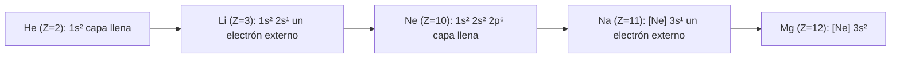

# B06-C02 — Tabla periódica y abundancias cósmicas

<!-- nav:top -->
[🏠 Programa](../../../../README.md) · [📚 Bloque B06](../../../tronco-comun/B06-quimica-y-materia-del-universo.md) · [← Anterior: B06-C01 — Estructura atómica](../B06-C01-estructura-atomica/CLASE.md) · [Siguiente: B06-C03 — Isótopos y masa atómica →](../B06-C03-isotopos-y-masa-atomica/CLASE.md)
<!-- /nav -->

## 1. Ubicación, nivel y alcance

Segunda clase del bloque B06. En C01 viste que cada átomo es una escalera de niveles de energía. Aquí usas esa idea para entender por qué los elementos se ordenan en una tabla y, después, miras cuánto de cada elemento hay en el Sol. Sigues en el nivel N1.

Verás cómo el número atómico ordena los elementos, cómo la configuración de electrones explica los periodos y los grupos, qué es una escala logarítmica de abundancias y cómo se pasa de ella a fracciones en número y en masa. No verás todavía cómo se fabrican los elementos en las estrellas (B17) ni el detalle de los orbitales (B24).

## 2. Por qué esta clase existe

Cuando alguien dice «el universo es casi todo hidrógeno y helio», ¿en qué sentido es cierto? ¿En número de átomos, en masa, en el Sol, en la Tierra? La respuesta cambia según lo que cuentes y de dónde lo midas. Y sin tabla periódica no hay manera de ordenar la lista de elementos que aparecen en un espectro.

La decisión central es: **¿cómo leo y comunico una composición química para que otra persona entienda qué se contó, dónde y con qué incertidumbre?** Aprenderás a leer la tabla como un mapa de configuraciones electrónicas, a convertir abundancias logarítmicas en fracciones y a declarar la base (número o masa). Es el paso previo a los isótopos (C03), a los enlaces (C04) y al análisis de meteoritos (C20).

## 3. Lo que podrás hacer al terminar

1. Ubicar un elemento en la tabla a partir de su número atómico y de su configuración de electrones.
2. Explicar por qué los gases nobles son poco reactivos y los metales alcalinos, muy reactivos, usando la energía de ionización.
3. Leer una abundancia logarítmica `A(X)` y convertirla en una razón `N_X/N_H`.
4. Calcular la fracción en número y la fracción en masa de un elemento.
5. Distinguir hidrógeno, helio y «metales» (X, Y, Z) en el vocabulario astronómico.
6. Redactar una ficha de composición solar que declare base, fuente y límites.

La evidencia es la **ficha de composición solar** del ejercicio 12 (sección 20).

## 4. Con qué llegas y cómo comprobarlo

Necesitas lo de C01 (átomo, niveles, número atómico) y potencias de diez (B01-C02). Cinco preguntas:

1. ¿Cuántos protones y cuántos electrones tiene un átomo neutro de oxígeno (`Z = 8`)?
2. ¿Cuánto vale `10⁻³`? ¿Y `10^0,3`, aproximadamente?
3. Si `N_O/N_H = 0,0005`, ¿cuántos átomos de oxígeno hay por cada millón de átomos de hidrógeno?
4. ¿Qué es más grande: 10 eV o 5 eV de energía de ionización? ¿Cuál es más difícil de arrancar?
5. ¿Qué diferencia hay entre «fracción en número» y «fracción en masa»?

<details>
<summary>Ver respuestas</summary>

1. 8 y 8. 2. 0,001; cerca de 2 (`10^0,3 ≈ 2`). 3. 500. 4. 10 eV es mayor y más difícil de arrancar. 5. La primera cuenta átomos; la segunda pesa: un átomo de oxígeno cuenta 1 en número y unas 16 veces más que uno de hidrógeno en masa.
</details>

Con cuatro o cinco aciertos, sigue. Con tres o menos, repasa C01 y B01-C02.

## 5. Un caso real: el Sol cambió de composición... en el papel

En 2009, Asplund, Grevesse, Sauval y Scott revisaron la composición de la fotosfera solar con un modelo tridimensional de la atmósfera y mejores datos atómicos. Concluyeron que las abundancias de carbono, nitrógeno, oxígeno y neón eran significativamente más bajas que las de valores usados una década antes; el nuevo resultado concuerda con las del vecindario solar y con meteoritos poco alterados, pero choca con los modelos del interior del Sol basados en heliosismología (S1). El Sol no cambió: cambió el método de medirlo.

Este caso enseña dos cosas: que una composición es una **medida con método y fecha**, no una constante de la naturaleza, y que hay que citar la edición. Ten presente el límite: lo que usamos aquí es una tabla de un trabajo concreto; otras compilaciones difieren en algunas milésimas (S1, Tabla 4).

## 6. Vocabulario

La **tabla periódica** ordena los elementos por número atómico `Z` creciente. Una **fila** se llama **periodo**; una **columna**, **grupo**. La **configuración electrónica** dice cuántos electrones hay en cada capa y subcapa: por ejemplo, el oxígeno es `1s² 2s² 2p⁴` (S2). Los electrones de la capa más externa son los **electrones de valencia** y determinan en buena medida cómo reacciona el elemento. Los **gases nobles** (He, Ne, Ar…) tienen la capa externa llena; los **metales alcalinos** (Li, Na, K…) tienen un solo electrón externo.

La **energía de ionización** (C01) es la que cuesta arrancar el electrón más externo. La **abundancia** es cuánto hay de un elemento; puede darse **en número** (átomos), **en masa** (kg) o con la **escala logarítmica astronómica**:

```text
A(X) = log10(N_X / N_H) + 12
```

donde `N_X` y `N_H` son números de átomos por unidad de volumen. Por definición `A(H) = 12`. En astronomía, **X** es la fracción en masa del hidrógeno, **Y** la del helio y **Z** la de todo lo demás, llamado en bloque «**metales**» aunque incluya carbono, nitrógeno y oxígeno (S1).

## 7. Modelo mental: capas que se llenan

Piensa en un edificio de cuartos que se ocupan de abajo hacia arriba: cada «piso» (capa) tiene un número limitado de lugares para electrones. Cuando un piso se llena, el siguiente electrón tiene que ir al piso siguiente, más lejos del núcleo. Cada vez que empieza un piso nuevo, empieza un periodo nuevo.



*Descripción textual:* una cadena de cinco elementos. Helio y neón tienen su última capa llena; litio y sodio, que vienen justo después, tienen un único electrón en una capa nueva; el magnesio añade un segundo.

La analogía del edificio sirve para ver por qué la reactividad se repite: elementos del mismo grupo tienen el mismo número de electrones en el piso más alto. Su límite: los «pisos» no son recintos con paredes; los electrones están repartidos en regiones que verás en B24, y a partir de `Z = 21` hay excepciones al orden simple de llenado.

## 8. La explicación, paso a paso

### 8.1 El número atómico ordena

Lo que identifica a un elemento es `Z`, el número de protones. Con ese orden aparecen regularidades: las propiedades químicas se repiten en intervalos de 2, 8, 8, 18… elementos, según cuántos electrones caben en cada capa. En los primeros tres periodos el orden de llenado es sencillo: `1s`, `2s`, `2p`, `3s`, `3p`. La NIST publica la configuración del estado fundamental: oxígeno `1s² 2s² 2p⁴`, neón `1s² 2s² 2p⁶`, sodio `[Ne] 3s`, magnesio `[Ne] 3s²` (S2). El símbolo `[Ne]` abrevia los diez electrones del neón.

### 8.2 La energía de ionización dibuja los periodos

Si tomas la energía de ionización de la NIST (S2), verás que sube a lo largo de un periodo y cae bruscamente al empezar el siguiente: helio 24,587 eV; litio 5,392 eV; neón 21,565 eV; sodio 5,139 eV; magnesio 7,646 eV; oxígeno 13,618 eV; hidrógeno 13,598 eV. El neón, con la capa llena y los electrones muy ligados, es difícil de ionizar; el sodio, con un electrón solo en una capa nueva y lejana, es fácil. Por eso los gases nobles apenas reaccionan y los alcalinos reaccionan con facilidad. Esa es la «química» que lee un espectro: qué átomos pierden electrones con poca energía y a qué colores.

### 8.3 Contar átomos: la escala logarítmica

Los astrónomos dan la abundancia de un elemento X respecto de hidrógeno con `A(X) = log10(N_X/N_H) + 12`. Para la fotosfera solar, Asplund y colaboradores dan `A(O) = 8,69`, `A(C) = 8,43`, `A(Ne) = 7,93`, `A(N) = 7,83`, `A(Mg) = 7,60`, `A(Si) = 7,51`, `A(Fe) = 7,50` y `A(S) = 7,12`; el helio, `A(He) = 10,93`, no procede de la fotosfera sino de la heliosismología (S1, Tabla 1). Para pasar a número: `N_X/N_H = 10^(A − 12)`. Para el oxígeno, `10^(−3,31) = 4,90 × 10⁻⁴`: unos 490 átomos de oxígeno por cada millón de hidrógeno. Una diferencia de 1 en `A` (1 «dex») es un factor 10; 0,3 dex, un factor 2.

### 8.4 De razón a fracción en número y en masa

La fracción en número del elemento X es `N_X / ΣN`, la suma sobre todos los elementos. La fracción en masa necesita además el peso atómico `M_X` (g/mol): `m_X ∝ N_X M_X`. Con los elementos de H a Zn (salvo Sc) el cálculo da `X = 0,7374`, `Y = 0,2492` y `Z = 0,0134`, frente a los 0,7381; 0,2485 y 0,0134 publicados (S1, Tabla 4). Ese acuerdo dentro de unas milésimas confirma que la conversión está bien hecha. Los pesos atómicos son los de la NIST, tomando el punto medio cuando el valor estándar es un intervalo (S3).

Una consecuencia: en número, el hidrógeno es el 92 % de los átomos y el helio el 7,8 %; en masa, 73,7 % y 24,9 %. Los «metales» son sólo 1,3 % de la masa y menos de 0,2 % de los átomos. El elemento más abundante después del helio es el oxígeno, y el hierro, aunque tiene `A` casi igual al del silicio, pesa más por átomo (S1, S3).

### 8.5 Qué no representa esta composición

La cifra es la de la **fotosfera solar actual**, no la del universo ni la de la Tierra. La fotosfera tampoco es idéntica a la composición con que nació el Sol: la gravedad ha ido asentando algo de helio y elementos pesados (S1, Tabla 4 distingue «proto-solar» y «fotosfera actual»). Y el helio se toma de la heliosismología porque el helio casi no deja líneas en la fotosfera.

## 9. Magnitudes, símbolos y unidades

| Símbolo | Qué es | Unidad | Valor o nota |
|---|---|---|---|
| `Z` | número atómico | — | protones |
| `A(X)` | abundancia logarítmica | dex | `log10(N_X/N_H) + 12` |
| `N_X/N_H` | razón en número | — | `10^(A−12)` |
| `M_X` | peso atómico | g/mol | NIST (S3) |
| `X, Y, Z` | fracciones en masa de H, He y metales | — | 0,7381; 0,2485; 0,0134 (S1) |
| `E_ion` | energía de ionización | eV | He 24,587; Ne 21,565; Na 5,139 (S2) |

## 10. Convenciones y referencias

`A(H) = 12` es la escala de Asplund y colaboradores; algunos trabajos usan otra normalización (por ejemplo, referir a 10⁶ átomos de Si en meteoritos; verás esto en C20). Los pesos atómicos se dan en g/mol; los intervalos de la NIST se sustituyen aquí por el punto medio, lo que introduce una incertidumbre menor que 0,02 % en la masa. Los corchetes en una tabla de abundancias (como el de la `A(He)`) marcan valores que no vienen del método principal.

## 11. De dónde sale lo que afirmamos

| ID | Fuente | Localizador | Respalda | Estado |
|---|---|---|---|---|
| S1 | M. Asplund, N. Grevesse, A. J. Sauval, P. Scott, «The chemical composition of the Sun», *Ann. Rev. Astron. Astrophys.* 47, 481–522 (2009) | arXiv:0909.0948, Tablas 1, 4 y 5 | `A(X)` de la fotosfera; X, Y, Z; resumen de la revisión de C, N, O, Ne | Resumen y PDF leídos el 2026-11-05 (texto extraído con PyMuPDF) |
| S2 | NIST, *Atomic Spectra Database* v5.12, energías de ionización y configuraciones | https://physics.nist.gov/cgi-bin/ASD/ie.pl (consulta de H I, He I, Li I, O I, Ne I, Na I, Mg I) | Configuraciones del estado fundamental y energías de ionización | Consulta del 2026-11-05 |
| S3 | NIST, *Atomic Weights and Isotopic Compositions for All Elements* | https://physics.nist.gov/cgi-bin/Compositions/stand_alone.pl | Pesos atómicos estándar (valores o intervalos) | Consulta del 2026-11-05 |
| S4 | NASA NSSDC, *Sun Fact Sheet* (act. 9-may-2024) | https://nssdc.gsfc.nasa.gov/planetary/factsheet/sunfact.html | Contraste: H 90,965 % y He 8,889 % sin indicar la base | Página consultada el 2026-11-05 |

Límites: la hoja de datos S4 no dice si sus porcentajes son en número o en masa, y no coincide con nuestro 92,07 % de hidrógeno en número (diferencia de 1,1 puntos); por eso no se usa como dato de la clase sino como advertencia (ejercicio 10). La regla de llenado de capas de la sección 7 es una explicación nuestra, contrastada sólo con las configuraciones de S2.

## 12. Cómo ver la composición

Esta tabla es la versión accesible de un gráfico de barras en escala logarítmica. Valores calculados con el script de la sección 17 a partir de S1 y S3.

| Elemento | `A(X)` | `N_X/N_H` | Fracción en número | Fracción en masa |
|---|---|---|---|---|
| H | 12,00 | 1 | 92,07 % | 73,74 % |
| He | 10,93 | 0,0851 | 7,84 % | 24,92 % |
| O | 8,69 | 4,90 × 10⁻⁴ | 0,045 % | 0,573 % |
| C | 8,43 | 2,69 × 10⁻⁴ | 0,025 % | 0,237 % |
| Ne | 7,93 | 8,51 × 10⁻⁵ | 0,0078 % | 0,126 % |
| N | 7,83 | 6,76 × 10⁻⁵ | 0,0062 % | 0,069 % |
| Mg | 7,60 | 3,98 × 10⁻⁵ | 0,0037 % | 0,071 % |
| Si | 7,51 | 3,24 × 10⁻⁵ | 0,0030 % | 0,067 % |
| Fe | 7,50 | 3,16 × 10⁻⁵ | 0,0029 % | 0,129 % |

Si dibujas barras, usa un eje logarítmico y etiqueta cada barra con el símbolo (no sólo con color). Descripción larga: el hidrógeno está a cuatro órdenes de magnitud sobre el oxígeno en número; entre el oxígeno y el hierro hay poco más de una unidad logarítmica.

## 13. Ejemplo trabajado: ¿cuánto oxígeno hay en el Sol, en número y en masa?

**Datos (observados/inferidos, S1):** `A(O) = 8,69`; `A(H) = 12`. **Peso atómico:** O = 15,999 g/mol, H = 1,008 g/mol (S3).

**Paso 1 · Razón en número.** `N_O/N_H = 10^(8,69−12) = 10^(−3,31) = 4,90 × 10⁻⁴`.

**Paso 2 · Fracción en número.** En el cálculo completo la suma `ΣN/N_H = 1,0862`. Entonces `N_O/ΣN = 4,90 × 10⁻⁴ / 1,0862 = 4,5 × 10⁻⁴ = 0,045 %`.

**Paso 3 · Fracción en masa.** `m_O/m_H = (N_O/N_H)(M_O/M_H) = 4,90 × 10⁻⁴ × 15,999/1,008 = 7,77 × 10⁻³`. Con la masa total por átomo de hidrógeno (1,3561 en unidades de `M_H`), `m_O/m_total = 0,573 %`.

**Paso 4 · Incertidumbre.** S1 da `A(O) = 8,69 ± 0,05`: ±0,05 dex equivale a ±12 % en número. Anota: «oxígeno: 0,573 % en masa (±12 %)».

**Sentido físico.** El oxígeno es el más abundante de los «metales», pero apenas un átomo de cada dos mil. Si lo comunicas, declara siempre base, fuente y edición.

## 14. Dos formas de decir la composición

La **escala logarítmica** `A(X)` es cómoda para comparar elementos separados por muchos órdenes de magnitud y es la que usan las tablas de espectroscopia. La **fracción en masa** (X, Y, Z) es la que necesitan los modelos de estructura estelar (B17). La primera se parece al conteo de átomos que ve un espectro; la segunda, al peso que siente la gravedad. Hay que convertir con cuidado y declarar siempre la base: confundirlas es el error más común en este tema.

## 15. Práctica guiada

**Ejercicio 1 · con los pasos indicados.** El magnesio tiene `Z = 12`. ¿Cuántos electrones tiene el átomo neutro y cuántos de valencia? *Pasos:* usa la configuración `[Ne] 3s²` (sección 8.1).

<details><summary>Solución comentada</summary>

Tiene 12 electrones. Diez forman el cierre del neón y los dos de `3s²` son los de valencia. Está en el grupo 2. Su energía de ionización (7,646 eV, S2) es baja, cercana a la del sodio, y mucho menor que la del neón.
</details>

**Ejercicio 2 · con una pista.** El oxígeno es `1s² 2s² 2p⁴`. ¿Cuántos electrones de valencia tiene? *Pista:* cuenta los de la segunda capa.

<details><summary>Solución comentada</summary>

`2 + 4 = 6` electrones de valencia: le faltan dos para completar la capa. Esto anticipa su tendencia a formar enlaces (C04).
</details>

**Ejercicio 3 · casi autónomo.** Con `A(O) = 8,69`, calcula `N_O/N_H` y cuántos átomos de oxígeno hay por millón de átomos de hidrógeno.

<details><summary>Solución comentada</summary>

`10^(8,69−12) = 10^(−3,31) = 4,90 × 10⁻⁴`; por millón de hidrógenos hay 490 de oxígeno. Si te salió 8,69 × 10⁻³, olvidaste restar el 12.
</details>

## 16. Práctica autónoma, transferencia e integrador

**Ejercicio 4.** Calcula `N_C/N_O` con `A(C) = 8,43` y `A(O) = 8,69`.

<details><summary>Solución comentada</summary>

`10^(8,43−8,69) = 10^(−0,26) = 0,55`. Hay aproximadamente un átomo de carbono por cada dos de oxígeno. Se restan las `A`: la resta de logaritmos es el logaritmo del cociente.
</details>

**Ejercicio 5.** ¿Cuántos átomos de hierro hay por millón de hidrógenos? (`A(Fe) = 7,50`)

<details><summary>Solución comentada</summary>

`10^(7,50−12) = 10^(−4,5) = 3,16 × 10⁻⁵`; es decir, unos 32 átomos de hierro por millón de hidrógenos.
</details>

**Ejercicio 6.** Calcula `N_Mg/N_Si` con `A(Mg) = 7,60` y `A(Si) = 7,51`.

<details><summary>Solución comentada</summary>

`10^(0,09) = 1,23`. El magnesio es un 23 % más abundante que el silicio en número; ambos son los metales rocosos más importantes (C20).
</details>

**Ejercicio 7.** El helio tiene `A(He) = 10,93`. Calcula `N_He/N_H` y su fracción en número si el total vale `ΣN/N_H = 1,0862`.

<details><summary>Solución comentada</summary>

`N_He/N_H = 10^(−1,07) = 0,0851`; fracción en número `0,0851/1,0862 = 7,84 %`. Recuerda que este valor viene de la heliosismología, no de líneas fotosféricas (sección 8.5).
</details>

**Ejercicio 8.** ¿Cuántas veces más abundante es el oxígeno que el hierro, en número?

<details><summary>Solución comentada</summary>

`8,69 − 7,50 = 1,19 dex`, es decir, `10^1,19 = 15,5` veces. Un factor de unas 15 veces es 1,2 unidades en la escala logarítmica.
</details>

**Ejercicio 9 · transferencia.** La NIST da la energía de ionización del helio (24,587 eV), del litio (5,392 eV), del neón (21,565 eV) y del sodio (5,139 eV). Explica por qué aumentan hasta el gas noble y caen en el siguiente elemento.

<details><summary>Solución comentada</summary>

Al pasar del helio al litio, el electrón nuevo va a una capa más lejana y apantallada por la capa 1s llena, y se arranca con poca energía. Lo mismo del neón al sodio. Dentro de un periodo, más protones atraen más fuerte la misma capa y la energía sube. La caída marca el comienzo de un periodo nuevo.
</details>

**Ejercicio 10 · transferencia.** La hoja de datos solar de la NASA da H 90,965 % y He 8,889 %. Nuestro cálculo da 92,07 % y 7,84 % en número. ¿Qué haces antes de decidir cuál «tiene razón»?

<details><summary>Solución comentada</summary>

Averiguas qué base usa la hoja (número o masa) y qué compilación de abundancias. No se puede comparar un porcentaje sin base. En masa, nuestro cálculo da 73,7 % y 24,9 %, que tampoco coincide; la hoja no declara su procedencia, así que no se usa como dato.
</details>

**Ejercicio 11 · transferencia.** Un titular afirma: «el universo es 75 % hidrógeno». ¿Qué le falta para ser una afirmación científica?

<details><summary>Solución comentada</summary>

Le falta declarar la base (¿en masa o en número?) y el objeto (¿la fotosfera del Sol?). En la fotosfera solar, X = 0,738 en masa y 92 % en número (S1). Para el universo en conjunto hay que citar otros datos (B19).
</details>

**Ejercicio 12 · integrador.** Elabora la *ficha de composición solar* (sección 20): para H, He, O, C, Ne, N, Mg, Si, Fe da `A(X)`, `N_X/N_H`, fracción en número y en masa; declara fuente, edición, base y la incertidumbre de `A(O)`.

<details><summary>Solución modelo</summary>

Los valores coinciden con la tabla de la sección 12; `A(O) = 8,69 ± 0,05` equivale a ±12 % en número (sección 13). Se aceptan tablas con cualquier subconjunto de elementos si cada columna declara su base y la fuente es S1 con su edición (2009). La nota «el helio viene de la heliosismología» es un criterio de calidad.
</details>

## 17. Laboratorio: de la escala logarítmica a X, Y, Z

El script [abundancias_solares.py](abundancias_solares.py) convierte las `A(X)` de 29 elementos en fracciones en número y en masa y recalcula X, Y y Z. Antes de imprimir comprueba que `N_H/N_H = 1`, que `A(O) = 8,69` da `10^−3,31`, que las fracciones suman 1 y que X, Y y Z coinciden con los publicados (S1, Tabla 4) dentro de 0,002 y `Z/X` dentro de 1 %; si no, se detiene.

**Datos:** publicados (observados e inferidos; S1) y pesos atómicos (S3). **Predice antes de ejecutar:** ¿qué fracción en masa tendrá el hidrógeno? (cerca de 0,74). **Resultados (2026-11-05, Python 3.12.9):** `X = 0,7374` (publicado 0,7381); `Y = 0,2492` (0,2485); `Z = 0,0134` (0,0134); `Z/X = 0,0181` (0,0181). Fracciones en número: H 92,07 %, He 7,84 %, O 0,045 %.

```bash
python programa/clases/B06/B06-C02-tabla-periodica-y-abundancias-cosmicas/abundancias_solares.py
```

**Límites:** son abundancias de la fotosfera solar según un trabajo concreto; se omiten Sc y los elementos con `Z > 30` (menos de 0,1 % de la masa); el punto medio de los intervalos de peso atómico es una aproximación. No sirve para la composición de otras estrellas ni de la Tierra.

## 18. Errores frecuentes y cómo corregirlos

**Olvidar el «+12».** Se toma `A(O) = 8,69` como `log N_O/N_H`. Se detecta porque sale un oxígeno más abundante que el hidrógeno. Se corrige con el ejercicio 3.

**Sumar en lugar de restar logaritmos.** Para comparar dos elementos se resta `A`. Se corrige con los ejercicios 4 y 6.

**Confundir número con masa.** Se corrige con la sección 14 y los ejercicios 7 y 10.

**Dar por universal una composición solar.** Se corrige con el ejercicio 11.

**Creer que las configuraciones siguen siempre el orden simple.** A partir de `Z = 21` aparecen excepciones; en esta clase sólo se usan los primeros periodos.

## 19. Cómo sabrás que vas bien

Tras 8.1: ¿puedes escribir la configuración del oxígeno y decir sus electrones de valencia? Si no, repite el ejercicio 2. Tras 8.2: ¿por qué el sodio se ioniza más fácil que el neón? Si dudas, haz el ejercicio 9. Tras 8.3: ¿qué significa un `A` mayor en 1? Si no lo sabes, repite el ejercicio 4. Tras 8.4: ¿puedes pasar de `A` a una fracción en masa? Si no, relee el ejemplo trabajado. Tras el laboratorio: ¿qué valida el script antes de imprimir? Si no lo sabes, lee su cabecera.

## 20. Qué entregas y cómo se evalúa

El producto es tu **ficha de composición solar**: una página con una tabla de al menos ocho elementos (`A(X)`, razón, fracciones en número y masa), la fuente con su edición, la base declarada y la incertidumbre de un elemento.

| Criterio | Inicial | En desarrollo | Logrado | Destacado |
|---|---|---|---|---|
| Conversión de `A(X)` | Con errores | Correcta con ayuda | Correcta con unidades | Verifica con casos límite |
| Base (número o masa) | No la declara | La declara a veces | Siempre | Convierte entre ambas |
| Fuente y edición | Sin fuente | Fuente sin edición | Con edición | Compara dos compilaciones |
| Incertidumbre | Ausente | Cualitativa | Cuantitativa | La propaga a la fracción |
| Alcance | Generaliza al universo | Lo menciona | Limita a la fotosfera | Explica proto-solar vs. actual |

**Condiciones críticas:** no presentar una composición sin base ni fuente; no extender la composición solar al universo; citar sólo fuentes consultadas.

## 21. Ética, seguridad y límites

Esta clase es un cálculo y no requiere laboratorio. Comunicar una composición sin su base y su incertidumbre puede inducir a errores de interpretación; se trata de honestidad científica. Accesibilidad: tablas equivalentes a los gráficos, fórmulas en texto, sin dependencia de color. Los símbolos químicos y su historia tienen aspectos culturales que se abordan en B02.

## 22. Para cerrar y seguir

La tabla periódica es el mapa de las configuraciones electrónicas; la energía de ionización explica por qué se repiten las propiedades. Una abundancia se declara con su base y su fuente: en la fotosfera solar, el hidrógeno es 73,7 % de la masa y 92 % de los átomos, y los «metales» sólo 1,3 % de la masa. Queda abierta la pregunta de la próxima clase: ¿todos los átomos de un mismo elemento son idénticos?

**Glosario español–inglés.** tabla periódica · *periodic table*; periodo · *period*; grupo · *group*; electrones de valencia · *valence electrons*; gas noble · *noble gas*; abundancia · *abundance*; fracción en masa · *mass fraction*; fotosfera · *photosphere*.

**Continuidad.** B06-C03 distingue los isótopos de cada elemento y cómo se calcula su masa atómica. B06-C20 compara esta composición solar con la de los meteoritos.

**Referencias:** ver sección 11. S1, S2 y S3 son consultas completas; S4 sólo se usa como advertencia.

<!-- nav:bottom -->
---

[← Anterior: B06-C01 — Estructura atómica](../B06-C01-estructura-atomica/CLASE.md) · [📚 Bloque B06](../../../tronco-comun/B06-quimica-y-materia-del-universo.md) · [Siguiente: B06-C03 — Isótopos y masa atómica →](../B06-C03-isotopos-y-masa-atomica/CLASE.md)
<!-- /nav -->
