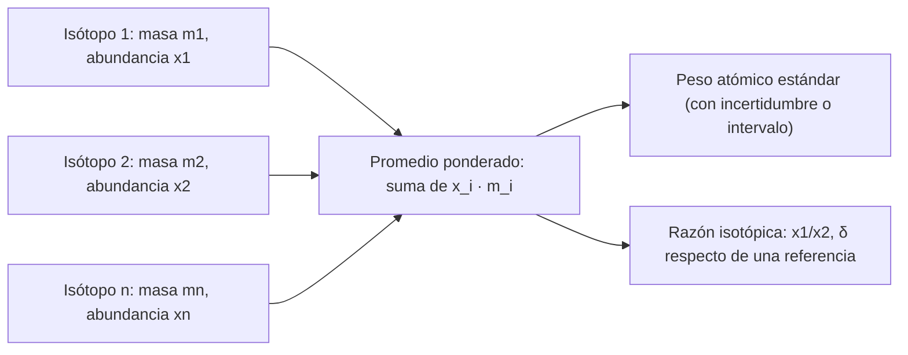

# B06-C03 — Isótopos y masa atómica

<!-- nav:top -->
[🏠 Programa](../../../../README.md) · [📚 Bloque B06](../../../tronco-comun/B06-quimica-y-materia-del-universo.md) · [← Anterior: B06-C02 — Tabla periódica y abundancias cósmicas](../B06-C02-tabla-periodica-y-abundancias-cosmicas/CLASE.md) · [Siguiente: B06-C04 — Enlaces iónicos y covalentes →](../B06-C04-enlaces-ionicos-y-covalentes/CLASE.md)
<!-- /nav -->

## 1. Ubicación, nivel y alcance

Tercera clase del bloque B06. En C02 viste que un elemento queda definido por su número atómico `Z`. Aquí descubres que no todos los átomos de un elemento pesan lo mismo, y que de ahí sale la «masa atómica» de las tablas. Sigues en el nivel N1.

Verás qué es un isótopo, cómo se calcula una masa atómica media a partir de las masas y las abundancias de sus isótopos, por qué la tabla de pesos atómicos a veces da un intervalo y cómo los cocientes isotópicos se usan en astronomía como huellas del origen de un material. No verás todavía desintegración radiactiva ni nucleosíntesis (B24 y B17).

## 2. Por qué esta clase existe

El carbono del Sol, ¿es igual que el de la Tierra? Una forma de preguntarlo con rigor es comparar cuántos átomos de carbono-12 hay por cada uno de carbono-13. Si la razón difiere, el material tuvo otra historia. Esa idea está detrás de los análisis de meteoritos y de las muestras del asteroide Bennu.

La decisión central es: **¿cómo paso de una lista de isótopos con sus masas y abundancias a una masa atómica con incertidumbre, y cómo uso una razón isotópica para comparar materiales?** Aprenderás a calcular promedios ponderados, a leer intervalos, a expresar desviaciones relativas y a declarar la referencia. Es base de C06 (mol), C07 (estequiometría) y C20 (meteoritos).

## 3. Lo que podrás hacer al terminar

1. Definir isótopo con número atómico, número de neutrones y número másico.
2. Calcular la masa atómica media de un elemento a partir de sus isótopos.
3. Explicar por qué algunos pesos atómicos se dan como un intervalo.
4. Calcular razones isotópicas (D/H, 12C/13C) y compararlas con una referencia.
5. Interpretar una desviación expresada en por mil (δ).
6. Redactar una ficha isotópica de un elemento con fuente, edición y límites.

La evidencia es la **ficha isotópica** del ejercicio 12 (sección 20).

## 4. Con qué llegas y cómo comprobarlo

Necesitas C01 y C02 (número atómico, configuración, abundancias) y promedios ponderados. Cinco preguntas:

1. ¿Cuántos neutrones tiene un átomo con `Z = 6` y número másico 13?
2. Si 3 de cada 4 bolas pesan 10 g y 1 pesa 14 g, ¿cuánto pesa una bola «media»?
3. Escribe 0,0107 como porcentaje.
4. ¿Cuánto es 4,311 dividido entre 3,653?
5. ¿Qué es un por mil (‰)?

<details>
<summary>Ver respuestas</summary>

1. 7. 2. `0,75 × 10 + 0,25 × 14 = 11 g`. 3. 1,07 %. 4. 1,18. 5. Una parte entre mil: 1 ‰ = 0,1 %.
</details>

Con cuatro o cinco aciertos, sigue. Con tres o menos, repasa C02 y B01-C02.

## 5. Un caso real: el carbono del Sol

Asplund y colaboradores determinaron en 2009 una razón isotópica en la fotosfera solar: `12C/13C = 86,8 ± 3,8` (S1). La razón terrestre que se desprende de la tabla de composiciones isotópicas de la NIST es `0,9893/0,0107 = 92,5` (S2). ¿Son distintas? La diferencia es de 5,7, es decir, 1,5 veces la incertidumbre del valor solar: **no es una diferencia significativa**. Este caso sirve para aprender a comparar dos razones con su incertidumbre y a no proclamar una diferencia que los datos no sostienen.

Un segundo caso, de otro tipo: las muestras del asteroide Bennu muestran un nitrógeno enriquecido en ¹⁵N (`δ¹⁵N = +180 ± 47 ‰` en el extracto caliente en agua), fuera del intervalo de materia orgánica terrestre (−10 a +20 ‰), lo que los autores interpretan como señal de formación en una nube molecular fría o en el disco protoplanetario externo (S3). Aquí la diferencia sí es grande frente a su incertidumbre. Ten presente el límite: la interpretación pertenece a los autores y se resume sin reproducir su análisis.

## 6. Vocabulario

Un **nucleón** es un protón o un neutrón. El **número másico** `A` es el número de nucleones. Dos átomos son **isótopos** del mismo elemento si tienen igual `Z` pero distinto número de neutrones `N`, de modo que `A = Z + N`. Se escribe con el número másico delante: ¹²C, ¹³C, ²H (deuterio, D), ⁵⁶Fe.

La **masa atómica relativa** de un isótopo es su masa dividida entre la doceava parte de la masa del ¹²C (por eso ¹²C vale exactamente 12). La **abundancia isotópica** es la fracción de átomos del elemento que son de ese isótopo. El **peso atómico estándar** es la masa atómica relativa media del elemento en materiales terrestres normales; puede darse como un valor con incertidumbre o como un **intervalo** (S2). Una **razón isotópica** es el cociente entre dos isótopos, como ¹²C/¹³C. La **notación δ** expresa la desviación relativa de una razón respecto de una referencia: `δ = (R_muestra/R_ref − 1) × 1000` en ‰.

## 7. Modelo mental: la bolsa de canicas

Imagina una bolsa con canicas de dos pesos casi iguales, mezcladas siempre en la misma proporción. Si pesas muchas, el peso medio de una canica depende del peso de cada tipo y de su proporción. Eso es la masa atómica de las tablas: un promedio ponderado.



*Descripción textual:* tres cajas de isótopos con su masa y su abundancia alimentan un promedio ponderado que produce el peso atómico; de las mismas abundancias salen las razones isotópicas.

La analogía de las canicas ilustra el promedio, pero tiene límite: ningún átomo individual pesa 35,45; el promedio no es una masa que exista en un átomo. Además, si la bolsa cambia de origen, la proporción cambia: por eso el peso atómico de algunos elementos es un intervalo.

## 8. La explicación, paso a paso

### 8.1 Isótopos: mismo elemento, distinta masa

Todos los átomos de cloro tienen 17 protones. Los hay con 18 neutrones (³⁵Cl) y con 20 (³⁷Cl). Químicamente se comportan casi igual, porque la química depende de los electrones (C01, C02); lo que cambia es la masa. La NIST tabula la masa de cada isótopo con ocho o más cifras: ³⁵Cl = 34,968 852 682 y ³⁷Cl = 36,965 902 602 (S2).

### 8.2 La masa atómica media

Se calcula como promedio ponderado:

```text
M = Σ x_i · m_i          con Σ x_i = 1
```

Para el cloro, con abundancias 0,7576 y 0,2424: `M = 0,7576 × 34,968 853 + 0,2424 × 36,965 903 = 35,4529`. El peso atómico estándar de la NIST es el intervalo [35,446; 35,457] (S2): el valor cae dentro. El script de la sección 17 repite este cálculo para doce elementos y los compara todos con la NIST.

### 8.3 ¿Por qué un intervalo?

Los isótopos de algunos elementos (H, Li, B, C, N, O, Mg, Si, S, Cl…) se reparten de modo algo distinto según el origen del material: agua de mar, roca, aire, organismos (S2). La NIST da entonces un intervalo que cubre las muestras terrestres normales. Para el hierro o el neón, en cambio, se da un valor con incertidumbre. En un cálculo de laboratorio elegirás un valor, pero debes saber que la última cifra puede variar según el origen del material.

### 8.4 Razones isotópicas

La razón `D/H` terrestre sale de la tabla: `0,000 115/0,999 885 = 1,15 × 10⁻⁴`, unos 115 átomos de deuterio por millón de hidrógenos (S2; la incertidumbre de la abundancia es grande, ±0,000 070). La razón `¹²C/¹³C` terrestre es 92,5. En astronomía estas razones se miden en estrellas, nubes y meteoritos y se comparan con las terrestres para inferir si el material tuvo una historia distinta.

### 8.5 La notación δ

Si la razón `¹⁵N/¹⁴N` de referencia es `R_ref` y la de una muestra es `R`, entonces `δ¹⁵N = (R/R_ref − 1) × 1000 ‰`. Con la razón de la tabla NIST (3,653 × 10⁻³) como referencia ilustrativa, un `δ¹⁵N = +180 ‰` equivale a `3,653 × 10⁻³ × 1,18 = 4,311 × 10⁻³` (el laboratorio de la sección 17 lo imprime). La referencia oficial para el nitrógeno es el N₂ atmosférico; aquí se usa la de la tabla sólo para enseñar el cálculo, y debe declararse siempre.

## 9. Magnitudes, símbolos y unidades

| Símbolo | Qué es | Unidad | Valor o nota |
|---|---|---|---|
| `Z`, `N`, `A` | protones, neutrones, nucleones | — | `A = Z + N` |
| `m_i` | masa atómica relativa del isótopo i | — (o u) | ¹²C = 12 exacto |
| `x_i` | abundancia isotópica | fracción | suma 1 |
| `M` | peso atómico | g/mol | `Σ x_i m_i` |
| `R` | razón isotópica | — | p. ej. ¹²C/¹³C |
| `δ` | desviación relativa | ‰ | respecto de `R_ref` |
| `u` | unidad de masa atómica | kg | 1,660 539 068 92 × 10⁻²⁷ (CODATA 2022) |

## 10. Convenciones y referencias

Las masas relativas y las abundancias son las de la NIST para materiales terrestres normales. Cuando el peso atómico estándar es un intervalo, en cálculos de aula se usa el valor convencional o el punto medio y se declara. Las razones solares y meteoríticas pueden diferir de las terrestres sin que haya contradicción. En esta clase la incertidumbre de las abundancias del hidrógeno es la que publica la NIST.

## 11. De dónde sale lo que afirmamos

| ID | Fuente | Localizador | Respalda | Estado |
|---|---|---|---|---|
| S1 | M. Asplund et al., «The chemical composition of the Sun», *Ann. Rev. Astron. Astrophys.* 47, 481 (2009) | arXiv:0909.0948 (texto, sección del carbono) | `12C/13C = 86,8 ± 3,8` en el Sol | PDF leído el 2026-11-05 (extracción con PyMuPDF) |
| S2 | NIST, *Atomic Weights and Isotopic Compositions for All Elements* | https://physics.nist.gov/cgi-bin/Compositions/stand_alone.pl | Masas relativas, composiciones y pesos atómicos estándar | Consulta del 2026-11-05 |
| S3 | D. P. Glavin et al., «Abundant ammonia and nitrogen-rich soluble organic matter in samples from asteroid (101955) Bennu», *Nature Astronomy* (2025), doi:10.1038/s41550-024-02472-9 | PDF de NASA NTRS (ntrs.nasa.gov, doc. 20250001355) | `δ¹⁵N = +180 ± 47 ‰`; rango orgánico terrestre −10 a +20 ‰; C 4,5–4,7 % y N 0,23–0,25 % en peso | PDF leído el 2026-11-05 (extracción con PyMuPDF) |
| S4 | NIST, *CODATA Recommended Values* (2022), constante de masa atómica `u` | https://physics.nist.gov/cgi-bin/cuu/Value?u | `u = 1,660 539 068 92 × 10⁻²⁷ kg` | Consulta del 2026-11-05 |

Límites: no se leyó el artículo de Asplund y colaboradores más allá del PDF indicado; la interpretación de S3 es de sus autores. La referencia de δ¹⁵N usada en la clase es ilustrativa y no la oficial.

## 12. Cómo ver los isótopos

Esta tabla es la versión accesible de un gráfico de barras de abundancias.

| Elemento | Isótopos (masa relativa; abundancia) | Peso calculado | Estándar NIST |
|---|---|---|---|
| Cl | ³⁵Cl (34,9689; 0,7576), ³⁷Cl (36,9659; 0,2424) | 35,4529 | [35,446; 35,457] |
| C | ¹²C (12; 0,9893), ¹³C (13,0034; 0,0107) | 12,0107 | [12,0096; 12,0116] |
| Mg | ²⁴Mg, ²⁵Mg, ²⁶Mg (0,7899; 0,1000; 0,1101) | 24,3051 | [24,304; 24,307] |
| Fe | ⁵⁴Fe, ⁵⁶Fe, ⁵⁷Fe, ⁵⁸Fe | 55,8451 | 55,845(2) |

Si dibujas barras, etiqueta cada barra con su isótopo y usa escala logarítmica en el eje de la abundancia. Descripción larga: en cada elemento domina un isótopo (¹²C, ⁵⁶Fe) salvo en el cloro, donde el isótopo ligero tiene tres cuartos del total.

## 13. Ejemplo trabajado: ¿pesa lo mismo el carbono del Sol y el de la Tierra?

**Datos:** terrestre, `x(¹²C) = 0,9893` y `x(¹³C) = 0,0107` (S2, observado en laboratorio); solar, `¹²C/¹³C = 86,8 ± 3,8` (S1, inferido de espectros).

**Paso 1 · Razón terrestre.** `0,9893/0,0107 = 92,5`.

**Paso 2 · Diferencia.** `92,5 − 86,8 = 5,7`.

**Paso 3 · Comparar con la incertidumbre.** `5,7/3,8 = 1,5`. La regla de aula: si la diferencia es menor que dos veces la incertidumbre, los datos no permiten afirmar que sean distintos.

**Paso 4 · Efecto en la masa atómica.** Si el carbono solar tuviera `¹²C/¹³C = 86,8`, `x(¹³C) = 1/(1+86,8) = 0,01139`, y `M = 12 + 0,01139 × 1,003355 = 12,01143`, frente a 12,0107: una diferencia de 0,0007, dentro del intervalo estándar [12,0096; 12,0116].

**Sentido físico.** Los carbonos del Sol y de la Tierra son indistinguibles con estos datos, y aun si fueran distintos, la masa atómica apenas cambiaría. Una razón isotópica es mucho más sensible que la masa media; por eso se mide ella.

## 14. Dos formas de comparar materiales

Puedes comparar **pesos atómicos** (promedios) o **razones isotópicas** (detalle). El peso atómico es cómodo para estequiometría (C06, C07) pero oculta casi toda la información de origen: dos materiales con razones distintas pueden tener pesos casi idénticos. La razón isotópica, o su desviación δ, es la herramienta de la geoquímica y la cosmoquímica, pero exige declarar referencia e incertidumbre. Usa la primera para calcular y la segunda para comparar orígenes.

## 15. Práctica guiada

**Ejercicio 1 · con los pasos indicados.** Calcula el peso atómico del cloro con ³⁵Cl (34,968 853; 0,7576) y ³⁷Cl (36,965 903; 0,2424). *Pasos:* promedio ponderado (sección 8.2).

<details><summary>Solución comentada</summary>

`0,7576 × 34,968 853 = 26,4924`; `0,2424 × 36,965 903 = 8,9605`; suma `35,4529`. Cae en [35,446; 35,457]. Si te dio 36, promediaste sin ponderar.
</details>

**Ejercicio 2 · con una pista.** ¿Cuántos neutrones tienen ⁵⁴Fe, ⁵⁶Fe y ⁵⁸Fe? *Pista:* `N = A − Z`, con `Z = 26`.

<details><summary>Solución comentada</summary>

28, 30 y 32 neutrones. Los tres son hierro (26 protones) con distinta masa (sección 8.1).
</details>

**Ejercicio 3 · casi autónomo.** Comprueba que las abundancias del neón (0,9048; 0,0027; 0,0925) suman 1.

<details><summary>Solución comentada</summary>

`0,9048 + 0,0027 + 0,0925 = 1,0000`. Antes de promediar siempre se comprueba que la suma sea 1; si no, el promedio queda mal normalizado.
</details>

## 16. Práctica autónoma, transferencia e integrador

**Ejercicio 4.** Calcula el peso atómico del magnesio con ²⁴Mg (23,985 042; 0,7899), ²⁵Mg (24,985 837; 0,1000) y ²⁶Mg (25,982 593; 0,1101).

<details><summary>Solución comentada</summary>

`18,9458 + 2,4986 + 2,8607 = 24,3051`. Está dentro del intervalo [24,304; 24,307] (S2).
</details>

**Ejercicio 5.** Calcula `D/H` con abundancias 0,000 115 y 0,999 885. Exprésalo por millón.

<details><summary>Solución comentada</summary>

`1,15 × 10⁻⁴`, es decir, 115 por millón. La abundancia del deuterio tiene incertidumbre de ±0,000 070 en la tabla (S2), así que la cifra tiene una incertidumbre relativa grande; el 115 no debe escribirse con más cifras.
</details>

**Ejercicio 6.** Calcula la razón `¹²C/¹³C` terrestre y la diferencia, en número de incertidumbres, respecto del valor solar 86,8 ± 3,8.

<details><summary>Solución comentada</summary>

`92,5`; diferencia `5,7`; `5,7/3,8 = 1,5`. No es significativa con el criterio de dos incertidumbres.
</details>

**Ejercicio 7.** Explica por qué ningún átomo de cloro pesa 35,45.

<details><summary>Solución comentada</summary>

Cada átomo es ³⁵Cl o ³⁷Cl; 35,45 es el promedio ponderado de una población. Es como decir que la familia media tiene 2,3 hijos: ninguna familia los tiene.
</details>

**Ejercicio 8.** El peso atómico del carbono es 12,0107. Si sólo existieran ¹²C (12 exacto) y ¹³C (13,003 355), deduce la abundancia del ¹³C.

<details><summary>Solución comentada</summary>

`x = (12,0107 − 12)/(13,003 355 − 12) = 0,0107/1,003 355 = 0,01066`, es decir, 1,07 %. Coincide con la tabla. Es el cálculo inverso del promedio.
</details>

**Ejercicio 9 · transferencia.** La NIST da para el hidrógeno el intervalo [1,00784; 1,00811]. ¿Qué te dice sobre el uso de «1,008» en un cálculo?

<details><summary>Solución comentada</summary>

Que el hidrógeno terrestre varía de una fuente a otra y que 1,008 es un valor convencional cuya cuarta cifra decimal no es firme. En estequiometría de aula basta; en geoquímica isotópica hay que declarar el material.
</details>

**Ejercicio 10 · transferencia.** El extracto de Bennu tiene `δ¹⁵N = +180 ‰` (S3). Con `R_ref = 3,653 × 10⁻³`, calcula `¹⁵N/¹⁴N` de la muestra y di qué quiere decir el signo.

<details><summary>Solución comentada</summary>

`R = 3,653 × 10⁻³ × (1 + 180/1000) = 4,311 × 10⁻³`. El signo positivo indica que la muestra tiene más ¹⁵N relativo que la referencia (un 18 % más). Recuerda que la referencia oficial es el N₂ del aire; aquí la usamos sólo como ilustración.
</details>

**Ejercicio 11 · transferencia.** El argón es 99,6 % ⁴⁰Ar (39,962 383) con ³⁸Ar (37,962 732; 0,000 629) y ³⁶Ar (35,967 545; 0,003 336). Calcula su peso atómico y compáralo con 39,948(1).

<details><summary>Solución comentada</summary>

`0,996 035 × 39,962 383 + 0,000 629 × 37,962 732 + 0,003 336 × 35,967 545 = 39,9478`. Coincide con 39,948. El argón de la Tierra es casi todo ⁴⁰Ar; el valor es una media dominada por un solo isótopo.
</details>

**Ejercicio 12 · integrador.** Elabora la *ficha isotópica* (sección 20) de un elemento de tu elección con al menos dos isótopos: masas y abundancias de la NIST, peso calculado, comparación con el estándar, una razón isotópica y una frase sobre dónde cambiaría la razón (Sol, meteorito, Tierra).

<details><summary>Solución modelo</summary>

Una ficha completa sigue el ejemplo trabajado de la sección 13 con otro elemento: tabla de isótopos, promedio ponderado con la suma de abundancias verificada, comparación con el intervalo estándar, una razón y su valor en otro entorno si hay fuente. Si no hay fuente para el otro entorno, la ficha debe decirlo.
</details>

## 17. Laboratorio: pesos atómicos desde los isótopos

El script [masa_atomica.py](masa_atomica.py) calcula el peso atómico de doce elementos a partir de las masas y las abundancias isotópicas de la NIST y comprueba que cada uno cae dentro del peso estándar publicado. También imprime las razones D/H, ¹²C/¹³C y ¹⁵N/¹⁴N. Antes de calcular comprueba que las abundancias suman 1 (con tolerancia de 2 × 10⁻⁴), que cada resultado cae en el estándar NIST, que un único isótopo da su propia masa y que invertir el promedio del carbono recupera 0,0107.

**Datos:** publicados (NIST; Asplund para la razón solar). **Predice antes de ejecutar:** ¿qué peso saldrá para el cloro? (cerca de 35,45). **Resultados (2026-11-05, Python 3.12.9):** H 1,0079; C 12,0107; N 14,0067; O 15,9994; Mg 24,3051; Si 28,0855; S 32,0648; Cl 35,4529; Ar 39,9478; Fe 55,8451; `D/H = 1,150 × 10⁻⁴`; `¹²C/¹³C = 92,5` (1,49 σ del solar); `¹⁵N/¹⁴N = 3,6533 × 10⁻³` y 4,3109 × 10⁻³ con +180 ‰.

```bash
python programa/clases/B06/B06-C03-isotopos-y-masa-atomica/masa_atomica.py
```

**Límites:** composición terrestre normal; para He, Ne, Ar y Fe el criterio de aceptación (±3 incertidumbres) es de esta clase, no de la NIST. No sirve para materiales con fraccionamiento anómalo ni para datar rocas.

## 18. Errores frecuentes y cómo corregirlos

**Promediar sin ponderar.** Se calcula `(35 + 37)/2 = 36` para el cloro. Se corrige con el ejercicio 1.

**No verificar que las abundancias sumen 1.** Se corrige con el ejercicio 3.

**Creer que el peso atómico es la masa de un átomo real.** Se corrige con el ejercicio 7.

**Afirmar una diferencia sin su incertidumbre.** Se corrige con el ejercicio 6 y la sección 13.

**Olvidar declarar la referencia de δ.** Se corrige con el ejercicio 10.

## 19. Cómo sabrás que vas bien

Tras 8.2: ¿puedes calcular el peso del magnesio sin mirar? Si no, repite el ejercicio 4. Tras 8.3: ¿por qué hay intervalos? Si dudas, haz el ejercicio 9. Tras 8.4: ¿qué indica una razón isotópica que no indica el peso? Si no lo sabes, relee la sección 14. Tras 8.5: ¿qué mide δ y respecto de qué? Si no, repite el ejercicio 10. Tras el laboratorio: ¿qué comprueba el script antes de imprimir? Si lo ignoras, lee su cabecera.

## 20. Qué entregas y cómo se evalúa

El producto es tu **ficha isotópica**: un elemento con sus isótopos, masas, abundancias, peso calculado, comparación con el estándar, una razón isotópica con incertidumbre y una nota de límites.

| Criterio | Inicial | En desarrollo | Logrado | Destacado |
|---|---|---|---|---|
| Promedio ponderado | Sin ponderar | Con errores | Correcto, suma verificada | Invierte para recuperar un dato |
| Comparación con el estándar | Ausente | Compara sin rango | Compara con rango | Explica el rango |
| Razones y δ | No las usa | Las calcula | Las calcula con referencia | Compara con incertidumbre |
| Fuentes | Sin edición | Con fuente | Con edición | Distingue medido, inferido y ilustrativo |
| Límites | Ausentes | Mencionados | Explicados | Propone qué dato falta |

**Condiciones críticas:** no omitir la referencia de una razón; no afirmar diferencias sin incertidumbre; citar sólo fuentes consultadas.

## 21. Ética, seguridad y límites

Esta clase es un cálculo: no hay reactivos ni radiación que manipular. Los isótopos radiactivos se tratan sólo como concepto; no se proponen prácticas con fuentes radiactivas. Cualquier trabajo futuro con ellas exige instalación autorizada y supervisión. Accesibilidad: tablas equivalentes a los gráficos, fórmulas en texto, sin dependencia de color. Las comparaciones isotópicas son evidencia de origen, no pruebas de procedencia: no deben usarse para acusar o certificar sin análisis profesional.

## 22. Para cerrar y seguir

Un elemento es una familia de isótopos; el peso atómico es su promedio ponderado y, cuando el material varía, se da como intervalo; las razones isotópicas, más sensibles, se comparan con su incertidumbre y con una referencia declarada. La próxima clase mira cómo los átomos se unen entre sí.

**Glosario español–inglés.** isótopo · *isotope*; número másico · *mass number*; abundancia isotópica · *isotopic abundance*; peso atómico · *atomic weight*; razón isotópica · *isotope ratio*; unidad de masa atómica · *atomic mass unit*.

**Continuidad.** B06-C04 usa los electrones externos para explicar los enlaces. B06-C06 usa el peso atómico para definir el mol, y B06-C20 retoma las razones isotópicas en meteoritos.

**Referencias:** ver sección 11. S1 a S4 son consultas del 2026-11-05; la referencia de δ¹⁵N usada es ilustrativa.

<!-- nav:bottom -->
---

[← Anterior: B06-C02 — Tabla periódica y abundancias cósmicas](../B06-C02-tabla-periodica-y-abundancias-cosmicas/CLASE.md) · [📚 Bloque B06](../../../tronco-comun/B06-quimica-y-materia-del-universo.md) · [Siguiente: B06-C04 — Enlaces iónicos y covalentes →](../B06-C04-enlaces-ionicos-y-covalentes/CLASE.md)
<!-- /nav -->
